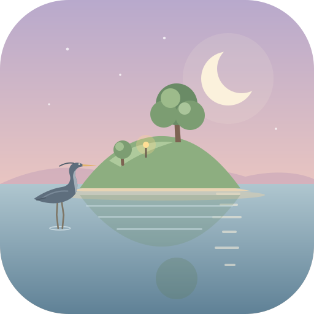

<h1 align="center">ebb</h1>

<em>a tended island</em>

A cozy idler and living diorama built on raw WebGPU. Shape a small island, plant seeds, and make room for creatures. They arrive and settle when the ecology suits them, and the island keeps growing while you are away. When you come back, it has moved on without you.

The look is soft and natural: physical light, sky and water, ground built from scanned materials, and a gentle palette applied last. Everything grows from seeded recipes, so it can all be tuned without code.

## Where it is

The M1 vertical slice, one small island with every pillar working in miniature, is built: every step from S1 to S8 is in, and the slice waits for its click-test as a whole. The full step list is in [docs/20-roadmap-and-vertical-slice.md](docs/20-roadmap-and-vertical-slice.md).

| | Step | What it gives you |
|---|---|---|
| Done | S1 to S3 | A seeded island to sculpt, smooth and paint (grass, sand, soil, rock) with undo and redo; a physical sky, sun, moon, shadows, seasons and weather; two palettes applied last |
| Done | G1 to G4 | Realistic ground from scanned materials: no visible tiling, wet ground in rain, natural rock |
| Done | S4 | Water: a shallow-water simulation coupled to sculpting, the tide, springs welling up from rock outcrops, streams, ponds and marshes, with reflections, caustics and foam. Ponds lie still, ruffled only by the wind and their inflow; the swell is the sea's |
| Done | S5 | Six plants that grow, spread and compete on their own ground: grass, rushes, reeds, water lilies, yellow flag iris and sea thrift, with a Plant tool. Grass stands tall and green by the water and cures to straw on the dry rise in late summer |
| Done | J1 to J2 | The field journal: a page and a field sketch for every living thing and every kind of ground, notes as things happen (new ones marked, and the ones you may have missed kept at the top), the Almanac, a web of what needs what, and a wash that shows where each thing lives |
| Done | S6 | Frogs: they find the island, arrive and settle (S6a), then move, call and react to you (S6b; by day they hide in the reeds and rushes, at dusk they come out to the edge), then come to trust you and take a name (S6c). Each frog now comes to know you, slowly and only ever forward: watching it quietly from close by earns trust, its card says how well it knows you in a word (Wary, Tolerant, Curious, Familiar), a trusting frog lets you come closer before it plops, and the journal notes when a frog's word moves up (S6c-1). The Feed tool tosses a pinch of insects on the bank; a frog nearby hops over and flicks them up once you give it room, which earns more trust (less if it ate recently), and the journal's Web links you to the frogs (S6c-2). A Curious frog can be given a name on its card, typed or suggested; the journal lists the frogs you named, a Familiar frog holds still while you look close, and named frogs are the last to leave (S6c-3). Midges dance over the reeds at dusk, and shelter from rain |
| Done | S7 | Saving, and the island moving on while you are away. Your island, its plants, frogs, springs, journal and view are kept on the device and come back on every load (S7a). Four real minutes away are one game hour (a quarter of watched time), up to 7 game days, reached after about 11 hours away, and what the journal wrote meanwhile waits under "You may have missed" (S7b). After 6 game hours or more away the island opens from cream, grows into what it became, rings the places that changed, brings its animals back, and shows the best five notes (S7c). An island backs up to a small file to carry to another device, earlier saves can be opened, and a damaged save comes back part by part from earlier copies with a calm note (S7d) |
| Done | S8 | The HUD, phones and the low tier. The buttons keep to the corners and the bottom edge: a clock dial at the top left draws the sun or moon on its arc, the season and the tide, and says it in a line when tapped; undo and redo sit at the bottom left; the buttons dim after 6 s untouched, H hides them, and on a phone a faint eye brings them back (S8a). Settings, from the sliders button in the top right corner: time speed, growing while away and the reveal on return; palette (now three, with Clear sight, a color-safe palette), text size up to 160 percent and calm motion; sound, kept for when it arrives; dimming; quality, switched with no reload; and saves (S8b). Phones run smoothly on the low tier (S8d-1): the picture softens a little instead of stuttering when the graphics card is busy and sharpens again when it calms (dynamic resolution), the game draws at 30 fps on a 120 Hz phone to stay cool, a phone that warms up eases off a step early, and if the lowest resolution is still too much the island steps down one quality tier once, with a calm note and Undo. Tuned on an iPhone 17 Pro Max (S8d-2): a smaller picture is kept only when it saves graphics time, so the phone stays sharp, and the low tier draws less grass, rushes, bloom and distant ripples. The phone check page runs full screen like the game, tests whether resolution matters, and offers a 2 minute run. On a phone held upright the tool card has a short upright size slider so more island shows; held sideways the tools become a column on the right edge with the card to its left, and undo and redo stand on the left edge; a left-handed setting mirrors both; tools/layout-check.html checks every phone size (S8c) |
| In progress | Shore | The shore zones itself by the tide as you shape it (docs/future/10): seaweed and kelp on rock in the tide band, black lichen in the splash zone above it, wave ripples in the wet sand and dark tidal mud on soil. Kelp blades come out at spring low tides. Each high tide leaves a strandline of dried litter and broken kelp at its reach, and a higher tide sweeps the older lines up. tools/shore-lab.html maps the zones as you shape and paint |
| In progress | Finds | Small shore lives to find by tapping (docs/future/11): beadlet anemones in rock pools (a credited low-poly model) that open under water and close to a dome at low tide or when you come close, periwinkles on the wrack (from a CC0 shell scan), lugworm casts drawn into the wet sand itself, laid fresh after each tide, a hermit crab that walks about its rock pool under water, young edible crabs in the wrack that run sideways when you come close, and shells washed up along each high tide's strandline, from common periwinkle shells to a very rare nautilus on the biggest tides, all kept on one Shells page. Where they live comes from how you shape the coast. Found ones gather in the journal's **Small lives** |
| In progress | Plants | Plants that read the ground (docs/future/10): each asks for its kind of ground (sand, rock or soil, and grass counts as soil), how steep, and how high above the sea, so reeds, lilies, iris, rushes and grass keep to earth and gentle banks, sea thrift to sand and rock low on the shore, and sea campion to rock above the thrift. A new island starts with grass, reeds and water lilies only; iris, rushes, sea thrift, marsh marigold and sea campion come by themselves over the first days, one seed landing where the ground suits it, and the journal notes each one and that you can plant it now. Marsh marigold has round, glossy leaves and golden cup flowers in early spring. tools/journal-review.html lays every plant's journal page side by side |
| In progress | Web | The journal's Web of what needs what, redrawn so it grows with the island: a trail of the last things you tapped, a card for one thing at a time with its ties as chips (Needs, Needed by, Shares a home with), and a shelf with a tab per kind (Ground, Plants, Small lives, Animals) holding a square tile for each. Every ground feature is in it, rock pools, stones, the strandline, wrack, kelp, lichen, rippled and wet sand and tidal mud among them, and every plant, find and animal; each kind wears a soft tint. Ties ink when you see them on the island; what you have not met is a pencil question mark that hints. Each journal page has a Ties strip that leads into the Web, and the Web opens on whatever the journal last showed. A new species or ground feature is one recipe entry. The **Living things** list stays tidy as it grows: each group (Plants, Animals, Small lives and Shells) folds shut, chips show all, found or not yet, or one place (Pond, Meadow, Shore), and it sorts by recently found, A to Z or place; your choices are kept on the device |

There are two islands to start from: the **Starter island** (one large spring-fed pond under a hill) and **Two ponds** (a low island with two spring-fed ponds and three rain-fed marshes). The **Island** button in **Settings > Saves** switches between them, and each keeps its own save. **Saves** also backs an island up to a file, opens one, steps back to an earlier save, or starts the island again. On previews and local builds, **Settings > Tests** pretends you were away and checks recovery. Test links (`?seed`, `?day`, `?frogs`, `?plants`) open throwaway islands that are never saved.

## What you can do in it

- **Sculpt, smooth and paint** the land; water always finds its way downhill. Sculpt's **Stone** mode sets a boulder where you tap.
- **Pour and drain water.** Place springs once they are unlocked (`?sandbox` unlocks them now).
- **Plant** reeds and water lilies from the start. Iris, rushes, sea thrift, marsh marigold and sea campion (which needs rock by the sea) come to the island by themselves, and once the journal has noted one you can plant it too. The tool says why when the ground won't do.
- **Tap anything** (a plant, the ground, the water) to name it, then open its page in the **field journal**. Pages fill in from what happens on the island, in words, never numbers. The journal's **Web** shows what needs what, one thing at a time.
- **Look closely along the shore** at low tide for finds: anemones in rock pools, periwinkles on the weed, lugworm casts on the sand. Each one you tap is kept in the journal.
- **Look:** switch palettes, and change how fast time flows.

## Running it

You need a WebGPU-capable browser: Chrome, Edge, Firefox on Windows, or Safari 26 and later.

- **Live:** https://mshomper.github.io/ebb/ (the `main` branch).
- **Branch previews:** https://mshomper.github.io/ebb/preview/ lists every other branch, each at `/ebb/preview/<branch>/`: newest first (or A to Z), with a search box, a "new" tag for the last day, and branches already merged into main folded away at the bottom.
- **On this PC:**
  1. Choose the branch in GitHub Desktop.
  2. Double-click `play.cmd` in the repo folder. It starts a small local server (nothing to install), opens the game in your browser, and uses the first free port from 8080 to 8099.
  3. Close its window to stop.

A small tag under the clock dial shows which build you are looking at, `local · <branch>` or `preview · <branch> · <commit>`; on the live site it is at the foot of Settings as `build <commit>`.

### Address switches

Add these to the address (for example `…/?island=two-ponds&day=8`) to test things quickly.

| Switch | What it does |
|---|---|
| `island=two-ponds` | Start on Two ponds instead of the Starter island |
| `seed=N` | Another seed for the same island recipe |
| `day=N` | Start a new world N game days in (14 a season; `day=15` is early summer) |
| `weather=clear`, `cloud`, `rain` or `mist` | Preview one kind of weather |
| `sandbox` | Unlock the spring tool now (normally a later gift), and offer every plant in the Plant tool before it has come |
| `plants=all` | Start a new island with every plant, not only grass, reeds and water lilies |
| `frogscale` | Frogs at true size around the pond, with a panel to compare sizes and close-up views |
| `tier=low`, `medium`, `high` or `ultra` | Force a quality tier |
| `debug` | Keep console errors and expose the game to the browser console, for tools and checks |
| `flora=0`, `ripplerain` | Hide the plants; ring the water with rain in any weather |

### Local test pages

Open these at `/tools/` while running locally. They are for checks that run on your own machine.

| Page | What it checks |
|---|---|
| `unit-tests.html` | Every unit test in one run: the core, terrain, water, growth, the journal, creatures and islands |
| `determinism.html` | The same seed builds the same island on every thread (`?island=` for another island) |
| `frame-timing.html` | The island live, with a graph of how long each drawing step takes on the graphics card |
| `phone-check.html` | The island on this device against its tier's budgets, with a 60 second run, a 15 minute warm run and Save result; open it on the phone from the preview link |
| `growth-lab.html` | 14 game days (one season) of growth on a copy of the island, with charts and a check that two runs end the same |
| `water-lab.html` | The live water's volume, wet area, flow and cost, with buttons that sculpt near the spring and pond |
| `finds-models.html` | The finds' models at true scale, side by side: the anemone open and shut, the crabs (the hermit crab walking), the shells; drag to turn them |
| `finds-sketches.html` | Every find's journal sketch in pencil, ink and wash, beside plant sketches to compare; the shapes are traced from the models by `tools/gen-sketch-outlines.mjs` |
| `shore-lab.html` | Shape and paint the coast and see the shore zones it makes (kelp, wrack, lichen, wet sand, mud), with a sea-level slider for each tide |
| `sky-lab.html` | The island at any hour and season, without moving the world clock |
| `palette-lab.html` | Tune a palette with a before and after divider, an eyedropper and sliders |
| `texture-lab.html`, `rock-lab.html` | Prepare the ground photo scans; compare rock tilings and scans |
| `sketch-lab.html` | Every journal field sketch at each stage: pencil, ink and wash |
| `journal-review.html` | Every plant's journal page side by side: sketch and icon, then each part of the page lined up across the plants, with empty parts and much longer or shorter wording flagged |
| `ecology-lab.html`, `frog-lab.html` | Frogs arriving over game days on two islands; frogs live at any hour, with the chorus, lily pads and presence checks |
| `creature-studio.html` | The frog on a stage with sliders for its shape, colors, eyes and idle motion; Save to repo writes only the numbers you moved into `recipes/species/frog.json` |
| `terrain-brush-bench.html` | Island building, brush strokes and settling, timed against their budgets |

## What's here

| Path | What it is |
|---|---|
| `index.html`, `play.cmd` | The game page, and the double-click launcher for this PC |
| `src/` | The game: `core/` (clock, seeded random numbers, events, store, workers), `world/` (terrain, water, growth, journal, creatures), `sim/` (the hourly tick), `render/` and `shaders/` (WebGPU passes and WGSL), `input/`, `ui/` |
| `recipes/` | Every tunable number: land shapes, flora, species, palettes, world settings and quality tiers |
| `tools/` | The local test pages above |
| `docs/` | 23 architecture docs, starting with [01 Vision and pillars](docs/01-vision-and-pillars.md); see the [docs index](docs/README.md) |
| `brand/`, `assets/` | The icon, favicons and identity review page; the ground's photo scans (CC0, credited in `assets/textures/CREDITS.md`); the finds' small models (credited in `assets/models/finds/CREDITS.md`) |

## Credits

- "Low-Poly Anemone" (https://skfb.ly/6X9T8) by Ben Lebreux, licensed under Creative Commons Attribution 4.0 (http://creativecommons.org/licenses/by/4.0/). Changed for ebb: textures baked to vertex colors, posed at rest, rescaled, and given a shut pose.
- "Crab 3d Model Free" (https://skfb.ly/pMCrp) by iRahulRajput, licensed under Creative Commons Attribution 4.0 (http://creativecommons.org/licenses/by/4.0/). Changed for ebb: texture baked to vertex colors, simplified, rescaled; drawn as a young edible crab.
- The hermit crab is a CC0 model, simplified, with its own walk.
- Shells, each licensed under Creative Commons Attribution 4.0 (http://creativecommons.org/licenses/by/4.0/) and simplified for ebb: "Turret Shell || Free Model" by CyberFox 3D Studio; "shell fossil 3D Scan" by Formwerk3D; "Murex Shell" by Loïc Norgeot; "Nautilus Shell" by RISD Nature Lab. Links in `assets/models/finds/CREDITS.md`.
- The periwinkle is a CC0 photo scan of a rough periwinkle (Littorina brevicula, ffish.asia), simplified to 900 triangles.
- Ground scans from Poly Haven and ambientCG (CC0); see `assets/textures/CREDITS.md`.
| `CLAUDE.md` | Working rules for Claude Code sessions on this repo |

## Pillars

1. **Shape**: sculpt land and water. Every action can be undone.
2. **Grow**: plants, moss and lichen grow by real rules.
3. **Welcome**: creatures are attracted, never bought.
4. **Tend**: refine the ecology to make them happy.
5. **Return**: the island advances while you're away.

## Tech

- Raw WebGPU and WGSL, no engine
- Plain JavaScript ES modules, no build step
- A deterministic, seeded simulation on an hourly tick, built so that offline catch-up (S7) replays the same world
- Desktop first; phones and tablets through WebGPU with quality tiers
- Hosted on GitHub Pages
