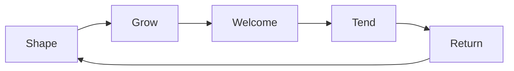

# 01 — Vision and pillars

> ebb is a small island you tend. You shape land and water, plant seeds, and leave room for creatures. They arrive, settle and thrive when the ecology suits them, and the island keeps growing whether you watch or not. When you come back, the island has moved on without you: moss on the stones, a sapling now a tree, frogs where the pond was bare. It is a game for flow and calm, not for winning. The look is soft and natural: real light, real water and real-looking ground, finished by a gentle palette.

## Locked decisions

- Name: **ebb**, lowercase wordmark, tagline "a tended island". Store listings and search always use "ebb: a tended island" (see `21-brand-identity.md`).
- Genre: cozy idler and living diorama, inspired by the feel of Tiny Glades.
- No fail states, no countdowns, no currency grind, no energy meters, no daily-login pressure.
- The world grows while the player is away and reveals an emerged state on return.
- One small island to start (about 64 m across); the world expands through milestones. Islands made from the first-evening update on start a little larger, about 72 m across, with a more varied coast; older islands keep their shape (docs/future/13, section 3.11). *(Changed October 22, 2026, docs/future/13.)*
- Human touches are limited: paths, stone walls, a small bridge, lanterns. The walker carries three made things: the canvas tent with its bedroll, the hand lantern and a fire steel. Everything else at camp is made from what the island grows. (docs/future/13, section 1.2) *(Changed October 22, 2026, docs/future/13.)*
- Creatures are the heart of the game. Making them happy is the core activity.
- Desktop and laptop only, in the browser, with mouse or trackpad and keyboard. A phone or tablet used by touch shows a gentle notice with a link to notarobot-eng.com/ebb instead of the game. *(Changed October 21, 2026: ebb is desktop and laptop only.)*
- Raw WebGPU, WGSL, plain JavaScript modules, GitHub Pages.

## How it works

### The feeling we are after

Picture a dusk scene: a soft lilac sky, a moon over a small green island, a heron standing in the shallows, a lantern glowing on the hill. Nothing is asking you to hurry. You nudge the shoreline to make a shallow bay, and the water flows into it. A few days later in game time, reeds have taken hold there and a heron has started fishing. That cycle, small action then slow living consequence, is the whole game.

### The five pillars

1. **Shape.** Sculpting land and water is tactile and forgiving. Every tool can be undone, nothing is permanent, and nothing can be ruined. Water always finds its way downhill, so shaping land is also shaping water.
2. **Grow.** Plants, moss and lichen grow by real rules (branching, spreading, competing for light and water). Growth is slow enough to feel earned and fast enough to notice within a session.
3. **Welcome.** Creatures are attracted, never bought. Each species has needs. When the island meets them, the creature visits, then settles, then raises young.
4. **Tend.** Most of the player's choices are about making the ecology better for the creatures already there: more cover, a quieter corner, a food plant nearby. Happiness shows in behavior (singing, nesting, play), not in meters.
5. **Return.** The island advances while you are away. Coming back is a small gift: a slow camera drift over what changed, and a few new notes in the field journal.

### What makes ebb different

- **Real systems, real surfaces.** The water is a simulation, the light is physical, the ground is built from scanned materials, the plants grow by algorithms drawn from biology. A gentle palette is applied last, so the style never fights the realism.
- **The tide.** The name is literal. A gentle tide rises and falls twice a game day, exposing flats and shallows. Some creatures only come at low tide; some plants only grow in the band between tides.
- **Creatures as the goal.** There is no score. Progress is the list of species that have made the island home, recorded in a field journal the player fills with their own photographs.
- **A designer's tool inside a game.** A tuning panel lets you reshape any species, plant or palette with sliders and save it as a recipe. Customization goes all the way down.
- **Fishing, always let go** (F17, October 31, 2026). A line the player makes, worms from the dig as bait, and fish that are sketched into the journal and let go, beside the keepsakes as a core hook. Living catches are always released, from the nets and from the line; a prize fish in an aquarium, once the player has a living space, is the one future exception.

### Non-goals

- No combat, predators hunting the player's creatures, disasters or anything that destroys progress.
- No crafting trees, resource counters or inventory management. Three things come close on purpose: nets (F12), a shelf of 16 keepsakes, and the walker's pack of a few pouches with a short path of handmade things. Nothing is spent toward a goal, nothing is shown as a number, and everything gathered comes from what the island grows. (docs/future/13, section 14) *(Changed October 21, 2026, to make room for keepsakes, `docs/future/12-keepsakes-and-nets.md`; changed October 22, 2026, docs/future/13, to add the pack.)* Nets are made and mended from what the island **grows** (rushes, driftwood, loose stones). A **shelf of 16** holds the keepsakes the player chooses: it is a choice of what is special, not storage, and there is nothing beyond it. The pack's pouches show fullness by drawing, never by count (docs/future/13, section 4.1).
- No multiplayer in v1. Sharing happens by exporting a world file or a photo.
- No large human settlements. A lantern is a highlight, not a city.
- No monetization design. ebb is a personal project.

## Data and interfaces

The vision has no code of its own. Every system doc carries these pillars forward:

| Pillar | Primary docs |
|---|---|
| Shape | `08-terrain-and-sculpt.md`, `07-water-and-tide.md`, `09-structures.md` |
| Grow | `10-growth-and-seasons.md`, `14-asset-recipes-and-tuning-panel.md` |
| Welcome | `11-creatures-and-ecology.md`, `12-creature-roadmap.md` |
| Tend | `11-creatures-and-ecology.md`, `13-progression-and-expansion.md` |
| Return | `02-core-loop-and-idle-model.md`, `18-saves-and-persistence.md` |
| Look | `04-render-pipeline.md`, `05-look-and-palette.md`, `06-sky-and-lighting.md`, `22-ground-detail.md` |

## Algorithms and shaders

None here. The guiding technical principle for every system: simulate the real behavior simply, keep it deterministic and seeded, and put every number that shapes the feel into a recipe the tuning panel can reach.

## Tuning knobs

The player-facing knobs are time flow (pause, 1x, 2x, 4x), palette, and the tuning panel. See `16-customization-and-photo-mode.md`.

## Performance budget

60 fps at 1440p on Matt's desktop (RTX 4070 Ti Super), and 60 fps on a laptop with integrated graphics at the medium tier, which is the design target. See `19-performance-and-quality-tiers.md`.

## Acceptance checks

These are the tests of the whole game, not one feature:

- Leave the game open with your hands off for five minutes. Something visible should change (light, tide, a plant, a creature moving) and nothing should demand attention.
- Close the game for a real day and reopen it. The island should look clearly further along, and the reveal should feel like a small gift, not a report.
- Undo anything. No action should feel risky.
- Take a screenshot at any moment. It should look like it belongs in the store page.

## Open questions

- Should there eventually be a gentle ending or "completion" moment, or does the island simply keep going?
- Would you ever want to visit someone else's island from a shared world file, or only view their photos?

## Depends on / feeds into

Feeds every other doc. Next: `02-core-loop-and-idle-model.md` and `20-roadmap-and-vertical-slice.md`.
