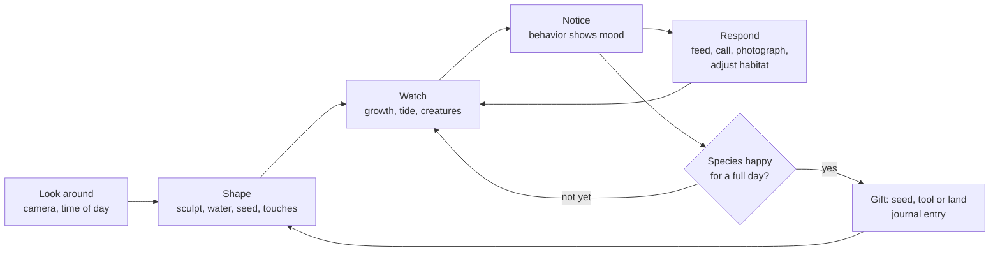
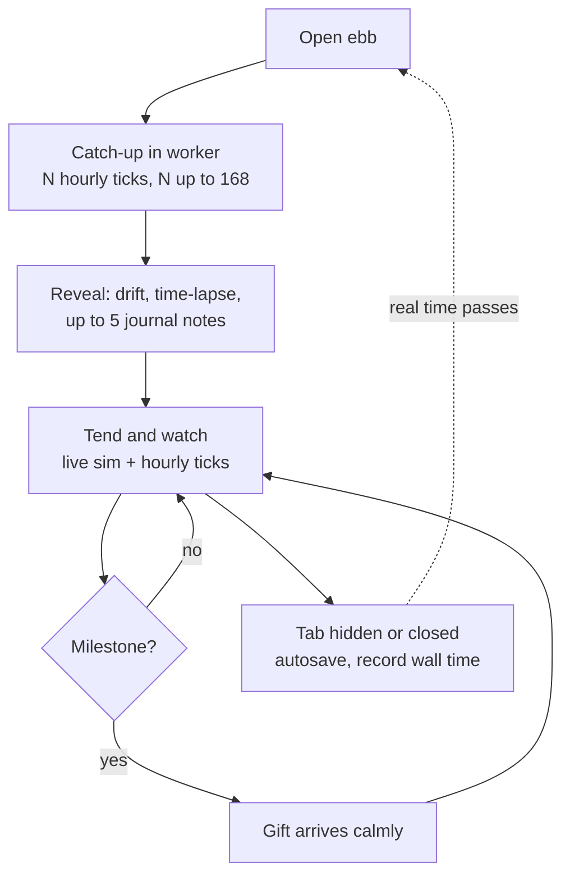
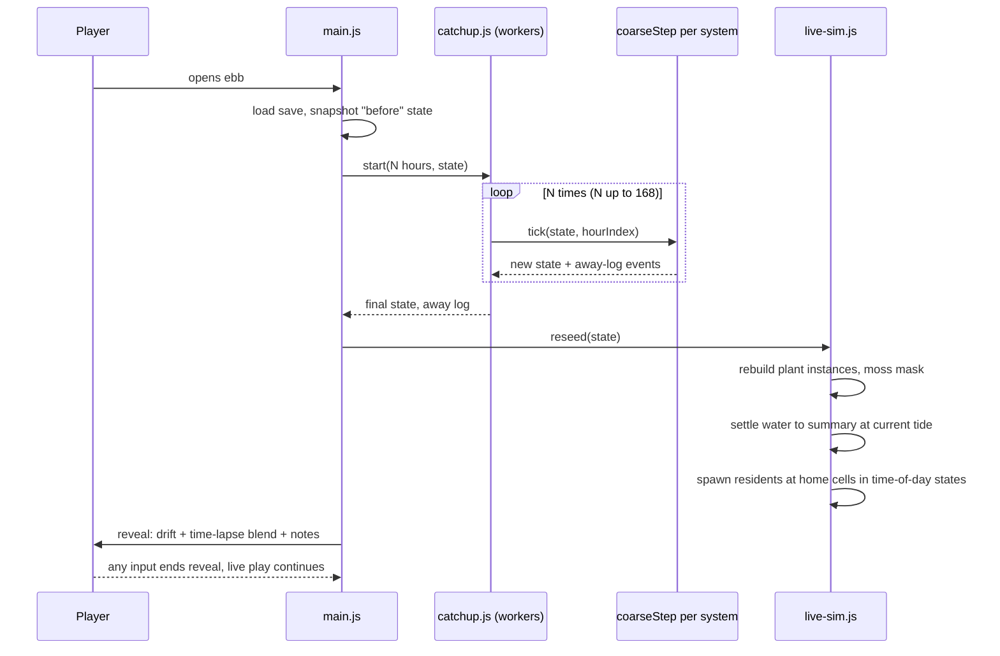

# 02 — Core loop and idle model

> ebb is a place you tend, not a game you beat. In each session you shape a little land and water, watch what grows and who arrives, and adjust things until the creatures settle in. When you leave, the island keeps living at a slow, believable pace, and when you come back the camera drifts over what changed while a few journal notes appear. This doc defines the loop, the world clock, and the two-speed simulation behind that feeling: a rich visual simulation while you watch, and a cheap, deterministic ecology model that runs both while you play and while you are away, so the island you return to is the same island you would have seen had you stayed.

## Locked decisions

- **1 game day = 24 real minutes at 1x**, so 1 game hour = 1 real minute. Time flow setting: pause, 1x, 2x, 4x.
- **Tide**: semi-diurnal, period 12 game hours, amplitude about 0.6 m on the starter island. Analytic function of world time, never simulated state.
- **Season** = 14 game days; **year** = 4 seasons = 56 game days (22.4 real hours at 1x). (Matt, October 19, 2026, F01; was 7 and 28.)
- **One ecology, two presentations.** The ecology tick (plants, moss, moisture, creatures' presence and mood) runs at fixed 1-game-hour steps in both live play and catch-up. The live sim adds only visuals on top (water flow, particles, animation, growth interpolation between ticks). Catch-up is the same tick run N times with nothing drawn.
- **Catch-up cap: 7 game days (168 ticks)** per return (F01; was 14 days, 336 ticks). Time beyond the cap is dropped; the world clock advances only by what was simulated.
- **Away rate is a quarter of watched time:** 4 real minutes away earn 1 game hour (`recipes/world/save.json` `catchUp.awayRate = 0.25`; F01, was 1x). The 7-day cap is reached after about 11.2 real hours away. If time flow was paused when the player left, the world stays paused. A "keep growing while away" setting (default on) can turn idle growth off.
- **Two clocks.** World time (pausable, scalable) drives sun, tide, seasons and ecology. Animation time always runs at real speed and drives wind ripples, idle breathing and creature motion, so 4x never looks frantic and pause never looks frozen.
- **Determinism**: every tick draws randomness from a counter-based stream keyed by (world seed, system id, hour index), so tick 1,207 produces the same result whether it ran live or in catch-up.
- The return is a calm **reveal** (camera drift, time-lapse blend, at most 5 journal notes), never a report screen. Any input ends it instantly.

## How it works

### The moment-to-moment loop

Plain language: look, touch, watch, notice, respond. The player sculpts a bank, plants reeds along the wet edge, lets the tide come in, and watches. Something small happens (a frog appears on a stone at dusk). The player notices it is restless, checks the journal hint, thickens the reeds or opens a quiet corner, and watches it settle. Nothing asks for attention; the island simply rewards it.



### The session loop

A session is: arrive (reveal) → tend → watch → maybe a gift → leave. A typical sitting is 15 to 45 real minutes, about one to two game days. Gifts and expansion are covered in `13-progression-and-expansion.md`; the creature side of "happy" in `11-creatures-and-ecology.md`.



### World clock

`src/core/clock.js` owns world time as game seconds in a float64 (`worldT`). At 1x, `worldT` advances 60 game seconds per real second. Derived values: hour of day, day index, season index (0 spring, 1 summer, 2 autumn, 3 winter), year, and a smooth `seasonPhase` in 0..1 for blending foliage color and day length. The tide (`src/world/tide.js`) is `h(t) = h0 + A(season) · cos(2π t / T + φ)` with T = 12 game hours; A drifts ±15% with the 7-day moon cycle (twice per season) as a gentle spring/neap rhythm so low tides vary. Sun and moon positions come from the same clock (`06-sky-and-lighting.md`).

The clock emits integer-boundary events on `src/core/events.js`: `clock:hour` and `clock:day`. The hourly tick runs on `clock:hour`. Tide and season changes (`tide:turned`, `season:changed`) are returned by those systems' coarse steps and emitted by the tick runner, so catch-up can log them (doc 03). The reveal emits `reveal:started`, `reveal:note-shown` and `reveal:ended` (see `15-camera-input-and-ui.md` and `17-audio.md`).

### Two-speed simulation

| | Live (watched) | Coarse (catch-up) |
|---|---|---|
| Where | `src/sim/live-sim.js`, GPU + workers | `src/sim/catchup.js`, worker pool split by chunk |
| Ecology tick | every game hour (1 real min at 1x) | the same tick, back to back |
| Water | GPU shallow-water flow, foam, optics | summary water map + analytic tide |
| Plants | interpolate size between ticks, wind | tick only |
| Creatures | bodies, IK, springs, boids, behaviors | residents' presence, mood, arrivals, departures |
| Particles, audio | yes | no |

The key rule: the ecology tick never reads anything only the live sim knows. Water enters ecology through the **water summary** (per-cell standing depth at mean tide plus flow class: still, slow, running), which `src/world/water/` rebuilds only when the player edits water or terrain. Visual flow details stay visual. This is what keeps live and catch-up results identical.

### What the coarse ecology model tracks

On a 1 m ecology grid (96 x 96 cells on the starter island (3 x 3 chunks of 32 m), sparse chunks as land is added):

- **Per cell**: ground height and slope (read from terrain), water summary, moisture, daily light exposure, soil fertility, cover per small-plant species (biomass 0..1 and stage), moss and lichen cover, leaf litter, static disturbance (paths, walls, lanterns).
- **Per large plant** (shrubs, trees, reeds clumps as individuals): species, position, seed, age, size, stage.
- **Creatures**: resident individuals and swarms (species, home cell, mood, trust, name, age), species happiness history, scouts in transit.
- **World**: clock, weather record per game day (seeded from world seed + day index, see `src/world/weather.js`), season, milestone queue, away log.

Not tracked: water velocities, foam, particles, creature poses or exact positions, wind state. These regenerate on re-seed.

### Catch-up and re-seed

On load (or when the tab becomes visible after being hidden), `catchup.js` computes `elapsedReal = now − lastSavedWallTime`, converts to game hours at the away rate, clamps to 168, and runs that many ticks on the worker pool (`catchup` lane, world split by chunk inside each hour, cross-chunk effects merged in entity-id order, per `03-tech-stack-and-module-map.md`). Each tick appends notable events to the away log with a salience score. After the last tick the full sim re-seeds from the coarse state:



Re-seed details: plant instance buffers are regenerated from plant state; the moss reaction-diffusion texture is re-seeded using coverage fraction as a mask (`10-growth-and-seasons.md`); the water sim is initialized from the summary at the current tide height and runs a short silent settle (about 200 steps) behind the fade-in; creatures spawn near their home cells already in the behavior that fits the hour (frogs at the water's edge calling at dusk, sleeping at noon).

### The "while you were away" reveal

- Under 6 game hours of catch-up (about 24 real minutes away): no reveal, just a soft time-lapse of growth over 2 seconds.
- 6 game hours or more: the screen opens from UI cream (#F4EEE4) to the scene. The camera starts high and drifts down along a slow spline that passes the 2 or 3 highest-salience event locations, over 8 to 12 seconds. Plants, moss and water level blend from the "before" snapshot to the new state as a time-lapse during the drift. Creatures fade in after the blend so nobody pops.
- Up to 5 journal notes (handwritten style, legible size) appear one at a time in a corner, each 3 seconds: "The frogs have a chorus now", "Autumn turned on day 29", "Someone is nesting under the east stones". Notes are also saved into the journal (`ui/journal.js`).
- Salience ranking: first arrival of a species > named creature event > species became happy > season change > plant reached maturity > spread amounts.

## Data and interfaces

```js
// src/core/clock.js
export const GAME_SECONDS_PER_REAL_SECOND = 60;   // at 1x
/** @typedef {{worldT:number, flow:0|1|2|4, animT:number}} ClockState */
export function advance(realDt) {}               // moves worldT and animT
export function hourIndex() {}                   // floor(worldT / 3600)
export function dayFraction() {}                 // 0..1
export function season() {}                      // {index, phase, year, day}

// The hourly tick = every world system's coarse.js coarseStep, in fixed order:
// tide -> weather -> seasons -> water summary -> growth -> ecology -> creatures -> expansion
// src/world/ecology/coarse.js  (pure, deterministic, worker-safe)
/** @returns {{state: EcologyState, events: AwayEvent[]}} */
export function coarseStep(state, hourIndex, env) {}   // env carries world seed, recipes, det math
// live-sim.js and catchup.js both run this same ordered list

// src/sim/catchup.js
export async function catchUp(state, lastWallTime, nowWallTime, opts) {}
// opts: {awayRate:0.25, capHours:168, keepGrowing:true}

/** @typedef {{hour:number, kind:string, cell:[number,number], salience:number, text:string}} AwayEvent */
```

Save stores: world seed, `worldT`, last wall time, ecology state, away log (last 64 events). See `18-saves-and-persistence.md`.

## Algorithms and shaders

- Counter-based RNG (SplitMix64 or PCG hash of seed, system id, hour index) in `src/core/rng.js`; no shared mutable RNG across systems. Coarse code uses the `det` math helpers from `rng.js` (no `Math.sin`, `Math.exp`, `Math.pow`), so the tide cosine inside the tick is `det.cos`.
- Fixed-step accumulator for the tick (Glenn Fiedler, "Fix Your Timestep"); at 4x the tick fires every 15 real seconds.
- Camera reveal path: Catmull-Rom spline through event points, eased with smootherstep, height falloff from 40 m to normal orbit distance.
- Time-lapse blend: per-instance lerp of scale and color from snapshot to new state, staggered by a hash of instance id so growth ripples rather than snaps.

## Tuning knobs

- Settings: time flow (pause, 1x, 2x, 4x), keep growing while away, reveal on/off, reveal length (short, normal).
- Tuning panel: catch-up cap (dev only), tide amplitude and spring/neap swing, reveal threshold hours, notes count, "simulate N hours now" button for testing.

## Performance budget

- One hourly tick (all systems) on the starter island: about 3 ms in a worker on desktop, under 8 ms on a laptop with integrated graphics. Full 168-tick catch-up: under 1 s desktop, under 3 s laptop (the reveal's fade covers it).
- Fully expanded world (see `13-progression-and-expansion.md`): tick under 8 ms desktop, catch-up under 3 s.
- Live hourly tick never blocks a frame: it runs in a worker and the result is swapped in on the next frame.
- Measured in S7b (Matt's desktop, Starter island, spring day 4): a median of 3.7 ms per hour and 12 to 20 ms at worst, about 1.3 s for 336 hours plus about 0.2 s for the journal's look (measured under the old 336-hour cap; the 168-hour cap halves it to about 0.65 s). That was over the 1 s goal; it runs in a worker, so the page stays smooth and the catching-up screen covers it. If laptops run well over 3 s, the next step is to split the hour across workers by chunk.
- `tools/catchup-bench.html`: checks watched against away (island and journal), in pieces against at once, worker against page, and save and load, on either island, and draws the cost of every one of 168 hours. Matt compares its numbers on desktop and laptop. `tools/determinism.html` checks the landform.
- As built (S7c), the reveal, `src/ui/reveal.js`:
  - The camera stays where you left it (Matt, S7 plan), so rings mark the places that changed in place of the drift.
  - The cream screen fades into the scene while every plant and cover grows from before to after over about 8 s, rippling by hash.
  - Animals are hidden meanwhile, then all come back within 1.5 s however many there are (Matt: one at a time drags on a big pond). At most 3 plops or ripples sound on the whole island, from those nearest the middle of the view.
  - Up to 5 notes show one at a time, 4 s each, ranked by note kind (journal.json `reveal.rank`). The ring of the note showing breathes, with an edge arrow when it is off screen.
  - It is blind to species: kinds are shared, plants and covers come from the growth state, and each live animal system offers the same return hooks, its style in its species recipe (`reveal`).
  - Replaying the last reveal from the journal waits for M2 (Matt).
- As built (S7b): world time holds while catch-up runs, then skips on by the hours run with no hour events. The water is re-seeded at the new tide afterwards. A hidden tab earns its hidden time at the away rate (a quarter, since F01) whatever the time flow, and short spells add up in the carried minutes.

## Acceptance checks

- At 1x, a full day/night cycle takes 24 minutes; at 4x, 6 minutes; pause stops sun and tide while water ripples and frogs still breathe.
- Watch two tides in one game day; low tide exposes the flats and shallows visibly.
- Close the tab for 40 real minutes, reopen: a short reveal shows about 10 game hours of change.
- Close for a night (about 11 hours or more), reopen: 7 game days passed (the cap, half a season), the reveal visits the frog pond, and notes mention it.
- Run the bench page twice with the same save: identical checksums; compare a live 60-minute run to a 60-tick catch-up: identical ecology checksum.

## Open questions

- ~~Does an overnight absence turning two seasons feel right, or should time away run slower than time watched?~~ Answered (F01): time away runs at a quarter of watched time, and a night away gives at most 7 game days.
- Should the player be able to replay the last reveal from the journal?

## Depends on / feeds into

Depends on `03-tech-stack-and-module-map.md`, `07-water-and-tide.md`, `10-growth-and-seasons.md`, `11-creatures-and-ecology.md`. Feeds `13-progression-and-expansion.md`, `15-camera-input-and-ui.md`, `18-saves-and-persistence.md`, `19-performance-and-quality-tiers.md`, `20-roadmap-and-vertical-slice.md`.
