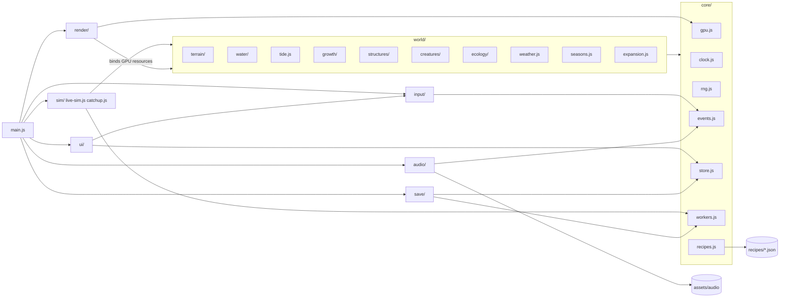

# 03 — Tech Stack and Module Map

> ebb is a plain web page: raw WebGPU for all graphics and heavy simulation, plain JavaScript modules for everything else, no engine and no build step. This doc is the map of the codebase: which folder owns which part of the world, how the parts talk to each other (an event bus and one shared store), how the GPU is set up, how CPU work is spread across all cores, how the game is deployed to GitHub Pages, and the rules Claude Code follows when writing code. Keeping the code this plain is what lets Matt open any file, read it, and tune the island without a toolchain in the way.

## Locked decisions

- Raw WebGPU + WGSL. No engine. Libraries allowed: `wgpu-matrix` (math), a small glTF loader later (see `14-asset-recipes-and-tuning-panel.md`). Libraries and fonts are vendored under `src/vendor/` with their license files (no CDN needed at runtime). Audio is the Web Audio API directly.
- Plain JavaScript ES modules with JSDoc types and `// @ts-check` at the top of every file. No bundler, no transpiler, nothing required to run except a static file server.
- Deployed from the `main` branch root of `github.com/mshomper/ebb` to GitHub Pages. All URLs relative (no leading slash) so the `/ebb/` subpath works.
- Units are meters, Y-up, right-handed. Mean sea level is `y = 0`.
- All randomness flows from one world seed through `core/rng.js`. `Math.random()` and `Date.now()` are banned inside simulation code.
- **One hourly tick for live play and catch-up.** Every world system that changes over time has a pure `coarse.js` exporting `coarseStep(state, hourIndex, env)`. They run in a fixed order: **tide, weather, seasons, water summary, growth, ecology, creatures, expansion** (`02-core-loop-and-idle-model.md`). Terrain and structures have no slot of their own: terrain only changes on player edits, and structure weathering runs inside the growth step.
- Coarse code never calls `Math.exp`, `Math.sin`, `Math.pow` or other transcendental functions (their last bits differ between browsers). It uses `+ - * /`, `Math.sqrt` (exactly rounded by spec) and the deterministic helpers exported by `core/rng.js` as `det`.
- **Two times.** World time (`worldT`) drives simulation and saves. **Display time** drives what the player sees and hears (sky, foliage color and leaf cover, tide visuals, ambience) and equals world time except during previews and photo mode (`16-customization-and-photo-mode.md`). Renderers read display time; simulation reads world time only.
- Workers exchange data by transferring `ArrayBuffer`s. No `SharedArrayBuffer` (GitHub Pages cannot send the cross-origin isolation headers it needs).
- Additions beyond the brief's map: `src/core/recipes.js` (recipe loader, validator, generator registry), `recipes/index.json` (a static host cannot list a folder), `recipes/land/` (land pieces, doc 13), `recipes/world/` (global tuning: `terrain.json`, `structures.json`, `growth.json`, `water.json`, `sky.json`), `recipes/quality-tiers.json` (doc 19), `recipes/schemas/` (slider ranges per recipe type, doc 14), `src/vendor/` (libraries and fonts), `assets/audio/` (CC0 sounds, doc 17), `assets/textures/` (CC0 ground scans, doc 22).

## How it works

In plain words: `main.js` wakes up, checks that the browser has WebGPU, picks a quality tier, loads the `.ebb` save, runs the catch-up model if the player was away, then starts the frame loop. Every frame the clock advances, input becomes actions, each world system updates, the GPU work is recorded and submitted, and the audio follows. Once per game hour (one real minute at 1x) the shared hourly tick runs.

World systems never draw and never touch the page. Renderers never change the world. The UI only reads the store and sends actions. That one-way flow keeps the code easy to reason about.

### Folder map

```
index.html
src/
  main.js                 boot, feature detect, quality tier pick, frame loop
  core/   gpu.js clock.js rng.js events.js store.js workers.js recipes.js
  world/  terrain/ water/ tide.js growth/ structures/ creatures/ ecology/
          weather.js seasons.js expansion.js
  sim/    live-sim.js tick.js hour.js catchup.js away.js
  render/ frame-graph.js camera.js quality.js passes/ (shadow, depth-prepass, ao, opaque,
          foliage, creatures, water, sky, particles, post/)
  shaders/ *.wgsl  (common.wgsl, lib-*.wgsl, one concern per file)
  input/  actions.js desktop.js
  ui/     hud.js tools.js journal.js tuning-panel.js settings.js desktop-only.js icons/
  audio/  mixer.js ambience.js voices.js
  save/   autosave.js world-file.js migrate.js sections.js idb.js prefs.js crc32.js recover.js backup.js
  vendor/ wgpu-matrix/ fonts/ (Nunito, Fraunces woff2) gltf/ (later)
recipes/  index.json quality-tiers.json species/ flora/ palettes/ land/ world/ schemas/
assets/   audio/ (beds/ oneshots/ tools/ CREDITS.md)
          textures/ (ground/<material>/<size>/ CREDITS.md, CC0 scans, doc 22)
brand/    ebb-icon.svg ebb-favicon.svg favicon.ico icon-*.png apple-touch-icon.png
docs/     architecture docs
tools/    local test and benchmark pages
```

### Module dependencies



Import rules (enforced in review):

| Module | May import | Must not import |
|---|---|---|
| `core/*` | other `core/*`, `src/vendor/*` | anything else |
| `world/*` | `core/*`, sibling world modules' public `index.js` only | `render/`, `ui/`, `input/`, `audio/` |
| `world/*/coarse.js`, `world/*.js` coarse parts | `core/rng.js`, pure parts of `core/clock.js`, other `coarse.js` files | GPU, DOM, events, store |
| `render/*` | `core/*`, world GPU-resource getters | `store.update`, `ui/` |
| `ui/*`, `input/*` | `core/events.js`, `core/store.js`, `input/actions.js` | world internals |

### Frame loop

```
requestAnimationFrame
  clock.advance(realDt)                   -> worldT, animT, displayT; hour crossings
  input: desktop.js -> actions.js (commands, undo stack)
  if an hour boundary was crossed: live-sim.hourlyTick()   -> the ordered coarseSteps
  live-sim.update(frame)                  -> per-frame tick() for each system
  encoder = device.createCommandEncoder()
  live-sim.encode(encoder, frame)         -> each system's compute passes
  frame-graph.render(encoder, frame)      -> shadow, depth-prepass, opaque, foliage, water, sky, particles, post
  device.queue.submit([encoder.finish()])
  events.flushDeferred()
  audio mixer update (reads displayT)
```

Time: 1 game day = 24 real minutes at 1x, so 1 real minute = 1 game hour while watched; time away earns a quarter of that (4 real minutes = 1 game hour, doc 02). A season is 14 game days. `clock.js` owns the time-flow setting (pause, 1x, 2x, 4x) and is the only source of time. `animT` keeps running while the world is paused, so leaves still sway.

## Data and interfaces

### Module ownership

| Path | Owns | Key exports |
|---|---|---|
| `src/main.js` | boot, feature detection, tier pick, frame loop | none (entry) |
| `core/gpu.js` | adapter, device, canvas context, shader loading, device-lost recovery | `initGpu()`, `loadShader(name)`, `makeBuffer()`, `makeTexture()`, `onDeviceLost(fn)` |
| `core/clock.js` | world time, animation time, display time, time flow | `advance(realDt)`, `hourIndex()`, `dayFraction()`, `season()`, `display()`, `setFlow()` (doc 02) |
| `core/rng.js` | seeded streams, counter-based hashing, deterministic math | `subSeed(world, 'growth')`, `hash32(...ints)`, `stream(seed, ...keys)`, `det.exp/log/sin/cos/pow` |
| `core/events.js` | event bus | `on`, `off`, `emit`, `emitDeferred`, `flushDeferred` |
| `core/store.js` | the live world state and device prefs | `get(slice)`, `update(slice, fn)`, `subscribe(slice, fn)` |
| `core/workers.js` | worker pool and worker entry | `run(job, args, {transfer, lane, key})` |
| `core/recipes.js` | recipe manifest, validation, generator registry | `loadRecipe(id)`, `registerGenerator(g)`, `validate(r)` (doc 14) |
| `world/terrain/` | heightfield, materials, ground state, sculpt | doc 08 |
| `world/water/`, `world/tide.js` | visual-only live water (0.5 m grid per 32 m chunk); deterministic 1 m water summary rebuilt in a worker; tide as a pure function of time (moon cycle 7 game days, two per season) | doc 07 |
| `world/water-world.js` | assembles the live water world for the app: water, foam, ripples, the wet-ground map and interim moss, in tick order, plus spring bookkeeping (undo comes in as an option, so it never imports `input/`) | docs 07, 08 |
| `world/growth/`, `seasons.js`, `weather.js` | flora, moss and lichen, seasons, weather | doc 10 |
| `world/structures/` | paths, walls, bridge, lanterns | doc 09 |
| `world/ecology/`, `world/creatures/` | 1 m ecology grid, habitat, creatures | doc 11 |
| `world/expansion.js` | land pieces, milestones, chunk unlocks | doc 13 |
| `sim/live-sim.js` | system registry, hourly tick order, per-frame update | `addSystem`, `hourlyTick`, `update`, `encode` |
| `sim/catchup.js` | away-time catch-up in a worker, a day per job (S7b) | `awayHours(p)`, `catchUp(input)`, `catchUpJob(input)` (doc 02) |
| `sim/hour.js` | one game hour: the tick, then the journal's look | `hourStep(state, journal, hour, env, jc)` |
| `sim/away.js` | when the game catches up (load, hidden tab, Pretend I was away) | `mountAway({ app, jr })` |
| `ui/reveal.js` | the reveal on return (S7c) | `mountReveal({ app, words })`; `world/journal/reveal-plan.js` `planReveal(p)`; `world/creatures/reveal-return.js` `createReturn(growS)` |
| `render/` | frame graph, camera, passes (incl. `passes/ao.js`, `passes/creatures.js`), LUT bake (32³, 0.6 s crossfade) | docs 04, 05 |
| `render/quality.js` | tier pick (`high`, `medium`, `low`) from `recipes/quality-tiers.json`, live tier changes | `pickTier()`, `tier()`, `setTier()` (doc 19) |
| `input/`, `ui/` | actions, gestures, HUD, journal, tuning panel, settings | docs 15, 16, 14 |
| `audio/` | mixer, ambience, voices | doc 17 |
| `save/` | autosave, `.ebb` world file, migrations | doc 18 |
| `src/vendor/` | third-party code and fonts with licenses | `wgpu-matrix`, Nunito, Fraunces, later a glTF loader |

### System contract

Every world system's `index.js` exports one object of this shape:

```js
/** @typedef {Object} System
 * @property {string} id                                   e.g. 'terrain'
 * @property {(ctx: Ctx) => Promise<void>} init            allocate GPU resources, subscribe to events
 * @property {(f: FrameInfo) => void} [tick]               per-frame CPU work (visual only)
 * @property {(enc: GPUCommandEncoder, f: FrameInfo) => void} [encode]  GPU compute
 * @property {(state: object, hour: number) => void} [afterHour]  live-only follow-up after the hourly tick
 * @property {(state: object) => void} [reseed]            rebuild live state from coarse state
 * @property {() => void} dispose
 */
// FrameInfo: {dt, worldT, animT, displayT, tier}
```

`coarse.js` exports `coarseStep(state, hourIndex, env) -> {state, events}` where `env` carries the world seed, sub-seeds, loaded recipes and `det` math. `live-sim.hourlyTick()` and `catchup.js` call exactly the same list in the same order.

### Event bus

Synchronous `emit` for things that must happen now (an undo), `emitDeferred` for everything else (flushed once at end of frame). World events are `domain:past-tense`. Names as defined by their owning docs:

| Domain | Events | Owner |
|---|---|---|
| clock, seasons, tide, weather | `clock:hour`, `clock:day`, `season:changed`, `tide:turned`, `weather:changed` | 02, 07, 10 |
| water | `water:summary-updated {chunks}`, `water:spring-added`, `water:spring-removed` | 07 |
| terrain | `terrain:edited {rect}`, `terrain:stroke-ended {rect}`, `terrain:grid-updated {chunks}` | 08 |
| structures | `structure:placed`, `structure:removed`, `structure:affordances-changed` | 09 |
| growth | `growth:planted`, `growth:stage-reached {plantId, stage}`, `growth:seed-dropped`, `growth:spread` | 10 |
| creatures | `creature:arrived`, `creature:settled`, `creature:left`, `creature:named`, `species:happy`, `species:moved-on` | 11 |
| progression | `progress:gifted`, `progress:milestone-reached`, `land:queued`, `land:rise-started`, `land:joined`, `expansion:unlocked` | 13 |
| journal | `journal:photographed`, `journal:page-updated`, `journal:year-completed` | 11, 13, 16 |
| reveal | `reveal:started`, `reveal:note-shown`, `reveal:ended` | 02 |
| input and UI | `tool:selected`, `tool:unlocked`, `history:undone`, `camera:follow-started`, `camera:follow-ended`, `ui:panel-opened`, `ui:panel-closed`, `note:posted` | 15 |
| look and photo | `palette:changed`, `preview:started`, `preview:ended`, `photo:entered`, `photo:exited` | 05, 16 |
| saves | `save:written`, `save:restored`, `save:failed`, `slot:locked` | 18 |
| sky | `sky:sun-crossed {event: dawn, sunrise, sunset, dusk}` | 06 |
| render | `render:resized`, `render:timings`, `palette:baked` | 04, 05 |
| recipes and system | `recipe:changed {id}`, `quality:changed`, `gpu:lost`, `gpu:restored` | 14, 19 |

Every event name is past tense; there are no present-tense aliases. Events raised inside `coarseStep` are returned in its `events` array, not emitted, so catch-up can log them to the away log; the live sim emits the same list after each hourly tick.

### Store

One plain object, in slices that mirror the `.ebb` sections (doc 18): `meta` (seed, sub-seeds, `worldT`, time flow, weather leaning, keep-growing flag, and the other header fields in doc 18), `water`, `structures`, `creatures`, `progression`, `journal`, `awayLog`, and `chunks` keyed `cx,cz` (one per open 32 m chunk, holding that chunk's terrain delta, flora and ecology; saved as sections named `chunk:<cx>,<cz>`). A separate `settings` slice holds device settings (palette, text size, motion, quality, audio); it is saved per device, never in the world file. Large data lives as typed arrays. If it is not in the store, it is rebuilt on load. GPU textures are working copies kept in step through dirty flags.

### GPU setup and feature detection

```js
if (!('gpu' in navigator)) return showNoWebGPU('missing');
const adapter = await navigator.gpu.requestAdapter({ powerPreference: 'high-performance' });
if (!adapter) return showNoWebGPU('no-adapter');
const want = ['float32-filterable', 'shader-f16', 'timestamp-query', 'rg11b10ufloat-renderable'];
const device = await adapter.requestDevice({
  requiredFeatures: want.filter(f => adapter.features.has(f)),
  requiredLimits: { maxStorageBuffersPerShaderStage: 8 } // stay at baseline so integrated laptop GPUs work
});
```

Every optional feature has a fallback: no `float32-filterable` means heightfield sampling does manual bilinear in WGSL; no `timestamp-query` hides the GPU timing overlay; no `shader-f16` uses f32. `render/quality.js` picks the tier (`high`, `medium`, `low`, numbers in `recipes/quality-tiers.json`, doc 19) from adapter info and limits, with medium (laptops, integrated graphics) as the floor; low is only an emergency fallback in the dynamic-resolution chain. It can be changed in settings.

Before any of this, `src/ui/desktop-only.js` checks the pointer. ebb is desktop and laptop only (changed October 21, 2026): a device whose only pointer is coarse (a phone or tablet used by touch) gets a calm card saying ebb is made for a desktop or laptop, with a link to notarobot-eng.com/ebb, and the game does not load. A tablet with a trackpad or mouse passes.

When WebGPU is missing, a calm full-page card replaces the canvas: the drawn ebb icon, UI cream text on the night background, 18 px body text:

> ebb needs WebGPU, a graphics feature in modern browsers. It runs in current Chrome and Edge on Windows and Mac, Firefox on Windows, and Safari 26 on Mac.

The `no-adapter` case adds "Your browser has WebGPU but could not use your graphics card. Check that hardware acceleration is turned on." Device loss later shows a small note ("Rebuilding your island") and rebuilds all GPU resources from the store.

### Shaders

WGSL files live flat in `src/shaders/`, one concern per file. Shared structs (frame uniforms, terrain cell, instance layouts) live in `common.wgsl`; shared functions in files prefixed `lib-` (`lib-hash.wgsl`, `lib-noise.wgsl`, `lib-terrain.wgsl`, `lib-color.wgsl`). `loadShader(name)` fetches the file, expands lines of the form `// #include common` once each, caches the result and logs compile messages with file and line.

### Workers

`core/workers.js` is both the pool (on the main thread) and the worker entry (loaded with `new Worker(url, { type: 'module' })`). A job names a module path and an exported function; the worker imports it dynamically, so jobs live next to the system that owns them (for example `world/growth/gen-space-colonization.js`).

- Pool size: `clamp(hardwareConcurrency - 2, 1, 14)`; the `low` tier caps at 4. Matt's 7700X gets 14.
- Lanes: `interactive` (tuning panel previews, wall generation after a stroke), `background` (tree skeletons, meshes, save encoding), `catchup` (every hourly tick, live or during catch-up, plus the water summary rebuild). Interactive jumps the queue; a newer job with the same `key` cancels the older one.
- Catch-up splits the world by 32 m chunk across workers inside each game hour, then merges cross-chunk effects (seed dispersal, creature moves) sorted by entity id, so the result does not depend on how many cores ran it.

### No-build modules and JSDoc

`index.html` holds an import map so bare names work without a bundler:

```html
<script type="importmap">{ "imports": {
  "wgpu-matrix": "./src/vendor/wgpu-matrix/wgpu-matrix.module.js" } }</script>
<script type="module" src="src/main.js"></script>
```

Imports always use relative paths with the `.js` extension. Types are JSDoc `@typedef` in the owning module and pulled in with `import('../core/store.js').Store`. A root `jsconfig.json` turns on `checkJs`; an optional dev-only `package.json` lists `typescript` and `@webgpu/types` for a type check (`npm run check`). Nothing in it is needed to run the game.

Local run: `python -m http.server 8080` in the repo folder (modules do not load from `file://`).

### Deploy

GitHub Pages serves `main` at `https://mshomper.github.io/ebb/`. The repo root has `.nojekyll`. Pages caches for about 10 minutes, so `main.js` carries a `BUILD` string shown in the settings footer; Matt can confirm which build he is click-testing. Claude Code works on branches, proposes changes before writing them, and asks before pushing to `main`. Commits may carry "Co-Authored-By: Claude"; they never include claude.ai session links. Steps Matt takes locally are written as GitHub Desktop actions.

### Coding conventions for Claude Code

- One concern per file; propose a split past about 600 lines.
- Every look or feel number lives in a recipe under `recipes/` so the tuning panel reaches it (doc 14).
- Systems talk through events and the store, never by reaching into each other's internals.
- UI: no horizontal scrolling at any width, drawn SVG icons only (`src/ui/icons/`), body text at least 15 px.

### tools/

`tools/index.html` links every local page. Each imports the real `src/` modules (no copies) and shows results in the page with large text:

| Page | Purpose |
|---|---|
| `gpu-probe.html` | adapter, features, limits, chosen tier, force device loss |
| `frame-timing.html` | live per-pass GPU timing graph |
| `determinism.html` | catch-up twice from one save, and with 1 vs N workers; compares state hashes |
| `catchup-bench.html` | 168-hour catch-up timing per system |
| `unit-tests.html` | small assert tests for pure modules (rng, clock, recipe validation, coarse steps) |
| `terrain-brush-bench.html`, `wall-gen-test.html` | docs 08, 09 |
| `growth-lab.html`, `moss-rd-test.html` | doc 10: growth time-lapse, reaction-diffusion |
| `recipe-preview.html` | doc 14: any recipe in isolation |
| `pacing.html` | doc 13: scripted-player pacing charts |
| `palette-lab.html`, `palette-check.html` | doc 05 and 16: palette editing, color-vision checks |
| `input-replay.html` | doc 15: record and replay input |
| `audio-check.html` | doc 17 |
| `migrate-test.html` | doc 18: old saves through migrations |
| `brand-export.html` | doc 21 |

Testing approach: every feature ships with a plain-language click-test list in its PR (what Matt should see on desktop), plus a `tools/` page for anything numeric.

## Algorithms and shaders

- Counter-based randomness: `hash32(seed, a, b, c)` is a PCG-style integer hash (Jarzynski and Olano, "Hash Functions for GPU Rendering", JCGT 2020); the same function exists in `lib-hash.wgsl`. Keyed by entity id and hour index, results never depend on processing order.
- Fixed-step accumulator for the hourly tick and GPU substeps (Fiedler, "Fix Your Timestep").

## Tuning knobs

Settings: time flow, quality tier, GPU timing overlay (when supported), worker count override. Developer: `?tune` or the backtick key opens the tuning panel (doc 14); `?seed=N` starts a fresh world with a given seed.

## Performance budget

Boot to first frame under 3 s on desktop, under 6 s on a laptop with integrated graphics, excluding catch-up (doc 19 owns these numbers). Main-thread CPU per frame under 4 ms desktop, 8 ms laptop; anything heavier moves to a worker or the GPU. Full frame targets are in doc 19.

## Acceptance checks

- Opening the site on a phone or tablet used by touch shows the desktop-only card with its link, and the game does not load.
- Opening the site in a browser without WebGPU shows the calm message card with the drawn icon, no blank page, no console-only error.
- `tools/gpu-probe.html` lists the adapter, features and the tier ebb picked.
- `tools/determinism.html` shows matching hashes for two runs and for 1 vs 14 workers.
- The settings footer shows the build string matching the latest commit.
- Forcing device loss from the probe page brings the island back unchanged.

### Files named in the system docs

The map above lists each module's main files. The system docs name these additional files; they belong to the folder shown and follow the same ownership rules:

| Folder | Files | Defined in |
|---|---|---|
| `src/world/creatures/` | `coarse.js` (arrival arc, S6a), `index.js` (live frogs, S6a), `body-bake.js`, `bodies.js` (variants, skeleton, skin, the worker bake job, S6b), `pose.js` (bone matrices, idle motion, S6b), `rigs/frog.js` (the frog's bones and proportions, S6b), `agents.js`, `motion.js`, `interact.js` | 11 |
| `src/world/ecology/` | `coarse.js`, `fields.js`, `habitat.js`, `midges.js` (S6a), `populations.js` | 11 |
| `src/world/` | `island-model.js`: a whole island without the GPU, for tools and tests (S6a) | 07, 08, 11 |
| `src/world/water/` | `summary.js` | 07 |
| `src/world/sky/` | `sun-moon.js` | 06 |
| `src/world/structures/` | `lights.js` | 09 |
| `src/world/hollow/` | The Hollow, not in the game yet: H0's fighting (`aim.js`, `lock.js`, `lantern.js`, `swing.js`, `occlude.js`, `foes.js`, `moves.js`); H1's floor maker: `plan.js` (the chamber graph), `shapes.js` (each depth's shapes), `field.js` (the signed field, sampled in slabs in workers), `walk-grid.js` (the walk grid from the mesh), `floor.js` (all of it, one thread or the pool) | F16 |
| `src/world/mesh/` | `surface-nets.js`: the surface nets mesher shared by creature bodies and Hollow floors | 11, F16 |
| `src/render/passes/` | `shadow.js`, `creatures.js`, `ao.js` | 04, 06 |
| `src/render/passes/post/` | `exposure.js`, `lut-bake.js`, `outline.js`, `dof.js`, `photo.js` | 04, 05, 16 |
| `src/render/` | `quality.js` | 19 |
| `src/ui/` | `tokens.css` (color and type tokens) | 21 |
| `src/ui/` | `desktop-only.js` (the coarse-pointer notice) | 15 |
| repo root | `manifest.webmanifest` | 21 |
| `src/shaders/` | `sky-transmittance.wgsl`, `tonemap.wgsl`, `lut-bake.wgsl`, `outline.wgsl`, `kuwahara.wgsl` | 05, 06 |

When a system doc and this table disagree on a path, the system doc wins and this table gets updated.

## Open questions

- Should branch builds get their own preview address so Matt can click-test before anything reaches the live page?
- Should the quality tier picked on first launch be remembered per device, or re-detected each time the game opens?

## Depends on / feeds into

Feeds every doc. Most directly: `02-core-loop-and-idle-model.md` (hourly tick, catch-up), `04-render-pipeline.md`, `14-asset-recipes-and-tuning-panel.md` (recipes.js), `18-saves-and-persistence.md` (store and `.ebb` sections), `19-performance-and-quality-tiers.md` (tiers).
