# 04 — Render Pipeline

> Every frame of ebb is drawn by a fixed sequence of GPU passes: compute work first (sky tables, water, foliage culling, particles), then shadows, a depth-only pass, the solid world, foliage, creatures, water, sky, particles, and finally a post chain that turns physical light into the painted look. This doc fixes that order, the textures each pass reads and writes, how shaders find their data, and how the frame adapts to window size and device speed. Getting this skeleton right is what lets the island feel calm and smooth: no hitches, no popping, and one predictable place where the palette is applied.

## Locked decisions

- Raw WebGPU, WGSL, no engine. The frame graph is a small hand-written module, `src/render/frame-graph.js`; it allocates textures and runs passes in a **fixed, declared order**. It does not reorder passes automatically.
- **Pre-exposed linear HDR.** All lighting is in physical photometric units (sun ~110,000 lux, full moon ~0.27 lux). Shaders multiply radiance by the current exposure (from the previous frame) before writing, so values stay inside `rgba16float` range (Frostbite approach, Lagarde and de Rousiers 2014).
- Main color target: `rgba16float`. Depth: `depth32float`, **reverse-Z with an infinite far plane** (near 0.05 m, cleared to 0).
- The depth prepass also writes a normal/ID target (`rgb10a2unorm`: octahedral view normal in RG, outline group in A). GTAO and the soft outline both read it.
- Coordinates: meters, Y-up, right-handed, **+X east, -Z north**, Y = 0 is mean sea level.
- Foliage is GPU-driven: a compute pass culls and picks LODs, then draws with `drawIndexedIndirect`. No per-plant CPU work per frame.
- No TAA in v1. Anti-aliasing is a post edge filter in the present pass. TAA is an open question.
- Bind group numbering is shared by every pipeline: group 0 frame, group 1 shared lighting, group 2 system/material, group 3 per-draw. All layouts are explicit (never `layout: 'auto'`) so bind groups can be reused across pipelines.
- The palette is applied in exactly one place: the tonemap pass (see `05-look-and-palette.md`).
- New pass files beyond the module map: `src/render/passes/creatures.js` and `src/render/passes/ao.js`.
- **Display time drives everything visual about time.** Sky, sun and moon, grading keys, foliage season color, tide visuals and fog read `clock.display()` (see `16-customization-and-photo-mode.md`). It equals world time in normal play and differs only during time and season preview and photo mode. Ecology and saves never read it.
- Quality tiers are `high`, `medium`, `low` as named in `03-tech-stack-and-module-map.md` and defined in `19-performance-and-quality-tiers.md`.

## How it works

Plain version: first the GPU updates everything that moves (water, the sky's light tables, which plants are visible). Then it draws the world from the sun's point of view to make shadows. Then it draws only depth so it knows what is in front, which makes every later pass cheaper and gives us ambient occlusion. Then solid things are colored, then plants, then creatures. Water comes after, because it needs a picture of what is under it to bend and tint. The sky fills whatever is left. Sparkles and pollen float on top. Finally the post chain softens, tonemaps, paints, outlines and presents.

```mermaid
flowchart TD
  CPU[CPU: clock tick, camera, FrameUniforms upload] --> C3
  subgraph World compute - live-sim.encode
    C3[Water sim substeps, foam, terrain wetness, boids]
  end
  C3 --> C1
  subgraph Render compute prelude - frame-graph.render
    C1[Sky LUTs: transmittance, multi-scatter, sky-view, aerial volume] --> C2[Sky probe + SH, amortized]
    C2 --> C4[Foliage cull + LOD, writes indirect args]
    C4 --> C5[Particle sim]
    C5 --> C6[Palette LUT bake, only when dirty]
  end
  C6 --> S[Shadow cascades: terrain, structures, foliage, creatures]
  S --> D[Depth prepass: depth + normal/ID]
  D --> AO[GTAO compute: ao target]
  AO --> O[Opaque: terrain + structures, depth equal]
  O --> F[Foliage color, indirect]
  F --> CR[Creatures color]
  CR --> CP[Copy HDR to sceneColorCopy, depth to depthCopy]
  CP --> W[Water: refraction, absorption, reflection, writes depth]
  W --> SK[Sky: fullscreen at far depth, sun, moon, stars, clouds]
  SK --> P[Particles: blended, soft, depth read-only]
  P --> PO
  subgraph Post
    PO[Luminance histogram -> exposure for next frame] --> B[Bloom]
    B --> T[Tonemap AgX + palette LUT -> ldr]
    T --> PT[Painterly filter, optional]
    PT --> OL[Soft outline + dither]
    OL --> PR[Present: edge AA + upscale to canvas]
  end
```



Technical notes on the order:

- **Two recorders, one encoder.** Following the frame loop in `03-tech-stack-and-module-map.md`, `live-sim.encode(encoder, frame)` records world-owned compute first (water, wetness, boids), then `frame-graph.render(encoder, frame)` records everything in this doc into the same command encoder, and one `queue.submit` sends it.

- **Opaque uses depth compare `equal` with depth writes off**, so each pixel is shaded once. Terrain, structures, foliage and creatures all appear in the prepass. Alpha-tested foliage also runs alpha testing in the prepass, so it shades at most once in the color pass too.
- **Copy before water.** WebGPU cannot sample a texture while it is a writable attachment, so after creatures we `copyTextureToTexture` the HDR target into `sceneColorCopy` (with 4 mips for blurred refraction) and the depth into `depthCopy`. Water samples both and then writes its own depth, so the sky does not draw over open sea.
- **Sky after water** draws a fullscreen triangle at depth 0 with compare `greater-equal`, so it only touches pixels nothing else covered. Water reflections use the sky-view LUT and sky probe, not the drawn sky.
- **Particles** attach depth as `depthReadOnly` and sample the same depth texture for soft edges, which WebGPU allows for read-only depth.
- **Auto-exposure** reads this frame's HDR and produces the exposure for the next frame. The one-frame lag is invisible because adaptation is slow on purpose.

## Data and interfaces

### Render targets (internal resolution unless noted)

| Name | Format | Usage | Notes |
|---|---|---|---|
| `hdr` | rgba16float | attachment, sampled | pre-exposed linear Rec.709 |
| `depth` | depth32float | attachment, sampled | reverse-Z, cleared to 0 |
| `normalId` | rgb10a2unorm | attachment, sampled | oct normal RG, B spare, A outline group (0 none, 1 terrain, 2 structures/foliage, 3 creatures) |
| `ao` | rgba8unorm (R used) | storage, sampled | full res on high, half res on medium, off on low |
| `sceneColorCopy` | rgba16float, 4 mips | copy dst, sampled | refraction source |
| `depthCopy` | depth32float | copy dst, sampled | water and particle depth reads |
| `bloom-down`, `bloom-up` | rgba16float, mip chains | attachment, sampled | half res down to 1/64 (render passes, no storage, so phones run it) |
| `ldr` / `ldr2` | rgba8unorm | attachment, storage, sampled | display-encoded, ping-pong for painterly and outline |
| `shadowMap` | depth32float 2D array | attachment, sampled | one layer per cascade, see `06-sky-and-lighting.md` |
| swapchain | `navigator.gpu.getPreferredCanvasFormat()` | attachment | canvas size, written only by present |

Storage textures must use formats that core WebGPU allows for storage (`rgba8unorm`, `rgba16float`, `r32float`, `rgba32float` and others). `r8unorm` and `r16float` are not storage formats in core, so any single-channel compute output is packed into a wider format.

### Bind group conventions

```
group 0  FrameUniforms (uniform, all stages)
  view, proj, viewProj, invViewProj, prevViewProj   mat4x4f
  cameraPos  vec3f, near f32
  renderSize vec2f, invRenderSize vec2f
  animTime f32 (real s), displayHours f32 (display time, game hours, wrapped per year),
  dayFrac f32, yearFrac f32, seasonPhase f32   (all from clock.display())
  sunDir vec3f, sunIlluminance vec3f (lux, after atmosphere)
  moonDir vec3f, moonIlluminance vec3f, moonPhase f32
  exposure f32 (linear multiplier), ev100 f32
  tierFlags u32, frameIndex u32
group 1  Shared lighting: shadow array + comparison sampler + cascade matrices,
         transmittance LUT, sky-view LUT, aerial-perspective 3D LUT, ao,
         sky probe cube, SH9 (uniform), cloud-shadow map, blue noise, lights buffer
group 2  System/material: terrain layers, foliage species table, water fields, etc.
group 3  Per-draw: instance buffers, compacted index lists, bone matrices
```

Group 1 sits near the default limit of 16 sampled textures per stage. Any new shared texture must be counted against that limit.

WGSL has no include. `loadShader(name)` in `src/core/gpu.js` expands `// #include common` and `// #include lib-<name>` lines once each (see `03-tech-stack-and-module-map.md`). `common.wgsl` holds `FrameUniforms` and shared structs. Render-side libraries: `lib-lighting.wgsl` (BRDF, shadows, SH, lights), `lib-color.wgsl` (OKLab, AgX, dither), `lib-noise.wgsl`, `lib-hash.wgsl`, `lib-terrain.wgsl` (owned by doc 08).

### Pass module shape

```js
/** @typedef {{ name:string,
 *   reads:string[], writes:string[],
 *   enabled:(tier)=>boolean,
 *   setup:(ctx)=>Promise<void>,      // pipelines, layouts
 *   resize:(ctx, size)=>void,        // re-create size-dependent bind groups
 *   record:(encoder, ctx)=>void }} Pass */
```

`frame-graph.js` exports `createFrameGraph(device, passes)`, `graph.resize(w, h, renderScale)`, `graph.render(encoder, frame)`, `graph.getTexture(name)`. Texture allocation is pooled by (format, size, usage). On resize the pool is cleared and every pass's `resize` runs.

Pass files: `src/render/passes/shadow.js`, `depth-prepass.js`, `ao.js`, `opaque.js`, `foliage.js`, `creatures.js`, `water.js`, `sky.js`, `particles.js`, and `post/` containing `exposure.js`, `bloom.js`, `lut-bake.js`, `tonemap.js`, `painterly.js`, `outline.js`, `present.js`. The water simulation compute lives in `src/world/water/`. The render pass only shades.

Events (via `src/core/events.js`): `render:resized {w,h,scale}`, `render:timings {passMs}` (about once per second when timing is on). Tier changes arrive as `quality:changed {tier}` from doc 03's list; the graph rebuilds tier-dependent targets and pipelines on it.

## Algorithms and shaders

### GPU-driven foliage instancing

1. Each species keeps one storage buffer of instances, 32 bytes each: position (vec3f), yaw plus scale (packed f16x2), growth stage and variant (u16x2), wind phase and tint seed (u16x2). Growth (`10-growth-and-seasons.md`) writes these buffers. Rendering only reads them.
2. `foliage-cull.wgsl` (64 threads per group) tests each instance against the camera frustum and each shadow cascade frustum, chooses a LOD by distance with a per-instance dithered crossfade band, and appends the instance index to a compacted list per (view, LOD) with `atomicAdd`.
3. The same kernel writes `drawIndexedIndirect` args (`indexCount, instanceCount, firstIndex, baseVertex, firstInstance = 0`). The vertex shader reads `compacted[instance_index]`, so we never rely on the optional `indirect-first-instance` feature.
4. Grass has no mesh. Blades are built in the vertex shader from `vertex_index`, about 7 vertices per blade, with bend from a wind field and a per-blade hash.
5. LODs: 3 mesh LODs, then a camera-facing card beyond the far LOD distance. Hi-Z occlusion culling is a later option.
6. Chunk-aware: instance buffers are allocated per 32 m chunk (doc 08 chunking) inside one large pooled buffer with a chunk offset table, so expansion adds chunks without re-allocating, and the cull kernel first rejects whole chunks by bounding box. Worst case (fully expanded 192 m world): about 250,000 plant instances plus procedural grass, see `19-performance-and-quality-tiers.md`.

### Resize and DPR

- A `ResizeObserver` on the canvas uses `devicePixelContentBoxSize` when the browser supports it, otherwise `contentRect × devicePixelRatio`. Changes are debounced by 100 ms and applied at the start of the next frame.
- Canvas size = CSS size × min(DPR, tier max DPR), clamped to `device.limits.maxTextureDimension2D`.
- Internal render size = canvas size × `renderScale`. Present upscales bilinearly with a light contrast-adaptive sharpen (AMD CAS style) when scale < 1.
- **Dynamic resolution:** if the GPU frame time (timestamp query, or `onSubmittedWorkDone` timing as fallback) stays above budget for 30 frames, `renderScale` drops by 0.05, down to the tier minimum. It climbs back after 120 frames under 85% of budget. Changes snap to multiples of 8 pixels so textures are not re-created every frame.

### Photo mode long exposure (owls' gift)

Implemented as a post-process accumulation option inside photo mode (`16-customization-and-photo-mode.md`), not a change to the live chain. While the shutter is open (0.5 to 8 s of animation time), each frame's pre-exposed HDR is added into a `rgba32float` accumulator at render size, weighted by `1 / frameCount` and divided by the exposure of that frame so auto-exposure cannot drift mid-shot (exposure is frozen during the shot). The camera is locked. Post (bloom, tonemap, palette, outline) runs once on the averaged HDR, so moving water blurs silky, fireflies leave light trails and the palette is still applied last. The accumulator exists only while photo mode is open. Cost: one extra full-screen add per frame (about 0.1 ms on the high tier).

### Frame timing

- One `requestAnimationFrame` loop in `src/main.js`. Real `dt` is clamped to 100 ms.
- `src/core/clock.js` advances game time by `dt × timeFlow × 60` (1 game day = 24 real minutes at 1x).
- Fixed-step subsystems (water at 1/120 s, particles at 1/60 s) use accumulators capped at 4 steps per frame. Rendering interpolates where it matters (camera, creatures).
- When the `timestamp-query` feature is present, each pass writes begin and end timestamps into a query set. The data is resolved to a buffer and read back through a ring of 3 staging buffers, so reading never stalls the frame.
- **Calm mode:** after 60 s with no input, the loop caps at 30 fps on desktop and 20 fps on mobile. Any input restores full rate. When the tab is hidden, the loop stops. What the clock does then is defined in `02-core-loop-and-idle-model.md`.

## Tuning knobs

Settings (`src/ui/settings.js`): quality tier, render scale (with an "auto" option for dynamic resolution), max DPR, frame cap (30 / 60 / display), calm mode on/off, painterly on/off, outlines on/off. A debug overlay, toggled from the tuning panel, shows per-pass GPU ms as a vertical bar list that fits its pane, plus target previews (depth, normals, AO, HDR false-color).

## Performance budget

The per-pass millisecond table is in `19-performance-and-quality-tiers.md`. Summary: on desktop (RTX 4070 Ti Super, 1440p), total GPU time is at most 12 ms, leaving 4.6 ms of headroom at 60 fps, and main-thread CPU is at most 4 ms. Mobile low tier: 30 fps, GPU sustained at most 18 ms with a hard ceiling of 24 ms.

## Acceptance checks

- The debug view shows the passes in exactly the order above, each with a nonzero time.
- Dragging the time-of-day preview dial moves the sun, sky and tide on screen while the clock dial in the HUD keeps showing the real world time.
- Dragging the browser window between monitors with different scaling does not blur, stretch or flash. The image re-sharpens within one frame of the resize settling.
- Grass and trees at the island edge do not pop. LOD changes dissolve over a short band.
- Ponds show the bent, tinted pond floor through the water. Open sea meets the sky at the horizon with no sky showing through the water.
- Photo mode long exposure (owls' gift): water turns silky and fireflies draw soft trails while still objects stay sharp.
- Pollen and firefly sprites fade softly where they touch the ground. They show no hard line.
- Leaving the game untouched for a minute visibly drops the fan noise on a laptop. Touching any key restores full smoothness.

## Open questions

- Is the shimmer on thin grass and branches acceptable with only the edge-filter anti-aliasing, or should a temporal anti-aliasing pass come before the first public build?
- Should creatures that are far away become flat picture cards to save time, or always stay full models since there are few of them?

## Depends on / feeds into

- Depends on: `03-tech-stack-and-module-map.md`, `05-look-and-palette.md`, `06-sky-and-lighting.md`, `07-water-and-tide.md`, `08-terrain-and-sculpt.md`, `10-growth-and-seasons.md`, `11-creatures-and-ecology.md`.
- Feeds into: `16-customization-and-photo-mode.md` (photo mode reuses the post chain at higher scale), `19-performance-and-quality-tiers.md`, `20-roadmap-and-vertical-slice.md`.
