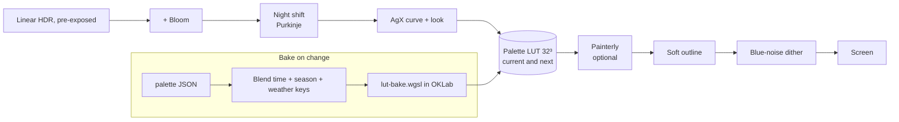

# 05 — Look and Palette

> ebb looks soft and natural: real light falling on real materials, finished by a gentle palette. The rule is **physical light, painted last**: the sun, sky, shadows, water and lanterns are all computed in real physical units, and only at the very end does a small color table (a palette LUT) nudge that physical image toward the palette's mood. Palettes are tuned toward realism: they tint the image rather than repaint it. Because the palette is applied after the light, a dusk palette and a morning palette both keep correct shadows, reflections and depth, and swapping the whole mood of the island means swapping one tiny texture. This doc defines exposure, the tonemap curve, how palettes are authored and stored, the soft outline, the optional painterly filter, and how the grade follows time of day and season.

## Locked decisions

- Lighting is linear Rec.709 HDR in photometric units, pre-exposed (see `04-render-pipeline.md`). Materials hold physical albedo (sRGB textures decoded to linear). **Nobody paints palette colors into materials or lights.** Style changes go in the palette.
- Post order: auto-exposure (from previous frame) → bloom (added in HDR) → Purkinje night shift → **AgX tonemap** → **palette LUT** → painterly (optional) → soft outline → blue-noise dither → present.
- Tonemap curve: **AgX** (Troy Sobotka), base transform with a per-palette "look" (slope, power, saturation). AgX desaturates bright light smoothly toward white, which suits pastels.
- Palette LUT: **32 × 32 × 32 3D texture, `rgba16float`** (matches `16-customization-and-photo-mode.md`), input domain is the AgX output in display-encoded sRGB (0 to 1). Two LUT textures exist (current and next) for crossfades.
- Palettes are JSON recipes in `recipes/palettes/*.json`, baked into the LUT on the GPU at runtime by `src/render/passes/post/lut-bake.js` (`src/shaders/lut-bake.wgsl`). Baking happens in **OKLab** (Björn Ottosson 2020).
- **Luminance is mostly preserved by the palette.** Each palette sets how much of the physical lightness survives (default 0.9). This is what keeps "the light still behaves the same" after a swap.
- **Realism first** (decided October 2026, with the ground detail work in `22-ground-detail.md`). Anchor strengths sit around 0.3 to 0.4, so a palette moves colors part of the way toward its targets and texture variety survives (a full-strength anchor would pull every green to one green). Chroma stays near 1.0. The painterly filter is off by default in every palette. Terrain outlines are faint; creature outlines stay clear.
- Time of day keys follow **sun elevation**, not clock hour, so longer summer days grade correctly. Season keys follow `seasonPhase`. Both come from **display time** (`clock.display()`), which equals world time in normal play and is moved by time and season preview and photo mode (`16-customization-and-photo-mode.md`). Grading never reads the world clock directly.
- Palette swap = 0.6 s crossfade between two LUTs inside the tonemap pass. No other pass changes.
- **Palette roster (fixed names):** **Dusk** (`dusk.json`) and **Meadow morning** (`meadow-morning.json`) available from the start; **Moonlight** (`moonlight.json`) unlocked as the bats' gift (`12-creature-roadmap.md`); **Clear sight** (`clear-sight.json`), the color-safe palette, always available. The vertical slice ships Dusk and Meadow morning.
- SDR output only in v1. HDR display output is an open question.

## How it works

Plain version: the renderer first makes a "photograph" of the island in real light. Auto-exposure sets the camera's exposure like a real camera would, slowly. A film-like curve (AgX) squeezes that photograph into screen range. Then the palette table moves each color part of the way toward the palette's colors: the sky's pale blue drifts toward lilac, sunlit grass toward soft moss, shallow water toward sea glass. Light and dark stay where physics put them, so shadows, glints and the texture of the ground still read. Last, soft ink lines mark silhouettes and creatures, and an optional brushy filter (off by default) is there for players who want a painted look.



### Exposure

- `src/render/passes/post/exposure.js` builds a 64-bin histogram of log2 luminance (range EV100 −6 to +18) with a center-weighted mask, discards the darkest 40% and brightest 5% of pixels, and averages the rest.
- Target EV100 is clamped to **[−1, 15]**. Physical full moonlight would adapt to about EV −3; clamping at −1 keeps night clearly darker than day while the moon, stars and lanterns still read.
- Adaptation is exponential and slow on purpose: brightening at 1.2 EV per second, darkening at 0.8 EV per second, for calm transitions out of shade or at sunrise.
- Exposure multiplier = `1 / (1.2 · 2^EV100)` (Lagarde and de Rousiers, "Moving Frostbite to PBR", 2014), plus per-key exposure compensation from the palette.

### Night shift

Below about 0.1 cd/m² the eye loses color and sees blue-shifted. Before AgX, `tonemap.wgsl` blends toward a desaturated, blue-shifted version weighted by a smooth rod-response curve (Jasmin Patry, "Real-Time Samurai Cinema", SIGGRAPH 2021). This is still "physical" (it models perception), so it comes before the palette.

### Palette baking

For each of the 32,768 LUT texels (input color `c`, converted to OKLab):

1. **Anchor pull.** Each anchor maps a `from` color (what the physical render typically produces for that thing after AgX) to a `to` color. Weight `wᵢ = strengthᵢ · exp(−(dᵢ / radiusᵢ)²)`, where `dᵢ` is the OKLab distance from `c` to `fromᵢ`. Offset = `Σ wᵢ (toᵢ − fromᵢ) / max(1, Σ wᵢ)`. This is a Gaussian radial basis field over color space.
2. **Keep light.** `L' = mix(L_pulled, L_original, keepLuminance)`.
3. **Grade.** Lift, gamma and gain on L; chroma scale (saturation); split-tone shadows and highlights toward tint colors by L.
4. **Gamut clip** in OKLCh by reducing chroma at constant L and hue until the color fits sRGB (Ottosson's gamut clipping).

One bake is a single compute dispatch of about 33k threads, under 0.05 ms on desktop.

### Time of day, season and weather

Each palette has optional override keys. Sun elevation and season phase are evaluated at display time. The blend is done on parameters (anchors, grade numbers), then baked, so keys can never fight inside the LUT.

```
sun elevation:  < −12°   −12°..−4°   −4°..6°    6°..20°    > 20°
key:            night    blue hour   golden     morning/   day
                                                afternoon
```

Weights use smoothstep across each boundary. Season weights come from `seasonPhase` (spring, summer, autumn, winter, each blending into the next). Weather from `src/world/weather.js` applies small overrides: overcast lowers chroma by up to 20%, mist lifts shadows, rain cools highlights. **Rebake triggers:** palette edit, palette swap, or the blended parameters moving more than a small threshold, at most four times per second. At 1x the light changes so slowly that the bake runs about once a second.

### Palette swap

The new palette bakes into the spare LUT. The tonemap pass samples both and crossfades over 0.6 s, then the roles swap. Palettes can also be scheduled by time of day (for example, dusk palette in the evening, meadow morning after sunrise) through a setting in `16-customization-and-photo-mode.md`.

### Soft outline

`src/render/passes/post/outline.js` reads `normalId`, final `depth` and `depthCopy`:

- Edge strength = max of a linear-depth discontinuity (relative, so it scales with distance), a normal-angle discontinuity, and a change of outline group (terrain, structures and foliage, creatures).
- Width is 1.25 px at 1440p, scaled by render height, faded out beyond 60 m, smoothed with a small soft kernel so lines look drawn, not aliased.
- **Ink color is never black.** It is the underlying pixel in OKLab with lightness multiplied by `1 − amount` and chroma raised slightly: a darker shade of the same hue.
- Creatures (group 3) get a stronger line so they read at a distance.
- Terrain (group 1) uses the palette's `terrainAmount` (default 0.1), so ground reads as ground and only strong landform edges get a hint of a line. Outlines read `normalId`, which holds the mesh normal, never the ground detail normal (doc 22), so pebbles and cracks never get lines.
- Where final depth differs from `depthCopy`, the pixel is water; outlines are suppressed there so pebbles under the surface stay soft.

### Painterly filter (optional)

Anisotropic Kuwahara filter (Kyprianidis, Kang and Döllner, "Image and Video Abstraction by Anisotropic Kuwahara Filtering", 2009): a smoothed structure tensor gives local stroke direction, then 8 sectors around each pixel are weighted and the least-varied sector wins. Applied to the LDR image before the outline so lines stay crisp. Strength blends with the unfiltered image. Off by default in every palette (realism first); the player can turn it on in Settings, and photo mode keeps it as a filter (doc 16). Full resolution on the high tier, quarter resolution on medium and low (as in doc 16). An optional paper grain texture (multiply at about 3%) is part of this toggle.

### Dither

Pastel skies band badly in 8 bits. Every write to an 8-bit target adds triangular blue-noise dither of ±1 code value.

## Data and interfaces

### Palette file (`recipes/palettes/<id>.json`)

```jsonc
{
  "id": "dusk", "name": "Dusk", "version": 1,
  "look": { "slope": 1.0, "power": 1.08, "saturation": 0.92 },
  "keepLuminance": 0.9,
  "anchors": [
    // role is a label for the tuning panel; from = typical AgX output, to = target
    { "role": "sky-high", "from": "#9EB4D2", "to": "#B8A9CC", "radius": 0.10, "strength": 0.35 }
  ],
  "grade": { "lift": 0.03, "gamma": 1.0, "gain": 0.98, "chroma": 0.88,
             "shadowTint": "#5E6E7D", "shadowAmt": 0.15,
             "highlightTint": "#FBF1DC", "highlightAmt": 0.10 },
  "keys": {
    "night":  { "grade": { "chroma": 0.6, "shadowTint": "#1E2624", "shadowAmt": 0.3 }, "exposureComp": 0.0 },
    "golden": { "grade": { "highlightTint": "#FFDE95", "highlightAmt": 0.2 } },
    "winter": { "grade": { "chroma": 0.75 } }
  },
  "outline": { "amount": 0.35, "terrainAmount": 0.1, "chroma": 1.1 },
  "painterly": { "enabled": false, "radius": 4, "sharpness": 8, "strength": 0.6 },
  "colorSafe": false
}
```

Keys may override `grade`, `look`, `exposureComp`, and individual anchors by `role`. Missing values inherit from the base. `colorSafe: true` marks palettes listed under the accessibility setting in `15-camera-input-and-ui.md`.

### Module exports

```js
// src/render/passes/post/lut-bake.js
export function loadPalette(id) {}          // fetch + validate JSON
export function setPalette(id, {fadeS=0.6}) {}
export function setKeyWeights({timeW, seasonW, weather}) {}  // called by sky/seasons each frame
export function bakeNow() {}                // forced rebake (tuning panel)
export function exportCube(size=32) {}      // .cube file for use in photo tools
// events: 'palette:changed' {id}, 'palette:baked' {ms}
```

## Algorithms and shaders

- `src/shaders/tonemap.wgsl`: exposure already applied; bloom add; Purkinje; AgX (log2 encoding, inset matrix, sigmoid polynomial, outset); LUT sample with half-texel offset `(c · 31 + 0.5) / 32`; crossfade; dither.
- `src/shaders/lut-bake.wgsl`: workgroup 4×4×4, one texel per thread; anchors in a storage buffer (max 32 per palette).
- `src/shaders/outline.wgsl`, `src/shaders/kuwahara.wgsl`.
- Bloom: 6-level downsample with 13-tap filter and 3×3 tent upsample (Jimenez, "Next Generation Post Processing in Call of Duty: Advanced Warfare", 2014), no threshold, mixed at 4%, so only bright things glow and energy is kept.

## Palettes

All four palettes share the same anchor roles, so the tuning panel can compare them side by side. The `to` colors are full-strength targets; at the realism-first strength of about 0.35 the result lands roughly a third of the way there. Values for `from` are first estimates. During slice step S3 they get replaced by eyedropper samples from the real render (see tuning knobs).

**Dusk** (brand palette, the icon's mood): lilac high sky, peach horizon, slate shadows.

| Role | from | to |
|---|---|---|
| sky-high | #9EB4D2 | #B8A9CC |
| sky-mid | #C9D2DA | #EBC6C0 |
| horizon | #E6DCCB | #F8DEC8 |
| water-shallow | #93AFAF | #AFC6CF |
| water-deep | #3E5A66 | #5F8196 |
| leaf-shade | #3D5530 | #6A8B66 |
| leaf-mid | #5F7F3D | #8DAE80 |
| leaf-sun | #9DB65E | #AECA9C |
| sand | #D9C7A2 | #E8D4B4 |
| bark | #5A4634 | #7D6352 |
| highlight | #FFF6E8 | #FBF1DC |
| lantern | #FFC774 | #FFDE95 |

Grade: shadow tint #5E6E7D at 15%, highlight tint #FBF1DC, chroma 0.95, keepLuminance 0.9.

**Meadow morning**: cool clear air, dew-bright greens, warm low sun, blue-gray shadows.

| Role | from | to |
|---|---|---|
| sky-high | #9EB4D2 | #A9C7DA |
| sky-mid | #C9D2DA | #CFE1E6 |
| horizon | #E6DCCB | #F3E9CF |
| water-shallow | #93AFAF | #B9D6D2 |
| water-deep | #3E5A66 | #6E98A0 |
| leaf-shade | #3D5530 | #5E8A5A |
| leaf-mid | #5F7F3D | #93B878 |
| leaf-sun | #9DB65E | #CFE0A4 |
| sand | #D9C7A2 | #EDE0C4 |
| bark | #5A4634 | #86705C |
| highlight | #FFF6E8 | #FFF8E6 |
| lantern | #FFC774 | #F9E3A8 |

Grade: shadow tint #6F8794 at 18%, highlight tint #F9E3A8 at 8%, chroma 1.0, keepLuminance 0.9, lift 0.02.

**Moonlight** (bats' gift): built for the night tier. Pulls the whole range toward the moonlight and heron-slate end of the brand palette: sky-high to #3E4A63, horizon to #7D86A0, water-deep to #2F4656 with highlight #FBF1DC, leaves to cool blue-greens (#4F6B62 to #8FA79A), lantern kept warm at #FFDE95 so lights stay the one warm accent. Grade: chroma 0.7, keepLuminance 0.85 (night must stay dark and readable), lower Purkinje strength so moonlit color survives. By day it reads as a silvery, overcast-moon look; it is meant to be scheduled for evening and night.

**Clear sight** (color-safe, always available, `colorSafe: true`): designed so categories never depend on red versus green alone. Rules, checked in `tools/palette-check.html` against simulated deuteranopia, protanopia and tritanopia (Machado 2009 matrices):

- Terrain categories are separated by **lightness first**: water darkest and clearly blue (#3F6F9A deep, #8DB7D6 shallow), foliage mid (moss ramp spread wider in lightness, #4E6E4A to #C2D9A8), sand and bare soil light and warm (#EFE0BF), rock neutral gray (#A7A6A0). The OKLab lightness gap between adjacent categories is at least 0.12.
- Plants and creatures are pushed apart: creature anchors (bark, heron, beak roles and the creature outline group) shift toward blue-violet or orange with a lightness offset from the foliage behind them, so a frog in reeds or a bird in a tree still pops.
- keepLuminance 0.6 and chroma 1.05, so hue cues are a bit stronger than in Dusk, and the soft outline amount is raised to 0.5 for creatures (group 3).
- It is listed under Accessibility in `15-camera-input-and-ui.md` and in the normal palette list.

## Tuning knobs

- **Palette editor** in the tuning panel (`src/ui/tuning-panel.js`) and a full-page version, `tools/palette-lab.html`: eyedropper on the scene adds an anchor whose `from` is the sampled color, then a color picker sets `to`; sliders for radius, strength, keepLuminance, grade, look; key editor with a time-of-day scrubber and season scrubber; a before and after split view (vertical divider, no horizontal scroll); save writes the JSON file; "export .cube" for photo tools.
- Settings (player): palette choice, palette by time of day, outlines on/off and strength, painterly on/off, exposure bias (−1 to +1 EV).
- Tuning panel (Matt): exposure clamp range, adaptation speeds, histogram cuts, Purkinje strength, bloom mix, outline widths and fade distance.

## Performance budget

Desktop high tier at 1440p: exposure 0.05 ms, bloom 0.35 ms, tonemap plus LUT 0.15 ms, painterly 0.8 ms when on, outline plus dither 0.2 ms, bake under 0.05 ms when it runs. Mobile low tier: painterly off by default (quarter resolution if turned on), bloom 4 levels, outline on (0.3 ms), total post under 1.5 ms. Full table in `19-performance-and-quality-tiers.md`.

## Acceptance checks

- Drag the time-of-day preview dial: the grade follows the previewed sun (golden, blue hour, night) while the HUD clock keeps the real time.
- Switch between Dusk and Meadow morning: the mood changes in under a second with a soft fade; shadows stay in the same places, the sun's glint on water stays, nothing flickers.
- At noon, the sky reads as lilac-tinted in Dusk and pale clear blue in Meadow morning; grass in sun is clearly lighter than grass in shade in both.
- Walking the camera from bright sand into tree shade, the image brightens gently over about a second, never jumping.
- At night the island is dark and blue-shifted but the moon path on water and the lantern stay readable. Colors are muted, not gone.
- The dusk sky gradient shows no visible bands, even on a large monitor.
- Outlines are darker shades of each object's own color, never black, and they vanish smoothly in the distance and under water.
- Painterly on: leaves and grass turn into soft brush clumps while creature eyes and outlines stay sharp.

## Open questions

- Should the palette follow the time of day automatically by default, or stay on the player's choice all day?
- Is support for HDR monitors worth adding later, or is the look better kept in standard range?
- Should the painterly filter include a visible paper texture, or stay purely brushy?

## Depends on / feeds into

- Depends on: `04-render-pipeline.md` (post chain, targets), `06-sky-and-lighting.md` (sun elevation, physical units), `10-growth-and-seasons.md` (season phase, weather), `21-brand-identity.md` (brand colors).
- Feeds into: `14-asset-recipes-and-tuning-panel.md` (palette recipes), `16-customization-and-photo-mode.md` (palette choice, photo export), `15-camera-input-and-ui.md` (color-safe palettes), `19-performance-and-quality-tiers.md`.
