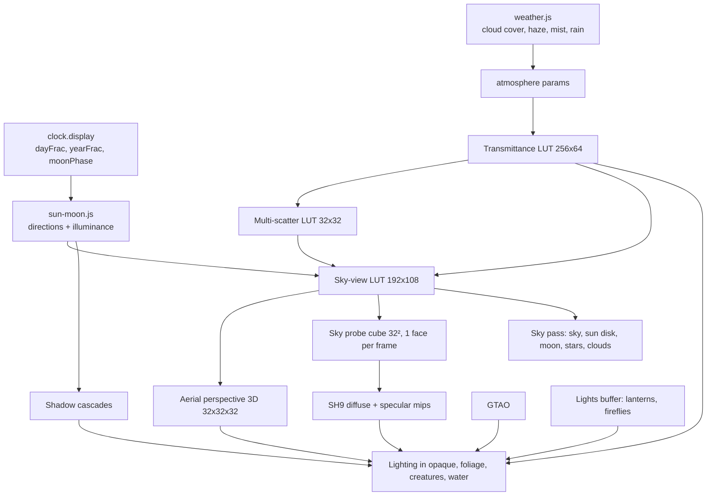

# 06 — Sky and Lighting

> The light is what makes the little island feel like a real place at a real hour. The sky is computed the way real air scatters sunlight, so sunsets turn peach on their own, noon is clean and bright, and the blue hour comes after the sun has set. The sun and moon move with the world clock, seasons change the length of the day, the moon goes through its phases, and shadows, soft ambient light, contact darkening, lantern glow and morning mist all come from that same light. Everything here is physical and in real units. The painted look is added afterwards by the palette (`05-look-and-palette.md`), so this doc never fakes a color for style.

## Locked decisions

- Sky model: **Sébastien Hillaire, "A Scalable and Production Ready Sky and Atmosphere Rendering Technique" (EGSR 2020)**. Four LUTs: transmittance, multiple scattering, sky-view, aerial perspective. Earth-like atmosphere (Rayleigh, Mie, ozone).
- Units: sun illuminance at the top of the atmosphere **120,000 lux**. Ground illuminance comes out of the transmittance LUT (about 100,000 to 110,000 lux at noon). Full moon about 0.27 lux at the ground. Lanterns in candela.
- World orientation: +X east, −Z north, Y up. Fictional latitude **40° N**, axial tilt **21°** (S2: 18° gave only 9.9 to 14.1 hours), so day length runs from about 9.5 game hours (midwinter) to 14.5 (midsummer). Both are tuning values.
- Year: `yearFrac` 0 is the spring equinox (start of season 0 in `src/core/clock.js`).
- Moon: **synodic cycle of 7 game days**, one full lunar cycle per season. New moon at the start of each season, full moon at day 3.5. `src/world/tide.js` reads moon phase for spring and neap tides (see `07-water-and-tide.md`).
- One directional shadow caster: the sun, or the moon when the sun is below −4° elevation. Crossfade between them through twilight.
- Cascaded shadow maps, `depth32float` 2D array, stable (texel-snapped) cascades.
- Ambient: **sky probe** (small cube rendered from the sky-view LUT) projected to **order-2 spherical harmonics (9 coefficients)** for diffuse, plus prefiltered mips for specular.
- Ambient occlusion: **GTAO** (Jimenez et al., "Practical Real-Time Strategies for Accurate Indirect Occlusion", 2016). It applies only to ambient light, never to sun or moon light.
- **Sun, moon, stars, sky LUTs, fog and weather blending read display time** (`clock.display()`), not world time. Display time equals world time in normal play and only differs during time and season preview and photo mode (`16-customization-and-photo-mode.md`). The ecology's daily light exposure uses the same `sunMoon()` function with world time.
- Stars, the Milky Way and the starlight glow are the **art-directed sky terms**. Physically the stars would be invisible at our night exposure (see 05). Their brightness is set relative to an EV −1 reference and held there on screen as the night key opens further, labeled as such in code. The starlight glow is a faint cool radiance added to the airglow shell (`sky.json` `starlight`), so moonless nights light the island softly.
- No volumetric clouds in v1. One procedural 2D cloud layer plus cloud shadows.

## How it works

Plain version: every frame, the sky asks the clock (its display time, so previews work) where the sun and moon are. A small set of lookup tables describes how much sunlight survives through the air from any height and angle, and how much scatters toward the eye. From those tables the sky is painted, distant things get a soft haze, and sunlight on the ground turns orange when the sun is low because the light has crossed more air. A tiny snapshot of the whole sky gives the soft fill light from above. Shadows come from the sun, or from the moon at night. Creases and contact points darken a little (ambient occlusion). Lanterns add warm pools of light at night.



### Sun and moon from the clock

`src/world/sky/sun-moon.js` (pure functions, also callable from the catch-up worker for "daily light exposure" in ecology):

```
ε  = axial tilt (18°),  φ = latitude (40°)
λ☉ = 2π · yearFrac                         sun's ecliptic longitude
δ☉ = asin(sin ε · sin λ☉)                   declination
H☉ = 2π · (dayFrac − 0.5)                   hour angle, 0 at solar noon
sin(alt) = sin φ sin δ + cos φ cos δ cos H
az       = atan2(sin H, cos H sin φ − tan δ cos φ)   measured from south, west positive
```

The moon uses the same formulas with `λ☾ = λ☉ + 2π · moonPhase`. Its right ascension offset from the sun gives its hour angle, `H☾ = H☉ − (RA☾ − RA☉)`, so the moon rises later each game day, as it does in reality. Moon illuminance = 0.27 lux × the Lommel-Seeliger phase curve × atmosphere transmittance. Earthshine adds a faint glow on the dark limb. The moon disk is a textured sphere impostor lit by the true sun direction, so the crescent always points toward the sun.

`FrameUniforms` (see `04-render-pipeline.md`) receives `sunDir`, `sunIlluminance` (after the atmosphere), `moonDir`, `moonIlluminance` and `moonPhase`.

### Physical sky (Hillaire 2020)

- **Transmittance LUT** (256×64, `rgba16float`): optical depth to the top of the atmosphere, parameterized by height and view zenith. Rebuilt only when atmosphere parameters change (weather), at most once per second.
- **Multiple-scattering LUT** (32×32): isotropic approximation of infinite scattering orders, which gives the bright, soft twilight. Rebuilt with transmittance.
- **Sky-view LUT** (192×108): sky radiance around the camera with non-linear latitude mapping that packs detail near the horizon. Rebuilt every frame (cheap).
- **Aerial perspective** (32×32×32 froxels, in-scatter RGB + transmittance A): applied to every lit surface by depth. Covers 0 to 400 m.

**Diorama haze.** A 64 m island is too small to show real aerial perspective. Instead of scaling distances, a **local ground aerosol layer** is added: Mie particles with a 40 m scale height and a density driven by weather and time (dense at dawn, thin at noon). It stays physical (a real hazy valley does this), and it gives depth separation between near and far islets.

**Mist.** On top of that, an exponential height fog (Wronski, "Volumetric Fog", SIGGRAPH 2014 style, analytic integral, no volume) lit by sun transmittance and the sky SH. It is used for morning mist over water and wet ground.

### Night sky

- Stars: a procedural starfield (hash on a cube map, about 4,000 stars with a magnitude distribution), rotating about the celestial pole at 40° elevation toward −Z (north) with sidereal motion from the clock. Twinkle is a slow noise on brightness only.
- Milky Way: a low-frequency band texture, faint.
- Both fade with sky luminance, so they appear naturally through blue hour.
- The moon's path on water comes from the water's specular response to the moon direction (`07-water-and-tide.md`), not a painted streak.

### Shadows

| Tier | Cascades | Size | Filtering |
|---|---|---|---|
| high | 3 | 2048 | PCSS-style penumbra, 16-tap Poisson with blue-noise rotation |
| medium | 2 | 1536 | 9-tap Poisson PCF |
| low | 1 | 1024 | 4-tap hardware compare, plus baked terrain horizon shadow |

- Splits: practical split scheme (log/linear blend 0.6). Max shadow distance = 1.5 × world radius, at least 60 m.
- Stable cascades: bounding sphere per split, light-space origin snapped to whole texels, so shadows do not shimmer as the camera orbits.
- Normal-offset plus slope-scaled bias. Foliage casts with alpha testing. Near-vertical rock faces from the Cliff tool (M2, doc 08) get a little extra normal offset so they never self-shadow in stripes.
- **Cloud shadows:** a 512² tiling noise map scrolled by wind, projected along the sun direction, coverage from weather. They multiply sun illuminance only.
- **Terrain horizon map** (128² per land chunk, 8 azimuth directions): rebuilt when a sculpt stroke ends. It provides low-sun self-shadowing past the last cascade and sky visibility in valleys.

### Ambient light

- Sky probe: the sky-view LUT plus a ground hemisphere (average terrain albedo × sun and sky illuminance) rendered into a 32² cube. One face per frame, so a full refresh every 6 frames. That is fine because the sky changes slowly.
- **SH9** projection (Ramamoorthi and Hanrahan, "An Efficient Representation for Irradiance Environment Maps", 2001) for diffuse ambient. The coefficients go into the group 1 uniform.
- Specular ambient: 5 GGX-prefiltered mips of the cube (split-sum, Karis 2013) for water, wet stone and creature eyes.
- Occlusion of ambient = min(GTAO, horizon-map sky visibility). Specular occlusion from AO and roughness (Lagarde's approximation).

### Ambient occlusion

- GTAO in `src/render/passes/ao.js`, reading `depth` and `normalId` after the prepass.
- high: full resolution, 3 slices × 6 steps, radius 1.5 m (world space), then a 4×4 depth-aware blur. medium: half resolution, 2 slices × 4 steps. low: off (horizon map and per-vertex foliage AO only).
- **Creature contact occlusion:** each creature publishes 1 to 4 occlusion spheres. Terrain and structures apply analytic sphere occlusion (Quilez) for the nearest 32 spheres, so a frog sits *on* the moss rather than floating.
- No TAA means no temporal filtering, so noise is rotated by a fixed blue-noise pattern, not per frame, to avoid crawling.

### Lanterns and small lights

- Lights live in one storage buffer: position, range, intensity (candela), color temperature, flicker seed, kind. Maximum 64.
- Lantern default: 2,200 K, 8 cd (a small candle lantern), range 8 m, inverse-square falloff with a smooth window (Karis 2013). Flicker is a two-octave noise on intensity, ±6%, at about 3 Hz.
- Fewer than 9 lights: shaders loop over all of them. More: a compute pass bins lights into 32×32 pixel screen tiles.
- Lantern shadows: none in v1. The lantern glass and flame are emissive and feed bloom.
- Fireflies: emissive particles plus up to 8 weak cluster lights (centroids of nearby fireflies), so they faintly light grass below.

### Weather effects on light

From `src/world/weather.js` (the current weather state). The player's drier or wetter leaning and the hold-today's-sky toggle (`16-customization-and-photo-mode.md`) act inside `weather.js`; lighting only reads the resulting state and needs no knowledge of them.

| Weather | Effect |
|---|---|
| Clear | base atmosphere; ground aerosol follows time of day (hazier at dawn) |
| Soft cloud | cloud coverage 0.4 to 0.8: direct sun × (1 − 0.9 · coverage) where cloud shadows fall, sky radiance blended toward a gray overcast dome with the same total energy |
| Rain | full overcast, ground aerosol × 2, wetness on terrain and stone (albedo darkens, roughness drops; Lagarde, "Water drop 2", 2013), rain streak particles, ripples on water (doc 07) |
| Mist | height fog density up, top at 3 m above sea level, ground aerosol × 3, densest at dawn and burning off by mid-morning |
| Frost (winter mornings; ebb has no snow) | clear or soft cloud; the frost input from doc 10 whitens grass tips and raises ground albedo a little (about 0.45), which brightens the sky probe's ground hemisphere; frost melts off as the sun climbs; no falling particles |

Weather changes blend over 20 game minutes. Light never changes abruptly.

## Data and interfaces

```js
// src/world/sky/sun-moon.js
export function sunMoon(t, opts) {}   // t = display time for rendering, world time inside coarseStep
// -> {sunDir, sunAlt, moonDir, moonAlt, moonPhase, moonIllum, dayLengthH}
// src/render/passes/sky.js
export function setAtmosphere(params) {}   // weather-driven; triggers LUT rebuild
export function getSkySH() {}              // Float32Array(27), also CPU-readable for UI tint
// src/world/structures/lights.js
export function addLight(desc) {}  export function removeLight(id) {}
// events: 'sky:sun-crossed' {event:'sunrise'|'sunset'|'dusk'|'dawn'}  (used by audio and creatures)
```

Atmosphere constants live in **`recipes/world/sky.json`** (next to `recipes/world/terrain.json` from doc 08) (Rayleigh and Mie coefficients, ozone, ground aerosol layer, mist defaults, latitude, tilt, star density), so the tuning panel can save them like any other recipe.

Shaders: `src/shaders/sky-transmittance.wgsl`, `sky-multiscatter.wgsl`, `sky-view.wgsl`, `sky-aerial.wgsl`, `sky-draw.wgsl`, `sky-probe.wgsl`, `sh-project.wgsl`, `shadow.wgsl`, `gtao.wgsl`, `lib-lighting.wgsl` (BRDF: GGX specular, Lambert diffuse, a wrap term for foliage translucency, sphere occlusion).

## Tuning knobs

- Tuning panel: latitude, axial tilt, moon cycle length, atmosphere coefficients, ground aerosol density and height, mist density and top, cloud coverage and scroll speed, cascade splits and bias, GTAO radius and intensity, lantern intensity and color temperature, star brightness above the exposure floor. A time scrubber previews any hour and season without changing the world clock.
- Settings: shadow quality (follows tier), ambient occlusion on/off, weather effects on/off.

## Performance budget

Desktop high tier at 1440p: sky LUTs and probe 0.25 ms, shadows 1.5 ms, GTAO 0.7 ms (full res), sky draw 0.15 ms, lighting cost inside the opaque budget. Mobile low tier: 1 cascade, no GTAO, sky-view LUT at half size, aerial perspective 16³, under 1.2 ms total. See `19-performance-and-quality-tiers.md`.

## Acceptance checks

- Drag the time-of-day preview to midnight in summer: stars and moon appear, the HUD clock still shows the real hour, and releasing glides back.
- Watch a full day at 4x: the sky goes from deep blue to pale dawn, through clean noon light, to peach sunset and a lilac blue hour, then stars appear gradually.
- The shadows of trees lengthen and turn with the sun and never shimmer while orbiting.
- In midwinter the day is visibly shorter and the noon sun lower than in midsummer.
- Over a season, the moon goes from new, to a crescent, to full and back. Its lit side always faces where the sun is.
- At night the moon casts soft shadows. A lantern makes a warm pool of light that falls off naturally, with a slight flicker.
- A frog on moss shows a soft dark contact under it. Creases between stones are slightly darker; open meadow is not.
- On an overcast day shadows fade and the light turns soft and even. In rain, stones and paths look wet and darker.
- Early morning mist hangs low over the pond and burns off by mid-morning.

## Open questions

- Is a 40° latitude with fairly balanced day and night right, or would you like longer, golden evenings (a higher latitude) for the cozy feel?
- Should a lantern cast its own soft shadow on the desktop high tier, or is the glow enough?
- Is a moon cycle of one per season (so the full moon falls in the middle of each season) good, or should it run independently of seasons?

## Depends on / feeds into

- Depends on: `02-core-loop-and-idle-model.md` (world clock), `04-render-pipeline.md` (passes, bind groups), `10-growth-and-seasons.md` (weather record), `09-structures.md` (lantern placement).
- Feeds into: `05-look-and-palette.md` (sun elevation keys, physical units), `07-water-and-tide.md` (moon phase, sky reflections, sun glints), `10-growth-and-seasons.md` and `11-creatures-and-ecology.md` (daily light exposure, sunrise and sunset events), `17-audio.md` (dawn and dusk events), `19-performance-and-quality-tiers.md`.
