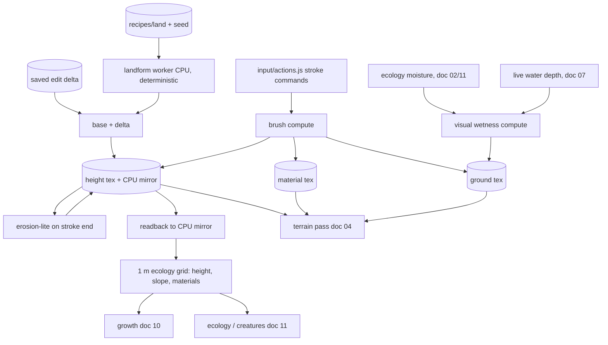

# 08 — Terrain and Sculpt

> The island is a heightfield: a grid of ground heights the player shapes with soft brushes, raising hills, carving hollows for ponds, smoothing banks and painting grass, sand, rock, soil or damp ground. Sculpting should feel like pressing warm clay: no menus, no snapping, every stroke undoable. The terrain is also the ground truth everything else reads. Water flows over it, the tide uncovers its flats, plants decide where to grow from its wetness and soil, moss spreads across its texture, and creatures pick homes from its shape. When the world expands, new land arrives as new chunks of the same heightfield.

## Locked decisions

- **Heightfield, not voxels.** One height per grid cell; no caves or overhangs. Overhang-like shapes (banks, arches) come from structures and rocks.
- **Cell size 0.25 m** (4 cells per meter) at every quality tier. Data resolution never changes between tiers, so saves match across devices; only render mesh detail and update rates change.
- **Chunks are 32 m square (128 x 128 cells).** The world is a fixed **6 x 6 chunk window, 192 m by 192 m**, the hard ceiling from `13-progression-and-expansion.md`. World origin is the starter island's center. Chunk `(cx, cz)` covers `x` in `[32·cx − 16, 32·cx + 16)` (same for `z`), with `cx, cz` from −2 to 3. The starter island (about 64 m across) opens the 3 x 3 chunks −1..1. Unopened chunks are open sea drawn with the analytic water surface.
- **Height range −4 m to +12 m** around mean sea level (`y = 0`), quantized to 16 bits (about 0.25 mm steps).
- **Base landform plus edit delta.** Every open chunk's base heights and materials regenerate deterministically from a land recipe in `recipes/land/` plus a seed. Player sculpting is stored as a delta on top. An unedited chunk saves no heights; an edited one saves the wrap-around difference from its regrown base (`18-saves-and-persistence.md`, sections `chunk:<cx>,<cz>`).
- **Landforms are generated on the CPU** (in a worker) with integer hashing and plain arithmetic only, never on the GPU, because GPU float results can differ between devices and the base must be bit-identical everywhere.
- **Painted layers:** grass, sand, rock, soil (four weights per cell, summing to 1) plus a separate **damp** paint channel. **Derived layers** (computed, never saved): visual wetness, steep-slope rock, beach sand in the tide band, path wear, moss and lichen masks.
- **Height only changes when the player edits or land rises.** The hourly tick never moves the ground. Erosion-lite runs only right after a stroke.
- Tuning numbers live in `recipes/world/terrain.json`; landforms in `recipes/land/*.json` (doc 14).

## How it works

Plain language first. The player picks a brush, drags across the island, and the ground rises, sinks, softens, levels or changes color under the cursor. When the stroke ends, a short settling pass (erosion-lite) slumps cliffs that are too steep, so a quick drag looks like a natural knoll rather than a spike. Water then finds the new low spots, and within a game hour the ground around it darkens as it gets damp.

```
 brush stroke          GPU compute                    after stroke ends
 ------------  -->  height += falloff * strength  -->  erosion-lite (thermal, 24 iters on rect)
 (pointer,          material weights repainted        readback dirty rect -> CPU mirror (quantized)
  pressure)         per frame, brush rect only        refresh 1 m ecology cells -> 'terrain:stroke-ended'
```

### Layers of a chunk

```
  base landform (regrown from recipes/land/<id>.json + seed)   never saved
+ edit delta (player sculpting, wrap-around uint16)            saved only if edited
= height                                                       CPU mirror + GPU texture
  base materials + painted materials (saved only if edited)
  derived: wetness, beach, steep rock, wear, moss              rebuilt every load
```

On load, a worker regrows each open chunk's base, adds the saved delta, and uploads the result. When the player sculpts, the delta is recomputed at save time as `heightQ − baseQ` (mod 65536), so the save is mostly zeros and compresses well.

### GPU textures

Three textures cover the whole 192 m window, allocated once at boot (768 x 768, about 2.4 MB each, fine on phones):

```
height    r32float     768 x 768   meters
material  rgba8unorm   768 x 768   grass, sand, rock, soil weights
ground    rgba8unorm   768 x 768   r visual wetness (derived)   g damp (painted)
                                   b moss/lichen mask (written by growth, doc 10)   a path wear (doc 09)
```

Only open chunks are edited, simulated or drawn. Chunks remain the unit of saving, dirty tracking, rendering and expansion.



### Brushes

| Brush | Effect | Notes |
|---|---|---|
| Raise | `h += s * f(d) * dt` | strength in m/s at center |
| Lower | `h -= s * f(d) * dt` | floors at −4 m |
| Smooth | blend toward 3 x 3 Gaussian mean | ping-pong between two textures over the brush rect |
| Flatten | blend toward a target height | target = height under the cursor at stroke start; the "level to water" toggle uses mean sea level |
| Paint | blend material weights toward the chosen layer, renormalize | layers: grass, sand, rock, soil, damp |
| Cliff: Terrace | `h = max(h, level − fall)` (M2) | level = start + Height, snapped; dragging builds a level shelf whose edge drops within one cell |
| Cliff: Cut | `h = min(h, level + fall)` (M2) | level = start − Height, snapped; dragging carves a level floor with sheer walls |

**Cliff tool** (decided October 2026; built as the first step of M2 on branch `m2-cliff-tool`, merged in PR #54). It is **the frogs' gift** (Matt, October 20, 2026): the chips show once the frogs first settle happy, `unlocks.cliffs`, and `?sandbox` or `?cliffs` opens them early for testing. Frogs live on the step between land and water, and this tool builds steps; Cut also digs the deep pool minnows come to (doc 12). Terraces built before the gift, or on an older save, stay as they are. Terrace and Cut are the fifth and sixth chips on the Sculpt card (three to a row), so the tool bar keeps six buttons and fits a 375 px phone. As built (`src/world/terrain/cliff.js`):
- **Level.** The shelf level is the ground where the stroke starts plus (Terrace) or minus (Cut) the Height slider (0.25 to 3 m, which takes the Strength slider's place in these modes), snapped to 0.25 m so shelves built one after another line up. Shift (desktop) levels to mean sea level for sea walls and beach shelves. A thin line under the ring shows where the ground meets the level before you drag.
- **Shape.** Inside the brush the ground goes to the level; across the rim's last `edgeM` (0.4 m, about 1.5 cells) it falls away by the stroke's Height, so the wall stays steep (about 68 degrees for 1 m, 82 for 3 m) and its top edge stays smooth where it runs across the grid instead of stair-stepping (a narrower rim aliased into teeth about 1 m long on walls just off the grid's axes).
- **Rock texture on walls.** On steep ground the triplanar projections are chosen by the drawn triangle's own facing (from screen derivatives), not the smoothed ground normal: where a wall steps across the grid the two differ, and a projection chosen by the smooth one lands edge-on and smears (lib-ground.wgsl).
- **Chunk edges.** A step across the edge between two chunks flags both as cliff chunks, so neither is left coarse with a crack its skirt would fill with a smeared wall. Terrace only lifts and Cut only lowers: a terrace dragged into a hill leaves the hill alone, so the shelf meets the land behind it naturally. Each stamp sets the ground rather than adding to it, so a stroke gives the same shelf at any frame rate and going over it again changes nothing. Before unopened land the shelf slopes away by `worldEdgeDropM` instead of standing as a wall.
- **Rock and erosion.** At stroke end, before erosion-lite, cells with a drop to a neighbor steeper than 60 degrees (the rim above and the foot below) are painted rock; painted rock's talus is 82 degrees, so faces stay sheer while turf on top still slumps.
- The tool is exempt from the 0.15 m step cap. Undo copies tiles as for every stroke. A heightfield gives walls up to about 85 degrees (a 3 m drop across one 0.25 m cell); overhangs, sea caves and arches stay out of the heightfield and arrive later as placed rock pieces.
- **Water** runs off a shelf's edge in the live sim (cell to cell at 0.5 m) and is drawn as a **waterfall** over the face: droplet water with real volume near the eye, a curtain along a gravity arc further off, with foam where it lands (doc 07, Waterfalls). Cut basins pool rain and springs; a cut that reaches the sea floods.
- `?cliffs` builds a test scene with real strokes; `tools/cliff-bench.html` measures the full-detail cost per tier.

**Steps** (built October 21, 2026, on branch `m2-shaping-path`; doc 13, the shaper's trail, where Steps replaced the bench). Sculpt's ninth chip, offered once the shaper's trail reaches "water falling from a terrace" (`unlocks.steps`; `?sandbox` or `?steps` open it early). You drag from a terrace down to the ground below, or up; the flight runs along that line (`src/world/pieces/steps.js`, tuning in `recipes/world/pieces.json` `steps`):
- **Shape.** 1.6 m wide. Every rise is at most 0.3 m and every tread at least 0.5 m (at most 1 m), and the whole flight is no steeper than 0.6, so the walker's step limit (0.45 m over half a metre) always holds. It starts with half a tread at the top level and ends with half a tread at the bottom, and runs on 0.25 m past each end, so it meets both levels. A drag too short for that says, in the card, how far to go; one with no drop, starting or ending in water, or across another flight says so calmly and cuts nothing.
- **In the ground.** The flight is written into the heightfield (quantized, saved with the chunk like any edit) and painted rock, with the sheer walls beside it. Two flat slabs (the pond stones' shapes with a short skirt) sit a few centimetres proud on every tread. One undo step takes the cut and the record away together.
- **Kept safe from reshaping** (Matt, October 21, 2026: the game must treat steps carefully when the cliffs round them are reshaped). Every flight's cells are marked in a guard mask (`terrain-guard`, r8) that the brushes read: Raise, Lower, Smooth, Flatten, Terrace and Cut leave those cells alone on the GPU. At every edit's end (after erosion-lite, and after a boulder), the flight's cells are set back to their steps before the undo tiles are taken, so erosion cannot slump them either. Reshaping round a flight moves the ground beside it and leaves the stair standing. Removing a flight (select it, Remove) lifts the guard and keeps the ground as it was cut, now ordinary ground to reshape.
- **Walking it.** The treads are footing for the walker (src/world/walk), so the walk grid takes each one as level and never reads the cut's walls beside it as a steep slope.

Falloff `f(d) = 1 − smoothstep(hardness · r, r, d)`. Radius 0.5 to 8 m, strength 0 to 1 mapped by the recipe. Pen and touch pressure scale strength. Stamps are spaced at 25% of the radius along the stroke so fast drags stay even.

**Steepness and edges.** Raise and Lower are capped so a single frame cannot create a step over 0.15 m between neighbors; erosion-lite cleans up what is left. The Cliff tool is the one exception. Smooth softens rock faces only at full strength, so a casual smoothing pass never erases a cliff. Brushes fade out over the last 2 m before an unopened chunk, so no wall forms at the edge of the world.

**Structures.** Brushes avoid cells under walls and bridge abutments by default (a mask from `world/structures/`); flatten and paint still work there. When a stroke ends under a path, the path re-fits (doc 09).

### Wetness: simulation vs. look

- **For simulation**, wetness is the ecology grid's **moisture** field (1 m cells, doc 02), advanced in the hourly tick from the water summary, the tide band, the day's seeded weather and the painted damp channel. Growth and creatures read only this.
- **For the look**, a GPU pass (`wetness.js`, `terrain-wetness.wgsl`) every half real second (1.5 s on the low tier) builds a 0.25 m visual wetness over the water rect, ping-ponging two rgba8unorm maps so it remembers. Each update: `wet = max(previous + rainSoak - dry, capillarySpread, sources)`, where the sources are live water deeper than about 2 mm, ground below the tide plus a 0.25 m splash band, and the damp hollows (`dampHollowWet`, a floor that never dries). Rain soaks the ground toward 1 at a rate per game hour. Capillary spread lends a wetter neighbor's wetness into banks, fading out over about 1.5 m, faster up a slope. Where nothing holds it, wetness falls from soaked to dry in about two game hours, faster in sun and wind, about a third as fast at night, not at all while it rains or the game is paused (game time comes from `worldT`, so 4x dries four times faster). Stores are dithered so the slow night step still lands in 8 bits. The first update builds from the sources only, then spreads, with no drying history. The terrain draw samples it filtered: it darkens albedo (`wetDarkening`) and, above `sheenFrom`, lowers ground roughness toward `wetRoughness`, so flats the tide just uncovered are dark and gently shiny, then dull, then dry. Puddles and the full wet specular are step G3. Moisture from the ecology grid joins the sources when that grid exists. This pass never feeds back into the simulation.
- **Damp paint** lets the player make a marshy patch with no standing water: effective moisture is at least `damp · 0.8`.
- **Steep rock** (slopes above 38 degrees) and **beach** (cells within the tide band, low tide to high tide plus 0.3 m, unless painted rock) blend in the terrain shader, so they follow sculpting instantly.

### Reading the terrain

- **GPU systems** (grass blades, reeds, water, moss, creature feet) bind the three textures. `lib-terrain.wgsl` gives `terrainHeight(xz)`, `terrainNormal(xz)`, `terrainMaterial(xz)`, `terrainWetness(xz)`, with manual bilinear when `float32-filterable` is missing.
- **CPU code** (picking, placement, creature pathing) uses the CPU mirror. During a stroke the CPU applies the same brush math to its mirror, approximately, so the cursor keeps hugging the ground; at stroke end the exact GPU result replaces it.
- **The hourly tick** (growth, ecology, creatures) reads only the **1 m ecology grid**. Terrain writes its per-cell inputs there (mean height, slope, material fractions, damp) for dirty chunks after each stroke and after a land rise.

## Data and interfaces

Files in `src/world/terrain/`: `index.js` (system), `heightfield.js` (textures, CPU mirror, sampling, raycast), `landform.js` (worker job: recipe + seed to base heights and materials), `brushes.js`, `erosion.js`, `wetness.js` (visual only), `chunks.js`, `grid-inputs.js`, `undo.js`. Terrain has no `coarse.js`: it is not in the hourly tick. Shaders: `terrain-brush.wgsl`, `terrain-erosion.wgsl`, `terrain-wetness.wgsl`, `terrain-draw.wgsl`, `lib-terrain.wgsl`.

```js
/** world/terrain/index.js */
export const terrain = {
  id: 'terrain',
  sampleHeight(x, z),              // meters, CPU mirror, bilinear
  sampleNormal(x, z, out),
  sampleMaterial(x, z),            // {grass, sand, rock, soil}
  raycast(origin, dir),            // {hit, point, normal} via heightfield DDA
  isLand(x, z),                    // above the high-tide line
  beginStroke(brush), strokeTo(point, pressure), endStroke(),
  openChunk(cx, cz, landId, seed), // called by expansion.js (doc 13)
  setRise(cx, cz, t),              // 0..1 rise blend for a rising chunk
  gpu: { height, material, ground, uniforms },
  chunkState(cx, cz),              // 'sea' | 'rising' | 'open'
};

/** world/terrain/landform.js (worker, deterministic; one args object, as worker jobs take) */
export function buildBase({ land, seed, cx, cz })
  // -> {cx, cz, heightQ: Uint16Array(128*128), material: Uint8Array(128*128*4)}

/** per-chunk record inside store slice `chunks['cx,cz']` (doc 18) */
// state: 'open' | 'rising', land: recipe id, seed, edited: bool,
// heightDelta?: Uint16Array (wrap-around), material?: Uint8Array, damp?: Uint8Array
```

Height quantization: `q = round((h + 4) / 16 · 65535)`. Delta: `(q − baseQ) & 0xFFFF`; restore: `(baseQ + delta) & 0xFFFF`.

Events: `terrain:edited {rect}` (each frame of a stroke, deferred), `terrain:stroke-ended {rect}`, `terrain:grid-updated {chunks}`. Listens to `land:rise-started` and `land:joined` (doc 13).

**Undo and redo.** The command stack in `input/actions.js` holds terrain commands (`history:undone` fires on undo). Before a brush first touches an 8 m tile (32 x 32 cells) during a stroke, `undo.js` copies that tile's quantized height, material and damp from the CPU mirror (exact between strokes, so no GPU readback or stall is needed). Undo writes the tiles back into the mirror and uploads them, then refreshes the grid. Budget: 48 MB desktop, 12 MB mobile (`undoBudgetMB` in `recipes/world/terrain.json`), far more than 50 strokes; the oldest steps drop off silently. Redo keeps the after-state tiles, copied once the stroke has settled. (S1 decision: CPU tiles instead of a GPU pool texture, because the exact mirror already exists.) Plants and structures are not undone with terrain; they re-settle onto the new ground.

**Expansion.** `expansion.js` calls `openChunk` for each chunk of a land piece. The landform worker builds the base from the piece's land recipe (domain-warped fbm masked by a soft island shape, blended over 6 m into neighboring open land). While rising, the drawn height is `base − 3 m · (1 − ease(t))`; when `land:joined` fires, the chunk becomes normal open land with an empty delta. Rising never changes cells the player has edited on existing land.

**Starter island.** `recipes/land/starter-island.json` is the landform for chunks −1..1: a gentle 64 m island, a central rise to about 4 m, a shallow basin that suits a first pond, and sand margins. Its seed is the world seed's terrain sub-seed, so every world's island differs a little.

## Algorithms and shaders

- **Landform**: value-gradient noise built from `hash32` and polynomial fades (quintic), fbm with domain warping (Quilez, "Domain Warping"), only `+ − * /`, so the same integers come out in every browser. Quantized before anything reads it.
- **Brush compute**: one dispatch over the brush's bounding rect per stamp (8 x 8 workgroups). Smooth uses a ping-pong pair limited to the rect.
- **Erosion-lite**: thermal erosion (Musgrave, Kolb, Mace, "The Synthesis and Rendering of Eroded Fractal Terrains", SIGGRAPH 1989). Material moves downhill when the slope between neighbors exceeds the talus angle (33 degrees soil; painted rock about 82 degrees from M2, so painted rock is the hard-rock mask and rock cliffs stay sheer while turf on top still slumps; 45 degrees in the slice). 24 iterations on the dirty rect plus a 2 m margin, checkerboard update so it runs race-free in parallel. Its result becomes part of the delta, so GPU float differences never reach other devices: the quantized CPU mirror is what gets saved.
- **Raycast**: 2D DDA across cells with per-cell bilinear patch intersection (Tevs, Ihrke, Seidel, "Maximum Mipmaps for Fast, Accurate, and Scalable Dynamic Height Field Rendering", 2008, without the mip acceleration since the world is small).
- **Rendering mesh** (owned by doc 04): per chunk, a grid mesh sampling height in the vertex shader, LOD 128/64/32 quads per side by distance, skirts to hide cracks (from M2, a chunk that holds a cliff face stays at full detail within the tier's cliff distance, so walls never go soft or jagged; doc 19); height-based material blending (sand fills cracks between rock, grass tufts at edges). From slice step G1 the surface detail (scanned albedo, normal, roughness and height maps per material, hex tiling, triplanar cliffs, wet ground) is specified in `22-ground-detail.md`.

## Tuning knobs

`recipes/world/terrain.json` and the tuning panel: brush radius range, strength curve, falloff hardness, step cap; Cliff tool face angle for automatic rock and far-side blend width; talus angles and erosion iterations; visual wetness spread, drying rate, tide-flat linger; steep-rock angle, beach band height. `recipes/land/*.json`: noise scale, octaves, warp, island falloff, base materials, peak height. Player settings: brush size and strength sliders, pressure on or off.

## Performance budget

| | Desktop (high) | Mobile (low) |
|---|---|---|
| Brush stamp | under 0.2 ms GPU | under 0.6 ms |
| Erosion-lite at stroke end | under 2 ms, once | under 6 ms, once |
| Visual wetness | every 0.5 s, 0.3 ms | every 1.5 s, 0.8 ms |
| Readback + grid refresh after stroke | under 5 ms async, no hitch | under 15 ms async |
| Landform build, one chunk | under 15 ms in a worker | under 40 ms |
| Terrain draw (with ground detail, doc 22) | about 1.3 ms | under 2.5 ms |

## Acceptance checks

- Dragging Raise makes a soft rounded hill under the cursor; on release the steepest sides slump slightly within a moment.
- Lower carves a hollow that fills with water (doc 07); within about a real minute the ground around it darkens.
- Flatten makes a level shelf at the height first touched; Smooth softens a jagged ridge without erasing it.
- Painting sand, rock, grass and soil gives soft blends with no tiling seams; grass blades (doc 10) thin out where sand is painted.
- When the tide drops, the uncovered flats look shiny and wet, then slowly dry.
- Undo and redo step stroke by stroke, instantly, even after 30 strokes.
- A brand new world with the same seed gives the same island on desktop and phone; `tools/determinism.html` shows matching landform hashes.
- On a phone, a one-finger drag sculpts and two fingers orbit; nothing stutters at stroke end.
- `tools/terrain-brush-bench.html` shows per-stamp, erosion and landform timings.

## Open questions

- Should there be a "carve channel" brush that cuts a narrow streambed along a stroke, or is Lower enough? (The Cliff tool's Cut mode covers straight-sided channels from M2.)
- ~~Should painted rock bring boulders with it automatically, or should boulders be placed on purpose?~~ Placed on purpose (docs/future/10): Sculpt's Stone mode sets a seeded boulder where you tap (`src/world/terrain/boulder.js`, `terrain.stampStone`), a main stone and sometimes one or two smaller ones against it, lifted into the heightfield and painted rock, so it saves with the edited chunk, undoes like a stroke, and is rock at once for moss, lichen and wrack. The size slider sets its width (terrain.json `stone`).
- When land is raised out of the water, should it start as bare soil or keep the material it had underwater?

## Depends on / feeds into

Depends on `03-tech-stack-and-module-map.md`, `13-progression-and-expansion.md` (land recipes, rises), `15-camera-input-and-ui.md` (brush input), `07-water-and-tide.md` (water depth, tide band). Feeds `02-core-loop-and-idle-model.md` (ecology grid inputs), `04-render-pipeline.md`, `07-water-and-tide.md` (bed shape), `09-structures.md`, `10-growth-and-seasons.md`, `11-creatures-and-ecology.md`, `18-saves-and-persistence.md`.
