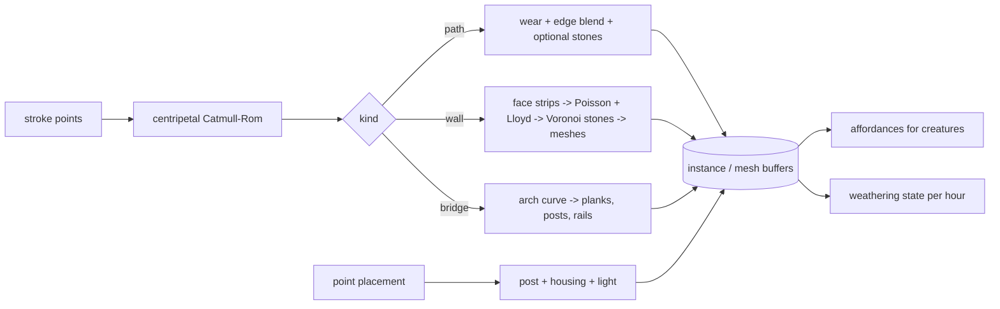

# 09 — Structures

> The human touches on the island are deliberately few: winding paths and stepping stones, dry-stone walls, one small wooden bridge, and a lantern or two. They are drawn with a single stroke and the details are generated: the player draws a line and a wall of fitted stones rises along it. Then nature takes them back slowly. Moss creeps up from damp ground, lichen freckles the stone tops, the bridge silvers, grass leans in over path edges. Structures also matter to creatures: walls are shelter and basking spots, stepping stones are frog perches, bats roost under the bridge, and lantern light changes who feels at ease at night. They exist to frame the nature, never to compete with it.

**Status:** The first placed piece, the loose stone, is built and in main (`src/world/pieces`, `recipes/world/pieces.json`): records `{ id, kind: 'stone', x, z, yaw, seed, size, placedHour }` in the save's `pieces` section (format 5, doc 18), a soft cap of 24 with a calm note, placement and removal through the undo history, meshes baked from the recipe on load. Stepping stones (Sculpt's Pond stones mode), Steps (doc 08) and the reed raft (the turtles' gift) are built on branch m2-shaping-path (October 21, 2026), as pieces of kinds `stepping`, `steps` and `raft` beside the loose stones (see Stepping stones below). Paths, walls, the bridge and lanterns are not built yet.

## Locked decisions

- Four kinds only: **path** (worn earth or stepping stones), **stone wall**, **bridge**, **lantern**. No buildings.
- **The keeper's camp** is the one exception, and it is not a building: a tent and a fire ring in fixed slots on a protected pad, with piles of what the walker sets down (docs/future/13, section 3). Its pieces join the placed-pieces model, not the structure tools. *(Changed October 22, 2026, docs/future/13.)*
- Every structure is **stroke-drawn or point-placed, then generated** from a recipe and a seed (`recipes/world/structures.json` for shared tuning; stone, plank and lantern shapes are flora-like recipes in the same file).
- Tools arrive through play (`12-creature-roadmap.md`): stepping stones and one lantern in M2; paths in M3; the **stone wall tool** is the butterflies' gift (tier 2, M3); the **bridge** arrives with the tier 2 milestone and the woodland knoll in M3 (`13-progression-and-expansion.md`). Gentle limits, not costs: 1 bridge per channel (span 4 to 14 m), one lantern at first, path and wall soft caps of 200 m and 120 m. When at a limit the tool icon dims with a calm note; nothing is spent.
- Structures follow the terrain; they never move the ground except that paths add wear (ground.a) and a tiny flatten across their width.
- Weathering is **deterministic per game hour** and runs inside the growth step of the shared hourly tick (order: tide, weather, seasons, water summary, growth, ecology, creatures, expansion), so walls are mossier after time away by exactly the expected amount.
- Creatures never read structures directly. Structures write **cover** and **disturbance** into the 1 m ecology grid (doc 11); live agents use structure geometry only for where to sit or hide.
- Simulation (weathering, light on or off for ecology) follows world time; what the player sees (lantern glow, moss look) follows display time, so previewing midnight lights the lanterns without changing the ecology record.
- **Build order** (`20-roadmap-and-vertical-slice.md`): the vertical slice has no structures. Stepping stones and one lantern arrive in M2 (stepping stones first, because frogs use them). Paths and stone walls arrive in M3, and the bridge arrives in M3 with the woodland knoll.

## How it works

The player picks the path, wall or bridge tool and draws. Points are resampled every 0.25 m, smoothed, and turned into a centripetal Catmull-Rom spline (no cusps or loops on tight curves). While dragging, a light ghost preview follows; on release the generator runs in a worker (interactive lane) and the structure grows into place over about a second (stones settle top-down, planks lay one by one). Clicking a structure selects it: drag handles move control points, a drawn "erase" icon removes it, and dragging the eraser along a wall cuts a gap (a gate opening with end stones).



### Paths

- **Worn path**: writes path wear into the terrain ground texture (ground.a) along the spline with a soft edge, width 0.8 to 1.6 m. The terrain shader turns wear into compacted soil or sand tones; grass density (doc 10) drops with wear. A light flatten across the width (not along it) keeps the path walkable on slopes.
- **Stepping stones**: flat rounded stones every 0.55 to 0.75 m along the spline with lateral jitter, sunk 30 to 60% into the ground. Allowed across water up to 1 m deep (Matt, October 21, 2026: the walker already wades 0.4 m, so stones must reach further), where they become the classic pond crossing. Each stone is an instance of a rounded-slab mesh from a small library of 16 shapes, scaled and rotated per stone.
  - **As built** (m2-shaping-path; `src/world/pieces/stepping.js`, `slabs.js`, recipe `pieces.json` `stepping`): Sculpt's **Pond stones** mode, offered once the shaper's trail reaches "a pool a metre deep" (`unlocks.pondStones`; `?sandbox` or `?pondstones` early). A drag lays a line, a stone each seeded stride with a small sideways nudge; a tap lays one, or selects a stone (Remove, and Remove line for a line of several). A line stops calmly where the water passes 1 m or the island holds its 80. Each stone is a rounded slab (superellipse footprint, a nearly flat top, a rounded edge) with a long skirt: in water it stands on the bed with its top 3 to 6 cm above the water as it is when laid, a little broader the deeper it stands; on land it sits 3 to 7 cm proud. Its record keeps no water depth, only its **rise** (top over the ground under it), so when a pond eases down in late summer it stands on the mud and the water draws itself at whatever level it has. A record: `{ id, kind: 'stepping', x, z, yaw, seed, size, rise, run, placedHour }`; `run` is the id of its line's first stone. Moss rims the rounded edge from 3 game days and creeps over the top by 40 (world time, so it is as grown after time away).
  - **Walking across**: stones and the line between two stones of one line no further apart than 0.85 m are footing for the walker (`pieces.footing(x, z)`, read by src/world/walk), so a line is one way across water too deep to wade.
- **Reed raft** (the turtles' gift, approved by Matt October 21, 2026; built on m2-shaping-path; `src/world/pieces/raft.js`, recipe `pieces.json` `raft`): a mat of nine reed bundles about 1.2 by 0.8 m, tied with three bands, staked on open fresh water. The Water tool's **Raft** mode shows once `unlocks.raft` is given (the spring creatures own the gift; `?sandbox` or `?raft` open it early). A tap sets one on fresh water at least 25 cm deep under its middle and away from the bank, never the sea, up to three on an island; a tap on a raft selects it (Remove; undo). It keeps no water depth: it floats with its top about 4 cm above the water as it is now, bobbing gently and easing to a new level, and settles on the highest ground under it where a pond drops away in late summer. A record: `{ id, kind: 'raft', x, z, yaw, seed, size, placedHour }`. It is a sit and bask point (`seats()`, kind `raft`, inWater while afloat), not footing for the walker.
  - **Creatures**: `pieces.seats()` lists every reed raft, loose stone and pond stone as a sit and bask point: `{ id, kind, x, y, z, r, cover: 'stone', sunny, wet, inWater }`, y its top, r how far from its middle a sitter may be, and the water read live round it (doc 11's frogs and the spring turtles use these).

### Stone walls

Dry-stone walls are the showpiece. Height 0.5 to 1.1 m, thickness 0.45 m, slight batter (narrower at the top).

1. Offset the spline to the two wall faces. Each face is unrolled into a flat strip: length along the wall, height up from the ground. The bottom edge follows the terrain sampled along the spline, so the wall steps down hills.
2. Scatter seed points in the strip with Bridson Poisson-disk sampling. The spacing grades from about 0.35 m at the bottom to 0.2 m near the top (big stones low, small stones high), with a row bias so courses read as roughly horizontal.
3. Run 3 iterations of Lloyd relaxation, then build the Voronoi cells (clipped to the strip).
4. Each cell becomes a stone: the polygon is inset by 1.5 to 3 cm (the dark gaps of a dry wall), extruded into the wall by a random depth, the front face is rounded with a bevel profile, and vertices are displaced by low-frequency noise for chipped, irregular faces. Stones on the two faces interlock at the top under a row of **cope stones**: upright slabs set on edge along the crest.
5. Ends get large "quoin" stones; cuts get the same end treatment.

Geometry is one merged mesh per 4 m wall segment, so edits only rebuild nearby segments. Each stone carries a stone id (for weathering variation) and an "up-facing" factor in a vertex attribute.

```
 face strip (unrolled)            after Lloyd + Voronoi + inset
 +-----------------------+        +--+--+-+--+-+--+--+-+--+   <- cope stones
 |  .   .  .   .  .   .  |        |__|_|__|_|__|__|_|__|_|
 | .  .   .   .  .   .   |  -->   |___|___|__|____|___|__|
 |   .    .     .    .   |        |_____|______|_____|___|
 +-----------------------+        +----------------------+   <- follows ground
```

### Bridge

A small wooden footbridge, drag from bank to bank. Span 4 to 14 m (channels are at least 8 m wide, `13-progression-and-expansion.md`), both ends must land on ground above high tide. Shape: a shallow arch (rise = 12% of span, parabolic), planks 0.12 m wide with 1 cm gaps and per-plank sag and twist jitter, two side beams, posts at each end and every 1.5 m, rope or rail on top. Material is weathered oak, physically lit, with a linear albedo of about 0.18 to 0.25.

Structure materials use physical linear albedo (0 to 1), never palette hex: weathered oak about 0.18 to 0.25, fresh bark-toned wood about 0.12 to 0.18, dry stone about 0.25 to 0.35. The palette maps these into its colors at tonemap (`05-look-and-palette.md`, and the look rule in `CLAUDE.md`).

### Lanterns

Point-placed: a short stone or wooden post with a paper or glass housing. Each lantern is a real light in the HDR pipeline with the values from `06-sky-and-lighting.md`: 2,200 K, about 8 cd, physical emission, and no shadows in v1. It turns on at dusk (display time) with a slow fade and flickers very slightly. For ecology, a lantern counts as night disturbance from sunset to sunrise of world time. Light values are tuned in `recipes/world/sky.json` (doc 06); the lantern object's placement and look stay in the structures recipe.

### The camp: tent, fire ring and piles

Phase 1 of the keeper's camp (docs/future/13, sections 3.2 to 3.4). The camp sits on one level, protected pad on the plateau above the beach (doc 08, The camp pad). Every camp piece has a **fixed slot**, so every island's camp looks composed and nothing lands badly. The slot list is the camp's cap: one thing per slot.

- **Slots.** Positions are in the pad's own frame, in meters: u points seaward along the facing line, v to the left facing the sea. They live in the land recipe's `camp` block (`slots`), and a camp record carries `slot` instead of free `x`, `z`, `yaw`.

Phase 1 fills these slots:

| Slot | Thing | Center (u, v) m | Size |
|---|---|---|---|
| `tent` | Canvas ridge tent with bedroll; the hand lantern hangs on its front pole | (-2.4, 0.1) | 2.2 x 1.6 m, ridge along u, flap at u = -1.3 toward the ring |
| `ring` | Fire ring of shore stones | (1.5, 0) | 1.0 m across |
| `sticks` | Stick pile | (-1.9, -2.6) | 0.6 m radius |
| `stones` | Stone pile | (1.3, -2.9) | 0.5 m radius |
| `heap1`, `heap2`, `heap3` | A pile of any other kind, first free heap | (2.9, -1.9), (3.2, 1.4), (-3.35, -1.3) | 0.35 m radius |

Later slots (hearth, cup, bowls, mortar, dye pot, seat, rack, clay, gift stone, lamp, jar, bird bath, chime) come with later phases; the full list is in docs/future/13, section 3.2.
- **New piece kinds in Phase 1:** `tent`, `ring`, `pile`, and `boat` (one, at the mooring, not walkable). They join `PIECE_KINDS` in `src/world/pieces/model.js`, so they share drawing, tapping and undo. Meshes are baked from recipes as stones and logs are; the tent and boat are new meshes. Live camp code lives in `src/world/camp/` (`index.js`, `fire.js`, `rest.js`, `layout.js`, `migrate-pad.js`).
- **Piles.** Setting a pouch down at camp moves it onto that kind's pile slot, or the first free heap. A pile holds up to twelve handfuls, drawn as a small heap, a heap or a big heap. With no free slot, a calm line asks to take one up first; nothing is lost (docs/future/13, sections 3.7 and 4.1).
- **Walking.** The tent, ring and piles block their cells on the walk grid. A clear lane runs from the tent flap past the ring to the pad's seaward edge and down to the boat.
- **The fire ring** is laid from one handful of fuel and two of stones. The fire burns only inside the ring and never spreads; rain drops it to embers. Its light is a 1,800 K flickering light reaching about 4 m, the first entry in doc 06's planned lights buffer (docs/future/13, section 3.5).
- **Undo.** Pitching, laying the ring, setting a pile down and taking one up join the undo history as `{ kind: 'camp', op, slot, record }`. Undo never destroys a made thing.
- **Saved** in the save's new `camp` section (doc 18), not in `pieces`. Pile contents are a kind and a fullness stage only.

### Weathering and overgrowth

Every structure stores its `age` (game hours) and a small weathering state, advanced in the growth step of the hourly tick (`world/structures/coarse.js`, called by `world/growth/coarse.js`):

- **Moss** on stone: per-stone moss amount `m` grows logistically at a rate set by the ecology grid's moss cover and moisture at its base, the stone's up-facing and north-facing (shaded) exposure, and recent rain. The shader draws moss where a noise field (triplanar, seeded per stone) falls below a threshold that rises with `m`, so coverage spreads in organic blotches from crevices and tops. Moss climbs: the threshold is biased by height above ground, so walls green from the bottom and the cap at the same time.
- **Lichen**: after about 10 game days, pale circular spots (cellular noise rings) appear on sunlit stone and cope stones, growing slowly.
- **Wood**: the bridge and wooden posts fade from warm bark to silvery grey over about 3 seasons (an albedo lerp in linear space), with moss on north-facing beams.
- **Overgrowth**: grass and ferns get a habitat bonus at wall bases (shade, shelter, no wear). Path wear softens slowly at its edges; worn paths narrow by up to 25% over a year but never disappear. Stepping stones gain moss rims.
- Weathering pauses where the player "tidies" a structure (a brush in the structure tool that resets moss on what it touches), for those who like crisp stone.

### Creatures and structures

Each structure publishes **affordances**. The growth step folds them into the 1 m ecology grid as **cover** (by cover type) and **disturbance**, which is all the hourly tick sees; the live sim also uses the affordance points to place agents (a frog sits on a stone, a bat hangs under the bridge).

| Structure | Grid effect | Live use | Species (doc 12) |
|---|---|---|---|
| Stepping stones | cover type `stone` (small), sunny | sit and bask points | frogs, dragonflies (1) |
| Wall, sunny face and crest | cover type `wall`, `bask` flag | perch and bask spans | bees, butterflies (2), songbirds perch (2) |
| Wall base, shaded side, with litter | cover type `wall` plus leaf litter trap | hide points | hedgehogs (3) |
| Stones at a bank | cover type `stone` at water edge | holt entrance | otters (4), turtles bask (1) |
| Bridge underside | cover type `roost` | roost points | bats (5); shade over water for minnows (1) |
| Bridge rail | none | perch span | herons, owls (live only) |
| Path | disturbance by day | creatures avoid the line | herons, frogs |
| Lantern | night disturbance within its radius | moths circle it | frogs, hedgehogs, fireflies (quiet need) |

Cover quality improves with weathering (a mossy wall shelters better than a fresh one), so time away makes structures more useful.

## Data and interfaces

Files in `src/world/structures/`: `index.js`, `spline.js`, `path.js`, `wall.js` (worker job), `bridge.js`, `lantern.js`, `affordances.js`, `coarse.js` (weathering). Shaders: `structure-stone.wgsl` (moss/lichen mask, triplanar), `structure-wood.wgsl`, `path-wear.wgsl`.

```js
/** @typedef {Object} Structure
 * @property {number} id            stable, from store counter
 * @property {'path'|'stones'|'wall'|'bridge'|'lantern'} kind
 * @property {string} recipe        e.g. 'world.structures#wall-drystone'
 * @property {number} seed          hash32(worldSeed, id)
 * @property {Float32Array} points  control points (x,y,z)...
 * @property {Object} params        width, height, etc. from the stroke
 * @property {number} placedHour
 * @property {{moss: Uint8Array, lichen: number, silver: number}} weather  per segment or stone
 */
export const structures = {
  id: 'structures',
  place(kind, points, params), remove(id), cut(id, a, b), tidy(id, region),
  affordances(),                 // [{kind, coverType, pos, normal, capacity, quality, structureId}]
  maskTexture,                   // brush-avoid mask for terrain (doc 08)
};
```

Placement and removal are `actions.js` commands, so undo works. Events: `structure:placed`, `structure:removed`, `structure:affordances-changed` (deferred, once per change or per game hour when quality changes). Structures listen to `terrain:stroke-ended` and rebuild segments whose footprint overlaps the rect. Coarse step: `world/structures/coarse.js` exports `weatherStep(structuresState, grid, hourIndex, env)`, a pure function the growth `coarseStep` calls after moss spread.

Saves store only the `Structure` records in the `structures` section of the `.ebb` file (doc 18); meshes regenerate on load from recipe and seed (deterministic, same worker job).

## Algorithms and shaders

- Centripetal Catmull-Rom (Yuksel, Schaefer, Keyser, "Parameterization and Applications of Catmull-Rom Curves", 2011).
- Bridson, "Fast Poisson Disk Sampling in Arbitrary Dimensions" (SIGGRAPH 2007 sketch) with variable radius.
- Lloyd relaxation; Voronoi by half-plane clipping per cell (cells are few per segment, so simple O(n·k) with a grid neighbor search is enough).
- Stone moss mask: `mask = smoothstep(t - 0.05, t + 0.05, n(p))` with `t = m * (0.6 + 0.4 * up) + climb(height)`, `n` = triplanar fbm.
- Worker job is pure in (spline, params, recipe, seed): `hash32` per cell, no `Math.random`.

## Tuning knobs

Wall: height, thickness, batter, stone size at bottom and top, course bias, gap width, bevel, chip noise, cope style (upright slabs or flat). Path: width, edge softness, wear strength, stepping-stone spacing and sink. Bridge: arch rise, plank width, sag, rail style. Lantern: post and housing style (light color temperature, intensity and flicker are in `recipes/world/sky.json`, doc 06). Weathering: moss rate, climb bias, lichen start age, wood silvering time. Grid effects: cover strength per structure type, path and lantern disturbance radii. All in `recipes/world/structures.json`.

## Performance budget

| | Desktop | Laptop (medium tier) |
|---|---|---|
| Wall generation, 10 m | under 40 ms in a worker | under 120 ms |
| Triangles, all structures on starter island | under 300k | under 80k (fewer bevel segments, merged cope) |
| Draw calls | one per material per chunk | same |
| Weathering coarse step | under 0.1 ms per game hour | same |

## Acceptance checks

- Drawing a curved line with the wall tool raises a dry-stone wall with bigger stones at the bottom, small ones near the top, dark gaps between them, and a crest of upright stones; it steps down over a hill without floating.
- Erasing across the middle of a wall leaves a clean opening with end stones.
- Stepping stones drawn across a shallow pond sit partly sunk, with water lapping around them.
- The bridge springs from bank to bank with a gentle arch; planks are slightly uneven.
- At dusk the lantern fades on, warm, with soft light on nearby grass.
- After a few game days (or a catch-up), the wall's damp side and top show moss blotches, and the bridge looks a little greyer.
- Frogs sit on stepping stones at dusk; a lantern placed next to their pond makes them call less over the following half day (doc 11).
- Previewing midnight in the time dial lights the lanterns; returning to now turns them back off if it is day.
- Set down a full pouch of sticks on the camp pad: a stick pile appears in its corner. Undo: the sticks are back in the pack. Fill every heap, then try another kind: a calm line says to take one up first (docs/future/13, section 3.10).

## Open questions

- Should walls be single-sided along shorelines (a retaining wall with earth behind) as well as freestanding?
- Should the bridge have a stone arch option, or is wood enough for the calm look?
- Should lanterns be allowed to float on the pond as small paper lights during a special evening?

## Depends on / feeds into

Depends on `08-terrain-and-sculpt.md`, `10-growth-and-seasons.md` (moss, grass, the growth step that runs weathering), `12-creature-roadmap.md` (which gifts unlock walls and the bridge), `14-asset-recipes-and-tuning-panel.md`, `15-camera-input-and-ui.md`. Feeds `04-render-pipeline.md`, `06-sky-and-lighting.md` (lantern lights), `11-creatures-and-ecology.md` (affordances), `13-progression-and-expansion.md` (limits), `18-saves-and-persistence.md`.
