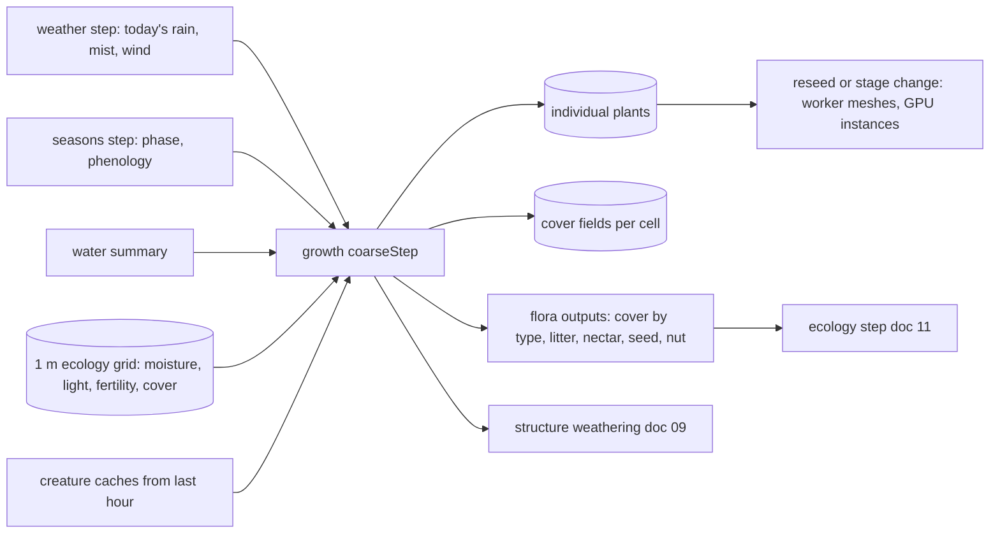

# 10 — Growth and Seasons

> Plants are how the island changes on its own. The player plants seeds; reeds creep along the wet edge of the pond, grass thickens, flowers open, shrubs fill in, and much later trees lift the skyline. Moss spreads in soft blotches over damp ground and stone. Seasons turn every fourteen game days: spring greens and blossoms, summer fullness, autumn color and falling leaves, then a gentle, snow-free winter of bare branches, frost mornings and mist. Weather (rain, mist, wind) waters the island and carries seeds. All of this advances one game hour at a time with seeded rules, so the island that greets the player after a night away is exactly the island that would have grown if they had watched.

## Locked decisions

- **Interim moss (October 2026, before this doc's moss arrives):** `src/world/growth/moss-live.js` grows moss where the water summary says the ground stays damp: hollows of at least 3 m², and banks of ponds and streams (full next to the water, thinning over three 0.5 m rings, never in the tide band). Cover starts inside a hollow and at the water's edge, spreads to neighbors, fills in about 18 game hours, and fades over 48 where the ground dries (`recipes/world/terrain.json` `moss`). It is visual and not saved; on load, existing habitat starts fully grown. The reaction-diffusion moss here replaces it and drives the same fifth ground layer (doc 22).

- **Two layers of flora.** *Cover plants* (grass, clover, moss, lichen, low flowers) live as biomass fields on the 1 m ecology grid. *Individual plants* (reed clumps, ferns, shrubs, trees, tall flowers) are records with id, position, seed, age, size and stage. This matches the save layout in `18-saves-and-persistence.md`.
- **Growth lives in the shared hourly tick** at its fixed slot: tide, weather, seasons, water summary, **growth**, ecology, creatures, expansion. `world/growth/coarse.js` exports `coarseStep(state, hourIndex, env)`. Structure weathering (doc 09) runs inside it.
- Growth reads only the ecology grid, the water summary, the day's weather record and the season state. Moisture comes from the previous hour's ecology step (a one-hour lag, by design).
- **Simulate from world time, draw from display time.** Plant sizes and stages come from world time. Season color, leaf cover, frost and wind sway come from display time, so the season preview dial (doc 16) can show autumn color without changing any plant.
- **Vertical slice: reeds** (cattail-like) spreading along wet ground and the tide band, plus a **grass** cover layer drawn as GPU blades. Everything else here is later milestones.
- **Winter is snow-free**: no accumulation. Winter shows bare branches, pale standing reed stalks, frosted grass tips at dawn, more mist. Where other docs mention snow, the season shader's "snow cover" input drives **frost rime** instead.
- **No plant withers because the player was away.** Established plants hold a size floor; only player actions (draining, burying, removing) or deep flooding remove them.
- Meshes regenerate only on stage changes, never every hour. Between ticks, the live sim interpolates size smoothly.

## How it works

### Plain language

Every game hour each plant asks three questions: is the ground right (moisture, soil, light, salt), is it the right season to grow, and is there room? The answers set how fast it grows that hour. Grown-up plants make seeds; wind, water and creatures carry them; some land somewhere good and sprout. Reeds also spread underground, sending a new clump a short way along wet ground every half day or so, which is why they creep along the pond edge as a band.



### Growth rule (individual plants)

For plant *i* of species *s* in cell *c*, each hour:

```
suit  = Π_k  bell(x_k; ideal range from recipe)        k = moisture, light, fertility, salt, depth
room  = 1 − crowding(c, s)                              shared capacity per cell
grow  = rate_s · seasonGrowth_s(phase) · suit · room
size += grow · (1 − size / maxSize)                     logistic toward recipe maxSize
age  += 1
```

`bell` is a smoothstep plateau (1 inside the ideal range, falling to 0 at the tolerance limits). Stages advance on size and age thresholds from the recipe: **seed, sprout, young, mature, flowering, fruiting, dormant**, and **old** for trees. If `suit` stays below 0.15 for 48 hours, size shrinks slowly toward a floor of 40% of its best size; it is removed only if the cell is buried, dug out, or under more water than the recipe tolerates for 72 hours.

Cover plants use the same rule on biomass per cell (0..1), with spread to the 4 neighbors at `spread_s · biomass` when the neighbor is suitable. Grass cover also reads the terrain's painted grass weight and path wear.

### Reeds, the slice worked example

```
           mature clump: 8-20 stems, seed heads in summer
  wet bank   |||  |||| |||    <- rhizome spawns a new clump 0.6-1.4 m along the band
 ~~~~~~~~~~~~~|||~|||||~~~~~~~  water's edge, depth 0 to 0.4 m
        tide band (wet twice a day): reeds tolerate it, grass does not
```

- Habitat: moisture 0.6 to 1, or standing water up to 0.4 m deep; tolerates brackish tide band; prefers full sun.
- Planting: the seed tool drops a seed; sprouts in 2 to 4 game hours if suitable.
- Growth: sprout to mature in about 30 game hours (half a real hour at 1x), so the player sees reeds rise in a first session.
- Spread: a mature clump with suitability above 0.6 rolls a rhizome every 12 game hours (seeded). The new clump goes 0.6 to 1.4 m away, at the bearing whose cells score best for moisture, so the band follows the shoreline. Capacity: one clump per 1.5 m² of reed-friendly cells.
- Seasons: fresh green in spring, brown velvet seed heads in summer, gold in autumn, pale standing stalks in winter (dormant, still counted as cover, which frogs need).
- Outputs to the grid: reed cover (frog shelter), biomass for the midge field (doc 11).

As built in S5b-1 (`world/growth/habitat.js`, `coarse.js`, `index.js`; `recipes/flora/reeds.json`, `recipes/world/growth.json`):
- **Habitat grid** (1 m, 192 × 192 from −80 m, aligned with the water summary's ecology aggregate), integers only: standing fresh water depth, moisture (255 in water and damp hollows, the tide band at least 200, falling to 0 over 3 m from fresh water by a chamfer distance), salt (255 in the sea, at least 210 in the tide band, falling over 4 m), still water, sea, and the painted grass share. Rebuilt whenever the water summary changes (after every sculpt or paint stroke); `env.habitat()` hands it to the tick.
- **Suitability** is a product of plateau bells, one per axis (moisture, water depth, salt), each `[ideal low, ideal high, tolerance]` in the species recipe. The sea counts as far too deep.
- **The growth step** runs after seasons in the hourly tick (`sim/tick.js`), seeded by `stream(subSeed(seed, 'growth'), hour, plantId)`. Each plant ages, grows `size += rate · seasonRate · suit · (1 − size)`, shrinks toward `floor · best` after 48 poor hours, dies after 72 hours too deep or a seed's 24 poor hours, and takes its stage from age, size and the season windows (flowering summer, dormant winter). A mature reed clump with suitability over 0.6 sends a rhizome every 12 hours, 0.6 to 1.4 m along the best of eight bearings (starting at a seeded bearing), unless another clump stands within 0.8 m.
- **Grass cover** per square meter moves 4% of the gap per hour toward how well grass likes the ground (none in standing water, thinning on salt). Painting decides where grass is at once; the cover only thins it where the ground turns against it, so a dug pond drowns its grass over a day.
- **New islands** get 7 mature reed clumps on the most suitable cells (2.5 m apart, chosen by a seeded hash order) the moment the habitat first exists (`settleGrowth`), not at the next hour.
- **The Plant tool** plants a seed through `growth.plant(species, x, z)`, which changes the world state like any other edit; it refuses ground under 0.2 suitability and says why (too dry, too deep, too salty, crowded). `src/world/growth/plant-tool.js` also draws rings on the ground (terrain-draw `marks`, UI only): each seed's ring blooms and fades, and while the tool is open the player's plantings keep a soft ring until they are mature. A seed draws as a few short shoots (`look.sproutM`, `look.seedShoots`), and no stem stands shorter than a sprout, so a planting is visible from the first moment.
- Two runs of 96 game hours from the same state give the same world hash; 96 hours take about 33 ms on desktop. `tools/growth-lab.html` charts 14 days and checks the two runs match.

As built in S5b-2 (`recipes/flora/lilies.json`, `iris.json`, `thrift.json`; `render/passes/flora-kinds.js`; `shaders/flora-lilies.wgsl`, `flora-iris.wgsl`, `flora-thrift.wgsl`, `lib-flora.wgsl`):
- **Three more species** on the same engine, each only in its own ground: **water lilies** in still fresh water 0.3 to 1.5 m deep (never in streams or the sea), **yellow flag iris** on the wet bank a little drier than reeds (at most a few centimeters of standing water), **sea thrift** on salty, dry shore (the tide band and the first meters inland, never in standing water; evergreen). Suitability axes are optional per recipe and now include **still** water; a plant tells the Plant tool which need is furthest from met, and in which direction (too dry or too wet, too shallow or too deep, too fresh or too salty, water moving), so each species has its own refusal text. Nothing grows outside the water summary's area (habitat `open`).
- **Spread**: lilies and iris by rhizome (lilies every 30 h, 0.9 to 1.6 m; iris every 30 h, 0.4 to 0.9 m); thrift by **seed** (`spread.kind: "seed"`): every 48 h a mature cushion drops a seed 0.5 to 2 m away on one rolled bearing, and it takes only where the ground scores at least 0.55. Starters: 3 lilies, 4 iris, 6 thrift on a new island where the ground suits them.
- **Drawing**: the instance buffer is grouped by species, and the flora pass draws each species' range with its own shader. Lily pads are notched discs floating 1.2 cm above the water simulation's surface (bed plus depth from its depth texture, interpolated like the water mesh), so they ride the level and settle on the mud if a pond drains; they bob and turn a little in the wind and catch a waxy GGX highlight; flowering plants (summer) open a cupped white flower. Iris clumps are fans of flat sword leaves in one plane each, with yellow flowers (late spring) of three falls and three standards; tips brown in autumn, short brown leaves in winter. Thrift is a low dome of fine blades lit with the dome's normal, with pink pompoms shaded as balls (spring to summer). About 960 plants after 28 game days cost 0.13 ms (p50) on ultra.

As built for the marsh (October 2026, branch `m1-marsh`; `recipes/flora/rushes.json`, `coarse.js`, `grass-blades.wgsl`):
- **Rushes and sedges**, a second cover plant (growth.json `cover`): a share per square meter, like grass, that moves `growth.ratePerH` of the gap each hour toward how well rushes like the ground (the same plateau bells as the species: still, shallow fresh water up to about 0.3 m and soaked ground; none in streams, the sea or salt). A new island started with it full where the ground suits it (since the plants-and-ground work, rushes come by themselves instead; see below). State: `growth.cover.rushes` (Uint8Array on the habitat grid).
- **Rushes spread; they never appear from nowhere** (review, October 2026). Bare ground is taken only from a stand beside it (a neighbouring square at least `spread.fromShare` full), so they creep out about a metre a game day. In any hour, with chance `spread.jumpPerH`, a seed carried off a stand (wind, birds, water) tries `jumpTries` landings within `jumpM`; where the ground suits it at least `jumpMinSuit`, a new tussock starts. A marsh dug far from any rushes waits for one, about every few game days on Two ponds. Spreading and seeding raise `growth:spread`, which the journal hears. Seeded by the hour.
- **Grass gives way to rushes** on soaked ground: its target falls by `grass.yieldToCover` times the rushes' share.
- **The Plant tool plants rushes** (`plantCover`): a tap starts a tussock `spread.plantStart` full, or says which need the ground misses most (dry, flow, salt, deep), or that rushes grow there already. Refusals teach the journal, so the rushes page learns its likes from what happens (`refused:dry`, `refused:flow`, `refused:salt`, `spread`), as the other plants do.
- **Ground with no water on it counts as still** in the habitat's needs: water can only move where there is water. Before this, dry ground told rushes and water lilies that "the water moves too much here".
- **Drawing**: the grass pass runs a second time with the rushes recipe. Stems stand on the bed and rise out of water up to `maxWaterM` (longer in deeper water), in tussocks about `clumpM` across with open water lanes between them (a slower noise), the core taller than the rim, stems splaying out from the core. A blade with no rush cover stops before reading the ground, so the pass costs little away from wet ground (about 0.33 ms on ultra looking into a marsh).
- **Basin starters**: an island recipe may give a basin starter plants of its own (`basins[].starters`, species to count), placed on that basin's suitable cells within its outer radius plus jitter, in seeded hash order. Two ponds gives each marsh reeds and iris; the starter island has none, so its plants are unchanged.

As built for the plants and ground (October 2026, branch `m1-plants-ground`; docs/future/10):
- **Ground axes** for every plant: the painted sand, rock and soil shares (soil counts grass paint too, since turf lies over soil and a pond floor is grass paint), slope in degrees, and height above mean sea level (`shoreM`, from the cell's mean terrain height). Reeds, lilies, iris, rushes and grass keep to earth and gentle ground; thrift wants sand or rock 0.3 to 3 m up; campion rock from 0.9 m, above most thrift.
- **Only grass, reeds and water lilies start** (growth.json `starters`; the earlier "rushes were there when you arrived" no longer holds). The others are **volunteers** (`src/world/growth/volunteers.js`): none in an island's first `firstAfterH` hours, then at least `gapH` hours apart, a chance of `chancePerH` each hour; the next species in `order` that has ground lands as a sprout (or a fresh tussock) on its best-hashed suitable square. Seeded by the hour, so catch-up brings the same plant to the same square. `growth.arrived` records when each came; a save from before it counts what it holds as arrived. The journal writes the `plantable` line under the first sighting, and the Plant tool offers a plant once the journal has seen it. Midges feed on rushes too, so a new island has fewer midges until rushes come (about day 3).
- **Starters take their season's stage** when planted, so a spring island shows its flowers at once.

As built for the first shrub (October 2026, branch `m2-grey-willow`; `recipes/flora/willow.json`, `shaders/flora-shrub.wgsl`):
- **Grey willow** (*Salix cinerea*) is the first shrub, and a volunteer after marsh marigold: a moist, fresh bank of soil, no salt, at most a few centimeters of standing water, gentle slopes. It grows over about a game season (`growth.ratePerH` 0.0065, mature at 0.8 of full size after about 10 days) and size reveals it. It seeds only in early summer (`spread.window`, new), 2.5 to 6 m away, at least 2.4 m apart, and stops at 14 plants (`spread.maxCount`, new), so a bank never fills with willow. Flowering (catkins) runs from late winter into early spring; dormant (bare) late winter.
- **Drawn without an L-system or a mesh**, as a light stand-in for this doc's L-system plan: the vertex shader grows 5 to 9 hashed stems from a stool with `floraCurve`, leaning out to the crown's edge, each forking once or twice, as tapering ribbons; toward the tips sit camera-facing cards cut in the fragment shader into twig sprays with leaves on a jittered grid, or catkins. The crown is lit as one mass with an ellipsoid normal, as thrift's dome. Leaf-out, the autumn turn and leaf fall come from season windows in the recipe (`phenology`), the colors from the season albedo; male and female bushes ripen their catkins yellow or green. 1,350 vertices a bush. Gorse can use the same shader (`draw: "shrub"`) with other numbers, as evergreen (no `phenology`).
- **A soft contact shadow** under each shrub (flora casts no shadows until the trees in M4): three stacked discs (12 cm apart, 432 vertices) draped on the terrain's height, drawn before the plants with a multiplying blend, so the grass under a bush darkens down its blades and not only the ground between them; sized to the crown, fainter while bare, drawn out a little away from the sun. About 0.2 ms for the whole flora pass with 14 willows in view on desktop.
- Frogs count willow as shelter (0.6) and tuck in at its foot by day.

### Grass

Grass is a cover field drawn as GPU blades with no mesh (doc 04). Blade density per 0.25 m texel = `grassCover(c) · materialGrass · (1 − wear)`. Blade height follows biomass and season (short in winter, tall by midsummer); tint comes from the season ramp, the moisture field, and a per-blade hash. Clover and low flowers ride on the same blade system as flower-headed variants.

As built in S5a (`render/passes/grass.js`, `grass-blades.wgsl`, `recipes/flora/grass.json`): blades stand on a world-anchored jittered grid in two square rings around the camera's focus, a dense near ring (140 blades per m² at full tier density, out to a quarter of the tier's grass distance) and a sparser far ring (12% of that, blades a little wider), both drawn from `vertex_index` with nine vertices per blade (two segments and a tip). A blade exists where a hash falls under the painted grass weight times a tuft pattern (patches of about 0.45 m up to 60% thicker or thinner, and 40% taller or shorter), never in water deeper than 1 cm; it shrinks away over the last quarter of the distance, so the meadow meets the textured ground with no edge. Blades bend at rest, sway with the day's wind and passing gusts (6 m, 2.5 m/s), take their height and albedo from the season blended through the year, darken in rain, and are lit like the ground (sun and moon with shadows, sky fill, a little wrap) with a darker root. They write the ground's normal and the terrain's outline group, so they never get outlines. Until S5b's growth step the cover is the painted grass weight itself. `?grass=0` turns them off. Cost on ultra about 0.2 ms.

The near and far rings no longer meet along the near ring's square (October 2026, after S6; Matt: zoomed out, the dense meadow read as a box). They meet across a soft round band over the outer half of the near ring, its edge wobbled by a slow noise: near blades thin out across it as the far ring's fill in (`density.blendShare`, `density.blendNoise`). The marsh's rushes, drawn by the same shader, blend the same way.

**Wet-to-dry grass** (October 2026, island areas step C; the biome session's plan, Matt chose a 6 m reach and late-summer straw). A look field (`src/world/growth/lush.js`), 0..1 per square meter, built with the habitat:
- **Where:** 1 at fresh water, easing to 0 by 6 m from ponds, marshes and streams and by 2.5 m from damp hollows. Salt dries the shore ring. The field is then feathered by a soft blur (`featherM`, about 2 m), and the tints were softened, after Matt saw the first version read as borders in summer.
- **Blades:** by the water they stand up to 1.5 times as tall and deeper green; on the dry rise 0.8 times as tall and paler. The dry end cures toward straw through late summer and autumn. A lushness of `mid` is today's meadow.
- **The far ground:** its grass layer takes the same tint, so the rings show past where blades end, with no edge.
- **Plumbing:** the field rides in the plant-cover texture's b channel (now rgba8).
- **Look only:** the plants' own moisture, growth, saves and the landform hash are unchanged.
- **Journal:** the Grass page learns a summer field note about it.
- **Numbers:** `recipes/flora/grass.json` `lush`.

### Other flora (later milestones)

| Kind | Generator | Notes |
|---|---|---|
| Trees (oak, beech, alder, hazel, wild cherry, hawthorn) | **space colonization** (Runions, Lane, Prusinkiewicz, "Modeling Trees with a Space Colonization Algorithm", 2007) | attractor cloud from the recipe's crown shape; skeleton grown once per stage; pipe-model radii; leaves as instanced cards on twig tips |
| Shrubs, ferns, bramble | **parametric L-systems** (Prusinkiewicz and Lindenmayer, *The Algorithmic Beauty of Plants*) | rules and angles in the recipe; ferns unroll their fronds in spring as a shader parameter |
| Flowers (wildflowers, evening primrose, water lilies) | small parametric meshes: stem curve, leaf rosette, petal ring | petal count, curl, cup, color region; bloom shown by an "open" parameter |
| Reeds, grass, clover | GPU blades from `vertex_index` | no meshes |

Growth between stages is shown without remeshing: each skeleton vertex stores its distance along the branch from the root, and the vertex shader reveals and scales branches by the plant's live size, so a tree visibly thickens and extends between stage meshes.

### Moss and lichen

- **Simulation:** moss and lichen cover per 1 m cell are cover fields in the growth step. Moss grows where moisture is high and light is low to medium (north slopes, under trees, wall bases, stone); lichen grows slowly on sunlit rock. **Sea-cliff lichen** (M4, with the reaction-diffusion work) bands rock faces in the spray zone the way real sea cliffs do: black near the tide line, orange higher up, grey on top, set by height above high tide and spray exposure. Over a few game weeks it turns a bare cliff from the Cliff tool (doc 08) into a living one.
- **Look:** a **Gray-Scott reaction-diffusion** texture in terrain texture space (0.25 m texels, only for open chunks near the camera) makes the organic blotch patterns. Feed and kill rates vary with moisture and shade, and the coarse cover field acts as a mask: the RD pattern may only occupy the fraction the simulation allows. Moss settles into blotchy spots and lichen into small rings (different feed and kill settings). The result is written into the terrain ground texture's moss channel (doc 08).
- On re-seed after catch-up, the RD texture is started from noise thresholded by the cover fraction and run for about 200 silent steps behind the reveal fade (doc 02). Stones and walls use their own triplanar mask driven by the same rates (doc 09).

### Seed dispersal

Mature plants produce seeds on their fruiting stage. Each seed's landing spot is a seeded draw from one of these kernels:

- **Wind:** exponential distance kernel, mean from the recipe (grass 3 m, wildflowers 6 m), skewed downwind using the hour's wind from the weather record.
- **Water:** reed seeds and clumps that land in water drift along the tide band to the nearest suitable shore cell within 15 m.
- **Gravity:** heavy fruits (acorns, hazelnuts) fall within the crown radius.
- **Creatures:** the creatures step records **caches** (jays and squirrels bury acorns and nuts, doc 12) and **drops** (songbirds and hedgehogs drop berry seeds). Growth reads last hour's caches and drops; a fraction (from the recipe) germinate in spring. This is how the jay plants the oak.

Seeds that land on unsuitable or full cells are discarded. Per-chunk seed results from workers are merged sorted by `(plantId, seedIndex)`, so the result does not depend on worker count. A species may hold at most its recipe's seed bank per chunk.

### Seasons

`world/seasons.js` runs the seasons step: it turns world time into `{index, phase, year, day}` (14 game days per season, 4 per year; F01, was 7) and per-species phenology: leaf-out, bloom window, fruiting, color turn and leaf drop, each as a phase window from the recipe plus per-plant jitter of up to ±1.2 game days (hash of plant id; not built yet), so trees do not change in lockstep. Growth rates per hour stay as they were with 7-day seasons (Matt, October 19, 2026), so each season ends fuller. Leaf drop adds leaf litter to the grid (food for hedgehog beetles, shelter for fireflies). Emits `season:changed`.

For drawing, the season shader uniforms (color ramp position, leaf cover, frost) come from **display time** through `clock.display()` (doc 04). In normal play the two agree; in preview only the look moves.

### Weather

`world/weather.js` runs the weather step. Each game day rolls one record from `hash32(weatherSeed, dayIndex)`: a mood (clear, soft cloud, rain, mist), rain hours and amount, mist hours, wind direction and a strength curve over the day. Winter swaps rain for cold drizzle and more mist; there is no snow.

**Weather leaning** (saved in the `world` slice, `-1` drier, `0` as it comes, `+1` wetter): the base probabilities for rain and mist are scaled by `(1 + 0.25 · lean)` and the clear and cloud shares absorb the difference, then renormalized; the shift never exceeds 25 percent and never forces a mood. A change of leaning applies from the next game day so today's record never changes after it is rolled. The same function runs live and in catch-up, so a wetter leaning grows the same extra moss either way.

Rain raises moisture (ecology step), triggers the visual wetness and puddle sheen (doc 08), and drives the rain particles. Mist lowers light for the day slightly. Wind sets dispersal skew in the sim and sway in the shader. "Hold today's sky" (doc 16) freezes only the visible weather.

## Data and interfaces

Files in `src/world/growth/`: `index.js`, `coarse.js`, `rules.js` (growth, stages, floors), `cover.js` (cover fields), `dispersal.js`, `instances.js` (writes per-chunk instance buffers, doc 04), `gen-space-colonization.js`, `gen-lsystem.js`, `gen-flower.js`, `gen-blades.js` (worker jobs), `moss-rd.js`. Plus `world/seasons.js` and `world/weather.js`. Shaders: `foliage-draw.wgsl`, `grass-blades.wgsl`, `moss-rd.wgsl`, `lib-season.wgsl`.

```js
/** @typedef {Object} Plant
 * @property {number} id   @property {string} species   @property {number} seed
 * @property {number} x    @property {number} z          @property {number} age    (game hours)
 * @property {number} size (0..1 of max)  @property {number} best  @property {number} stage
 */
// coarse.js
export function coarseStep(state, hourIndex, env)
  // reads state.weather.today, state.seasons, state.waterSummary, state.ecology (last hour)
  // writes state.flora.plants, state.flora.cover[species], state.flora.outputs, state.structures.weather
  // returns {state, events}   events: growth:planted, growth:stage-reached, growth:seed-dropped, growth:spread
// weather.js
export function coarseStep(state, hourIndex, env)   // rolls the day at hour 0, applies leaning
export function dayRecord(seed, dayIndex, lean)     // pure; also used by tools/growth-lab.html
// seasons.js
export function coarseStep(state, hourIndex, env)
export function phenology(speciesRecipe, plantId, seasonState)  // {leaf, bloom, fruit, color}
```

Per-chunk save (doc 18): plant records for plants in that chunk; cover per species and moss and lichen as 32 x 32 `Uint8Array`s. Instance buffers and RD textures are never saved.

## Algorithms and shaders

Space colonization (Runions et al. 2007); parametric L-systems (Prusinkiewicz and Lindenmayer 1990); Gray-Scott reaction-diffusion (Pearson, "Complex Patterns in a Simple System", Science 1993); pipe model for branch radii (Shinozaki et al. 1964); exponential dispersal kernels; logistic growth. Coarse math uses only `+ − * /`, `Math.sqrt` and `det` helpers; grids are `Uint8` or fixed-point so rounding is identical everywhere. Per-plant randomness is `hash32(growthSeed, plantId, hourIndex)`.

## Tuning knobs

Per flora recipe (doc 14): growth rate, max size, habitat ranges and tolerances, stage thresholds, spread rate and distance, dispersal kernel, phenology windows, color ramps per season, mesh parameters. Global (`recipes/world/growth.json`): moss and lichen rates, RD feed and kill ranges, frost amount, weather probabilities per season, leaning limit (25 percent). Tuning panel buttons: "grow 1 day", "grow 1 season".

## Performance budget

| | Desktop | Mobile |
|---|---|---|
| Growth coarse step, starter island | under 0.8 ms per hour (worker) | under 2.5 ms |
| 168-hour catch-up share | under 0.3 s | under 0.9 s |
| Stage remesh (tree) | under 30 ms in a worker | under 90 ms |
| Moss RD | 4 steps per frame, under 0.4 ms | 1 step every other frame |
| Grass blades | up to 400k visible | up to 60k visible |

## Acceptance checks

- Plant reeds at the pond edge: within half a real hour at 1x they stand tall; over the next game days they creep along the wet margin and into the tide band, never up the dry slope.
- Grass is thick on painted grass, thin on sand and paths, and leans with the wind.
- Leaving overnight and returning shows a longer reed band and thicker grass, and `tools/determinism.html` matches a watched run hour for hour.
- Setting weather leaning to wetter makes moss spread visibly faster over a few game days.
- Dragging the season dial to autumn turns reeds gold and grass straw-toned; releasing returns to now with no plant changed.
- Winter has no snow: bare stalks, frosted grass at dawn, mist on the water.
- `tools/growth-lab.html` shows a time-lapse chart of reed clumps and grass cover over 14 game days (one season) for a seed.

## Open questions

- Should reeds ever need thinning, or should their spread simply stop at the edge of wet ground?
- Should winter frost look silvery-white or stay pale blue-grey so it never reads as snow?
- How much of the island should trees be allowed to shade before grass and flowers start to give way?
- With 14-day seasons and unchanged growth rates, where does each plant cap out by the end of a season, and should anything recede (die back, thin) across seasons? (F01)

## Depends on / feeds into

Depends on `02-core-loop-and-idle-model.md` (tick, catch-up, re-seed), `07-water-and-tide.md` (water summary, tide band), `08-terrain-and-sculpt.md`, `14-asset-recipes-and-tuning-panel.md`, `16-customization-and-photo-mode.md` (display time, leaning). Feeds `04-render-pipeline.md` (instances), `05-look-and-palette.md` (season keys), `09-structures.md` (weathering), `11-creatures-and-ecology.md` (cover, food), `17-audio.md`, `18-saves-and-persistence.md`.
