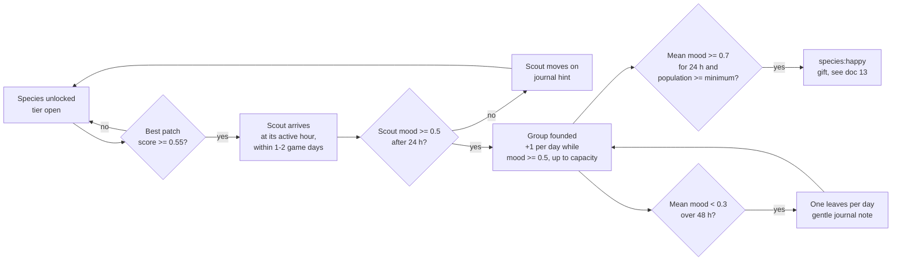
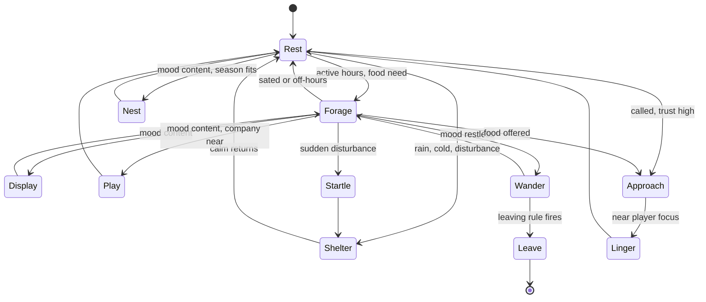

# 11 — Creatures and ecology

> Creatures are the reason to tend the island. Each species wants five things: the right water, the right food, somewhere to hide, some peace and space, and company. The island is read as a grid of small patches, and every patch gets a score for every species from what is growing and flowing there. When a good enough patch exists, a creature comes to look; if it likes what it finds, others follow. Their mood is never shown as a bar: a happy frog sings at dusk, a restless one wanders the edges. The player reads behavior, adjusts the habitat, and watches the island answer. The same rules run whether the player is watching or away, so creatures settle and come and go believably either way.

## Locked decisions

- **Five needs**, each scored 0..1 per species: water, food, shelter, quiet/space, company. Weighted per species in its recipe.
- **Mood = weighted geometric mean of the needs**, smoothed over hours. One missing need pulls mood down hard; no single excellent need can carry a bad habitat.
- **Habitat is scored on the 1 m ecology grid** defined in `02-core-loop-and-idle-model.md`, inside the hourly tick (`coarseStep` in `src/world/ecology/coarse.js` and `src/world/creatures/coarse.js`), so live play and catch-up give identical results.
- **Mood shows only through behavior** (calling, singing, nesting, play, lingering, wandering). No meters, no icons over heads. The journal gives soft hints in words.
- **No death, no fail.** Unhappy creatures leave calmly ("moved on") and can return when habitat recovers. Populations never crash on screen.
- **Two creature kinds**: *individuals* (frogs, hedgehogs, herons; each has an agent, position, can be named) and *swarms* (minnows, midges, bees, fireflies; a density field in ecology, boids in the live sim).
- **Bodies are blended SDF primitives**, baked to meshes on the GPU at load from the species recipe. Far LOD and tiny swarms use impostors. Hand-made glTF bodies are a later option.
- **Motion is procedural**: two-bone IK legs with foot planting, damped springs for secondary parts, boids for swarms.
- **Vertical slice species: frogs**, using reeds for cover, the pond and shallows for water, and midges (an insect field fed by reeds near still water) for food. Full frog spec in `12-creature-roadmap.md`.

## How it works

### Plain language

Think of each species as carrying a checklist and a pair of glasses. The glasses show the island as a heat map: warm where the checklist is met, cool where it is not. A frog's glasses light up where still shallow water, thick reeds and plenty of midges meet, away from paths and lanterns, with room for a few other frogs. When the warmest patch is warm enough, a scout appears. If the scout is content after a day, it stays and a small group forms, growing toward what the patch can hold. If things get worse (the player drains the pond, a path cuts through the reeds), mood slides over several hours, behavior turns restless, and after two unhappy days one frog leaves, then another.

### The ecology fields creatures read

The ecology `coarseStep` maintains per-cell fields on the 1 m grid. Creatures never read the GPU water sim or plant meshes directly; they read only these:

| Field | Source | Used by need |
|---|---|---|
| Water class and depth | water summary at mean tide plus the analytic tide | water |
| Tide band | cells wetted between low and high tide | water (shore species), food (waders) |
| Plant biomass per species | growth model (`10-growth-and-seasons.md`) | food, shelter |
| Cover | weighted sum of cover-giving plants, walls, logs, leaf litter | shelter |
| Cliff (from M2; used from M7) | per 1 m cell: rock face height, steepness, ledge cells (narrow level steps in a sheer face), height above high tide, cliff-top turf | shelter (ledge and burrow nesters), quiet |
| Prey fields | insect (midge) field, fish field, nectar field, seed and nut field | food |
| Disturbance | paths (day), lanterns (night), structures, larger wary species | quiet |
| Occupancy | residents and swarm densities per species | company, crowding |

The **insect field** matters for the slice: midge density grows logistically where reed biomass sits within 3 m of still water, scaled by warmth (season and time of day), and is consumed by frogs. In the live sim it is drawn as a faint shimmer of midges over the reeds; it is not a species with its own needs.

### Need scores

For species *s* at cell *c*, with recipe radii and preferences:

- **Water** `sW = 1 − smoothstep(rOk, rMax, d)` where *d* is distance to the nearest cell of an accepted water class (still, slow, running, tide band) and depth range. Distances come from a chamfer distance transform per water class, rebuilt only when water or terrain changes.
- **Food** `sF = min(1, supply / (demand · groupSize))`, supply being the sum of accepted food fields inside the foraging radius (summed-area table, so any radius costs four lookups).
- **Shelter** `sS = smoothstep(c0, c1, maxCover)` over the shelter radius, cover weighted by the species' preferred cover types.
- **Quiet** `sQ = 1 − smoothstep(q0, q1, blurredDisturbance)`, disturbance switched by the species' active hours (lanterns bother frogs and fireflies at night, paths bother herons by day).
- **Company** a tent function of nearby conspecifics against the recipe's preferred range `[nMin, nIdeal, nMax]`, plus small bonuses for listed companion species. Crowding above `nMax` lowers it.

**Target mood** `M* = Π sᵢ^wᵢ` with weights summing to 1. It is computed as `det.exp(Σ wᵢ · det.log(max(sᵢ, 0.01)))` with the deterministic math from `src/core/rng.js`. Actual mood eases toward it each tick: `M ← M + 0.15 · (M* − M)`, about a 4-hour half-life, so a single edit never flips a creature instantly.

**Habitat score** of a cell is `M*` evaluated with the species' ideal group size. Contiguous cells scoring above 0.5 form a **patch**; patch **capacity** is `floor(area · density)` capped by the species limit.

### Arrival, settling, leaving



Scouts are scheduled with the deterministic RNG keyed by species and day index. A species that has fully moved on returns through the same scout path. Swarm species skip scouting: their density field seeds at the patch edge and grows logistically toward capacity, shrinking when mood falls.

### Mood expressed through behavior

Each individual runs a small **utility-weighted state machine**. State weights come from mood band, time-of-day activity curve (diurnal, nocturnal, crepuscular), weather, season and trust in the player.



Mood bands drive what the player sees: **content (0.7+)** display, play, nesting, lingering near the camera; **settled (0.5–0.7)** routine foraging and rest; **restless (0.3–0.5)** wandering the patch edge, fewer calls, more startles; **leaving (under 0.3)** a slow walk to the shore and away. "Startle" is always brief and soft: a hop into the water, never a panic.

### Interactions

- **Feed**: a gentle toss gesture scatters the species' food at the cursor. Raises the food need by up to 0.2 for 6 game hours (diminishing on repeats) and raises trust. Recorded as a timed event so the tick applies it identically in live play and saves.
- **Call**: a soft whistle. Individuals with trust above 0.3 within 15 m turn and approach, then linger.
- **Name**: available once an individual's trust reaches 0.5. Named individuals keep a persistent record (age, home, a seeded marking pattern so they are recognizable) and get their own journal line.
- **Follow**: the camera locks to an individual with a soft follow rig (`15-camera-input-and-ui.md`).
- **Photograph**: in photo mode (`16-customization-and-photo-mode.md`), framing a creature records species, behavior state and name. The first photo of a species fills its journal page; photos of signature behaviors fill "moments".

Trust grows slowly with feeding, calling and time spent watching; it shortens flee distance and enables naming. It never decays below what was earned.

**Presence** (decided October 2026) is what a creature's flee distance is measured from. For now the only presence is the camera: its distance to the creature and how fast it moves, plus edits (sculpt, pour, plant) close by. Coming in slowly is welcome; a fast swoop inside a creature's comfort ring, or an edit right beside it, makes it startle softly (a frog hops into the water). Trust shrinks the ring (for frogs from about 1.5 m to 0.3 m). Startles are live animation only; trust changes are stored in the world as small events so saves and catch-up agree. The system is written for presences in general, not for the camera alone, so other presences can join later without a redesign.

### Procedural bodies

A body recipe lists SDF primitives (sphere, ellipsoid, capsule, round cone, rounded box), each attached to a bone, blended with a polynomial smooth-min of radius *k* (Inigo Quilez, "smooth minimum"). At load, a compute pass evaluates the SDF on a grid around the body and extracts a mesh with **surface nets** at three resolutions (LOD0 48³, LOD1 24³, LOD2 12³). LOD3 is an octahedral impostor atlas, also used for swarm members. Skin weights come from each primitive's share of the smooth-min blend, normalized across the four strongest bones. Albedo regions (back, belly, markings) are physical linear albedo; the painted look comes only from the palette tonemap (`05-look-and-palette.md`). Thin parts (frog throat sac, ears, wings) use a wrap-lighting term for soft translucency. Individual variation: each individual's seed jitters primitive radii by up to 6% and offsets marking noise.

### Motion

- **Legs**: analytic two-bone IK; feet plant on the terrain heightfield and lift on a gait phase per leg. Body height and pitch follow the averaged foot plane. Longer chains (heron neck) use FABRIK.
- **Hops** (frogs): a ballistic arc between planted poses, with squash-and-stretch from a spring on body scale.
- **Springs**: critically damped second-order springs on secondary bones (tails, ears, throat sac, whiskers), driven by root acceleration.
- **Swarms**: Reynolds boids (separation, alignment, cohesion) on the GPU with a uniform spatial hash, plus attraction to their ecology field and curl noise for insects. Fish stay below the live water surface; birds bank from lateral acceleration.
- **Pathing**: individuals steer on a coarse walkability grid (slope, water depth) with a simple flow field toward goal cells; no full navmesh in v1.

### Offline handling

The coarse model keeps only **group records** (species, patch, population, group mood, trust per named individual) and swarm densities. There are no positions while away. On re-seed, agents spawn near their home cells in the state their activity curve gives for that hour, as described in `02-core-loop-and-idle-model.md`.

## Data and interfaces

```js
// recipes/species/frog.json (shape; values in doc 12)
{ "id":"frog", "kind":"individual", "tier":1, "activity":"crepuscular",
  "needs": { "water":{"classes":["still","tide"],"depth":[0.05,0.6],"rOk":2,"rMax":8,"w":0.25},
             "food":{"fields":{"insect":1.0},"radius":6,"demand":0.08,"w":0.25},
             "shelter":{"cover":{"reeds":1.0,"grass":0.3},"radius":3,"c":[0.2,0.6],"w":0.2},
             "quiet":{"night":["lantern"],"day":["path"],"q":[0.2,0.6],"w":0.15},
             "company":{"n":[2,5,9],"companions":{"dragonfly":0.1},"w":0.15} },
  "density":0.02, "cap":12, "minHappyPop":4,
  "body":{ "prims":[ /* {type,bone,c,r,k,region} */ ] }, "motion":{ "gait":"hop" } }
```

Modules:

- `src/world/ecology/fields.js` field storage, summed-area tables, distance transforms.
- `src/world/ecology/coarse.js` the hourly step: fields, habitat, populations, in that order.
- `src/world/ecology/habitat.js` `scoreSpecies(state, speciesId) → Float32Array`, patches, capacity.
- `src/world/ecology/populations.js` arrival, settling, leaving, happy detection.
- `src/world/creatures/agents.js` live individuals, behavior state machine.
- `src/world/creatures/bodies.js` recipe to SDF to mesh bake (shaders `creature-sdf-bake.wgsl`, `surface-nets.wgsl`).
- `src/world/creatures/motion.js` IK, springs, hop arcs; `boids.wgsl` for swarms.
- `src/world/creatures/interact.js` feed, call, name, follow, photograph hooks.

Events (past tense, per doc 03): `creature:arrived` (a scout), `creature:settled`, `creature:left`, `creature:named`, `species:happy`, `species:moved-on`, `journal:photographed`.

## Algorithms and shaders

Weighted geometric mean for mood; summed-area tables (Crow, 1984) for radius sums; chamfer distance transform; surface nets (Gibson, 1998); polynomial smooth-min (Quilez); FABRIK (Aristidou and Lasenby, 2011); boids (Reynolds, 1987) with spatial hashing; curl noise (Bridson et al., 2007); utility AI action selection ("Behavioral Mathematics for Game AI", Mark).

## Tuning knobs

Tuning panel, per species: need weights and radii, accepted water and food, cover preferences, group range, density and cap; body primitives (drag sliders for radius, position, blend), marking colors, variation amount; gait speed, hop height, spring stiffness and damping; boid weights. A "show habitat heat map" overlay per species and a "force scout now" button. Saves to `recipes/species/*.json`.

## Performance budget

- Desktop: habitat scoring for all unlocked species under 1.5 ms per tick in a worker; up to 120 live individuals with IK and springs under 1 ms CPU; 4,096 boids under 0.3 ms GPU; creature rendering under 2 ms at 1440p. Body bake under 20 ms per species at load.
- Mobile (low) tier: 50 individuals (matching `19-performance-and-quality-tiers.md`), 1,024 boids, LOD bias +1, creature rendering under 3 ms.
- Offscreen individuals beyond 60 m run behavior at 4 Hz and skip IK.

## Acceptance checks

- Build a pond with reeds along one edge: within one or two game days a frog scout appears at dusk on the reed margin.
- Thicken the reeds and let grass fill the banks: frogs grow to a group of 4 or more; at dusk they call in a chorus and some sit still near the camera.
- Raise the ground under most of the pond and its reed margin so only a small puddle and a few reeds remain: over the next half day frogs call less and wander the far edge; after two days one leaves with a gentle journal note. Dig the pond out again and let the reeds regrow: a scout returns.
- Toggle the frog heat map: warm cells match where frogs actually sit.
- Feed and call a frog repeatedly; within a session it approaches when called and can be named; the name shows in the journal.
- Drag the body sliders in the tuning panel: the frog reshapes live with no seams.

## Open questions

- Should the journal ever hint at the exact weakest need, or only describe the behavior and let the player guess?
- Should named individuals ever leave, or always stay as long as their species stays?
- Is there room for gentle predator-prey moments (a heron near the frog pond making frogs warier), or should all species simply coexist?

## Depends on / feeds into

Depends on `02-core-loop-and-idle-model.md`, `07-water-and-tide.md`, `08-terrain-and-sculpt.md`, `09-structures.md`, `10-growth-and-seasons.md`, `14-asset-recipes-and-tuning-panel.md`. Feeds `12-creature-roadmap.md`, `13-progression-and-expansion.md`, `15-camera-input-and-ui.md`, `16-customization-and-photo-mode.md`, `17-audio.md`, `19-performance-and-quality-tiers.md`, `20-roadmap-and-vertical-slice.md`.
