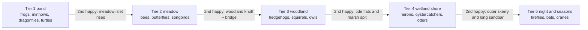

# 12 — Creature roadmap

> Sixteen species in five tiers, each tier tied to a kind of place: the pond, the meadow, the woodland, the wetland shore, and the night and the turning seasons. Every species wants a slightly different mix of water, food, shelter, quiet and company, so each one asks the player to build something new. Each has one behavior that makes it worth watching, one way the player connects with it, and one gift it gives back when it is happy. Frogs come first and are built in full for the vertical slice; everything else reuses what frogs prove out.

## Locked decisions

- Five tiers in the order below: four species in the pond tier and three in each of the others, sixteen in all (October 20, 2026: turtles moved from the shore tier to the pond, where European pond turtles live, and oystercatchers took their place on the shore). A tier's species become eligible to scout when its land exists (see `13-progression-and-expansion.md`). Tier 1 is eligible from the start.
- Every species gives **one gift** (a seed or a tool) when it first settles happy, never a creature: creatures are attracted, never bought. Trust brings its own rewards instead of items: a name, a call answered, a portrait at arm's length (`23-presence.md`). Land comes from **tier milestones**: when the second species of a tier becomes happy, new land joins. Gifts never expire and do not depend on order. A gift is given when the species is happy, whether or not the player has found one yet.
- Need models, mood, arrival and leaving follow `11-creatures-and-ecology.md`. Numbers below are starting values for the tuning panel, not final.
- **Winter dormancy**: frogs, hedgehogs, turtles, bees, butterflies, fireflies and bats go quiet in winter (hidden, mood held, not counted as unhappy). Their journal pages say where they sleep.
- **Starter kit** (before any gift; revised October 20, 2026): Sculpt (Raise, Lower, Flatten, Stone), Paint, Water (pond and shallows, with Pour and Drain), Plant with grass, reeds and water lilies, and Feed once a creature is found. The slice has no structures; stepping stones and one lantern join the kit in M2, and paths in M3 (`20-roadmap-and-vertical-slice.md`). Other plants are not gifts: they arrive by themselves over the first days (iris, rushes, thrift, marigold, campion, about one every 1.7 game days, `recipes/world/growth.json`) and can be planted once seen. Every other tool, and every seed beyond those, is a gift.
- **Colors**: species albedo regions are physical linear albedo (0 to 1), never palette hex. The palette maps them into its colors at tonemap (`05-look-and-palette.md`).
- **Frogs are the vertical-slice species.** Reeds give them cover, the pond and shallows give them water, and midges (the insect field fed by reeds near still water) give them food.

## How it works

Plain language: each tier teaches one new kind of habitat-building and one new kind of motion. The pond tier teaches water and hopping; the meadow tier teaches flowers and flight; the woodland tier teaches trees and four-legged walking; the shore tier teaches the tide and wading; the night tier teaches darkness and time.

The whole chain, gift by gift, with what each lets you make and whom it draws, is in `13-progression-and-expansion.md` ("The gift chain"). Gifts are chosen so one species helps the next: frogs give the Cliff tool, whose Cut digs the deep pool minnows come to; the dragonflies' springs then turn the frogs' terraces into waterfalls; minnows give pondweed, which turtles eat; turtles let you carry driftwood to the pond, and toads and slow worms (finds) live under the logs; minnows feed herons; oystercatchers eat the shore finds you have already met; songbirds plant oaks, which squirrels and owls need; the bridge gives bats a roost.

## Vertical slice: frogs (full detail)

| Aspect | Spec |
|---|---|
| Kind, activity | Individual. Crepuscular: active 18:00 to 02:00 and 04:00 to 07:00 game time; rests in reeds at midday. Dormant in winter (buried in pond mud). |
| Water (w 0.25) | Still fresh water 0.05 to 0.6 m deep, or a damp hollow; full score within 2 m, zero beyond 8 m. Not the tide band: common frogs avoid salt (changed in S6a). |
| Food (w 0.25) | The midge field summed over 6 m around the frog, against 2.5 square meters of full midge cloud per frog in the group. Midges are an ecology field, not a species (see below). |
| Shelter (w 0.20) | The best cover within 3 m: reeds 1.0, rushes 0.9, iris 0.7, lilies 0.5, grass 0.3; cover 0.3 starts counting, 0.6 is full, so grass alone is no shelter and a bare grassy bank holds no frogs. |
| Quiet (w 0.15) | Lanterns within 8 m at night, paths within 3 m by day (none exist in the slice, so quiet is full). |
| Company (w 0.15) | Group 2 to 9, ideal 5; a lone frog is a little lonely, a crowd past 9 a little less content; happy needs 4 or more. Small bonus near dragonflies (M2). |
| Numbers | **One frog per 3 m of good edge** (Matt, October 2026): a bank square beside still water whose habitat score is 0.5 or more is good edge, and the island holds one frog per 3 m of it, so the count follows the habitat and a bare stretch holds none. No fixed cap. The starter pond has about 85 m of good edge (about 28 frogs in time), Two ponds about 200 m. The shore fills slowly: a pair first, then about one more on most evenings while there is room. |
| Arrival (S6a) | 1) The pond becomes right: the journal's Frogs "?" gains a hint and the page's pencil circles sit near the best edge. 2) A sign at dusk, never "a frog arrived": a plop and rings by the reeds, and a note that something slipped into the water. 3) First sighting, only when the player finds one (taps it, or watches it closely): the page inks, the moment is written, the web's frog links ink. 4) Settling after a day, a second frog the next dusk. 5) The shore fills; if the habitat fails, one frog a day moves on, quietly. Numbers and timings in `recipes/species/frog.json` (ecology); `tools/ecology-lab.html` shows the arc on both islands. |
| Gift | **The Cliff tool** (Terrace and Cut, `08-terrain-and-sculpt.md`; Matt, October 20, 2026). It replaces the water lily seed, which the player already starts with. Frogs live on the step between land and water, and this tool builds steps. It is the first gift most players see, on the first or second evening. Saves where the frogs are already happy receive it quietly on load. |
| Signature behavior | **Dusk chorus**: content frogs call from the reed margin with the throat sac swelling; neighbors alternate rather than overlap (each frog delays its call if another started within 0.4 s), so the chorus ripples around the pond. In spring, nesting shows as frogspawn clumps in the shallows. |
| Other behaviors | Tongue-flick at midges (forage); sit still on a stone or pad (rest, linger); plop into water and surface eyes-up 2 m away (startle); slow hop along the far edge (restless wander). |
| Interaction hook | Call: a soft croak whistle, answered by frogs with trust above 0.3 (waits for M2 and the frog voice). Feed: a pinch of midges at the cursor, for trust only. Photograph moments: "dusk chorus", "frogspawn", "a frog that came when called". |
| Presence (doc 23) | Comfort ring about 1.5 m when shy, shrinking to 0.3 m with trust, always at real size (not scaled with the drawn frog); startles only at a fast swoop inside it or an edit beside it, a plop and back within a minute. Trust from feeding and quiet watching, at doc 23's pace (several play sessions). Named from trust 0.5. Ceiling: Familiar, sitting still for a portrait at arm's length (Bonded is kept for later rungs). The camera may come to 35 cm in normal play from S6b (the size preview allowed 25 cm). |
| Display size | Drawn at **1.5 times real size** (`body.displayScale`, Matt, October 2026), so frogs read from a little way off on a big screen and show more detail on a phone. Hops and tongue reach scale with it; comfort rings, needs and numbers stay in real meters. |
| Body recipe | Ellipsoid torso (squashed 1 : 0.6 : 1.3); round-cone head blended k 0.02 m; two eye spheres raised on the head top; throat sac sphere under the jaw (spring-scaled); hind legs as three capsules each (thigh, shank, long foot) folded at rest; short foreleg capsules. Length 7 to 9 cm. Albedo regions (linear): moss-green back about 0.12 to 0.16, sand-pale belly about 0.40 to 0.50, seeded dark bark-brown blotches about 0.05 to 0.08; the palette maps them into its colors at tonemap. |
| Motion | Hop: ballistic arc 0.3 to 0.6 m, legs extend via IK then fold, squash-and-stretch spring on landing. Swim: frog-kick cycle at the surface, floats with eyes above water. Breathing spring on throat at rest. Faces the camera slowly when lingering. |
| Audio | Call voice and chorus layering in `17-audio.md`. |

Every species also gets a presence block and a wildness ceiling, the closest it will ever let you come; starting ceilings for all sixteen are in `23-presence.md`.

## Tier 1 — pond island (starter, about 64 m)

Four species (turtles joined in October 2026). The meadow islet still rises when the second of them is happy.

| | Minnows | Dragonflies | Turtles (European pond turtle) |
|---|---|---|---|
| Kind | Swarm, diurnal, active all year (deeper in winter) | Swarm of few (3 to 8 visible), diurnal, summer and late spring | Individual, diurnal, dormant in winter (in the pond mud) |
| Water | Still or slow fresh water, depth 0.2 to 1.5 m, at least 20 m², with a deep spot of about 1 m to winter in. They come by themselves once such a pool exists; the frogs' Cut digs one in a stroke, and Lower can too | Still water within 10 m, sunny | Still, warm fresh water 0.3 to 1.2 m deep, in sun most of the day |
| Food | Midge field over water, pondweed when available | Midge field (competes lightly with frogs) | Pondweed and water lilies |
| Shelter | Water lily pads and reed stems at the water's edge | Reeds as perches and emergence stems | A sunny basking spot at the water's edge: a stone (the Stone chip) is enough at first; a log is better |
| Quiet | Low sensitivity (shade from structures is fine) | Low sensitivity | Moderate |
| Company | School of 8 to 30 | 3 to 8 | 2 to 6 |
| Gift | Pondweed seed (underwater meadow, holds more fish; food for turtles) | Stream tool: unlocks the Water tool's Spring mode (`unlocks.springs`; up to 4 springs, trickle, brook or stream; built in S4b). A spring above a terrace pours over its edge as a waterfall | **Carry a log**: lift a piece of driftwood off the strandline (the naturalist's notes bring it at 10 finds) and set it down anywhere. A log by the pond is a better basking spot, and toads and slow worms (finds) live under it. It replaces the shore tier's old drift log tool |
| Signature | School turns as one, flashes silver when the sun hits | Hovering patrol over the pond; pairs in tandem flight | Stacks of turtles basking on one log or stone |
| Interaction | Feed: crumbs make the school swirl up to the surface | Follow camera rides along a patrol route | Feed lily leaves; a named turtle ages visibly |
| Body | Capsule body tapered with a round-cone tail fin; impostor at distance | Thin capsule abdomen, sphere thorax and head, four flat wing ellipsoids | Flattened ellipsoid shell, sphere head on a short neck, flipper-shaped ellipsoids |
| Motion | GPU boids under the live water surface | Boids with hover hold points; wing flap as spring-driven phase | Slow paddle; haul-out onto stones and logs |

**As built (M2, branch m2-minnows-dragonflies, October 20, 2026).** One species list (`src/world/species.js`), one needs reader (`src/world/ecology/needs.js`, frogs byte-identical through it) and one tick model for schools and swarms (`src/world/creatures/swarms.js`: a group per pool, a sign, settling, growth toward what the pool holds, thinning, happy once, trust). Live, one system runs both behaviours (`schools.js`): minnows as seeded CPU boids under the live surface (`school.js`; CPU because there are at most about a hundred, the same on every device, and the game can find each one), dragonflies as patrol beats (`patrol.js`). Minnows need a spot at least 1 m deep (the starter pond is 96 cm). The dragonfly is the southern hawker (Matt's pick), flying from 0.4 into spring to mid-autumn. Pondweed is curled pondweed (`recipes/flora/pondweed.json`, `flora-pondweed.wgsl`), given only as the minnows' seed. Numbers in `recipes/species/minnow.json` and `dragonfly.json`.

## Tier 2 — meadow (the meadow islet)

| | Bees | Butterflies | Songbirds |
|---|---|---|---|
| Kind | Swarm, diurnal, spring to autumn | Swarm of few, diurnal, summer | Individuals (robin, wren, jay), diurnal |
| Water | Any shallow edge within 40 m | Damp ground (puddling) within 20 m | Shallow edge or bird-bath stone within 30 m |
| Food | Nectar field (clover, wildflowers) | Nectar plus a host plant patch | Seed field and insect field |
| Shelter | Sunny bare bank or stone wall | Tall grass, sunny wall to bask | Hawthorn hedge or shrubs |
| Quiet | Paths fine | Low | Moderate (paths fine, lanterns at dawn not) |
| Company | 20 to 80 | 4 to 15 | Pairs, 2 to 8 |
| Gift | Hawthorn seed | Stone wall tool | Oak (acorn) seed: the jay plants it |
| Signature | Flower-to-flower drift, waggle on the bank | Basking with open wings on warm stone | Dawn chorus; nest building in spring |
| Interaction | Photograph a bee on each flower species | Call: lands on the camera's focus point | Feed seed; a named robin follows the cursor |
| Body | Sphere head, sphere thorax, ellipsoid abdomen with banding | Thin capsule body, two pairs of flat wing ellipsoids with seeded patterns | Sphere body, sphere head, cone beak, ellipsoid tail and wings |
| Motion | Boids with flower targets | Fluttering path with noise, wing spring | Hop gait on ground, flap and glide in flight, perch on branches |

## Tier 3 — woodland (the woodland knoll and its bridge, which arrive at the Tier 2 meadow milestone)

| | Hedgehogs | Squirrels | Owls |
|---|---|---|---|
| Kind | Individual, nocturnal, dormant in winter | Individual, diurnal | Individual (pair), nocturnal |
| Water | Shallow edge within 30 m | Any water within 40 m | Any water within 60 m |
| Food | Beetle field (leaf litter plus moisture) | Nut field (hazel, oak, beech) | Small-prey field (grass plus litter) |
| Shelter | Leaf litter under hedge, wall or bramble | Mature tree for a drey | Old tree with a hollow (oak past maturity) |
| Quiet | Lanterns within 6 m at night | Paths fine | Lanterns within 15 m at night |
| Company | 1 to 3 | 2 to 6 | A pair |
| Gift | Bramble (blackberry) seed | Beech seed | Night-photo tool (long exposure in photo mode) |
| Signature | Snuffling forage along wall bases | Spiral chase around a trunk; caching nuts | Silent glide between trees; hooting duet |
| Interaction | Feed: a dish at the cursor; named hedgehog returns nightly | Feed nuts; caches appear as seedlings later | Call: answers the whistle with a hoot |
| Body | Ellipsoid body, round-cone snout, spine shell as displaced SDF noise | Ellipsoid body, sphere head, large tail of chained spheres | Egg body, flat facial disc, two large eyes, folded wing ellipsoids |
| Motion | Quadruped IK, short trot | Quadruped IK, bounding gait, trunk climbing on tree SDF, tail springs | Perch idle head turns, glide flight |

## Tier 4 — wetland shore (tide flats and the marsh spit)

Oystercatchers took the turtles' place here in October 2026. They feed on the shore finds the player has already met, so finds become food for a creature.

| | Herons | Oystercatchers | Otters |
|---|---|---|---|
| Kind | Individual, diurnal, all year | Flock of few, diurnal, all year | Individual, crepuscular, all year |
| Water | Tide band and shallows 0.1 to 0.5 m | The tide band: wet sand, sandbars and mussel beds exposed at low tide | Running or slow water, depth over 0.5 m |
| Food | Fish field (minnows) in shallows | The shore finds as a food field: mussels, periwinkles, lugworms | Fish field |
| Shelter | Tall reeds or trees to roost | Open sand or shingle above high tide to roost, with clear sight lines | Bank holt under roots or stones |
| Quiet | High: paths within 12 m by day | Moderate: paths within 8 m | Moderate |
| Company | 1 to 2 | 2 to 12 | 2 to 4 |
| Gift | Tide stone tool (choose gentle or strong tides) | Sea kale seed (big blue leaves and white flowers on bare shingle above the tide; nectar for bees) | Alder seed (bankside tree; wet alder wood keeps leaf litter damp for firefly larvae, and old alders hollow for bats) |
| Signature | Stands still for minutes, then strikes | Piping display: pairs run side by side calling; the flock lifts off the bar as the tide covers it | Slides down a bank, rolls and plays in pairs |
| Interaction | Photograph the strike | Photograph the piping; watch the flock follow the tide edge | Call: pops up and watches the camera |
| Body | Slim ellipsoid body, long neck of chained capsules, long cone beak, stilt legs | Sphere body, black back and white belly, long orange-red cone bill, short pink legs | Long capsule body, flat round-cone tail, small sphere head |
| Motion | FABRIK neck, slow wading IK, slow flap | Run and probe at the water's edge; low fast flock flight | Swim along a spline, quadruped bound on land, play loops |

## Tier 5 — night and seasons (the outer skerry and long sandbar)

| | Fireflies | Bats | Cranes |
|---|---|---|---|
| Kind | Swarm, nocturnal, summer only | Swarm of few, dusk and night, dormant in winter | Rare visitors: arrive at the spring and autumn turns, stay 1 to 3 game days |
| Water | Damp ground (moisture field) | Open water to drink in flight | Shallows and tide flats on the skerry |
| Food | Larvae in moist leaf litter | Midge field at dusk | Fish field and seed field |
| Shelter | Tall grass and meadow edges | Hollow trees or under the bridge | None needed; wide open sight lines instead |
| Quiet | Very high: no lanterns within 15 m | Lanterns along flight lines | Very high: no paths or structures within 20 m |
| Company | 20 to 200 | 5 to 20 | Flock of 4 to 12 |
| Gift | Evening primrose seed | Moonlight palette (`05-look-and-palette.md`) | Wild cherry seed; their arrival is usually the last step toward the year page (`13-progression-and-expansion.md`) |
| Signature | Synchronized flashing that spreads through the swarm | Stream out from the roost at dusk, zigzag over water | Pair dance: bowing and leaping at dawn |
| Interaction | Photograph the sync | Follow the dusk stream | Photograph the dance; "happy" here means they danced before leaving |
| Body | Tiny impostor with an emissive tail (physical emission, palette last) | Small ellipsoid body, membrane wings as thin SDF fans | Tall ellipsoid body, long capsule neck and legs, wing ellipsoids |
| Motion | Boids plus coupled-oscillator flash phase | Boids with sharp turns | Flock V formation in flight, slow wading IK |

## Data and interfaces

One recipe per species in `recipes/species/<id>.json`, schema in `11-creatures-and-ecology.md`, with extra fields `gift: {kind:"seed"|"tool"|"palette", id}`, `dormant: ["winter"]`, `visitor: {seasons:["spring","autumn"], stayDays:[1,3]}` for cranes, and `signature: "<behavior id>"`. The happy event (`species:happy`) carries the gift id; `src/world/expansion.js` watches it for tier milestones.

## Algorithms and shaders

Reuse from doc 11 throughout. New per tier: frog call alternation (call inhibition window, a simple form of anuran chorus timing); boids with targets (bees, dragonflies); quadruped gait phase tables (hedgehogs, squirrels, otters); FABRIK neck (herons, cranes); a run-and-probe flock that follows the tide edge (oystercatchers); firefly sync as a Kuramoto coupled-oscillator model, with coupling strength rising with mood so a happier swarm flashes in tighter unison.

## Tuning knobs

Each species exposes its needs, gift, group sizes, body primitives and motion constants in the tuning panel. A "roadmap" view lists all sixteen with unlocked, eligible, present and happy status as drawn icons.

## Performance budget

Per-species additions must stay inside doc 11 totals. Rule of thumb: swarm species share one boids pass; at most 6 individual species are animated at full rate at once, others at 4 Hz off-screen. Fireflies and minnows use impostors only.

## Acceptance checks

- Slice: frogs meet every row of the frog table above (except the gift card, which is M2), including the dusk chorus ripple.
- Each later species, when built: its heat map makes sense, its signature behavior appears within one game day of becoming content, and its gift card appears once.

## Build order

1. Frogs (slice, S6 in `20-roadmap-and-vertical-slice.md`)
2. Minnows (first boids, first fish field)
3. Dragonflies (flying boids, wing springs)
4. Turtles (basking on placed pieces; with the piece system that loose stones, driftwood and stepping stones share in M2)
5. Bees, 6. Butterflies, 7. Songbirds (first birds and perching)
8. Hedgehogs (first quadruped), 9. Squirrels (tree climbing), 10. Owls
11. Herons (FABRIK neck), 12. Oystercatchers (a flock feeding on the finds field), 13. Otters (swim plus land gait)
14. Fireflies (oscillator sync), 15. Bats, 16. Cranes (visitor system)

## After v1: the Headland expansion (M7)

A new chapter after the year page, so the sixteen species above stay the whole first year. Cliffs come from the Cliff tool (M2, `08-terrain-and-sculpt.md`) and from the Headland land piece (`13-progression-and-expansion.md`). Needs use the cliff field in `11-creatures-and-ecology.md`.

| | Puffin (first) | Kittiwake (first) | Feral goat (later) |
|---|---|---|---|
| Shelter | burrows in soft cliff-top turf, 3 m or more above high tide | narrow ledges on rock faces steeper than 70 degrees, above water | rock ledges out of the wind |
| Food | sand eels in deep, clear water within 30 m | surface fish on open sea | grass and heather on steep ground |
| Quiet and space | no lantern or path within 6 m | a sheer drop, nothing walking above the ledge | 40 m of land or more to roam |
| Company | colony of 6 to 20 | ledge colony, calls at dawn | small herd of 3 to 6 |
| Signature | waddle, beak full of fish | dawn calling along the ledge | sure-footed climb up a face |

## Open questions

- Should songbirds be one species with three looks, or three separate journal pages?
- Should herons ever eat a frog, or only fish?
- Is a gift every species too frequent late in the game, or about right? (October 20, 2026: kept at one gift per species, on settling, with trust rewarded by names, calls and portraits rather than items.)
- Matt's pin (October 2026), not scheduled: small burrows or caves, an exception to the heightfield's no-undercuts rule, that draw a landmark land creature such as a bear. Landmark creatures want landmark places the player can discover. Keep the door open: placed rock pieces (M7's arches and sea caves, doc 20) are the natural way to build them.

## Depends on / feeds into

Depends on `11-creatures-and-ecology.md`, `10-growth-and-seasons.md`, `07-water-and-tide.md`. Feeds `13-progression-and-expansion.md`, `14-asset-recipes-and-tuning-panel.md`, `17-audio.md`, `20-roadmap-and-vertical-slice.md`.
