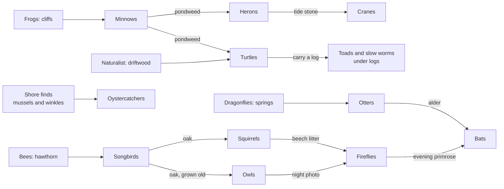
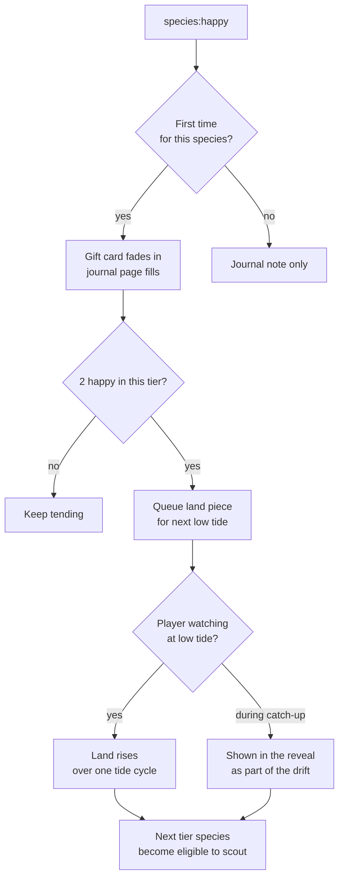

# 13 — Progression and expansion

> ebb has no score, no currency and no way to lose. Progress means the island gets richer: each species that becomes happy leaves a gift (a new seed, a new tool), and when two species of a tier are happy, new land joins the world: an islet rises out of the sea at low tide, a sandbar firms up, a bridge reaches across to a wooded knoll. The field journal is the only record of how far you have come, filled with photographs, names and small notes. The pace is set by things growing, not by chores, so a relaxed player who drops in for a while each evening sees something new most visits without feeling hurried.

## Locked decisions

- **The only progression input is species happiness** (`species:happy` from `11-creatures-and-ecology.md`). No experience points, no currency, no crafting.
- **Two kinds of reward from creatures.** Each species gives one gift (a seed, tool or palette, never a creature) the first time it becomes happy; trust is rewarded by names, calls and portraits, not items (`23-presence.md`). Finds have their own line, the naturalist's notes, which never counts toward milestones. A **tier milestone** fires when the second species of a tier is happy, and that milestone brings new land. Gift list per species: `12-creature-roadmap.md`.
- **Five land pieces, one per tier milestone**, in fixed order, each placed by the world seed so every world differs a little.
- **New land arrives at low tide, while the player is watching.** A milestone reached during catch-up is queued and plays during the reveal or the next low tide in play. Gifts reached offline appear as journal notes in the reveal.
- **Happiness is not lost by progress.** Once a gift is given it stays. If a species later moves on, its journal page says so gently and it can come back; nothing is taken away.
- **No fail states, no deadlines, no pressure.** Nothing dies on screen, nothing is lost by being away, no reward is time-limited. Rare visitors (cranes) return each spring and autumn, so missing them never closes a door.
- **Hard world ceiling**: fully expanded, the world fits inside a 192 m by 192 m area, about 4.5 times the land of the starter island. Expansion never grows past the budgets in `19-performance-and-quality-tiers.md`.

## How it works

### What reaches the player, and when

Agreed with Matt on October 20, 2026. New things reach the player in five ways, and no single one dominates:

| Way | What comes | Paced by |
|---|---|---|
| Starter kit | Sculpt (Raise, Lower, Flatten, Stone), Paint, Water (Pour, Drain), Plant with grass, reeds and water lilies; Feed once a creature is found | nothing: there from the start |
| Plants that come by themselves | Iris, rushes, thrift, marigold, campion; plantable once seen | about one every 1.7 game days (`recipes/world/growth.json`) |
| The naturalist's notes | Shells at 3 finds; loose stones at 6, driftwood at 10, the hand lens at 15 (driftwood and the lens swapped places on October 20, 2026, so logs come in time for the turtles) | finds discovered (`recipes/world/naturalist.json`) |
| Species gifts | One seed or tool per species, when it first settles happy (list in `12-creature-roadmap.md`) | creature happiness |
| Tier milestones | New land, when the second species of a tier is happy | creature happiness |

The first ten game days on the pond tier:

```mermaid
flowchart LR
  S[Start<br/>starter kit<br/>grass, reeds, lilies] --> F[Days 3 to 6<br/>frogs settle<br/>gift: the Cliff tool]
  F -->|Cut digs a deep pool| M[Minnows come<br/>gift: pondweed]
  F -->|terraces wait| D[Dragonflies<br/>gift: springs]
  D -->|spring above a terrace| W[Waterfalls]
  S -->|a sunny stone by the pond| T[Turtles<br/>gift: carry a log]
  N[10 finds<br/>driftwood on the strandline] --> T
  M --> L[2nd happy species<br/>meadow islet rises]
  D --> L
  T --> L
```



The gifts build on each other. The frogs' Cliff tool makes the deep, still pool minnows want; the dragonflies' springs then pour over the terraces the player has already built. A gift never brings a creature: the creature still decides to come.

### The gift chain (agreed with Matt, October 20, 2026)

Each gift lets the player make something new, and what they make is part of what draws a later creature. The chain runs forward through the tiers and sometimes loops back to feed an earlier one, or to the naturalist's notes. Gifts are as in doc 12.

| Species | Gift | Lets you make | Which draws in |
|---|---|---|---|
| Frogs | Cliff tool | deep pools, terraces, sea walls | minnows; after v1, puffins and kittiwakes on cliffs |
| Minnows | Pondweed | an underwater meadow | more fish for herons; food for turtles |
| Dragonflies | Springs | streams, and waterfalls off terraces | otters (running water); damp ground for butterflies; running water on the meadow islet, which has no spring |
| Turtles | Carry a log | driftwood from the strandline, set down anywhere | a better basking log for turtles; toads and slow worms under it (finds, so the naturalist's line moves on) |
| Bees | Hawthorn | hedges | songbirds nest in them; hedgehogs forage beneath |
| Butterflies | Stone wall | sunny walls that gather moss | bees bask on them; hedgehogs walk the wall bases |
| Songbirds | Oak | a tree that grows old | squirrels (nuts); owls (a hollow, once old) |
| Hedgehogs | Bramble | thickets with berries | loops back: berries for songbirds, flowers for bees |
| Squirrels | Beech | deep leaf litter | beetles for hedgehogs; firefly larvae |
| Owls | Night photo | a way to see in the dark | helps the player find fireflies and bats |
| Herons | Tide stone | bigger tides and wider flats | cranes and oystercatchers; the rarest shells on the strandline |
| Oystercatchers | Sea kale | big-leaved flowers on bare shingle above the tide | loops back: nectar for bees |
| Otters | Alder | wet alder wood with damp litter | firefly larvae; old alders hollow for bats |
| Fireflies | Evening primrose | flowers that open at dusk | moths at dusk, food for bats |
| Bats | Moonlight palette | a way to see the night | the end of the chain |
| Cranes | Wild cherry | spring blossom and summer fruit | loops back to bees and songbirds; often the last step to the year page |



A gift only helps: every creature can still come without it (turtles bask on a stone before any log; fireflies find litter under any tree), so no gift becomes a lock and order never matters.

### Milestones

Plain language: watch for the second happy species in a tier. That is the moment the sea gives something back.



The species after the second in each tier (the third and fourth in the pond tier) are optional for land but still give their gifts and fill their pages. The fifth tier milestone has no land after it; it is usually the last step toward the year page (see below).

### How new land joins

All new land is a **pre-shaped heightfield chunk set** generated from a land recipe plus the world seed. Land recipes add one folder to the module map, `recipes/land/*.json`, alongside species, flora and palettes (see `14-asset-recipes-and-tuning-panel.md`). It starts below the sea and is raised gently.

| Milestone | Land piece | How it joins | Opens |
|---|---|---|---|
| Tier 1 (pond) | **Meadow islet**, about 40 m across, 25 m offshore | Appears as a pale sand shoal at low tide, then rises over one full tide cycle (12 game hours) to sit just above high tide. A sandbar links it to the main island at low tide only. | Tier 2 |
| Tier 2 (meadow) | **Woodland knoll**, about 48 m, beyond a narrow channel | Rises the same way. The **bridge** gift arrives with it: the player draws one small bridge across the channel (`09-structures.md`). | Tier 3 |
| Tier 3 (woodland) | **Tide flats and marsh spit**, about 70 m by 30 m | The shore around the main island lowers a little and widens, so the low tide exposes wide flats; a curved spit of marsh grows out from one end. | Tier 4 |
| Tier 4 (shore) | **Outer skerry and long sandbar**, skerry about 30 m, bar about 80 m | A rocky skerry rises at the edge; the long bar is exposed at low tide and covered at high tide. | Tier 5 |
| Tier 5 (night) | none | No new land. The year page completes when all sixteen species pages hold a photograph and all four seasons have passed; see "The year page" below. | — |
| After v1 (M7) | **Headland**, about 50 m, with sea cliffs of 6 to 10 m, cliff-top turf and a sea stack, inside the existing 192 m window | Rises like the others, after the year page completes. Its cliffs are painted rock, so they stay sheer (doc 08). | Puffins, kittiwakes, later feral goats (doc 12) |

### The meadow islet in play (agreed October 20, 2026)

What a new islet means to the player, using the first one as the pattern for the rest:

- **New ground.** Sculpt, Paint and Plant work on it as soon as it is above water. It is dry, sunny meadow soil: where the meadow tier's flowers want to be, and different from the pond island.
- **No spring of its own.** Rain fills its hollows; for running water the player places a spring there (the dragonflies' gift), which gives that gift a second purpose.
- **The sandbar is a place of its own.** It is dry twice a game day at low tide, with lugworm casts and shells on it, and later oystercatchers feeding along it. At high tide it is under water and the islet is on its own again.
- **Crossing.** The camera goes anywhere, at any tide. Creatures that walk (hedgehogs, later) cross only while the bar is dry; fliers and swimmers cross any time.
- **Walking over yourself.** When the walker arrives (M3, doc 23) the player can walk across the bar at low tide. If the tide comes in while they are on the islet, they wait for the next low tide (about 6 game hours) or step out of the walker; nobody is ever stuck. The tide decides when you can cross, which is the "ebb" in the name.
- **The woodland knoll** (Tier 2) lies beyond deeper water. It has no bar; the player draws the bridge to it.

Rising technique: the chunk's target heightfield `H` blends from a submerged copy `H − 3 m` using an eased factor over the tide cycle, with sand material first and the recipe's soil, rock and starter flora (a few clumps of the tier's base plants) blending in as it clears the water. The water summary, distance transforms and ecology fields are rebuilt for the affected chunks only, once at the end. The player can sculpt the new land like any other land as soon as it is above water; the rise never overwrites player edits on existing land, and placement avoids any cell the player has edited.

### Pacing for a relaxed player

Target player: 20 to 40 minutes most evenings, with the game left closed overnight (time away earns a quarter of watched time, so a night of about 11 hours fills the 7-game-day cap per return, `02-core-loop-and-idle-model.md`; an evening plus a night is about 8 game days). Most of the wait is plant growth (`10-growth-and-seasons.md`), which is the point: the player arranges, the island grows into it.

| Stage | Game days (approx.) | Real time for the target player | Gated by |
|---|---|---|---|
| First frog scout | 1 to 2 | first session | reeds filling in along the pond |
| Frogs happy (first gift, the Cliff tool) | 3 to 6 | first or second evening | group of 4 and a thick reed margin |
| Turtles come | 5 to 12 | first week | a sunny stone at a warm pond with lilies; driftwood at 10 finds makes them happier |
| Tier 1 milestone, meadow islet | 6 to 10 | second or third evening | minnows, dragonflies or turtles happy |
| Tier 2 milestone, woodland knoll and bridge | 15 to 25 | end of the first week | wildflowers and hawthorn maturing |
| Tier 3 milestone, tide flats | 35 to 55 | second or third week | trees maturing for squirrels and owls |
| Tier 4 milestone, outer skerry | 55 to 80 | about a month | fish populations, the shore finds for oystercatchers, alder growth |
| Journal year complete | 80 to 120 | one to two months | fireflies in summer, cranes at a season turn |

Seasons are 14 game days (F01), so the year page can complete no sooner than one 56-day year, and anything that waits for a season waits twice as long in game days as it did. The frog timings were reviewed in F01b: their hour-based steps (scout, settle, leave, a join about once a day) are kept, so frogs still arrive within the first evenings; their winter sleep is set by season position, so it keeps its share of the year (about 10 of 56 days).

```
gifts
 15 |                                              ......*
    |                                     ......***
 10 |                         ......******
    |              ....*****
  5 |      ..****
    | .***
  0 +----+----+----+----+----+----+----+----+----+---- game days
    0   10   20   30   40   50   60   70   80   90  100
    fast early (learn), steady middle, slow calm tail
```

Early gifts come fast so the loop teaches itself; later tiers lean on trees and seasons, so the player has time to just enjoy what is there. A player who wants a quicker pace can use 2x or 4x time flow; nothing changes in balance.

### The journal as the progression record

`src/ui/journal.js` is the only progression screen. It is a book, not a dashboard, and the way the player reads the whole island. It has four jobs (decided October 2026): **know** (a page for every living thing, plants included), **look** (opening a page washes the island where that species lives, strongly, and where it would do well, palely; J2), **connect** (a web of what needs what, each link inked once it has been seen on the island; J2) and **remember** (notes). Pages fill only from what happens on the island, through the pure model in `src/world/journal/observe.js`, so a later catch-up writes the same journal; all its words are in `recipes/world/journal.json`.

**The web (J2a).** The journal's Web section draws what needs what as bands: ground at the top, plants in the middle, animals below, and you. Each band is one row of names in the order set in `recipes/world/journal-web.json`. Links run only between neighbouring rows, or between linked neighbours in one row, so no line passes behind a name. The order keeps lines from crossing, and a unit test checks both rules. A link starts in pencil and is inked, once and for good (a journal flag `web:a>b`), the first time its trigger happens on the island. A trigger is a plant growing on a kind of ground, a page becoming known, moss on rock, or a flag that later systems set (frogs eating midges, a frog eating your offering). Links already true on the island you found ink quietly; later ones write the link's line as a note. A name not yet known shows only as a pencil "?", so the web hints without telling; tapping it says what known things seem to lead into it ("Something here seems to need reeds."). A name is known when its page is, or once any of its links is inked; you are always known. Tapping a name brings its links forward and lists the inked ones in the journal's words, with a way to its page. The model is `src/world/journal/web.js` and the drawing is `src/ui/journal-web.js`. Everything is drawn in one journal ink, never species colours, so the page stays in harmony as more species arrive.

**The wash (J2b).** While a species or Ground page is open, the island is washed in the same journal ink:
- strongly, with an inked edge, where that thing lives now (around each plant, over grass cover, or over that kind of ground);
- palely where a known species would do well but doesn't grow yet.

The camera stays where it is; you look around the island to find the wash. A species not yet seen washes nothing, so the page never gives away where it is. Instead, two or three dashed pencil circles sit a little off the best places for it: a hint, not the answer. The map is pure and comes from `src/world/journal/wash.js`. It is painted after the palette (`05-look-and-palette.md`) and is redrawn each hour and after each edit while the page stays open.

- **Plant pages** (J1): grass and every flora species. The status says in words how much there is, where ("a thick margin of reeds by the water on the west side, creeping along the bank"), whether it is flowering, spreading, pulling back or resting for winter. **Likes** lines are learned as they show themselves: when it is first seen, when it spreads, when some drown or a seed gives up, or when the Plant tool refuses a spot for it; the rest wait as "more to learn by watching". **Seasons** boxes fill as the year turns. **Gives** lines stay in pencil, as a hint, until the species they point to is seen using it.
- **Every page** (J1.5) also has **Show me** (rings the example nearest the middle of your view, without moving the camera; an arrow at the edge points to it when it is out of view), **field notes** (real natural history, learned like likes, including from moments), **your island's story** (here when you arrived or first seen, what you planted and when, how much grew on its own, the oldest plant, a better showing in the past) and **moments**: four frames that show only a pencil "?" until the player taps that thing at that moment (in flower, in rain, at dusk, in winter; for the ground: rain, mist, dawn, winter). Frames never list what is missing; photos replace their small sketches in M2.
- **Field sketches** (J1.6): every page opens with a hand-drawn sketch (`src/ui/sketches/`), one drawing shown three ways: a faint pencil outline before the thing is seen, ink once it is, and a soft watercolor wash once it has flowered or been caught at a moment. Its handwritten labels ("pollen spike", "creeping root") appear one by one as the page learns them (`sketch` blocks in the journal recipes). Sketch colors are paper and ink for the cream page, not world materials, so the palette rule does not apply to them.
- **Ground pages** (J1.5): soil, sand, rock, moss, fresh water, and shore and sea, from the painted ground and the habitat grid: how much of the island, what grows there, field notes and moments. Tapping bare ground or water names it in words (how wet, how salty, how deep) and the plants you know that would like it; one you have not met shows only as a pencil hint.
- **The almanac** (J1.5): today on the island in words: date and part of the day, weather and wind, the tide and when it turns, the moon, the length of the days, what is flowering or resting.
- **Species pages**, one per species, in tier order. Unknown species show a soft pencil outline and one riddle-like line about what they like ("likes still water and tall stems"). Seen species add a sketch. A photograph replaces the sketch. Happy species gain a pressed-flower corner and their gift note. Named individuals are listed with their age and markings.
- **Moments**: photos of signature behaviors (dusk chorus, the heron's strike, firefly sync), a gallery that fills over time.
- **Away notes**: the notes from each reveal, dated in game days and seasons.
- **New, seen and missed** (October 2026, after S6; Matt: when a lot happens at once it is hard to tell what just happened and what you missed). Each note gets a number as it is written (`src/world/journal/read.js`), and the journal keeps the last number you saw in Notes and on each page, saved with it.
  - **New:** a note written since you last opened Notes, or its page, has a small ink dot. So does the book button, and the section and page it belongs to, until you open them.
  - **Missed:** a note that never showed on the island (more at once than the queue holds, or written while the tab was out of sight, and later the reveal's catch-up) goes at the top of Notes under "You may have missed". The island says "3 more in the journal" instead of dropping them silently.
  - **Seen:** everything else is plain. On a new island, the notes about what was already there count as read.
- **The island map**: a hand-drawn style map that adds each land piece as it rises, with player-named places.
- **The year page**: four season boxes that fill as each season is seen with a happy species in it. When all sixteen species pages hold a photograph and all four seasons are filled, the year page completes with a short closing note. Play continues; nothing ends.

Hints live only in the journal and are always phrased as observation ("the frogs keep to the far bank since the lantern went up"), never as instructions or checklists.

### What never happens

- No creature dies on screen, starves or is lost forever.
- No plant withers to nothing because the player was away; growth rules hold a floor on established plants (`10-growth-and-seasons.md`).
- No reward expires, and no event is missable for good.
- No notifications pull the player back. The game does not nag.
- No land is ever removed. Undo exists for the player's own edits only.

## Data and interfaces

```js
// src/world/expansion.js
/** @typedef {{id:string, tier:1|2|3|4|5, state:"locked"|"queued"|"rising"|"joined", t0?:number}} LandPiece */
export function onSpeciesHappy(evt) {}     // records gift, checks tier milestone
export function update(clock) {}           // starts a queued rise at the next low tide
export function coarseStep(state, hourIndex, env) {}  // milestones and queued rises during catch-up
export function riseProgress(pieceId) {}   // 0..1, read by terrain and water

// recipes/land/meadow-islet.json
{ "id":"meadow-islet", "tier":1, "size":[40,40], "offset":{"dist":25,"bearingSeed":true},
  "height":{"noise":"fbm","base":0.8,"amp":1.6}, "linkBar":{"lowTideOnly":true},
  "starterFlora":["grass","clover"], "chunkSize":32 }
```

Events (past tense, per doc 03): `progress:gifted`, `progress:milestone-reached`, `land:queued`, `land:rise-started`, `land:joined`, `expansion:unlocked` (a tier's species become eligible), `journal:page-updated`, `journal:year-completed`. Save fields (`18-saves-and-persistence.md`): gifts given, happy-ever set per species, land piece states, journal contents.

## Algorithms and shaders

Land placement uses Poisson-disc rejection around the existing coastline with the world seed, keeping channels at least 8 m wide (room for fish and otters) while the bridge length stays under 14 m. Heightfield blend uses smootherstep over the rise. Chunk rebuilds reuse the terrain and water passes from `08-terrain-and-sculpt.md` and `07-water-and-tide.md`, scoped by dirty-chunk bounds.

## Tuning knobs

Tuning panel: milestone threshold (second or third happy species), rise duration, land size and offset per piece, starter flora per piece, "trigger milestone now" and "rise now" buttons for testing, a pacing simulator in `tools/pacing.html` that runs the coarse model on a scripted player and charts gifts over game days on Matt's machine.

## Performance budget

- Terrain and ecology are stored in **32 m chunks**. Starter island plus margin is about 9 chunks; fully expanded about 26 land and shoreline chunks, inside a 6 by 6 chunk area. Open sea outside the land uses a cheap analytic water surface.
- Ecology tick, fully expanded: under 8 ms desktop, under 20 ms mobile (worker, hourly, never in the frame).
- Live water sim runs only on chunks within 60 m of the camera focus plus all shoreline cells at reduced rate; farther water uses the analytic tide and a normal-map surface.
- Creature caps from `11-creatures-and-ecology.md` are world totals, not per island; distant individuals tick at 4 Hz without IK.
- Flora instances fade to lower LODs and impostors by distance; distant islets draw at LOD2 or lower, keeping total frame time at 16.6 ms desktop (60 fps, at 1440p) and 33 ms on the mobile tier.
- A land rise costs one chunk rebuild spread over several frames (under 2 ms per frame).

## Acceptance checks

- Get frogs and minnows happy: at the next low tide a pale shoal appears offshore and, over about 12 real minutes at 1x, rises into a green islet with a sandbar that floods at high tide.
- Reach a milestone while away: the reveal's drift passes over the new islet and a note says it rose.
- Open the journal: unknown species show pencil outlines with a short hint; photographed species show the photo; the map shows each land piece.
- Leave a happy frog group, add a lantern until they move on: the gift stays, the page says they moved on, and removing the lantern brings a scout back.
- With everything unlocked on desktop the frame rate stays at 60 fps while orbiting the whole world; the mobile tier stays at 30 fps.

## Open questions
- Should the player choose where a new islet rises (from two or three spots), or is a surprise placement nicer?
- Is the second happy species the right trigger, or should land wait for all three in a tier?
- Should the journal year page lead into a second year with new rare visitors, or simply rest?

## Depends on / feeds into

Depends on `02-core-loop-and-idle-model.md`, `07-water-and-tide.md`, `08-terrain-and-sculpt.md`, `09-structures.md`, `10-growth-and-seasons.md`, `11-creatures-and-ecology.md`, `12-creature-roadmap.md`. Feeds `15-camera-input-and-ui.md`, `16-customization-and-photo-mode.md`, `18-saves-and-persistence.md`, `19-performance-and-quality-tiers.md`, `20-roadmap-and-vertical-slice.md`.
