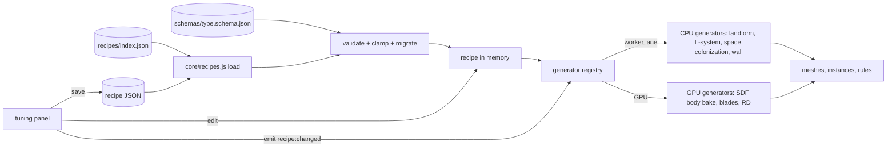

# 14 — Asset Recipes and Tuning Panel

> Almost nothing in ebb is modeled by hand. A reed clump, a frog, a stone wall, a palette, a new islet: each is a small JSON **recipe** (a handful of named numbers, colors and a seed) that a **generator** turns into geometry, instances, a texture or simulation rules. Because the look and feel live in recipes rather than code, Matt can shape the island himself. The built-in **tuning panel** shows every recipe as sliders, color swatches and curves; dragging a slider reshapes the reeds or the frog live in the running world, and saving writes the recipe file. No code needed. Hand-made glTF hero creatures can plug into the same species recipes later.

## Locked decisions

- Every look or feel number lives in a recipe under `recipes/`, never hard-coded (CLAUDE.md rule).
- Recipe folders: `recipes/species/`, `recipes/flora/`, `recipes/palettes/`, `recipes/land/`, `recipes/world/` (global tuning: `terrain.json`, `structures.json`, `growth.json`, `water.json`, `sky.json`), the single file `recipes/quality-tiers.json` (doc 19), plus `recipes/schemas/` (one schema per recipe type) and `recipes/index.json` (the manifest, because a static host cannot list folders).
- Recipes are plain JSON (no comments in shipped files; doc examples may show them). Field names are camelCase. Units: meters, game hours, degrees for angles. Palette colors (doc 05) are `#RRGGBB` sRGB hex; material colors in species and flora recipes are physical albedo as linear 0–1 RGB triples, never palette hex (CLAUDE.md look rule).
- **A recipe holds values; its schema holds ranges.** Sliders, limits and validation come from `recipes/schemas/<type>.schema.json`, so recipe files stay short and readable.
- **Same recipe + same seed = same result.** Generators whose output feeds the simulation (landforms, plant rules, dispersal, structure layouts) are pure CPU code using `core/rng.js` and run in workers. Purely visual GPU generators (SDF body meshing, moss RD) only need to look the same.
- The tuning panel is a developer tool: opened with the backtick key or `?tune`, not listed in Settings (doc 15).
- Saving from the panel never pushes anything. Matt reviews the changed file and commits it with GitHub Desktop.

## How it works

Plain language: a recipe is a seed packet label. It says what kind of thing it is, which version of the label format it uses, and the settings that shape it. The generator is the gardener that reads the label and grows the thing. The tuning panel is a way to rewrite the label while watching the plant change.



### Common header

Every recipe starts with the same fields:

```jsonc
{
  "type": "flora",          // species | flora | palette | land | world; inferred from the folder if absent
  "id": "reeds",            // unique within its type, kebab-case, matches the filename
  "name": "Reeds",          // shown in the panel and journal
  "schema": 1,              // version of the type's schema this file follows
  "version": 7,             // content revision; the panel bumps it on every save
  "seed": 1207,             // preview seed; world entities use their own seeds (below)
  "tags": ["slice", "tier1", "wetland"],
  ...type-specific body
}
```

Palette files from doc 05 already carry `id`, `name` and `version`; their `type` is inferred from the folder and `schema` defaults to 1, so they are valid as written.

**Seeds.** In the world, each entity's seed is `hash32(subSeed(worldSeed, type), entityId)`, so two reed clumps differ. The recipe's own `seed` is for the panel preview and for anything meant to be fixed (a named hero shape).

**Versioning.** `schema` changes only when the shape of a type changes; `core/recipes.js` carries ordered migration steps per type (same pattern as save migrations in doc 18) and upgrades older files on load. `version` is the content revision. The `.ebb` save header records each loaded recipe's id and a content hash, so `tools/determinism.html` can tell Matt when a difference comes from a tuned recipe rather than a bug.

### Schemas and ranges

A schema lists every tunable path with its default, range and how the panel shows it:

```jsonc
// recipes/schemas/flora.schema.json (excerpt)
{ "type": "flora", "schema": 1,
  "fields": {
    "growth.rate":        { "default": 0.04, "min": 0, "max": 0.2, "step": 0.005, "unit": "per hour", "group": "Growth" },
    "growth.maxHeight":   { "default": 1.6, "min": 0.2, "max": 3, "unit": "m", "group": "Shape" },
    "habitat.moisture":   { "kind": "range", "default": [0.6, 1], "min": 0, "max": 1, "group": "Habitat" },
    "spread.every":       { "default": 12, "min": 2, "max": 72, "step": 1, "unit": "game hours", "group": "Spread" },
    "season.albedo":      { "kind": "ramp", "group": "Color" },
    "generator":          { "kind": "enum", "options": ["blades", "lsystem", "colonization", "flower"] }
  } }
```

`kind` is `number` (default), `range` (two-handle slider), `int`, `enum`, `bool`, `color`, `ramp` (a list of colors over the season phase or another 0..1 input), `curve` (a few points, monotone cubic), or `prims` (the SDF primitive list for bodies). Validation clamps out-of-range values and reports them in the panel in plain words; it never refuses to load a world.

### Recipe types

| Type | Folder | Generator | Consumers |
|---|---|---|---|
| species | `recipes/species/` | SDF body bake (GPU, surface nets), motion rig | doc 11, 12 |
| flora | `recipes/flora/` | blades, L-system, space colonization, flower mesh; plus growth rules | doc 10 |
| palette | `recipes/palettes/` | LUT bake to a 32³ LUT (`render/passes/post/lut-bake.js`), 0.6 s crossfade on swap | doc 05, 16 |
| land | `recipes/land/` | landform (CPU worker, deterministic) | doc 08, 13 |
| world | `recipes/world/` | none (global tuning tables) | docs 06, 07, 08, 09, 10 |
| quality | `recipes/quality-tiers.json` | none (per-tier budgets for `high`, `medium`, `low`) | doc 19 |

**Worked example: reeds (vertical slice, step S5)**

```json
{
  "type": "flora", "id": "reeds", "name": "Reeds", "schema": 1, "version": 1, "seed": 1207,
  "tags": ["slice", "tier1", "wetland"],
  "generator": "blades",
  "layer": "individual",
  "shape": { "stemsPerClump": [8, 20], "clumpRadius": 0.35, "maxHeight": 1.6,
             "stemWidth": 0.012, "lean": 6, "seedHead": { "length": 0.18, "width": 0.025, "fromStage": "flowering" } },
  "habitat": { "moisture": [0.6, 1], "waterDepth": [0, 0.4], "light": [0.5, 1], "salt": [0, 0.6] },
  "growth": { "rate": 0.04, "maxSize": 1, "floor": 0.4,
              "stages": { "sprout": 2, "young": 10, "mature": 30, "flowering": "summer" } },
  "spread": { "kind": "rhizome", "every": 12, "distance": [0.6, 1.4], "minSuit": 0.6, "areaPerClump": 1.5 },
  "dispersal": { "kernel": "water", "range": 15 },
  "season": { "albedo": { "spring": [0.12, 0.20, 0.08], "summer": [0.08, 0.14, 0.06], "autumn": [0.30, 0.24, 0.10], "winter": [0.35, 0.30, 0.22] },
              "dormant": ["winter"], "keepStalks": true },
  "outputs": { "cover": { "reeds": 1 }, "midgeFeed": 1 },
  "wind": { "stiffness": 0.35, "sway": 0.8 }
}
```

The grass layer is `recipes/flora/grass.json` with `"layer": "cover"` and `"generator": "blades"`. Frogs read the `reeds` cover type by name (`recipes/species/frog.json`, doc 11). Season values are physical albedo (linear 0–1); the palette maps them into its colors at tonemap, per the CLAUDE.md look rule.

**Species** follow the schema in `11-creatures-and-ecology.md` (needs, density, body primitives, motion) plus the fields in `12-creature-roadmap.md` (gift, dormant, visitor, signature), inside the common header.

**Palettes** follow doc 05's file format. The roster is fixed: **Dusk** (`dusk.json`) and **Meadow morning** (`meadow-morning.json`) from the start, **Moonlight** (`moonlight.json`, the bats' gift) and **Clear sight** (`clear-sight.json`, color-safe, always available).

**Land** recipes follow `13-progression-and-expansion.md` (`meadow-islet.json` and the other four pieces) plus `starter-island.json` (doc 08).

### Generator contract

```js
/** @typedef {Object} Generator
 * @property {string} id                 e.g. 'flora.blades', 'species.sdf-body', 'land.landform'
 * @property {'species'|'flora'|'palette'|'land'} type
 * @property {'worker'|'gpu'} where
 * @property {boolean} simRelevant       true => must be bit-identical across devices (CPU only)
 * @property {(recipe, seed, opts) => Promise<Output>} run      opts: {lod, chunk, stage, tier}
 * @property {(recipe, seed) => Promise<PreviewOutput>} [preview]  fast, low-detail version for the panel
 * @property {(prev, next) => 'rebuild'|'reparam'|'none'} [diff]  what a recipe edit requires
 */
registerGenerator(gen);   // core/recipes.js
```

`diff` lets the panel be fast: a color change only updates a uniform (`reparam`), a branch-angle change rebuilds meshes (`rebuild`), a growth-rate change does nothing visible until the next tick (`none`). Generators never read the store or the DOM; their inputs are the recipe, the seed and `opts`.

### The tuning panel

Desktop: a panel docked on the right, 440 px wide, the world still visible and live. Phone: a bottom sheet at half height, draggable to full. Layout fits its pane at every width; no horizontal scrolling. Labels are 15 px or larger on desktop and 16 px or larger on phones (CLAUDE.md), numbers 16 px or larger, all icons drawn SVG.

```
+---------------------------------------------+
| [type: Flora v]  [search reeds........]     |
| Reeds  v7   seed [1207] [dice icon]         |
| Preview: [In world] [Isolated]              |
|---------------------------------------------|
| > Shape                                     |
|   Max height      [=======o----]  1.60 m    |
|   Stems per clump [==o======o--]  8 - 20    |
| > Habitat                                   |
|   Moisture        [======o====o]  0.6 - 1.0 |
| > Spread   > Season colors   > Wind         |
|---------------------------------------------|
| [grow 1 day] [grow 1 season] [reset]        |
| [Revert]  [Save to repo]  [Save as...]      |
+---------------------------------------------+
```

- **Live:** each edit updates the in-memory recipe, emits `recipe:changed {id}`, and re-runs the generator on the `interactive` worker lane with the recipe id as the job key (debounced 100 ms; a newer edit cancels the older job). Simulation values apply at the next hourly tick; "grow 1 day" and "grow 1 season" run ticks immediately on a copy of the world so Matt sees the effect, and "reset" discards the copy.
- **Isolated preview:** a turntable view of one instance (or a palette swatch board, or a top-down landform) at fixed noon light, with a stage slider for flora and an animation toggle for species.
- **Undo** inside the panel is per recipe, separate from world undo.
- **Unsaved edits** are kept in IndexedDB as overrides until saved or reverted, so a reload does not lose them. A drawn dot marks recipes with unsaved edits.
- **Save to repo:** on desktop Chrome and Edge, Matt connects his local `ebb` folder once (File System Access API); saving then writes `recipes/<type>/<id>.json` directly, bumps `version`, and pretty-prints with stable key order so GitHub Desktop shows a clean diff. **Save as** downloads the file anywhere (the fallback on browsers without folder access, including phones). **Load** opens a file or accepts a dropped file and validates it.
- **New recipe:** "duplicate" makes a copy under a new id and adds it to `recipes/index.json`.

**The creature studio page, as built** (October 2026, after S6, before S7; the creature studio plan's first step; `tools/creature-studio.html`). The frog on a paused stage, ahead of the tuning panel:
- **The stage:** the game's own bake on the worker pool, posed by the frog's bones with idle breathing, blinks and a call every 3 s. A 1 cm grid, darker every 5 cm, at real size. Set views (three-quarter, front, side, behind, top) or drag to turn; scroll or pinch to come closer. A Game size switch draws the frog at its in-game size.
- **The sliders:** the look half only.
  - the seven proportions;
  - back, belly and blotch colors, and the blotches' cover and fineness;
  - the iris and its flecks, the pupil, the wet glint;
  - variation between frogs, size difference, drawn size;
  - the idle motion.
  The life half (needs, arrival, presence, trust) stays in the file, since it changes how the game plays.
- **While you drag:** a coarse 3.3 mm bake right away, then the full 1.1 mm one when you stop. Specimen picks the recipe body or any of the eight variants.
- **Unsaved edits** stay in the browser (localStorage) until saved or undone, and each moved slider gets a dot.
- **Save to repo:** asks once for the ebb folder, then writes `recipes/species/frog.json` through `tools/recipe-text.js`. It changes only the values that moved, in place, so the file's hand-made layout and notes stay and GitHub Desktop shows just those lines. **Download** gives the same file.
- **Not done yet:** it does not bump `version` or validate against a schema (no species schema yet). The player look layer and the tuning panel come in M2, as planned.

### Hand-made glTF hero creatures (later)

Not in v1. A species recipe's body can switch generator:

```jsonc
"body": { "kind": "gltf", "src": "assets/models/heron.glb", "scale": 1.0,
          "boneMap": { "root": "Hips", "spine": ["Spine", "Chest"], "neck": ["Neck1", "Neck2", "Neck3"],
                       "legL": ["ThighL", "ShinL", "FootL"], "legR": ["ThighR", "ShinR", "FootR"] },
          "albedoRegions": "vertexColor" }
```

- A small vendored loader (`src/vendor/gltf/`) reads `.glb` meshes, skin and textures; animations are ignored because motion stays procedural (IK, springs, boids drive the mapped bones).
- Materials are reduced to linear albedo plus roughness; baked lighting or stylized colors in the file are not used, so the creature still obeys "physical light, painted last".
- LODs and the impostor are baked the same way as SDF bodies. Needs, behavior and journal data stay in the recipe unchanged, so a species can move from SDF to glTF without touching ecology.
- Budget per hero: 15k triangles at LOD0, 1 MB file. Models go in a new `assets/models/` folder when the first one arrives.

## Algorithms and shaders

JSON validation against the schema with clamping; deterministic generators per doc 08 (landform), doc 09 (walls), doc 10 (flora), doc 11 (SDF bodies with surface nets); monotone cubic interpolation (Fritsch and Carlson 1980) for curves; OKLab interpolation for color ramps.

## Tuning knobs

The panel itself is the tuning knob for everything. Its own options: preview light (noon, golden, night), turntable speed, show bounding boxes, show habitat score overlay for the selected flora or species.

## Performance budget

Slider to visible change under 150 ms for reparam edits and under 500 ms for a single-instance rebuild on desktop (under 1.5 s on phone). Recipe load and validation of the full set under 50 ms. The panel costs nothing when closed (module loaded on demand).

## Acceptance checks

- Press backtick, pick Reeds, drag Max height: reeds around the pond grow taller within a moment, with no stutter.
- Change the autumn color, drag the season dial to autumn: the new color shows.
- Press "grow 1 season": the reed band spreads along the shore; "reset" puts it back.
- "Save to repo" writes `recipes/flora/reeds.json`; GitHub Desktop shows only the changed lines and the version bump.
- Loading a recipe with a value out of range shows a plain note ("Max height was 9 m, limited to 3 m") and still loads.
- Switching palettes between Dusk, Meadow morning and Clear sight from the panel re-bakes and crossfades.

## Open questions

- Should the panel also be reachable from the deployed site, so Matt can tune on his phone and save files to share back, or stay a local-only tool?
- When a tuned recipe changes growth rules, should existing saved islands re-run with the new values, or keep the values they were grown with?

## Depends on / feeds into

Depends on `03-tech-stack-and-module-map.md` (core/recipes.js, workers), `05-look-and-palette.md`, `08-terrain-and-sculpt.md`, `10-growth-and-seasons.md`, `11-creatures-and-ecology.md`, `13-progression-and-expansion.md`, `15-camera-input-and-ui.md`. Feeds `09-structures.md`, `12-creature-roadmap.md`, `16-customization-and-photo-mode.md`, `18-saves-and-persistence.md` (recipe hashes), `20-roadmap-and-vertical-slice.md` (tuning panel v1 in M2).
