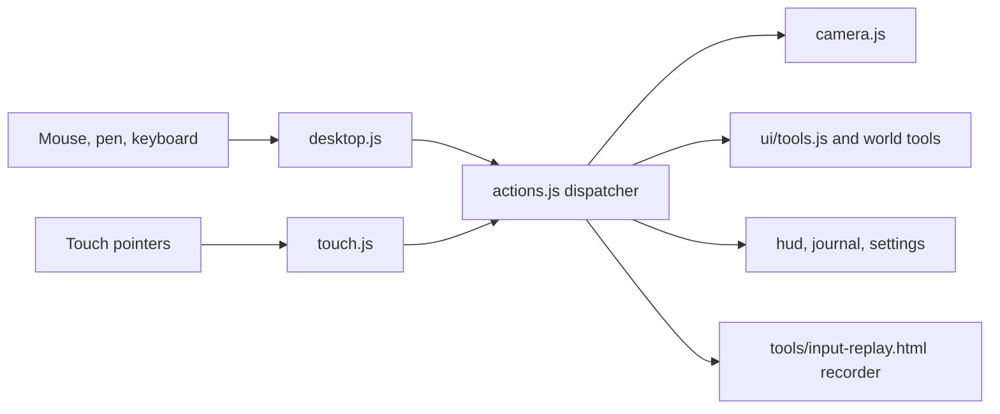

# 15 — Camera, Input and UI

> The camera, the controls and the interface decide whether ebb feels like tending a tabletop garden or operating a level editor. The camera orbits the island like a hand turning a diorama: soft, damped, never fighting you, never pointed somewhere useless. Mouse, keyboard and touch all speak one small action vocabulary, so every feature works the same on desktop and on a phone. The interface stays out of the way: a small palette of drawn icons, a clock dial, gentle notes in an italic serif, and a field journal that reads like a naturalist's notebook. No meters, no horizontal scrolling, no tiny text.

## Locked decisions

- **One play camera:** a damped orbit around a target point on the island (yaw, pitch, distance). Photo mode uses a separate free camera (16-customization-and-photo-mode.md).
- **Soft limits, not walls:** pushing past a limit meets rising resistance and springs back on release.
- **Action layer:** `src/input/desktop.js` and `src/input/touch.js` only translate raw events into actions defined in `src/input/actions.js`. Nothing else reads DOM input events.
- **Touch grammar:** one finger uses the active tool; two fingers orbit (drag), zoom (pinch) and yaw (twist). With no tool selected (the "look" state), one finger pans.
- **UI is DOM over the WebGPU canvas**, plain modules in `src/ui/`, no framework.
- **Icons are drawn SVG** in one sprite, `src/ui/icons/sprite.svg`, used via `<use href>`. No emoji, Unicode symbols or icon fonts.
- **Type:** Nunito (600 labels, 800 headings) for UI; Fraunces italic for journal text, notes and the tagline. Vendored `woff2` in `src/vendor/fonts/` (per 21-brand-identity.md).
- **Legibility floor:** no UI text below 15 px on desktop or 16 px on phones; body text 16 px desktop, 17 px phone. The text-size setting (16) only scales up.
- **No horizontal scrolling, ever.** Panels reflow vertically at any width and text size.
- **Touch targets** at least 48 px; 52 px for the phone tool bar.
- **Vertical slice:** orbit camera with soft limits, desktop and touch input via the action layer, palette with sculpt, smooth, paint, water, seed, feed, undo, redo; the creature card with name and follow; one journal page (frogs); clock dial; settings with time flow and volume (matches doc 20 step S6). The full journal and build tools follow.

## How it works

### The camera

Picture the island on a turntable. The camera looks at a point on the island (the target); you spin, tilt, slide the target and move closer or farther, and every move eases in and out.

```
            eye o
               / \
     distance /   \
             /pitch\
   ---------*----------- island surface
          target         yaw = spin around the vertical through the target
```

Technical detail (`src/render/camera.js`):

- Each of `target`, `yaw`, `pitch`, `distance`, `fovY` has a goal (set by actions) and a displayed value that chases it with frame-rate-independent damping: half-life 70 ms for direct input, 250 ms for glides (double-tap recenter, follow start, reveal drift).
- Vertical FOV 32 degrees by default (a slightly flattened, diorama read); settings range 24 to 50.
- Pitch soft range 18 to 72 degrees, hard 10 to 84. Distance soft range 5 m to `1.4 × worldRadius / tan(fovY/2)`, hard 3 m to 1.25 × soft max. The max grows on `land:joined` as the world expands in 32 m chunks (up to 192 m by 192 m, per 13-progression-and-expansion.md).
- Target is clamped to the open land chunks plus 8 m; its height follows terrain with 300 ms smoothing, so the camera rides over hills.
- Ground clearance: the eye stays 1.2 m above terrain and water sampled at the eye and two points toward the target; if violated, pitch rises (distance does not shrink).
- Zoom moves the target part of the way toward the terrain point under the cursor or pinch center.

### Follow-creature mode

Selecting a creature (tap in the look state, long-press with any tool) opens a card: name, species, Follow, Name, Feed, Photo. Follow tracks `position + velocity × 0.3 s` at a size-class distance (frog about 3 m, heron about 10 m); yaw drifts behind travel only after 3 s without player orbit. Panning or using a tool ends follow, as does the creature leaving the island (1 s glide back). Picking is a CPU ray test against bounding spheres from 11-creatures-and-ecology.md.

### The action layer



Actions carry normalized units and are plain data, so `tools/input-replay.html` can record and replay a session to reproduce bugs on Matt's machine.

| Desktop input | Action |
|---|---|
| Left drag | Active tool; pan in look state |
| Right drag | Orbit |
| Right click (under 4 px movement) | Context card |
| Middle drag, or Space + left drag | Pan |
| Wheel or trackpad pinch | Zoom toward cursor |
| W A S D / arrows; Q / E | Pan; rotate |
| 1 to 9 | Select tool; same key again returns to look state |
| [ and ] | Brush smaller, larger |
| Ctrl+Z; Ctrl+Shift+Z or Ctrl+Y | Undo; redo |
| J, P, F, H, Esc | Journal, photo, follow hovered creature, hide HUD, close |

| Touch gesture | Action |
|---|---|
| One finger drag | Active tool; pan in look state |
| One finger tap | Tool tap (plant, place); select creature in look state |
| Long press (450 ms, under 8 px) | Context card |
| Double tap | Glide target to that point |
| Two finger drag / pinch / twist | Orbit / zoom / yaw |
| Three finger tap | Undo |

Pen pressure scales brush strength; strokes read `getCoalescedEvents()` for smoothness. A one-finger stroke starts only after 80 ms or 8 px, so a second finger landing late leaves no stray sculpt mark; if a second finger arrives mid-stroke, the stroke commits and the gesture becomes camera control. The canvas sets `touch-action: none`.

### The HUD

Corners and the bottom edge only; the island stays centered. The HUD dims to 40 percent after 6 s without input; H hides it; it hides itself during the reveal (02-core-loop-and-idle-model.md), whose up to five notes use the same note style in the same corner.

- **Clock dial** (top left): a drawn sun and moon on an arc, a four-segment season ring, a small wave showing tide rising or falling. Hover or tap shows a sentence: "Spring, day 3, early evening. Tide coming in."
- **Top right:** journal, photo, settings. **Bottom left:** undo, redo, and above them gentle notes ("A frog has settled by the reeds.") in Fraunces italic that fade after 6 s and open the journal entry when clicked. **Bottom right:** time flow with drawn pips (one, two, three) or rest bars for pause.
- **Brush size** shows as a soft ring on the terrain; phones add a short vertical size slider.
- **Gift card:** on `progress:gifted`, a small cream card with a pressed-flower drawing and one Fraunces line ("The frogs left you a water lily seed") fades in above the palette for 8 s. Gifts earned while away appear only as reveal notes.

Desktop:

```
+-------------------------------------------------------------------------+
| (dial) sun/moon, season, tide                  [journal] [photo] [set]  |
|                                                                         |
|                          island, centered                               |
|                                                                         |
|  A frog has settled by the reeds.                                       |
| [undo][redo]  [sculpt smooth paint|water|seed|path wall bridge lantern  |
|                |call feed]                                    [time]    |
+-------------------------------------------------------------------------+
```

The palette is one row grouped by thin dividers: Land, Water, Life, Build, Creatures. Unearned tools are hidden; gifted tools (12-creature-roadmap.md) slide into their group with a soft glow, while gifted seeds join the seed tool's own vertical picker, so the row never outgrows its space.

Phone portrait: the palette collapses to five group buttons; a group opens a vertical flyout and remembers its last tool. Phone landscape: the group bar becomes a right-edge column with flyouts opening left. Layouts honor `env(safe-area-inset-*)`; a left-handed setting mirrors them. The bar fits a 360 px wide screen.

```
 portrait                          landscape
+------------------------------+  +---------------------------------------+
|(dial)     [jrnl][photo][set] |  |(dial)                [jrnl][photo][set]|
|                              |  |[undo]                         [Land]  |
|           island             |  |[redo]       island            [Water] |
|                    [lantern] |  |                               [Life]  |
|  note text wraps   [bridge ] |  | note                          [Build] |
|  [undo][redo]      [wall   ] |  |                       [time]  [Crit]  |
|  [time]   |size|   [path   ] |  +---------------------------------------+
| [Land][Water][Life][Build][C]|
+------------------------------+
```

### Field journal

`src/ui/journal.js` is the only progression screen (13-progression-and-expansion.md); this doc owns its layout. Desktop: a 440 px panel sliding in from the right, cream paper (#F4EEE4) with night text (#1E2624). Phone: a full-screen sheet with a drawn close icon. Vertical scroll only. Five sections, shown as a vertical list of drawn section icons with labels down the panel's left edge on desktop and as a stacked list on phones (never a tab row that could overflow):

- **Species:** one page per species in tier order, filling as 13 describes (pencil outline and riddle line, then sketch, then photo, then a pressed-flower corner when happy), with named individuals listed. Hints are observations in Fraunces italic ("the frogs keep to the far bank since the lantern went up"), never bars, numbers or checklists.
- **Moments:** photos of signature behaviors (dusk chorus, the heron's strike), a grid that wraps to the pane width.
- **Away notes:** notes from each reveal, dated in game days and seasons, newest first.
- **Island map:** a hand-drawn style map that adds each land piece as it rises, with player-named places.
- **Year page:** four season boxes and the closing note.

### Settings

`src/ui/settings.js`. Desktop: a 600 px panel with a vertical section list. Phone: a full-screen sheet with stacked collapsible sections. Sections: Look and Accessibility (16), Time (time flow, keep growing while away, reveal on or off; a line notes that an island left paused stays paused while away), Sound (17-audio.md), Controls (orbit speed, invert, field of view, left-handed, HUD dimming), Quality (19-performance-and-quality-tiers.md), Saves (18-saves-and-persistence.md). The tuning panel (`src/ui/tuning-panel.js`, doc 14) opens with the backtick key or `?tune` and is not listed in settings.

## Data and interfaces

```js
// src/input/actions.js
/** @typedef {'camera.orbit'|'camera.pan'|'camera.zoom'|'camera.glideTo'|
 *  'tool.select'|'tool.begin'|'tool.move'|'tool.end'|'tool.cancel'|'tool.tap'|
 *  'brush.resize'|'history.undo'|'history.redo'|'context.open'|'creature.follow'|
 *  'ui.journal'|'ui.photo'|'ui.settings'|'ui.hideHud'|'ui.close'|'time.flow'} ActionType */
/** @typedef {{type:ActionType, dx?:number, dy?:number, dz?:number, x?:number, y?:number,
 *  ray?:{o:Float32Array,d:Float32Array}, pressure?:number, toolId?:string,
 *  source:'mouse'|'pen'|'touch'|'key'}} Action */
export function dispatch(action) {}
export function on(type, handler) {}   // returns unsubscribe
export function setRecorder(fn) {}

// src/render/camera.js
export function createOrbitCamera(opts) {} // {update(dt), view, proj, eye, follow(id), glideTo(p), setBounds(aabb)}

// src/ui/tools.js
export const TOOL_GROUPS = { land:['sculpt','smooth','paint','cliff'], water:['water','stream','tide-stone'],
  life:['seed'], build:['path','wall','bridge','lantern','drift-log'], creatures:['call','feed'] };
// a tool shows only when progression lists it as unlocked
// 'cliff' (M2) is unlocked from the start of play; its brush card holds Terrace and Cut chips
```

**Cliff tool input** (M2, `08-terrain-and-sculpt.md`). Desktop: a click sets the shelf level, left drag builds (Terrace) or carves (Cut), and Shift snaps the level to sea level. Touch: a tap sets the level, a one-finger drag builds or carves, and two fingers still move the camera. While the tool is active, a faint level plane shows the shelf height under the ring.

Events (past tense, per 03-tech-stack-and-module-map.md) emitted: `tool:selected`, `camera:follow-started`, `camera:follow-ended`, `ui:panel-opened`, `ui:panel-closed`, `note:posted`. Listened to: `land:joined`, `progress:gifted`, `creature:settled`, `creature:left`, `species:moved-on`, `journal:page-updated`, `reveal:started`, `reveal:note-shown`, `reveal:ended`, `clock:hour`.

### Icon set

One `<symbol id="i-NAME" viewBox="0 0 24 24">` per icon: 24 px grid, 2 px padding, stroke 1.75, round caps and joins, `stroke="currentColor"`, optional accent fill at 20 percent. Drawn at 28 px on desktop (48 px buttons), 26 px on phones (52 px buttons).

| Icon | Drawing |
|---|---|
| sculpt | trowel lifting a soft mound |
| smooth | flat float over a wavy line that straightens |
| paint | round brush with a leaf-shaped dab |
| cliff | chisel edge over a stepped ground profile (M2) |
| water | droplet over one ripple line |
| seed | split seed with two first leaves |
| path | three stepping stones on a curve |
| wall | three stacked rounded stones |
| bridge | small arch over a wave line |
| lantern | hanging lantern with a short glow arc |
| creature call | reed whistle with two sound arcs |
| feed | small scoop with seeds falling |
| camera / photo | rounded camera body, round lens |
| journal | bound book with ribbon and a leaf |
| time flow | half sun on a horizon with a flow arc; pips or rest bars for state |
| settings | three horizontal sliders with knobs |
| undo / redo | curved arrow left; mirrored |

Support icons in the same style: close, back, check, follow, name tag, hide HUD, the five group icons, the five journal section icons (species, moments, away notes, map, year), and the gifted tools (stream, tide stone, drift log, night photo).

## Algorithms and shaders

- Damping: `x += (goal − x) · (1 − 2^(−dt / halfLife))`.
- Rubber band: past a soft limit, input scales by `1 / (1 + overshoot / k)`; on release the goal returns to the limit with a 300 ms half-life.
- Zoom to cursor: `target += (hit − target) · (1 − newDist / oldDist) · 0.6`.
- Gestures: two-pointer centroid delta to orbit, distance ratio to zoom, angle delta to yaw, each behind a dead zone (4 px, 2 percent, 3 degrees) so a pinch does not wobble yaw.
- The brush ring is a terrain-shader uniform (center, radius, softness), not geometry.

## Tuning knobs

Settings: orbit speed, invert vertical, zoom speed, field of view, left-handed layout, HUD dimming. Tuning panel: damping half-lives, soft and hard limits, follow lead and distances per size class, gesture dead zones, stroke start delay.

## Performance budget

- Camera plus action processing under 0.1 ms per frame on both tiers.
- HUD: no per-frame DOM writes; the clock dial updates at 4 Hz; under 0.5 ms main thread per frame. Panels animate only `transform` and `opacity`. `backdrop-filter` blur is off on the mobile tier.
- Input to visible tool response within one frame.

## Acceptance checks

- Right-drag on desktop and two-finger drag on a phone orbit with the same feel; nothing snaps.
- Tilting toward the horizon meets resistance and floats back on release; zooming far out stops gently with the whole island in view.
- Wheel zoom lands on what is under the cursor; the camera never dips under terrain or water.
- Sculpting with one finger, then adding a second to orbit, leaves no stray mark.
- Following a frog keeps it centered as it hops; panning ends follow cleanly.
- At the largest text size every panel still fits with no horizontal scroll, and no text is smaller than 15 px.
- Every icon is a drawn shape that takes the panel color in light and dark themes.

## Open questions

- Should the HUD dim on its own, or only when the player asks for a clean view?
- Should tapping a creature with a tool selected open its card, or only in the look state?
- Should the camera drift slowly by itself after a minute with no input?

## Depends on / feeds into

- Depends on: 03-tech-stack-and-module-map.md, 04-render-pipeline.md, 08-terrain-and-sculpt.md (height queries, sculpt), 11-creatures-and-ecology.md (creature bounds), 13-progression-and-expansion.md (tool unlocks, world growth), 21-brand-identity.md (fonts, colors).
- Feeds into: 02-core-loop-and-idle-model.md (reveal drift uses the glide), 12-creature-roadmap.md (call, feed, follow hooks), 09-structures.md and 10-growth-and-seasons.md (tool actions), 16-customization-and-photo-mode.md, 17-audio.md (listener follows the camera), 18-saves-and-persistence.md (device settings), 19-performance-and-quality-tiers.md.
