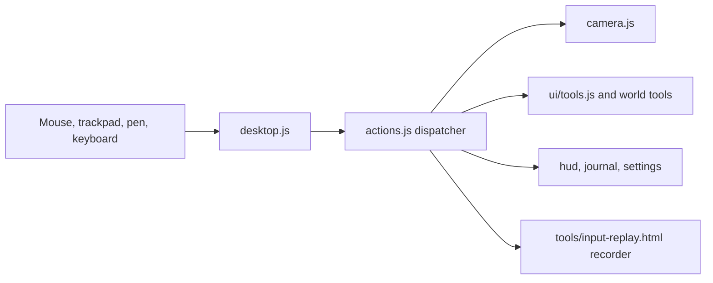

# 15 — Camera, Input and UI

> The camera, the controls and the interface decide whether ebb feels like tending a tabletop garden or operating a level editor. The camera orbits the island like a hand turning a diorama: soft, damped, never fighting you, never pointed somewhere useless. Mouse, keyboard and trackpad all speak one small action vocabulary, so every feature works the same on a desktop and on a laptop. The interface stays out of the way: a small palette of drawn icons, a clock dial, gentle notes in an italic serif, and a field journal that reads like a naturalist's notebook. No meters, no horizontal scrolling, no tiny text.

## Locked decisions

- **One play camera:** a damped orbit around a target point on the island (yaw, pitch, distance). Photo mode uses a separate free camera (16-customization-and-photo-mode.md).
- **Soft limits, not walls:** pushing past a limit meets rising resistance and springs back on release.
- **The close-up (S6b, Matt, October 2026):** the camera may come to 35 cm from what it looks at, anywhere on the island. Below about 5 m the view eases from aiming half way down the slope to aiming at the ground or the water's surface, and the eye may come down to about 6 cm above it, never under a pond (`recipes/world/camera.json` close).
- **Desktop and laptop only (changed October 21, 2026).** ebb is played with a mouse or trackpad and a keyboard. A phone or tablet used by touch (a coarse pointer and no fine one) gets a gentle notice instead of the game (see "Touch screens" below). A tablet with a trackpad or mouse passes and plays.
- **Action layer:** `src/input/desktop.js` only translates raw events into actions defined in `src/input/actions.js`. Nothing else reads DOM input events.
- **UI is DOM over the WebGPU canvas**, plain modules in `src/ui/`, no framework.
- **Icons are drawn SVG** in one sprite, `src/ui/icons/sprite.svg`, used via `<use href>`. No emoji, Unicode symbols or icon fonts.
- **Type:** Nunito (600 labels, 800 headings) for UI; Fraunces italic for journal text, notes and the tagline. Vendored `woff2` in `src/vendor/fonts/` (per 21-brand-identity.md).
- **Legibility floor:** no UI text below 15 px; body text 16 px. The text-size setting (16) only scales up.
- **No horizontal scrolling, ever.** Panels reflow vertically at any window width and text size.
- **Click targets** at least 48 px.
- **Vertical slice:** orbit camera with soft limits, mouse and keyboard input via the action layer, palette with sculpt, smooth, paint, water, seed, feed, undo, redo; the creature card with name and follow; one journal page (frogs); clock dial; settings with time flow and volume (matches doc 20 step S6). The full journal and build tools follow.

## How it works

### The camera

Picture the island on a turntable. The camera looks at a point on the island (the target); you spin, tilt, slide the target and move closer or farther, and every move eases in and out.

```
            eye o
               / \
     distance /   \
             /pitch\
   ---------*----------- island surface
          target         yaw = spin around the vertical through the target
```

Technical detail (`src/render/camera.js`):

- Each of `target`, `yaw`, `pitch`, `distance`, `fovY` has a goal (set by actions) and a displayed value that chases it with frame-rate-independent damping: half-life 70 ms for direct input, 250 ms for glides (double-click recenter, follow start, reveal drift).
- Vertical FOV 40 degrees by default (`recipes/world/camera.json` fovYDeg); settings range 24 to 50.
- Pitch soft range 18 to 72 degrees, hard 10 to 84. Distance soft range 2.5 m to `1.4 × worldRadius / tan(fovY/2)`, hard 2.2 m to 1.25 × soft max (`distanceSoft`, `distanceHard`; 4 m and 3.6 m until October 21, 2026, when the creatures were drawn larger). The max grows on `land:joined` as the world expands in 32 m chunks (up to 192 m by 192 m, per 13-progression-and-expansion.md).
- Target is clamped to the open land chunks plus 8 m; its height follows terrain with 300 ms smoothing, so the camera rides over hills.
- Ground clearance: the eye stays 1.2 m above terrain and water sampled at the eye and two points toward the target; if violated, pitch rises (distance does not shrink).
- Zoom moves the target part of the way toward the terrain point under the cursor.

### Follow-creature mode

Selecting a creature (click in the look state, right-click with any tool) opens a card: name, species, Follow, Name, Feed, Photo. Follow tracks `position + velocity × 0.3 s` at a size-class distance (frog about 3 m, heron about 10 m); yaw drifts behind travel only after 3 s without player orbit. Panning or using a tool ends follow, as does the creature leaving the island (1 s glide back). Picking is a CPU ray test against bounding spheres from 11-creatures-and-ecology.md.

### Two views: above and below (M2, Matt, October 21, 2026)

Above is the orbit camera described here: the diorama, where you shape. Below is you on foot, the walker (doc 23). Above shapes; below lives there.

- **Go down and Go up:** one drawn-icon button at the right edge, mid-height. Go down glides to a figure standing where you are looking (the middle of the view, the nearest walkable spot). Go up glides back to the orbit, and the figure stays standing on the island, visible from above. Both glides are game moves and never startle.
- **Below, the camera** sits low behind the figure, about 3 m back. No panning: you move by walking.
- **Below, the input:** click a spot to walk there; double-click to hurry; left drag looks around; the wheel or a trackpad pinch zooms between 1.8 m and 5.2 m (`recipes/world/walker.json` camera.distanceM; it lands at 3 m and aims 1 m up on the 1.4 m figure).
- **Below, the tool bar and undo are hidden.** Sculpt, Paint, Water, Plant and Cliff work only above.
- **From W3,** the closest above view stops at about 2.5 m (4 m until October 21, 2026), so getting close always means going down.
- Numbers live in `recipes/world/walker.json`.

### The first evening and the camp (Phase 1, approved October 22, 2026)

What the keeper's camp adds to the camera and the UI (docs/future/13, sections 2, 3 and 4). All of it is contextual: no new visibility toggles.

- **The beach start** (section 2.1, beat 0). A new island opens below, at dawn, with the low camera behind the walker, who stands on the beach a little inland of the boat's stake, facing inland toward the camp; the boat lies grounded behind (`walk.placeAt`, then `walk.downHere`). Placing the walker is a game move: presence speed reads 0, nothing startles. (Changed October 22, 2026, Matt: no row-in.) Under the first hint, at beat 0 only, a text button offers *Skip the first evening*. While the evening is unfinished (`intro:done` missing), a reload opens below at the walker's spot, the one exception to "a save opens above" (section 2.2).
- **Evening hints** (section 2.3). One line at a time in Fraunces italic in the island-notes corner, on `intro:hint { id, text }`, with its own quiet style, at least 15 px. It stays until its beat is done; a click tucks it away. The Go up button pulses once at beat 7, in its normal look.
- **Pouches on the ground bar** (section 4.1, K-01). Below, a row of drawn cloth pouches sits inside the ground bar, above the Sit, Kneel, Feed, Net and Look buttons, centred. Above, it is not shown, as the ground bar is not. Six pouches to start, each drawn in four fullness looks (flat, a few, half, full and tied) with a small sketch of its contents at the mouth; no text label and no number, an aria-label such as "Sticks, half full". Pouches sort themselves in a fixed order by kind. From eight pouches the row breaks into two even rows whenever one would not fit the pane; it never scrolls sideways. Clicking a pouch opens its card (sketch, one line, the fullness word, **Set down** at camp and **Empty**). Drawings are SVG in the shared stroke weight and palette.
- **The Look card's Gather** (section 4.2, GR-14 to GR-16). Below, a click on a gatherable thing opens its card, with one **Gather** button per thing there now (labelled with the thing, at most two) plus **Leave**. Ground that is everywhere (sand, pebbles, a strandline stretch) shows its card only with Look on or within arm's reach, so walking on the beach stays walking. Gather walks the walker into reach, kneels, takes one handful, and keeps the card open with its word updated. With no room, the card offers **Set down here** or **Leave it**. From above, the same card shows no Gather and says *"You can gather this on foot."*
- **Camp slot glow** (section 3.3, CS-05). A soft pale patch on the ground (the terrain marks' ring, filled) glows on a camp slot the first time it is needed in the evening, and after that only while the pack holds something for that slot and the walker is on or within 2 m of the pad. It stops the moment the pack no longer holds that thing. Clicking the glow shows the slot's card (**Pitch the tent**, **Lay the fire ring**). Standing at a laid ring shows **Light** on the ground bar; within 2 m of the tent flap after sunset, **Rest**.
- **The brush edge on the pad** (section 3.1, CP-01). Above, while a brush ring overlaps the camp pad, the pad's edge draws as a soft dashed circle on the ground and fades when the brush leaves (doc 08). Loose stone, Spring and a Water pour on the pad show a quiet line: *"The camp ground stays clear."*
- **The return at the tent flap** (section 3.5, C-40). Rest skips the night behind a short cream screen. While it is up, the walker is placed kneeling at the flap and the camera set down behind it facing seaward, so the first view is out of the tent: the ring, the pad and the sea, just before sunrise. The first click climbs out. No reveal and no away card after a rest. A new visit after closing the tab opens as today.

### The action layer



Actions carry normalized units and are plain data, so `tools/input-replay.html` can record and replay a session to reproduce bugs on Matt's machine.

| Desktop input | Action |
|---|---|
| Left drag | Active tool; pan in look state |
| Right drag | Orbit |
| Right click (under 4 px movement) | Context card |
| Middle drag, or Space + left drag | Pan |
| Wheel or trackpad pinch (ctrl+wheel) | Zoom toward cursor |
| Double-click | Glide target to that point |
| W A S D / arrows; Q / E | Pan; rotate |
| 1 to 9 | Select tool; same key again returns to look state |
| [ and ] | Brush smaller, larger |
| Ctrl+Z; Ctrl+Shift+Z or Ctrl+Y | Undo; redo |
| J, P, F, H, Esc | Journal, photo, follow hovered creature, hide HUD, close |

Pen pressure scales brush strength; strokes read `getCoalescedEvents()` for smoothness.

### Touch screens (October 21, 2026)

ebb is desktop and laptop only. `src/ui/desktop-only.js` checks the pointer at boot: a device whose only pointer is coarse (a phone or tablet used by touch) gets a calm cream card saying ebb is made for a desktop or laptop, with a link to notarobot-eng.com/ebb, and the game does not load behind it. A device with any fine pointer (a mouse or trackpad, including a tablet with one attached) plays as normal. There is no touch input, touch layout or touch tier.

### The HUD

Corners and the bottom edge only; the island stays centered. The HUD dims to 40 percent after 6 s without input; H hides it; it hides itself during the reveal (02-core-loop-and-idle-model.md), whose up to five notes use the same note style in the same corner.

- **Clock dial** (top left): a drawn sun and moon on an arc, a four-segment season ring, a small wave showing tide rising or falling. Hover shows a sentence: "Spring, day 3, early evening. Tide coming in."
- **Top right:** journal, photo, settings. **Bottom left:** undo, redo, and above them gentle notes ("A frog has settled by the reeds.") in Fraunces italic that fade after 6 s and open the journal entry when clicked. **Bottom right:** time flow with drawn pips (one, two, three) or rest bars for pause.
- **Brush size** shows as a soft ring on the terrain.
- **Gift card:** on `progress:gifted`, a small cream card with a pressed-flower drawing and one Fraunces line ("A gift from the frogs: you can build terraces and cut cliffs now") fades in above the palette for 8 s. Gifts earned while away appear only as reveal notes.

Desktop:

```
+-------------------------------------------------------------------------+
| (dial) sun/moon, season, tide                  [journal] [photo] [set]  |
|                                                                         |
|                          island, centered                               |
|                                                                         |
|  A frog has settled by the reeds.                                       |
| [undo][redo]  [sculpt smooth paint|water|seed|path wall bridge lantern  |
|                |call feed]                                    [time]    |
+-------------------------------------------------------------------------+
```

The palette is one row grouped by thin dividers: Land, Water, Life, Build, Creatures. Unearned tools are hidden; gifted tools (12-creature-roadmap.md) slide into their group with a soft glow, while gifted seeds join the seed tool's own vertical picker, so the row never outgrows its space.
### Field journal

`src/ui/journal.js` is the only progression screen (13-progression-and-expansion.md); this doc owns its layout. Desktop: a 440 px panel sliding in from the right, cream paper (#F4EEE4) with night text (#1E2624), ending above the bottom row so time flow stays in reach and the island stays in view. Vertical scroll only. The book button sits in the top right corner, with the Look button to its left; J opens and closes it, Esc closes it. Five sections, shown as a vertical list of drawn section icons with labels down the panel's left edge (never a tab row that could overflow). J1 ships two of them, Living things (the species pages) and Notes, as wrapping buttons under the title; J1.5 adds Ground and Almanac (four buttons, two to a row on narrow screens). J2a adds the Web, after Ground; on narrow screens the fifth button takes a whole row. In the Web, names are 18 drawing units in a drawing scaled to the page width, so they read at 16 px or more in a narrow panel. Each name is a button: click it, or press Enter or Space, to bring its links forward. A page's **Show me** leaves the camera where it is (a game-driven move proved distracting; October 2026). It rings the example nearest the middle of your view, with a screen-sized drawn ring that breathes gently and reads from any distance, and opens its card beside it. As you move the camera the ring and card ride along. While the spot is out of view (or behind the open journal), the card waits and a drawn arrow at the screen edge points toward it. Ring and card stay for `showMe.showS` in `recipes/world/journal.json`. The view's middle and the screen position of a ground point come from the store slice `view`, which `src/app.js` sets up. While a page is open the island carries that page's wash (J2b, doc 13). The camera does not move for it. The journal's sections:

- **Species:** one page per species in tier order, filling as 13 describes (pencil outline and riddle line, then sketch, then photo, then a pressed-flower corner when happy), with named individuals listed. Hints are observations in Fraunces italic ("the frogs keep to the far bank since the lantern went up"), never bars, numbers or checklists.
- **Moments:** photos of signature behaviors (dusk chorus, the heron's strike), a grid that wraps to the pane width.
- **Away notes:** notes from each reveal, dated in game days and seasons, newest first.
- **Island map:** a hand-drawn style map that adds each land piece as it rises, with player-named places.
- **Year page:** four season boxes and the closing note.

**Click to identify (J1).** With no tool chosen, a short still click on the island (the `look.tap` action) opens a small cream card beside the click: the living thing's name, what it is doing in words ("A young clump of reeds"), and "Open its page". It closes after 8 s, on a click elsewhere, or when a tool is chosen. A soft ring on the ground breathes around what was clicked while the card is open. From J1.5 a click on bare ground or water opens the same card for the ground (soil, sand, rock, moss, fresh water, the tide band or the sea), with the plants you know that would suit it. A click at a special moment (in flower, in rain, at dusk, at dawn, in mist, in winter) also fills that moment's frame on the page.

**Island notes (J1).** New journal notes (`note:posted`) appear at the bottom left above the tool bar in Fraunces italic, two at most, each for 6 s; a click opens the journal at that species. They step aside while a tool's card is open in windows narrower than 1180 px, and leave room for the time-flow button in narrow windows.

### Settings

`src/ui/settings.js`. A 600 px panel with a vertical section list. Sections: Look and Accessibility (16), Time (time flow, keep growing while away, reveal on or off; a line notes that an island left paused stays paused while away), Sound (17-audio.md), Controls (orbit speed, invert, field of view, HUD dimming), Quality (19-performance-and-quality-tiers.md), Saves (18-saves-and-persistence.md). The tuning panel (`src/ui/tuning-panel.js`, doc 14) opens with the backtick key or `?tune` and is not listed in settings.

## Data and interfaces

```js
// src/input/actions.js
/** @typedef {'camera.orbit'|'camera.pan'|'camera.zoom'|'camera.glideTo'|
 *  'tool.select'|'tool.begin'|'tool.move'|'tool.end'|'tool.cancel'|'tool.tap'|
 *  'brush.resize'|'history.undo'|'history.redo'|'context.open'|'creature.follow'|
 *  'ui.journal'|'ui.photo'|'ui.settings'|'ui.hideHud'|'ui.close'|'time.flow'} ActionType */
/** @typedef {{type:ActionType, dx?:number, dy?:number, dz?:number, x?:number, y?:number,
 *  ray?:{o:Float32Array,d:Float32Array}, pressure?:number, toolId?:string,
 *  source:'mouse'|'pen'|'key'}} Action */
export function dispatch(action) {}
export function on(type, handler) {}   // returns unsubscribe
export function setRecorder(fn) {}

// src/render/camera.js
export function createOrbitCamera(opts) {} // {update(dt), view, proj, eye, follow(id), glideTo(p), setBounds(aabb)}

// src/ui/tools.js
export const TOOL_GROUPS = { land:['sculpt','smooth','paint','cliff'], water:['water','stream','tide-stone'],
  life:['seed'], build:['path','wall','bridge','lantern','drift-log'], creatures:['call','feed'] };
// a tool shows only when progression lists it as unlocked
// The Cliff tool (M2) is the frogs' gift (doc 12): its chips show once `unlocks.cliffs` is true,
// or with ?sandbox or ?cliffs. As built it is not a tool button of its own: Terrace and Cut are
// Sculpt chips five and six (three to a row), so the bar stays at six buttons and fits a
// narrow window. Before the gift the card shows four.
```

**Cliff input** (M2, `08-terrain-and-sculpt.md`; from the frogs' gift). Desktop: left drag builds (Terrace) or carves (Cut) a shelf at the ground where the drag starts plus or minus the Height slider, and Shift at the start levels to sea level. In these modes the card swaps Strength for Height (0.25 to 3 m in 0.25 m steps) and shows a one-line hint. While hovering or dragging, a thin line under the ring marks where the ground meets the shelf's level.

Events (past tense, per 03-tech-stack-and-module-map.md) emitted: `tool:selected`, `camera:follow-started`, `camera:follow-ended`, `ui:panel-opened`, `ui:panel-closed`, `note:posted`. Listened to: `land:joined`, `progress:gifted`, `creature:settled`, `creature:left`, `species:moved-on`, `journal:page-updated`, `reveal:started`, `reveal:note-shown`, `reveal:ended`, `clock:hour`.

### Icon set

One `<symbol id="i-NAME" viewBox="0 0 24 24">` per icon: 24 px grid, 2 px padding, stroke 1.75, round caps and joins, `stroke="currentColor"`, optional accent fill at 20 percent. Drawn at 28 px (48 px buttons).

| Icon | Drawing |
|---|---|
| sculpt | trowel lifting a soft mound |
| smooth | flat float over a wavy line that straightens |
| paint | round brush with a leaf-shaped dab |
| terrace | a level shelf raised on a sheer face with rock bands, an up stroke above (M2, Sculpt chip) |
| cut | a notch carved into the ground with sheer walls, the cut-away top dotted, a down stroke (M2, Sculpt chip) |
| water | droplet over one ripple line |
| seed | split seed with two first leaves |
| path | three stepping stones on a curve |
| wall | three stacked rounded stones |
| bridge | small arch over a wave line |
| lantern | hanging lantern with a short glow arc |
| creature call | reed whistle with two sound arcs |
| feed | small scoop with seeds falling |
| camera / photo | rounded camera body, round lens |
| journal | bound book with ribbon and a leaf |
| time flow | half sun on a horizon with a flow arc; pips or rest bars for state |
| settings | three horizontal sliders with knobs |
| undo / redo | curved arrow left; mirrored |

Support icons in the same style: close, back, check, follow, name tag, hide HUD, the five group icons, the five journal section icons (species, moments, away notes, map, year), and the gifted tools (cliffs, stream, reed raft, tide stone, night photo).

## Algorithms and shaders

- Damping: `x += (goal − x) · (1 − 2^(−dt / halfLife))`.
- Rubber band: past a soft limit, input scales by `1 / (1 + overshoot / k)`; on release the goal returns to the limit with a 300 ms half-life.
- Zoom to cursor: `target += (hit − target) · (1 − newDist / oldDist) · 0.6`.
- The brush ring is a terrain-shader uniform (center, radius, softness), not geometry.

## Tuning knobs

Settings: orbit speed, invert vertical, zoom speed, field of view, HUD dimming. Tuning panel: damping half-lives, soft and hard limits, follow lead and distances per size class.

## Performance budget

- Camera plus action processing under 0.1 ms per frame on every tier.
- HUD: no per-frame DOM writes; the clock dial updates at 4 Hz; under 0.5 ms main thread per frame. Panels animate only `transform` and `opacity`. `backdrop-filter` blur is off on the low tier.
- Input to visible tool response within one frame.

## Acceptance checks

- Right-drag orbits with the same feel on a mouse and on a laptop trackpad; nothing snaps.
- On a phone or tablet used by touch, the desktop-only notice shows with its link and the game does not load; a tablet with a trackpad or mouse plays.
- Tilting toward the horizon meets resistance and floats back on release; zooming far out stops gently with the whole island in view.
- Wheel zoom lands on what is under the cursor; the camera never dips under terrain or water.
- Following a frog keeps it centered as it hops; panning ends follow cleanly.
- At the largest text size every panel still fits with no horizontal scroll, and no text is smaller than 15 px.
- Every icon is a drawn shape that takes the panel color in light and dark themes.
- Start a fresh island: it opens below at dawn on the beach, the boat behind (changed October 22, 2026, Matt: no row-in). Pitch, gather and lay the ring: each slot glows only when it is needed. Rest after dusk: the cream screen softens and the first view is out of the tent flap just before sunrise (docs/future/13, section 2.5).
- Below, the pouch row sits above the ground-bar buttons and never scrolls sideways at any window width; above, it is hidden (docs/future/13, section 4.1).

## Open questions

- Should the HUD dim on its own, or only when the player asks for a clean view?
- Should clicking a creature with a tool selected open its card, or only in the look state?
- Should the camera drift slowly by itself after a minute with no input?
- The keeper's camp spec draws each pouch as a 40 px tap target (docs/future/13, section 4.1), under this doc's 48 px click floor. Raise pouches to 48 px, or allow 40 px for pouches only? To settle before E2.

## Depends on / feeds into

- Depends on: 03-tech-stack-and-module-map.md, 04-render-pipeline.md, 08-terrain-and-sculpt.md (height queries, sculpt), 11-creatures-and-ecology.md (creature bounds), 13-progression-and-expansion.md (tool unlocks, world growth), 21-brand-identity.md (fonts, colors).
- Feeds into: 02-core-loop-and-idle-model.md (reveal drift uses the glide), 12-creature-roadmap.md (call, feed, follow hooks), 09-structures.md and 10-growth-and-seasons.md (tool actions), 16-customization-and-photo-mode.md, 17-audio.md (listener follows the camera), 18-saves-and-persistence.md (device settings), 19-performance-and-quality-tiers.md.
