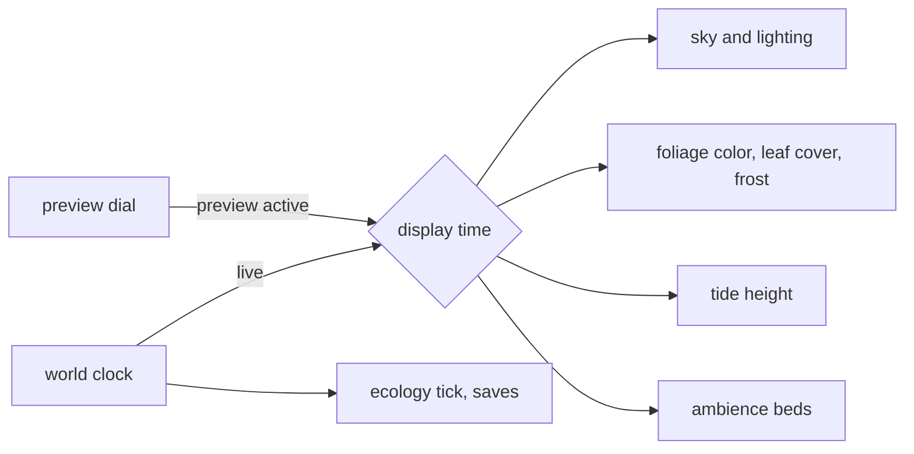

# 16 — Customization and Photo Mode

> ebb is as much about making a place look the way you like as about growing it. This doc covers the ways the player shapes the mood without touching the land: choosing a painted palette, previewing other times of day and seasons, nudging the weather, setting how fast time flows, and accessibility options. It also covers photo mode, where the player frames the island or a favorite creature with a free camera, soft focus and a few gentle filters, then saves a PNG or a journal photo. Finally, it covers sharing a whole island as a small file a friend can open. None of this costs anything; the only things earned are one palette and one photo tool that creatures gift (12-creature-roadmap.md).

## Locked decisions

- **Palettes are LUTs** owned by 05-look-and-palette.md (32 × 32 × 32 `rgba16float`, baked in OKLab, 0.6 s crossfade). This doc owns only how the player picks and schedules them.
- **Previews never change the world.** Time-of-day and season preview drive the render and audio only; the world clock, ecology and save are untouched. Leaving preview glides back to the live time over 1.5 s.
- **Weather is a preference, not an override of the simulation.** The ecology record of rain per day stays seeded (02-core-loop-and-idle-model.md); the player's weather choice biases what is shown and what future days roll, within limits (see How it works).
- **Time flow:** pause, 1x, 2x, 4x (02). Away rate is always 1x, and paused stays paused while away.
- **Photo mode pauses world time** and the live sim's world-time systems; animation time keeps running (creatures breathe, grass sways) unless the player taps "freeze".
- **Photo export is PNG**, rendered at up to 2x screen resolution on desktop (cap 4096 px on the long side) and 1x on the mobile tier, with no HUD.
- **Shared world files** use the same versioned format as saves (18-saves-and-persistence.md), minus device settings.
- **Vertical slice:** two palettes (Dusk, Meadow morning) with crossfade, time flow, reduced motion, text size. Photo mode, weather and season preview follow.

## How it works

### Palettes

A palette is a small recipe of color anchors and a grade (format in 05-look-and-palette.md). Because lighting stays physical, every palette still reads correctly at noon, dusk and under moonlight.

Set: **Dusk** (brand palette, default) and **Meadow morning** from the start; **Moonlight**, gifted by happy bats (tier 5); **Clear sight**, the color-safe palette (accessibility below), always available. More palettes can be added as recipes without code.

The picker in Settings > Look is a vertical list of cards, each with a live thumbnail: the current frame, downsampled and run through that palette's LUT, so the player sees their own island. A "palette by time of day" option (05) lets the player pick one palette for day and another after sunset; the switch uses the same crossfade at sunrise and sunset.

### Time-of-day and season preview

A small drawn dial in Settings > Look (also reachable from photo mode). Dragging the sun around the dial previews any hour; a four-step ring previews seasons. Under the hood, the sky, sun and moon (06-sky-and-lighting.md), foliage color and leaf cover (10-growth-and-seasons.md), and the tide height for that hour (07-water-and-tide.md) read a **display time** instead of world time. Plants do not regrow or shed; season preview only changes color, leaf density and frost through the same uniforms seasons already use.



### Weather controls

Weather (`src/world/weather.js`) has four moods: clear, soft cloud, rain, mist (winter brings frosty mornings and colder rain, never snow). Each game day's weather rolls from the seed. The player gets a "weather leaning" with three positions: drier, as it comes, wetter. The leaning shifts the roll probabilities for future days by at most 25 percent; it never forces a day. A "hold today's sky" toggle freezes the visible weather for the session without changing the ecology record. Wet weather still feeds moisture in the ecology tick only through the seeded record, so catch-up stays deterministic: the leaning is part of saved world state and is applied inside the weather step of the shared hourly tick (`coarseStep`, order: tide, weather, seasons, water summary, growth, ecology, creatures, expansion), identically live and in catch-up.

### Time flow

The bottom-right HUD button cycles 1x, 2x, 4x, pause; long-press or right-click opens a small vertical picker. At 4x the sun visibly travels but animation time stays real, so nothing looks frantic. A one-line note appears the first time the player pauses: "The island rests while paused, here and while you are away."

### Accessibility

- **Reduced motion** (follows `prefers-reduced-motion` by default): camera glides become 150 ms fades, the reveal becomes a slow crossfade with a fixed camera, wind sway amplitude drops by 70 percent, water caustics and sparkles dim, no screen shake (there is none anyway), particle counts halve.
- **Text size:** 100, 115, 130, 160 percent. All UI uses `rem`; layouts are tested at 160 percent with no horizontal scroll. The phone tool bar keeps its five groups and grows taller rather than wider.
- **Color-safe palette (Clear sight, `colorSafe: true` per 05):** foliage ramps separated in lightness rather than hue, water kept clearly bluer than land, creature colors pushed apart in lightness. Independently, all UI states use shape plus color (a selected tool gets a drawn underline, not only a tint).
- **High-contrast UI:** cream on night or night on cream, 7:1 minimum for body text.
- **Hold to use:** long-press alternatives for every two-finger gesture (an on-screen orbit puck appears on request) for players who cannot pinch.
- Captions for creature calls in the journal and notes ("A frog is calling from the reeds") when sound is off.

### Photo mode

Entered with P or the photo icon. The HUD fades out; a slim, drawn photo bar appears (bottom on desktop, bottom sheet on phones).

```
desktop                                   phone portrait
+-------------------------------------+   +--------------------------+
|                                  [x]|   |                      [x] |
|        framed view, guides          |   |      framed view         |
|                                     |   |                          |
|                                     |   |--------------------------|
| [frame][focus][light][filter][shot] |   | [frame][focus][light]    |
+-------------------------------------+   | [filter]        [shot]   |
                                          +--------------------------+
```

- **Free camera:** desktop uses right-drag to look, WASD to move, Q/E for height, wheel for speed; touch uses one finger to look and a drawn joystick for movement, pinch for height. Limits: stays within the world bounds plus 20 m, at least 0.15 m above terrain or water (so the player can get low for a frog's-eye shot). Roll up to 15 degrees.
- **Focus:** tap a point to focus there (depth read from the depth prepass); aperture slider from f/1.4 to f/16 in a simulated 35 mm equivalent. Depth of field is a gather bokeh pass in `src/render/passes/post/dof.js` (circle of confusion from depth, half-res scatter-as-gather, Jimenez-style "Next Generation Post Processing in Call of Duty" approach, simplified).
- **Light:** the same time-of-day dial as preview, plus exposure (±2 stops) and a lantern glow boost.
- **Frame:** aspect (free, 1:1, 4:5, 3:2, 16:9, 9:16), rule-of-thirds guide, a soft vignette, and three drawn border styles (none, cream paper margin, journal page with a handwritten caption in Fraunces italic).
- **Filters:** a short list that layer after the palette: Soft (light bloom and lifted blacks), Painterly (the Kuwahara-style brush filter from 05 at stronger strength), Pencil (outline plus paper grain), Film (grain and gentle halation). Each has one strength slider.
- **Shot:** renders an offscreen frame at the export size, encodes PNG with `OffscreenCanvas.convertToBlob`, and offers "Save to device" (a download link; on iOS the share sheet via `navigator.share` with files) and "Add to journal" (stored as a 1024 px WebP thumbnail in IndexedDB). Framing a creature records species, behavior state and name (11-creatures-and-ecology.md): the first photo of a species replaces the sketch on its journal page, and a photo of a signature behavior (dusk chorus, frogspawn, the heron's strike) fills that slot in Moments. The shot emits `journal:photographed`. Once the owls' **night-photo tool** is gifted, a "long exposure" toggle appears under Light: it holds the shutter open for 0.5 to 8 s of animation time (04-render-pipeline.md owns the spec), so firefly trails, bat streams and moving water blur softly.

### Sharing world files

Settings > Saves > "Share this island" exports an `.ebb` file (format in 18). The shared copy strips device settings and the away log, and keeps the world seed, edits, flora, creatures, journal text and names. Opening a shared file always imports as a **new island slot**; it never overwrites. Shared files are plain data: no scripts, no URLs loaded, sizes and counts validated on import.

## Data and interfaces

```js
// Device prefs (store slice `settings`, saved per device, never in world files; see 18)
// palette, paletteNight (or null), textScale (1|1.15|1.3|1.6),
// reducedMotion ('system'|'on'|'off'), highContrast, captions
// World state (store slice `meta`, saved in the world file):
// timeFlow (0|1|2|4), weatherLean (-1|0|1), keepGrowing

// src/ui/settings.js
export function openSection(id) {}            // 'look'|'time'|'sound'|'controls'|'access'|'quality'|'saves'
// src/render/passes/post/photo.js
export async function capture({width, height, filters, frame}) {} // -> Blob (PNG)
```

Events (past tense): emitted `preview:started`, `preview:ended`, `photo:entered`, `photo:exited`, `journal:photographed` (species, behavior, creature id if in frame); listened to `palette:changed` (05), `progress:gifted` (Moonlight palette, night-photo tool).

## Algorithms and shaders

- Palette thumbnails: the current frame at 160 px, run through each candidate LUT in one small compute pass (the bake itself is 05's).
- Long exposure: as specified in 04-render-pipeline.md (0.5 to 8 s of animation time into an `rgba32float` accumulator before tonemap, so the palette still applies last).
- Depth of field: thin-lens circle of confusion `c = A · f · |z − zf| / (z · (zf − f))`, half-res gather with 16 to 48 taps by tier, near-field dilation to avoid sharp silhouettes over blurred backgrounds.
- Painterly filter: anisotropic Kuwahara (Kyprianidis et al.) at quarter-res on mobile.
- Color-safe palette validated against simulated deuteranopia, protanopia and tritanopia (Machado 2009 matrices) in `tools/palette-check.html`.

## Tuning knobs

Settings: palette, outlines on or off, painterly strength, time flow, weather leaning, hold today's sky, reduced motion, text size, high contrast, captions. Tuning panel: palette key colors and curves with live LUT rebake, DOF tap counts, filter defaults, weather leaning limit.

## Performance budget

- Palette picker thumbnails: under 2 ms total, only while the picker is open.
- Photo mode DOF: under 1.5 ms desktop at 1440p, under 3 ms mobile at its render scale. Painterly filter: under 2 ms desktop.
- 4K PNG export: under 1.5 s on desktop including encode; mobile 1x export under 1 s.

## Acceptance checks

- Switching from Dusk to Meadow morning crossfades smoothly; the island at noon, dusk and night still reads correctly in both.
- Dragging the preview sun to midnight shows moonlight and lanterns; letting go glides back to the real hour and nothing in the world has changed.
- With reduced motion on, the reveal is a still crossfade and grass barely moves.
- At 160 percent text, settings and the photo bar fit on a 360 px phone with no horizontal scroll.
- A frog's-eye photo with shallow focus shows a sharp frog and a soft background with no halo; the PNG has no HUD.
- A shared island opens as a new slot on another device and looks the same.

## Open questions

- Beyond Moonlight, should more palettes come as gifts, or should all extra palettes be available from the start?
- Should the weather leaning exist at all, or should weather be left entirely to the island?
- Should photos in the journal be capped (for storage), and if so, how many?
- Would a gentle "photo prompt" ("The heron is fishing at the flats") help, or feel like a task?

## Depends on / feeds into

- Depends on: 04-render-pipeline.md, 05-look-and-palette.md, 06-sky-and-lighting.md, 07-water-and-tide.md, 10-growth-and-seasons.md, 15-camera-input-and-ui.md.
- Feeds into: 11-creatures-and-ecology.md (photographed species), 12-creature-roadmap.md and 13-progression-and-expansion.md (photo moments, journal pages), 17-audio.md (preview display time drives ambience), 18-saves-and-persistence.md (prefs, photos, shared files), 19-performance-and-quality-tiers.md.
