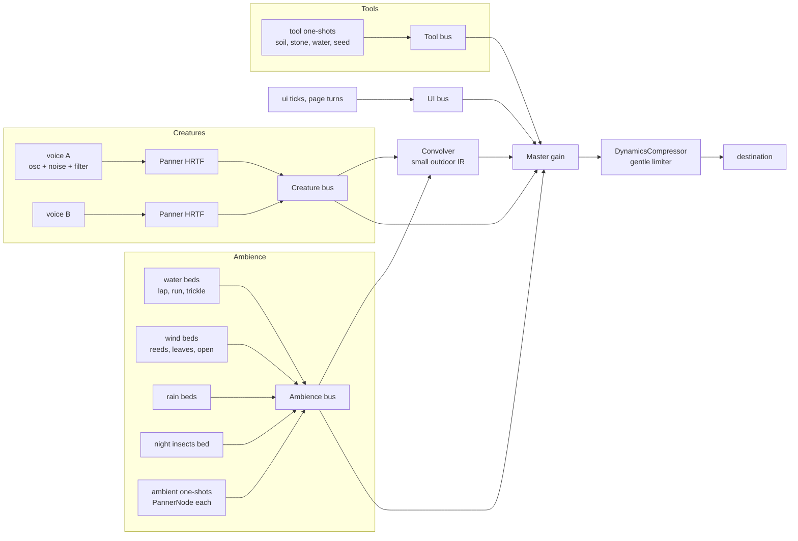

# 17 — Audio

> Sound is half of what makes ebb calm. The island should sound like a real small place: water lapping more or less as the tide moves, wind in the reeds, birds at dawn, frogs at dusk, rain on leaves, a hush on frosty mornings. Creature voices are made on the fly so every frog sounds a little different and a happy chorus sounds fuller than a lonely call. Tools make soft, earthy sounds (soil, stone, a drop of water), never clicks or chimes that feel like a menu. Everything is mixed quietly, placed in space around the camera, and starts only after the player's first click or key press, as browsers require.

## Locked decisions

- **Web Audio API directly**, no audio library. Three modules: `src/audio/mixer.js` (graph, buses, listener, unlock), `src/audio/ambience.js` (beds and one-shot ambient events), `src/audio/voices.js` (procedural creature voices).
- **Layered beds plus scattered one-shots.** A few long looping beds (water, wind, rain, night insects) crossfade by state; short one-shot samples (a single drip, a reed creak, a distant bird) are scattered in space on a seeded schedule so loops never sound like loops.
- **Creature voices are synthesized** (oscillators, noise, filters, envelopes), parameterized by species recipe and individual seed. Recorded samples are used for ambience and tools only.
- **Sound follows display time**, so previewing midnight in settings or photo mode (16-customization-and-photo-mode.md) sounds like midnight.
- **Mood is audible:** a happy species sings more often, in fuller chorus; an unsettled one calls sparsely. No alert sounds, ever.
- **Assets are CC0 only**, as Ogg Opus at 96 kbps stereo for beds and 64 kbps mono for one-shots, with an AAC (`.m4a`) fallback for older Safari. Total audio download under 6 MB for the M2 first pass, loaded after first paint.
- **Autoplay:** the audio context is created suspended and resumed on the player's first click or key press anywhere. There is no title screen: ebb opens straight into catch-up and the reveal (02-core-loop-and-idle-model.md, 15-camera-input-and-ui.md), which runs silently until that first gesture.
- **Not in the vertical slice.** Audio arrives in M2 (20-roadmap-and-vertical-slice.md). The M2 first pass is the water bed, the wind bed, and the frog voice with chorus.

## How it works

### Plain language

A soundscape reads the island several times a second (water near the camera, wind, hour, season, weather, nearby creatures) and turns each into the volume of a matching layer. Close to the stream you hear running water; pull up and it widens into a soft island-wide wash.

### The graph



Buses are `GainNode`s driven by settings sliders. A shared convolution reverb (about 1.2 s, impulse generated from filtered noise, no asset) gives everything the same air. A gentle compressor on the master (threshold −12 dB, ratio 3) keeps a big chorus from spiking.

### Ambience that reacts

`ambience.js` updates at 10 Hz from a small **sound state** vector built on the main thread:

| Input | Source | Drives |
|---|---|---|
| Water nearness and flow | water summary near the camera target (07-water-and-tide.md): still, slow, running depth within 12 m | lap, trickle, run bed gains; lowpass opens as the camera gets close |
| Tide phase | `src/world/tide.js` | lap bed rate and gain swell with rising tide; extra mud-drip one-shots at low tide on exposed flats |
| Wind | `src/world/weather.js` wind strength and gusts | reed, leaf and open wind beds; gusts drive short swells |
| Time of day | display time, plus `sky:sun-crossed` (06-sky-and-lighting.md) to start dawn and dusk transitions | dawn and day birds, dusk frogs, night insects; overall level dips at night |
| Season | `src/world/seasons.js` | spring busy, summer insects, autumn dry leaves, winter quiet with a high-shelf cut (frosty mornings are hushed) |
| Weather | rain, mist | rain bed on leaves and water (sizzle on water cells near camera); mist lowers the high end and narrows space |
| Creatures nearby | 11-creatures-and-ecology.md residents | voices, plus the "life" bed (distant swarm hum) scaled by population |
| Camera height | 15-camera-input-and-ui.md | close: detailed, panned layers; high: mono-ish wide wash, lower one-shot density |

Gain changes use `setTargetAtTime` (0.8 to 3 s time constants), so nothing jumps. Beds are paired loops of different lengths (for example 47 s and 61 s) so their combination rarely repeats. One-shots get a rate from the state and positions from the seeded RNG over suitable cells (reed creaks over reeds, drips over shallows).

### Procedural creature voices

`voices.js` turns a species voice recipe plus an individual seed into calls. Each species recipe (`recipes/species/*.json`, field `voice`) names a model:

- **Frog (M2 first pass):** pulse-train croak. A band-limited pulse train at 18 to 40 Hz repetition through two resonant bandpass filters (formants near 600 Hz and 1.4 kHz), amplitude envelope per call, 2 to 6 pulse groups per phrase. Individual seed shifts pitch ±15 percent and rhythm ±20 percent.
- **Songbird (tier 2):** FM chirps. Sine carrier 2 to 6 kHz with fast pitch sweeps from a small grammar of syllables (up, down, trill, whistle) chained into phrases per individual.
- **Bee and insect swarms:** filtered noise plus a low sawtooth hum, amplitude modulated by swarm density; cicada-like buzz in summer.
- **Owl, heron, crane, otter:** formant-filtered tones with breath noise; recipes give pitch, formants, contour.

**Chorus behavior:** a happy species calls more often and individuals answer each other, producing a chorus; an unsettled species calls rarely and alone. This reads directly from mood and company in the ecology state. The frog rule matches 12-creature-roadmap.md: a frog delays its call if a neighbor started within 0.4 s, so calls alternate and the chorus ripples around the pond rather than overlapping. The behavior system (11-creatures-and-ecology.md) decides who calls and when; `voices.js` only renders the sound. A voice manager caps simultaneous voices (12), prioritizing nearest and named creatures; distant groups merge into the life bed.

Calls are scheduled on the audio clock (`AudioContext.currentTime`) a little ahead (look-ahead scheduling, after Chris Wilson's "A Tale of Two Clocks"), so timing stays steady even if a frame hitches.

### Tool sounds

Soft and material: sculpt a low soil push (pitch tied to stroke speed), smooth a sand brush, paint a light rustle, water a pour that tracks flow rate, seed a soil tap then a breathy sprout, wall a stone set (pitch varied per stone), path a soft step, bridge a wooden knock, lantern a faint glass ring. Undo plays the tool sound softly reversed. Strokes are granular loops modulated by speed and pressure, fading 150 ms after release. UI sounds: a paper page for the journal, a pencil scratch for a new note, nothing on ordinary buttons.

### Spatialization

The `AudioListener` sits at the camera eye with orientation from the view. Creature voices and ambient one-shots use `PannerNode` with `HRTF`, `inverse` distance model, `refDistance` 2 m, `rolloffFactor` 1. Beds are stereo and not panned, but their filters and gains follow camera nearness. An air-absorption lowpass on each voice drops with distance (cutoff from 18 kHz at 2 m to 3 kHz at 60 m).

**Finding creatures by ear** (Matt, October 2026). Creatures are drawn to blend in: a far frog has no outline (doc 05). Sound is the main way to find them, so every calling animal is its own panned voice at its live position, never a mixed-down chorus bed. You turn toward a call and move closer, and the voice gets louder, nearer and brighter. Behind the listener a voice is slightly muffled (HRTF), so look direction matters. Presence (doc 23) makes this a game: a swoop hushes the frogs near you, and a slow approach keeps them calling.

### Autoplay

- The context is created at boot and starts suspended. `mixer.unlock()` runs on the first `pointerdown` or `keydown` anywhere on the page, resumes the context, then fades the master in over 2 s.
- If the browser interrupts the context, the mixer resumes on the next click or key press.
- `visibilitychange` hidden: fade master out over 300 ms and suspend the context; visible: resume and fade in.
- ebb is desktop and laptop only (October 21, 2026), so the phone audio settings (the phone flag, fewer voices, `equalpower` panning, half-length reverb and the lighter phone sample set) are retired. The per-piece loading and memory limits first set for phones can relax for desktop; new numbers are still to be measured.

### What plays during the "while you were away" reveal

This answers the open question in 02-core-loop-and-idle-model.md: the reveal is quiet but not silent. For absences under 6 game hours (the 2 s time-lapse, no full reveal) the soundscape simply fades in over 2 s. For a full reveal, during the fade from cream only a soft wind bed and the water lap at the current tide rise over 3 s. As the camera drifts past each high-salience event, its sound fades in there: a frog chorus where frogs settled (`creature:settled`), birdsong at a new nest, a low, slow wash of water draining off sand where queued new land rises at low tide (13-progression-and-expansion.md). A species that moved on gets no sound, only its note. Each of the up to five notes gets one soft pencil scratch. Tools and UI buses stay muted until the reveal ends; on first input the full soundscape eases in over 1.5 s. If the context is still locked (first load in a fresh tab), the reveal runs silently and the soundscape fades in when the player first clicks or presses a key. With reduced motion on, the audio behavior is the same.

### Sourcing CC0 sounds

- Sources: Freesound filtered to the CC0 license, plus anything Matt records himself (released CC0). Royalty-free packs that are not CC0 (for example the Sonniss GDC bundles or BBC Sound Effects) are excluded so the repo stays freely redistributable.
- Files live in a new top-level `assets/audio/` folder (beds/, oneshots/, tools/), outside `src/` because they are data, not code. Every file is listed in `assets/audio/CREDITS.md` with source URL, author, license and edits made.
- Processing: trim, loop-point crossfade (for beds), loudness normalize (beds to −30 LUFS integrated, one-shots peak at −6 dBFS), encode Opus and AAC. `tools/audio-check.html` plays every bed and one-shot, shows loop seams and levels, and lets Matt audition the live mix with sliders for each state input.

## Data and interfaces

```js
// src/audio/mixer.js
export function init() {}                 // builds graph, suspended
export function unlock() {}               // on first gesture
export function setBusLevel(bus, value) {} // 'master'|'ambience'|'creatures'|'tools'|'ui', 0..1
export function setListener(eye, forward, up) {}
// src/audio/ambience.js
/** @typedef {{waterNear:{still:number,slow:number,running:number}, tidePhase:number,
 *  wind:number, gust:number, hour:number, season:number, seasonPhase:number,
 *  weather:'clear'|'cloud'|'rain'|'mist', camHeight:number, life:number}} SoundState */
export function update(state) {}
// src/audio/voices.js
export function call(creatureId, voiceRecipe, seed, pos, intensity) {}
export function setMaxVoices(n) {}
```

Voice recipe sketch (inside `recipes/species/frog.json`): `"voice": {"model":"pulse-croak", "rateHz":[18,40], "formants":[600,1400], "q":[6,4], "phrase":[2,6], "chorus":{"holdOffS":0.4, "answerGap":[0.4,1.2]}}`.

Events listened to (past tense, per 03-tech-stack-and-module-map.md): `reveal:started`, `reveal:note-shown`, `reveal:ended`, `tool:selected`, `history:undone`, `creature:arrived` (a single distant call from the scout), `creature:settled`, `species:happy` (chorus density rises), `land:rise-started` (draining-sand wash), `progress:gifted` (a soft paper rustle as the gift card appears, never a fanfare), `season:changed`, `weather:changed`, `sky:sun-crossed` (dawn and dusk bed transitions), `preview:started`, `preview:ended`, `photo:entered`, `photo:exited` (tools and UI buses mute in photo mode; a soft shutter plays on each shot). Winter-dormant species (12-creature-roadmap.md) have no voices in winter.

## Algorithms and shaders

- Look-ahead scheduling with a 100 ms window, 25 ms timer.
- Poisson one-shot scheduling with minimum gap; positions from the seeded RNG per system id `audio`.
- Procedural reverb impulse: exponentially decaying filtered stereo noise, decorrelated channels.
- Granular stroke loops: 40 to 80 ms grains with Hann windows, overlap 50 percent.

## Tuning knobs

Settings: master, ambience, creatures, tools and UI volume; mute when in background; captions (16). Tuning panel: bed gain curves per input, one-shot rates, voice recipe fields with a "play call" button, chorus answer timing, reverb length, max voices.

## Performance budget

- Audio thread: under 15 percent of one core at 12 voices.
- Main thread: ambience update at 10 Hz under 0.2 ms.
- Memory: decoded audio under 40 MB.

## Acceptance checks

- Moving the camera from the stream to high above the island turns running water into a soft wash.
- At low tide, mud drips and quieter lapping can be heard near the flats; at high tide the lap swells.
- At dusk with happy frogs, several frogs answer each other from different directions in headphones; an unsettled frog calls rarely and alone.
- Rain on the pond sounds different from rain on the meadow.
- Sculpting sounds like soil, not a click; placing a wall stone sounds like stone.
- The first click or key press brings sound in gently; switching tabs and back does not leave sound off.
- During a reveal after frogs arrived, the chorus fades in as the camera passes the pond.

## Open questions

- Should there be music at all, perhaps a very sparse instrument at dawn and dusk, or only the island's own sounds?
- Should named creatures have a slightly more distinct voice so the player can recognize them?
- Should the reveal play sound at all, or start fully quiet and let the island fade in after?

## Depends on / feeds into

- Depends on: 02-core-loop-and-idle-model.md (clock, reveal), 07-water-and-tide.md, 10-growth-and-seasons.md, 11-creatures-and-ecology.md, 15-camera-input-and-ui.md (listener, unlock gesture), 16-customization-and-photo-mode.md (display time, captions).
- Feeds into: 12-creature-roadmap.md (voice models per tier), 14-asset-recipes-and-tuning-panel.md (voice recipe fields), 18-saves-and-persistence.md (volume settings), 19-performance-and-quality-tiers.md.
