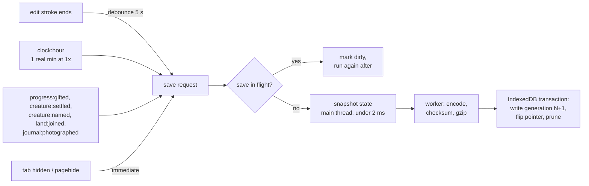
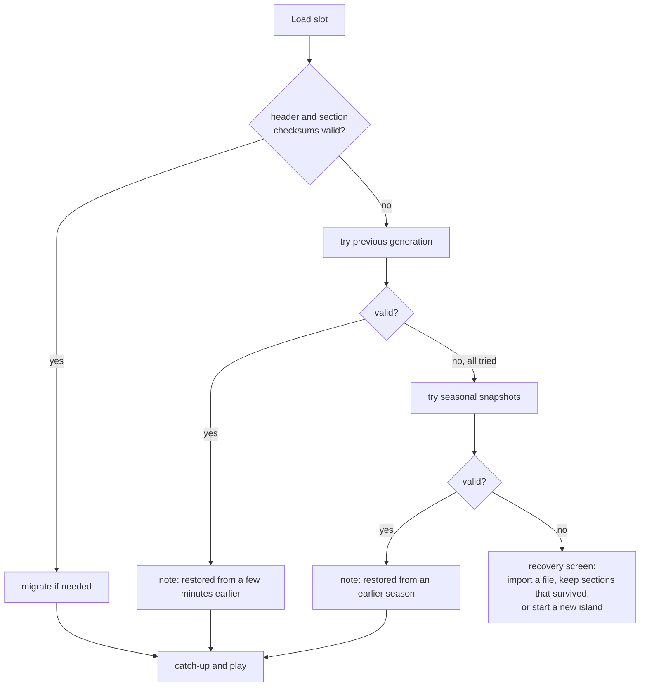

# 18 — Saves and Persistence

> An island you tend for months has to be safe. ebb saves quietly and often, never asks the player to press save, and never loses more than a minute of work. The save holds what cannot be regrown from the seed (the player's edits and the living state of plants and creatures) and leaves out everything the simulation can rebuild. The same data can be exported as a small `.ebb` file to back up or share. Saves carry a version so old islands always open in new builds. Time away is measured carefully so a changed device clock never wipes or fast-forwards an island, and a damaged save falls back to an earlier copy instead of failing.

## Locked decisions

- **Storage:** IndexedDB, one database `ebb`, accessed only through `src/save/autosave.js`. Request `navigator.storage.persist()` after the first meaningful edit so the browser does not evict the island.
- **Save what cannot be derived.** Saved: world seed, world clock, terrain edits, player water features, structures, flora state, ecology grid, creatures, progression, journal, away log. Not saved: water velocities and foam, particles, creature poses, moss texture, plant instance buffers, the water summary (all rebuilt on load, as in 02-core-loop-and-idle-model.md re-seed).
- **Saved per 32 m chunk.** Terrain, flora and ecology are stored chunk by chunk (08, 13); the world tops out at a 6 × 6 chunk area (192 m by 192 m), about 26 open chunks. An unedited chunk saves no heights (it regrows from its land recipe and seed). Only dirty chunks are re-encoded.
- **No save button.** Autosave on a cadence plus on leaving. Settings > Saves offers export, import, and "earlier versions".
- **One format for saves, backups and shared islands:** the `.ebb` container, versioned and gzip-compressed with the browser's built-in `CompressionStream` (no library).
- **Atomic writes with generations:** every save writes a new generation, then flips the slot's pointer in the same transaction. The last 3 generations and one per game season (up to 8, reaching back 112 game days with 14-day seasons, was 56) are kept.
- **Migrations only go forward** and the pre-migration blob is kept until the migrated save has loaded successfully once.
- **Time away comes from the wall clock with guards:** negative elapsed counts as zero, a high-water mark blocks repeat credit after a clock rollback, and the cap from 02 applies: at most 168 game hours (7 game days) per return, at the away rate of a quarter (4 real minutes = 1 game hour, `recipes/world/save.json` `catchUp`; F01). An island left paused stays paused while away.
- **Old saves and the longer seasons (save format 2, F01b):** a save made under 7-day seasons keeps its year, its season and its time of day, and day d of the season becomes day 2d ("Summer, day 3" opens as "Summer, day 5"). Every saved game time is moved the same way: the clock, plant spread stamps, frog stamps (since, fed, named, cooldown, joins and leaves, pending arrivals), weather day indices, and the journal's hours and note dates. Time only moves forward, so nothing due in the future becomes past; a gap between stamps can stretch, so a plant or a visiting frog may act on the first hour, as after a catch-up. The step is `src/save/migrate-calendar.js`; an island file opened from a backup is written back under the new format so it is not upgraded twice.
- **World state is saved as of the last whole hourly tick** (`coarseStep`: tide, weather, seasons, water summary, growth, ecology, creatures, expansion, shared by live play and catch-up), plus `worldT` and the minutes carried toward the next tick.
- **One writer per island:** the Web Locks API ensures only one tab tends a given island.
- **Device settings stay on the device** (store slice `settings`, written to the IndexedDB `prefs` store), never in world files.
- **Vertical slice:** autosave of seed, clock, terrain edits, water features, flora, ecology, frogs; per-chunk sections from day one (the slice has 9 chunks); load with catch-up; three generations; `.ebb` export and import. Seasonal snapshots and the recovery screen follow.
- **As built in S7a** (`src/save/`):
  - One save slot per island id, so each island in the badge's list keeps its own save. Slots are kept per page folder (`slotFor` in `autosave.js`): the live site (`/ebb/`) and each branch preview (`/ebb/preview/<branch>/`) share one web address and one database, so each keeps its own islands and never loads or overwrites another's. The local server's root keeps plain island ids. Only the game (`main.js`) saves. Tool pages and test links (`?seed`, `?day`, `?frogs`) run unsaved test islands; `?sandbox` unlocks for the visit only, and the save keeps earned unlocks alone.
  - The `world` section is the hourly tick's state exactly as the tick and the Plant tool left it, derived frog maps included (small once packed), so a loaded island is bit-for-bit the saved one.
  - Further sections: `view` (the camera, outside the checksum) and `looks` (empty until the creature studio).
  - Routine saves are packed into `.ebb` bytes in a worker. The save made as the tab hides is written to IndexedDB as it is (`codec: 'raw'`), at once, because the page may close before a worker answers; the next routine save replaces it.
  - The Saves menu on the build badge stands in for Settings > Saves until S8.
- **As built in S7d** (`src/save/recover.js`, `backup.js`; the Saves menu in `src/ui/saves-menu.js`):
  - **Part-by-part recovery:** the newest copy whose meta and world read is the island. Any other damaged part (journal, springs, unlocks, view, one chunk) comes from the newest older copy that has it whole. With none, a chunk regrows from the seed and the journal starts fresh.
  - **Calm note and quarantine:** a note says what happened (`recipes/world/save.json` `recovered`). Damaged copies go to the IndexedDB `quarantine` store (database version 2) once each, never deleted. With no copy readable, a recovery card offers opening a file or a new island. On previews and local builds only, it can also keep the broken save as a file for fixing (Matt: players have no use for it).
  - **Back up:** to an `.ebb` file. Touch phones use the share sheet, other devices a download. The slot records `lastBackupAt`, and after 7 real days without a backup a quiet line appears in the Saves menu.
  - **Opening a file:** checked before anything changes (format, checksums, size, an island this build has), then asked twice on the page. It goes in as the newest copy, so the replaced island stays among the earlier saves (Matt: replace, not a second island).
  - **Earlier saves:** opening one copies it as the newest. Both an opened file and an earlier save are stamped with the time now, so the time they waited earns no time away.
  - **Fingerprint:** the island fingerprint is `hashWorldState(world)` as 8 hex digits, the same on every device.
  - **Tests and tools:** buttons to damage the newest save, damage one chunk, or move the clock back a day, on previews and local builds only. `tools/migrate-test.html` (with `tools/save-samples/`) is ready for the first format change.
  - `navigator.storage.persist()` is asked for after the first edit.
- **As built in S7b:**
  - `meta.carryMinutes` and `meta.keepGrowing` are kept.
  - A loaded island does not save until its catch-up is done, and no save is made while one runs. A save then would stamp the old island with the time now and lose the time away; if the page closes mid catch-up, the next load counts the same time again.
  - The badge's Saves menu adds Pretend I was away (1 hour, 10 hours, 2 days, 30 days, in game hours earned at the away rate, so 30 days is cut to the 7-day cap), which runs the same clock rules.

## How it works

### Plain language

The save is the island's notebook, not a photograph: the seed, every change to land and water, and the state of each living thing. On return, ebb regrows everything else (water motion, moss texture, plant meshes) from those notes and runs time forward. Determinism means the same notes always regrow the same island.

### What is in a save

Sections map one to one onto the store slices in 03-tech-stack-and-module-map.md (except `settings`, which stays on the device). World-wide sections:

| Section | Contents | Size (compressed) |
|---|---|---|
| meta | format version, build id, slot name, world seed, sub-seeds, created and saved times, wall-clock high-water mark, `worldT`, carried minutes, time flow, weather leaning, keep-growing flag, ecology checksum | under 1 KB |
| water | `{ springs, tideStone, version }` (07-water-and-tide.md owns the shape); ponds and channels are terrain edits and live in the per-chunk heights | under 5 KB |
| structures | paths, walls, bridge, lanterns, drift logs as stroke polylines plus recipe ids and seeds (09-structures.md) | under 10 KB |
| creatures | group records per species (patch, population, group mood), named individuals (id, name, seed, markings seed, home cell, trust, age), swarm totals, scouts in transit, per-species happiness history (11-creatures-and-ecology.md) | under 15 KB |
| progression | happy-ever set per species, gifts given (one per species, never re-given), unlocked tools and palettes, land pieces with state (`queued`, `rising` with its start hour, `joined`) and the milestone queue (13-progression-and-expansion.md) | under 2 KB |
| journal | species page states, named-creature lines, moments, away notes, map place names, year page boxes, photo references (not pixels) | under 30 KB |
| awayLog | last 64 away events | under 8 KB |
| pieces | from format 5: placed pieces (09-structures.md), loose stones and kept logs; with no format change, pond stones (kind `stepping`, their rise but never the water's depth) flights of Steps (kind `steps`, their two ends, levels and rises; the cut itself is in the chunk heights) and reed rafts (kind `raft`, never the water's level). A build that does not know a kind leaves its records out | under 4 KB |
| keepsakes | from format 6 (F12): the shelf, up to 16 kept keepsakes, each with its family, generator version, its numbers (not only its seed, so later tuning never changes it), rarity, mark, where and when; and nets, up to 3, each with kind, place, the tide it was set and its wear. An older island migrates to an empty shelf and no nets | under 3 KB |

Per-chunk sections, one record per open chunk, keyed `cx,cz`:

| Field | Contents | Size per chunk (compressed) |
|---|---|---|
| state | `open` (locked chunks are not stored), landform recipe id and seed, `edited` flag | tiny |
| heightQ | only if edited: `Uint16Array` 128 × 128 (08's 16-bit heights), stored as they are (not as a difference from the regrown landform, so retuning a land recipe never scrambles an edited chunk; decided in S7a) | 10 to 40 KB |
| material, damp | only if edited: `Uint8Array` 128 × 128 each | 1 to 6 KB |
| flora | large plants in this chunk (species, position, seed, age, size, stage); small-plant cover per species and moss and lichen cover as 32 × 32 `Uint8Array`s | 2 to 8 KB |
| ecology | moisture, fertility, litter, light history, swarm densities as 32 × 32 `Uint8Array`s | 2 to 5 KB |

Starter island (9 chunks) totals about 150 to 300 KB; the fully expanded world (about 26 open chunks) stays under 1.5 MB. Photos live in their own store (`photos`); exports can include them on request. Undo history is not saved.

### Autosave cadence



- At most one save every 10 s from routine triggers; leaving the page always saves.
- The snapshot copies typed arrays out of `src/core/store.js`. Terrain already keeps its CPU mirror up to date after each stroke (08), so saving never waits on the GPU. Only chunks marked dirty since the last save (by `terrain:stroke-ended`, the hourly tick or `land:joined`) are re-encoded; clean chunks reuse their compressed bytes from the previous generation.
- On `pagehide` or hidden, if no full save can finish within 50 ms, a minimal clock and wall-time record is written so away time stays correct.
- Time flow paused: the meta section still updates the wall time and high-water mark, and the catch-up rule grants nothing, so a paused island stays paused.

### The `.ebb` world file

A small, forward-compatible binary container:

```
offset  content
0       magic "EBB\0" (4 bytes)
4       container version uint16 (currently 1)
6       flags uint16 (bit0 gzip, bit1 includes photos, bit2 shared copy)
8       header length uint32
12      header JSON (UTF-8): {format, build, seed, subSeeds, savedAt,
          wallHighWater, worldT, recipes:[{id, hash}],
          sections:[{id, offset, length, crc32, codec}]}
          recipes: each loaded recipe's id and content hash (14-asset-recipes-and-tuning-panel.md),
          so tools/determinism.html can tell a tuned recipe from a bug
          section ids: meta, water, structures, creatures, progression,
          journal, awayLog, chunk:<cx>,<cz> (one per open chunk)
...     sections, each gzip-compressed independently
end     crc32 of everything before it (4 bytes)
```

- `format` is the data schema version (integer, starts at 1) and is what migrations key on; the container version only changes if the byte layout changes.
- Each section is either `json` (small structured data) or `bin` (typed arrays with a tiny JSON descriptor of shape and type). Unknown sections are kept and written back unchanged, so a newer section survives a round trip through an older build.
- Section-level compression means one bad section (even one bad chunk) does not destroy the others.
- Starter island file: under 300 KB; fully expanded world: under 1.5 MB without photos.
- Shared copies (16-customization-and-photo-mode.md) set the shared flag and omit the away log; device settings are never in the file.
- Import validates magic, checksums, version, and size limits (grid dimensions, counts, string lengths) before anything touches the store. The file is data only: no code, no URLs.

### Migrations

`src/save/migrate.js` holds an ordered list of steps. On load, if `format` is older than the build's, each step runs in order on the decoded sections.

```js
export const MIGRATIONS = [
  { from: 1, to: 2, note: 'moss cover split into moss and lichen',
    up(s) { for (const c of s.chunks) c.flora.lichen = new Uint8Array(c.flora.moss.length); return s; } },
  // ...
];
```

Steps are pure and deterministic; species and recipe ids are permanent once shipped (renames go through an alias table); if a step throws, the original generation stays untouched. `tools/migrate-test.html` migrates a folder of old sample saves and shows a thumbnail and checksum of each, so Matt can check upgrades locally.

### Catch-up timestamps and clock safety

Away time is wall-clock time, which the player (or a time zone change, or a dead device battery) can move. The rules in `src/sim/catchup.js` with data from the save header:

```
now        = Date.now()
last       = header.savedAt              // wall time at last save
highWater  = header.wallHighWater        // largest wall time ever seen by this island
if now < highWater - 2 days:             // clock moved far back (or an earlier jump forward was corrected)
    elapsed = 0; highWater = now         // accept the new clock, grant nothing
else if now < highWater:                 // small backward step
    elapsed = 0                          // no credit until the clock passes highWater again
else:
    elapsed = now - max(last, highWater - grace)   // grace = 5 min for small NTP corrections
    highWater = now
if timeFlow == 0 or not keepGrowing: elapsed = 0                  // paused stays paused
totalMinutes = elapsed / 60000 * awayRate + carryMinutes          // awayRate 0.25: 4 real min = 1 game hour
ticks        = min(floor(totalMinutes), 168)
carryMinutes = (ticks == 168) ? 0 : totalMinutes - ticks          // time beyond the cap is dropped
```

Catch-up runs exactly `ticks` hourly `coarseStep`s and advances `worldT` by that many game hours only. Milestones reached during those ticks queue their land rise for the reveal or the next low tide (13); a piece saved as `rising` resumes from its start hour, since the rise follows the analytic tide.

- A clock set backward never rewinds or freezes the island; it simply earns no away time until real time catches up. A large backward jump resets the guard so an island is never stuck waiting on a mistaken future date.
- A clock set forward earns at most the 7-game-day cap (reached after about 11.2 real hours), the same as a real long absence, so there is nothing to gain by cheating and nothing to lose by accident.
- All stored times are UTC milliseconds, so time zones do not matter.
- In a session, time comes from `performance.now()`. A tab hidden over 60 s runs catch-up for the hidden span on return, at the away rate (hidden tabs are throttled).
- Fractional hours carry over in `carryMinutes`, so many short absences add up correctly.

### One island, one tab

On load, `autosave.js` requests the Web Lock `ebb-slot-<id>` with `ifAvailable`. If another tab holds it, this tab shows "This island is open in another window" with a take-over button (the other tab is asked over a `BroadcastChannel` to save and release), so two tabs never write different futures.

### Recovery from a damaged save



- Bad generations are moved to a `quarantine` store, never deleted, and can be exported from the recovery screen for debugging.
- If only some sections fail (for example the journal, or one chunk), the rest loads. A failed chunk is first taken from the newest older generation that has a valid copy of it; failing that, it regrows from its landform recipe and seed with default ecology. A note says what was lost in plain words.
- A load-time sanity pass clamps out-of-range values (negative ages, positions outside the world) rather than failing.
- "Back up this island" downloads an `.ebb`; after 7 real days without one, the Saves section shows a gentle reminder line, never a popup.

## Data and interfaces

IndexedDB stores (database version tracked separately from the world `format`):

| Store | Key | Value |
|---|---|---|
| `slots` | slot id | name, thumbnail, current generation, created, last played |
| `saves` | [slot id, generation] | `.ebb` container bytes (Blob) |
| `photos` | photo id | slot id, species id, WebP thumbnail, optional PNG |
| `prefs` | `'device'` | the store's `settings` slice: settings from 15, 16 and 17 (also mirrored to `localStorage` for instant boot) |
| `quarantine` | auto | damaged containers with the error |

```js
// src/save/autosave.js
export async function open() {}                    // opens DB, requests persistence and lock
export function requestSave(reason) {}             // 'edit'|'hour'|'event'|'hide'
export async function loadSlot(slotId) {}          // -> {state, elapsedMs, restoredFrom}
export async function listGenerations(slotId) {}   // for "earlier versions"
// src/save/world-file.js
export async function encode(state, opts) {}       // -> Blob; opts {includePhotos, shared}
export async function decode(blob) {}              // -> {header, sections} or throws SaveError
// src/save/migrate.js
export function migrate(sections, fromFormat) {}   // -> sections at current format
```

Events (past tense, per 03): emitted `save:written` (generation, bytes, ms, chunks re-encoded), `save:restored` (from), `save:failed`, `slot:locked`. Listened to: `terrain:stroke-ended`, `clock:hour`, `progress:gifted`, `creature:settled`, `creature:named`, `land:joined`, `journal:photographed`.

## Algorithms and shaders

- CRC-32 (IEEE polynomial) per section and for the whole file; the header also carries the ecology checksum used by `tools/determinism.html`.
- Gzip via `CompressionStream('gzip')` and `DecompressionStream`. Edited chunk heights are stored as they are; a row-delta step before compression can come later if files grow.
- Encoding runs in a worker from `src/core/workers.js`; transfers typed arrays without copying.

## Tuning knobs

Settings: export (with or without photos), import, earlier versions list, backup reminder on or off, delete island (with a typed confirmation of the island name). Tuning panel: save debounce, generations kept, "corrupt the current save" and "set clock back a day" test buttons for checking recovery and clock guards.

## Performance budget

- Snapshot on the main thread under 2 ms; encode and compress in a worker under 30 ms desktop, 80 ms mobile for the starter island, and the same for the full world because only dirty chunks are re-encoded.
- Load and decode under 150 ms desktop, 400 ms mobile before catch-up starts.
- Storage per island under 5 MB including 8 generations; photos counted separately and listed in settings with their total size.

## Acceptance checks

- Sculpt a hill, close the tab within 10 s, reopen: the hill is there.
- Set the device clock back a day, reopen: nothing rewinds, no reveal; set it forward a month: the reveal shows 7 game days, no more.
- Pause time, close the tab for an hour, reopen: nothing has grown.
- Corrupt one chunk with the tuning panel: only that chunk comes back from an earlier copy; the rest of the island is current.
- Corrupt the current save with the tuning panel button, reload: the island comes back from a minute earlier with a calm note.
- Export an island on desktop, import it on a phone: it opens as a new island and matches.
- Open the same island in two tabs: the second shows the "open in another window" note.
- An old sample save in `tools/migrate-test.html` migrates and shows the same thumbnail.

## Open questions

- Should there be more than one island slot from the start, or a single island until the player asks for another?
- Should exported files include photos by default?
- How long should earlier versions go back: a few seasons, or a whole in-game year?

## Depends on / feeds into

- Depends on: 02-core-loop-and-idle-model.md (clock, catch-up, re-seed), 08-terrain-and-sculpt.md, 09-structures.md, 10-growth-and-seasons.md, 11-creatures-and-ecology.md, 13-progression-and-expansion.md.
- Feeds into: 15-camera-input-and-ui.md (journal, settings), 16-customization-and-photo-mode.md (prefs, photos, sharing), 19-performance-and-quality-tiers.md, 20-roadmap-and-vertical-slice.md.
