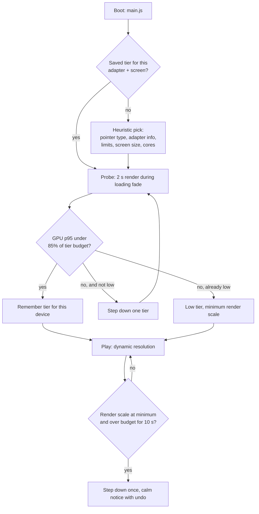

# 19 — Performance and Quality Tiers

> ebb should never stutter. A calm game that hitches is not calm, and a phone that gets hot in your hand is not cozy. This doc sets the frame-time budgets every system must live inside, defines three quality tiers (high for desktops like Matt's, medium for laptops and tablets, low for phones), says how the game picks a tier by itself, lists memory limits, describes which CPU work moves to worker threads, and specifies a benchmark page under `tools/` that Matt runs on his own machine to check every milestone against these numbers. The worst case is always the fully expanded world (192 m by 192 m, `13-progression-and-expansion.md`), not the starter island.

## Locked decisions

- **Ultra (added October 2026)** sits above high for strong desktop GPUs: ground detail to 260 m (high 140 m), the finest terrain mesh to 120 m, a 4096 shadow map, water ripples to 250 m, native resolution up to 8.3 MP. It is never a guess: a discrete GPU starts on ultra and the startup probe (2 s of GPU timestamps once the ground detail has faded in, pulled forward from S8) keeps it when GPU p95 is under 4 ms, else steps down to high at runtime without a reload. The verdict is remembered per adapter and screen; `?tier=ultra` forces it. On Matt's RTX 4070 Ti Super at 3440×1440 the probe measures about 2 ms.
- **Three base tiers: `high`, `medium`, `low`** (names from `03-tech-stack-and-module-map.md`). Data resolutions never change between tiers (terrain 0.25 m, water 0.5 m, ecology 1 m), so saves and simulation results are identical on every device. Only render detail, live-sim reach and update rates change.
- **Desktop target (high):** RTX 4070 Ti Super, Ryzen 7 7700X, 2560×1440, **60 fps**, GPU at most **12 ms** per frame, main-thread CPU at most **4 ms**, in the worst-case world.
- **Mobile target (low):** a 2023 or newer phone (iPhone 15 or newer on Safari 26; Android 12+ on Chrome with an Adreno 7xx or Mali-G7xx class GPU) at a steady **30 fps**, GPU sustained at most **18 ms** (hard ceiling 24 ms, `04-render-pipeline.md`) so the phone stays cool, main thread at most 8 ms.
- **Medium:** laptops with integrated graphics, Apple Silicon Macs and M-series iPads at 60 fps, GPU at most 13 ms at a reduced render scale.
- Every pass budget below is a **ceiling in the worst case**. A milestone that breaks one is fixed before the next step starts (`20-roadmap-and-vertical-slice.md`).
- Dynamic resolution (doc 04) is the first defense. A tier only steps down automatically once, with a calm notice and a one-tap undo.
- **No SharedArrayBuffer.** GitHub Pages cannot send the cross-origin isolation headers it needs, so workers exchange data through transferable `ArrayBuffer`s.
- The tier table is data: `recipes/quality-tiers.json`, listed in `recipes/index.json`, editable from the tuning panel. New file `src/render/quality.js` owns detection and applies the table.
- Benchmarks run on Matt's machine through `tools/benchmark.html`, never as long cloud runs.

## How it works

Plain version: a frame at 60 fps has 16.6 ms. We spend about 12 ms on the graphics card and keep the rest as a cushion for the browser, the operating system and surprises. That 12 ms is split among the passes like a household budget, and each system's doc promises to stay inside its line. When the game starts, it looks at the device (is it a phone, what graphics chip, how much power) and picks a tier. During a short loading fade it quietly renders the island to check that guess, and steps down if needed. While playing, if a heavy moment pushes past budget, the internal resolution drops a little and comes back when things calm down, which is far less noticeable than a stutter.

### Heuristic pick (`src/render/quality.js`)

1. `matchMedia('(pointer: coarse)')` with a small screen (shorter side under 900 CSS px) suggests **low**.
2. `adapter.info`: `isFallbackAdapter` forces **low** with a gentle notice. A vendor or architecture string that names a discrete desktop GPU (nvidia, amd discrete) suggests **high**. Integrated GPUs (intel, apple on a Mac, qualcomm on Windows laptops) suggest **medium**. Apple GPUs on a touch device with a large screen (iPad) suggest **medium**.
3. Limits that fall back to the WebGPU baseline on a non-touch device lower the pick one step.
4. `navigator.hardwareConcurrency` under 6 lowers the pick one step. Chrome's `navigator.deviceMemory` under 4 GB lowers it one step.
5. The pick, the adapter identity string and the screen size are remembered in `localStorage` (wrapped in try/catch). A different adapter or screen re-runs detection. The player can always override in Settings > Quality (`15-camera-input-and-ui.md`).

The probe uses GPU timestamps when `timestamp-query` is available and `onSubmittedWorkDone` round trips otherwise.

## Data and interfaces

### Desktop budget: high tier, 1440p, fully expanded world (GPU ms)

| Group | Pass | Budget |
|---|---|---|
| World compute | water sim, 36 chunk tiles, 2 steps (doc 07) | 0.60 |
| | foam and ripples | 0.15 |
| | terrain wetness (doc 08) | 0.10 |
| | boids, 4,096 agents (doc 11) | 0.30 |
| Render compute | sky LUTs and sky probe (doc 06) | 0.25 |
| | foliage cull and LOD, about 250,000 instances | 0.30 |
| | particle sim | 0.10 |
| Geometry | shadow cascades, 3 × 2048 | 1.50 |
| | depth prepass with normal and ID | 0.85 |
| | GTAO, full resolution | 0.70 |
| | opaque: terrain and structures, caustics included | 1.50 |
| | foliage color | 1.50 |
| | creatures color (doc 11's 2 ms covers all creature work) | 1.00 |
| | HDR and depth copy, refraction mips | 0.15 |
| | water shading with SSR (doc 07) | 0.90 |
| | sky draw | 0.15 |
| | particles draw | 0.30 |
| Post (doc 05) | exposure, bloom, tonemap with LUT, painterly when on, outline, dither, present | 1.65 |
| **Total** | | **12.0** |

Headroom to 16.6 ms: 4.6 ms. Photo-mode extras (depth of field 1.5 ms, long-exposure accumulate 0.1 ms) only run in photo mode, where the frame cap may drop to 30 fps.

### Mobile budget: low tier, phone, about 1.2 MP internal (GPU ms)

| Group | Budget |
|---|---|
| World compute: water (40 m reach, 1/60 s steps), foam, wetness, boids 1,024 | 1.55 |
| Render compute: sky LUTs half size, foliage cull, particles | 0.95 |
| Shadows, 1 × 1024 | 0.70 |
| Depth prepass | 1.80 |
| Opaque | 3.00 |
| Foliage | 3.50 |
| Creatures | 1.50 |
| Copies, water shading, sky draw, particles | 1.70 |
| Post, with tonemap, outline and dither fused into one pass | 1.50 |
| **Total** | **16.2** (sustained ceiling 18) |

### CPU budget (main thread, per frame)

| Work | high | low |
|---|---|---|
| Input, actions, camera (doc 15) | 0.10 | 0.20 |
| live-sim tick (CPU side of systems) | 0.50 | 1.00 |
| Creature IK, springs, hops for live individuals (doc 11) | 1.00 (120) | 2.00 (50) |
| Frame graph record and uniform uploads | 1.00 | 2.00 |
| HUD, events (doc 15: under 0.5 ms) | 0.50 | 0.80 |
| Audio scheduling (doc 17) | 0.20 | 0.30 |
| Slack | 0.70 | 1.70 |
| **Total** | **4.0** | **8.0** |

### Settings matrix (`recipes/quality-tiers.json`)

| Setting | high | medium | low |
|---|---|---|---|
| Target fps (calm mode cap) | 60 (30) | 60 (30) | 30 (20) |
| GPU budget, ms | 12 | 13 | 18 |
| Render scale default (minimum) | 1.0 (0.67) | 0.85 (0.6) | 0.75 (0.5) |
| Max DPR / max internal megapixels | 2 / 3.7 | 2 / 2.1 | 2 / 1.2 |
| Shadows | 3 × 2048, PCSS | 2 × 1536, 9-tap | 1 × 1024, 4-tap + horizon map |
| Ambient occlusion | GTAO full res | GTAO half res | off (horizon map, vertex AO) |
| Sky-view LUT / aerial volume | full / 32³ | full / 32³ | half / 16³ |
| Water live reach, step | 60 m, 1/120 s | 60 m, 1/120 s | 40 m, 1/60 s |
| Water reflections, refraction mips | SSR + probe, 4 | probe, 4 | probe, 1 |
| Caustic layers, ripple window | 2, 256² | 2, 256² | 1, 128² |
| Grass density, grass distance | 1.0, 40 m | 0.6, 30 m | 0.35, 20 m |
| Foliage LOD distance scale | 1.0 | 0.75 | 0.5 |
| Live creatures, boids | 120, 4,096 | 80, 2,048 | 50, 1,024 |
| Particles max | 20,000 | 10,000 | 4,000 |
| Lights (shader loop / tiled) | 64 tiled | 32 tiled | 8 loop |
| Bloom levels | 6 | 5 | 4 |
| Ground detail (doc 22): map size, hex tiling (3 reads per projection), triplanar, puddles, anisotropy; macro variation on every tier | 1024, on, on, on, 16x | 1024, on, on, on, 8x | 512, two-scale mix (2 reads), off, damp only, 4x |
| Ground detail fade (m), terrain LOD distances (m), water ripple fade (m); ultra: 260, 120/240, 250 | 140, 45/95, 140 | 60, 45/95, 120 | 35, 45/95, 80 |
| Cliff chunks at full mesh detail (M2, doc 08), and the extra cost per cliff chunk | within 60 m, about 0.2 ms | within 45 m, about 0.2 ms | within 30 m, about 0.4 ms |
| Painterly (off by default on every tier, doc 05) | full res | quarter res | quarter res |
| Outline | separate pass | separate pass | fused into tonemap |
| HUD backdrop blur (doc 15) | on | on | off |
| Worker pool | `hardwareConcurrency − 2`, max 14 | same | max 4 |
| Photo export (doc 16) | 2x, 4096 px max | 2x, 4096 px max | 1x |

### Memory budgets

| | high | low |
|---|---|---|
| Render targets (doc 04 list at internal size) | about 170 MB at 1440p | about 50 MB |
| Shadow maps | 50 MB | 4 MB |
| Terrain textures, 192 m grid at 0.25 m, 768 × 768 (doc 08: height, material, ground) | 7 MB | 7 MB |
| Ground detail arrays, 2 × 4 layers with mips (doc 22: 1024² high and medium, 512² low) | 43 MB | 11 MB |
| Water fields, at most 384 × 384 at 0.5 m plus ripple window (doc 07) | 11 MB | 11 MB |
| Foliage instances and compacted lists | 12 MB | 12 MB |
| Meshes (flora library, creature bodies, structures) | 40 MB | 25 MB |
| Moss, sky LUTs, palette LUTs, noise | 20 MB | 12 MB |
| **GPU total steady** | **under 380 MB** | **under 150 MB** |
| Photo mode extra (accumulator, export target) | up to 250 MB at 4096 px | up to 40 MB |
| JS heap (store, ecology grid, recipes) | under 200 MB | under 120 MB |

`src/core/gpu.js` tracks every `makeTexture` and `makeBuffer` allocation by label, so the benchmark and debug overlay can show the total. iOS Safari ends tabs that grow too large, so the low-tier total stays under 400 MB including the page.

### Worker use

Pool and lanes are defined in `03-tech-stack-and-module-map.md`. CPU work that must never touch the main thread:

| Job | Lane | Desktop / phone target |
|---|---|---|
| Catch-up, 168 ticks (the 7-day cap, F01; was 336), full world (doc 02) | catchup | under 3 s / under 8 s |
| Hourly coarseStep, one tick live or in catch-up, full world (docs 02, 13) | catchup | about 3 ms / under 8 ms |
| Water summary rebuild (doc 07) | background | 25 ms / 80 ms |
| Ecology distance transforms (doc 11) | background | under 10 ms / 30 ms |
| Tree skeletons, space colonization (doc 10) | background | under 30 ms per tree |
| Stone wall Voronoi packing after a stroke (doc 09) | interactive | under 50 ms |
| Tuning panel regeneration (doc 14) | interactive | under 100 ms |
| Save encode and compress (doc 18) | background | 30 ms / 80 ms |

Results come back as transferables and are applied at the start of the next frame, so no frame waits on a worker.

### Boot and shader compile

All pipelines are created with `createRenderPipelineAsync` and `createComputePipelineAsync` during the loading fade, so no shader compiles mid-play. Boot to first calm frame: under 3 s desktop, under 6 s phone, not counting catch-up (doc 02).

## Algorithms and shaders

- **Timing**: per-pass timestamp pairs resolved into a ring of 3 readback buffers (doc 04). Chrome rounds timestamps to 100 µs unless chrome://flags "WebGPU Developer Features" is on. The benchmark page reminds Matt of this.
- **Statistics**: p50, p95 and p99 over a rolling 300-frame window. Budgets are judged at p95.
- **Dynamic resolution**: the controller from doc 04 (step 0.05 after 30 frames over budget, recover after 120 frames under 85%).
- **Tile-based GPUs** (all phones): every transient attachment uses `storeOp: 'discard'` when nothing reads it later, passes are fused where possible on low (tonemap, outline and dither), and no target is read back mid-frame.
- **Thermal care**: on low, if p95 creeps up by over 20% across five minutes at constant scene load (a sign of throttling), the render scale drops a step early instead of waiting for frames to miss.

## Tuning knobs

- Settings > Quality: tier, render scale (auto or fixed), frame cap, calm mode, plus the per-feature toggles from docs 04 to 07 (shadows, ambient occlusion, painterly, outlines, weather effects).
- Tuning panel: every value in `recipes/quality-tiers.json`, the probe length and threshold, the dynamic resolution steps, and the debug overlay (per-pass bars, memory total, worker queue lengths).

## Performance budget

This doc is the budget. Summary: high 12 ms GPU and 4 ms CPU at 1440p, 60 fps; medium 13 ms GPU at 60 fps; low 18 ms sustained GPU and 8 ms CPU at 30 fps; all measured in the 192 m fully expanded world.

## The benchmark page: `tools/benchmark.html`

A page Matt opens locally (or from the GitHub Pages URL on a phone) next to the game. It imports the same `src/` modules, so it measures the real code.

**Scenes** (fixed seeds, scripted 30 s camera paths recorded with `tools/input-replay.html`):

1. Vertical slice island, midday, clear.
2. Vertical slice island, dusk, light rain, frogs calling (no lanterns: the slice has no structures).
3. Worst case: synthetic fully expanded 192 m world with every land piece joined, mature flora at maximum density, maximum live creatures and boids.
4. Water stress: every chunk active, 8 springs, the pour brush running, spring low tide.
5. CPU only: 168-tick catch-up on the worst-case world, plus one water summary rebuild and one save encode.

**Controls**: tier (one or all three), resolution (window size or forced 2560×1440), scenes to run, run count. A run takes under 4 minutes for all scenes at one tier.

**Results**, as one vertical column that fits its pane with no horizontal scrolling and text at 16 px or larger:

- A summary line per scene: pass or over budget, with a drawn check or a drawn warning icon plus the words, never color alone.
- Per-pass horizontal bars against their budget lines (the bars run left to right inside the pane width, with values printed beside them).
- Frame time histogram with the p50, p95 and p99 marked.
- CPU main-thread time per frame, worker job times, GPU memory total from the allocation tracker, JS heap where the browser reports it.
- **Compare** with a previous run: load a saved result JSON (or the last run kept in browser storage) and show the change per pass, marked better or worse in words and drawn arrows.
- **Save result** downloads `ebb-bench-<date>-<tier>.json`. When Matt approves a milestone, Claude Code commits that file to `tools/baselines/` so later work is checked against it.

Related pages: `tools/gpu-probe.html` (adapter, features, the tier ebb would pick), `tools/catchup-bench.html` and `tools/determinism.html` (doc 02).

## Acceptance checks

- On Matt's desktop at 1440p, `tools/benchmark.html` reports every scene at high tier as passing, worst case included, with p95 GPU time under 12 ms.
- Orbiting fast over the fully expanded world shows no hitch. The debug overlay's frame line stays flat.
- On a recent iPhone and a recent Android phone, the game opens on the low tier, runs smoothly, and the phone is only mildly warm after 15 minutes.
- Forcing high tier on a phone: within a couple of seconds the image softens slightly (dynamic resolution), and after 10 s a calm notice offers a lighter setting with an undo.
- Switching tiers in Settings never reloads the page or loses the island.
- The first sculpt stroke, the first rain and the first photo never stutter (all pipelines were compiled during loading).

## Open questions

- Should the game remember a tier per device permanently, or re-check it each time it opens (this matches the question in doc 03)?
- Is 30 fps on phones good enough for the feel you want, or should newer phones try 60 fps at a lower resolution?
- Which phones and tablets do you have on hand for click-testing, so the benchmark baselines include them?

## Depends on / feeds into

- Depends on: `03-tech-stack-and-module-map.md` (tiers, workers), `04-render-pipeline.md` (passes, timing, dynamic resolution), `05-look-and-palette.md`, `06-sky-and-lighting.md`, `07-water-and-tide.md`, `08-terrain-and-sculpt.md`, `10-growth-and-seasons.md`, `11-creatures-and-ecology.md`, `13-progression-and-expansion.md` (world ceiling), `02-core-loop-and-idle-model.md` (catch-up).
- Feeds into: `15-camera-input-and-ui.md` (Settings > Quality), `16-customization-and-photo-mode.md` (photo limits), `18-saves-and-persistence.md` (encode budgets), `20-roadmap-and-vertical-slice.md` (milestone gates).
