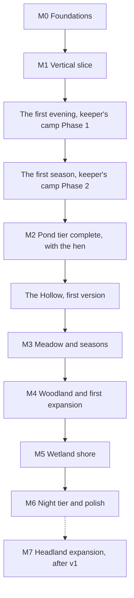

# 20 — Roadmap and vertical slice

> The build order for ebb. The first target is a vertical slice: one small island that already shows every pillar working together at small scale. After Matt approves the slice, the game grows tier by tier, following the creature roadmap. This doc also explains how to feed the doc set into Claude Code sessions so each session has exactly the context it needs.

## Locked decisions

- Nothing from a later milestone is built until the milestone before it is click-tested and approved.
- ebb is a desktop and laptop game, played with mouse, keyboard or trackpad (decided October 21, 2026). Phones and tablets used by touch get a short note that ebb is made for a desktop or laptop, with a link to notarobot-eng.com/ebb, and the game does not load behind it. Medium is the floor tier; low is a fallback for weak laptops. The slice was first built to run on phones too; those parts were retired then.
- The slice has no human structures and no audio; both start in M2.
- Each milestone ends with a short click-test list for Matt and a local `tools/` page for anything numeric.
- Each milestone lands on its own branch and merges to main only with Matt's approval.

## How it works

### M0 — Foundations

The skeleton everything else hangs on. No gameplay yet, but it should already look calm.

- `index.html`, brand icons in the head, WebGPU feature detection with a friendly message when it is missing.
- `src/core/`: GPU device, world clock with time flow, seeded random numbers, event bus, store, worker pool.
- `src/render/`: frame graph, diorama orbit camera, HDR target, a placeholder tonemap.
- A flat placeholder island and a plain sky, so the camera and frame graph can be seen working.
- `tools/frame-timing.html`: live per-pass timing graph Matt can run locally.

Click-test: the page opens on desktop, the camera orbits, pans and zooms smoothly with the mouse, and the timing page shows steady frame times.

### M1 — Vertical slice

One island, everything in miniature. Built in seventeen steps, each its own click-test. G1 to G3 (ground detail) were added in October 2026 after the realism review; they upgrade S1's surfaces and sit between the original steps. S4 (water) was split into S4a to S4c in October 2026 so each piece stays click-testable, with realism a priority. J1 and J2 (the field journal) were added in October 2026, before frogs, because the journal is how the player reads the whole island, plants included, not a page per creature:

| Step | What appears | Main docs |
|---|---|---|
| S1 | Sculptable heightfield island with grass, sand, soil and rock paint; undo and redo | 08 |
| S2 | Physical sky, sun and moon moving with the world clock, shadows, day and night, plus a minimal seasons and weather step (season index, day length, light rain, frog and reed dormancy) so catch-up across seasons works | 06, 10 |
| S3 | Palette-last tonemap with two palettes ("dusk" and "meadow morning"), tuned toward realism, and a soft outline | 05, 04 |
| G1 | Textured ground: CC0 scanned detail maps per material (calibrated in `tools/texture-lab.html`), texture arrays with GPU mips, height blending, micro-normal lighting | 22, 08 |
| G2 | No tiles, no stretch: hex tiling, triplanar on steep slopes, macro variation, ground quality-tier settings | 22, 19 |
| S4a | Water you see: analytic tide, the GPU shallow-water simulation coupled to sculpting, the starter spring, and physically based water drawing (Fresnel sky reflection, sun and moon glints, refraction, Beer-Lambert depth color, flow-mapped ripples, gentle sea swell); `tools/water-lab.html` | 07 |
| S4b | Water the island knows: the deterministic water summary (priority-flood), the pond refill nudge, pour and drain tools, spring placing (built, locked until the dragonflies' gift; `?sandbox` opens it), the live readback for creatures, tide events for ecology | 07, 11, 12 |
| S4c | Water optics and wet ground: sky probe with specular mips, screen-space reflection on high, caustics, foam, ripples from rain and creatures, the visual wetness pass with drying tide flats | 07, 06, 08 |
| G3 | Wet ground: roughness and specular, damp darkening and puddles in rain (reads S4c's wetness pass and sky probe) | 22, 06 |
| S5 | Shipped grass, reeds, water lilies, yellow flag iris and sea thrift, each growing and spreading on its own ground, with the Plant tool and `tools/growth-lab.html` | 10, 14 |
| J1 | Field journal v1: the book button, a page for every living thing on the island that fills from what happens there, notes on the island and in the journal, click a plant to name it | 13, 15 |
| J1.5 | More to explore: click the ground too (soil, sand, rock, moss, fresh water, shore) and a Ground section; Show me rings a page's example nearest the middle of your view (first built as a camera glide; since J2a the camera stays put); field notes, your island's story and four "?" moment frames per page; the Almanac; `?day=N` to start a new world later in the year | 13, 15 |
| J1.6 | Field sketches: a drawn illustration for each page, in pencil until known, then inked | 13, 15 |
| J2a | The journal's Web: what needs what, in bands (ground, plants, animals, you); links inked once seen on the island, in one journal ink; names not yet seen are a pencil "?" | 13, 15 |
| J2b | The "show where" wash: opening a page washes the island in one journal ink with an inked edge, strong where the species lives and pale where it would do well, painted after the palette; the camera stays where it is; an unseen species gets two or three pencil circles a little off the spot, a hint rather than the answer | 13, 05, 15 |
| S6 | Frogs: needs, arrival, settling, behavior, presence (a list of sources, the camera first), feeding for trust and naming; midges and frogs get journal pages and sketches. In three pieces: S6a frogs arrive (the midge field, frog habitat and the arrival arc in the hourly tick, the journal's stages, posed bodies, `tools/ecology-lab.html`); S6b the frog you see (baked body, motion, the chorus, the midge swarm, presence); S6c feeding, trust and naming | 11, 12, 23 |
| S7 | Autosave, reload, and offline catch-up with the "while you were away" reveal | 02, 18 |
| S8 | Minimal HUD with drawn icons and settings; the touch layout on phone and the phone tier were built, then retired on October 21, 2026 when ebb became desktop and laptop only | 15, 19 |

**Signed off October 20, 2026:** Matt passed all eight checks below together (tools/slice-review.html). M2 became the current target. Since October 22, 2026 the first evening (below) comes first.

Slice acceptance, all together:

- Sculpt a dip near the spring. Water fills it and finds its way to the sea.
- Watch for a few game hours. The tide visibly ebbs and returns; reeds creep along the wet edge.
- After enough reeds and water, a frog visits, then settles; you can feed it and give it a name.
- Open the journal: every plant on the island has a page that says, in words, where it grows and what it likes, and the notes tell what changed.
- Switch palettes. The whole scene changes mood instantly, and the light still behaves the same.
- Orbit in close at a low sun, then let it rain. Sand, rock and soil read as real material, show no tiling, and turn dark and glossy with puddles in the rain.
- Close the tab, come back the next day. The island has moved on, and a short calm reveal shows what changed.
- (Retired October 21, 2026: the same steps on a phone with touch. ebb is now desktop and laptop only.)

### The first evening (keeper's camp Phase 1) — done

Decided October 22, 2026 (Matt): Phase 1 of the keeper's camp (`docs/future/13-keepers-camp.md`) comes before the rest of M2 and ships before ebb is marketed, because a player who lands with no orientation is likely to leave. A new island opens at dawn with the walker standing on the beach below the camp, the small boat grounded behind (changed October 22, 2026, Matt: no row-in). Nine short beats teach walking, the spring and the journal's first page, pitching the tent, gathering, laying the fire ring, going up to shape, lighting the fire at dusk, and resting until morning. The starter island grows to 4 x 4 chunks with a more varied coast (F13 section 3.11).

| Piece | Scope | Depends on |
|---|---|---|
| E1 | Camp ground and the larger island: `starter-island-2`, the pad and its brush lock, the trodden look, older saves stamped, save format 9 begins | none |
| E2 | Pack core and the gather engine: pouches, fullness, set down and piles, sticks, drift twigs, pebbles, flat stones, reed down | none |
| E3 | Tent and fire ring: pitching, laying, lighting, light, smoke, embers, rest skipping to just before sunrise | E1, E2 |
| E4 | The evening director: beats, walker hooks, the boat start and mooring, the keeper's first page, skip | none |
| E5 | `tools/intro-lab.html` | E4 |

Exit check: Matt plays the first evening on a fresh seed, end to end, without reading anything outside the game, and an existing island loads with its camp pad stamped. **Passed October 23, 2026.**

### The first season (keeper's camp Phase 2)

Decided October 24, 2026 (Matt). A short groundwork step comes first: the rest of the walker's motion (leaning into starts and stops, the head turning to look, a gesture for each action) and the planting sketch (D1). **All planting is the walker's:** the Plant tool leaves the view from above, and seeds and gifts are tossed from where the walker stands (D1a: the seed tin and the gift spot on the walker's bar; the raft simply appears on the pond, no pushing off; the net is set by walking out to the clicked spot). Then Phase 2 in pairs (F13 section 13, with 3.12):

| Step | Side by side |
|---|---|
| 1 | P2a plant rules, P2b the four tea herbs |
| 2 | P2c cord, shovel and digging, P2i fire products |
| 3 | The workbench and apothecary bench makes with P2j the camp store; then P2d clay and the three pots, with the star fire |
| 4 | P2e teas, P2h treats and trust, P2k the forager's trail (a fourth trail, added October 24, 2026; doc 13) |
| 5 | P2g planting from below (after D1), P2f the satchel and basket |

**The camp store (P2j)**, added October 24, 2026 (Matt): a simple store at camp with 6 slots, made larger to 12, linked to the workbench, the apothecary bench and the fire, which draw from it. Its material and how it grows are proposed separately for Matt's pick.

**All built by October 27, 2026** (every Phase 2 piece in `docs/progress.md`). Exit check (Matt, October 27, 2026): the ten checks on `tools/season-review.html`, played on his own island and the test links there; anything not yet right becomes a fix log, as Phase 1's did. **Passed October 29, 2026**, after a fix round from Matt's playthrough (the dune for chamomile, woven twigs for the first shovel, young rush beds giving stems, and the season fixes; `docs/progress.md`).

Later phases of the camp ride with the milestones below: Phase 2 (the first season: plant rules, tea herbs, digging, clay, teas, treats and trust) now comes next, before the rest of M2 (October 24, 2026, below); Phase 3 (pond tier gifts) at M2's close; Phase 4 (meadow herbs, dyes) with M3; Phase 5 (woodland, shore and night) with M4 to M6, each with its species' milestone (F13 section 13).

### M2 — Pond tier complete and the meadow islet — current target

The rest of M2 continues after the first season (changed October 24, 2026), together with the camp's Phase 3. Check the meadow islet's placement against the larger 4 x 4 island first.

**M2's close, in order** (Matt, October 27, 2026):

| Stage | What |
|---|---|
| B1 | The camp's Phase 3 (pond tier gifts), with the hen's slices 2 to 4 (trust and Fond, her day, eggs and the nest box; F15). She needs only scrub, dust and water, all on the island by now; her chicks wait for M3 |
| B2 | W7 Steps and crossings, the stepping stones and one lantern, photo mode. The tuning panel v1 is dropped (Matt, October 30, 2026): tunables stay in recipes, and a small slider page under `tools/` covers anything that needs tuning |
| B3 | The meadow islet and its sandbar, and the autumn and winter creatures (Matt, October 27, 2026): doc 13's cold-season plan plus teal. Grey seals and a pup on a quiet sandbar the player raised; turnstones on the strandline wrack; purple sandpipers on a rocky sea wall the player built with Terrace; silver eels on rainy autumn nights; and **teal** wintering on a reedy pond once the frogs sleep, leaving in early spring. Starlings were considered and left out. Each comes first as **a visit** that hints at what it would need, and its home must be **shaped by the player, not found**; the island cannot hold everyone at once (doc 13, "Shaped, not found") |

**Gifts come at naming** (Matt, October 27, 2026): a species gives its gift when the first of them is named (trust 0.5), or, for a school or swarm that cannot be named, when its trust first reaches 0.5. The happy event (a big content group for a day) now drives only the tier land. Turtles can be named, and get two treats (worms at the water's edge, and a lily leaf parcel made at the workbench) so their trust can be earned; built on `m2-turtle-friendship`, which rewrites doc 12's rule.

- **First step: the Cliff tool** (decided October 2026). Terrace and Cut modes that build or carve level shelves with sheer rock faces, painted rock that stays sheer (talus about 82 degrees), full mesh detail near cliffs, and a shadow offset for near-vertical faces. Built first so it lands as early as possible without interrupting the slice (docs 08, 15, 04, 19). First planned as available from the start; since October 20, 2026 it is **the frogs' gift** (doc 12), replacing their water lily seed, with `?sandbox` and `?cliffs` opening it for testing. Built October 20, 2026 and merged (PR #54) as Sculpt chips (Terrace and Cut beside Raise, Lower, Flatten and Boulder), together with **waterfalls**: water running over a shelf's edge is drawn as volumetric droplet water near the eye (screen-space fluid) and as a curtain further off, with foam where it lands (doc 07). Their sound is built too: each waterfall near the camera is heard where it falls (doc 25).
- Minnows (schooling), dragonflies (darting flight) and turtles (basking) join the frogs. Minnows come by themselves to a still pool with a deep spot of about 1 m; turtles to a warm pond with a sunny stone, and better with a log (doc 12; turtles moved here from the shore tier on October 20, 2026).
- Gifts (progression agreed October 20, 2026, doc 13): the frogs' Cliff tool, the minnows' pondweed, the dragonflies' stream tool, the turtles' floating reed raft (Matt, October 21, 2026). Driftwood washes up from the naturalist's notes at 10 finds and can be carried from then on (no longer a gift), and toads and slow worms (finds) live under logs. The gift card and the progress module are built (`src/world/expansion.js`); the frogs' gift moves from lilies to the Cliff tool.
- The Tier 1 milestone: the meadow islet rises at low tide with a sandbar to the main island, dry only at low tide (doc 13, "The meadow islet in play").
- Field journal with photo mode; photographs fill species pages.
- Tuning panel v1: live sliders for species and flora recipes, saving recipe files.
- First audio pass: water bed, wind bed, frog voice with chorus (doc 17). Done, with the music (docs 24, 25).
- First human touches: stepping stones and one lantern, so the icon's dusk scene can be recreated in game.
- **The walker** (doc 23; pulled forward from M3 on October 21, 2026), after the season markers already in flight. Two views: above shapes, below lives there. The seat folds into the walker's Sit. W0 (docs), W1 (the walk grid, `tools/walk-lab.html` and a `?sandbar` test island) and W2 (a stand-in figure, Go down and Go up, click to walk, the low camera) came first as a feel test. W3 to W6 (presence below, the ground bar, the figure, the ground-level look) are built and merged; W7 (Steps and crossings) is still to come.
- Seasons as chapters (agreed October 20, 2026, doc 13 "The year, season by season"), in this order:
  1. The cheap season markers: moon jellyfish, damselflies, fungi on logs and dewy webs, storm-tide shells.
  2. The toad and the lizard on the piece system.
  3. Frogspawn to froglets.
  4. Turtles arriving in summer.
  5. The shore birds (sand martins, turnstones, purple sandpipers), which may run into M3.
  6. Grey seals last, with the meadow islet's sandbar.
- **Keepsakes and the shelf** (F12, agreed October 21, 2026): unnamed, procedurally generated trinkets on the strandline, rarer at spring tides and in coves the player carved, kept on a 16-slot shelf that is its own journal section. Then the general net on the beachcomber's trail at four keepsake families kept, with living catches released and given short pages. Both are built and merged, with `tools/keepsake-lab.html` and `tools/catch-lab.html`. The light and sinker nets wait for the meadow and shore tier milestones.

### The Hollow, first version (after M2)

Moved up from "after M7" on October 27, 2026 (Matt). Doc 16's first pieces need nothing past M2 (the lantern, the drift staff, the shovel and the mortar), and the cave opens in a cliff the island already has or the player made with the Cliff tool. H0 to H2 were built as test pages (the move arena and the cave lab) and change nothing in the game; H4 (the threat budget) and H5 (the old crawler) may go on there at any time. **H3**, the wet shelf and the dripstone playable in the game, is this milestone, with H4 and H5 brought in. Hazel, the Headland's sea caves and F14's star iron feed later makes and deeper floors, and grow with their own milestones.

### M3 — Meadow, seasons and the woodland knoll

- Bees, butterflies and songbirds; flowering plants and a meadow mix.
- Full seasonal look: color shifts, blooming, leaf drop, frosty winter mornings (no snow).
- Full weather: rain, mist, wind, and the drier or wetter leaning.
- Paths and stone walls, with moss growing over them in time.
- The walker moved to M2 (October 21, 2026, doc 23). Paths and the bridge become routes it walks when they arrive here.
- The Tier 2 milestone: the woodland knoll rises beyond a channel, and the bridge gift arrives with it.

### M4 — Woodland and the tide flats

- Trees grown by space colonization, with shrubs and ferns.
- Hedgehogs, squirrels and owls; shelter in hollows, logs and walls.
- Moss and lichen spreading by reaction-diffusion, including sea-cliff lichen in bands on rock faces in the spray zone (doc 10).
- The Tier 3 milestone: the shore widens into tide flats and a marsh spit.

### M5 — Wetland shore and the outer skerry

- Herons, oystercatchers and otters; tide flats become a feeding ground, and oystercatchers feed on the shore finds.
- More lanterns.
- The Tier 4 milestone: an outer skerry and a long sandbar exposed at low tide.

### M6 — Night tier and polish

- Fireflies, bats, and migrating cranes as rare seasonal visitors.
- Night lighting polish, lantern glow, firefly light; the Moonlight palette as the bats' gift.
- Presence rung 4, the camp (doc 23): changed October 22, 2026. The camp now arrives with the first evening (F13), fixed on its pad from the first day; the night tier adds its fireflies and the dark night (F13 Phase 5).
- The journal year page (all sixteen species photographed and all four seasons passed).
- Low tier tuning for weak laptops, accessibility pass, store page and promo capture.

### M7 — Headland expansion (after v1)

- A new chapter after the year page, so the sixteen-species year and the five land pieces stay as designed (docs 12, 13).
- A Headland land piece with sea cliffs of about 6 to 10 m, cliff-top turf and a sea stack.
- Puffins (burrows in cliff-top turf, sand eels offshore) and kittiwakes (ledge colonies on sheer faces above water) first; feral goats later on the headland's heights.
- Placed rock pieces for arches and sea caves, which the heightfield cannot hold.

## Data and interfaces

### Branch and version naming

- Branch per step: `m1-s4-water`, `m2-journal`, and so on.
- Version tags: `v0.1.0` for M0, `v0.2.x` across the M1 steps, `v0.3.0` for M2, then one minor version per milestone.

### Feeding the docs to Claude Code

Each session starts with the same three files, then only the docs for the step:

1. `CLAUDE.md` (always)
2. `docs/01-vision-and-pillars.md` (always)
3. `docs/03-tech-stack-and-module-map.md` (always)
4. The step's main docs from the table above
5. `docs/20-roadmap-and-vertical-slice.md` to know where the step sits

A starter prompt for a step:

> Read CLAUDE.md, docs/01, docs/03, docs/20 and docs/07. We are on M1 step S4. Analyze what exists in the repo, then propose the changes for S4 with a short visual plan before writing code.

## Algorithms and shaders

None here. Each step's techniques are in its system doc.

## Tuning knobs

None here.

## Performance budget

Every milestone must hold the targets in `19-performance-and-quality-tiers.md`. If a step breaks the budget, fixing that comes before the next step.

## Acceptance checks

Listed per milestone above. At the end of each milestone, Matt should also be able to say yes to all four whole-game checks in `01-vision-and-pillars.md`.

## Open questions

- Is reeds the right first plant, or would you rather the slice show a small tree growing, which is more dramatic but much heavier to build?
- Once the slice works, would you like a 30-second capture of it, like the F13LD promo, before moving to M2?

## Depends on / feeds into

Depends on every system doc. The step table above is the map back to them.
