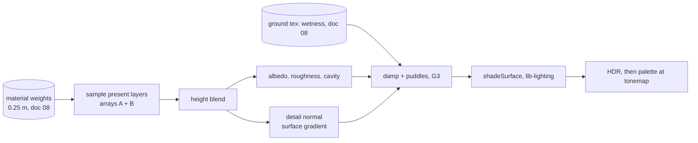

# 22 — Ground detail

> The ground should read as real material at every zoom: sand with grain and ripples, rock with cracks, soil with pebbles, and puddles when it rains. Each painted terrain material gets photo-scanned detail maps (albedo, normal, roughness, height, cavity) from CC0 libraries, calibrated so its average color still comes from the recipe. Materials meet by height, so sand settles into the cracks between stones. Hex tiling hides repeats, triplanar mapping keeps cliffs from stretching, and the millimeter-scale normal changes how sun, sky and rain light the ground. Everything here is physical surface data, so the palette still does all styling at the tonemap (doc 05). This work is render-only and never touches simulation, saves or determinism.

## Locked decisions

- **Three slice steps** (doc 20): **G1** textured ground and **G2** tiling and cliffs right after S3; **G3** wet ground right after S4, which builds the visual wetness pass and sky probe that G3 reads.
- **Sources: CC0 photo scans** from ambientCG and Poly Haven. No procedural fallback in the slice. Credits in `assets/textures/CREDITS.md` (source page, original asset name, what we changed), the same pattern as `assets/audio/`.
- **The recipe owns the color.** `tools/texture-lab.html` rescales each scanned albedo so its mean equals that material's albedo in `recipes/world/terrain.json`, inside the physical range 0.04 to 0.9. The texture only adds variation around that mean.
- **Tile size 3 m** (12 terrain cells) for every material. At 1024 px that is about 3 mm per texel; one screen pixel at 20 m at 1440p covers about 11 mm.
- **Two texture arrays**, one layer per material in the order grass, sand, rock, soil (the order of the material weight texture, doc 08):
  - Array A, `rgba8unorm-srgb`: RGB albedo, A height.
  - Array B, `rgba8unorm`: RG normal (Z rebuilt), B roughness, A cavity.
- **Map size by tier:** 1024² on high and medium, 512² on low. Phones download only the 512 set.
- **Files are WebP**, no build step. Mips are built on the GPU at load. KTX2 with BC7 or ASTC is deferred until memory needs it.
- **Three opaque files per material and size** (G1 decision): browsers premultiply alpha when they encode a canvas, which would corrupt data kept in an alpha channel. So `a.webp` is albedo RGB, `b.webp` is normal X and Y (OpenGL convention, as scanned) plus roughness, and `c.webp` is height plus cavity. A compute pass repacks them into the two arrays at load.
- **Textures load after the first calm frame.** Until they arrive the ground draws with flat recipe albedo (the S1 look), then the detail fades in over 0.5 s. Boot budgets in doc 19 are unchanged.
- **The mesh normal stays the reference** for the shadow normal offset, `normalId` (outline) and GTAO. Only shading uses the detail normal, so pebbles never get ink lines or shadow acne.

- **Moss, the fifth layer** (October 2026, with S4b): array layer 4 is moss from ambientCG's CC0 "Moss 003" (the texture lab fetches ambientCG zips through play.cmd's local server, `GET /__fetch/ambientcg`), calibrated to `materials.albedoMoss`, tiled at 1.2 m. Its weight is not painted: it comes from the moss cover (`src/world/growth/moss-live.js`, an interim live form until doc 10's growth system), which lies over the four painted layers and joins the height blend.

## How it works

Plain version: every pixel of ground already knows how much grass, sand, rock and soil it holds (the 0.25 m weight map from doc 08). For each material that is present, the shader reads its detail maps at that spot. The material whose surface stands taller at that pixel wins the blend, which is how real sand fills gaps between stones. The resulting detail normal tilts the light at millimeter scale, so a low sun rakes across ripples and cracks. In rain, porous ground darkens and turns satin, then water collects in the lowest parts of the height map as puddles that reflect the sky.



### Sampling

- **Planar** from above on ground flatter than about 35 degrees: `uv = xz / 3 m`.
- **Triplanar** where the mesh normal is steeper (where steep rock already takes over): three projections blended by `|n|^6`. Flat ground never pays for it.
- **Hex tiling** (Heitz and Neyret, "High-Performance By-Example Noise using a Histogram-Preserving Blending Operator", 2018; Mikkelsen, "Practical Real-Time Hex-Tiling", 2022): three samples on a triangle grid with random offsets per vertex, weights sharpened by height. Offsets only, no rotation, so gradients need no rotating. All samples use `textureSampleGrad` with the unoffset UV derivatives, so mips never seam. G2 settled on 2 grid vertices per tile (Mikkelsen's 2√3 cut the rock scan's stones into fragments) and weight exponent 6, so each stone stays whole and seams fall in cracks. It applies inside every triplanar projection too.
- **Low tier** skips hex tiling and instead mixes a second sample of the same map at 2.7x scale by noise about 6 m across.
- **Macro variation** on every tier: a low-frequency brightness and hue drift (noise at 40 m plus a weaker 12 m layer, ±30% brightness swing at the extremes, a slight warm-cool shift) that removes the last hint of repeats at a distance. It multiplies the flat far look too.
- **Side-by-side check:** `?tiling=grid`, `?tiling=hex` or `?tiling=two` forces one mode; the texture lab's 24 m preview has the same Grid / Hex / Hex and macro switch.
- Materials with weight under 0.004 are skipped, so most pixels sample one or two layers.

### Height blend

For each present layer `i`: `a_i = w_i + h_i · heightInfluence`; `top = max(a_i)`; `b_i = max(a_i − (top − blendDepth), 0)`, normalized. Starting values: `heightInfluence` 0.6, `blendDepth` 0.12. This replaces the value-noise relief in today's `terrain-draw.wgsl`.

### Lighting (lib-lighting.wgsl)

| Term | Before G1 | After |
|---|---|---|
| Sun and moon | Lambert on the mesh normal | Lambert on the detail normal, multiplied by `smoothstep(−0.02, 0.12, dot(nMesh, L))` so detail never lights the dark side of a hill |
| Sky fill | SH9 × albedo | SH9 at the detail normal × cavity (occlusion on sky light only, doc 06) |
| Specular | none | GGX sun and moon with per-pixel roughness and F0 0.04; sky reflection from the doc 06 probe (G3) |
| Shadows, outline, GTAO | mesh normal | unchanged |

Detail normal by the surface gradient method (Mikkelsen, "Surface Gradient Based Bump Mapping Framework", 2020): `n' = normalize(n − (g − (g·n) n))`, where `g` is the height gradient in world units from the projection in use.

**Mips.** A compute pass at load averages albedo in linear light (through the sRGB view), averages height, averages normals and converts the shortening of the averaged normal into extra roughness (Toksvig, "Mipmapping Normal Maps", 2004). Distant ground goes flat and matte instead of sparkling. Samplers use anisotropic filtering (16x high, 8x medium, 4x low).

### Wet ground (G3)

Two stages after Lagarde, "Water drop 2a/2b" (2013), driven by the visual wetness map (doc 08, `world/terrain/wetness.js`: r wetness, g puddle level), which rain soaks and drying empties. Numbers live in `terrain.json` `wetGround`.

1. **Damp.** `albedo *= mix(1, mix(0.8, 0.45, porosity), wet)`; roughness moves toward `mix(0.18, 0.4, porosity)`. Porosity is blended per pixel from the detail layers (grass 0.6, sand 0.9, rock 0.15, soil 0.8, moss 0.95). Sand and soil (porous) go dark and satin; rock darkens a little and turns shiny. Moss changes least. Grass keeps most of its roughness when wet (its blades scatter the light), so a rainy meadow is a deep wet green, never glossy.
2. **Sky reflection.** Wet ground and puddles reflect the doc 06 sky probe at the mip for their roughness, with Schlick Fresnel and the roughness-limited rim (Karis 2014) and the cavity as specular occlusion. Dry ground stays matte (sun GGX only, as in G1).
3. **Puddles.** On flat ground (full below 6°, none past 14°) a level in the wetness map's g channel rises with rain (full in about an hour of heavy rain) and drains over about 1.5 game hours of drying (faster in sun and wind). Water stands where the ground's relief is below the level: the blended detail height (ruts and the gaps between stones fill first) mixed with a slow 2.5 m undulation, so puddles gather in real dips. Turf soaks rain up: on grass the level rises 65% less, so only the deepest meadow dips flood. Puddle pixels: roughness 0.03, F0 0.02, bed albedo × 0.6, and the raindrop rings of `lib-rain.wgsl` (shared with the water) tilt their normal. As the level falls the shallow rims surface first, so puddles shrink from their edges.

Streaks on rock and puddles reflecting the island (screen-space) are later polish, not part of G3.

### Look

This is consistent with "physical light, painted last". Palettes are tuned toward realism (doc 05): anchors pull gently so texture variety survives, most of the physical lightness is kept, the painterly filter is off by default, and terrain outlines are faint while creature outlines stay.

## Data and interfaces

Files:

```
assets/textures/ground/<material>/<size>/a.webp   albedo RGB (calibrated to the recipe mean)
assets/textures/ground/<material>/<size>/b.webp   normal X, Y (OpenGL), roughness
assets/textures/ground/<material>/<size>/c.webp   height, cavity
assets/textures/CREDITS.md
src/render/ground-detail.js        load WebP, build arrays, mip pass, fade-in
src/shaders/ground-mips.wgsl       mip generation with Toksvig roughness
src/shaders/lib-ground.wgsl        sampling, hex tiling, triplanar, height blend
tools/texture-lab.html             calibrate, check wrap, pack, export, tiled preview
```

`recipes/world/terrain.json` gains a `detail` block (per material: `heightAmplitudeM`, `normalStrength`, `roughness` range, `porosity`; global: `tileMeters`, `heightInfluence`, `blendDepth`, `fadeInS`, puddle fill and drain rates; G2 adds `hex` {density, sharpness}, `twoScale` {size, noiseMeters} and `macro` {scalesM, strength, second, hue}).

`recipes/quality-tiers.json` gains a `ground` block per tier:

| Key | high | medium | low |
|---|---|---|---|
| `mapSize` | 1024 | 1024 | 512 |
| `hexTiling` | true | true | false (two-scale mix) |
| `triplanar` | true | true | false |
| `specular` | true | true | sun only |
| `puddles` | true | true | false (damp only) |
| `anisotropy` | 16 | 8 | 4 |
| `detailFadeMeters` | 80 | 60 | 35 |

Events: `ground:detail-ready {tier, mapSize}` when the arrays are built.

Bindings: both arrays and one sampler join terrain's group 2 (doc 04), not group 1, so the shared sampled-texture count does not grow.

## Algorithms and shaders

- Hex tiling: Mikkelsen 2022 triangle grid, height-weighted blend `w_i^s · (h_i + 0.25)⁴`, normalized, with `s` = `detail.hex.sharpness` (6).
- Surface gradient bump mapping: Mikkelsen 2020.
- Normal mip roughness: Toksvig 2004.
- Wetness: Lagarde 2013.
- Albedo calibration in the texture lab: divide out a heavily blurred luminance to remove leftover baked shading, then scale to the recipe mean in linear space.

## Tuning knobs

Tuning panel: every value in the `detail` block, per-material detail strength, the tier `ground` block, and a debug view that shows one channel (albedo, height, normal, roughness, cavity, blend weights). Texture lab: delight strength, target mean, wrap check, tile preview over 24 m.

## Performance budget

Estimates, measured in `tools/frame-timing.html` (and `tools/benchmark.html` when it lands):

| | High, 1440p | Low, phone |
|---|---|---|
| Samples per pixel | 8 to 24 | 4 to 8 |
| Terrain draw | about 1.3 ms | about 2.5 ms |
| GPU memory | 43 MB | 11 MB |
| Download | about 8 MB | about 2 MB |
| Mip build at load | under 5 ms, once | under 15 ms, once |

## Acceptance checks

- At a low sun, ripples on sand, cracks in rock and pebbles in soil cast visible light and shade; at noon they read softly.
- Where rock meets sand, sand fills the gaps between stones; there is no soft smear across a cell.
- From the default camera and from far out, no tiling grid is visible on any material.
- Cliff faces show rock texture without vertical stretching.
- Outlines follow silhouettes only; no pebble or crack gets an ink line.
- Distant ground does not sparkle or crawl while the camera orbits.
- The first frame appears as fast as before; the detail fades in shortly after.
- In rain, sand and soil darken a lot and rock a little and turns shiny; puddles form in sand troughs and soil dips, reflect the sky, and shrink when the rain stops (G3).
- Switching palettes keeps the texture's variety; the ground does not collapse to one flat color.
- On a phone at the low tier, frame time stays inside doc 19's budget.

## Open questions

- Should scanned detail also arrive for damp mud and gravel as extra layers in the slice, or wait for paths (M3)?
- Should puddles stay purely visual, or should creatures (frogs) one day notice them?

## Depends on / feeds into

- Depends on: `05-look-and-palette.md`, `06-sky-and-lighting.md` (lighting, sky probe), `08-terrain-and-sculpt.md` (weights, ground texture, wetness), `04-render-pipeline.md` (bind groups, passes), `19-performance-and-quality-tiers.md`.
- Feeds into: `10-growth-and-seasons.md` (grass blades sit on textured ground; moss masks later use the same arrays), `09-structures.md` (path wear), `16-customization-and-photo-mode.md` (close-up photos).
