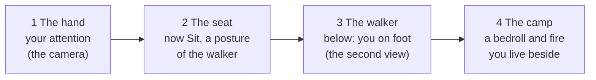

# 23 — Presence

> Presence is how the player is *on* the island, not just above it. Creatures read the player the way real animals read a person: how fast you come, how low you sit, where you look, how long you stay still. Trust grows from patience, not from clicking. Presence is built as a **list of sources** that creatures react to. In the slice the only source is the camera. Later rungs add a small walking figure and a camp, each as one more source, so frog behavior never needs reworking. Followed far enough, presence ends with a small traveler who can walk the island and camp beside its plants and animals. Matt scoped this in October 2026; the first rung lands with the frogs in S6. On October 21, 2026 he approved the walker plan: two views, above shapes and below lives there; the seat folds into the walker's Sit, and the walker lands in M2.

## Locked decisions

- **Presence is a list of sources.** Each source reports a few signals (position, speed, editing, stillness, and later posture, gaze, light and predictability). Creatures react to the nearest or strongest source. S6b builds the list with the camera as its only entry; the code never asks "where is the camera", only "what sources are there".
- **Rung 1, the hand, is the slice** (M1 S6b and S6c). The walker (M2, which now holds the seat as Sit) and the camp (M6, or with the M7 chapter) are planned, not built, until their milestones.
- **Two views (October 21, 2026).** Above is the orbit camera, the diorama where you shape. Below is you on foot. From W3, above stops counting for trust and for fast-swoop startles; sculpting or pouring right beside a creature still startles it. The closest above view stops at about 4 m, so getting close always means going down.
- **The camera source** is the camera's eye (where you look from), so it is close to a creature only when you have zoomed in near it. Its speed is how fast the eye moves; editing is a sculpt, pour or plant stroke within a short reach of the creature.
- **Moves the game makes never startle.** A camera glide that the game drives (Follow, and any later one) is not a movement of the camera source: its speed is reported as zero while the glide runs, and any input ends the glide and hands speed back. This came from Matt's creature tests. Being taken to a creature must never scare it. The journal no longer moves the camera at all: Show me rings the nearest example in place, and J2b's wash leaves the camera where it is.
- **Each creature has a comfort ring**: about 1.5 m for a shy frog, shrinking to about 0.3 m for a trusting one. Coming close slowly is welcome. A creature startles only when a source is inside its ring and moving faster than its calm speed, or when an edit happens right beside it.
- **A startle is soft and live only**: a frog hops into the water, a ripple, eyes up about 2 m away, back in about a minute. Nearby frogs hush for a while, and the chorus returns from the far side. Never a panic.
- **Trust is stored; wariness is not.** Trust belongs to one individual, only ever grows, and is saved as small timed events (a feeding, a stretch of quiet watching) applied in the hourly tick, so live play, saves and catch-up agree. Wariness is the after-effect of a startle: an animation state, gone in about a minute, never saved.
- **Words, not numbers.** Trust shows as a word on the creature card and in the journal (Wary, Tolerant, Curious, Familiar, Bonded), never a bar or a percent.
- **Wildness ceilings.** Each species has a ceiling on how close it will ever get. ebb is a tended island, not a petting zoo.
- **Comfort rings are not shown in the game** by default; creatures' bodies do the telling. A ring view belongs on a tools page.

## How it works

### The ladder

Each rung is a new way to be on the island and keeps the rungs below it. The game holds together at any rung.



| Rung | You are | Creatures feel | Lands around |
|---|---|---|---|
| 1 The hand | The camera (above) | Fast swoops through their ring; sculpting or pouring beside them; quiet watching. From W3, only edits right beside them | M1 S6b and S6c |
| 2 The seat | Sitting where you stand, as the walker | A still, low, patient presence | M2, folded into the walker's Sit |
| 3 The walker | You on foot, below | Approach speed, posture, gaze, footsteps, lantern | M2 (October 21, 2026); paths and the bridge join as routes in M3 |
| 4 The camp | Someone who lives here | A home point; trust keeps growing slowly while you are away | M6, or with the M7 chapter |

### What the repo already gives presence

| Already in the repo | Where | What presence does with it |
|---|---|---|
| Trust per individual, from feeding, calling and watching, never decays | doc 11 | Stays the stored value; startles add only live wariness |
| Feed, Call, Name, Follow, Photograph | docs 11, 15, 16 | Stay; gain a body later (kneel to offer, whistle while sitting) |
| The disturbance field feeding the "quiet" need | doc 11 | Sources are added to the same field |
| Soft startle, "a hop into the water, never a panic" | doc 11 | Becomes the flee response with the ring rule |
| Walkability grid and flow-field pathing | doc 11 | The walker uses the same grid |
| Stepping stones (M2), paths and walls (M3), the bridge (M3) | docs 09, 20 | Become the routes the figure walks, which creatures learn |
| The follow camera's soft rig | doc 15 | Grows into the walker's third-person camera |
| Field journal: words not numbers, tap anything alive, likes learned, notes, the web | docs 13, 15 | Where presence shows, without meters |

### Signals

| Signal | Meaning | Rung 1: the camera | Later rungs |
|---|---|---|---|
| Position | Where the presence is | The camera's eye | The seat; the figure's feet; the camp |
| Speed | How fast it moves through a creature's ring | How fast the eye moves (a swoop) | Walking pace: creep, stroll, brisk |
| Editing | Sculpting, pouring or planting right beside a creature | Yes | Yes (digging, splashing while wading) |
| Stillness | Time since the presence last moved | Camera at rest | Figure at rest |
| Offering | Food put down | The Feed tool | Kneel and offer from the hand |
| Posture | How low and small you are | No; zooming in is fine | Stand, kneel, sit (the walker; sit is the old seat) |
| Gaze | Whether you are looking at it | No | The figure's head |
| Light | A carried or placed light at night | No | Hand lantern, campfire |
| Predictability | Doing the expected thing | No | On a path versus off it |

The first five are all the slice needs. The last four exist only with a body, so they arrive with the walker and do not change how frogs work in the slice.

### The comfort ring

Later rungs add multipliers to the same ring, not new rules. Field studies of flight-initiation distance find that a faster approach and a direct gaze both make animals flee sooner (Bateman and Fleming 2011, hadeda ibises; see Sources).

```
ring = species shy ring × (1 − 0.8 · trust)          slice: 1.5 m → 0.3 m for frogs
     × posture (walker)   stand 1.0, kneel 0.8, sit 0.65
     × gaze (walker)      watching 1.15, looking away 0.9
     × light (night)      lantern or fire 1.3
startle when: a source is inside the ring and faster than the calm speed,
              or an edit happens right beside the creature
calm speed  = gentle pace × (1 + 2 · trust)
```

Every number is a per-species field in the species recipe, so the tuning panel can reach it. Rings are in real meters: frogs are drawn 1.5 times real size (doc 12), and their hops and tongue scale with that, but their comfort rings do not. Matt confirmed this pace in October 2026: these trust numbers (0.012 a minute of quiet watching in stretches of 20 to 600 s, 0.06 a feeding, satiation capping one sitting) mean trust grows over several play sessions, and naming opens at 0.5. In normal play the camera may come to 35 cm from what it looks at, from S6b. Matt's presence sandbox (a walker-form prototype, kept outside the repo) runs this rule for frogs.

### Trust, wariness and familiarity

- **Trust** belongs to one individual and is stored as small events. Feeding and quiet watching earn it; it shrinks the ring. Naming and later bonded behavior build on it. It never goes down.
- **Wariness** is the after-effect of a startle: live only, gone in about a minute. A clumsy approach costs a minute, never earned progress.
- **Familiarity**, a whole group slowly getting used to you, could arrive with the walker or the camp (also stored as events). The slice does not need it.

| Word | Internal range | What you see |
|---|---|---|
| Wary | 0–0.2 | Keeps its full ring; plops at the first swoop |
| Tolerant | 0.2–0.45 | Lets you come slowly to about a meter |
| Curious | 0.45–0.65 | Lets you right up close; can be named from 0.5 |
| Familiar | 0.65–0.85 | Sits still for a portrait; comes to food quickly |
| Bonded | 0.85 and up | Rests beside you; visits camp (later rungs only) |

### Wildness ceilings

Starting values for the tuning panel. The ceiling itself says something about the animal.

| Species | Ceiling | Closest it gets |
|---|---|---|
| Frogs | Familiar | Sits still for a portrait at arm's length; calls from a reed beside you |
| Midges | (a swarm) | Ignore you; they matter to the frogs, not to you |
| Minnows | Familiar (as a school) | Swirls to the surface at your hand |
| Dragonflies | Curious | Patrols past you; lands on a reed by your knee |
| Turtles | Familiar | Keeps basking when you sit on the same log |
| Bees | Tolerant | Ignore you while you sit in the flowers |
| Butterflies | Curious | Land on your sleeve or hat if you are very still |
| Songbirds (robin) | Bonded | Follows you while you dig; perches on the tent or your pack |
| Hedgehogs | Bonded | Snuffles past your boots at night; sleeps by the cold firepit |
| Squirrels | Familiar | Takes a nut from the ground near you; caches near camp |
| Owls | Tolerant | Stays on its branch and watches you back; answers your hoot |
| Herons | Tolerant | Keeps fishing if you stay about 15 m away and look elsewhere |
| Oystercatchers | Wary (as a flock) | Keep feeding on the bar if you stay on the sand above them; lift off piping if you come closer |
| Otters | Bonded | Pops up to watch; leaves a pebble or shell on your stone |
| Fireflies | Tolerant (as a swarm) | Their flashing drifts around you when you sit without light |
| Bats | Tolerant | Hunt the moths drawn to your fire |
| Cranes | Wary | Rare visitors; you watch from far, and that is the point |

Several come from real behavior: robins follow people who turn soil, because digging exposes worms, and can learn a familiar person; bats hunt the insects drawn to lights.

### Presence in the journal

Presence needs no screen of its own:

- **Likes lines** learned by watching: "Doesn't mind you close, if you come slowly." "Dives at a fast swoop." "Will sit for a portrait once it knows you."
- **Notes** for moments: "Pip sat still for a portrait." "The chorus went quiet when you swooped, and came back from the far side."
- **The creature card** carries the trust word beside the name.
- **The web** may later gain a pencil node for you ("you → frogs, food"), inked the first time a frog eats from your offering. Optional.

### Determinism and time away

Live only, recorded when it matters:

1. Startles, wariness and the chorus going quiet are live animation. Nothing is saved.
2. Trust is saved as small timed events and applied by the hourly tick in live play and catch-up alike, the pattern doc 11 already uses for Feed. Quiet watching becomes such an event: a stretch of a still camera near a creature, closed when the camera moves or the stretch reaches its cap.
3. While you are away there is no presence, so trust does not change. The later exception is the camp, which adds standing presence events during catch-up.
4. Later rungs add their own event types the same way (footfall for desire lines, camp events). No per-frame presence data is ever saved.

### Rung 1, the hand (S6b and S6c)

- **S6b (the frog you see, and presence):** each frog has its comfort ring. A fast swoop through it, or sculpting or pouring right beside it, causes a soft startle. Zooming in slowly is welcome. Nearby frogs hush; the chorus returns from the far side.
- **As built in S6b-4** (`src/world/creatures/presence.js`, `agents.js` `sense` and `startle`; numbers in `recipes/species/frog.json` presence):
  - The app updates the source list each frame, right after the camera. The camera's speed is smoothed over about a tenth of a second, and reads zero while `camera.driven()`: a glide the game makes (today only tools, such as the frog lab's Look at; later Follow), ended by any input.
  - Sculpt, pour and plant strokes report where they land, for that frame.
  - A frog startles when the eye is within its ring (1.5 m, real size, 3D distance) and moving faster than 0.5 m/s, or when an edit lands within 2 m. It hops into the water (off a pad, into the deep water beside it), plops, dives and dashes about 2 m away from the source at 0.3 m/s, and comes up to float eyes-up, wary for 40 to 70 s. Then it swims home. It doesn't call while wary.
  - Frogs within 4 m of a startled frog hush for 14 to 20 s. The chorus carries on from the frogs further away and comes back as the hush ends.
  - Live events: `creature:startled` and `creature:hushed`. Nothing is saved; trust stays 0 until S6c.
  - Finding a frog by watching asks for the eye within 1.5 m again (`find.lookDistM`), as planned, now that the camera can come close.
  - Checked with the frog lab's Swoop, Creep and Glide buttons. On the real camera code at 60 steps a second: a swoop puts the eye 55 cm from the frog at 6.4 m/s, a 25 s creep stays at 0.14 m/s, and a glide reads 0.03 m/s as it settles.
- **S6c (feed, trust and name):** Feed is for trust only. Feeding and quiet watching earn trust as small saved events; trust shrinks the ring. A curious frog can be named; a familiar frog sits still for a portrait.

### Rung 2, the seat (folded into the walker, October 21, 2026)

There is no bench or seat to build. Sit is a posture the walker takes anywhere, and sitting is the old seat: low, still and never fast, so it never startles and always counts as quiet watching, the place trust grows fastest. Sitting earns quiet-watching trust at the seat's higher rate, and the HUD fades while you sit. The shaper's trail reward that was the bench ("a terrace with water falling from it") is now Steps (rung 3).

### Rung 3, the walker (M2, approved October 21, 2026)

Two views: above shapes, below lives there. Above is the diorama with every shaping tool (Sculpt, Paint, Water, Plant, Cliff). Below is you on foot, with no shaping tools. All numbers live in `recipes/world/walker.json`.

- **Going down and up:** Go down lands you where you are looking (the middle of the view, the nearest walkable spot). Go up returns to the orbit; your figure stays standing on the island and is visible from above. Both glides are game moves and never startle.
- **Moving:** tap or click a spot and the figure walks there; the same on a phone and a desktop, no virtual joystick. One calm pace, a stroll, that eases to a creep by itself near creatures. A double tap hurries (brisk), and only hurrying can startle. Postures: stand, kneel, sit.
- **The walk grid:** 0.5 m cells. A cell is walkable if its slope is under about 35 degrees, it is not a cliff step, and the water over it right now is shallower than knee deep (0.4 m). No swimming.
- **The tide is read live.** The sandbar opens at low tide and closes at high tide. Tapping the islet while the bar is under water shows "The bar is under water. Low tide in about N hours." If the water rises while you cross, the figure wades back to dry ground by itself (a game move, never a startle). You can always go up, so nobody is stuck.
- **The camera below:** low third-person, about 3 m behind you. Drag to look around; pinch or wheel between 2 m and 6 m; no panning.
- **Presence below (W3):** the walker joins the source list with posture and gaze. Feeding, finds and quiet watching read where you stand, not the camera. Feed is only below. Above stops counting for trust and for fast swoops; edits right beside a creature still startle.
  - **As built (October 21, 2026):** each source now has a `body` flag. In the game the camera's is off, so it counts only for its edits. Tool pages that test presence with the camera (the frog lab) pass `labCamera` and keep both its body and the old close camera. The walker source sits at `presence.heightM` over your feet for your posture (stand 0.9 m, kneel 0.5 m, sit 0.4 m, in `recipes/world/walker.json`). Each species' `presence.multipliers` (posture; gaze within `gazeConeDeg` of where the camera faces) scales its ring, in `agents.js` and `schools.js` through `ringScale`. Quiet watching counts each second sitting as `watch.sitBoost` seconds (2). Finding a creature by watching: on foot, standing within `find.lookDistM + find.lookM` of it for `find.holdS`. The closest view above is 4 m (`recipes/world/camera.json`).
- **The ground bar (W4, as built):** along the bottom while you are below, in the tool bar's place (a column at the right edge in phone landscape). **Sit** and **Kneel** lower you where you stand; a second press, or walking on, stands you up. While you sit, the buttons fade. **Feed** kneels and puts food down 0.7 m in front of you: in the water for a school you have found (the minnows), on land for the frogs. **Look**, while on, makes a tap name what it lands on (and pick up a find or keepsake), within 8 m, instead of walking there. **Photo** joins when photo mode exists. The stand-in figure has no poses, so it sinks a little when you kneel or sit; the real figure's poses come with the figure work.
- **Crossings and routes:** stepping stones become the way across a pond, and Steps cut into a cliff face (the shaper's terrace reward, in place of the bench) let you walk up your terraces. Paths and the bridge become routes when they arrive in M3.
- **Creatures learn your routes:** on a path you always use, the ring multiplier is slightly smaller. Repeated footfall wears a faint desire line into the grass that grows back if you stop using it.
- **The figure:** a small stylized traveler, about 1.7 m, in a coat, hat and pack, with no face, made from the same blended-SDF body pipeline as the creatures. W2 uses a plain stand-in.
- **Build pieces** on `m2-walker`: W0 docs; W1 the walk grid, `tools/walk-lab.html` and a `?sandbar` test island; W2 the stand-in figure, Go down and Go up, tap to walk and the low camera, as a feel test. W3 presence below, W4 the ground bar (Sit, kneel, Feed, Look, Photo), W5 the figure, W6 the ground-level look and W7 Steps and crossings are scoped after Matt tries W2.
- **Cost:** the biggest rung. Near-field rendering and draw distance at ground level, grass that bends underfoot, footprints, footsteps by ground (doc 17), an animation set, and new save data.

### Rung 4, the camp (M6, or with M7)

A spot above high tide: a bedroll or small tent, a firepit, a kettle, a lantern and a crate. A home point, not a building project (doc 01's non-goal of settlements holds).

- **The sleep ritual:** crawling into the tent saves and ends a session; the next return opens at camp at dawn, the reveal starting from the tent flap. Closing the tab still works.
- **Standing presence:** while you are away, the camp adds small trust events during catch-up for creatures that already know you. Bonded animals visit: the hedgehog by the cold firepit, the robin on the tent ridge, an otter's pebble on your stone.
- **Fire:** a physical light at about 1,800 K with flicker and wind-blown smoke. It draws moths, the bats come for the moths, the frogs call from beyond the firelight. It never spreads; its ash fades in a day.
- **Leave no trace:** moving camp leaves a pale patch that regrows over a few days.

## Data and interfaces

```js
// src/world/creatures/presence.js (S6b): the live source list, rebuilt each frame, never saved.
/**
 * @typedef {Object} PresenceSource
 * @property {string} id
 * @property {'camera'|'walker'|'camp'} kind          only 'camera' in the slice
 * @property {[number, number, number]} pos           world meters
 * @property {number} speed                           m/s
 * @property {boolean} editing                        a sculpt, pour or plant stroke near pos
 * @property {number} stillS                          seconds since it last moved
 * @property {'stand'|'kneel'|'sit'} [posture]        walker
 * @property {[number, number] | null} [gazeAt]       walker
 * @property {boolean} [light]                        lantern or fire, at night
 * @property {boolean} [onPath]                       walker
 */
```

Per species, a `presence` block in `recipes/species/<id>.json` (frog starting values):

```json
"presence": {
  "ringM": 1.5, "ringTrustShrink": 0.8, "ringMinM": 0.3,
  "calmSpeed": 0.5, "calmTrustGain": 2,
  "editReachM": 2, "wariS": [40, 70], "hushReachM": 4, "hushS": [14, 20],
  "watch": { "reachM": 3, "minS": 20, "capS": 600, "trustPerMin": 0.012 },
  "feedTrust": 0.06, "ceiling": "familiar", "namingTrust": 0.5,
  "multipliers": { "posture": { "stand": 1, "kneel": 0.8, "sit": 0.65 }, "gaze": { "watch": 1.15, "away": 0.9 }, "light": 1.3 }
}
```

Stored trust events (applied by the hourly tick, saved with the world): `trust:fed { creature, hour }`, `trust:watched { creature, minutes, hour }`. Live events (past tense, doc 03): `creature:startled`, `creature:hushed`, `creature:portrait`.

## Tuning knobs

Per species, in the tuning panel: the ring, its trust shrink and minimum; calm speed and its trust gain; edit reach; wariness time; hush reach and time; quiet-watching reach, minimum, cap and rate; feed trust; the ceiling; and the later posture, gaze and light multipliers.

## Performance budget

Rung 1 is a few distance checks per creature per frame against one source: negligible. Later rungs keep the source list small (a handful of entries). The walker's near-field rendering is budgeted in doc 19 when it is scheduled.

## Acceptance checks (rung 1, with S6)

- Swoop the camera fast past a frog on the reeds: it hops into the water, surfaces eyes-up about 2 m away, and is back within about a minute; frogs nearby hush, and the chorus resumes from the far side.
- Zoom in slowly to the reeds beside a frog: it stays put.
- Sculpt or pour right beside a frog: it startles.
- Feed and watch quietly over a few sessions: the card's word moves from Wary toward Curious; a curious frog can be named; a familiar frog sits still for a portrait.
- Close the tab and come back: trust is where you left it, and startles from before are forgotten.

## Open questions

- Answered October 21, 2026: the main way to play is two views. Above shapes; below lives there.
- Should the figure be customizable from the start, or found and gifted over time?
- Should a whole group slowly get used to you (familiarity), or should closeness stay one creature at a time?
- Should the camp kit be a creature's gift, or the reward for your first bonded creature?
- Should the camp ever grow (a lean-to, a small garden, a rain barrel), or stay a bedroll and a fire?
- One camp you move, or more than one camp spot?
- Should a bonded creature ever follow you on walks, or only meet you at its home and at camp?

## Sources

- [Bateman and Fleming (2011), "Who are you looking at? Hadeda ibises use direction of gaze, head orientation and approach speed in their risk assessment of a potential predator", *Journal of Zoology*](https://researchportal.murdoch.edu.au/esploro/outputs/journalArticle/Who-are-you-looking-at-Hadeda/991005542929307891)
- [A Review of Flight-Initiation Distances and their Application to Managing Disturbance to Australian Birds](https://vuir.vu.edu.au/22210/)
- [Countryfile: Your garden robin might know who you are and even follow you about](https://www.countryfile.com/animals/your-garden-robin-might-know-who-you-are-and-even-follow-you-about-but-its-not-because-youve-become-friends)

## Depends on / feeds into

Depends on `11-creatures-and-ecology.md`, `13-progression-and-expansion.md` (journal), `15-camera-input-and-ui.md`, `02-core-loop-and-idle-model.md` (hourly tick, catch-up). Feeds `12-creature-roadmap.md` (ceilings), `16-customization-and-photo-mode.md` (the seat, the figure's look), `17-audio.md` (footsteps, fire, the chorus hushing), `18-saves-and-persistence.md` (trust events, later camp state), `19-performance-and-quality-tiers.md` (near-field budgets), `20-roadmap-and-vertical-slice.md` (where each rung lands).
