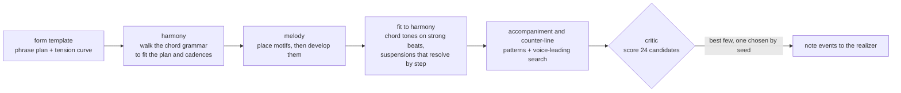
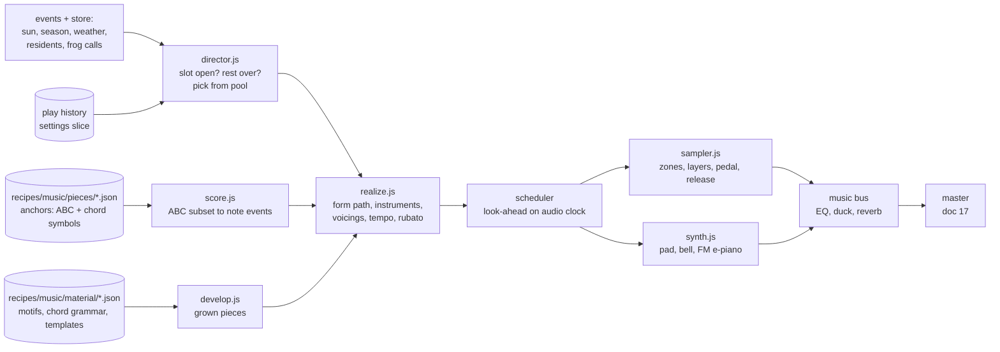

# 24 — Music

> ebb has an original score that behaves like weather. It arrives with the morning, drifts through the day in short pieces, steps aside at dusk so the frogs can sing, and returns as a quiet nocturne late at night. Most of the time the island plays alone. Every note comes from composed material, with real melodies, real harmony and real voice-leading. Some pieces are written out in full; others are grown at play time by a development engine that works the season's motifs the way a composer would. No piece is ever played the same way twice: a small runtime "music director" chooses what to play from the season, the hour, the weather and who lives on the island, then realizes it with fresh voicings, instruments, tempo and phrasing on CC0 sampled instruments. Each season has its own key, instruments and character. The score grows with the island: an empty island hears piano and harp; once frogs settle, a clarinet joins with a little frog motif. The aim is meditation. A player should never notice a loop, never want to turn the music down, and miss it when it is gone.

## Locked decisions

- **Composed material, developed live.** Two kinds of music share one engine. **Anchor pieces** (each season's morning pieces and nocturnes, the island theme settings and the special cues) are fully composed and re-realized each time: new voicings, instruments, register, tempo and phrasing. **Grown pieces** (interludes, evening, rain and mist pieces) are composed at play time by a development engine from authored material: each season's motif bank, chord grammar and form templates. The engine develops motifs the way a composer does and writes accompaniment and counter-lines by voice-leading rules, but never invents a motif from nothing. Matt designs and tunes the engine's rules (decided October 2026: the algorithm is the instrument); the music session writes the material and the anchors, and Matt reviews.
- **Music is non-diegetic and quiet.** Its own bus, its own reverb, stereo, never spatialized, never louder than the island at default levels. Dynamic ceiling is mezzo-forte. No drums or percussion hits, no sub-bass below 60 Hz.
- **Silence is part of the score.** At the default setting, music plays about 35 to 45 percent of real time (with rests of 2 to 4 real minutes between pieces, a 24-minute game day holds about three pieces, about 9 to 11 minutes); the rest belongs to the island. Every piece is followed by a rest of at least 2 real minutes. (Matt, October 19, 2026: rests shortened from 3 to 7 minutes so the island is a little less silent.)
- **Day arc by sun, season by season phase, both from display time**, the same keys the palette uses (doc 05): night, blue hour, golden, morning and afternoon, day. Rests and tempo run on real time, so 4x never sounds frantic and pause never sounds frozen.
- **Frogs own dusk.** From half an hour before dusk to three hours after (the frog call window, `recipes/species/frog.json` `moods.callAfterDuskH`), no piece starts while frogs are calling. The chorus is the music.
- **Four seasonal identities** (key center, mode family, tempo band, instrument palette), described below. New worlds start in spring, so spring is composed first.
- **The score grows with the island.** Instruments and motifs join as species settle. Before any resident: piano, harp and a soft pad. Each settled species adds one instrument and one short motif.
- **Instruments are CC0 samples**, mainly the Versilian Community Sample Library (VCSL) and VSCO 2 Community Edition, both CC0 and hosted on GitHub. Soft synth voices (pad, warm bell, FM electric piano) are built in Web Audio code. Salamander Grand Piano is excluded (CC-BY 3.0).
- **Authoring format: ABC notation** (a text music notation that Claude writes well and that renders as sheet music), one voice per line, chord symbols on every bar. The runtime parses a small ABC subset; the music lab renders full notation with abcjs (MIT, vendored under `src/vendor/`).
- **Equal temperament, A4 = 440 Hz.** Every sample zone is checked and corrected to within 3 cents.
- **Not a simulation system.** Music never reads or writes world state beyond published events and store slices, and never uses the simulation's random streams. It has its own seeded stream (system id `music`) so the lab can replay any realization exactly.
- **No quotation.** Inspired by ConcernedApe's Stardew Valley scores in spirit only (see "Influences"). No melody, chord progression with matching rhythm, or hook from any existing work.
- Lives in `src/audio/music/`, with tunables in `recipes/music/` and samples in `assets/audio/instruments/`. Ships in M2 after the first ambience pass (doc 17), behind its own bus slider.

## How it works

### Plain language

Think of the island as having a quiet musician who lives nearby. At sunrise they often play something for the morning. Then they rest, listen, and now and then play a short piece while the day goes on. When the light turns gold they play something slower. When the frogs start calling at dusk, they put the instrument down and listen. Late at night they might play a few soft notes. They know the season, so a spring morning sounds different from an autumn one. They know who lives on the island, and as frogs settle, a friend with a clarinet starts joining in. They never play a piece exactly the same way twice, and they never play the same piece again within a few days.

### Influences, and what we take from them

From Stardew Valley (ConcernedApe), in spirit:

- **Each season has its own sound world**, carried mostly by instrumentation and key, so the player feels the season change with their ears.
- **Music comes with the morning and then leaves room.** Long stretches of the day are only ambience, which is a large part of why those scores never wear thin.
- **Simple, singable, folk-like melodies** with modal color, over warm harmony. Acoustic instruments blended with soft synth warmth.
- **Rain has its own music**, more inward and spacious.
- **Layered support.** A simple lead over quiet supporting layers: string beds, pads, a harp or mallet doubling, entering and leaving with the phrases. This layering, more than the melody, is what makes those pieces feel full while staying calm.

Mood references, one per season (Matt, October 19, 2026), for feeling only: spring "It's a Big World Outside", summer "Nature's Crescendo", autumn "The Smell of Mushroom", winter "The Wind Can Be Still". ebb sits on the mellow side of them: the calm, reflective moments, not the brighter, busier ones.

What we do not take: looping tracks, upbeat daytime tempos, festival percussion, chiptune leads, and any melodic material.

### The shape of a day

One game day is 24 real minutes at 1x. Day length runs from about 9.5 game hours in winter to 14.5 in summer (doc 06), so the windows below stretch and shrink with the season.

```
game hour   0      3      6      9      12     15     18     21     24
           |--night------|dawn|morning-----day-----|gold|dusk|--night--|
music      .  nocturne?  . [MORNING]  (interlude) (interlude) [EVENING] . frogs . nocturne?
           .  (50%)      .  (85%)      (60%)        (60%)      (70%)   . only  . (50%)
rest                       >=2 min     >=2 min      >=2 min    >=2 min
```

| Slot | When (sun or event) | Chance per day | Length | Character |
|---|---|---|---|---|
| Morning | starts within 1 game hour after `sky:sun-crossed` sunrise | 0.85 | 2.5 to 4 min | The day's signature piece. Brightest register, clearest melody. |
| Interlude | sunrise + 3 h until the sun drops below 10°, after a rest | up to 2, each 0.6 (at 1x the rests usually leave room for one) | 2 to 3.5 min | Lighter, sparser, often a duet. Weather pools replace these on rain and mist days. |
| Evening | sun falling through 10° to 2° | 0.7 | 2.5 to 3.5 min | Slower, lower, warmer. Must end (or use its short form) before the frog window opens. |
| Frog window | dusk − 0.5 h to dusk + 3 h | none while frogs call | | Silence on the music bus. If no frog is awake (early game, winter, dormancy), this slot becomes an early nocturne at 0.4. |
| Nocturne | dusk + 3 h until dawn − 1 h | 0.5, at most one | 2 to 3 min | Very sparse, low density, long tails, solo or duo. |
| Pre-dawn hush | dawn − 1 h to sunrise | none | | The quiet before the morning piece. |

At 4x a game day takes 6 real minutes. Because rests are in real time, the director naturally plays fewer pieces per game day at 4x, roughly the morning piece and one other. A piece that runs past its slot always finishes its current phrase and then takes its coda or a gentle 8-second fade at a phrase end. Nothing is ever cut mid-phrase except a mute, a hidden tab, or photo export.

### Day color

Inside a season, a few continuous parameters follow sun elevation with smoothstep blends, exactly like the palette keys:

| Parameter | Night | Blue hour | Golden | Morning/afternoon | Day |
|---|---|---|---|---|---|
| Register center (melody) | C4 | D4 | D4 | A4 | G4 |
| Note density ceiling (notes per second, all voices) | 0.6 | 1.2 | 1.5 | 3.0 | 2.0 |
| Tempo multiplier on the piece's range | 0.88 | 0.94 | 0.94 | 1.04 | 1.0 |
| Music reverb send | 0.45 | 0.38 | 0.32 | 0.22 | 0.25 |
| Brightness (lowpass on the music bus) | 5.5 kHz | 7 kHz | 9 kHz | 14 kHz | 12 kHz |
| Max simultaneous voices | 3 | 4 | 5 | 6 | 5 |

The realizer reads these when it picks octave, left-hand texture and tempo, so a morning piece that happens to run late into the day softens on its own.

### The four seasons

New worlds start on spring day 0 at 10:00 (`recipes/world/sky.json` `startHour`), so the first music a player ever hears is a spring interlude or morning piece.

| | Spring | Summer | Autumn | Winter |
|---|---|---|---|---|
| Feeling | First light, waking, fresh green, rain that smells good, the frogs' breeding chorus | Long warm days: mornings and middays lift and move, evenings and nights settle into stillness and fullness, steady evening chorus | Gold reeds, mist, a little wistful, settling down | Hush, frost, bare stalks; lonely and majestic, a quiet melancholy with breadth; the island asleep |
| Home key | D major | F major | E Dorian | D minor |
| Mode family | Ionian, Lydian (G Lydian color), Mixolydian lift | Ionian, Mixolydian, Lydian (B-flat Lydian), major pentatonic | Dorian, Aeolian with raised 6th, occasional Mixolydian warmth | Aeolian; Dorian (B natural) for moments of warmth; harmonic minor only at cadences, sparingly; quartal voicings and open fifths |
| Nearby keys for variety | G, A, B minor | B-flat, C, D minor | A Dorian, B minor, G | F major, A minor, G minor, B-flat major |
| Tempo band (BPM) | 72 to 86 | morning and interlude 70 to 84; evening and nocturne 58 to 72 | 62 to 76 | 48 to 60 (often senza misura feel) |
| Meters | 4/4, 6/8 | 3/4, 4/4 | 3/4, 6/8 | 4/4, 3/4, free |
| Lead colors | piano (brighter, mid-upper), flute, harp, kalimba accents | piano (warm), vibraphone (soft mallets), FM electric piano, nylon guitar if sourced; mornings and middays add gently rhythmic mallet and guitar patterns | piano (lower, rounder), cello, clarinet, viola | piano (soft, long pedal), wine glasses, bowed vibraphone, string harmonics |
| Bed colors | soft pad, harp rolls, violin section pizzicato (very light) | warm string pad, marimba (soft, low), sustained pad | warm pad, cello sustains, harp | glass pad, slow low strings, wide open fifths spread across three octaves, open-fifth piano drones; the island theme heard in augmentation |
| Rain pieces | piano and harp, more pedal, rising figures | electric piano and vibes, slow | cello and piano, inward | piano alone, very sparse |
| Mist mornings | no plucks; flute and pad only | bowed vibraphone and pad | clarinet and viola | wine glasses and piano |

Home keys approved by Matt (October 2026), with winter in D minor to lean into the melancholy. Spring opens in D major and winter closes in D minor, so the year turns on one tonic: the same home note, brightened in spring and shadowed in winter. Pieces may move to the nearby keys, so a season never sits in one key for hours, but each season's first morning returns home.

The summer lift and the winter breadth are Matt's (October 19, 2026). Summer's lift is in the music only: the island's summer soundscape stays a warm stillness (doc 25).

Season edges blend: on the last day of a season and the first day of the next, pools mix both seasons, weighted by `seasonPhase`. The first morning of each new season (`season:changed`) plays that season's version of the island theme.

### Weather

- **Rain**: the rain pool replaces interludes for the rain's hours; morning and evening slots draw from the rain pool when rain covers the slot. The music bus drops 2 dB and its lowpass falls by a third while rain is heavy, so the rain bed (doc 17) comes forward.
- **Mist**: mist-tagged pieces only, soft-attack instruments only (no plucks, no mallets struck hard), reverb send +0.1.
- **Cloud**: no change beyond a slightly lower brightness (−1 kHz).
- **Wind and gusts**: no effect on music.

### The score grows with the island

Residents change the orchestration and add motifs. This is also one of the strongest defences against repetition: the same piece sounds different on an island with frogs than on an empty one.

| Who lives here | What joins the score |
|---|---|
| No residents | Piano, harp, soft pad only. Wide, open, a sense of space and possibility. |
| Midges present at dusk (`midges` field above its "seen" threshold) | A faint high shimmer (glass harmonics or bowed vibraphone, very low level) in evening pieces only. |
| First frog settled (`creature:settled`) | Clarinet joins the palette in every season except winter. The frog motif (below) appears as a counter-line in about one piece in three. |
| Frogs happy (`species:happy` for frogs) | Pieces may add a third independent line (a counter-melody voice), and the frog motif may appear in the bass in autumn. |
| Frogs dormant in winter (`creature:dormant`) | Clarinet leaves; the frog motif may appear once, slowed and inverted, in a winter nocturne, as a memory. |
| Future species (later milestones) | Songbirds: flute and a birdlike motif. Bees and butterflies: light pizzicato and kalimba. Hedgehogs: bassoon. Owls: low ocarina or recorder. Herons: cello. Otters: marimba. Fireflies: glockenspiel, very soft. Bats: string harmonics. Cranes: French horn, distant. Each is a proposal, decided when the species is built. |

### Motifs

- **The island theme ("ebb").** A short theme of two to four bars whose contour is a tide: it rises stepwise to one held note, then falls back past where it began. It must work in all four modes above (including D minor, where it is heard as the same tide under a darker sky), in augmentation, in inversion (winter), and in the bass (autumn). It is heard rarely so it stays precious: the first morning of each season, the return reveal, a gift bloom, and as a disguised fragment in at most one other piece per game day. The music session writes three or four candidate themes; Matt chooses.
- **Species motifs.** Two to five notes each, recognizable in any key. The frog motif has a small hop in it (for example a short note leaping up a fourth). A species motif appears softly once, on that species' instrument and in the current harmony, the first time the player finds that species (`creature:found`, first time only), and afterwards only inside pieces.

### Special moments

| Event | Music |
|---|---|
| Full return reveal (`reveal:started`, absences of 6 game hours or more) | One soft statement of the island theme, 20 to 30 s, under the camera drift, in the current season's palette. At most once per real day. Shorter absences get nothing. |
| `season:changed` | The next morning slot is the new season's island-theme piece (always plays, chance 1.0). |
| `progress:gifted` | A "bloom": one sustained chord swelling pp to p and back over 6 to 8 s (strings and glass), in the current key, entering on the next bar line if a piece is playing. No fanfare, no arpeggio flourish. |
| `creature:found` (first time per species) | The species motif, once, quiet, fitted to the current chord. |
| Photo mode | Music continues. Tools and UI mute as in doc 17. |
| Signature night (one per season) | A rare anchor piece tied to something real on the island, heard at most once a season. When its night comes, that night's nocturne slot plays it (chance 1.0, starting after the frog window if frogs are calling). It sits outside the season's anchor pool and history. Proposed nights: spring, the first night the whole settled frog chorus calls; summer, the first full-moon spring-tide night (`src/world/tide.js`, the moon's 7-day cycle); autumn, the first clear night after the reeds turn gold; winter, the longest night of the year. Matt, October 19, 2026: one signature night per season; the nights themselves are proposals for his approval. |
| Seat (M2, doc 23) | No special cue. Optional later: the seat lowers the music bus 1 dB so the island is closer. |
| Time or season preview | Day color follows display time smoothly. No new piece starts during a preview. A playing piece continues. |
| Tab hidden | Master fades out (doc 17); the director pauses and, on return, resumes with a fresh rest. |

### Anti-repetition

1. **Realization variety** (every play): melody octave, instrument assignment, accompaniment pattern, voicings, tempo inside the range, dynamic arc, rubato shape, ornament choices and optional form sections are each drawn from the piece's allowed set by the music stream. Two plays of one piece share a melody and a harmonic plan and differ in almost everything else.
2. **Pool size**: v1 target per season is 5 anchor pieces (morning 3, nocturne 2) plus the material for grown pieces (motif bank, chord grammar, 4 to 6 form templates) covering interludes, evening, rain and mist. Until the engine passes its gate, those slots use authored stand-ins (interlude 3, evening 2, rain 1, mist 1). Plus the island theme in four seasonal settings and the special cues. Grown pieces make the effective pool unbounded; history still tracks their templates and lead motifs so the same shape does not return too soon.
3. **History**: the device keeps the last 40 piece plays (id, game day, real time) in the settings slice (device, never the world file). A piece cannot be chosen again within 3 game days or 90 real minutes, whichever is longer, unless its pool is exhausted, in which case the least recently played wins.
4. **Weighted choice**: inside a pool, weight = base weight × freshness (rises with time since last play) × fit (season blend, day color, weather, residents).
5. **Key drift**: each piece declares allowed keys; the director avoids starting two consecutive pieces in the same key unless one is the season's first morning.
6. **Ambient distance**: rests are drawn from 2 to 4 real minutes (default setting), never fixed.

### Composition rules (for the music session)

These exist because Matt has a trained ear and will hear the usual tells of generated music.

- **Melody**: singable range of a tenth or less; mostly stepwise with a few leaps of a fourth to a sixth, each leap recovered by step; one clear high point per phrase; phrases breathe (rests or long notes between them); every phrase has a goal note.
- **Phrasing**: avoid square four-bar closure every time. Mix 3-, 5- and 6-bar phrases with 4-bar ones. Let some phrases end on the third or fifth, or on a suspended chord.
- **Harmony**: slow harmonic rhythm, usually one chord per bar or two. Prefer plagal, modal and deceptive motion (IV–I, bVII–I, ii–I, iv–I, vi substitutes) over dominant-seventh cadences. No unbroken I–V–vi–IV loops. Extensions (add9, maj7, 6/9, sus2, sus4) used for color, not stacked on every chord.
- **Voice-leading**: keep common tones, move inner voices by step, avoid parallel fifths and octaves in the outer voices, avoid low close voicings (nothing closer than a fifth below C3). Open spacing in the left hand (root and fifth or root and tenth).
- **Texture**: no endless arpeggios. Each piece has at least one moment of contrast: a borrowed chord, a suspension and its resolution, a register shift, or a bar of silence.
- **Dynamics**: pp to mf. Swells are slow.
- **Space for creatures**: evening pieces keep melodic lines out of 600 Hz to 1.5 kHz (roughly D5 to F#6) where frog calls live, by sitting lower (cello, clarinet, piano below C5) or above.
- **Endings**: every piece has a full ending and a short form (a coda reachable from any section end) so the director can close it gracefully.
- **Originality check**: before Matt reviews a piece, the session states what it is not like: no recognizable quotation, checked against the melodies it knows from game and film scores. When in doubt, rewrite.

### The development engine (grown pieces)

This is the heart of the score and the part Matt designs. Anchor pieces are written out in full; grown pieces are composed at play time from authored material by rules, the way a composer develops a sketch. The engine never invents a motif from nothing, and every rule and weight lives in a recipe Matt can tune in the music lab.

**Authored material, per season** (`recipes/music/material/<season>.json`):

- **Motif bank**: 6 to 10 short motifs (2 to 8 notes, with rhythm), each tagged by role: opening, answer, climbing, falling, cadential. Species motifs and the island theme are shared across seasons.
- **Chord grammar**: a small graph of chords in the season's key family, with weighted moves between them and marked cadence moves (plagal, modal, deceptive, half), so progressions sound like that season and never like a loop.
- **Form templates**: phrase plans such as statement, answer, development, return, cadence, each with a length range (12 to 32 bars), a tension curve, and which slots and weather it suits.
- **Textures**: which accompaniment patterns and instrument roles fit each template.

**How a grown piece is made:**



1. **Template**: chosen to fit the slot, weather, residents and day color.
2. **Harmony**: a path through the chord grammar that fills the template's bars, lands cadence types where the template asks, and matches its tension curve (more color chords where tension rises).
3. **Melody**: phrase starts take a motif from the bank by role; following phrases develop it with classical techniques, each with a weight: sequence (the motif moved by scale steps to fit the new chord), inversion, augmentation and diminution, fragmentation (its head or tail alone), rhythmic displacement, extension by a step or two, and plain return. About half of all melodic material is a recognizable motif statement; the rest is its development, so pieces feel related without repeating.
4. **Fit**: strong-beat notes are chord tones, or suspensions and appoggiaturas that resolve by step; weak beats take passing and neighbour tones. Contour rules from the composition rules above apply (range of a tenth, one high point per phrase, leaps recovered, a goal note per phrase).
5. **Accompaniment and counter-line**: a pattern from the texture list, voiced by the same smallest-motion voicing search as anchors. A counter-line (from residents, for example the clarinet with the frog motif) enters in imitation or contrary motion, avoiding parallels with the melody.
6. **Critic**: the engine builds 24 candidates and scores each one: rule breaks (heavy penalties), melodic interest (interval and rhythm variety without wandering), motif balance (recurrence near half), tension match to the template, the frog band kept clear in evening pieces, and distance from what played recently. One of the best few is chosen by the seed.

**What Matt tunes in the lab**: every weight above on sliders, regenerate by seed, and see the result as notation and piano roll with an overlay that marks each note's job (motif, development, chord tone, suspension, passing tone) and any rule it bent. Pressing Keep promotes a grown piece Matt loves into an anchor piece file, so the best of the engine becomes part of the authored score.

**Shipping gate**: grown pieces join a slot's pool only after Matt has auditioned about 20 seeds for that season and slot and would happily hear any of them in the game. Until then the slot uses anchors only. Once the morning slot passes its gate, grown pieces may play there too (Matt, October 2026), mixed with the morning anchors; the first morning of each season always plays its island-theme anchor.

**Matt as composer**: the lab's material editor (a clickable piano-roll grid, or note names typed in) lets Matt write or edit motifs, chord grammar moves and anchor phrases directly. No MIDI keyboard is needed.

### Realizing a piece



1. **Form path**: the piece's grammar (for example `A A' B? A'' coda`) is walked; optional sections are rolled; the short form is taken if the slot window is closing.
2. **Instruments**: melody and accompaniment instruments are drawn from the season and slot palette, filtered by residents and weather, and limited by the day color's voice ceiling.
3. **Accompaniment**: if a section carries an authored accompaniment voice, it is used, with octave variants allowed by the piece. Otherwise the voicing generator builds it from the chord symbols with the rules above (shells, drop-2, spread fifths and tenths), choosing the voicing with the smallest total voice motion from the previous chord. The left hand plays each chord in a texture, the way a pianist does (Matt, October 19, 2026): mostly struck, all notes together; flowing arpeggios in time with the meter, every note held to the chord change (slower toward evening and night); now and then a quick roll close to the melody; rarely the bass and then the chord. Choppier figures (short broken eighths, offbeat dyads) stay rare in this style and are kept for pieces that want them. Each phrase picks a main texture and single chords vary from it, so a piece is never all one thing. A harp sweep and pad-only bed are instrument choices on top of these.
4. **Paraphrase** (optional per piece, 0 to 0.3): passing tones added, repeated notes tied or split, an anticipation here and there, always keeping the contour and the notes on strong beats.
5. **Ornament**: grace notes, a turn at a phrase peak, a rolled final chord. Probabilities per piece.
6. **Tempo and rubato**: tempo drawn in range, times the day color multiplier; each phrase gets a gentle arch (up to 3 percent faster toward the high point, 4 to 8 percent ritardando into the cadence, a fermata on the final chord).
7. **Humanize**: onset jitter ±10 ms (melody slightly ahead of accompaniment on downbeats, about 8 ms, as a pianist plays), velocity jitter ±5 on a curve that follows the phrase.
8. **Pedal**: sustain pedal down after each chord change and lifted just before the next (legato pedaling), using the piano's sustain samples while down and its release samples on lift.

### Instruments

All from CC0 sources, checked file by file into `assets/audio/instruments/CREDITS.md` with source URL, license, and edits.

| Role | First choice | Source and notes |
|---|---|---|
| Piano (lead and bed) | Grand Piano, Steinway B (chosen by Matt, October 19, 2026) | VCSL `Chordophones/Zithers/Grand Piano, Steinway B`: sustain, no-sustain and release sets, close mic, sampled every whole tone, 3 velocity layers, normalized (rebuild the dynamic range with a velocity curve; do not re-gain layers). Played with gentle stretch tuning and the Knight upright's recorded pedal mechanism under the pedal. The Kawai grand and the Yamaha and Knight uprights were compared on the bench and set aside. |
| Harp | Concert Harp (VCSL) | mf and f layers; VSCO 2 CE harp as alternate. |
| Flute | VSCO 2 CE Flute | sustain non-vibrato, sustain vibrato, expressive vibrato, staccato. |
| Clarinet | VSCO 2 CE Clarinet | long sustain, staccato with round-robins. |
| Strings | VSCO 2 CE cello, viola and violin sections; solo violin; contrabass | sustain with vibrato, tremolo, pizzicato, spiccato. |
| Mallets | VCSL Vibraphone (struck and bowed), Marimba, Glockenspiel | bowed vibraphone is a key winter and mist color. |
| Glass | VCSL Wine Glasses | winter lead and shimmer layer. |
| Kalimba | VCSL Kalimba (Kenya, Tanzania) | spring accents, sparingly. |
| Others available | VCSL hand chimes, psaltery, recorders, ocarina; VSCO oboe, bassoon, French horn | reserved for later species and variety. |
| Nylon guitar | wanted, being searched | Matt wants it (October 2026): it fits the theme, mainly spring and summer leads and accompaniment. A separate session is searching. Order of preference: a CC0 single-note set (Freesound, CC0 filter); then a free or paid library under the rules in doc 25 ("When CC0 does not land"); then harp and psaltery for the plucked role. A Karplus-Strong model only if Matt approves it by ear. |
| Soft synth | built in code (`synth.js`) | warm pad (detuned saws or triangles through a slow lowpass), soft sine bell, two-operator FM electric piano for summer (chosen by Matt over the sampled TX81Z, October 19, 2026). |

**Sample preparation** (in the workspace, from the GitHub sources, then auditioned on Matt's machine): trim, fade natural decays to silence (piano up to 8 s at low notes, 4 s at the top), convert to mono for everything except piano and harp on the desktop tier, encode Ogg Opus 96 kbps (stereo) or 64 kbps (mono) with an AAC fallback as in doc 17, tune each zone to A440 within 3 cents (measured, stored as `tuneCents` in the instrument recipe, applied at playback).

**Sampler rules**: zones are at most a whole tone apart (shift no more than one semitone either way); adjacent velocity layers crossfade over 12 velocity steps so a slow crescendo has no audible steps; velocity also opens a lowpass (piano: about 1.8 kHz at pp to 12 kHz at f) for a natural color change; same-note retrigger damps the old voice over 80 ms; voice stealing takes the quietest released voice first and fades it over 30 ms (never a click); key-off on the no-sustain set plays a soft release sample.

### The music lab

`tools/music-lab.html`, run on Matt's machine beside the game. It is the main way Matt reviews the score, so it is visual first.

- **Day simulator**: choose season, weather and residents, then run a simulated day at 1x, 4x or 16x. A timeline shows slots, which piece played, rests and the frog window, and reports the silence share.
- **Piece view**: sheet music (abcjs) and a piano roll that scrolls as it plays, each voice in its own color; the chord symbol above each bar; realization seed shown and lockable so Matt can say "seed 4127, bar 9, the left hand is muddy".
- **Realization A/B**: play two seeds of the same piece back to back.
- **Instrument bench**: play any instrument from the computer keyboard or the on-screen keys (and a MIDI keyboard through Web MIDI, if one is ever connected), with a velocity sweep test, a chromatic tuning check that measures each zone in cents, and a layer-crossfade test.
- **Engine panel**: the development engine's weights and rules on sliders, candidates regenerated by seed, the note-job overlay, the critic's scores for each candidate, and Keep to promote a grown piece to an anchor.
- **Material editor**: write or edit motifs, chord grammar moves and anchor phrases on a clickable piano-roll grid or by typing note names, with playback and notation.
- **Mix**: sliders for the music bus, reverb send, duck depth and brightness, and a toggle to hear the island ambience under the music.

## Data and interfaces

```
recipes/music/
  director.json            slots, chances, rest range, history rules, duck and EQ, day color, frequency settings
  seasons/spring.json      key centers, modes, tempo band, palettes by slot and weather, resident additions
  seasons/summer.json, autumn.json, winter.json
  motifs.json              island theme (per season settings) and species motifs
  instruments/<id>.json    zones, layers, tuning, envelopes, velocity curve, articulations
  pieces/<id>.json         one anchor piece each
  material/<season>.json   motif bank, chord grammar, form templates, textures
  develop.json             development engine weights and critic terms
assets/audio/instruments/<id>/*.ogg, *.m4a, and CREDITS.md
src/audio/music/
  director.js   slot logic, pool choice, history       (event listener, 2 Hz update)
  score.js      ABC subset parser to note events
  develop.js    grown pieces: template, harmony walk, motif development, fit, critic
  realize.js    form, instruments, voicing, paraphrase, rubato, humanize
  voicing.js    chord symbol to voicing with smallest motion
  sampler.js    zone playback, layers, pedal, release, stealing
  synth.js      pad, bell, FM electric piano
  index.js      public API
tools/music-lab.html (+ tools/music-lab.js)
```

### Piece file

```jsonc
{
  "id": "spring-morning-01", "title": "Reeds in first light", "version": 1,
  "slots": ["morning"], "seasons": ["spring"], "weather": ["clear", "cloud"],
  "requires": {}, "avoidWhen": {},                // e.g. "requires": {"settled": ["frog"]}
  "keys": ["D", "G"], "mode": "ionian", "meter": "6/8", "tempo": [76, 84],
  "palette": { "melody": ["piano", "flute"], "accomp": ["piano", "harp"] },
  "form": { "grammar": "A A' B? A'' coda", "short": "A coda", "optional": { "B": 0.7 } },
  "sections": {
    "A": { "abc": "X:1\nM:6/8\nL:1/8\nK:D\nV:mel\n\"Dmaj9\" ... |\nV:acc\n...", "bars": 6 },
    "A'": { "abc": "...", "bars": 6 },
    "B": { "abc": "...", "bars": 5 },
    "coda": { "abc": "...", "bars": 3 }
  },
  "variation": { "octave": [0, 12], "paraphrase": 0.2, "ornament": 0.15,
                 "textures": { "struck": 0.6, "arpeggio": 0.3, "roll": 0.1 } },  // optional; weights or a list
  "motifs": ["frog?"],                           // a counter-line used only if frogs are settled
  "notes": "composer's intent in one or two lines, for Matt"
}
```

### Director recipe (shape)

```jsonc
{
  "frequency": { "often": { "chanceScale": 1.4, "restScale": 0.75 }, "now-and-then": { "chanceScale": 1.15, "restScale": 1 },
                 "rarely": { "chanceScale": 0.55, "restScale": 1.6 }, "off": { "chanceScale": 0 } },  // scales slot chances and rests
  "restRealMin": [2, 4],
  "slots": {
    "morning":   { "from": "sunrise", "withinH": 1, "chance": 0.85, "lenMin": [2.5, 4] },
    "interlude": { "fromH": "sunrise+3", "toSunDeg": 10, "max": 2, "chance": 0.6, "lenMin": [2, 3.5] },
    "evening":   { "sunDeg": [10, 2], "chance": 0.7, "lenMin": [2.5, 3.5], "mustEndBy": "frogWindow" },
    "frogWindow":{ "fromDuskH": -0.5, "toDuskH": 3, "silentWhileCalling": true, "elseNocturneChance": 0.4 },
    "nocturne":  { "fromDuskH": 3, "toDawnH": -1, "chance": 0.5, "max": 1, "lenMin": [2, 3] }
  },
  "history": { "keep": 40, "minGapDays": 3, "minGapRealMin": 90 },
  "duck": { "creatureWithinM": 8, "db": -3, "attackS": 0.2, "releaseS": 2 },
  "chorusEq": { "hz": 900, "q": 0.7, "db": -4, "minCallersWithinM": [3, 25] },
  "reveal": { "theme": true, "maxPerRealDay": 1 },
  "dayColor": { /* table above, keyed night, blueHour, golden, morning, day */ }
}
```

### Module API

```js
// src/audio/music/index.js
export function init(mixer, store, bus) {}          // registers the 'music' bus, loads current season's instruments
export function update(state) {}                     // 2 Hz; state = sound state from doc 17 plus residents
export function setFrequency(level) {}               // 'often'|'now-and-then'|'rarely'|'off'
export function playPiece(id, {seed, form}) {}       // lab and debug only
export function stop({fadeS = 8}) {}
// listens: sky:sun-crossed, season:changed, weather:changed, reveal:started, reveal:ended,
//          creature:settled, creature:dormant, creature:woke, creature:found, species:happy,
//          progress:gifted, preview:started, preview:ended, photo:entered, photo:exited
// emits:   music:started {id, seed}, music:ended {id}
```

Mixer change (doc 17): add a `music` bus. Music goes bus → peaking EQ (chorus) → duck gain → its own convolver (procedural, about 2.6 s, darker than the island's) mixed with dry → master. It is not sent to the island's outdoor reverb and is never panned in 3D.

## Algorithms and shaders

- Look-ahead scheduling on `AudioContext.currentTime` with a 150 ms window and 25 ms timer (doc 17 uses 100 ms for voices; music needs a little more for chord onsets).
- Voicing: dynamic programming over candidate voicings per chord, cost = total semitone motion + penalties (parallel perfect intervals in outer voices, low close intervals, range exits, doubled leading tone).
- Rubato: per phrase, tempo curve `t(x) = base · (1 + a · sin(π x)) · (1 − r · smoothstep(0.8, 1, x))` with `a` up to 0.03 and `r` 0.04 to 0.08.
- Choice: weighted sampling from the music stream (`rng.js` stream keyed by system id `music`, device music seed and real session counter). Never `Math.random()`.
- Procedural music reverb: stereo decorrelated noise, exponential decay, early reflections at 11, 17, 23 and 31 ms, high frequencies decaying faster than lows.

## Tuning knobs

- **Settings (player)**, in the Sound section: Music volume (0 to 1, default 0.7); Music: Often, Now and then (default), Rarely, Off.
- **Tuning panel (Matt)**: every number in `director.json` and the season files; per piece weight and enable; per instrument level, brightness and release; theme frequency.
- **Music lab**: everything above, plus seed lock, piece-by-piece notes.

## Performance budget

- Audio thread: music under 8 percent of one core on desktop at 24 sampler voices; mobile under 5 percent at 10 voices.
- Main thread: director update at 2 Hz under 0.1 ms; realizing a piece (done once when it starts, in small slices) under 2 ms total. Growing a piece (24 candidates and the critic) runs in a worker through `src/core/workers.js`, under 150 ms on desktop and 400 ms on mobile, started a minute of real time before its slot opens.
- Download: the core piano about 10 MB (the Steinway B game set: pedal, no-pedal and key-off recordings across the middle five octaves, 4 s tails, mono below C3, Opus at 90 kbps stereo and 60 kbps mono; Matt, October 19, 2026, who chose full recordings over a smaller set) plus the pedal mechanism and the code-built pad, loaded after the ambience; each season's extra instruments under 2.5 MB, loaded when that season is a game day away. Total music about 20 MB.
- Decoded memory: under about 128 MB desktop, under 20 MB mobile (Matt, October 19, 2026). The whole piano downloads once and the browser keeps it, but only the notes a piece uses are unpacked, about a minute before it starts, and notes the next piece does not need are released after it ends (the most recent are kept). With every note unpacked the desktop piano is about 260 MB, so unpacking per piece is required. Mobile uses a lighter set (mono piano, zones every major third, two velocity layers, shorter tails) and drops instruments the current season does not use.

## Acceptance checks

- **The hands-off hour.** Leave ebb running at 1x for 60 real minutes with no input. You hear a morning piece, one or two interludes, an evening piece, frogs alone at dusk, and perhaps a nocturne. More than half the time is the island alone. No piece plays twice. Matt never reaches for the volume.
- **Fast time.** Thirty minutes at 4x: pieces never cut mid-phrase, never pile up, and fewer pieces play per game day.
- **Dusk belongs to the frogs.** With content frogs, no piece starts in the frog window. With no frogs awake, a nocturne may play early.
- **Finding a frog by ear.** With music playing, bring the camera within a few meters of a calling frog: the music dips and the call is easy to place.
- **Seasons sound different.** Jump with `day=` to the first morning of each season: four clearly different sound worlds, each opening with its island-theme setting.
- **The score grows.** On an empty island only piano, harp and pad play. Within a game day of the first frog settling, a clarinet line appears in some pieces.
- **Same piece, new play.** In the lab, two seeds of one anchor piece share melody and harmony but differ in voicing, register, instruments and phrasing.
- **Grown pieces hold up.** For each season and slot, 20 consecutive grown seeds in the lab: each one sounds composed (clear phrases, goal notes, cadences that land), audibly related to the season's motifs, and none breaks a voice-leading rule in the overlay. Matt would let any of them play in the game.
- **Piano quality.** Every zone within 3 cents of A440; a slow crescendo on one note has no audible layer steps; pedal lifts sound natural; no clicks on retrigger or stealing.
- **Rain.** On a rain day, rain pieces play and the music sits behind the rain.
- **Preview.** Drag the time dial to midnight and back: no new piece starts, the current one continues, the color of the music shifts gently.
- **Silence share.** The lab's three-day simulation at the default setting reports 55 to 65 percent silence on the music bus.

## Open questions

- If no nylon guitar set passes, is a paid guitar library worth its license terms (doc 25), or do harp and psaltery carry it?
- Should a seat (M2) ever cue its own short piece, or stay with the normal director?

## Depends on / feeds into

- Depends on: `17-audio.md` (mixer, buses, unlock, sound state), `06-sky-and-lighting.md` (`sky:sun-crossed`, sun elevation), `05-look-and-palette.md` (day keys), `10-growth-and-seasons.md` (season phase, weather), `11-creatures-and-ecology.md` and `12-creature-roadmap.md` (residents, events, frog call window), `02-core-loop-and-idle-model.md` (display time, reveal), `16-customization-and-photo-mode.md` (preview, photo mode), `25-soundscape-seasons.md`.
- Feeds into: `14-asset-recipes-and-tuning-panel.md` (music recipes), `15-camera-input-and-ui.md` and `16` (Sound settings), `18-saves-and-persistence.md` (music settings and history in the device settings slice), `19-performance-and-quality-tiers.md` (music voices and sample sets per tier), `20-roadmap-and-vertical-slice.md` (M2 music steps).
