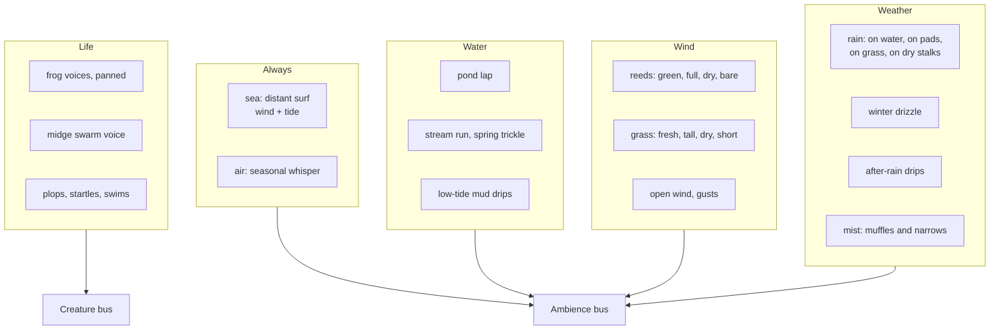

# 25 — Seasonal soundscape

> Doc 17 sets up how ebb's sound works: beds, one-shots, procedural voices, the mixer. This doc decides what the island sounds like in each season, at each hour, with the life that is actually there, and now and then a soft call from somewhere beyond the shore. The starting island is small, bare of trees and empty of animals until frogs move in, with midges dancing over the pond at dusk. So its sound is water, wind, grass and reeds, rain and mist, the sea around it, and, when the habitat is right, frogs. Each season gets its own signature: the running water and rain of spring, the warm stillness of summer, the dry gold rustle of autumn, and the frosted hush of winter. Sounds are CC0 first; a free or paid library is a fallback, under rules that keep the public repo clean.

## Locked decisions

- **Residents up close, distant visitors rarely.** Up close, only what lives on the island is heard. Beyond the shore, a few soft, distant animal calls are allowed from the start, infrequently (Matt, October 2026): a far gull over the sea, geese passing high, a songbird across the water at dawn, an owl far off at night. They are placed beyond the shoreline, never on the island, never in the journal, and never insects (crickets and cicadas sound close by nature). As species settle, their own voices take over up close, like the score (doc 24). This replaces doc 17's "birds at dawn" and "night insects" beds.
- **No sound for things that are not there.** No leaf rustle until shrubs or trees exist (doc 17's "leaves" wind bed and "autumn dry leaves" wait for M3 woodland); dry reeds and grass carry autumn instead.
- **The sea is always there.** A distant surf bed around the island, shaped by wind and tide, is added to doc 17's beds. It is the island's floor: the one sound that never stops.
- **A seasonal air bed** sits under everything at a whisper, so silence never turns into digital nothing. Each season has its own color.
- **Seasonal variants by crossfade.** Beds that change with the season (wind in reeds and grass, rain, air) have one recording per season, crossfaded by `seasonPhase` across the last and first days of neighbouring seasons. One-shot pools are per season too.
- **Frogs follow their year.** The frog voice (doc 17) changes with the season: spring is the breeding chorus (fullest, purring, frogspawn time, doc 12), summer a steady evening chorus, autumn sparse and lower, winter silent (dormancy).
- **Midges have a voice**, procedural, heard only up close at dusk.
- **Tools hear the ground.** Tool sounds change with ground wetness (doc 22) and frost, so sculpting after rain sounds wet and at a winter dawn sounds stiff.
- **CC0 first, then a fallback with rules.** Sources in order: Freesound with the CC0 filter and the VCSL and VSCO 2 CE libraries; procedural synthesis for small sounds where it does well (drops, ticks, knocks); then, only where nothing lands, a free royalty-free or paid library under the rules in "When CC0 does not land" (Matt, October 2026). Matt has no recording equipment, so there is no home foley.

## How it works

### The island's layers



### Season by season

**Spring: running water and soft rain.** The springs and streams run fuller after the winter drizzle, so trickle and run beds sit a little higher. Rain is common (28 percent of spring days) and lands on new lily pads with a soft tap, on young reeds and on the pond. After rain, drips fall from reeds and pads for one to two game hours. Wind is light and gusty and moves through young green reeds with a soft, low rustle. The frogs wake (`creature:woke`) with a few slow first calls on the first warm dusk, then the breeding chorus builds through the season: the fullest, most continuous chorus of the year. Midges return. Air bed: fresh, slightly bright.

**Summer: the warm stillness.** Days are long and calm (48 percent clear). Wind is soft by day and nearly still at dusk; tall grass makes a long, smooth swish in the gusts; reed seed heads give a soft velvet rustle. The pond lap is lazy. Dusk is the summer moment: midges at their thickest (a faint hum when the camera is near the pond) and a steady frog chorus. Summer nights are almost silent, just the sea and the pond, which makes them restful. Air bed: warm, a touch of low body.

**Autumn: the dry gold.** Reeds turn gold and stiff, so the reed bed becomes crisp and higher in pitch, with dry stalk knocks and a seed-head rattle in gusts. Gusts are stronger. Mist mornings are common (18 percent), muffling the high end and narrowing the stereo image. Rain on dry grass and stalks is crackly rather than soft. Frogs call less, lower and alone as dormancy approaches (dormancy begins at season position 2.6, a little past the middle of autumn, and frogs wake at 0.3, early spring; `recipes/world/seasons.json`). Midges thin out. Air bed: dry, slightly hollow.

**Winter: the hush.** No frogs, almost no midges. A high-shelf cut over the whole ambience on frosty mornings (doc 17), lifted as the day warms. Rain becomes a fine drizzle with a soft hiss. Mist is the most common weather of the year (28 percent). Pale dormant reed stalks knock hollowly in the wind, and on stronger gusts a faint aeolian whistle comes through them. As the sun reaches frosted grass at dawn, the closest grass gives tiny ticks and crackles for a few minutes (only within about 3 m of the camera). The pond is glassy and the lap minimal. With no wind in the reeds, the surf carries across the still air and becomes the main voice. Air bed: thin, cold, darker.

### Season matrix

| Layer | Spring | Summer | Autumn | Winter |
|---|---|---|---|---|
| Sea | medium, tide swell | soft | stronger with gusts | clear and present across still air |
| Air | fresh, bright | warm | dry, hollow | thin, cold, dark |
| Pond lap | lively | lazy | medium | minimal |
| Streams, trickles | fullest | lower | medium | medium |
| Reeds in wind | young, green, soft | full, velvet seed heads | gold, crisp, stalk knocks | bare, hollow knocks, aeolian whistle |
| Grass in wind | fresh, short | tall, long swish | dry, scratchy | short, quiet |
| Rain | on pads, reeds and pond, soft | warm, heavier drops, brief | on dry grass and stalks, crackly | fine drizzle, hiss |
| After-rain drips | many | some | some | few |
| Mist | light | rare | common | most common |
| Frogs | wake, then breeding chorus | steady evening chorus | sparse, lower, alone | silent |
| Midges | return at dusk | thickest at dusk | thinning | almost none |
| Dawn one-shots | water drips, reed creak | very few | reed knock, distant gust | frost ticks, stalk knock |

### Hour by hour

All hours follow display time (doc 17), so previews sound right.

| Time | What shifts |
|---|---|
| Pre-dawn | The quietest hour: sea, air, the pond barely lapping. Ambience overall level at its night dip. |
| Dawn to sunrise | Mist (if any) peaks; a few dawn one-shots near the camera; ambience level eases up over 20 game minutes. |
| Morning | Wind rises with the day curve (`weather.wind.diurnalAmount`, peak at 15:00), reeds and grass come alive. |
| Afternoon | Windiest; gust swells most frequent. |
| Golden hour | Wind starts to fall; midges begin to gather (live swarm density, `recipes/species/midge.json`). |
| Dusk window | Frogs call (content frogs only); midge hum near the pond; reeds settle. The music steps aside (doc 24). |
| Night | Wind low, sea forward, occasional frog call early in the night, then quiet. Ambience overall level dips (doc 17). |

### Creature voices

**Frog** (doc 17's pulse-train croak, unchanged at its core), with seasonal parameters in the frog recipe's `voice`:

| Season | Call rate | Chorus | Character |
|---|---|---|---|
| Spring | ×1.3 | dense, answering, a low purr underneath from distant callers | breeding chorus; first week begins with a few slow calls the first dusk after waking |
| Summer | ×1.0 | steady, alternating (0.4 s rule) | the reference voice |
| Autumn | ×0.5 | sparse, rarely answered | pitch 5 percent lower, phrases shorter |
| Winter | 0 | none | dormant |

The 0.4 s hold-off, mood-driven density, nearest-voice priority, HRTF panning and the presence hush (doc 23: frogs within 4 m hush for 14 to 20 s after a startle, and the chorus continues from the far side) all stay as doc 17 and doc 23 describe.

Frog body sounds (sampled one-shots, panned at the frog): **plop** into water (startle and ordinary entries, at least 8 variants, size-scaled), **surface** (a tiny water break as it comes up eyes-up), **swim kick** (very soft, only within 2 m), **landing** on a lily pad (a soft leaf pat; the pad dip in doc 11) and on mud. No tongue sound.

**Midges** (procedural, `voices.js` model `midge-swarm`): one voice per live swarm, at the swarm's center, nearest two swarms only. A thin high hum built from 6 to 10 sine or triangle partials around 400 to 700 Hz, each slightly detuned and slowly wandering so they beat against each other, with amplitude following the swarm's live density (dusk peak, night near zero, damped by wind). Audible only within about 3 m of the camera (`refDistance` 0.5 m, steep rolloff) and never in the far field: a player bending close to the water at dusk hears them, nobody else does. Tune by ear in the lab against a real chironomid swarm recording if one is found as CC0.

**Minnows** (procedural, model `surface-sip`, M2): each time a fish rises and rings the surface, a tiny soft plop at the ring: one small bubble near 1.2 kHz (lower and rounder than a raindrop) with a soft lip click, about 9 dB under a frog's plop. Heard within about 9 m, fading out from 5 m, so you hear a school only when you are near it. Rises come often while the school swirls up to food.

**Southern hawker** (procedural, model `wing-rattle`, M2, `src/audio/voices/dragonfly.js`): a soft, dry, papery rattle, not a hum. Each wingbeat is two short noise grains (fore pair, then hind pair a little behind), each a different strength, with now and then a tiny crinkle; the beats loop at the drawn wingbeat rate (22 a second hovering, 27 darting). Louder and brighter darting than hovering, silent on a perch. One voice per dragonfly at its own place, nearest two only, heard only within about 2 m of the camera eye, so one passing close by is a small event.

### Distant visitors

Soft calls from beyond the island, so it feels part of a larger world without anything arriving.

| Season | Possible visitors | When |
|---|---|---|
| Spring | a songbird across the water, geese passing north | dawn and morning |
| Summer | a far gull over the sea | midday and afternoon |
| Autumn | geese passing south (a long skein, the season's signature), a far owl | morning; night |
| Winter | a far crow, a gull riding the wind | morning and afternoon |

- **How often**: two to four per game day at most, at least 1.5 game hours apart, none during the frog window or while a music piece is playing its first phrase.
- **How far**: placed 80 to 200 m beyond the shoreline in a seeded direction (geese move across the sky as a panned pass over 20 to 40 s). Strong air absorption (lowpass near 2.5 kHz), extra reverb, about 18 dB under a near frog call. Heard, never seen.
- **Foreshadowing** (Matt, October 2026): distant visitors may include species that can come later, heard far off before their land exists (a songbird across the water before the meadow islet, an owl before the woodland knoll). They become a little more frequent once their tier's land joins, then stop once the species settles and its voice moves up close. Sea and sky birds (gulls, geese, crows) stay as visitors throughout.
- **Rules**: never a species that lives on the island at that moment (its own voice is up close instead); never in the journal or the reveal; muted in winter mornings' frost hush for the first game hour.
- **Sources**: CC0 recordings that are clean of other sounds, or a clean close recording pushed into the distance by the filters above (often easier to find clean).

### Weather details

- **Rain on surfaces**: the rain bed is split into four layers, mixed by what is near the camera from the water summary and flora: on open water (soft fizz and drops, the "sizzle on water cells" of doc 17), on lily pads (tap), on reeds and rushes (patter), on grass and ground (soft wash; crackly on autumn's dry grass). Pulled up high, they merge into one wide wash.
- **First drops and last drops**: rain starts with a minute of sparse single-drop one-shots before the bed swells, and ends with the bed thinning into drips.
- **Drizzle**: winter's own bed, fine and hissing, quieter than rain.
- **Mist**: lowpass the ambience bus from 18 kHz down to about 7 kHz at peak density, narrow the stereo width of beds by 30 percent, add 0.1 to the reverb send. One-shot density drops by a third.

### Tools hear the ground

Doc 17's tool sounds gain three states read from the ground under the brush: **dry** (summer default; soil push is crumbly and light), **wet** (after rain and at the water's edge, from the doc 22 wetness; soil push is heavier and wetter, sand brush gritty-damp), **frost** (winter mornings until the frost burns off; a faint crisp crunch on the first contact of each stroke). Stone and wood sounds do not change. Water pour does not change.

### The reveal

Doc 17's reveal rules stand. Additions: the sea and air beds rise first with the wind and water lap; in winter the reveal is quieter (no frogs to fade in, so the drift passes over a silent pond, which is right); the music adds its theme statement (doc 24).

## Sourcing

### What the workspace can and cannot reach

The cloud workspace reaches GitHub and package registries, not Freesound. So:

- **Instrument samples** (VCSL, VSCO 2 CE) are fetched from GitHub in the workspace, trimmed and encoded there, then auditioned on Matt's machine.
- **Field recordings** from Freesound: the session builds a shortlist by reading Freesound pages with its web tools (CC0 filter, preview listened to by Matt), Matt downloads the originals with his Freesound account (originals need a login), and drops them into a connected folder or attaches them. The session then processes them.
- **Procedural sounds**: small one-shots built in code where physics does them well, in the same spirit as the game's physical light. Water drops and plops from bubble resonance (the Minnaert frequency of a bubble of a given size, with a short pitch rise), frost ticks and dry crackles as short filtered impulses, stalk knocks as a few decaying resonances (modal synthesis). They are used where library files are not clean, and to add variety under recorded ones. Matt judges them by ear against the recordings.

### When CC0 does not land

If a sound (or the nylon guitar, doc 24) cannot be found clean under CC0, the fallback order is:

1. **Free royalty-free bundles** that allow use in games without credit, such as the Sonniss GDC bundles. Doc 17 excluded them only because the repo is public; the rules below handle that.
2. **A paid library**, bought by Matt, only when the sound matters and nothing else lands.

Rules for anything not CC0:

- Read the current license text before use. It must allow use inside a distributed game, including a web game whose files the browser downloads.
- Commit only the processed, game-ready files (Opus and AAC, trimmed and mixed), never the source WAVs or the library itself.
- List each file in a separate `assets/audio/LICENSES-NONCC0.md` with the library, license name and a link to its terms; the purchase record stays with Matt.
- Note in the repo's license section that these files are not covered by the open license and may not be reused outside ebb.
- Keep the count small, and prefer replacing them with CC0 later if a clean file appears.

### Contamination rules

Every candidate is listened to in full before it enters the shortlist. Reject anything with: birds of any kind in beds and non-bird one-shots (the most common problem with outdoor recordings; birds come only through the distant visitor calls, which are placed on purpose), insects other than a usable midge or gnat swarm, crickets, frogs of another species, human voices, footsteps, traffic, aircraft, boats or engines, dogs, wind buffeting on the microphone, clipping, or audible edits. A short contaminant can be cut out of a bed if the remainder still loops well; otherwise reject.

### Shopping list (v1)

| Sound | Kind | Season | Freesound search ideas (CC0 filter) | If nothing clean is found |
|---|---|---|---|---|
| Distant surf, calm and gusty | bed ×2 | all | "distant surf", "waves far", "sea ambience calm" | free or paid bundle |
| Pond lap, lively and lazy | bed ×2 | all | "pond water lapping", "lake shore lapping small" | free or paid bundle |
| Trickle, small stream | bed ×2 | all | "trickle", "small brook", "spring water" | free or paid bundle |
| Wind in reeds: green, full, dry, bare | bed ×4 | per season | "reeds wind", "cattails wind", "dry grass wind", "dry reeds" | free or paid bundle; a season may share a take with a different filter |
| Wind in grass: fresh, tall, dry, short | bed ×4 | per season | "tall grass wind", "meadow wind", "dry grass rustle" | free or paid bundle |
| Open wind and gusts | bed ×2 | all | "wind gust open field", "soft wind" | procedural wind (filtered noise) under one recorded take |
| Air tone per season | bed ×4 | per season | "quiet countryside night", "room tone outdoor", "winter silence" | procedural (shaped noise per season) |
| Rain on water, on leaves, on grass, on dry grass | bed ×4 | per season | "rain on pond", "rain on leaves", "light rain grass", "rain dry leaves" | free or paid bundle |
| Drizzle | bed | winter | "drizzle", "fine rain" | the light-rain take, filtered and thinned |
| Drips after rain | one-shots ×12 | spring, autumn | "water drip single", "leaf drip" | procedural drops |
| Mud drips at low tide | one-shots ×10 | all | "mud drip", "wet mud plop" | procedural drops, lower and duller |
| Reed creak, stalk knock, seed rattle | one-shots ×10 each | per season | "dry reed knock", "bamboo knock soft", "seed pod rattle" | procedural knocks (modal) |
| Aeolian stalk whistle | one-shots ×4 | winter | "wind whistle hollow stem", "aeolian" | procedural (a band of noise through a narrow resonance) |
| Frost ticks | one-shots ×8 | winter | "frost crackle", "ice crackle tiny" | procedural ticks |
| Frog plop, surface, swim kick, pad landing | one-shots ×8 each | spring to autumn | "plop small water", "frog jump water" (check it has no frog call) | procedural plops |
| Distant visitors: gull, geese, songbird, owl, crow | one-shots ×4 to 6 each | per season | "gull distant", "geese flying over", "owl distant", "crow far" (clean of other birds) | free or paid bundle |
| Tool foley: soil wet, dry, frost; sand; stone; wood; pour | granular sources ×3 to 6 each | all | "soil digging", "sand brush", "stone placed", "wood knock" | free or paid bundle |

### Processing

As doc 17: trim, loop-point crossfade for beds (equal-power, 1 to 3 s), loudness normalize (beds −30 LUFS integrated, one-shots peak −6 dBFS), encode Ogg Opus (96 kbps stereo beds, 64 kbps mono one-shots) with an AAC fallback, and list every file in `assets/audio/CREDITS.md`. Additions: a gentle high-pass at 40 Hz on every bed; beds at least 45 s long and paired with a second take of a different length (for example 47 s and 61 s) as doc 17 asks; one-shot pools of at least 8 variants, never the same file twice in a row, with playback rate jitter of ±3 percent.

`tools/audio-check.html` (doc 17) gains a season and hour scrubber, so Matt can hear each bed and pool as the island would play it.

## Data and interfaces

```
assets/audio/
  beds/<layer>/<season>-a.ogg, <season>-b.ogg     (season omitted for all-season beds)
  oneshots/<pool>/<season>/*.ogg
  tools/<tool>/<state>/*.ogg                       (state: dry, wet, frost)
  CREDITS.md
recipes/world/ambience.json     beds, seasonal crossfades, gain curves per sound-state input, one-shot pools and rates
recipes/species/frog.json       voice.seasons { spring, summer, autumn: {rate, pitch, phrase} }
recipes/species/midge.json      voice { model: "midge-swarm", partials, hz, detuneCents, reachM }
```

Sound state (doc 17 `SoundState`) gains: `seasonBlend` (weights of the four seasons), `groundState` under the active tool (`dry`, `wet`, `frost`), `frost` (0..1 from the season shader's frost input), and `residents` (settled species ids), which doc 24 also reads.

## Tuning knobs

Tuning panel: per bed, per season gain and filter; crossfade width across season edges; one-shot rates per pool per season; rain surface mix by distance; mist lowpass and width; frog seasonal call factors; midge partials, pitch and reach; tool ground-state blend. Settings stay as doc 17 (master, ambience, creatures, tools, UI, plus doc 24's music).

## Performance budget

Within doc 17's budgets. Seasonal variants mean more files on disk, not more playing at once: at most two seasons' versions of a bed decode at a time (the current season and, near an edge, the next). Download for the full v1 soundscape under 9 MB, loaded season by season like the music.

## Acceptance checks

- On an empty new island in spring, you hear sea, air, the pond and wind in young reeds, and nothing alive. After frogs settle, the dusk chorus fills the pond.
- No bird is ever heard on the island itself; distant visitors are rare (two to four a game day at most), soft, beyond the shore, and gone if you listen for them up close. No cricket or human sound at any hour.
- Autumn morning: now and then a skein of geese passes far overhead from one side to the other.
- Jump to each season at noon with wind: reeds sound green, full, dry and bare in turn.
- Autumn mist morning: the island sounds muffled and close; it opens as the mist burns off.
- Winter dawn with frost: bending close to the grass, tiny ticks as the sun reaches it; the pond is still; the surf carries.
- Rain on the pond sounds different from rain on the meadow, and on autumn's dry grass it crackles.
- Bend close to the water at a summer dusk: a faint midge hum appears within about 3 m and is gone when you pull back.
- Sculpt soil right after rain, then on a dry summer afternoon, then on a frosty winter morning: three different soils.
- Spring frogs call more and answer more than autumn frogs; in winter there are none.

## Proposed amendments to doc 17

1. Open question "Should there be music at all": answered yes, see doc 24. Add the `music` bus to the graph and the settings list.
2. "birds at dawn" and "night insects bed": replace with distant visitors (rare, beyond the shore); no insect beds until those species exist.
3. "autumn dry leaves" and the "leaves" wind bed: hold until shrubs or trees exist; autumn uses dry reeds and grass.
4. Add the sea bed and the seasonal air bed to the bed list.
5. Frog voice: add the seasonal parameters above. Add the midge swarm voice model.
6. Tools: add the dry, wet and frost ground states.

## Open questions

- Should winter have one more signature sound beyond the hush, for example ice skinning the pond edge at dawn? (The island is snow-free, so ice would need a matching visual.)

## Depends on / feeds into

- Depends on: `17-audio.md`, `10-growth-and-seasons.md` (seasons, weather odds, dormancy), `11-creatures-and-ecology.md` and `12-creature-roadmap.md` (frogs, midges), `22-ground-detail.md` (wetness), `23-presence.md` (startle, hush), `07-water-and-tide.md` (water summary, tide).
- Feeds into: `24-music.md` (residents, quiet dusk), `14-asset-recipes-and-tuning-panel.md`, `19-performance-and-quality-tiers.md`.
