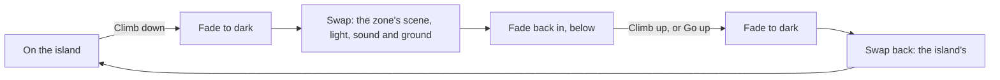

# 26 — Zones: places off the island

> Some places are not on the island's surface: the cave under the spring, later the sea cave and
> the Hollow. A zone is one of these. You go down (or in), the screen fades through dark, and you
> are somewhere else with its own ground, light and sound. You come back the same way. The island
> never stops while you are gone.

**Status:** Built October 31, 2026, with the underground spring (the spring-ore plan, O3), its first
zone. The sea cave (`docs/future/16-the-sea-cave.md`) and the Hollow will use the same system.

## How it works

- **The fade** (`src/world/zones/zone.js`, pure): out to dark over `fadeS`, held dark `holdS`, then
  back in over `fadeS`. The swap happens once, at the start of the hold. Numbers:
  `recipes/world/zones.json`. A plain dark veil over the view does the fading; the HUD stays.
- **The registry** (`src/world/zones/live.js`): a zone registers `enter` and `leave` (it moves the
  walker in and out), and what it brings: its `light` each frame, its `sound` bed, its `cardAt`, where
  a click meets its floor (`groundAt`), and how far back the view may sit (`viewRoom`). The store
  slice `zone` holds the zone you are in (null on the island). Events: `zone:entered`, `zone:left`.
- **The walker** (`src/world/walk/index.js` `enterZone`, `leaveZone`): a zone's ground and water
  become the walk's, on a walk grid over the zone's bounds, with none of the island's solids. While
  in one, you are not on the island: presence, the finds and the here-bar feel nobody, no prints are
  left, and `spot()` keeps the island spot you went down from.
- **Drawing** (`src/app.js`): the zone's own passes run (they clear the frame themselves), with the
  walker and the post passes (exposure, bloom, tonemap, photo mode's lens); every island pass is off.
  The zone's light is a second lighting group on the same layout as the island's (doc 04): its own
  sky term (the cave's bounce) and no sun shadows, so the figure's shader takes either. The frame's
  sun is the zone's light on the walker. The palette still paints everything at the tonemap.
- **Sound**: the zone gives the sound state an `under` input and its own water near you; the
  ambience lets the island's beds fall away and the one-shots stop (`recipes/audio/ambience.json`).
- **The view**: the camera keeps above the zone's floor (`setFloor`, `setGroundProbe`) and within
  `viewRoom` (`setRoom`). In the spring's cave the rock between the eye and you fades out, so the
  roof never hides you.

## The island while you are below

Nothing about the island pauses. World time, the hourly simulation, growth, creatures, the camp's
fire and furnace all run exactly as they do when you stand on the island, so catch-up and saves stay
deterministic. A save made below keeps the island spot by the way down; reloading puts you there,
on the island, by the hole. Being in a zone is never saved.

## Adding a zone

1. A recipe (like `recipes/world/spring-cave.json`) listed in `recipes/world/zones.json` and
   `recipes/index.json`.
2. A world module that registers it (`zones.register({ id, enter, leave, tick, light, sound,
   cardAt, groundAt, viewRoom })`), builds its scene (in a worker when heavy), and calls
   `walk.enterZone` and `walk.leaveZone`.
3. Its passes, added to the frame graph's zone set in `src/app.js` (enabled only while it is the
   zone), and the zone's light written to the zone lighting group each frame.
4. A way in on the island (a card action that calls `zones.go(id)`) and out (`zones.back()`).
5. A test link that goes straight in (`zones.goNow(id)`), like `?spring=cave`.

## The spring's cave

The first zone (`src/world/spring/`): a small cave round the pool that feeds the spring, under the
hole where the ground gave way above it (O2). Its shape is a seeded field meshed by surface nets in
a worker (`cave-field.js`); its pass (`src/render/passes/cave.js`, `cave-draw.wgsl`) lights it from
the hole: a disc of sky, the sun down the shaft only when it lines up, the light bounced round the
walls, and a soft fill (Matt allowed fake light for the ambience). The pool's water refracts the
stones under it and reflects the bright hole. The old keeper's pan lies by the water: Pan the pool
gives iron ore (black sand) most often and copper ore more rarely, a few pans a game day, seeded so
time away never changes it (`pan.js`). Since the pan finds (Matt, October 31, 2026) it also turns up
ochre and mica (into the pack), keepsakes for the shelf (a rock crystal, crinoid beads, garnet sand, a
cave pearl once a season at most, a fleck of gold once ever), the old keeper's three lost things on
the 12th, 24th and 36th pans (a copper thimble, a bone button, a small iron key), and now and then a
well shrimp, curling in the pan before you tip it back (a journal find). Test link: `?spring=cave`.
