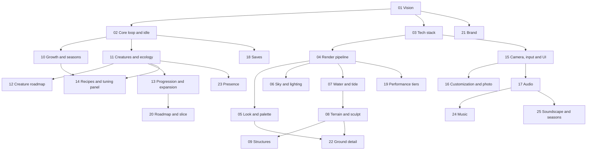

# ebb architecture docs

ebb: a tended island. A cozy idler and living diorama built on raw WebGPU.

Start with `../CLAUDE.md`, then `01-vision-and-pillars.md`, then `20-roadmap-and-vertical-slice.md` for the build order.

| Doc | Covers |
|---|---|
| 01-vision-and-pillars | What ebb is, the five pillars, non-goals |
| 02-core-loop-and-idle-model | Session loop, world clock, live and offline simulation, the return reveal |
| 03-tech-stack-and-module-map | Modules, events, store, workers, conventions, deploy |
| 04-render-pipeline | Frame graph, passes, targets, instancing |
| 05-look-and-palette | Physical light painted last, palette LUTs, outlines, grading |
| 06-sky-and-lighting | Physical sky, sun and moon, shadows, ambient light, fog |
| 07-water-and-tide | Shallow-water simulation, tide, water shading |
| 08-terrain-and-sculpt | Heightfield, paint layers, brushes, undo |
| 09-structures | Paths, stone walls, bridge, lanterns, weathering |
| 10-growth-and-seasons | Flora models, moss, dispersal, seasons, weather |
| 11-creatures-and-ecology | Needs, habitat, arrival, behavior, interactions, procedural bodies |
| 12-creature-roadmap | Species by tier, unlocks, build order |
| 13-progression-and-expansion | Milestones, new land, pacing, journal |
| 14-asset-recipes-and-tuning-panel | Recipe format, generators, tuning panel |
| 15-camera-input-and-ui | Camera, mouse, keyboard and trackpad input, HUD, icons, layouts |
| 16-customization-and-photo-mode | Palettes, time and weather controls, accessibility, photo mode |
| 17-audio | Ambience, creature voices, mixing |
| 18-saves-and-persistence | Autosave, world file, migrations, catch-up timestamps |
| 19-performance-and-quality-tiers | Budgets, tiers, benchmark page |
| 20-roadmap-and-vertical-slice | Milestones, slice steps, how to feed docs to Claude Code |
| 21-brand-identity | Name, wordmark, icon, favicon, colors, type |
| 22-ground-detail | Scanned ground textures, height blending, hex tiling, micro-normals, wet ground |
| 23-presence | How creatures read the player: presence sources, comfort rings, trust and wariness, the walker (Sit replaces the seat) and camp |
| [24-music](24-music.md) | The music: the director's day, the four tides, the composer that grows new pieces, the piano and support kit, hearted pieces |
| [25-soundscape-seasons](25-soundscape-seasons.md) | The island's sounds through the seasons: beds, small sounds, frogs and midges, weather, the reveal |
| [26-zones](26-zones.md) | Places off the island (the spring's cave first, later the sea cave and the Hollow): the fade, the swap, and the island simulating on behind it |

## Future features

[future/](future/README.md) holds the F-series feature notes (pacing, plants and surfaces, finds, keepsakes and nets, and more), each with its status.

## Working notes

Notes from the audio sessions, kept beside the docs:

| Note | What it is |
|---|---|
| [audio-session-brief](audio-session-brief.md) | The audio track's phase plan and house rules |
| [audio-handoff](audio-handoff.md) | Where the audio work stands, the code map and what comes next |
| [audio-future-work](audio-future-work.md) | Open audio decisions and merge-time steps |
| [audio-develop-plan](audio-develop-plan.md) | The plan for the composer that grows pieces |
| [audio-freesound-shortlist](audio-freesound-shortlist.md) | The 110 Freesound recordings shortlisted for the beds |
| [audio-nylon-guitar-shortlist](audio-nylon-guitar-shortlist.md) | The nylon guitar sample sets considered |
