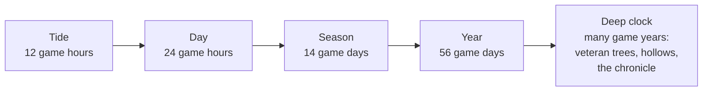
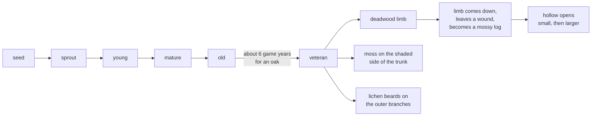

# F04 — The deep clock

> The authored arc (fifteen species, five land pieces, the year page) is a first chapter, and it runs out. A player who stays on one island for many game years needs the island to keep changing without new authored content. The deep clock is a small set of slow systems whose rhythm is years, not days: trees that grow old and then ancient, hollows that open in them and the rare residents that move in, a pressed page in the journal for every year that passes, and the occasional quiet anniversary. None of it asks anything of the player. It simply rewards staying, the way an old garden rewards its gardener.

**Status:** Leaning. Not scheduled. Nothing here is built until Matt schedules it.

## Decided so far

- Players may stay on one island for many game years. The island should still be changing in year ten.
- A season is 14 game days, so a year is 56 game days. The day cadence stays at 24 real minutes per game day at 1x.
- The catch-up cap drops from 14 game days to 7 game days per return.
- Growth while away runs slower than watched time. (Details of these clock changes live in F01, pacing and seasons.)
- Everything in this doc is counted in game time. Nothing is framed in real time.
- The locked rules hold: no fail states, nothing dies on screen, nothing is lost by being away, no notifications that pull the player back.

## The idea

ebb already has four clocks: the tide (half a day), the day, the season (14 days) and the year (56 days). The deep clock adds a fifth, measured in game years, that nobody sets and nobody can hurry.

Three parts, each small:

1. **Old growth.** Trees already have an "old" stage (doc 10). Past it lies a **veteran** stage that takes many game years. Veteran trees carry deadwood, moss and beards of lichen, and in time they form **hollows**. Hollows are homes that a young island simply cannot offer, so the rarest residents only come to islands that have been tended for a long time.
2. **The chronicle.** At each year's turn the journal presses one page: that year's best photograph, the named individuals who lived through it, and what changed. Over many years the journal stops being a field guide and becomes a history of one place.
3. **Anniversary notes.** Now and then, sparingly, the island remembers: "A year ago today the first frog came." Never a reminder, never a reason to come back on a certain day.

The real ecology behind old growth is the point. In real woodland, hollows form only in old trees: a limb dies, falls, and leaves a wound; heart-rot fungi soften the wood behind it over decades; woodpeckers drill into the soft deadwood and open it further. Owls, bats, nuthatches and many beetles depend on those hollows, and no amount of planting can make one appear sooner. That is exactly the kind of slow, earned consequence the vision asks for.

## How it could work

### Old growth: the veteran stage

The tree life gains one stage at the end, and the veteran stage gains features over the years instead of further stages. All numbers below are starting points for the tuning panel, not decisions.

| Tree | Veteran from (starting point) | Hollows? | Notes |
|---|---|---|---|
| Oak | about 6 game years | yes, the largest | the classic veteran; owls' first choice |
| Beech | about 5 game years | yes, medium | bracket fungus on the trunk |
| Alder | about 4 game years | yes, small | by water; quickest to give bats a roost |
| Wild cherry | about 4 game years | small only | peeling bark, gum on old wounds |
| Hazel, hawthorn | about 4 game years | no | grow wide and many-stemmed instead |

A pollarded tree (F07, growing as craft) could reach the veteran stage sooner and open hollows earlier, as real pollards do: the repeated cuts leave wounds where rot begins. That gives a player who wants owls a slow, hands-on way toward them.

- **One roll a year.** Each veteran tree makes one seeded roll per game year, at an hour in autumn picked by a hash of its id (so trees do not all change at once). The roll decides whether a new feature appears and whether an existing one grows. It reads only the tree's own record and the year number, so a year that passes in catch-up gives exactly the same tree as a year watched.
- **Deadwood.** A veteran's first feature is usually a dead limb: silver-grey, bare in summer, still standing. Real veterans also **retrench**: the crown slowly lowers as top limbs die back and new growth comes lower down. That keeps the tree's size steady for decades rather than ever falling.
- **Limbs come down, gently.** After a few years a dead limb may drop, always on a windy autumn night, onto a free spot inside the crown (never onto a path, wall or bridge). It becomes a log on the ground, furred with moss within a season. It adds cover and deadwood to the ecology grid, so the island gains something, nothing is lost. The wound it leaves is where a hollow can later start.
- **Hollows.** A hollow starts at an old wound, small, and grows a size class every few years: small (bats, small birds), medium (woodpecker), large (owls). Its place on the tree comes from the space-colonization skeleton: the wound of the thickest lost limb.
- **Moss and lichen.** Trunk moss follows the existing moss rules (shade and damp) on the shaded side of the trunk. Lichen beards lengthen a little each year in proportion to that year's mist days from the weather record, so a misty island grows the long beards that real clean, humid woods do.
- **Never dies.** A veteran tree does not die, fall or rot away. The only ways it leaves are the player's own actions, as today (doc 10).
- **Drawing.** Each new feature is a stage change, so the tree remeshes at most once a game year. Deadwood is a bark material on chosen branches; beards are instanced hanging cards; hollows are a dark opening cut on the skeleton.

### Residents that need old trees

The ecology grid gains two fields fed by veteran trees: **hollows** (a short list per tree: size, height, facing, who lives there) and **deadwood** (standing dead limbs and fallen logs). Species read them like any other need (doc 11).

| Resident | From doc 12, or new | What the veteran island adds |
|---|---|---|
| Owls | doc 12, Tier 3 | today they need an old oak; a large veteran hollow lets a pair **nest** and raise owlets, with a hooting duet and a fledging night in spring |
| Bats | doc 12, Tier 5 | they roost under the bridge on a young island; a veteran hollow holds a summer **nursery colony**, so the dusk stream is longer and starts from the tree |
| Squirrels | doc 12, Tier 3 | a hollow becomes a winter den beside the summer drey |
| Woodpecker | **new, idea only** | needs standing deadwood; drums in spring, feeds on beetle larvae in it, and drills new holes that speed later hollows for everyone else |
| Treecreeper | **new, idea only** | creeps up veteran bark in spirals, nests behind loose bark |
| Stag beetle | **new, idea only** | larvae live in fallen deadwood for several years before adults appear on summer evenings: a creature that only an old island can have |
| Bracket fungus, beard lichen | **new journal pages, idea only** | plant-like pages that the journal learns as they appear |

New species would follow the post-v1 pattern of the Headland (doc 12): a chapter after the year page, never part of the fifteen.

### The chronicle

At the turn of each year (the last hour of winter into the first of spring) the journal presses one page.

- **The photograph.** The player can mark any photo taken that year as "for this year's page", and change it until the year turns. If none is marked, the year's highest-ranking moment photo is used. If there are no photos, a sketch of the island map as it stood that year.
- **Named individuals.** Each named creature alive on the island that year, with one line ("Fen, oldest of the frogs, called from the west reeds all summer").
- **What changed.** Chosen by salience from a small **year ledger** that collects firsts and changes as they happen: first sightings, species that became happy, land that joined, ponds dug, the oldest tree, any new veteran feature, a meadow turning to scrub (F06), the wettest season, the plant that spread most. At most about eight lines, in the journal's words.
- **A pressed leaf** of that year's most-flowered plant in the corner.
- **Then and now.** Any two pressed pages can be opened one above the other (stacked, never side by side on a phone, never scrolling sideways).

The year page (doc 13) stays exactly as it is: the record of the first full year. The chronicle is the record of every year, including the first. If the farewell in F02 is built, an island's chronicle is what becomes its bound volume on the shelf.

### Anniversary notes

- They mark only a short list of firsts: the first creature found, each species' first sighting, the first name given, each land piece joining, the first hollow, the first owlets.
- They come on the same day of a later year, and only in years 1, 2, 3, 5, 10, 15 and 20, so they thin out as the island ages.
- At most one per game week and one per reveal, ranked below every live event. If a day passes while away and the reveal has no room, the note is written into that year's chronicle quietly, never into "you may have missed".
- They speak of the present: "A year ago today the first frog came. Twenty-two call from the reeds tonight." If the thing remembered has moved on, the note is skipped rather than pointing at an absence.
- A setting turns them off.

### Determinism and saves

- Veteran rolls key on the world seed, the tree's id and the year number. Limb landings, hollow placement and resident assignment are seeded the same way, and ties break by id.
- The year ledger and chronicle are built from tick events, so catch-up writes the same page a watched year would. Only the photo choice is player data.
- Save cost is small: a few bytes per veteran feature per tree, under 1 KB per pressed year, and a short list of firsts with their day.

## What it would change

- **02 Core loop and idle model:** a year-turn event and the year number in the clock (the season length, cap and away rate are F01's changes).
- **10 Growth and seasons:** the veteran stage, yearly rolls, retrenchment, dropped limbs as logs, trunk moss, lichen beards.
- **11 Creatures and ecology:** hollow and deadwood fields; hollows as a shelter type with one resident each.
- **12 Creature roadmap:** owl nesting and bat nursery as veteran-island behaviors; a post-v1 old-growth chapter for the new ideas.
- **13 Progression and expansion:** the chronicle and anniversary notes in the journal; the year ledger.
- **15 Camera, input and UI:** the Years section of the journal and the stacked then-and-now view.
- **16 Customization and photo mode:** marking a photo for this year's page.
- **17 Audio:** woodpecker drumming, owlet calls, the bigger bat stream.
- **18 Saves and persistence:** veteran features per tree, the year ledger, pressed pages, the list of firsts, and a migration.
- **19 Performance and quality tiers:** cost of veteran meshes, beards and logs on phones.
- **20 Roadmap:** a post-v1 milestone, after the Headland or beside it.

## Risks and guardrails

- **Owls already need an old tree.** Doc 12 puts owls in Tier 3 needing an "oak past maturity" with a hollow, around the first year. If hollows only come with veterans, the authored arc stalls. Guardrail: the old stage keeps one small hollow so owls can roost and be happy on schedule; veterans add nesting, not the first visit.
- **Too slow to notice.** If veterans take too long, a player never sees one. Guardrail: the tuning panel's "grow one year" button and a `tools/` page that grows a tree for twenty years so Matt can tune the pace and see it.
- **Dropped limbs read as damage.** Guardrail: limbs only fall on windy autumn nights, never onto anything the player built, and arrive as a mossy log that adds habitat.
- **Anniversaries turning into nagging.** Guardrail: thinning cadence, one per week at most, never shown out of game, never listed as missed, and a setting to turn them off.
- **Chronicle pages as reports.** Guardrail: words, not numbers; at most eight lines; a pressed page, not a table.
- **Deep save growth.** Twenty years of pressed pages must stay small. Guardrail: pages store keys and numbers, the words come from the journal recipe, photos are references.

## Open questions

- Should owls on a young island roost in the small hollow of an old oak, or should their first visit wait for a veteran tree?
- How many game years should an oak take to become a veteran? Is about six right, or should it feel more like ten?
- Should a dropped limb ever happen while the player is watching, or only while away?
- Which of the new old-growth residents appeal most: the woodpecker, the treecreeper, the stag beetle, or none of them yet?
- Should the player choose the chronicle photograph, or should the island choose it and let the player swap it?
- Are anniversary notes welcome at all, or would the chronicle alone be enough?

## Depends on / feeds into

Depends on F01 (the 56-day year, the cap and the away rate), `02-core-loop-and-idle-model.md` (clock, catch-up), `10-growth-and-seasons.md` (trees, stages, space colonization, moss), `11-creatures-and-ecology.md` (fields, needs), `12-creature-roadmap.md` (owls, bats, squirrels), `13-progression-and-expansion.md` (journal, year page), `18-saves-and-persistence.md`. Works alongside F06 (succession brings the woodland that veterans stand in) and F07 (pollards bring hollows sooner). Feeds F05 (the chronicle is where lineage changes are noticed) and F02 (an island's chronicle becomes its bound volume).
