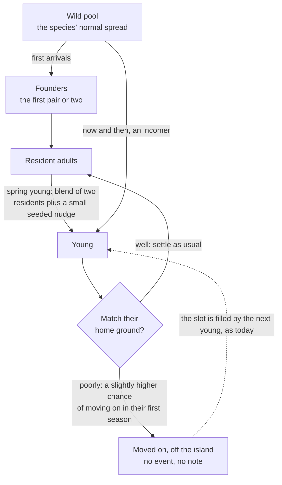

# F05 — Lineages

> Over many game years, an island's creatures could slowly come to look like their island. Each creature would carry a small set of inherited traits (the tone of its markings, its size, the pitch of its call), passed from parents to young with a little seeded variation. Young that match their surroundings settle a little more easily; the ones that don't quietly move on, as creatures already do. Nothing else changes: not their needs, not their behavior, not their happiness. Years later the frogs on a mud-banked pond are a shade darker than the first pair that came, and the journal notices. It is the biology of real islands (founder effect, genetic drift, camouflage) told at the pace of a tended garden.

**Status:** Tentative. Not scheduled. Nothing here is built until Matt schedules it. Matt wants this approached carefully; see "Why careful" below before anything else.

## Decided so far

- Traits are **cosmetic only**. They never touch needs, mood, behavior, trust, numbers or happiness.
- The range is **narrow**: a frog always reads as a common frog.
- Everything is **deterministic and seeded**, because saves and catch-up depend on it.
- The journal notices in **observational words**, never as a stat or a score.
- Moving on is the existing gentle rule from doc 13: no death, nothing on screen.
- Counted in game time only (a year is 56 game days, per F04).

## The idea

Real islands are natural laboratories for this. A handful of founders arrive and carry only part of their species' variety with them (**founder effect**). In a small population, chance alone shifts which traits are common from one generation to the next (**genetic drift**). And where a creature's color helps it disappear against its ground, those that match are a little more likely to stay and raise young (**cryptic coloration**), so the population slowly takes on the colors of its place. Classic cases: lizards on pale sand and dark lava within a few generations; peppered moths darkening with soot-dark bark.

In ebb this would mean two islands built the same way end up with frogs that are subtly different, because their first frogs were different and because one pond has dark mud banks and the other pale sand. The player never steers it and never sees a number. They just notice, one spring, that the frogs are not quite the frogs they first met.

## How it could work

### Three traits, each a narrow dial

Every individual of a lineage species carries three small inherited values. Numbers are starting points, not decisions.

| Trait | What it changes on screen | Range (starting point) | Shaped by |
|---|---|---|---|
| Markings tone | back color from lighter to darker, and how much of the back the blotches cover | within the recipe's own range (frog back albedo 0.12 to 0.16, blotches 0.05 to 0.08) | the surroundings, slightly; and chance |
| Size | drawn size | within the existing size jitter (a few percent) | chance only |
| Call pitch | pitch of the call | about two semitones up or down | chance only |

Only markings respond to the island. Size and pitch drift by chance alone, so each island ends up with its own voice and build for no reason but its history. That keeps the honest part of the science (drift is real and needs no story) and avoids inventing a reason for size or song.

Because the ranges sit inside what the recipe and the body variants already allow, no lineage can ever push a frog outside its look. If Matt retunes the frog in the tuning panel, traits are offsets within the new range, so they follow.

### Inheritance



- **Founders.** The first scout and the first joiners draw their traits from the species' wild pool, seeded by the world seed and their id. Whatever they happen to carry is where the island starts.
- **Island-born young.** Once a species has raised young on the island (frogspawn in spring for frogs, doc 12), most new joiners are island-born. Each takes the midpoint of two resident adults (picked by seeded draw, nearest homes first) plus a small seeded nudge.
- **Incomers.** A small share of joiners (about 1 in 10, starting point) still come from the wild pool, so a lineage never narrows to a single look and always keeps a little variety.
- **One generation a year** for frogs, at the spring young. Other species would use their own breeding season.

### Settling a little more easily

The surroundings signal is a **ground tone** worked out from the coarse state, never from rendered colors: the ground material and cover around the creature's home square (mud and dense reed stems read dark, sand and dry grass pale, moss and lilies in between). The match is how close a young one's markings tone is to that.

- A good match changes nothing. A poor match adds a small extra chance of moving on during its first season, on top of the existing rules. Starting point: at most 10 to 15 percent extra for the worst match.
- **Numbers never change.** Doc 11 sets how many frogs the edge can hold. A young one that moves on frees its slot, and the next young fills it as usual. Lineages change *which* frogs stay, never *how many*.
- Moving on here is never an event: no animation, no note, no line in "you may have missed". The young simply did not settle, which is also what most young in real ponds do.

**A quieter alternative**, same result: instead of anyone moving on, the island picks each new joiner from three seeded candidates, weighted by match. No one ever leaves; the drift is the same. It is simpler to reason about and has nothing that could read as culling. See the open questions.

### How fast, and how far

```
markings tone of the frogs, mud-banked pond (sketch, not data)
 darker |                                    ............ (holds near the ground's tone)
        |                       ..........'''
        |             .......'''
        |      ...''''
 lighter|''''  founders                 range limit is the recipe's own
        +-----+-----+-----+-----+-----+-----+-----+----- game years
        0     2     4     6     8    10    12    14
```

- Starting goal: a change the player could notice side by side after about **5 to 8 game years**, and not before about 3. Slow enough to be a deep-clock system (F04), quick enough that someone who stays sees it.
- It levels off near the ground's tone and stays within range. If the player reshapes the pond (sand where the mud was), the next years drift back the other way, just as slowly.

### What the journal says

- Lineage changes are noticed by comparing the population today with the founders and with earlier chronicle pages (F04), never as a running readout.
- At most one line a year, and only past a clear threshold, written in the chronicle or on the species page's "your island's story": "The frogs by the mud bank are darker than the pair you first met." "The chorus sounds a little lower than it did in the early years." "A pale frog came from somewhere else this spring."
- No words like "evolved", "adapted", "fitter" or "selected". The journal describes what you can see and hear.
- Named individuals keep their markings for life (doc 11 already gives them a seeded marking pattern), so a named founder visibly stands out among her darker descendants years later. Whether the journal names lines ("one of Fen's") is an open question.

### Which species

Start with **frogs only**: they already have individuals, home squares, spring young and seeded body variants. Later, if it reads well: minnows over a dark or pale pond bed (fish match their bottom, a well-known real case), hedgehogs, songbirds. Swarm species would carry a single population tone rather than per-individual traits. Never visitors (cranes) that do not breed on the island.

### Sister islands

When a player starts a sister island (F02 in this folder), its first frogs could be descendants of the old island's: the founders are drawn from the old island's population instead of the wild pool. The founder effect then becomes something the player can see: a sister pond started from three dark frogs out of a dark-banked pond begins darker, then drifts toward its own ground. The journal can say so: "These frogs came from the old island's pond." F03 (presence) already proposes that founders arrive Wary but their young start Tolerant; lineages would carry looks, not trust.

### Determinism and saves

- Every draw keys on the world seed, a lineage sub-seed, the species and the individual's id; parents are chosen by a seeded draw over residents sorted by id, so worker count and order never matter.
- Traits are three small whole numbers per individual, blended with whole-number math. Catch-up and live play produce the same young.
- Drawing uses the existing body variants plus a per-individual tone shift and size, so no extra bakes. Pitch is a playback setting.
- Save cost: a few bytes per individual (three traits and two parent ids). A few dozen frogs is well under 1 KB.

## What it would change

- **10 Growth and seasons:** a ground-tone summary per square from material and cover, rebuilt with the habitat.
- **11 Creatures and ecology:** traits per individual; founders, young and incomers in the joining rule; the extra first-season chance of moving on (or the candidate pick); the "numbers never change" rule written down.
- **12 Creature roadmap:** which species carry lineages; spring young as the generation step.
- **13 Progression and expansion:** observational lineage lines in the chronicle and species pages; "what never happens" gains "lineages never touch needs, behavior or happiness".
- **14 Asset recipes and tuning panel:** a lineage block per species (ranges, incomer share, settle bias), and a "run twenty years" view.
- **17 Audio:** per-individual call pitch.
- **18 Saves and persistence:** traits and parent ids per individual, a lineage sub-seed, a migration that gives existing creatures founder traits.

## Risks and guardrails: why careful

- **"The ones that don't fit leave" can read badly.** Worded carelessly, this is a story about sorting creatures by looks. Guardrails: no on-screen or noted departures for this reason, no word implying better or worse, and the candidate-pick alternative removes leaving from the system entirely.
- **It could become a breeding game.** If players see traits as numbers, they will try to steer them, and ebb becomes a breeding sim. Guardrails: no trait readouts, no pairing controls, no "rare color" to chase, no reward of any kind tied to a lineage.
- **Too subtle to see, or too fast to believe.** Real frogs take a couple of years a generation; ebb compresses that. Guardrails: tune with a local `tools/` page that runs twenty game years and shows founders beside year twenty; keep the change slow enough to feel like the island, not a trick.
- **Art direction drift.** A lineage must never make a frog look wrong in a screenshot. Guardrail: ranges live inside the recipe's look, and the palette still maps everything at tonemap.
- **Hidden effects on happiness.** If a mismatched young counted toward mood or numbers, the player could lose a happy species to a color. Guardrail: lineage code never writes to needs, mood, capacity or progression; a unit test checks that populations and happy events are identical with lineages on and off.
- **Determinism and save weight.** More per-individual state means more chances for order bugs. Guardrails: sort by id everywhere, whole-number math, and the determinism page compares lineage hashes too.
- **Science wording.** The journal should never imply creatures change because they want to. It notices the population, not the individual.

## Open questions

- Should young that don't match their ground quietly move on, or should the island simply favor matching young when picking newcomers, so no one ever leaves?
- Should only markings respond to the island, with size and call pitch changing by chance alone, as proposed here?
- Is about five to eight game years the right time before a change is noticeable?
- Should the journal ever trace family lines, such as "one of Fen's", or keep to the population as a whole?
- Should frogs be the only species with lineages at first?
- When a sister island starts, should the player choose to bring frogs from the old pond, or should it simply happen?

## Depends on / feeds into

Depends on F01 (the year length), `11-creatures-and-ecology.md` (individuals, joining and moving on, body variants), `12-creature-roadmap.md` (frogs, frogspawn), `13-progression-and-expansion.md` (journal, what never happens), `18-saves-and-persistence.md`, and `04-deep-clock.md` in this folder (the year clock and the chronicle where changes are noticed). Feeds the sister-island idea (F02 in this folder) through founders carried from the old island.
