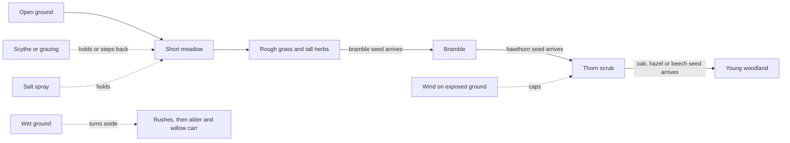

# F06 — Succession

> Today every plant on the island grows toward a fixed habitat and then holds. Real islands drift: open grass gives way to bramble, bramble to hawthorn scrub, scrub to woodland, unless something holds the ground back, such as grazing, mowing, wind, salt spray or wet ground. Succession would give the idle world a direction, so what you come back to is further along a story rather than just fuller. It has to be slow, readable in the journal, and steerable rather than a chore: a meadow cut once a season stays a meadow, and one left alone becomes a thicket that hedgehogs and wrens love. Natural brakes keep some places open on their own, so the island becomes a patchwork without the player managing every square meter.

**Status:** Seed. Not scheduled. Nothing here is built until Matt schedules it.

## Decided so far

- From Matt's session on October 19, 2026 (these apply to the whole game, not just this idea): a season is 14 game days and a year is 56 game days; the day cadence stays as it is; the catch-up cap drops to 7 game days per return; growth while away runs slower than watched time (details in F01, pacing and seasons).
- Succession runs on **game time**, never real time, inside the shared hourly tick, so watched and away runs give the same island.
- The journal stays **observational**: it says what happened, never what the player should do.

Everything below is a proposal.

## The idea

A real meadow is not a finished thing. Left alone, tall grasses and herbs shade out the short turf, bramble arrives in a bird dropping, hawthorn rises through the bramble (which protects it from browsing), and in time oak and hazel take over. Ecologists call these steps seral stages.

ebb would borrow that arc. Each patch of ground carries a slow clock of how far along it is. The clock only moves when seeds of the next stage can reach it, so succession follows the island's own story: no hawthorn scrub until the bees have given hawthorn seed, no woodland until a jay has planted an oak.

What it adds to play: a reason to come back that is not a reward, the pleasure of reading a landscape, and a gentle choice between open and wild that different creatures answer differently. Bees and butterflies want the meadow; hedgehogs, wrens and later owls want the thicket and the wood. The richest island is a mosaic with lots of edges, which is also true of real ones.

## How it could work

**The stage field.** One new number per 1 m square on the ecology grid, from 0 to 255, read in bands (all numbers below are starting points for the tuning panel):

| Band | Stage | What the player sees |
|---|---|---|
| 0 to 39 | Open ground | sand, bare soil, fresh sculpt |
| 40 to 89 | Short meadow | today's grass, clover, low flowers |
| 90 to 139 | Rough grass | taller, tussocky grass, seed heads, knapweed and similar |
| 140 to 189 | Bramble | arching bramble cushions spread in from the edges |
| 190 to 229 | Thorn scrub | hawthorn and blackthorn through the bramble |
| 230 to 255 | Young woodland | trees close overhead, a woodland floor beneath |

**Pace (starting points, in game time).** Short meadow to rough grass in about one season (14 game days). Rough grass to bramble in about one more season once a bramble seed lands within reach. Bramble to scrub in about one year (56 game days) after hawthorn arrives. Scrub to woodland in about two years after a tree seed arrives. With the 7-day catch-up cap and the slower away rate, one return moves a patch at most a fraction of a band, so nothing jumps.

**Seeds gate the bands.** A square cannot pass the start of the bramble, scrub or woodland band unless that stage's plants are within reach, using the dispersal kernels already planned in doc 10 (birds and hedgehogs drop berry seeds, jays cache acorns, wind carries light seed). When a square crosses into a new band, an individual plant record (a bramble, a hawthorn, a sapling) may start there through the normal growth rules, seeded by the square and the hour. Stages spread from edges inward, the way scrub creeps from a wall or hedge base.

**Shade.** A second new field, rebuilt each hour from the tree and shrub records: each crown splats a soft disc of shade by its size and leaf cover (none in winter). Shade lowers the grass target and raises moss and woodland-floor plants. This answers doc 10's open question about how much trees shade the grass: grass thins under a canopy toward a floor, and the ground there fills with ferns, moss, bluebell-like spring flowers and leaf litter instead of going bare.

**Natural brakes** (computed from fields that already exist or are planned, not saved):

- **Salt spray:** within about 4 m of the tide band the clock does not pass short meadow (thrift and sea-pink turf); it slows to half out to about 12 m.
- **Wind:** on exposed ground (high, open to the prevailing wind; the headland in M7) the clock stops at thorn scrub, and the scrub grows low and windswept (see F07).
- **Wet ground:** soaked ground follows a wet track instead: rushes, then alder and willow carr. Ponds never fill in on their own; the shape of water belongs to the player.
- **Paths:** worn ground stays open, as it does now.

**Steering.**

- **Scythe (proposed tool, Life group):** brush over ground to keep it open. One pass steps a square back by up to one band (never below short meadow), and cut bramble and scrub leave a soft brash pile for a season that hedgehogs and beetles use. A scythe pass also leaves a quiet **keep-open mark** on the square. The proposal is that the mark lasts: the island then "cuts itself" each late summer (the meadow shows stubble and hay rows for a few days), so a meadow set once stays a meadow without returning to it. Erasing the mark lets it go wild again. This is what keeps steering from becoming a chore.
- **Grazing (idea only):** feral goats (M7) hold the ground they roam at short meadow or low scrub, giving the headland its close-bitten turf. A rabbit field, kept like the midge field (no journal creature needed at first), could hold short turf near warrens. Both are ideas to weigh later.
- **Let it grow:** the default. Doing nothing is a real choice with a reward.

**The floor rule, decided as a proposal for Matt to confirm.** Succession never removes anything the player put there on purpose:

1. Plants the player planted, and cover the player painted, are never displaced by succession. A planted wildflower in a scrubbing meadow stays, held at its floor size if shade slows it.
2. Wild cover (what spread by itself) can shrink as a later stage takes the square, but only toward a floor, about a third of its share, so a meadow becomes a meadow with bramble in it before it becomes a thicket, and some grass always survives at the edges.
3. Under woodland, ground cover changes kind rather than disappearing; the square is never left bare.
4. Nothing ever moves backward toward open ground on its own; only brakes, the scythe or grazing do that.

**Journal lines (examples):** "Bramble has found the north slope." "The wrens are using the thorn scrub by the east wall." "The spray keeps the shore turf short." "The first oak is above the hawthorn." Away notes report one succession change at most per return, so the reveal stays a gift.

**Determinism and saving.** Each square's step is seeded by the square and the hour, as growth is now. Saved per 32 m chunk: the stage field and the keep-open marks, two small byte grids (about 2 KB before compression, much less after). Shade and brakes are rebuilt, never saved.

## What it would change

- **02** core loop: away notes gain succession lines; check catch-up cost with the extra field (small).
- **10** growth and seasons: add the stage and shade fields, the gating by seed, and the wet track; answer the shade open question; add the floor-rule wording for succession; update season length to 14 days.
- **11** creatures and ecology: new fields (stage, shade); cover from bramble and scrub; maybe an edge bonus for mosaic ground.
- **12** creature roadmap: hedgehogs, songbirds and owls read scrub and woodland; bees and butterflies read open meadow; goats graze.
- **13** progression: add to "what never happens" that succession never displaces the player's own planting.
- **14** recipes and tuning panel: a new `recipes/world/succession.json` with band edges, pace, brake distances, floors; "grow 1 year" button.
- **15** camera, input and UI: the scythe tool and its drawn icon in the Life group.
- **18** saves: two per-chunk byte grids.
- **22** ground detail: stubble, hay rows, brash piles, woodland floor.
- **17** audio: a soft scythe swish.

## Risks and guardrails

- **Reads as loss.** If a favorite meadow fills with bramble while the player is away, it can feel like neglect. Guardrails: the pace above, the floors, the lasting keep-open mark, and a journal that frames it as the island's story.
- **Reads as a chore.** Never require the scythe. No square ever turns into something no creature wants; every stage is someone's home.
- **Swamps the island.** Without brakes everything ends as woodland. The brakes, plus seed gating, must leave real open ground on the starter island even with no player input. A `tools/` page should time-lapse a seed for three game years with no input and with light steering, side by side.
- **Cost.** One more byte grid and a cheap per-square step; must fit inside the growth step's budget in doc 10.
- **Fights the Shape pillar.** Every scythe pass and mark is an edit that undo can reverse.

## Open questions

- Should the scythe's mark last forever (set once, the meadow cuts itself every late summer), or should a cut wear off after a season so the player has to return now and then?
- Is the floor rule above right: the player's own plantings are never displaced, and wild meadow only shrinks to about a third, never to nothing?
- How far should a wild island go if the player never touches it: mostly scrub, or real woodland on the sheltered side?
- Should the wet track (rushes to alder and willow carr) be part of this, or kept for later?
- Would you like rabbits as a quiet grazing field near the shore, before the goats arrive?
- Should a square that has reached woodland ever be able to step back to meadow by scything, or only by removing the trees on purpose?

## Depends on / feeds into

Depends on doc 10 (growth rules, dispersal, trees and shrubs), doc 11 (ecology grid), doc 12 (which seeds arrive as gifts and when), the M3 woodland tier, and the weather system's prevailing wind. Feeds F07 (wind-shaped scrub and laid hedges hold or shape succession), docs 11 and 12 (new shelter and food), doc 02 (the reveal), and the M7 headland (goats and wind).
