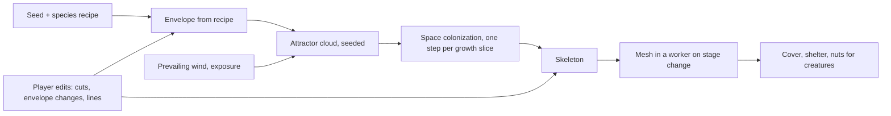

# F07 — Growing as craft

> Trees in ebb are planned to grow by space colonization: a cloud of attractor points fills the crown's envelope, and branches grow toward the points nearest them until the space is used up. That one choice means the old crafts of shaping living wood fall out of the algorithm for free. Pruning, coppicing, pollarding, laying a hedge, espalier on a wall, and training a tree along a shape are all just removing branches, removing attractors, or reshaping the envelope, and the tree regrows into what is left over the following seasons. The player shapes living structure over time instead of placing objects. It is biomimicry turned into play: the same move as translating a biological structure into CAD, but here the structure answers back. Wind can bias the same attractors, so trees on exposed ground grow windswept on their own.

**Status:** Seed. Not scheduled. Nothing here is built until Matt schedules it.

## Decided so far

- From Matt's session on October 19, 2026 (whole game): a season is 14 game days and a year is 56 game days; the day cadence stays; the catch-up cap is 7 game days; growth while away runs slower than watched time (details in F01). All regrowth below runs on game time.
- The Shape pillar holds: every cut and every envelope edit can be undone, nothing is permanent, nothing can be ruined.
- Trees stay deterministic and seeded. A tree is saved as its seed plus the player's edits, never as a mesh.

Everything below is a proposal.

## The idea

Space colonization grows a tree in three moves each step: every attractor finds its nearest branch tip within an influence radius, each tip grows a short segment toward the average direction of the attractors that chose it, and attractors within a kill distance of a tip are used up. The crown's envelope (the shape the attractors are scattered in) is therefore the tree's intent, and the attractors still unused are its future.

Each craft becomes one simple edit:

| Craft | What the player does | What the algorithm does |
|---|---|---|
| Pruning | cut a branch | the branch and everything beyond it go; its old attractors are freed, so nearby tips grow into the gap |
| Thinning | brush out a crowded part | free attractors are thinned in that region, so it stays airy |
| Coppicing | cut a hazel or willow to the stool | the skeleton is reset to the base; many new shoots rise from it, each chasing a tall narrow envelope |
| Pollarding | cut the crown at head height | the trunk stays; a ball of new shoots rises from the knuckle |
| Shaping | drag the envelope (a box, a dome, an arch, a column) | new attractors fill the new shape; growth follows over seasons |
| Espalier | draw lines on a wall face | attractors lie on those lines in a thin layer; the tree grows flat along them |
| Pleaching | join a row of trees with a shared flat envelope | crowns knit into a raised hedge on clear stems |
| Hedge laying | stroke along a row of young hawthorns | stems are bent over along the line and live on; new shoots rise vertically from them, making a dense, stock-proof hedge |

Why it matters for creatures as well as looks: a laid hedge is the densest cover on the island (wrens, dormice later, hedgehogs at its foot); coppice stools give hazelnuts low down for squirrels; an old pollard grows hollows sooner, which owls want. The crafts link straight into the habitat scores in doc 11.

## How it could work

**What is saved per tree.** The seed, species, position, age, and a short list of edit records in the order they were made. Each record is tiny:

- a cut: the game hour, and the branch it removed, named by its path from the root (for example "third child of the second child") so it survives regrowth;
- an envelope change: the game hour and a shape (kind, center offset, size, rotation), one of a small set;
- a line set for espalier or a laid hedge: the game hour and a few spline points.

A tree with a dozen edits saves in well under 200 bytes. On load the skeleton is regrown from seed and the edit list, replayed at the hours they happened, exactly as if watched. This keeps saves small and determinism checkable.

**Regrowth pace (starting points).** A pruned gap refills over about one season. A coppice stool reaches head height in about one year (56 game days) and is ready to cut again in two to three years, which in ebb time is a comfortable rhythm rather than a deadline. A pollard's new crown fills in about a year. An espalier tier fills in about a season per arm. Away growth runs at the slower away rate, so shaping is mostly seen while watching.

**Wind.** On exposed ground, each attractor is nudged downwind by an amount set by exposure (height, distance from shelter, open fetch to the sea) and by the prevailing wind from the weather system (the most common bearing over recent seasons, not today's wind). Upwind attractors also thin slightly. The result is the classic one-sided, leaning crown of a coastal hawthorn, with no extra rule. Walls, hedges and other trees give shelter, so a tree behind a wall stays upright: building a windbreak becomes a quiet way to change how trees grow. This is also the brake on exposed ground in F06.

**Forgiving by design.**

- Every cut and edit can be undone at any time; undo removes the record and the tree regrows as if it never happened.
- There is no wrong cut. The worst case is a tree that is smaller for a season. A cut never kills a tree; the trunk and root always stay unless the player removes the whole tree on purpose.
- The tool previews what will be removed (a soft highlight) before the cut lands, and shows the envelope as a light ghost shape while shaping.
- A tree that is ignored after shaping simply grows back out toward its natural form over a few years, slowly enough that the shape stays readable.

**Tools (proposed, Life group).** One **Shears** tool with modes: cut, thin, coppice or pollard (chosen by where you cut on the trunk), and shape (drag the ghost envelope). A **Hedge** mode draws a line along a row of young shrubs to lay them. Espalier is the shape mode on a wall: the wall offers a flat envelope and the player draws arms on it. Every icon is a drawn SVG.

**Tuning panel and recipes.** Per species recipe (doc 14): envelope shape and size per stage, attractor count, influence radius, kill distance, segment length, how readily it regrows from a cut (hazel and willow very readily, oak slowly, beech poorly from old wood), whether it coppices or pollards well, leaf card size, pipe-model exponent for branch radii, wind response. Global (`recipes/world/craft.json`): regrowth pace, how far ignored shapes relax, wind exposure scale, prevailing wind window, hedge-laying bend angle. Panel buttons: "grow 1 season", "grow 1 year", "show attractors", "show envelope", "replay edits".

## What it would change

- **10** growth and seasons: tree growth becomes stepwise (slices of colonization per growth step) rather than once per stage; edit records join the plant record; wind exposure field; regrowth rates.
- **09** structures: walls gain an espalier face; laid hedges become a living, structure-like boundary that writes cover and shelter.
- **11** creatures and ecology: laid hedges and coppice give strong cover; pollards bring hollows forward; shelter from wind as a field.
- **12** creature roadmap: songbirds, hedgehogs, squirrels and owls gain craft-based shelter; a possible later hedge creature (dormouse).
- **14** recipes and tuning panel: new recipe fields and the craft recipe above.
- **15** camera, input and UI: Shears tool and its modes, envelope ghost, cut preview.
- **18** saves: edit lists in the per-chunk flora records.
- **19** performance: remesh budget for frequent small regrowth.
- **F06** succession: laid hedges and wind brakes shape where scrub stands.

## Risks and guardrails

- **Fiddly.** Sculpting a tree branch by branch could become precise work. Keep tools coarse (a soft brush, a few shapes), and make the default outcome look good.
- **Branch names drift.** If a regrown tree's structure shifts slightly after a recipe change, a cut could land on a different branch. Guardrail: store each cut with a small position hint too, and match the nearest branch on that path; test in a `tools/` page that replays edits across recipe changes.
- **Cost.** Replaying edits on load and remeshing after cuts must stay inside doc 10's tree remesh budget (under 30 ms in a worker on desktop). Large crowns may need a coarser attractor count on phones.
- **Feels like a chore.** Nothing asks to be pruned. A coppice is never "overdue"; it just grows tall.
- **Wind reads as damage.** Windswept trees should look healthy and old, not broken.

## Open questions

- Which crafts matter most to you for a first pass: pruning and shaping, coppice and pollard, laid hedges, or espalier on the stone walls?
- Should a shaped tree slowly grow back toward its natural form if left alone, or hold its shape forever?
- Should shaping be a gift from a creature (for example the wrens give the shears), or part of the woodland tier's tools?
- Do you want to see the attractor cloud in the game itself as a soft "where it wants to grow" view, or keep it in the tuning panel only?
- Should wind-shaping wait for the headland, or start on the starter island's exposed side?
- Would you like a way to save a trained shape as a recipe and grow it again elsewhere?

## Depends on / feeds into

Depends on doc 10 (space colonization trees, L-system shrubs, seasons, weather and prevailing wind), doc 09 (walls for espalier and shelter), doc 11 (cover and shelter fields), the M3 woodland tier, and doc 14 (recipes). Feeds F06 (hedges and wind as succession brakes), doc 12 (creature shelter), doc 16 (photo mode subjects), and the M7 headland (windswept thorn).
