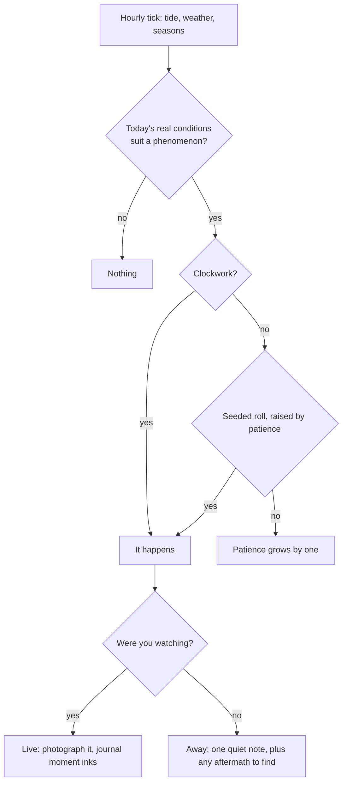

# F08 — Rare phenomena

> The music already keeps one rare signature night per season. The world could keep its own rare moments: a king tide that floods the marsh edge, a fog bank rolling in off the sea, the shallows glowing blue under a dark summer moon, a morning of migrating birds, frost flowers on dead stalks, a winter meteor shower, a rainbow after a passing shower at low sun. Each one comes from real conditions on the island (moon, tide, season, weather), recurs on a seeded schedule, and is never missable for good. Each is a photograph and a journal moment. If it happens while you are away, you get a quiet note and sometimes an aftermath to find, never a replay. Nothing calls you back for it.

**Status:** Seed. Not scheduled. Nothing here is built until Matt schedules it.

## Decided so far

- Matt, October 19, 2026: seasons become **14 game days** (a year is 56 game days). The day stays as it is (tide period 12 game hours). The catch-up cap drops to **7 game days**, and growth while away runs slower than watched time (F01 Pacing and seasons). Docs 02, 06 and 10 do not say this yet.
- Phenomena run on **game time**, never real time or the real calendar.
- They follow the vision's locked rules: no notifications, no countdowns, no fail states, nothing lost by being away.
- The music's signature nights stay as doc 24 defines them (one per season, at most once a season). This doc links to them; it does not redesign them.

## The idea

Real places have days people remember: the morning the fog came in so fast you lost the far shore, the night the water lit up around your feet. These are rare because the conditions that make them are rare, not because a game rationed them. ebb already simulates those conditions (a moon with phases, an analytic tide with spring and neaps, a seeded daily weather record, a sun that sits low in winter). Rare phenomena are what happens when those systems line up.

Two kinds, which behave differently:

- **Clockwork phenomena** fall out of the moon, tide and calendar, so they are predictable: king tides and the meteor shower. Like a real tide table or sky almanac, the journal could list when the next one is due.
- **Weather-borne phenomena** need the right weather on top of the right season, so they are a seeded chance: fog bank, rainbow, glowing plankton, frost flowers, migration morning. These lean toward times you are actually there (see below).

## How it could work

### A note on the 14-day season (flag, not a decision)

Doc 06 has a 7-day moon with a new moon at the start of each season, so today each season holds one full lunar cycle, and the "full moon in mid-season" in doc 06 assumes that. With 14-day seasons and the moon left at 7 days, each season holds **two** cycles: two new moons, two full moons, four spring tides. Because 14 is exactly two cycles, the phases still repeat every year on the same days. Since the year starts at the spring equinox (doc 06), the equinoxes and solstices fall on season starts (days 0, 14, 28, 42), and those are new moons either way. That gives dark skies on the longest night and at midsummer, and spring tides on the equinoxes, which suits several phenomena below. If Matt instead stretches the moon to 14 days (one cycle per season again), the season starts are still new moons but there are half as many spring tides and full moons, so king tides and full-moon nights get rarer. Either works; the moon choice is F01's open question and should be settled before any of this is tuned.

### The seven phenomena (all numbers are starting points)

| Phenomenon | Real conditions it needs | About how often (per 56-day year) | Lasts |
|---|---|---|---|
| King tide | Spring tides nearest the equinoxes, lifted by a slow yearly swing in tide range (like a real perigee) | 2 (spring and autumn), each over 2 to 3 high tides | a few game hours a day |
| Fog bank | Spring or early summer; a misty morning in the weather record; light onshore wind after a warm day | 1 to 2 | 2 to 4 game hours |
| Glowing plankton | Summer; new-moon night; calm wind; after a few clear days | 1 | one night |
| Migration morning | A clear, calm dawn within 3 days of the spring or autumn turn | 2 | the morning |
| Frost flowers | Early winter; first clear, calm, frosty night after a wet day | 1 | dawn to mid-morning |
| Meteor shower | A fixed window of 3 nights around the longest night; clear or broken cloud | 1 (peak night inside the window) | the nights |
| Rainbow | A shower that clears while the sun is low (5 to 40 degrees up) and the rain moves away from the sun | 3 to 6; a double bow about one time in four | 10 to 30 game minutes |

What each looks like:

- **King tide.** A slow yearly term lifts the tide range by about 25 percent at its two peaks, so the equinox spring tides reach roughly 15 to 20 cm above the usual spring high water. The sea creeps into the meadow edge (the marsh spit once it exists), herons fish the flooded grass, and when it falls it leaves a **wrack line** of drift reed stems and weed that fades over about 3 game days (a trace, see F09). The herons' tide stone (gentle or strong tides) scales king tides with everything else.
- **Fog bank.** Instead of mist forming in place, a white wall rolls in from the sea on the wind, crosses the island in about 20 game minutes, swallows the far shore and the skyline, and later burns off from the land side first as the ground warms. Sounds muffle, lanterns get halos. It only happens on a day the weather record already holds a misty morning, so the ecology sees nothing new.
- **Glowing plankton.** On a dark summer night in the sea and tide-band shallows, anything that moves the water flashes blue: breaking ripples, foam, a fish, an otter's wake, the walker wading (doc 23). Only salt water glows; the ponds stay dark.
- **Migration morning.** Long skeins of birds pass high over the island at dawn, calling, and a few drop to the flats to rest until midday. It needs no habitat and happens before cranes are ever unlocked; once cranes visit (doc 12), their arrival can fall on this morning.
- **Frost flowers.** Thin curling ribbons of ice push out of the bases of dead flower stalks, and **hair ice** (fine white hair on damp dead wood) grows on drift logs. Both are real, need the ground still warm and wet under a hard freeze, and melt as the sun reaches them. Winter stays snow-free.
- **Meteor shower.** Streaks across the sky at a peak of roughly one every 15 to 30 real seconds at 1x, with a rare bright fireball. Its peak sits on the longest night, the first night of winter, a new moon in either moon choice, so the sky is dark.
- **Rainbow.** Computed from the true sun direction: a primary bow 40.6 to 42.4 degrees from the point opposite the sun (red outside), a fainter reversed secondary at 50 to 53 degrees, a darker band between, drawn only where the rain curtain is. You see it only facing away from the sun, as in life.

### The schedule

- A small **phenomena step** runs in the hourly tick right after weather and seasons. It reads only the analytic tide and moon, the day's weather record and the season, and decides from the world seed whether a phenomenon starts, when, and how strongly.
- **At most one phenomenon a day.** If two qualify, the rarer one wins and the other keeps its patience.
- **Patience** is the "never missable for good" guarantee. Each weather-borne kind keeps a small counter of suitable windows that passed without it. The chance rises with each one (for example 35 percent, then 60, then certain), so nothing goes many years unseen.
- **Leaning toward presence.** With a 7-day catch-up cap, a player who drops in once a day watches only a small share of game time live (roughly one game day in eight, as a rough estimate). So for the weather-borne kinds, patience could count only the windows you were there for, and the chance falls back after you have seen one. Phenomena change nothing in the ecology (the fog is an already-rolled mist day, the king tide does not move the habitat grid), so this lean does not break catch-up determinism: the island grows identically either way; only which nights glowed differs.
- **Away**: the away log gets one note ("The sea glowed in the shallows on the night of day 18"), ranked with the rest for the reveal's five. Aftermaths you can still find: the wrack line, frost flowers melting if you return before mid-morning, a pair of migrants still resting on the flats, everything wet after fog. No replay.
- **Previews** (doc 16's time and season dial) never show a phenomenon; they belong to the real world clock. Photo mode pauses world time, so a phenomenon holds while you frame it.

### Photographs and the journal

A new journal page (working name "Sky and sea") holds one moment frame per phenomenon, pencil "?" until seen, following doc 13's rule that frames never list what is missing. Seeing one live inks its frame; a photo replaces the sketch. Notes from away go in the journal text but do not ink the frame. No photo prompts: before a phenomenon the world gives its own tells (the sea goes glassy before plankton nights, the horizon whitens before fog, the evening is very still before frost).

### Music pairings (links only; doc 24 decides)

- **Winter:** the meteor shower peak on the longest night is the same night as winter's signature night. The strongest pairing.
- **Summer:** the signature is the first full-moon spring-tide night; glowing plankton is a new-moon night, so they stay apart. Matt could move summer's signature to the first plankton night if he prefers.
- **Autumn and spring:** no direct pairing proposed. The fog bank already uses the mist piece slot.

### Rendering cost by quality tier (rough)

| Phenomenon | High and ultra | Low (phones) | Cost on high |
|---|---|---|---|
| King tide, wrack line | live water as usual, wrack as decals | same | near zero |
| Fog bank | moving front on doc 06's mist layer, low-resolution raymarch with noise | height fog with a moving edge, no raymarch | 0.3 to 0.6 ms while it lasts |
| Glowing plankton | emission from foam, ripples and wakes | emission from foam only | under 0.1 ms |
| Migration | 20 to 80 bird impostors in skeins | 20 | under 0.1 ms |
| Frost flowers, hair ice | a few hundred small ribbons | cards | under 0.2 ms |
| Meteors | streaks in the sky pass | same | near zero |
| Rainbow | analytic sky term, physical light | same | near zero |

All are physical light in linear HDR with the palette applied last (doc 05): plankton is a blue emission, the rainbow a spectral term, never painted color.

## What it would change

- **02** core loop: a phenomena step in the tick order; new away-log note kinds and reveal ranking; patience saved with the world.
- **05** look: confirm plankton emission and rainbow colors survive the palette lookup.
- **06** sky: the moon cycle against 14-day seasons; meteors and rainbow in the sky pass; the fog bank's moving front on the mist layer.
- **07** water and tide: the slow yearly term for king tides (tide band definition unchanged); plankton emission in the water draw.
- **10** growth and seasons: weather record flags (onshore wind, shower clearing, calm frosty night); frost flowers and hair ice; king tides never count as deep flooding.
- **12** creature roadmap: migration flocks as a sky event; cranes may arrive on a migration morning; herons fish king tides.
- **13** progression: the "Sky and sea" journal page and its moments.
- **16** photo mode: previews never show phenomena; answers the photo prompt question with in-world tells.
- **17 and 25** audio: fog muffling, distant migrant calls, water lapping in grass.
- **18** saves: patience counters, the day's phenomenon, wrack line (well under 1 KB).
- **19** performance: the budget lines above.
- **24** music: the winter pairing; the summer option.

## Risks and guardrails

- **Too often and it is weather; too rare and nobody sees it.** Tune rarity in playtests at the real catch-up cap, not on paper.
- **Fear of missing out.** Clockwork ones can be shown ahead; weather-borne ones lean toward presence; every kind recurs yearly. Never a notification, never a countdown.
- **Nothing harmful.** King tides flood but never drown plants or salt the habitat grid. Fog never hides a creature that needs finding for progress.
- **Determinism.** Phenomena must not write to the ecology; anything that would (salt, light loss) is out of scope.
- **Phones.** The fog bank is the only costly one; it degrades to height fog.

## Open questions

- Which of the seven belong in the first set, and are any missing (northern lights would need a higher latitude)?
- Should king tides and the meteor shower be listed ahead in the journal like a tide table, or stay a surprise?
- Should the rarer phenomena wait for you to be present, or happen on the world's own schedule whether you are there or not?
- Should the moon stay at 7 game days (two cycles per season) or stretch to 14 (one per season)?
- Would you like summer's signature night moved to the first glowing plankton night?
- Is a rainbow three to six times a year too common to count as rare?

## Depends on / feeds into

- Depends on: F01 (56-day year, moon choice, catch-up cap), 02 (tick, catch-up, away log), 06 (moon, sun, mist), 07 (tide), 10 (weather record, seasons), 12 (cranes, herons), 13 (journal), 16 (photo mode, preview), 19 (tiers), 24 (signature nights).
- Feeds into: F09 traces (the wrack line), 17 and 25 audio, 18 saves.
