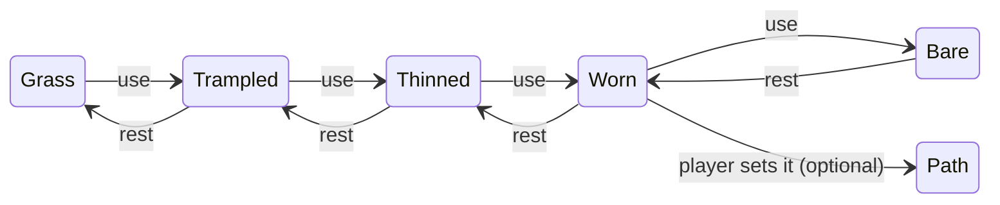
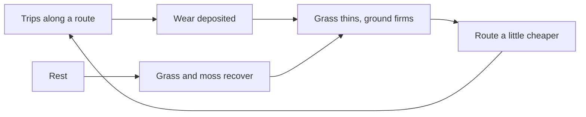

# F09 — Traces

> Paths on ebb do not have to be drawn. When the walker (presence rung 3, doc 23) keeps taking the same way to the pond, the grass there bends, thins, wears to a pale line and finally to bare soil, the way a real desire line forms across a park lawn. Stop using it and it heals: grass creeps back, moss tints the old soil, and within about a season it is gone. Creatures leave their own marks the same way: a hedgehog's run under the hedge, an otter's muddy slide into the stream, the heron's favorite stone whitened. Traces keep the island's human marks quiet and earned, and they give the player a way to read who has been where.

**Status:** Seed. Not scheduled. Nothing here is built until Matt schedules it.

## Decided so far

- Matt, October 19, 2026: seasons become **14 game days** (a year is 56 game days); the catch-up cap drops to **7 game days**; growth while away runs slower than watched time (F01). All trace rates below are in **game time**, and recovery while away follows the slower away growth rate.
- Doc 23 already promises this in one line: "Repeated footfall wears a faint desire line into the grass that grows back if you stop using it", saved as footfall events, never per-frame data.
- Placed paths (doc 09) stay. Traces sit beside them; they do not replace the path tool.

## The idea

Desire lines are one of the clearest cases of self-organization in the built world. Every walker slightly flattens the grass, flattened grass is easier to walk on, so the next walker is drawn to it, and the trail reinforces itself while unused trails fade. Ant trails (pheromone laid and evaporating) and the slime mold *Physarum* (tubes that thicken with flow and shrink without it) follow the same rule: **deposit with use, decay with rest, and let the trace steer the next trip.** Helbing and colleagues modeled human trail systems exactly this way ("Modelling the evolution of human trail systems", Nature, 1997), and Tero and colleagues showed *Physarum* building a network close to the Tokyo rail map with the same feedback (Science, 2010).

On ebb this means the player's marks are earned by living on the island, not drawn with a tool, and nature takes them back by itself when they stop. That fits pillar 4 (Tend) and the rule that human touches stay few.

## How it could work

### One field on the ecology grid

A **trace field** on the 1 m ecology grid: each cell holds a wear amount from 0 to 255, plus a dominant direction (16 compass steps) so a line can be drawn thin and oriented through the cell instead of as a 1 m smudge. It lives in the hourly tick, inside the growth step, next to grass cover and structure weathering (doc 10). All numbers below are starting points.

| Stage | Wear | What you see |
|---|---|---|
| Grass | 0 to 39 | Untouched |
| Trampled | 40 to 99 | Blades bent along the direction of travel, a little paler |
| Thinned | 100 to 169 | Blades at about half density, soil showing between them |
| Worn line | 170 to 229 | A pale compacted line 30 to 50 cm wide, grass leaning in from the edges |
| Bare soil | 230 to 255 | Packed earth, or mud where the ground is wet, a hand's width wider |

**Deposit.** Each walker crossing of a cell adds about 6 at a stroll, 3 at a creep and 8 at a brisk pace, capped at 24 per cell per game hour so pacing back and forth does not wear a hole. Wet ground (moisture over 200) wears half again as fast. A worn line takes roughly 30 to 40 strolling trips spread over a few game days.

**Decay.** Below 170 the wear falls by about 1 per game hour of rest; at 170 and above, compacted soil heals at half that. A bare line left alone fades back to grass in about 340 game hours, roughly one 14-day season. Decay scales with the grass growth rate of the season, so winter traces linger (as real winter paths do) and spring heals fastest. Where the ground is damp, moss tints the recovering soil first (doc 10's moss reads the trace as open ground).

**Feedback.** The walkability flow field (doc 11) gives worn cells a small discount, at most 15 percent, so tap-to-walk and creature routes drift onto existing lines. The cap keeps every route from collapsing into one trunk.

### Where wear comes from

- **The walker** (doc 23, rung 3). The live game counts which cells the figure crossed in the current game hour, a small sparse list, and hands it to the hourly tick as one footfall event. No per-frame data is saved. While you are away there is no walker, so nothing is deposited.
- **The camp** (rung 4). Later, the camp could add a faint daily round trip from the tent to the nearest water during catch-up, so a camp keeps its own small path.
- **Creatures.** Only the coarse simulation deposits, never the live animals, so watched and away time agree. Each settled group has a home cell and the patches it uses for water and food (doc 11); once a game day, the tick routes home to each target over the flow field and lays a small deposit per individual. Small animals deposit little and reach only the trampled or thinned stage. Live animals still prefer worn cells, so you see them use their runs.
- **The tide band** keeps no saved traces: the tide wipes it twice a day. Footprints on wet sand and mud are live decals that the next tide or rain clears (doc 23 already lists footprints).

### Creature traces

| Trace | Who | What it looks like | Fades |
|---|---|---|---|
| Run | Hedgehogs (and any later hare or deer) | A narrow tunnel of parted grass along a hedge or wall base, a gap where it passes under | With the general field |
| Slide | Otters | A smooth, wet mud chute down a bank into deep water, darker and glossy | About 3 game days after the otters stop playing there |
| Whitened stone | Herons (and later cranes or gulls) | A favorite perch stone or post streaked white on top and down one side | Rain washes it slowly over about a season |
| Squirrel middens | Squirrels (optional) | Stripped cone and nut shells under a favorite branch | With the leaf litter |

Runs and slides use the same trace field (an otter slide is a short line of high wear with a "wet" flag). Marked spots like the heron's stone are a short list of points (position, kind, amount, at most about 32), driven by how often the coarse sim has the creature resting there. The journal can mention them as field-note clues ("Something has been sliding down the east bank").

### Meeting paths, walls and stones (doc 09)

- **Placed paths** already write wear into the ground. Walking a placed path adds nothing new; the path is already the trace. A placed path never fades below its set wear, as doc 09 says.
- **Setting a line** (option A). Tapping a worn or bare line offers "set as path": a centripetal spline is fitted through the trace and becomes an ordinary path structure (worn earth or gravel), undoable, counting against the path soft cap. The worn line becomes the sketch for an authored path.
- **Paths stay authored** (option B). Traces are only traces; the player who wants a permanent path draws one, maybe along the trace.
- **Walls** block walking, so lines funnel through the gate openings that doc 09's eraser cuts. That should read beautifully: a worn patch at every gap.
- **Stepping stones and the bridge** are crossings; lines run up to them and on from the far side.

### Quiet for creatures

Doc 11 counts paths as daytime disturbance (frogs within 3 m, herons within 12 m, cranes within 20 m). A walker's worn line should count the same way but more gently, scaled by its wear: a bare line as about 40 percent of a placed path, a trampled one hardly at all. Creature traces never count as disturbance. Because unused lines fade, the player can win a quiet corner back just by walking elsewhere for a season. This also feeds doc 23's "creatures learn your routes": a worn line is the predictable route where the comfort ring is slightly smaller.

### Drawing and saving

- **Drawing.** The terrain already derives path wear into the ground texture's wear channel (doc 08), and grass density already falls with wear (doc 10). The trace adds to that: when a chunk's derived layers rebuild, each worn cell draws a soft line 0.3 to 0.5 m wide along its direction, joined smoothly to worn neighbors, and the larger of path wear and trace wear wins. The trampled stage only bends and lightens grass blades. Cost: a little extra work at chunk rebuild, near zero per frame. The same on every quality tier.
- **Saving.** Per 32 m chunk, only chunks with traces: a 32 by 32 grid of wear, and one of direction and flags. Under 2 KB compressed per chunk; the marked-spot list is under 1 KB. Deterministic: integer math in the tick, seeded per cell where any jitter is needed.

## What it would change

- **08** terrain: trace wear joins the derived wear layer.
- **09** structures: "set as path" from a trace (if chosen); wall gaps and crossings collect lines; paths ignore walker wear.
- **10** growth: the trace field in the growth step; grass cover and moss read it; seasonal recovery rate.
- **11** ecology: trace field as a grid field; worn lines in disturbance at reduced weight; flow-field discount; daily creature routes in the coarse step.
- **12** creature roadmap: runs, slides and whitened stones as species marks; journal clues.
- **13** journal: field notes and ground-page moments for traces.
- **17 and 25** audio: footsteps on packed earth versus grass.
- **18** saves: the trace grids per chunk and the marked-spot list.
- **23** presence (and F03): the footfall event per game hour; the camp's round trip; "learn your routes" reads the trace.
- **F08** rare phenomena: the king tide's wrack line is a trace of the sea.

## Risks and guardrails

- **Scars, not marks.** A player who walks everywhere could brown the whole meadow. The per-hour cap, wet-ground and decay tuning, and the flow-field pull toward existing lines keep wear in lines. Test with a "wander everywhere" bot in a tools page on Matt's machine.
- **Lost while away.** Grass healing a line while you are away is the island moving on, not a loss, but recovery runs at the slower away rate, and with a 7-day cap a line fades at most about halfway in one absence. A set path never fades.
- **Determinism.** Only the hourly tick writes wear; the live game only submits footfall events. Live creature motion never writes.
- **Nothing dies.** Bare soil is soil; no plant record is removed by wear, plants under a line just hold their size floor.

## Open questions

- Should a worn line be something you can turn into a real path with one tap, or should paths always be drawn by hand?
- How long should an unused line take to grass over: about one season, or longer, so your habits stay visible for a while?
- Should your worn lines bother shy creatures like herons and cranes, and if so, how much compared with a placed path?
- Which creature marks do you want first: hedgehog runs, otter slides, the heron's whitened stone, or others?
- Should traces wait for the walker, or could the camera-only player leave faint marks somewhere too (for example, where they sit with the seat)?

## Depends on / feeds into

- Depends on: F01 (season length, away growth rate), F03 (the walker in depth), 08 (wear layer), 09 (paths, walls, gates), 10 (growth step, grass, moss, seasons), 11 (ecology grid, flow field, disturbance), 23 (walker, camp, footfall events).
- Feeds into: 12 (creature marks), 13 (journal), 17 and 25 (footsteps), 18 (saves), F08 (wrack line).
