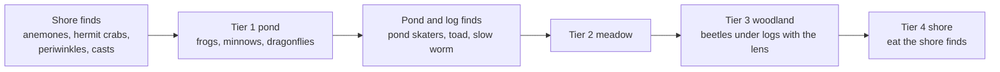

# F11 — Creature roadmap and finds

> Doc 12 plans fifteen species in five tiers, each one a full creature with needs, arrival, trust and a gift. That is the heart of the game, but it is also slow to build and slow to reach: the first frog takes days. This doc adds a lighter class of life, **finds**, that appears within a tide or two of the player shaping a place for it: a hermit crab picking across a rock pool, anemones opening as the pool fills, lugworm casts on the sand flats, a toad under a log. It sorts every creature into weight classes so each new one costs only what it needs. It proposes a progression line for finds that sits beside the species gifts, and a short list of one-time generalizations that let later species be added as recipes rather than new systems. It is grounded in a read of the code on October 19, 2026.

**Status:** Largely built and merged to main. First three finds (2026-10-20): beadlet anemone (rock pools: basins of rock that reach the tide band), periwinkle (wrack), lugworm casts (wet sand, re-laid each tide). Code in `src/world/finds/index.js`, numbers in `recipes/species/finds.json`, journal list "Small lives". After Matt's review the anemone and periwinkle became models (`assets/models/finds/`, read by `src/world/finds/models.js`, checked in `tools/finds-models.html`), and lugworm casts are drawn into the sand by the terrain shader (`src/shaders/lib-casts.wgsl`), so they cost no mesh. Then came the hermit crab (rigged, its walk played by `src/world/finds/rig.js`), the young edible crab (runs sideways from you), and shells on the strandline with rarity by tide (one Shells page, a `collection` in journal.json); find sketches are traced from the models (`tools/gen-sketch-outlines.mjs`, `src/ui/sketches/finds.js`). Then (2026-10-20, PR #53) the naturalist's notes line was built (`src/world/expansion.js`, `recipes/world/naturalist.json`), as a journal page of its own drawn as a trail (since October 21, 2026 one of three trails on the journal's Trails page); shells became its first reward at three finds (save format 3 keeps them for older islands), and species gifts use the same module (the frogs' lilies then; since October 20, 2026 the frogs give the Cliff tool, doc 13). Four more finds: acorn barnacles and pond skaters (built from numbers, `procedural.js`), common mussels (one scanned valve mirrored into a hinged pair, `mussel.js`) and sand dollars, both baked by `tools/bake-find-model.mjs`. The rest of this doc is still leaning.

## Decided so far

Matt, October 19, 2026:

- Low-cost creatures without a large engine behind them are wanted, so players have more to explore, triggered by what they shape (a patch of sand big enough, a mound of sand).
- A certain number of finds should trigger something worth putting on a progression line, without being tied tightly to creature gifts.
- Be cautious with small insects. Frogs had to be drawn at 1.5 times real size to be findable, so tiny creatures are a risk however appealing they are.
- Placed stones and logs (F10) should open up creature options, such as something living under a fallen log.

## Weight classes

| Class | What it needs | Examples | Built today |
|---|---|---|---|
| **Finds** | A ground rule, a body and one motion. Nothing saved. | Hermit crab, anemones, toad under a log | No |
| **Fields** | A density per square meter in the hourly tick, and a live draw | Midges; later pond skaters, sand hoppers | Midges, wired one-off |
| **Swarms** | A field plus needs, flocking and a gift | Minnows, dragonflies, bees | No |
| **Residents** | Needs, arrival, settling, trust, naming, a gift | Frogs; later hedgehogs, robins | Frogs, hardcoded |
| **Landmarks** | Residents plus a special place | Heron, otter, cranes | No |

Each class reuses everything above it in the table. A find never grows into a resident. A toad that is a find stays a find.

## Finds

### What a find is

- **Its numbers follow the ground.** A find's recipe names the conditions it lives in. How many there are, and where, is worked out from a seeded hash of the ground cell and the hour, only near the camera. Nothing is saved and catch-up costs nothing.
- **It has a body and one motion.** It has no needs, mood, arrival story or trust.
- **It has a journal page.** You find it by tapping it, then its page inks, its sketch fills and its moments can be caught.
- **It reacts to presence.** A crab draws into its shell, an anemone closes, a toad freezes. This comes from the existing presence sources, at the find's own calm speed.

### Readable at a glance

Frogs taught the rule. A find has to be readable from the normal camera, which means one of these:

1. **Large enough at real or modestly enlarged size.** A shore crab, a toad or a slow worm reads at real size or up to 1.5 times, like the frogs.
2. **Found through a place the player made.** Anemones live in the rock pool you shaped; the toad lives under the log you placed. You know where to look because you made the place.
3. **Seen by its sign.** Lugworm casts, pond skater dimples catching the light, or a ring of crabs' tracks on wet sand are readable even when the animal is not.

Small insects (woodlice, beetles, sand hoppers) wait until there is a reason and a way to show them, such as lifting a stone, where the camera is already close. A hand lens (below) can come later.

### The starter list

Chosen for readability and for using places the island already has or that F10 adds:

| Find | Lives where | What shapes it | How you notice it | Body and motion |
|---|---|---|---|---|
| Beadlet anemone | Rock pools in the tide band | A hollow in painted rock in the band that holds sea water at low tide | Red blobs in the pool; open when covered, closed at low tide | Rigless body; open and close pose. The cheapest find there is. |
| Hermit crab | Rock pools and sand nearby | The same pool, with sand within a few meters | Picks across the pool floor, drags its shell | Shell plus legs; scurry; retract into the shell |
| Shore crab | Under rocks and weed in the band; larger than the hermit | Rock and seaweed zonation in the band (F10) | Sidles out at low tide, flees sideways | Scurry |
| Periwinkles | On wet rock in the band | Rock in the band | Clusters on stones; drift a little each tide | Rigless shells; crawl |
| Lugworm casts | Sand and mud flats in the band | A sand or mud area in the band larger than a threshold | Coiled casts that appear after each tide | Ground decal only, no body |
| Common toad | Under logs and stones on damp ground; out at dusk | A log or loose stone (F10) near fresh water | Crawls rather than hops; sits in the open after rain | The frog body and rig with toad proportions; a walk |
| Slow worm | Under stones and logs, warm grass | A loose stone or log on dry, sunny ground | A bronze legless lizard, 30 to 40 cm; basks in the morning | A chain of spheres; crawl along a curve. No legs. |
| Pond skaters | Still, shallow fresh water in summer | A pond or still margin | Dimples on the surface catching the light | A field, like midges; the water's light shows them |

Seasonal finds added on October 20, 2026 (seasons as chapters, doc 13):
- **Summer:** moon jellyfish stranded on the strandline (like shells); the common lizard basking on stones and logs among the gorse.
- **Autumn:** fungi on carried logs; dewy spiders' webs in tall grass on misty mornings; silver eels crossing wet grass from pond to sea on rainy nights.
- **Spring:** the common toad's night walk back to the pond.

Matt's sand ideas map onto these. A large enough patch of sand in the tide band brings lugworm casts. Sand beside a rock pool brings hermit crabs. A sand mound above the high tide grows marram (F10), and a dune is where sand hoppers would live once they can be shown.

The island's wildlife is northern European (robins, hedgehogs, common frogs), so a fallen log brings a toad, a slow worm or, once quadrupeds exist, a wood mouse, rather than a chipmunk.

### How finds plug into the code

Each piece below names where it would go, from the code read on October 19, 2026:

- **A niche rule reader (new, small).** It reads fields that already exist:
  - the 1 m habitat grid via `world.env.habitat()` (depth, moisture, salt, still water, sea, the tide band);
  - painted ground via the terrain mirror (`sampleMaterial`, `paintedKind`);
  - water basins from `summary.js`;
  - cover via `plantField` in `ecology/fields.js`;
  - placed pieces' shelter fields (F10).
  
  It adds three derived measures:
  - the area of a connected patch of one ground type (a flood fill over cells);
  - local mound height (height minus a blurred height);
  - rock pools (a basin inside the tide band whose rim is painted rock and which holds sea water at low tide).
  
  The water summary has basin ids and the band flag but no salt-water pools, so the rock pool check is the main new piece.
- **A live spawner (new, shaped like midges).** `createMidges` in `midges-live.js` is the pattern: a live system registered with `sim.addSystem` and the frame graph in `app.js`, reading the camera from `presence.sources()`.
- **Bodies (exists).** `bakeVariant` and `bakeBody` are generic and recipe-driven. A species with no rig falls back to a single root bone, which suits anemones, periwinkles, shells and logs with no rig code at all. Toads reuse the frog rig (`rigs/frog.js`) with toad proportions.
- **Drawing (exists, mostly).** `createCreaturePass` draws baked bodies. Lugworm casts are a ground decal; pond skaters reuse the water's own light.
- **Tapping (small change).** `cardAt` in `journal/index.js` checks frogs first, then plants, then ground. A finds lookup goes beside the frog check. `creature:found` is currently filtered to frogs and needs to accept any species.
- **Journal pages (small change).** Pages are data in `journal.json`, but a new kind of page ("find") needs a describe function and a render branch, and its sketch and icon are code. The journal's tabs are hardcoded (`VIEWS` in `src/ui/journal.js`). Proposed: finds sit as a "Small lives" group inside Living things rather than as a sixth tab, which keeps the phone layout as it is.
- **Reveal (exists).** `reveal-return.js` is already shared by frogs and midges; finds return the same hooks so they fade in after time away.

## A progression line for finds

Finds do not give creature gifts and do not count toward tier milestones, so the species arc stays as doc 12 and doc 13 designed it. They have a line of their own: **the naturalist's notes**.

- Each find you discover inks its page and adds a mark to a short line at the front of Small lives.
- At a few marks along that line, the island gives something that helps you look and shape, never a creature:

| Finds discovered | What it gives (proposals) |
|---|---|
| 3 | **The shell collection.** A page that fills with the shells you find along the driftline (F10). Observation only, nothing to manage. |
| 6 | **Loose stones.** The Stone piece unlocks (F10), so you can make homes for what lives under them. |
| 10 | **Driftwood.** Logs start washing up on the driftline (F10). The turtles (pond tier since October 20, 2026) give the gift to carry one to the pond, where toads and slow worms live under it. Moved from 15 so logs come in time for the turtles. |
| 15 | **The hand lens.** Look closer at small lives: the camera may come nearer to them, and small creatures under lifted stones become findable. This is the door for insects, on your terms. Moved from 10. |

The thresholds and rewards are starting points. The line uses the same plumbing species gifts will need. Today `species:happy` is emitted with the frog's gift, but nothing grants anything, and nothing writes `unlocks.earned` at runtime. One small progress module, the one doc 13 plans as `src/world/expansion.js`, would grant species gifts and naturalist rewards alike.

## Building once for everything after

The survey found the frog built in full but hardcoded (`createFrogAgents`, `bringFrogs`, `state.creatures.frogs`, `species:'frogs'`), and midges wired one-off (`ecologyNow` returns nothing unless both frog and midge recipes exist). Before the second resident, a few one-time changes would let later species arrive as recipes plus a small behavior module:

1. **A species list.** `createCreatures` in `src/world/creatures/index.js` takes one recipe and has frog naming inside. It would take a list of species recipes and route each to its class. `state.creatures` is already keyed per species, so it fits.
2. **A behavior library.** `twoBoneIK`, the quaternion helpers, `poseSkeleton`, `idleMoves` and the presence reactions are reusable. Each new motion (walk, crawl, scurry, retract, flutter, glide) becomes a module any species can name in its recipe, rather than a copy of `frogMoves`.
3. **One field framework.** Midges' target, hourly step, live draw and journal kind become a pattern that pond skaters, sand hoppers and later fireflies configure, not clone. This means loosening `ecologyNow`'s frog-and-midge guard and making the midge pass and shader take recipe values.
4. **Generic needs.** `moodOf` and `NEEDS` in `habitat.js` are already reusable; `frogNeeds` would become a needs reader driven by the recipe's needs block.
5. **Tools that take any species.** Built for the studio (October 20, 2026): a species picker (frog, minnow, southern hawker), each moving with the game's own pose code, and a small table per species in `tools/creature-studio-species.js` that lists its sliders (colors, drawn size, motion numbers, and part sizes that stretch named body pieces from their joint) and its motions. A new species is one entry in that table.
6. **The progress module** above.

**The toad as the test.** A toad (as a find, or later as a light resident) uses the frog rig with new proportions and a walk instead of a hop. It is the cheapest second species there is, so it is the right one to prove the species list and the behavior library before the hedgehog, which needs a new quadruped rig, arrives in M4.

## Finds feed the species that come later

Finds are the bottom of the food web. Many later residents eat them, so building finds early means their food already lives on the island when they arrive, and the journal's web has been inking those links all along.

| Find or field | Who eats it later (doc 12) |
|---|---|
| Pond skaters, midges | Frogs, dragonflies, bats |
| Periwinkles, crabs, lugworms | Herons, otters, shorebirds |
| Slugs and snails after rain (when readable) | Hedgehogs, songbirds |
| Beetles under logs and stones (with the hand lens) | Hedgehogs, owls |
| Sand hoppers on the driftline | Songbirds, shorebirds |

Doc 12 already describes several of these as fields ("beetle field", "small-prey field", "fish field"). Finds are the visible face of those fields, so one rule set serves both.

## A revised build order

Doc 12's fifteen species stay in their tiers. Finds slot in around them:

1. **Shore finds first.** They need zonation and the rock pool rule (F10), no rig code and no new motion beyond retract and scurry. They give the first days a fast loop while frogs take their time.
2. **Pond and log finds with M2.** Pond skaters as the first reuse of the midge field pattern; the toad and slow worm with the piece system that stepping stones bring in M2.
3. **Later tiers inherit.** Each tier adds two or three finds suited to its land, chosen so the tier's residents have something to eat.

## What it would change

Listed only; Matt applies these later.

- **Doc 11 (creatures and ecology):** a third creature kind, finds, beside individuals and swarms; the niche rule reader and its derived measures (patch area, mound height, rock pools); the species list and behavior library.
- **Doc 12 (creature roadmap):** the weight classes; the finds per tier; the toad as the generalization test; the food-web table.
- **Doc 13 (progression):** the naturalist's notes line and its rewards; one progress module for gifts and rewards.
- **Doc 15 (camera and UI):** finds in the tap path; the hand lens's closer camera.
- **Doc 07 (water):** rock pools as a summary class.
- **Doc 23 (presence):** finds' reactions (retract, close, freeze) at their own calm speeds.
- **Doc 14 (tuning panel) and the creature studio:** any species, not only frogs.
- **Doc 20 (roadmap):** where shore finds land (they would fit early in M2).

## Risks and guardrails

- **Busywork.** Finds must not become a checklist. The journal never lists what is missing (doc 13's rule), and the naturalist's line shows marks, not a count of what is left.
- **Clutter.** Finds stay sparse: a few crabs, one toad. Their numbers follow the ground, capped per tier.
- **Readability.** Every find passes the readability rule before it is built. Insects wait for the lens.
- **Scope creep.** The generalizations are worth doing once, before the second resident. Doing them halfway, a copy per species, is the trap.

## Open questions

- Do the naturalist's rewards feel right (shells, loose stones, the hand lens, driftwood), or would you rather finds give something else?
- Should the hand lens be the way insects come into the game, or should insects stay out entirely?
- Should the toad be a find or a light resident with a name and trust?
- Should Small lives be a group inside Living things, or its own tab?
- Should shore finds come before the M2 pond tier, or alongside it?

## Depends on / feeds into

Depends on F10 (the places finds live), docs 07, 11, 12, 13 and 23. Feeds F04 (logs ageing hold more finds), F05 (finds have no lineages; residents might) and every later tier in doc 12.
