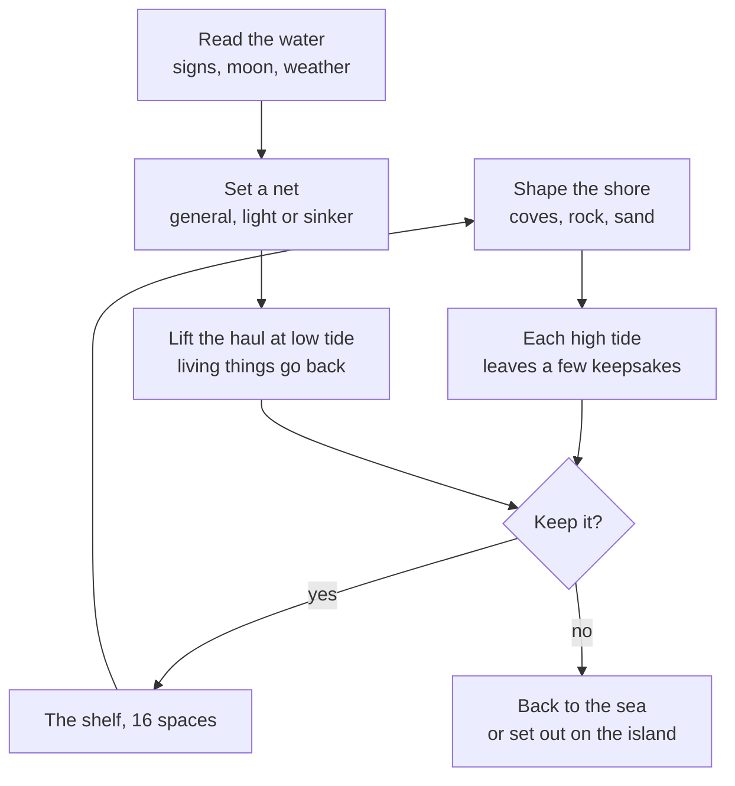

# F12 — Keepsakes, the shelf and the nets

> ebb's slow systems (growth, seasons, creatures settling) need a companion that gives every visit something to look for while the island takes its time. This doc proposes that hook: **keepsakes**, one-of-a-kind objects the sea leaves on the strandline and that nets snag out in the waves. Every keepsake is generated from a seed, so no two are alike, and each carries a rarity the player can read. A **memento shelf** of about 16 spaces holds the ones the player chooses to keep, so the point is choosing what is special rather than gathering everything. Three **nets**, each a different build, reach water the strandline never sees, and **signs in the water** (a sparkle, diving birds) reward paying attention. Nothing here hurries the player or pays for repetition: what turns up depends on the tide, the moon, the weather and the shape of the shore, never on how often you walk the beach. It is grounded in a read of the code on October 20, 2026.

**Status:** Scheduled for M2 (October 21, 2026). Keepsakes, the shelf and the general net are built first, in small branches starting with `tools/keepsake-lab.html`. The light and sinker nets wait for the meadow and shore tier milestones; weathering waits for F04; king tides and storms wait for F08. Shells on the strandline (F11) are the seed this grows from.

## Decided so far

Matt, October 20, 2026:

- ebb needs a core hook beside its slow systems, the way farming, fishing or mining serve other games: continuous exploration, progression, the chance of rarer things, and combining what you find. It should be simple with depth, sit cohesively with the rest of the game, never hurry the player, and not reward meaningless grinding.
- **Procedural generation** for what the player finds: shells, driftwood, bottles, rocks, fossils, feathers and more.
- **Rarity is labeled.** The chance of something objectively rarer is part of the hook.
- **A memento shelf** in the Journal area, limited to about 16 spaces, so players are not pushed to gather and keep every little thing.
- **The journal records only what you kept.** Counting up to 50 or 100 of something is the grinding mindset; a limited shelf still has plenty of variety but lets players choose what is special to them.
- **Keepsakes left out in the world changing over time** is interesting, but Matt needs to review how the game handles things in perpetuity first (see "Weathering", below).
- **Bottles are the only human-made thing that washes up on the shore.** Nets can snag other interesting objects and artifacts.
- **Artifacts stay mysterious and disconnected.** They are not the main story.
- **Living catches are always released.**
- **The player crafts their own net.** Nets can be damaged and must be repaired.
- **Up to three nets, each a different kind:** a general net first, then a lightweight specialty net, then a sinker net for deeper water. Progression unlocks the second and third, so a few are out at a time at most.
- **Signs in the water,** such as a sparkle where setting a net gives better odds of something rarer, to encourage awareness of the environment. A limited number of signs accumulate while you are away.

Matt, October 21, 2026 (answers to the planning questions):

- **Keepsakes and the shelf join M2.** Doc 01's "no crafting or inventory" line was changed to make room for this system, and says so.
- **Version 1 gates rarity on spring tides, the season and the shape of the shore.** King tides and storms wait for F08. The winter storm-tide shells (doc 13) become the first rare-keepsake rule.
- **Keepsakes are unnamed trinkets.** The shelf is about discovering pretty things of different rarities, not identifying them. The Shells page and the small finds stay as they are, and the five scanned shells stay beside the procedural ones.
- **The shelf is its own journal section, with its own icon.** Each slot is an ink sketch traced from the keepsake's mesh (the same tracing as `tools/gen-sketch-outlines.mjs`), so the meshes themselves are throwaway. The rarity word is on the card when it is found; the slot's paper ground shows the rarity, so players want to photograph their shelves.
- **The shelf is the only record.** Keeping something writes no journal note.
- **Letting go returns things to the sea** in version 1. Setting out on the island comes with weathering.
- **The general net is on the naturalist's line after driftwood** (proposed at 12), so there must be enough small finds to get there.
- **A worn net keeps fishing,** with lower odds of the higher rarities.
- **Living catches get a short page** (an ink drawing, a name, one note) and count on the naturalist's line.
- **Bottles hold messages,** perhaps written by a writer friend of Matt's.
- **At most 2 signs** wait on return.

Matt, later on October 21, 2026:

- **Five rarity tiers.** A fifth, **once in a lifetime**, sits above very rare. It opens only at the very top of a spring tide, and winter leans toward it. It has its own pearl paper on the shelf. (Built.)
- **Counters of kinds and firsts are allowed, totals never.** "7 of 13 families kept" is a record; "keep 50 shells" would be grinding. This replaces the earlier "no counters" rule.
- **Three trails on one shared Trails page.** The naturalist's trail (what you notice) is joined by a **beachcomber's trail** (what you keep) and a **shaper's trail** (what you make).
  - The nets move to the beachcomber's trail, where they naturally sit.
  - Agreed in full the same night: doc 13, "Trails", and "The beachcomber's trail" below.
  - The naturalist's rewards are now ways to look: the tide table at 12, the hand lens at 15, field glasses at 20, a night lamp at 25.
  - Species gifts stay the only source of shaping tools.
- **Living catches,** caught in the nets and never kept, are made from seeds like the keepsakes (fish from the creature body bake, jellies, shrimp). Releasing one is what counts: a nod to the conservation side of the game.
- **Artifacts** are nine baked bases, each morphed, recoloured and named from its seed into endless variants. They come from the nets, the sinker net most of all; the strandline leaves only bottles of the made things.
- **Coves** carved by the player catch far more keepsakes, through the cove field. (Built.)

Matt, October 21, 2026 (the general net, piece K6; built on `m2-nets`):

- **Lifting brings the net in.** Casting it is always something the player chooses; a net never re-sets itself.
- **Closing the haul tray lets the rest go,** living things and an unanswered keepsake alike.
- **The young cuttlefish waits** for the sinker net.
- **Built:** the net at four families kept, through the progress module (`recipes/world/beachcomber.json`); the Water tool's Net mode; hauls rolled on lifting (`src/world/nets/haul.js`); eight living catches (sand eel, sand goby, pipefish, young plaice, ballan wrasse, brown shrimp, shore crab, moon jelly), each first release a find with its own traced page; save format 7.

## The loop

Two ways in, one choice at the end. Beachcombing is what the sea gives the shore; the nets are what you go and ask it for.

## Keepsakes

### What a keepsake is

- **A seed, not a model.** Each keepsake is a family (shell, driftwood, stone and so on) plus a short list of numbers drawn from a seed. The family's generator turns those numbers into a mesh when it is needed.
- **Nothing is saved until it is kept.** What one tide leaves in one strandline cell is a pure function of the world seed, the cell, the tide and its conditions, exactly as `shellAt` works today (`src/world/finds/index.js`). Live play and catch-up give the same keepsakes, and an unkept one costs nothing.
- **A kept keepsake saves its numbers, not just its seed.** If a generator's sampling is retuned later, a seed would produce a different object. Saving the dozen or so numbers (and the generator version) keeps a kept shell the same shell for good.
- **It has a rarity and sometimes a mark.** Rarity uses the four words the Shells page already shows: common, uncommon, rare, very rare. A **mark** is a named trait on top of rarity, taken from real natural history where possible: a left-coiled shell, a holed stone, a double feather. Marks are the outliers a practiced eye learns to spot.

### Rarity comes from conditions, not effort

The Shells recipe already gates its rare items by the tide (`springMin` in `recipes/species/finds.json`: the murex needs a tide near spring, the nautilus nearer still). Keepsakes generalize that rule. A keepsake's rarity is allowed only when the conditions reach it, and within what is allowed the seed picks the object:

| Condition | What it opens (proposals) |
|---|---|
| Spring tides (new and full moon) | Rare keepsakes on the highest strandline |
| King tides (F08, after version 1) | Very rare keepsakes, and floaters (bottles, pumice, drift seeds) on the outermost line |
| A storm the night before (F08, after version 1; until then, winter spring tides stand in, as doc 13's storm-tide shells) | More keepsakes, heavier ones high on the shore, and more wear on nets |
| Season | Which families lean in: feathers in the autumn moult, driftwood after winter storms, glowing life in summer nets |
| The shape of the shore | Coves catch floaters; rock in the tide band holds stones and fossils; sand holds shells and feathers |

The shore-shape rule is the one that makes sculpting pay off: a player who carves a sheltered cove has made a place the sea leaves things. Strandline cells would be weighted by how enclosed the shoreline around them is, read from the water summary's graded shore (F10, Z1).

**The tide's budget.** Each high tide leaves only a few keepsakes on the whole island, beyond the ordinary shells: starting point 0 to 2, average about 1, more with spring tides and storms. With two high tides a game day (tide period 12 game hours, doc 07) that is roughly a hundred keepsakes in a 56-day year, against a shelf of 16. Walking the beach more never makes the sea leave more.

**While away.** The strandline is already swept by any higher tide (`src/world/water/strandline.js`), so a return finds only what the most recent tides left, capped at about 3 keepsakes. Nothing piles up into a chore.

### The families

Each family is one small generator with one or two rarity knobs. Starting points:

| Family | Where | How it is generated | Rare knobs and marks | Reuses |
|---|---|---|---|---|
| Shells | Strandline, sand | Raup's coiling model: a profile swept along a logarithmic spiral, four main numbers (how fast the whorl grows, distance from the axis, how far it climbs, aperture shape) plus ribs, spines and banding | Size, spines, banding; mark: **left-coiled** (in real whelks, a small fraction of a percent coil the "wrong" way) | A sweep like `lathe` in `src/world/finds/procedural.js` |
| Driftwood | Strandline, after storms | Blended capsules with bark noise (the creature body bake, `body-bake.js`, as F10 plans for logs), bleached by age | Length, twist, silvering; mark: **root knot** | `bakeBody` |
| Stones | Rock in the tide band | The loose-stone bake (blended ellipsoids cut by facets, `recipes/world/pieces.json`) at hand size, with banding | Banding, polish; mark: **holed stone** | The loose-stone bake |
| Fossils | Rock in the tide band | A Raup shell set into the stone bake | Whole or broken; mark: **ammonite, complete** | Shells plus stones |
| Feathers | Above the strandline, in wind | A flat card with a parametric vane: rachis curve, barb angle, notch, pattern | Size, barring; mark: a large flight feather from a landmark bird that lives on the island (a heron's, once herons come) | The flora card path |
| Bottles | Outermost strandline, king tides only | A lathe profile with tint and frosting | Tint, a stopper; very rare by design | `lathe` |

The five scanned shells (periwinkle, turret, cockle fossil, murex, nautilus) stay as they are, as finds. Procedural shells sit beside them as one-of-a-kind keepsakes with no species name: a card describes one plainly ("a shell, coiled to the left, long-spined").

Bottles hold a message, picked by seed from `recipes/world/bottle-messages.json`: short (about 40 words, readable on a phone card), mysterious and disconnected, written by a guest writer and credited.

**Readability.** Keepsakes are hand-sized, so they follow F11's rule: drawn at a modest enlargement like the strandline shells (`scale` 2 in finds.json), found in places the player made or knows (the strandline, the cove), and few at a time.

## The memento shelf

- **16 spaces, in a journal section of their own** with a drawn icon (a sixth section; on phones the sections sit two to a row, so six make three even rows). Each slot shows the keepsake as an ink sketch traced from its mesh, on a paper ground that shows its rarity: plain paper (common), a pale wash (uncommon), a deeper wash with an inked border (rare), a gilt edge (very rare). A shelf of different grounds is meant to be photographed, and the section has a button that saves it as a picture. Tapping a slot opens its card: a plain description, its rarity and mark, and one line of where and when ("On the cove's strandline, after the spring tide of summer day 9"), with a 3D view to turn it.
- **Only kept things are recorded.** The shelf is the record; keeping writes no journal note, and there is no list of everything ever found and no count of what is missing (doc 13's rule).
- **A full shelf asks for a choice.** To keep something new, the player lets something go, back to the sea. Setting it out on the island comes later, with weathering. Curating the shelf is the decision that matters.
- **Setting out.** A keepsake set on the island becomes a placed piece (the piece system in `src/world/pieces`), capped like loose stones are, so the island does not fill with clutter. What happens to it over time is the weathering question below.

## The nets

### Three kinds

| Net | Comes from (proposals) | Where it is set | What it favors |
|---|---|---|---|
| **General net** | The beachcomber's trail, at 4 families kept; woven from rushes growing on the island | Staked in the shallows of the tide band at low tide, so the next high tide fills it | Small living things, drift seeds, ordinary oddities |
| **Light net** | The beachcomber's trail, at 8 families kept; its floats are driftwood | On floats along the current line, beyond the tide band | Floating curiosities, glowing life at night, things carried a long way |
| **Sinker net** | The beachcomber's trail, at the first very rare kept; weighted with loose stones | Weighted down in open water | The rarest and heaviest drifters, and most of the artifacts |

**The beachcomber's trail** (agreed October 21, 2026; doc 13, "Trails"). A stop is the first keepsake of each family kept, the first kept at each rarity, or the first of each rare mark seen. Marks seen count even when the keepsake is left to the sea.

| Stop | Gives |
|---|---|
| First keepsake kept | The shelf |
| 4 families kept | The general net |
| First rare kept | A glass case: one shelf space under glass |
| 8 families kept | The light net |
| First very rare kept | The sinker net |
| 3 marks seen | A second shelf |
| First once in a lifetime kept | A pressed-gold border for its space, and a quiet note |
| All 13 families kept | The cabinet: the shelf's picture gets a frame |

Each net's mesh is part of its kind (the general net is medium, the light net fine, the sinker coarse), so there is no separate mesh setting to manage. Three kinds, three places, three temperaments: depth without extra controls.

### Made from the island, not an inventory

The vision rules out currency grind (doc 01), and a pile of materials to farm would be one. So nets are made and mended from what the island **grows and holds**, never from items spent:

- The general net is woven from rushes. It can be made when a stand of rushes of some size grows on the island (rushes are already a cover plant, doc 10).
- The light net's floats are driftwood, so it needs driftwood on the driftline (the naturalist's reward at 10 finds).
- The sinker net is weighted with loose stones, so it needs a few on the island (the reward at 6 finds).

Cutting rushes for cord would thin that patch's cover share for a few days, then it grows back. The player's real work is growing the right plants and keeping the shore, which is the game they are already playing.

### Setting and lifting

- **Set and walk away.** A net is placed on the water like a piece. It fishes through one tide and is ready to lift at the next low tide.
- **A full net waits.** A net holds one haul. Once full it catches nothing more until lifted, so time away gives one haul per net, and a haul never spoils.
- **The haul** opens as a small tray: kelp and weed as texture, living things for a moment before they slip back, and any keepsake offered to keep or return.
- **Pure, like the strandline.** A haul is a function of the world seed, the net, the tide, its place and depth, the hour, the season, the weather and any sign nearby. Nothing is simulated in the water.
- **Starting odds:** most hauls hold a living thing or two and something ordinary; about one in four holds a keepsake.

### Living catches

Always released: a nod to the conservation side of the game. Each is made from a seed like the keepsakes. Fish come from the creature body bake, shrimp and small crabs from the shell sweep and the finds' leg rig, and jellies from the stranded-jellyfish generator. Each gets a moment alive on the tray and a short journal page (an ink sketch traced from that very animal, a name, one note), then swims off. A first release of each kind counts as a find on the naturalist's line only (Matt, October 21, 2026). A distinctive one may be caught again and recognised ("The same wrasse as in spring"), but only while the code stays simple: the save keeps a short list of released seeds, and a later haul that rolls the same seed is the same animal. Kinds: a sand eel, a pipefish, a shrimp, a small flatfish, a moon jelly; at night in the light net, a comb jelly glowing; very rarely a young cuttlefish. Being handled gently could feed presence (doc 23), so the sea's creatures come to know you over time.

### Wear and mending

- **Wear builds with use.** Every haul adds a little; storms, rock in the shallows and heavy hauls add more. Nothing wears while a net is stored.
- **Holes change the catch, never stop it.** A worn net loses small things through its holes and its odds of rare and very rare things fall. That is a gradual, visible change, not a broken state.
- **Mending restores the odds.** Mending takes the net out of the water for one tide, with rushes growing on the island. A net is never lost.

### Artifacts

Mysterious and disconnected, per Matt. Each gets a single line of observation and nothing more: no lore, no set to complete.

- A carved float from someone else's net
- A small bell
- A clay pot, sometimes with seeds still inside
- A lantern lens
- A scrap of map with no names

Most of them are revolved profiles, so one lathe generator (the `lathe` helper in `src/world/finds/procedural.js`, exported) with carved pattern stamps makes the family. Natural curiosities share the nets with them: drift seeds, sponge skeletons, coral branches, a whale's ear bone, a pumice raft with goose barnacles riding it (reusing `barnacleMesh`).

## Signs in the water

A small family of signs teaches players to read the sea. Each favors a pool and a net:

| Sign | What it means | Best net |
|---|---|---|
| A sparkle on the surface | Something reflective drifting: better odds of a rare object | Any |
| Diving birds | Fish near: more living catches | Light |
| A floating kelp mat | Things tangled inside it: natural oddities | General or light |
| A glow at night | A bloom of light-making life (F08's glowing plankton night is the big version) | Light |
| A strangely flat, calm patch | Something large below: the rarest drifters | Sinker |

- **Unhurried.** A sign lasts until the next tide turns. A net set within some distance of it before then (starting point 15 m) gets the better odds.
- **Never required.** Anything a sign makes likelier can also come without one, only less often, so a missed sign closes no door (doc 13: nothing is lost by being away, no reward is time-limited).
- **While away.** At most 2 wait for your return, laid out on the water by the reveal (`reveal-return.js`) and lasting until the next tide after you are back.
- **Rolled like weather.** Signs come from the seed and the game hour, the same way F08's weather-borne phenomena do, leaning toward the conditions that would cause them in life (diving birds at dawn and dusk, glows on dark calm nights).

## Weathering (seed, pending Matt's review)

The idea: a keepsake set out somewhere changes with time. Driftwood left on grass silvers and mosses, a shell in a pool takes barnacles, a bone buried in sand slowly turns to stone. This is crafting that happens while the seasons turn.

What it would take, for Matt to weigh against how the game keeps things in perpetuity:

- **No ongoing simulation.** A set-out keepsake saves only when it was set down and what it rests in. Its look is a function of its age and its ground, worked out when it is loaded and again only when it crosses a stage, the same way F04's veteran trees remesh at most once a game year.
- **Age follows the island's clock.** Time away would count at the same slowed rate as growth while away (F01), so weathering never outruns the rest of the island.
- **Capped.** A set-out cap, like the loose stones' cap of 24, keeps the count small.
- **Stages, not a slider.** Each family gets two or three named stages (fresh, weathered, old), each a small change to its numbers, so the save stays tiny.

## How it plugs into the code

From the code read on October 20, 2026:

- **The roll (new, small).** A `keepsakeAt` beside `shellAt`: pure, seeded by cell and tide, gated by conditions, weighted by shore shape, with an island-wide budget per tide. Numbers in a new `recipes/world/keepsakes.json` (families, rarity weights, gates, budgets).
- **Generators (new, one module per family).** `src/world/keepsakes/`, each taking its numbers and returning a mesh. Reuse `lathe` (export it from `procedural.js`), `bakeBody`, the loose-stone bake and `barnacleMesh`. Meshes are made on demand near the camera and cached by keepsake id, since unlike the scanned shells each one is unique.
- **A keepsake lab (new tool).** `tools/keepsake-lab.html`, a local page that lays many seeds of a family side by side with their rarity, for tuning the generators and the odds on Matt's own machine, in the style of `tools/finds-models.html`.
- **Tapping (small change).** `cardAt` in `journal/index.js` gains a keepsake lookup beside the finds lookup; the card offers keep or leave. A left keepsake stays until a higher tide sweeps its line.
- **The shelf (new section).** A sixth entry in `VIEWS` in `src/ui/journal.js`, with a new icon in `src/ui/icons/`. Slot sketches come from a browser port of the tracer in `tools/gen-sketch-outlines.mjs`, run in a worker once per kept keepsake; the mesh is then dropped and only the numbers and the traced lines stay.
- **Nets (new piece kind).** Nets are pieces that sit on water. Setting, lifting and mending would live with the piece system (`src/world/pieces`), with a Net mode beside Loose stone.
- **Unlocks (exists).** The general net as a naturalist reward in `recipes/world/naturalist.json`, granted by `src/world/expansion.js`; the light and sinker nets through the same module at milestones.
- **Signs (new, small).** Rolled hourly from the seed; drawn as surface effects in the water pass (the sparkle and the glow use the water's own light, like pond skaters).
- **Saves.** A new `keepsakes` section (shelf slots with their numbers, set-out keepsakes with their stamps, nets with wear and set time) and a save format step from 5 to 6, with a migration that starts older islands with an empty shelf.

## What it would change

Listed only; Matt applies these later.

- **Doc 07 (water and tide):** strandline cells weighted by how enclosed the shore is; nets fishing through a tide; signs drawn on the water.
- **Doc 09 (structures):** the piece system broadened to nets on water and keepsakes set out on land.
- **Doc 12 (creature roadmap):** living net catches as a new set of journal pages; a landmark bird's feather as a keepsake mark.
- **Doc 13 (progression):** the general net on the naturalist's line; the light and sinker nets at milestones; the shelf rule (kept things only, never a count of what is missing).
- **Doc 14 (tuning panel):** the keepsake lab.
- **Doc 15 (camera and UI):** keepsake cards, the haul tray, the Net mode and the shelf page.
- **Doc 18 (saves):** the `keepsakes` section and save format 6.
- **Doc 20 (roadmap):** where keepsakes and the first net land.
- **Doc 23 (presence):** gentle release as a presence source for sea creatures; signs waiting on return.
- **F04 (deep clock):** weathering of set-out keepsakes, if accepted.
- **F08 (rare phenomena):** king tides and the glowing night as the biggest keepsake and sign events.
- **F10 (plants and surfaces):** rushes as net material; the driftline as the keepsake shore.
- **F11 (creatures and finds):** living net catches beside the shore finds; the Shells page reconciled with the shelf (open question).

## Risks and guardrails

- **Hoarding.** The shelf's 16 spaces and the set-out cap are the guard. There is no storage beyond them.
- **Grinding.** A fixed budget per tide, one haul per net per tide, no sell value and no currency. Rarity is gated by conditions the player learns, never by repetition.
- **Chores.** A full net waits and never spoils; signs last a tide; the strandline only ever shows the latest tides. Checking is a pleasure, never an obligation.
- **Clutter.** Few keepsakes at a time, drawn only near the camera.
- **Kept things changing.** Kept keepsakes save their numbers and generator version, so later tuning never alters what a player chose to keep.
- **Cost.** Six small generators and one lathe family are the bulk of the work. The lab makes tuning them a visual job rather than a code one.

## Open questions

Those asked first were answered on October 21, 2026 (see "Decided so far"). Still open:

- The four rarity grounds for shelf slots: confirm them once the shelf is drawn.
- Bottle messages: length, tone and credit, to agree with the writer.
- Whether a weathered, set-out keepsake can come back to the shelf (with F04).

## Depends on / feeds into

Depends on F01 (the clock and catch-up), F08 (spring and king tides, the glowing night), F10 (the strandline, rushes, driftwood, loose stones), F11 (finds, the naturalist's line, the Shells page) and docs 07, 09, 13 and 18. Feeds F04 (weathering over years) and the shore tier of doc 12.
