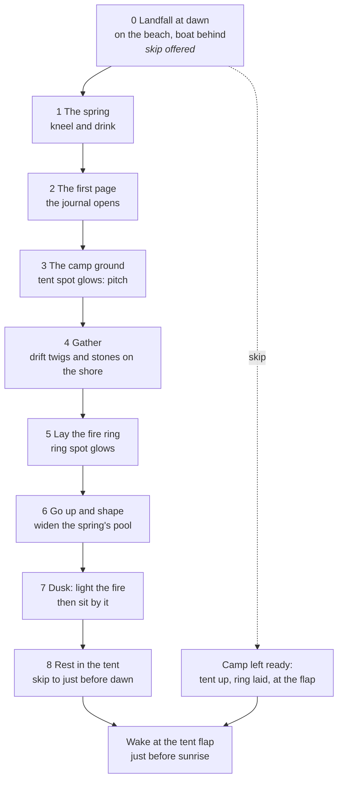
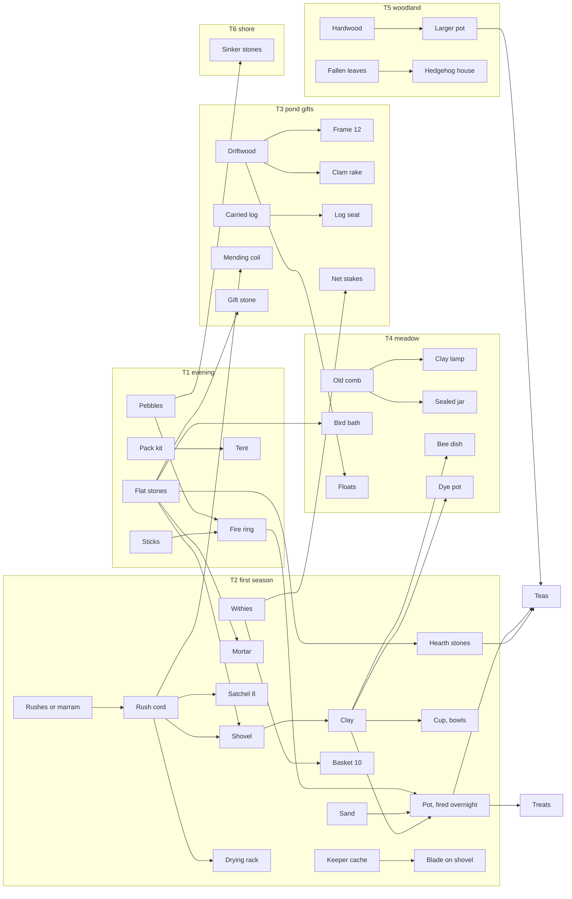
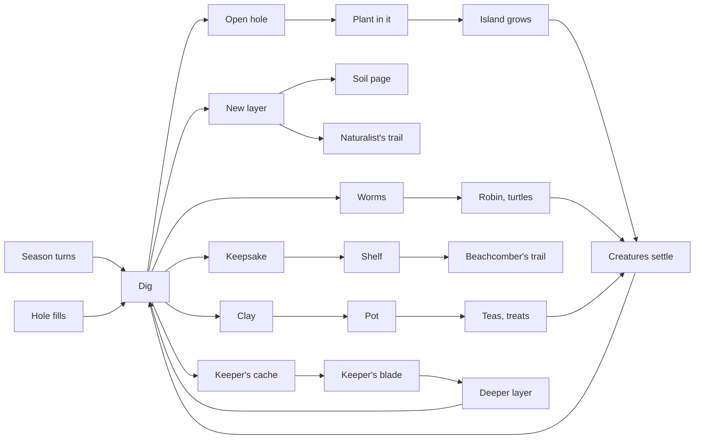
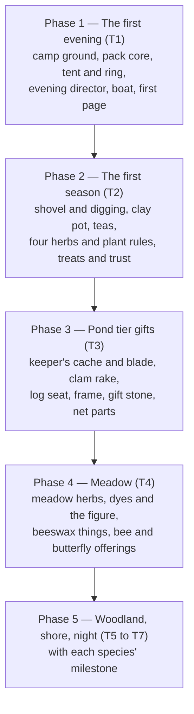

# ebb — The keeper's camp: arrival, gathering, making, teas, dyes and digging

**Status: Decided** (Matt, October 22, 2026). Phase 1, the first evening, is the current target, ahead of the rest of M2 (doc 20). Later phases wait for Matt's approval.

**A build spec for an orchestrator session.** Drafted October 22, 2026 from Matt's picks on the options sheet (297 kept, 84 maybe, 176 cut) and the F13 plan. Where picks overlapped or conflicted, the simpler reading was taken; every such call is listed in section 1.3. This document supersedes F13 (`docs/future/13-arrival-camp-and-pack.md` once filed) wherever they differ.

## 1. How to use this document

### 1.1 For the orchestrator

1. Read `CLAUDE.md`, `docs/01-vision-and-pillars.md`, `docs/23-presence.md` and this document before planning.
2. **First action: propose, for Matt's approval, the roadmap change** that makes Phase 1 (the first evening, section 13) the current target ahead of the rest of M2, and the matching edits to `docs/20-roadmap-and-vertical-slice.md` and CLAUDE.md's "Current target". CLAUDE.md forbids building past M2 until Matt says so; this document is his request, but the change still goes through him.
3. File this document as `docs/future/13-keepers-camp.md` (status Decided) and apply the numbered-doc changes in section 14 as each phase is approved, following `docs/future/README.md`'s working rule.
4. Work in small pieces on branches, one per build piece in section 13. Split each piece across small, fast subagents and keep working in parallel; never wait idle on one long task. Matt click-tests on desktop before anything merges. Never push to main without his approval. Commit trailers: `Co-Authored-By: Claude` is fine; no claude.ai session links in commits or PR text. Steps Matt takes locally are written as GitHub Desktop actions.
5. Every piece ships with a plain-language click-test list in its PR (the acceptance checks in each section are the starting point) and, for anything numeric, a page under `tools/` that runs on Matt's machine side by side with the game.
6. Analyze, then propose, then build. When a section leaves a choice open (section 15), ask Matt in plain language before building that part.

### 1.2 What ebb is, and the rules this work keeps

ebb is a cozy island you tend: shape land and water, plant, and leave room for creatures, and the island keeps growing while you are away. The walker is a **keeper**, one of a scattered company who tend islands that rise from the sea. This work gives the keeper a first evening, a camp, a pack, things to gather, a short path of handmade things, teas that write journal entries, treats for creatures, dyes to make the walker and camp your own, and digging that keeps paying back over a year.

Rules every part keeps:

- **No fail states, no hurry, no stamina, no spoiling, no loss.** Nothing gathered goes bad. Tools never break (only nets wear). A recipe once found is never lost. Everything placed can be undone.
- **Words, not numbers,** in everything the player sees. Pouches show fullness by drawing; trust shows as a word; the journal speaks in observations.
- **Real biology.** Every plant, food, tea and dye is true to life. Nothing offered would harm an animal. Living things found are always put back.
- **Limited, handmade human touches.** The walker carries three made things: the canvas tent with bedroll, the hand lantern, and a fire steel. Everything else is made from what the island grows.
- **Determinism.** Everything simulated is seeded through `src/core/rng.js` and applied on the hourly tick, so live play, saves and catch-up agree. What lies on the ground to gather, what a hole gives, and where story spots sit are computed from the seed; only what the player changed is saved.
- **Every tunable number lives in a recipe file** under `recipes/`.
- **UI:** contextual controls, no new visibility toggles, no horizontal scrolling, no emoji or glyph icons (drawn SVG icons in `src/ui/icons/`), body text never below 15 px in the game, Nunito for UI and Fraunces italic for the journal's voice. Never the two words CLAUDE.md bans from UI copy, docs and messages.
- **Desktop and laptop only.**

**Tiers in this document** are content tiers, not doc 12's species tiers: T1 the first evening, T2 the first season, T3 the pond tier's gifts, T4 the meadow, T5 the woodland, T6 the shore, T7 the night. Content for a species that is not built yet lands with that species' milestone.

**One unlock rule:** a make, tea, treat or dye is possible when every part can be gathered and its tool exists. Seasons, gifts and habitat gate the parts; nothing else gates recipes.

### 1.3 Calls made where the picks overlapped

| # | Picks involved | Call (simpler reading) |
|---|---|---|
| 1 | PR-12 and PR-13 both kept | Regrowth by size only (PR-13). A plant below its pickable size says "Let it rest a while" (PR-16). No per-plant rest stamp. Ground spots use picked events (GR-04). |
| 2 | PR-21 kept, PR-25 cut | A big raise over a plant removes it with no seed left behind. Undo restores it (PR-26). Matt's note: one island notice when a stroke buries 3 or more gather plants, or a session 8 or more, pointing to undo. |
| 3 | PR-31, D-42 | Plants are moved only with the shovel (PR-31). |
| 4 | DR-20, DR-22, M-08 | Three digging tools: the shovel (layers 1 and 2), the keeper's blade from the cache (layer 3), the clam rake (sand flats). Hands, stick and trowel rungs dropped. |
| 5 | D-04, D-05, D-09, D-10 cut | Layers: topsoil; subsoil or clay; a third layer only at story spots and under damp banks. Drift seeds come from beach sand. |
| 6 | CS-02, CS-04, CS-05 | CS-05: two steps, slots glow the first time and then only when the pack holds something for them. |
| 7 | CP-03, CP-05 (needed cut CP-04) | Fixed slots for every camp piece (CP-03). The slots are the camp's cap. |
| 8 | C-14 kept, C-13 crate cut | The gift shelf is a flat gift stone by the tent. |
| 9 | CP-19 and CP-20 | Farewell packs the tent into the boat (CP-19). CP-20 parked as later polish. |
| 10 | CP-15 options, C-39 | Resting skips the night: time runs on to just before sunrise and the walker wakes at the tent flap, with no away message (Matt, October 22). A new visit after closing the tab opens at whatever the game hour now is. |
| 11 | M-07, G-45, X-18 | Rush cord is one thing. Marram leaves make the same cord. |
| 12 | PR-37, D-40, X-23 (drying line cut) | Kelp or wrack go straight from the pack into a planting hole. |
| 13 | X-09 with TR-18, TR-22 cut | Dried herbs brew exactly like fresh. The drying rack is T2. |
| 14 | T-44, T-46, T-47 need cut plants | T-44 becomes chamomile and elderberry. T-46 becomes rose hip and kelp. T-47 becomes evening primrose and chamomile. Only T-45 stays three-herb. |
| 15 | T-27, T-47, F-31 | Evening primrose is added as a plant (T7). |
| 16 | PR-41 with P-21 and F-11 | Clover is a meadow volunteer. Gift-only plants are doc 12's existing gifts (bramble, hawthorn, oak, hazel, beech, pondweed). |
| 17 | F-12, M-43, X-13/M-33/M-35 | Promoted because kept items need them: bee water dish (M-37), fallen leaves (G-24), pouch fullness stages (K-03), and old comb as the only beeswax source (comb a wild colony left, never from a living nest). |
| 18 | F-32, M-48 cut | Fireflies come when the lantern is out and the fire burns low. |
| 19 | F-16, DR-15 | The robin following you while you dig is part of F-16. |
| 20 | G-08, X-26 | Every use of salt was cut. Boiled salt stays a camp-page first with no use (open question). |
| 21 | PR-19 | Built only if the creature system can cheaply say a creature is on a plant. |
| 22 | C-27 | The walker carries a fire steel; tinder is reed down, drift twigs or King Alfred's cakes. |
| 23 | C-43 iris grey, PR-44 | Iris stays look-don't-pick; no iris dye. |
| 24 | P-49 | Chanterelle is a squirrel offering (T5, Stretch). |
| 25 | X-01, X-02, X-03, X-07 | Dyes use only island plants: gorse yellow, lady's bedstraw root red, woad blue (woad added as a plant), woad over gorse green, heather or nettle olive, bramble or elderberry purple, lichen-twig rust. Alder brown dropped. |

### 1.4 Phase 1 at a glance (start here)

Phase 1 is the first evening, and it ships before marketing. The orchestrator needs only this brief and sections 2 to 4 to begin; sections 5 to 10 are the reference for later phases.

- **What the player gets:** a new island opens at dawn with the walker standing on the beach below the camp, the boat grounded behind (changed October 22, 2026, Matt: no row-in). Nine short beats (0 to 8, section 2.1) teach walking, the spring and the journal's first page, pitching the tent, gathering drift twigs and stones, laying the fire ring, going up to shape the pond, lighting the fire at dusk and sitting by it, and resting in the tent, which skips the night to just before sunrise. A skip at beat 0 leaves the camp ready. Islands made before the update skip the evening and find the pad and the tent in the pack.
- **What gets built:** E1 the camp pad and its brush lock, with the larger starter island and its varied coast (3.11), E2 the pack core and the gather engine, E3 the tent and fire ring with light, smoke and rest, E4 the evening director, boat and first page, E5 `tools/intro-lab.html` (section 13).
- **Decisions already in the sections:** the pad is 4 m in radius, 1.3 m high, 0.61 m above today's highest spring tide, re-placed on the larger island (sections 3.1, 3.11); the fire lights only when the player chooses; every camp piece has a fixed slot (3.2); the first fuel is drift twigs, because gorse and willow arrive later; the dusk sound is a far-off curlew, because frogs are still asleep on spring day 0; save format 8 goes to 9 in one step that adds the camp, pack, gather, dig, cook and dyes sections (12.1).
- **Before E3 starts:** give the smoke pass and the fire and lantern lights performance budgets in doc 19; confirm the ground shader reads the path-wear channel (for the trodden pad); confirm nothing compares base-chunk hashes, since the pad changes every island's base (section 3, "To finish" notes).
## 2. The first evening

Every new island opens below, at dawn, with the walker standing on the beach under the camp and the boat grounded behind at its stake (changed October 22, 2026, Matt: no row-in, to keep the animation work down). Nine short beats teach walking, gathering, making, shaping, sitting and resting by doing each once. Each beat waits for the player. Each has one hint line in journal italic. The whole evening takes about 10 to 15 minutes if the player does every beat. All of it is T1. (F13 "The first evening"; CS-05; CP-09; resolution 10)

### 2.1 The beats



| # | Beat | Starts when | What the player sees | Hint line (draft) | Done when | What the code does |
|---|---|---|---|---|---|---|
| 0 | Landfall | A new island's first frame | Dawn light. The low camera behind the walker, who stands on the beach a little inland of the boat's stake, facing inland: the camp ground's pale flat above, the stream glinting inland. The boat lies grounded behind at its mooring (CP-09). | *Click the sand to walk there.* with *Skip the first evening* (a text button under the line, beat 0 only) | `walk:arrived` on land (any walkable cell) | Clock set to dawn on spring day 0. Walker placed on the beach with `walk.placeAt` and the camera down behind it. The sea sound is the beach's usual bed (doc 17). (Changed October 22, 2026, Matt: no row-in; the boat beat and the climb-out are gone.) |
| 1 | The spring | Beat 0 done | A soft breathing ring marks the spring's pool over the view, seen from the beach (no stream leads there from camp on every island). | *Walk inland, up the slope, to the spring: a soft ring marks its pool. Kneel there and drink.* | The walker kneels within 2.5 m of the spring's pool | Kneel at the pool plays the drink act (cupped hands to mouth, about 3 s). The spring is the first one from `landmarks()`. |
| 2 | The first page | Beat 1 done | The journal opens by itself on the keeper's first page, in the walker's hand. | *The journal keeps what you learn here. Close it when you're ready.* | The journal is closed | `journalUi` opens on the keeper page view. The page is also kept in the journal afterwards. |
| 3 | The camp ground | Beat 2 done | The tent slot on the pad glows softly (CS-05). The pad already reads as trodden ground (CP-02). | *Turn round and walk back down to the flat ground above the beach: that is your camp. Click the glowing patch, then Pitch the tent.* | `camp:pitched`, or the tent already up | A click on the glow (or the Pitch card) walks the walker to the slot; pitch act about 4 s; tent piece appears in its slot. |
| 4 | Gather | Beat 3 done | Drift twigs along the strandline and pebbles and flat stones on the shore below camp, close to the boat. | One line for what is still needed: *Drift twigs lie along the tide line below the camp. Click one to walk to it, then Gather.*, then *Now two handfuls of pebbles from the shore. Click a pebble, then Gather.*, then *One more handful of pebbles. Gather again.* | The pack holds one handful of twigs or sticks and two handfuls of stones | The gather engine and pouches (section 4). Gorse and willow are not on a new island yet, so the first fuel is drift twigs (G-09); stones are pebbles or flat stones (G-01, G-02). |
| 5 | Lay the fire ring | Beat 4 done | The ring slot glows in the middle of the pad. | *Back up at your camp, click the glowing ring of earth, then Lay the fire ring.* | `camp:ring-laid`, or the ring already laid | Walker kneels at the slot; lay act about 4 s; the stones go round, the twigs inside; those handfuls leave the pack. The fire is laid, cold. |
| 6 | Go up and shape | Beat 5 done | The Go up button pulses once (its normal look, one soft pulse). After going up, the island as a diorama. | *Go up to see the whole island. From above you can shape it.* then, once above: *Pick Sculpt in the bar below and drag across the land, or pick Water and press to pour.* | Any finished Sculpt stroke or Water pour off the pad (`terrain:stroke-ended` or a pour ending) | Two lines, one after the other, in the same beat. If it is still well before sunset when the stroke ends, one more line shows: *Evening comes in its own time. The time button at the bottom right can bring it sooner.* When dusk begins, time returns to its normal pace (the time button may have hurried the day). |
| 7 | Dusk at the fire | The sun crosses sunset (`sky:sun-crossed` sunset) with beat 6 done, or beat 6 done after sunset | Low gold light. The tide coming in over the sand. | *Evening. Go down to your fire ring and press Light.* then, once lit: *Sit by the fire a while.* (lit already, straight to sitting) | The fire is lit, then the walker sits within 1.5 m of it for 20 s | The fire lights only when the player chooses (Matt, October 22): standing at the laid ring shows **Light** on the ground bar; the figure kneels, strikes the fire steel, the twigs catch (C-27). One call far out over the water (a sound only, not a creature): the frog call the game already has, Matt's choice in place of a curlew recording, though frogs have not come on spring day 0 (changed October 22, 2026, Matt). Firelight, smoke and moths begin (section 3.6). |
| 8 | Rest | Beat 7 done | The lantern now hangs on the tent's front pole. The tent flap glows faintly as the ring slot did. | *When you're ready, walk to the tent's door and press Rest to sleep until morning.* | `camp:rested` | Rest skips the night (C-39, section 3.5): time runs on to just before sunrise and the walker wakes at the flap. Sets `intro:done`. |

Changes from F13, and why:
- **No frog at dusk.** Frogs sleep until a third of the way into spring (`seasons.json` dormancy `frogs [2.6, 0.3]`), and a new island starts on spring day 0. A distant call over the water takes its place: a sound only, the game's frog call (Matt's choice, October 22, in place of a curlew recording).
- **No sticks under gorse on the first evening.** Gorse and willow come later as volunteers (`growth.json` volunteers). Drift twigs on the strandline are the first fuel.
- **The spring comes before the camp** and the first page opens at the spring, so the story lands before any making.
- **The fire lights only when the player chooses** (Matt, October 22), not by sitting.
- **Rest skips the night** to just before sunrise (Matt, October 22); it does not end the session. Closing the tab is how a session ends, and the next visit opens as today, at whatever hour it now is.

### 2.2 Skip, reloads, older islands, the sister island

- **Skip (beat 0 only, CS-06).** The tent is pitched and the ring laid (cold), with nothing taken from the pack. The boat is at its mooring. The walker stands below at the tent flap. The keeper's first page is in the journal, marked unread. Every `intro:*` flag is set, plus `intro:skipped`. The clock keeps its hour. No more evening hints show.
- **Leaving mid-evening.** Progress lives in `journal.flags` and the camp save. A reload resumes at the first beat without its `intro:<id>` flag. While `intro:done` is missing, the island opens below at the walker's spot (the one exception to "a save opens above"). A hint shows again after a reload until its beat is done. "Shown once" means never again after its beat is done.
- **Islands made before this update** never run the evening. They get `intro:done` and `intro:older` on migration. The pad is stamped (section 3.8). The tent is in the walker's kit, not pitched. One island notice on the first load: *"There's a camp ground on the flat above the shore now. Your tent is in your pack."* The tent slot glows the first time they go down within 12 m of the pad. The first page waits in the journal, unread.
- **The sister island (F02, CP-19).** The farewell writes `intro: "short"` into the new island's meta. The director then runs landfall, pitch, ring, dusk and rest (beats 0, 3, 5, 7 and 8) with no hint lines (changed October 22, 2026, Matt: no row-in).

### 2.3 The evening director

A small beat machine. It listens to events, checks one condition per beat, posts that beat's hint, and sets flags. It never moves the world itself except at the start (walker, clock, camera) and on skip.

- **Module:** `src/world/intro/index.js` (the director), `src/world/intro/checks.js` (named done-checks, one small pure function each), `src/world/intro/boat.js` (the mooring and its pose on the water or the sand; Matt's boat model), `src/world/intro/boot.js` (the new-island start and test links) and `src/world/intro/adapter.js` (the live context, and the stand-in camp until E3). (Changed October 22, 2026, Matt: no row-in.)
- **Recipe:** `recipes/world/intro.json`. Beats are data: id, hint lines, done-check name and its numbers. The Cliff tool's hint lines move here too, out of `CLIFF_HINTS` in `src/ui/tools.js` (F13 small fix), under `hints.tools`.

```json
{
  "type": "intro", "version": 1,
  "startAtDawn": { "dayIndex": 0, "afterDawnH": 0.25, "dawnSunDeg": -6 },
  "flagPrefix": "intro:",
  "springGlow": { "radiusM": 1.6, "opacity": [0.45, 0.85], "breatheS": 2.6 },
  "beats": [
    { "id": "landfall","hint": ["Click the sand to walk there."], "skip": "Skip the first evening", "done": { "check": "arrivedOnLand" } },
    { "id": "spring",  "hint": ["Walk inland, up the slope, to the spring: a soft ring marks its pool. Kneel there and drink."], "done": { "check": "kneltAtSpring", "reachM": 2.5 }, "then": { "act": "drink" } },
    { "id": "page",    "onStart": { "page": "first" }, "hint": ["The journal keeps what you learn here. Close it when you're ready."], "done": { "check": "journalClosed" } },
    { "id": "pitch",   "hint": ["Turn round and walk back down to the flat ground above the beach: that is your camp. Click the glowing patch, then Pitch the tent."], "done": { "event": "camp:pitched", "orCheck": "tentPitched" } },
    { "id": "gather",  "steps": [
        { "need": { "fuel": 1 }, "hint": "Drift twigs lie along the tide line below the camp. Click one to walk to it, then Gather." },
        { "need": { "stones": 1 }, "hint": "Now two handfuls of pebbles from the shore. Click a pebble, then Gather." },
        { "need": { "stones": 2 }, "hint": "One more handful of pebbles. Gather again." }
      ], "done": { "check": "packHolds", "need": { "fuel": 1, "stones": 2 } } },
    { "id": "ring",    "hint": ["Back up at your camp, click the glowing ring of earth, then Lay the fire ring."], "done": { "event": "camp:ring-laid", "orCheck": "ringLaid" } },
    { "id": "shape",   "hint": ["Go up to see the whole island. From above you can shape it.", "Pick Sculpt in the bar below and drag across the land, or pick Water and press to pour."], "hintNext": ["walk:went-up"], "later": "Evening comes in its own time. The time button at the bottom right can bring it sooner.", "laterIfBeforeSunsetH": 2, "done": { "check": "shapedOffPad" } },
    { "id": "dusk",    "start": { "check": "afterSunset" }, "onStart": { "flow": 1 }, "hint": ["Evening. Go down to your fire ring and press Light.", "Sit by the fire a while."], "hintNext": ["camp:lit"], "hintNextIf": ["fireLit"], "cue": { "on": "camp:lit", "emit": "intro:curlew" }, "done": { "check": "satByFire", "reachM": 1.5, "stillS": 20 } },
    { "id": "rest",    "hint": ["When you're ready, walk to the tent's door and press Rest to sleep until morning."], "done": { "event": "camp:rested" } }
  ],
  "short": ["landfall", "pitch", "ring", "dusk", "rest"],
  "older": { "notice": "There's a camp ground on the flat above the shore now. Your tent is in your pack.", "glowWithinM": 12 },
  "hints": { "tools": { "terrace": "Drag to build a level shelf, Height above where you start, with a sheer rock face at its edge.", "cut": "Drag to carve a level floor, Height below where you start, with sheer rock walls around it." } }
}
```

- **Flags (in `journal.flags`, saved with the journal):** `intro:<beatId>` when each beat is done; `intro:done`; `intro:skipped`; `intro:older`. Set through `flag()` in `src/world/journal/observe.js`, so they ride the journal's save and catch-up untouched.
- **Hint display.** One line in Fraunces italic in the island-notes corner (`src/ui/island-notes.js`), on a new `intro:hint { id, text }` event with its own quiet style. It stays until its beat is done. A tap on it tucks it away; the beat still waits, silently. Never more than one hint at a time. Body text at least 15 px. Every wait has a line saying what is still needed: a beat with `steps` posts the line for the first thing the pack still lacks, and a done event with `orCheck` lets a beat finish when its work was done before it came (the tent pitched early). While a beat has a place to go (the spring, the tent slot, the ring slot, the fire at dusk, the tent flap at rest), a soft ring over the view marks it (`intro:mark { x, z }` or null), so it can be found from far off or behind tall grass. Passing island notes wait while a hint shows.
- **No terrain cards (Matt, October 22).** Clicking plain ground (grass, sand, mud) never pops a card: it walks there. Ground with something to gather on it (drift twigs, pebbles) shows only a small gather card: at once within reach, or after the walker walks up to it.
- **Events the director emits:** `intro:beat-started { id }`, `intro:beat-done { id }`, `intro:hint { id, text }`, `intro:skipped`, `intro:done`.
- **Events it listens to:** `walk:arrived`, `walk:went-up`, `walk:went-down`, `terrain:stroke-ended`, the Water tool's pour end, `sky:sun-crossed`, `camp:pitched`, `camp:ring-laid`, `camp:lit`, `camp:rested`, `journal:ui` changes (store slice `journalUi`), `pack:changed`.
- **New-island start (`src/app.js`, where `back` is null; today that is only `freshIsland: !back` for the music).** When there is no save and no test link that sets a day or hour: `clock.reset` to dawn on spring day 0 plus `afterDawnH` (dawn found from `sunMoon()` in `src/world/sky/sun-moon.js`, the sun crossing -6 degrees rising), instead of `skyRecipe.orbit.startHour` (10). Then the walker is placed on the beach a little inland of the boat's stake, facing inland, with the camera down behind it (`walk.placeAt`, then `walk.downHere`), and the director starts on landfall (changed October 22, 2026, Matt: no row-in).
- **Walker hooks (`src/world/walk/index.js`).**
  - `walk:arrived { x, z }`: emitted in `update()` on the frame `walker.moving` turns from true to false at the end of a walk (not on `stop()`).
  - `walk.act(name)`: plays a short act on the figure and reports its end with `walk:act-done { name }`. Acts: `drink`, `pitch`, `lay`, `strike` (fire steel), `crawlIn`, `climbOut` (`stepOut` dropped, changed October 22, 2026, Matt: no row-in). Built in `src/world/figure/acts.js`, played by `src/world/figure/motion.js` beside today's `feed()`, `arrive()` and `leave()`, with poses in `recipes/world/figure.json`.
  - `walk.placeAt(x, z, yaw, posture)`: the director's way to put the figure on the beach, at the flap, or on the seat. A game move, never a startle. `walk.downHere()` goes down at the figure wherever it stands.
- **Test links (unsaved):** `?intro` runs the evening on a fresh island; `?intro=<beatId>` starts at that beat with earlier beats' results laid in; `?nointro` starts a fresh island as if skipped. Add them to `TEST_PARAMS`.
- **The lab:** `tools/intro-lab.html` (Phase 1, E5): jump to any beat, replay on a fresh seed, show the pad's lock edge and slots, skip to dusk, side by side with the game.

### 2.4 The keeper's first page

- A page in the walker's hand, rendered by `letterHtml()` in `src/ui/journal-letters.js` with a new form, `Keeper page`. Under 60 words. The story collaborator writes it; it lives in `recipes/world/keeper-pages.json` (`{ id, form, title, body: [...] }`), so it changes without code.
- It is reached later from the journal's front as "The first page", with any later keeper pages after it.
- Stand-in text until the collaborator's arrives: *"I came in on the morning tide. The land here is new, still pale from the sea. Keepers don't own the islands we tend. We help them hold what comes, and write down what we see. Someone will read this after me. Start at the spring."*

### 2.5 Acceptance checks

- Start a fresh island: it opens at dawn, below, with the walker standing on the beach under a pale flat patch, the boat grounded behind at its stake (changed October 22, 2026, Matt: no row-in).
- Click the sand: the walker walks there. The next hint names the spring.
- Kneel at the spring's pool: the figure drinks, then the journal opens on the first page by itself. Close it: the tent patch on the camp ground glows.
- Pitch, gather twigs and stones on the shore, lay the ring. Each step's hint appears only after the one before is done, and never comes back afterwards.
- Go up, make one stroke or pour: the lines change; if it is early, a line mentions the time button.
- At sunset a line asks you to light the fire. Light it: the walker kneels and strikes the steel, the fire catches, a curlew calls far out, and the line asks you to sit by it. The tent's lantern is lit.
- Rest at the tent after dusk: the screen softens to cream for a moment, and the walker wakes at the tent flap just before sunrise, with the fire banked to embers.
- Fresh island, click Skip: the tent stands, the ring is laid and cold, you stand at the flap, and the journal shows an unread first page. No hints follow.
- Reload in the middle of the evening: you open below where you stood, on the same beat and its hint.
- Open an island saved before this update: no boat, no evening, one notice about the camp ground; going down near it makes the tent patch glow.
- `?intro=dusk` opens near sunset with the tent up and the ring laid.

## 3. The camp

The camp is the keeper's home point: one fixed, protected, level pad on the plateau above the shore where the boat lands. Every piece has a fixed slot, so every island's camp looks composed and nothing lands badly. It starts as a tent and a fire ring and slowly gathers a few handmade things and the gifts of creatures that know you. It never becomes a building. (F13 "The camp ground"; CP-03; resolution 7)

### 3.1 The pad

| Rule | Value and behavior | Source |
|---|---|---|
| Place | Center at world (12.5, -13) on today's starter island, about 18 m from the island's center, northeast; re-placed on the larger island in 3.11 and confirmed in `tools/intro-lab.html`. Probed over 60 seeds: the natural ground there is 1.16 to 1.55 m, the sea is 9.5 to 13 m out along the facing line, the spring 16 to 19 m inland, the pond basin about 21 m off. The camp faces outward from the island's center, toward the sea. The prevailing wind blows that way too, so the smoke drifts out over the water. Tunable in the recipe; Matt confirms it in `tools/intro-lab.html` (section 15). | F13 |
| Size | Radius 4 m (8 m across), level. A soft blend of 2.5 m outside it back to the natural ground. | F13 |
| Height | 1.3 m, the plateau height. Today's highest spring tide is 0.6 x 1.15 = 0.69 m (`water.json` tide), so the pad sits 0.61 m above it. | F13, CP-18 |
| Built into new islands | `src/world/terrain/landform.js` `sampleCell`: inside the radius, height = `heightM`; across `blendM`, smoothstep back to the natural height. Material on the pad: grass and soil only (no sand or rock there). This lives in the new island recipe (section 3.11), so only islands made after the update have the pad in their base. | F13 E1 |
| Locked (CP-01) | Sculpt (all modes), Cliff, Stone (boulders), Paint and Water do nothing on the pad. One mask for every brush: 0 inside the radius, rising to 1 over `lockFadeM` (1 m) outside it, so a stroke fades to nothing at the edge. CPU: `applyStampCpu` and `applyCliffCpu` in `src/world/terrain/brushes.js` multiply their falloff by the camp mask, as they do by the open-land `edgeFade` today. GPU: `terrain-brush.wgsl` gets `campFade(p)` beside `edgeFade(p)`; the camp center, radius and fade go in the stamp uniforms (`STAMP_BYTES` 80 to 96; the 256-byte stride has room). The erosion pass after a stroke and `stampStone`'s `fadeAt` take the same mask. The Loose stone mode, Spring placement and Water pour refuse a tap on the pad with a quiet line: *"The camp ground stays clear."* | CP-01 |
| Dashed edge (CP-01) | Only while a brush ring overlaps the pad (ring center within brush radius plus 4 m): the pad's edge draws as a soft dashed circle on the ground. It fades out when the brush leaves. Drawn with the terrain marks (`terrainPass.setMarks`), which gain a dashed style. Nothing to toggle. | CP-01 |
| Trodden look (CP-02) | Built (E1, October 22, 2026): the terrain draw shader works the wear out from the pad's center and radius in its uniform (`campWear` in `terrain-draw.wgsl`), since nothing fills the ground texture's alpha channel and the draw pass has no texture slot left; `ground.a` stays for the desire paths (CP-10). Never saved. The terrain shader turns wear into packed earth with short, worn grass; grass density falls with wear. The edge is softer: wear fades out over 1 m. Visible from above and below with no line. | CP-02 |
| Plants (CP-16) | No plant seeds, volunteers or is planted on the pad (also PR-07). Grass stays short there (grass height capped at 0.35 of normal). Nettles come only at its edge (3.5) and the herb bed sits just off it. | CP-16, PR-07 |
| Creatures (CP-17) | Nothing keeps animals off. The pad is ordinary ground for creature pathing. Hedgehogs snuffle across at night, the robin hops by the ring, frogs keep out of the firelight (the light multiplier does that). | CP-17 |
| Walking | The tent, ring, rack and piles block their cells on the walk grid; smaller pieces do not. A clear lane runs from the tent flap past the ring to the pad's seaward edge and down to the boat. | CP-03 |
| King tides (CP-18) | Any future king tide (F08) must peak at least `kingTideMarginM` (0.3 m) under the pad. Written in the recipe note. Only the boat feels the tide. | CP-18 |
| Digging | None on the pad (DR-04). | DR-04 |

Checked (E1): the terrain draw shader did not read `ground.a`, and nothing wrote it; CP-02 draws the pad's wear from the camp uniform instead (row above).

### 3.2 The fixed slots

Slot positions are in the pad's own frame, in meters: **u** points seaward along the facing line, **v** to the left when you face the sea. Every slot holds one thing. The slot list is the camp's cap (CP-06). A slot glows only as CS-05 says (3.3).

```
              seaward (to the beach and boat) -->
                 ...........
            ...B...           .....        B  bird-bath stone
          ..   R R R R          heap 2      R  drying rack
        ..   j   l                ..       T  tent (F = flap, lantern on the front pole)
       .  h  TTTTTTTT F      d            O  fire ring + three hearth stones
       .     TTTTTTTT     =    O O        c w m  cup, bowls, mortar at the ring
       .  3  TTTTTTTT     =   cOw m       d  dye pot at the ring edge
       .        g         =               =  log seat, facing the fire and the sea
        ..   S S                heap 1    g  gift stone    l  clay lamp   j  sealed jar
          .. S S      k     P P           S  stick pile  P  stone pile  k  clay lump
            ...........P.....             1 2 3  heaps for any other kind
       herb bed (just off the pad)        h  shell wind chime   nettles: just off the seaward-right edge
```

| Slot | Thing | Center (u, v) m | Size | Faces | Tier | Source |
|---|---|---|---|---|---|---|
| `tent` | Canvas ridge tent with bedroll; the hand lantern hangs on its front pole | (-2.4, 0.1) | 2.2 x 1.6 m, ridge along u | Flap at u = -1.3, toward the ring | T1 | C-01, C-05, C-15, M-02 |
| `ring` | Fire ring of shore stones; three hearth stones inside it for the pot | (1.5, 0) | 1.0 m across | — | T1 ring, T2 hearth stones | C-06, C-07, M-01 |
| `hearth` | The clay pot on the hearth stones (or at the ring's side when cold) | (1.5, 0) | 0.3 m | — | T2 | C-09, M-09 |
| `cup` | Clay cup at the ring | (1.0, -0.65) | 0.12 m | — | T2 | C-10, M-11 |
| `bowls` | Two or three clay bowls at the ring | (1.55, -0.85) | 0.3 m | — | T2 | M-12 |
| `mortar` | Mortar and pebble at the ring | (2.05, -0.7) | 0.3 m | — | T2 | M-17 |
| `dyepot` | Clay dye pot at the ring's edge | (2.2, 0.6) | 0.36 m | — | T4 | M-40 |
| `seat` | Driftwood log seat | (0.4, 0), along v, up to 1.8 m long | log size | Sitting on it you look over the fire to the sea | T3 | C-11, M-25 |
| `rack` | Herb drying rack | (-1.0, 2.55) | 1.2 x 0.5 m | Along u | T2 (resolution 14) | C-12, M-21 |
| `sticks` | Stick pile | (-1.9, -2.6) | 0.6 m radius | — | T1 | C-21, M-03, K-15 |
| `stones` | Stone pile | (1.3, -2.9) | 0.5 m radius | — | T1 | C-22, M-04, K-15 |
| `clay` | Clay lump on a flat slab | (-0.3, -3.3) | 0.3 m radius | — | T2 | K-15 |
| `heap1`, `heap2`, `heap3` | A pile of any other kind set down (kelp, rushes, herbs and so on), first free heap | (2.9, -1.9), (3.2, 1.4), (-3.35, -1.3) | 0.35 m radius | — | T1 | K-15, K-20 |
| `gift` | Gift stone: a flat stone by the tent where bonded creatures' gifts gather | (-0.9, -1.2) | 0.56 m | — | T3 | C-14 (resolution 8) |
| `lamp` | Clay lamp on a flat stone by the flap | (-0.95, 1.2) | 0.16 m | — | T4 | M-33 |
| `jar` | Sealed clay jar beside the tent | (-1.6, 1.4) | 0.24 m | — | T4 | M-35 |
| `bath` | Bird-bath stone at the pad's edge | (1.6, 2.9) | 0.6 m | — | T4 | M-36 |
| `chime` | Shell wind chime on a willow stick by the tent's back corner | (-3.3, 1.6) | stick 1.2 m tall | — | T6 (open question, section 15) | C-20 |
| `bed` (off the pad) | Herb bed: a strip of ground just outside the pad where moved plants go | (-0.5, 5.0) | 2.4 x 1.2 m | — | T3 | C-24 |
| `nettles` (off the pad) | Nettle ground: an arc just outside the pad's seaward-right edge, ash-rich from the fire | arc at 4.0 to 4.6 m, from -70 to -35 degrees | — | — | T2 to T3 | C-25 |

Checked: every on-pad slot lies inside 3.7 m of the center, and none overlaps another or the tent. The lane along u from the flap to the seaward edge stays clear.

- **The herb bed is ground, not a piece.** It lies outside the lock, so the shovel works there. It is drawn with a few edging pebbles once the first plant is set in it (PR-31). Plants there follow their own niche rules: chamomile does well on its dry end; water mint only if the player has led water near (K-28). The camp page names what grows in it.
- **Nettles by the fire** (C-25) arrive as volunteers on the nettle ground after a season with the fire lit on at least 6 game days (an arrival with a cause, PR-40). Plant rules in section 5.
- **Not at camp:** the hedgehog house (under the bramble), the bee water dish (by the flowers), net stakes (at the water) and the mending coil (with the net). They are pieces placed where they are used; their sections own them.

### 3.3 Setup: CS-05, step by step

1. **The pad is there from the first frame.** Trodden, level, nothing on it.
2. **Pitch.** The tent slot glows the first time (the evening's beat 4). A tap on the glow, or on the pad while the pack holds the tent, shows a card: **Pitch the tent**. The walker walks to the slot's front, kneels, and pitches (about 4 s). Emits `camp:pitched`. Kit state `tent: 'pitched'`.
3. **Gather** (section 4). The ring needs one handful of fuel (sticks or drift twigs) and two handfuls of stones (pebbles or flat stones).
4. **Lay the ring.** The ring slot glows the first time it can be laid. Card: **Lay the fire ring**. The walker kneels and lays it (about 4 s); those handfuls leave the pack. Emits `camp:ring-laid`. Fire state `laid`.
5. **After the first evening,** a slot glows only while the pack holds something that can be set down or made there, and only while the walker is on or within 2 m of the pad. A glow is a soft pale patch on the ground (the terrain marks' ring, filled). It stops the moment the pack no longer holds that thing. No toggle.
6. **Making a camp piece** (pot, cup, rack and the rest, section 6) puts it straight into its slot when made at camp. If that slot already holds the thing, the new one goes to the set-aside list (3.9).
7. **Setting a pouch down at camp** (K-15): stand on the pad, open the pouch card, **Set down**. It goes to its kind's pile slot (sticks, stones, clay) or the first free heap. A pile has the pouch's fullness stages; setting down more of the same kind adds stages up to "full and tied", then that pile is full. Gathering from a pile is a tap and Gather, a handful at a time.

### 3.4 Data

**The `camp` block in the land recipe** (`recipes/land/starter-island.json`; every land recipe may carry one):

```json
"camp": {
  "note": "The keeper's camp (docs/future/13 section 3; src/world/camp). x, z: pad center (world m). facingDeg: null faces outward from the island's center; a number overrides. radiusM, heightM: the level pad; blendM: the soft fall back to natural ground; lockFadeM: brushes fade from nothing at the edge to full over this much; dash: the edge drawn on brush contact; wear: the trodden look in ground.a (0..1) with edgeWearM; grassScale: grass height on the pad. Slots in the pad's frame: u seaward, v left facing the sea. mooring: the boat's stake, found by walking out along the facing line to the first ground at stakeLevelM; boatOutM: how far beyond the stake the boat lies on its rope. kingTideMarginM: any king tide must peak this far under heightM.",
  "x": 12.5, "z": -13, "facingDeg": null,
  "radiusM": 4, "heightM": 1.3, "blendM": 2.5, "lockFadeM": 1.0,
  "dash": { "dashM": 0.35, "gapM": 0.25, "widthM": 0.06, "opacity": 0.55, "showWithinM": 4 },
  "wear": 0.55, "edgeWearM": 1.0, "grassScale": 0.35,
  "slots": [
    { "id": "tent", "kinds": ["tent"], "u": -2.4, "v": 0.1, "w": 2.2, "d": 1.6, "yaw": "seaward", "blocks": true },
    { "id": "ring", "kinds": ["ring"], "u": 1.5, "v": 0, "r": 0.5, "blocks": true },
    { "id": "hearth", "kinds": ["pot"], "u": 1.5, "v": 0, "r": 0.15 },
    { "id": "cup", "kinds": ["cup"], "u": 1.0, "v": -0.65, "r": 0.06 },
    { "id": "bowls", "kinds": ["bowls"], "u": 1.55, "v": -0.85, "r": 0.15 },
    { "id": "mortar", "kinds": ["mortar"], "u": 2.05, "v": -0.7, "r": 0.15 },
    { "id": "dyepot", "kinds": ["dyepot"], "u": 2.2, "v": 0.6, "r": 0.18 },
    { "id": "seat", "kinds": ["seat"], "u": 0.4, "v": 0, "yaw": "alongV", "maxLengthM": 1.8 },
    { "id": "rack", "kinds": ["rack"], "u": -1.0, "v": 2.55, "w": 1.2, "d": 0.5, "yaw": "alongU", "blocks": true },
    { "id": "sticks", "kinds": ["pile"], "pile": "fuel", "u": -1.9, "v": -2.6, "r": 0.6, "blocks": true },
    { "id": "stones", "kinds": ["pile"], "pile": "stones", "u": 1.3, "v": -2.9, "r": 0.5, "blocks": true },
    { "id": "clay", "kinds": ["pile"], "pile": "clay", "u": -0.3, "v": -3.3, "r": 0.3 },
    { "id": "heap1", "kinds": ["pile"], "pile": "any", "u": 2.9, "v": -1.9, "r": 0.35, "blocks": true },
    { "id": "heap2", "kinds": ["pile"], "pile": "any", "u": 3.2, "v": 1.4, "r": 0.35, "blocks": true },
    { "id": "heap3", "kinds": ["pile"], "pile": "any", "u": -3.35, "v": -1.3, "r": 0.3, "blocks": true },
    { "id": "gift", "kinds": ["giftstone"], "u": -0.9, "v": -1.2, "r": 0.28 },
    { "id": "lamp", "kinds": ["lamp"], "u": -0.95, "v": 1.2, "r": 0.08 },
    { "id": "jar", "kinds": ["jar"], "u": -1.6, "v": 1.4, "r": 0.12 },
    { "id": "bath", "kinds": ["birdbath"], "u": 1.6, "v": 2.9, "r": 0.3 },
    { "id": "chime", "kinds": ["chime"], "u": -3.3, "v": 1.6, "r": 0.08 }
  ],
  "offPad": {
    "bed": { "u": -0.5, "v": 5.0, "w": 2.4, "d": 1.2 },
    "nettles": { "fromM": 4.0, "toM": 4.6, "fromDeg": -70, "toDeg": -35 }
  },
  "mooring": { "stakeLevelM": 0.05, "boatOutM": 1.6, "searchM": 24 },
  "kingTideMarginM": 0.3
}
```

The gift stone, the fire's three hearth stones and the clay slab are small flat stones that come with their slot; they are not loose stones and do not count toward the cap of 24.

**Camp tuning** in a new `recipes/world/camp.json` (starting values):

| Knob | Start | What it does |
|---|---|---|
| `glow.nearM` | 2 | Slots glow only while the walker is within this of the pad |
| `glow.opacity`, `glow.breathS` | 0.35, 3.2 | The glow's look |
| `pitchS`, `layS` | 4, 4 | Act lengths |
| `ring.fuelHandfuls`, `ring.stoneHandfuls` | 1, 2 | What laying the ring takes |
| `fire.flameH` | 3 | Game hours at full flame from one handful of fuel |
| `fire.feedHandfuls` | 1 | Fuel to bring embers back to flame, or add flame hours |
| `fire.emberH` | 24 | A banked or burned-down fire stays as embers this long, then goes cold |
| `fire.ashFadeH` | 24 | The cold ring's ash fades over this |
| `fire.lightK`, `fire.reachM`, `fire.flicker` | 1800, 4, 0.12 | Fire light (doc 06 values) |
| `lantern.lightK`, `lantern.cd`, `lantern.rangeM` | 2200, 8, 8 | Lantern light (doc 06) |
| `smoke.riseMps`, `smoke.lean`, `smoke.midgeClearM` | 0.4, 1.0, 2 | Smoke column and the midges' clearance |
| `moths.count`, `moths.orbitM` | 6, [0.4, 1.2] | Moths at the fire and lantern after dark |
| `pot.fireH` | 8 | Game hours in the coals to fire a shaped pot (or cup, bowls, lamp, jar, dye pot) |
| `rack.dryDays` | 3 | Game days for a bunch to dry |
| `dye.dipH` | 6 | Game hours of rest with the fire banked for one dye dip |
| `known.reachM`, `known.perSeason`, `known.ringAtFull` | 6, 0.25, 0.85 | A known place (C-36) |
| `known.restsPerSeason` | 2 | Rests at camp in a season for it to count as used |
| `standing.reachM`, `standing.trust`, `standing.minWord` | 30, 0.01, "tolerant" | Standing presence while away (CP-13) |
| `canvas.fadeSeasons`, `canvas.patchAtSeasons`, `poles.silverSeasons` | 4, 2, 3 | Weathering (C-35) |
| `wear.decayDays` | 14 | The pad pales and regrows after the farewell |
| `words` | — | Every card and notice line in this section |

**Piece kinds.** Camp pieces join the placed-pieces model (`src/world/pieces/model.js`, `PIECE_KINDS`) so they share drawing, tapping and undo, but they sit in slots: a camp record carries `slot` instead of free `x`, `z`, `yaw` (those come from the slot). New kinds: `tent`, `ring`, `pot`, `cup`, `bowls`, `mortar`, `dyepot`, `seat`, `rack`, `pile`, `giftstone`, `lamp`, `jar`, `birdbath`, `chime`, plus `boat` (one, at the mooring). Meshes are baked from recipes as stones and logs are today (`src/world/pieces/meshes.js`); the tent and boat are new meshes. Live camp code lives in `src/world/camp/` (new): `index.js` (slots, glow, cards), `fire.js` (fire state and its light, smoke and moths), `rest.js` (rest and return), `layout.js` (pad frame and slot positions, pure), `migrate-pad.js` (older islands, pure search plus the stamp).

**Save section `camp`** (format 9; added to `KNOWN` in `src/save/sections.js`, with `cleanCamp()` like `cleanPieces()`):

```js
/**
 * @typedef {Object} CampState
 * @property {number} version
 * @property {{ x: number, z: number, heightM: number, facingDeg: number, source: 'recipe' | 'nearest' }} pad  where this island's camp is
 * @property {boolean} stamped            the older-island stamp is done
 * @property {{ tent: 'pack' | 'pitched' | 'boat', lantern: 'pole' | 'carried' }} kit   the carried things (the fire steel is always carried)
 * @property {{ slot: string, kind: string, seed: number, placedHour: number, made?: string, dye?: any, stages?: number, pileKind?: string }[]} slots  what fills each slot
 * @property {{ kind: string, seed: number, made: string }[]} aside   made camp things not in a slot (3.9)
 * @property {{ state: 'none' | 'laid' | 'lit' | 'embers' | 'cold', sinceHour: number, flameUntilHour: number, lightings: number, litDays: number }} fire
 * @property {{ slot: string, item: string, sinceHour: number }[]} work   firing, drying, dyeing in progress (CP-12)
 * @property {{ species: string, gift: string, hour: number }[]} gifts  on and around the gift stone
 * @property {{ known: number, seasonsUsed: number[], restsThisSeason: number }} place   C-36, only grows
 * @property {{ hour: number, at: number } | null} rested   the last rest: game hour and UTC ms (C-39, C-40)
 * @property {number} firstPitchedHour    for canvas weathering
 */
```

Pile contents are a kind and a fullness stage only, like pouches (K-35). Nothing per frame is saved.

**Events** (past tense, doc 03):

| Event | Payload | When |
|---|---|---|
| `camp:pitched` | `{ hour }` | Tent pitched |
| `camp:ring-laid` | `{ hour }` | Ring laid |
| `camp:lit` | `{ hour, first }` | Fire lit |
| `camp:fed` | `{ hour }` | Fuel added |
| `camp:banked` | `{ hour }` | Rest with the fire lit |
| `camp:cold` | `{ hour }` | Embers went out (tick) |
| `camp:placed` | `{ slot, kind }` | A piece went into its slot |
| `camp:taken-up` | `{ slot, kind }` | A piece went to the set-aside list |
| `camp:pile-set` | `{ slot, pileKind, stages }` | A pouch set down |
| `camp:rested` | `{ hour }` | Rest |
| `camp:returned` | `{ hours }` | Climbed out at the flap |
| `camp:fired`, `camp:dried`, `camp:dyed` | `{ slot, item, hour }` | Hourly tick, live and in catch-up (CP-12); notable for the reveal |
| `camp:gift-left` | `{ species, gift, hour }` | Hourly tick |
| `camp:stamped` | `{ source }` | Older island's pad laid |
| `trust:camp` | `{ creature, hour }` | Stored trust event, catch-up only (CP-13) |
| `walk:arrived` | `{ x, z }` | End of a walk (2.3) |

The hourly tick's camp step lives in `src/sim/` beside the others, as a system added in `app.js` like `pieces`, so live play and catch-up run the same code. `NOTABLE` in `src/sim/hour.js` gains `camp:` so the reveal can use those events.

### 3.5 Kept camp behaviors

| Item | What the player sees and does | Rules and code | Tier | Source |
|---|---|---|---|---|
| Lighting the fire | Always the player's choice (Matt, October 22): stand within 1.5 m of the ring and tap **Light** on the ground bar (a contextual button; shown only there, only with fuel in the ring or a handful of fuel in the pack). | The walker carries a fire steel with the tent and lantern (resolution 23). Tinder is drawn from what the fuel is: reed down, drift twigs or a King Alfred's cake if the pack holds one; the pouch page names it. One handful of fuel = `fire.flameH` hours of flame. First light emits `camp:lit { first: true }`. | T1 | C-27 |
| Embers kept | Rest with the fire lit: it is banked under ash. On return, if under `fire.emberH`, a thin smoke rises from the ring; **Feed the fire** (one handful of fuel) brings the flame back with no steel. Left longer, it is cold. A fire burning unattended also sinks to embers after its flame hours. | State by the clock only (CP-11). Never "out by your fault". | T1 | C-28 |
| Smoke drifts with the wind | A soft column that leans and thins with the weather's wind, rises straight on still evenings, hangs low in mist. Midges keep about 2 m clear of it. | A new small billboard puff pass, seeded, about 40 puffs. Reads `weatherAt()` wind. Midge swarms get the fire as a no-go disc while lit. | T1 | C-29 |
| Moths, then bats | After dark, a few moths circle the fire and the lantern. From the night tier, bats sweep through for them. | Moths: a few seeded instanced sprites on loose orbits, live only. Bats: with T7 (F-30). | T1 moths, T7 bats | C-30 |
| Fire never spreads | Fire only ever burns inside the ring. Rain drops it to embers with a hiss and thicker smoke; it never goes out from rain alone. The cold ring's ash fades over a day; wood ash and charcoal can be gathered from it at dawn (G-41, G-42). | No fire state outside the ring exists. | T1 | C-31 |
| Camp at night | The fire is a 1,800 K flickering light reaching about 4 m; the lantern adds a warm 2,200 K pool. Beyond, the island is moonlit blue. Below, exposure eases toward the firelight. | Builds doc 06's planned lights buffer (lanterns, fireflies) with the fire as its first entries: inverse-square with a smooth window, flicker as doc 06 says. Exposure: `recipes/world/exposure.json`. Presence: a `camp` source (doc 23's `kind: 'camp'`) with `light: true` while lit at night, speed 0, never startles; it widens creature rings by the existing `light` multiplier (1.3). | T1 | C-32 |
| The lantern on the tent pole | After dusk the lantern hangs lit on the front pole whenever the walker is on the pad or away. Walk off the pad at night and the walker takes it down and carries it; come back and it is hung again. Put out, it stays dark (fireflies, F-32). | Kit `lantern: 'pole' | 'carried'`, live; only `'pole'` is saved. | T1 | C-15 |
| Camp in rain | Rain drums on the canvas, drips run off the ridge, the fire hisses low. Resting in rain muffles the island to the canvas sound as the screen softens. | A tent sound layer (doc 17) within 6 m of the tent. | T1 | C-33 |
| Seasons at camp | Spring: nettles by the ring. Summer: the rack full of bunches. Autumn: leaves blown against the tent's walls, seedheads on the rack. Winter: frost on the canvas after clear nights, the bedroll airing on the ridge on frosty mornings, a crust of ice in the bird bath. | All read from season and weather state; drawing only. | T2 on | C-34 |
| Canvas weathering | The canvas fades and softens over seasons and gains patches where it wore; poles silver like doc 09's wood. A dyed canvas fades with it; the walker's clothes do not fade. | From `firstPitchedHour`; `canvas.*` knobs. | T3 on | C-35 |
| Dyed canvas | The tent canvas and bedroll can be dyed; clay slip paints simple shapes on the canvas. | Dye recipes, depths and targets are in the dyes section (resolutions "Dyes and customization"). The dip happens at the fire while resting (CP-12 below). Iris grey is dropped (resolution 24). | T3 to T5 | C-43, X-28 |
| A known place | Over time, creatures near camp let you a little closer. | Within `known.reachM` of the pad's center, every creature's comfort ring is multiplied by `1 - (1 - ringAtFull) * known`. `known` grows by `perSeason` for each season with at least `restsPerSeason` rests at camp, up to 1; it never falls. | T3 | C-36 |
| Bonded visits | The robin on the tent ridge or the pack; the hedgehog asleep by the cold ring; a squirrel caching near camp; an otter's pebble on the gift stone or the seat. | Seeded visits per game day for each Bonded species with a camp behavior (doc 23 ceilings), drawn live when the walker is near. Each Bonded species leaves its one gift once on or around the gift stone (`camp:gift-left`), written on the camp page. Lands with each species' milestone. | T3 to T7 | C-37, C-14 |
| Seen from above | By day: a pale square, a tent and a thread of smoke. At night: a small lit point that makes the island feel lived in. | The flame and lantern glass are emissive and feed bloom, with a small minimum on-screen glow so they read from the orbit view. | T1 | C-38 |
| Rest skips the night | Between sunset and `rest.wakeBeforeSunriseMin` (10) minutes before sunrise, tap the tent (or **Rest** on the ground bar within 2 m of the flap). The walker crawls in, the screen softens to cream for a moment, and the walker wakes at the flap just before sunrise. No away message, no "while you were away" card. By day the tent card says *"Rest comes after dark."* | `camp:rested`. Works like the existing simulate-time-away step, but only to the target hour: catch-up (`src/sim/away.js`) runs the hours from now to `sunrise - wakeBeforeSunriseMin` behind the cream screen, using the away growth rules, then saves. The reveal does not play. A banked fire, a pot in the coals and a dye dip all advance through those hours. Closing the tab still ends a session as today. | T1 | C-39 (changed) |
| Waking at the tent flap | After a rest, the first view is out of the tent: the ring, the pad and the sea beyond, just before sunrise. The walker climbs out on the first tap. | The walker is placed kneeling at the flap and the camera set down behind it facing seaward (`camera.setGround`, or `setPose`) while the cream screen is up. A new visit after closing the tab opens as today, at whatever hour it now is (resolution 10). | T1 | C-40, CP-15 A |
| The journal's camp page | A drawn page of the camp as it is now, what was made and when, blends and dyes found, and each gift with the creature that left it. | Owned by the recipes section (TR-04). This section supplies the camp state it draws. | T2 on | C-41 |

### 3.6 Away: CP-11, CP-12, CP-13

- **The fire while you are away (CP-11).** A banked fire is embers until `fire.emberH` (24 game hours) after banking, then cold. Worked out from the clock in the camp tick, so the same hours give the same fire live and in catch-up.
- **Work done while away (CP-12).** Only work started at camp, and nothing is gathered (GR-09):
  - A shaped clay piece set in the coals before resting fires once `pot.fireH` (8) game hours pass with the fire banked or lit. It then goes to its slot (`camp:fired`).
  - Herb bunches on the rack dry over `rack.dryDays` (3) game days, live or away (`camp:dried`).
  - A piece in the dye pot takes one dip per night's rest, or per `dye.dipH` (6) game hours away, with the fire banked (`camp:dyed`).
  - After a night's rest the changes are simply there at camp; after a real absence the reveal shows them.
- **Standing presence (CP-13).** Only in catch-up (a night's rest or a real absence), and only once the camp exists: once per game day of the absence, each creature already Tolerant or closer whose home lies within `standing.reachM` (30 m) of the pad gets a stored `trust:camp { creature, hour }` worth `standing.trust` (0.01; a feeding is 0.06). The 7-day catch-up cap (`capHours` 168) bounds it to seven per absence.

### 3.7 Rules that keep the camp tidy

- **How much fits (CP-06).** One thing per slot. If its slot is taken, the card says *"The camp already has a <thing> there. Take that one up first."* If every pile slot holds another kind: *"No room for another pile at camp. Take one up first."* Nothing is lost: the pouch stays as it was.
- **Undo (CP-21).** Pitching, laying the ring, placing a piece, setting a pile down and taking a piece up all join the undo history as `{ kind: 'camp', op, slot, record }`, the way loose stones push `{ kind: 'piece' }` today. Undoing a set-down puts the handfuls back in the pack (or, if the pack is full, leaves the pile). Undoing a placement moves the made thing to the set-aside list. Undo never destroys a made thing. An undone pitch or ring during the evening does not undo its beat; the slot simply glows again.
- **Set aside.** Made camp things not in a slot wait on the set-aside list, drawn on the camp page with **Set out**, which puts one back in its slot when the slot is free.
- **The desire path to the spring (CP-10).** The camp-to-spring round trip is the first worn line on the island. It is built with the footfall trace field (docs/future/09: footfall per game hour, wear that deposits with use and heals over about a season), and needs nothing camp-specific beyond being where the first evening sends you. It never wears across the pad (the pad is already worn).

### 3.8 Older saves: CP-07, then CP-08

Save format 8 to 9 (`src/save/migrate-camp.js`, step `camp9` in `MIGRATIONS`; the same step that adds `pack` in section 4) adds a `camp` section with `stamped: false`, the kit's tent `'pack'`, nothing pitched, and `intro:done` plus `intro:older` in the journal's flags. The pad itself is laid on the first load, because the migration is pure and cannot see heights:

1. **Try the recipe spot (CP-07).** Islands made before this update keep their own land recipe (section 3.11), so the pad is never in their base. For edited chunks under the pad, the pad is levelled as recorded edits on load (like `buildSandbarDemo`'s strokes, but kept off the undo stack and marking the chunks edited so the save keeps it). Loose stones and logs on the pad move to just outside its edge. Plants on a slot's footprint move to the nearest suitable spot just off the pad; other plants on the pad stay, held at their floor size.
2. **Fall back (CP-08)** if the recipe spot would flood or cut into what the player shaped: any pad cell under standing water, a cliff face, a height range over the pad above 0.6 m, or more than a tenth of its cells shaped by more than 0.3 m (`shapedCm` from the habitat). Then search outward on rings for the nearest plateau spot whose cells are all dry and not cliff, whose natural spread is within 0.3 m, and whose level is at least `heightM` minus 0.05 m and at least `kingTideMarginM` above the highest tide. Level it to its mean height. Store the spot in `camp.pad` with `source: 'nearest'`. The mooring is found again from there. If no spot qualifies, take the one needing the least change, and never level a cell under water.
3. Emit `camp:stamped`, set `stamped: true`, show the older-island notice (2.2).

Checked (E1): nothing in a save compares base-chunk hashes; `hashBase` is used only by the test pages. An island keeps the land its saved chunks record (`islandLand` in `src/world/terrain/chunks.js`), and the larger island's 4 x 4 land is centered on (-16, -16), since chunks sit on multiples of 32 m (`center` in `recipes/land/starter-island-2.json`).

### 3.9 The boat (CP-09) and the farewell (CP-19)

- **Mooring.** From the pad's seaward edge, walk out along the facing line to the first ground at `stakeLevelM` (0.05 m): a stake goes there, and the boat lies `boatOutM` (1.6 m) beyond it on its rope. It floats and bobs when the water under it is deeper than its draft (0.15 m), and rests tilted on the sand at low tide. It stays all game. Not walkable. Position worked out from the pad and the ground, not saved; `kit.tent: 'boat'` is the only boat state saved.
- **Farewell (CP-19).** On F02's departure, the walker walks to the boat and the tent and bedroll are rolled into it; the lantern goes with the walker. The ring stays, cold. On the resting island, pad wear decays over `wear.decayDays` (14) game days when it next catches up, so the pad pales and grass returns. The slots stay in the recipe. Arriving at the sister island runs the short evening (2.2). Sailing back, the tent comes too and its slot glows. CP-20 (camp left standing, seen across the water) is parked.

### 3.10 Acceptance checks

- From above, a pale trodden square sits on the plateau above the beach; nothing on it looks like a line or a frame.
- Drag Sculpt Raise across the pad: a dashed circle appears at its edge while the brush is near; the ground inside does not move, and the stroke fades out across about a meter outside. The same for Lower, Flatten, Terrace, Cut, Boulder, Paint and a Water pour.
- Tap Loose stone or Spring on the pad: a quiet line says the camp ground stays clear.
- Below on a fresh island: the tent patch glows; pitch it. Later, with only twigs and stones in the pack, only the ring patch glows. With nothing that fits, nothing glows.
- Set down a full pouch of sticks on the pad: a stick pile appears in its corner. Undo: the sticks are back in the pack.
- Fill every heap, then try to set down another kind: a calm line says to take one up first; the pouch is unchanged.
- Light the fire at dusk: warm light reaches a few meters; the island beyond is blue; smoke leans with the wind and drifts out to sea; a few moths circle. Rain: it drops to embers with a hiss and never goes out. Above at night: a small warm point.
- Walk off the pad at night: the walker takes the lantern down. Come back: it hangs on the pole again.
- Rest with the fire lit and come back within a game day: a thin smoke rises from the ring, and Feed the fire relights it. Come back after two game days: the ring is cold.
- Set a shaped pot in the coals, rest overnight: on return the reveal shows the fired pot at the hearth.
- Use **Pretend I was away** after resting with a Tolerant frog living near camp: its trust word moves a little over a long absence and does not without the rest.
- Load an island saved before this update whose camp spot you dug into a pond: the camp appears on the nearest dry flat ground instead; nothing you made moved more than a step.
- `tools/determinism.html`: the same seed and edits, with the camp used, give the same island after catch-up.

To finish: the smoke pass and the lights buffer are new rendering work with no code yet; give them budgets in doc 19 before E3 starts.

### 3.11 A larger starter island with more coastline (Matt, October 22)

The starter island grows a little and gets a more varied coast, now that phones are not a concern. This rides with E1, since the camp needs room.

| Rule | Value and behavior |
|---|---|
| New land recipe | `recipes/land/starter-island-2.json` for every island made after the update. Islands made before keep `starter-island` (each saved chunk already records its land recipe id), so their shape never changes. |
| Size | Coast radius about 36 m (from 29.5 m), roughly one and a half times the land. Open land grows from 3 x 3 to 4 x 4 chunks (128 m square, chunks -2 to 1) so the shelf still falls to the seabed inside open land. Check against doc 13's land pieces (the meadow islet 25 m offshore and the rest) and the 192 m window; move their offsets out if needed. |
| Coastline variance | Two layers on the coast: today's fine wobble (about plus or minus 5 m), plus a few low-frequency lobes (plus or minus 7 to 9 m) seeded per island, so each island gets one or two coves, a headland and a short spit. One rocky point is painted rock; the camp's shore stays a sand beach so the boat can land. |
| Kept the same | The plateau height, the central hill, the pond hollow and the spring, scaled with the radius, so the first evening and the frog ground work as before. |
| Camp | The pad keeps its rules (3.1) and is placed by the recipe on the plateau's edge above the beach; `tools/intro-lab.html` shows the pad, the coast lobes and the boat line over 60 seeds so Matt can confirm. |
| Performance | Re-run the medium-tier laptop budget (doc 19) and the catch-up timing (doc 02) with 16 chunks instead of 9. |
| Acceptance | Two new islands on different seeds have clearly different coasts; both have a sand beach under the camp and a boat landing; an old save loads with exactly its old shape plus the stamped pad. |

### 3.12 Stations, stores and the three pots (Matt, October 23, 2026)

Decided after the Phase 1 playtest. Where it differs from sections 3.2, 6.4, 6.5, 7.1 or 9.3, this section wins. The unlock rule, the no-numbers rule and the overnight rules are unchanged.

**The camp in places, not scattered slots.** The pad keeps its radius (4 m; it may grow slightly only if the layout proves tight). Its slots are grouped into places with one job each:

| Place | Job | Holds |
|---|---|---|
| The fire (heart of the camp) | Cooking, brewing tea, firing clay overnight, leaving dyes overnight, charcoal and ash at dawn | Ring, hearth stones, the three pots, cup, bowls |
| Workbench | Making things and shaping clay | Made by the player: a flat stone slab on two stones, later a driftwood plank. Tools hang on it when not carried |
| Apothecary bench | Preparing and keeping plants: drying, grinding, mixing, storing | Made by the player. Mortar and pestle stone, the drying rack beside or above it, the sealed jar, saved seeds |
| Stores (land side of the pad) | Keeping what is gathered | Wood store, stone pile, clay slab, heaps |
| Rest (back of the pad) | Resting and gifts | Tent with the lantern on its hook, clay lamp, gift stone, log seat facing the fire and the sea, bird bath at the edge |

The two benches face the fire, so things move naturally between them: shape a pot at the workbench and fire it in the coals; grind dye stuff at the apothecary and leave it overnight at the fire.

**Stores are places from the first frame.** The wood store (two forked stakes and a low crossbar over flat stones), the stone pile (a shallow scrape ringed by edging stones) and the clay slab are drawn empty and waiting, so the player can see where piles go. Each has a card even when empty ("Wood store. Empty."), with Set down while the pack holds that kind. The soft glow still lights the matching store while the pack holds it and the walker is near camp. First-evening hint, after the ring is laid while the pack still holds twigs or pebbles: *"Spare twigs keep dry in the wood store."* (Phase 1 polish.)

**The benches are made, not given.** The workbench is the first make after the first evening (flat stones; Phase 2). Rush cord and the shovel are made on it. The apothecary bench comes with the herbs (sticks and rush cord), with the drying rack and the mortar as its parts.

**Three clay pots, each with its own temper.** Each is shaped at the workbench from clay plus a different temper, fired overnight at the fire, and drawn so the three can be told apart on the hearth:

| Pot | Clay plus | Use | Look |
|---|---|---|---|
| Cooking pot | Sand | Treats and food | Wide, pale and plain |
| Tea pot | Crushed shell (shells ground in the mortar) | Teas only; replaces the single brewing pot of 7.1 | Small, lidded, with a spout, flecked with shell |
| Dye pot | Crushed charcoal or ash from the fire | Dyes only (replaces M-40's clay-and-sand dye pot) | Deep, dark and stained |

Tempers are what potters mix into clay for heat and strength. The tea pot is the only pot that brews; the cooking pot never brews tea, and the dye pot is never used for food or tea.

**Dyes.** Dye stuff (bedstraw root, woad and ash, and the rest) is prepared at the apothecary bench by grinding. The dip is left overnight in the dye pot at the fire (9.3's overnight rule).

**One combining pattern at every station.**
1. Click a station. Its card opens as a wider workspace: the station's surface with 2 or 3 part spots on top, and the pouches along the bottom, drawn with the gather icon family (fix log F7).
2. Click a pouch, and the walker lays one handful on the surface. Click a laid part to put it back.
3. Combining is free. If the station knows a make that uses what is laid, the missing parts show as pencil outlines (TR-16). There is never a recipe list.
4. The station's single action lights when the parts are complete: Make at the workbench; Brew, Cook or Fire at the fire; Dry, Grind or Mix at the apothecary. It is drawn as an icon.
5. Nothing is used until the action is pressed. Walking away puts every part back in its pouch.
6. Parts that make nothing give a calm line ("These don't come to anything together.") and go back. At the tea pot any two herbs still give a plain cup (7.2).
7. Work that takes time (firing, drying, an overnight dip) shows on the station itself, never as a timer.
8. The first time anything is made, the camp page writes it with a sketch of its parts.

**Ground materials are never clicked.** The ground itself (grass, sand, soil) is not hoverable or clickable. Things lying on it are clicked, and their cards have Gather. Materials that are the ground are offered on the here-bar while the walker stands on them, and only once the player has a use for them:
- **Scoop sand** on dry sand above the wet line.
- **Dig** with the shovel on a damp bank near fresh water (clay comes up with layer 2).
- **Fill** at the spring.

**Built (S1, October 24, 2026).** The workbench is built in its slot (`workbench`, u 0.3, v -1.5, facing the ring) from two handfuls of flat stones; the fire ring, once laid, is the fire station. The workspace is `src/world/camp/stations.js` (live) and `src/ui/station.js`; the pure making core is `src/world/camp/making.js` with `recipes/world/cook.json`; station spots and reach are in `recipes/world/camp.json` `stations`. The save's reserved `cook` section holds `{ version, made: { id: firstHour }, count, tools }` (format 10, no bump). Slots for the apothecary bench (u 0.3, v 1.5) and the store (u -0.9, v -2.5) are in the land recipes; the mortar sits on the apothecary bench. The store's draw is a hook (`store` in `createStations`) for P2j. The camp page is `src/ui/journal-camp.js`.

**Built (S2 and P2j, October 25, 2026).** The apothecary bench is built in its slot from two handfuls of sticks and one of rush cord. The drying rack (two withies or sticks, cord) and the mortar (a flat stone, a pebble) are made at the workbench once the bench stands (cook.json `after`); the rack stands in its own slot beside the bench, the mortar and pestle on the bench's worktop (camp.json `apothecary`). The apothecary's two actions are drawn icons: Dry hangs a handful of any herb on the rack (a `{ group: 'herbs' }` part), Grind turns broken shells into crushed shell. Bunches dry over `rack.dryDays` from the hour each was hung, worked out from the clock (the shader's `dry` turns a bunch's green to straw). Matt's rack came with bunches baked on; the model pipeline lifts them off (`tools/assets/drop-paint.mjs`) and the game hangs his own bunches one at a time at his model's hang points. `shells` is a strandline gather kind (appended to `KINDS`), `crushed-shell` a pouch kind. The hamper (P2j) is made at the workbench from rushes and cord, a second (rushes, cord, a withy lid) stacks on it: 6 slots, then 12, one kind a slot, 12 handfuls a slot (`src/world/pack/store.js`, pack.json `store`). Set down at camp goes to a kind's own place first, then the hamper (`src/world/pack/route.js`); once a hamper stands the heap slots retire into it. The hamper and the rack open in the station workspace's store mode, slots as drawn icons with the pile words, each a Take up; making draws from the pack, the piles, then the hamper. The live keeps are `src/world/camp/keeps.js`; their records ride in the camp section (`stack`, `holds`, `bunches`; no format bump). Test link `?camp=apothecary`; card check `tools/apothecary-check.html`. The clay bowl and the clay cup are made in code (Matt, October 25, 2026: sessions make them), in the clay of his clay pot (`tools/assets/made/pieces.mjs` `clayBowl`, `clayCup`; `tools/clay-lineup.html`); P2d shapes, fires and fills them.

**Built (P2i, October 25, 2026).** Fire-nights: a night with three hours of fire (lit or embers) between dusk (20:00) and dawn (04:00) is a fire-night; the fire writes its last three into `fire.nights` before each change overwrites its burn, carrying the hours of a night split between two burns (camp.json `fire.night`; `src/world/camp/fire.js`). Charcoal fed to the fire burns twice the flame hours of sticks (`fire.fuelK`), and the ring's card says so. The ring is a gather source (`ring`; `charcoal` and `ash` appended to `KINDS`): one handful of charcoal and two of ash from dawn until the next dusk after a fire-night, drawn as lumps round the ring's edge and a pale heap inside it. Spread here on the ash pouch's card tips a handful where you stand: a pale patch 1.2 m across for 14 game days, at most six (the gather section's `ashes`), drawn into the ground through the holes' marks (`lib-holes.wgsl`, a negative mouth darkness); nettles already on the island may come up on a patch while it lies (`volunteers.js` `ashSpreadAt`, nettle.json `cause.ash`), never bringing nettles that have not come. The overnight work list (`src/world/camp/work.js`, the camp section's `work`) is clock-driven like the fire: a laid piece's fire hours are written in before each change to the fire (`withFire`), so live play and catch-up agree; S5's clay firing lays its pots there too. Willow withies laid at the fire with Fire become a pouch of charcoal sticks after eight hours of fire, taken up from the ring's card. The sketchbook (`src/world/sketchbook`, `src/ui/sketchbook.js`, recipes/world/sketchbook.json, the save's `sketchbook` section, written with the format 9 sections so an older save reads as an empty book): Sketch on the here-bar with charcoal sticks in the pack and a creature, plant or find near the middle of the view; the walker sits for five seconds; stages 1 to 4 (first sketch, a later day, a moment, another season) show Matt's tiered drawings from `assets/sketches` (placeholders for now, recipe `placeholderArt`; `tools/assets/sketch-sheets.py` splits and ships them); the sticks wear one handful a three sketches. Not yet: the walker's own sketching gesture with the book and stick props (I6, it sits for now), and drawing stages 3 and 4 from each creature's pose. Test links `?camp=dawn&hour=7`, `?sketch`.

**Models.** Matt makes the workbench, the apothecary bench, the three pots, the mortar and pestle stone, the drying rack, and later the sealed jar, the clay lamp, the satchel, the basket, the driftwood frame and the clam rake. Sessions make the simple pieces: the wood store stakes and crossbar, the stone ring, the clay slab, the hearth stones, the clay cup and bowl, the gift stone, the bird bath, the cord and the fire steel.

## 4. The pack and gathering

The walker carries a pack of cloth pouches, one kind of thing per pouch, drawn fuller as each fills. Everything in it comes from the island by hand: picked from a plant, picked up from the ground or the strandline, dug, or taken from the fire's ring at dawn. A plant or a spot always keeps most of what it has. Nothing in the pack spoils, nothing is lost, and nothing is ever shown as a number.

Tiers in this section are the recipe and content tiers from the resolutions sheet: T1 first evening, T2 first season, T3 pond-tier gifts, T4 meadow, T5 woodland, T6 shore, T7 night. They are not doc 12's species tiers. A thing can be gathered once its source exists on the island (its plant, its ground, its tide or its fire); seasons, gifts and habitat gate it, and nothing else does (resolutions, Global).

### 4.1 The pack

#### What the player sees and does

- Below, a row of drawn cloth pouches sits on the ground bar, above the Sit, Kneel, Feed, Net and Look buttons (K-01). Above, the pack is not shown, as the ground bar is not.
- Each pouch shows its fullness in four drawn looks: **flat** (empty), **a few**, **half**, **full and tied** (K-03, promoted). A small sketch of its contents sits at the mouth (K-01).
- Tapping a pouch opens its card: a sketch, one line and a word, with Set down and Empty (K-05).
- Pouches sort themselves in a fixed order by kind; the player never arranges them (K-24).
- The pack starts with six pouches and grows to eight, ten and twelve through three made things (K-06, K-07, K-08, K-14).
- When there is no room, a card says so and offers two calm choices (K-21).
- At camp, a pouch is set down as a pile; piles are the only store (K-15, K-20).

#### Pouches and fullness

- **One kind per pouch.** A pouch holds one kind of thing, from flat to full in three handfuls. One Gather tap adds one handful, which is one look step (K-30).
- **Looks and words** (K-03). The word shows only on the pouch's card, never on the bar:

| Handfuls | Look | Word on the card |
|---|---|---|
| 0 | Flat, lying low | "Empty." |
| 1 | A few | "A few." |
| 2 | Half | "Half full." |
| 3 | Full and tied | "Full." |

- **More than one pouch of a kind.** When a kind's pouch is full and an empty pouch is free, the next handful opens a second pouch of the same kind. The pack keeps one normal form: for each kind, every pouch is full except at most one, and a part-filled pouch tops up first. After any change, part-filled pouches of the same kind merge.
- **No pouch is ever hidden.** Empty pouches lie flat in their place at the end of the row.
- **The walker's kit is not in the pouches.** The tent, bedroll, lantern and fire steel are the pack itself and never take a pouch (C-01, C-05, C-15, resolution 23).

**Layout on the ground bar** (K-01; CLAUDE.md hard UI rules):

- The pouch row is its own row inside the ground bar, above the buttons, centred.
- Each pouch is a 40 px tap target (a 32 px drawing) with a 4 px gap. Six fit one row at any width from 320 px up.
- With eight or more pouches, the row breaks into two even rows (4 and 4, 5 and 5, 6 and 6) whenever one row would not fit the pane. It never scrolls sideways and never shrinks a target below 40 px.
- Pouches have no text label. Each has an aria-label such as "Sticks, half full".
- Drawings are SVG in the shared stroke weight and brand palette, no emoji or glyphs (CLAUDE.md). Each group has a default sketch, and a kind may name its own (see the kinds table).

#### The pouch card (K-05)

- A tap on a pouch opens a card beside it, in the same card language as the Look card. It shows the kind's sketch, its one line, and the fullness word: "Dry sticks from under the gorse. Half full."
- **Buttons:**
  - **Set down** shows only on the camp ground or within reach of its edge (see 4.1, Piles). It moves the whole pouch onto that kind's pile.
  - **Empty** shows anywhere. It tips the pouch out where the walker stands: "You tip it out. The island takes it back." The contents are gone; this is the player's choice, never the game's.
  - Other sections may add one contextual button here, at most one at a time: Plant (at an open hole, section on digging), Offer (near a creature, section on treats), or Into the pot (at the fire, section on recipes).
- **Worms** set down or emptied anywhere "wriggle down into the soil" and are gone (D-29, GR-18).
- **A clump** keeps Empty, with the line "Its roots are bare. Set it in a dug hole to keep it." (PR-31).

#### Sorted by kind (K-24)

Pouches sort in a fixed group order, and within a group in the order of `recipes/world/pack.json` `kinds`:

1. **Fuel**: sticks, drift twigs, reed down, King Alfred's cakes, charcoal
2. **Stones**: pebbles, flat stones
3. **Fibres**: rushes, marram leaves, willow withies, reed leaves, rush cord
4. **Herbs** (the pot and the dye pot): every leaf, flower, bark, root and twig picked for brewing or dyeing
5. **Earth**: sand, clay, topsoil, wood ash, fallen leaves, seedheads (one kind per species), clumps (one kind per species)
6. **Sea**: cast kelp, wrack
7. **Living and food**: worms, fruit (one kind per plant), acorns, hazelnuts, old comb, chanterelle, lily leaves, pondweed

Groups are never shown to the player. They only set the order, so the same kinds always sit in the same place.

#### Every pouch kind

Plant parts come from section 1's plant table; this table only gives each a pouch kind and its sort group. A plant part's id is `<species>.<part>`. Seeds are `<species>.seed` and clumps `<species>.clump`. "Camp place" is where a set-down pouch goes (see Piles below).

| Kind | Id | Group | Comes from | Camp place | Tier | Source IDs |
|---|---|---|---|---|---|---|
| Sticks | `sticks` | fuel | Under mature gorse and grey willow | Stick pile | T1 | G-21, G-38 |
| Drift twigs | `drift-twigs` | fuel | The strandline | Stick pile (own) | T1 | G-09 |
| Reed down | `reeds.down` | fuel | Reed seed heads, late autumn into winter | Bundle | T1 | G-18, P-14 |
| King Alfred's cakes | `cakes` | fuel | Old driftwood logs | Bundle | T3 | P-46 |
| Charcoal | `charcoal` | fuel | The fire ring's edge at dawn | Heap on a flat stone | T1 | G-41, X-15 |
| Pebbles | `pebbles` | stones | Shore and stream bed | Stone pile | T1 | G-01 |
| Flat stones | `flat-stones` | stones | Rock in the tide band, steep shingle | Stone pile (own) | T1 | G-02 |
| Rushes | `rushes.stems` | fibres | Rush stands, summer and autumn | Bundle | T2 | M-07, M-19 |
| Marram leaves | `marram.leaves` | fibres | Marram on loose sand, late summer | Bundle | T2 | P-08, resolution 12 |
| Willow withies | `willow.withies` | fibres | Grey willow, late winter | Bundle | T2 | M-20, M-21, D-41 |
| Reed leaves | `reeds.leaves` | fibres | Reeds, summer | Bundle | T1 | P-14 (no use yet; see 4.8) |
| Rush cord | `rush-cord` | fibres | Made at camp from rushes or marram | Coil | T2 | G-45, M-07, X-18, resolution 12 |
| Gorse flowers | `gorse.flowers` | herbs | Gorse, all year, most in spring | Rack | T2 | T-01, PR-43, dyes |
| Water mint | `mint.leaves` | herbs | Pond and stream margins, summer | Rack | T2 | P-11, T-02 |
| Meadowsweet | `meadowsweet.flowers` | herbs | Damp ground by fresh water, high summer | Rack | T2 | P-12, T-03 |
| Nettle tops | `nettle.tops` | herbs | Ash-rich ground by the fire | Rack | T2 | P-35, T-04, X-06 |
| Chamomile | `chamomile.flowers` | herbs | Sandy turf above the strandline | Rack | T2 | P-23, T-05 |
| Willow bark | `willow.bark` | herbs | Grey willow, late winter | Rack | T2 | T-06 |
| Elderflowers | `elder.flowers` | herbs | Elder, early summer | Rack | T4 | P-31, T-38 |
| Red clover | `clover.flowers` | herbs | Meadow grass, summer | Rack | T4 | P-21, T-10 |
| Self-heal | `selfheal.flowers` | herbs | Short turf and path edges | Rack | T4 | P-22, T-36 |
| Wild thyme | `thyme.tops` | herbs | Thin soil over rock | Rack | T4 | P-26, T-40 |
| Heather tops | `heather.tops` | herbs | Dry acid ground, late summer | Rack | T4 | P-41, X-06 |
| Woad leaves | `woad.leaves` | herbs | Sunny bare-ish soil near camp | Rack | T4 | X-02, dyes |
| Lady's bedstraw roots | `bedstraw.roots` | herbs | Dug beside a mature bedstraw | Rack | T4 | P-25, dyes |
| Lichen twigs | `lichen-twigs` | herbs | Under old willow and gorse after wind | Rack | T4 | X-05, G-38, dyes |
| Evening primrose | `primrose.flowers` | herbs | Dry sunny ground, at dusk | Rack | T7 | resolution 16, T-27 |
| Yarrow | `yarrow.flowers` | herbs | Dry grassland | Rack | T4 | P-20 |
| Sorrel leaves | `sorrel.leaves` | herbs | Grassland, spring to summer | Rack | T4 | P-24 |
| Cuckooflower | `cuckooflower.flowers` | herbs | Damp meadow, spring | Rack | T4 | P-16 |
| Watercress | `watercress.leaves` | herbs | Clean running water | Rack | T3 | P-17 |
| Sea beet | `seabeet.leaves` | herbs | Strandline and shingle tops, all year | Rack | T6 | P-03, PR-43 |
| Sea kale | `seakale.leaves` | herbs | Shingle above the strandline | Rack | T6 | P-04 |
| Rock samphire | `samphire.leaves` | herbs | Spray-zone rock ledges | Rack | T6 | P-01 |
| Bog myrtle | `myrtle.twigs` | herbs | Wet acid ground, all year | Rack | T4 | P-13, PR-43 |
| Sand | `sand` | earth | Dry sand above the wet line | Heap on a slab | T2 | G-03 |
| Clay | `clay` | earth | Dug from a damp bank | Lump on a slab | T2 | G-16, D-03 |
| Topsoil | `topsoil` | earth | Dug, first layer | Heap on a slab | T2 | D-01, X-24 (see 4.8) |
| Wood ash | `ash` | earth | The cold ring at dawn | Heap on a slab | T1 | G-42 |
| Fallen leaves | `leaves` | earth | Under willow, later oak, hazel and beech | Heap | T2 | G-24 (promoted), M-43 |
| Seedheads | `<species>.seed` | earth | Any flowering plant past bloom | Stays in the pouch | T2 | PR-33, D-39, F-18, X-24 |
| Clumps | `<species>.clump` | earth | A plant dug up whole | Stays in the pouch | T2 | PR-31 |
| Cast kelp | `kelp` | sea | Strandline after spring tides | Weed heap | T2 | G-05, PR-37 |
| Wrack | `wrack` | sea | Strandline litter | Weed heap | T1 | G-06, PR-37 |
| Worms | `worms` | living | Dug, spring and autumn | Never piled | T2 | D-29, F-16, F-09 |
| Rose hips | `rose.hips` | living | Dog rose, autumn into winter | Bowl | T4 | P-32, T-08, T-46 |
| Elderberries | `elder.berries` | living | Elder, autumn | Bowl | T4 | P-31, T-23, X-17 |
| Blackberries | `bramble.berries` | living | Bramble (gift), late summer | Bowl | T5 | P-33, F-13, F-21 |
| Wild strawberries | `strawberry.fruit` | living | Sunny banks, summer | Bowl | T4 | P-39, F-13 |
| Juniper berries | `juniper.berries` | living | Heath and cliff | Bowl | T6 | P-44 |
| Acorns | `acorns` | living | Under oak (gift), autumn | Bowl | T5 | F-19 |
| Hazelnuts | `hazelnuts` | living | Under hazel (gift), autumn | Bowl | T5 | F-24, F-18 |
| Old comb | `old-comb` | living | Where a wild colony moved on, autumn | Bowl | T4 | resolution 18 |
| Chanterelle | `chanterelle` | living | Under trees after autumn rain | Bowl | T5 | P-49, resolution 25 |
| Lily leaves | `lilies.leaf` | living | Water lilies, from the bank | Bowl | T3 | F-08 |
| Pondweed | `pondweed.strands` | living | Pondweed, from the bank | Bowl | T3 | F-05 |

- **Seedheads and clumps** are one kind per species, because a seed or a clump must remember what it will grow into (PR-31, PR-33). Which species give seed and which can be lifted whole is section 1's plant table.
- **Clumps stack** like any handful: one clump is one look step, up to three of one species per pouch. A shrub past its young size cannot be lifted ("Too big to lift. It is rooted deep.").
- **Not pouch kinds:**
  - Spring water and sea water travel only in the pot (K-26).
  - Driftwood is a carried piece, as today (docs/future/10).
  - Keepsakes go to the shelf of 16 (F13).
  - Boiled sea salt is a camp-page first with no pouch (resolution 21).
  - Living finds (cockles, lugworms, sleepers) are seen and put back (D-31, D-32, D-35, GR-18).
- **Old comb is the beeswax.** The lamp, the jar and the candles take old comb as their wax part; there is no separate wax kind (resolution 18, M-33, M-35, X-13).

#### Growing the pack (K-06, K-07, K-08, K-14)

Pouches come only from made things, never from seasons of play (K-14). Each carrier adds two flat pouches at the end of the row, which unfold with a soft one-time hint: "Two more pouches."

| Pouches | Carrier | Made from | Possible when | Tier | Source IDs |
|---|---|---|---|---|---|
| 6 | The walker's own pack | | From the start | T1 | F13 |
| 8 | Rush satchel | Rushes and rush cord | Rushes grow (summer and autumn) | T2 | K-06, M-19 |
| 10 | Willow basket | Withies and rush cord | Grey willow stands and it is late winter | T2 | K-07, M-20 |
| 12 | Driftwood frame | A driftwood log, rush cord, a flat stone | Driftwood washes up (10 finds) | T3 | K-08, M-26 |

- Carriers are made at camp like any make (section on recipes owns the parts and amounts).
- **Never lost.** A carrier is never lost or broken (TR-21), so the pack never shrinks.
- **Order does not matter.** The three may be made in any order; only the count matters.

#### Full means a card (K-21)

A Gather that finds no room (no part-filled pouch of that kind and no empty pouch) turns the thing's card into:

> **No room in the pack.**
> [Set down here]  [Leave it]

- **Set down here** takes the handful anyway (the spot's share goes down as usual) and lays it as a small heap at the walker's feet. The heap is tappable and gives its handfuls back with Gather once there is room. It lasts until the next dawn, when the island takes it back. At most six heaps lie on the island at once; a seventh lets the oldest go.
- **Leave it** closes the card and takes nothing. The spot is untouched.
- Nothing is lost or thrown away without the player choosing it, and there is no fail sound (K-21, doc 01).

#### Piles at camp, no store (K-15, K-20)

- **Set down at camp.** Set down on a pouch card at camp moves the whole pouch onto that kind's pile. Each kind has its own pile, drawn by group (K-15). There is no crate and no store beyond the piles (K-20, resolution 8).
- **Slots.** Piles sit in fixed pile slots at the pad's edge, from the camp block's slot list (CP-03). The slot list is the camp's cap (CP-06, resolution 7).

| Group | Camp place and look | Needs |
|---|---|---|
| Fuel | A stick pile (sticks); a paler pile (drift twigs); a soft bundle (reed down, cakes); a black heap on a flat stone (charcoal) | A free pile slot |
| Stones | A low stone pile, one per kind (M-04, C-22) | A free pile slot |
| Fibres | A bundle or a coil (rush cord) | A free pile slot |
| Herbs | A bunch hung on the drying rack, one bunch per kind | The drying rack (M-21, C-12) |
| Earth | A heap on a flat slab (sand, topsoil, ash, leaves); a clay lump on a slab | A free pile slot |
| Sea | A weed heap at the pad's edge | A free pile slot |
| Living and food | Kept in a clay bowl, one kind per bowl | Clay bowls (M-12) |

- **Pile size.** A ground pile holds up to twelve handfuls (four full pouches). It is drawn as a small heap (1 to 3), a heap (4 to 8) or a big heap (9 to 12). Its card says "A small heap.", "A good heap." or "A big heap."
- **A full pile.** Set down onto a full pile moves what fits; the rest stays in the pouch: "This heap is as big as it gets."
- **No free slot.** Set down for a kind with no pile and no free slot says the camp's own line: "The camp has all it needs. Set something aside first." (CP-06)
- **Taking up.** A pile's card has **Take up**, which fills one pouch of that kind (to full, or with what is left). With no room, it shows the K-21 card without "Set down here".
- **The rack and bowls** hold six handfuls a kind. The rack holds six bunches; bowls are as many as were made (M-12, "two or three").
- **No rack yet.** Herbs at camp before the rack exists: "Herbs want somewhere to hang. A drying rack would hold them." They stay in the pouch.
- **No bowls yet.** Food before bowls exist: "This wants a bowl to sit in." It stays in the pouch.
- **Seeds and clumps** are never piled; they wait in the pouch for a hole (PR-31, PR-33).
- **Worms** set down at camp dig themselves in and are gone (GR-18).
- **Herbs keep in pouches and piles unchanged.** Nothing spoils, and dried herbs brew exactly like fresh (resolution 14). So the rack is where herbs are kept at camp, and its bunches pale as they dry (C-12) as a look only.
- **Undo.** Setting down, taking up and making piles join the pieces undo history (CP-21).
- **Making.** The pack API lets a make take from the pack first and then from the camp's piles, since making happens at camp. The recipes section confirms this.

#### Water in the pot (K-26)

- **Taking up the pot.** Water is carried only in the clay pot (M-09), held in both arms. The pot's card at its hearth has **Take up**.
- **While holding it:**
  - The pouch row dims and a pot tile shows at its start.
  - Every Gather button is replaced by the line "Your arms are full with the pot."
  - Feed, Net and Dig are not offered.
- **Filling.** A tap on water shows **Fill the pot**:
  - **Fresh water** fills from the spring's pool, its stream, or any running or slow fresh water fed by a spring (water summary class `running` or `slow`; `src/world/water/summary.js` WATER_CLASS). Still pond water gets a card line instead: "This water stands still. The spring runs cleaner."
  - **Sea water** fills from the sea, for the boiled-salt first (G-08, resolution 21).
- **Setting it down.** **Set down** on the camp ground puts the pot back on its hearth stones, whatever spot on the pad was tapped. Off the pad, the card offers only **Pour out**, with the line "The pot belongs by the fire."
- **Going up or resting** with the pot in arms sets it back on its hearth as it is, water and all, as a carried piece goes back on Escape today.
- **Pouring into dishes.** Pouring from the pot into a dish (the bee water dish, M-37; the hedgehog's dish, F-22; the bird-bath stone, M-36) is a button on that dish's card while holding a full pot. Those sections own the dishes.

#### A rill to camp (K-28)

Matt's note: this is already possible with the starter spring and terraforming, so it needs no new system. The Water tool's Stream mode and Sculpt can lead the spring's water down past the camp ground. Two lines teach it:

- **A hint, once.** It shows after the walker has carried a full pot from water more than 15 m from the pad three times. In journal italic: "Water could come down to the camp by itself, if it had a way." It uses the evening director's hint mechanism and shown-once flag (`journal.flags` `hint:rill`; E4).
- **A journal line, once.** It is written the first time the pot is filled from water within 6 m of the pad's edge: "The spring's water runs past the camp now. No more carrying." (flag `camp:rill`)
- **The pad stays protected.** The rill may run beside it, never across it (CP-01). Water near the pad never floods it, because the pad is protected ground.

### 4.2 Gathering

#### What the player sees and does

1. **Tap a thing below** (GR-14). A gatherable thing shows its card, and the walker walks to within arm's reach.
   - Things that stand out (a plant, the foot of a shrub or tree, the fire ring, a heap, old comb, a log) show the card on any tap.
   - Ground that is everywhere (sand, pebbles, flat stones, a strandline stretch) shows its card only with Look on, or when the tap lands within arm's reach of the walker. So walking on the beach stays walking, and a tap at your feet shows what lies there.
2. **The card** (GR-14, GR-15) shows the thing's sketch and plain lines: what it is, and a word for how much is there ("Plenty here.", "A little left.", "Picked over for today.").
3. **Buttons** (GR-15). The card has one **Gather** button for each thing there now, labelled with the thing ("Sticks", "Gorse flowers"), at most two, plus **Leave**. A shrub can offer its flowers and the sticks at its foot.
   - Look-not-take things show **Leave it be** instead.
   - Poisonous plants show the line "Not for drinking." and no Gather (TR-19, PR-44).
4. **Gather** (K-30). If the walker is not yet within reach, they walk there first. They kneel for a moment, take one handful into the pack, and stand. The card stays open, and its word updates, so a second tap takes a second handful if the share allows.
5. **From above** (GR-16), a tap shows the same card with no Gather buttons and the line "You can gather this on foot."

#### Gathering rules

| Rule | What it means here | Source IDs |
|---|---|---|
| A share kept | Every plant and every ground spot gives a share and keeps the rest. A ground spot gives a few handfuls a day (by its table, 4.4); a strandline stretch gives a few per tide; a plant gives about one handful, then rests. | GR-01, PR-11, TR-20 |
| Picked over, drawn | A picked spot looks it: stick litter under a shrub thins, the strandline shows a gap, a picked plant is smaller with fewer heads (PR-17, section 1). The card word says "Picked over for today." (strandline: "Picked over. The next tide will bring more."). | GR-02 |
| Seeded pickups | What lies in a spot is worked out from the world seed, the spot, the period (day or tide) and that period's season and weather, minus picked events. Nothing about a spot is saved until something is picked from it. | GR-03 |
| Picked events, small | The save keeps a short list of picked spots, each with its period and how much was taken. An event is dropped as soon as its period is over. The list is capped. | GR-04 |
| Recovery | Ground spots re-roll each new game day. Strandline stretches re-roll each high tide. The fire ring re-rolls each fire-night. Picked plants recover by growing back (model B), faster in rain. | GR-05, resolution 1 |
| Gathering is quiet | Gathering never startles anything. A creature within its comfort ring may watch, but it stays. No startle event is sent. | GR-06 |
| Digging is an edit | Digging (section on digging) can startle a creature within about 2 m, never on the camp ground, and its hole fills back in. What it turns up (clay, topsoil, worms, roots, clumps) goes into the pack through the same add and the same full card. | GR-08, DR-14, DR-23 |
| Nothing gathered while away | Time away grows the island and gathers nothing. Catch-up never adds to the pack, the piles or the heaps. Picked events simply age out, and picked plants regrow in the growth step. | GR-09 |
| Season and weather tables | What lies on the ground follows the season and the weather, one recipe table per kind (4.4). | GR-11 |
| Look card first | Every gather starts at a card. The walker walks to it first if it is out of reach. | GR-14 |
| A Gather button | One labelled Gather per thing, plus Leave; Leave it be for look-not-take; "Not for drinking." for poison. | GR-15 |
| Below only | Gathering happens on foot, within arm's reach (0.9 m, or 1.6 m into water from the bank for lily leaves and pondweed). From above, cards only. | GR-16 |
| No harm rules | See the list below. | GR-18 |

**The no-harm rules** (GR-18):

- **Never living creatures.** The one exception is worms turned up by digging, which only the robin and turtles take (F-16, F-09, D-29, DR-23). Set down anywhere, worms dig themselves back in. A Gather button never takes a creature.
- **Never attached weed.** Kelp and wrack growing on rock (shore zones `kelp`, `wrack`, `channelled`) show "It is holding on to the rock. Leave it be." Only cast weed on the strandline is gathered (G-05, G-06).
- **No nests in season.** No nest kind is built (G-33 was cut). The rule stands for any later kind.
- **No pond floor in winter.** In winter, no gather or dig in still fresh water or on its muddy margin within 1 m of the water: "Frogs sleep in the mud here." Pond mud itself was cut (G-17).
- **No owl roost disturbance.** No gather spot within 8 m of a live roost, once owls exist.
- **Old comb** is never taken from a living nest. It only lies where a colony has already gone (resolution 18).
- **Lichens** are never scraped from rock; only lichen on fallen twigs is taken (PR-44, X-05).

#### Plants: regrowth model B (resolution 1)

Model B is the only plant model (PR-13, PR-16). PR-12's rest stamp is not built. The effect of a rest comes from size alone, so no new per-plant state is saved.

- **A pick takes size.** A pick sets `size = max(floor × best, size × (1 − share))`. `share` is about a third for herbs and much less for shrub fruit, flowers and twigs (see below); `floor` is the species' existing growth floor.
- **Pickable** when all of these hold:
  - The plant has been mature (`best ≥ matureSize`).
  - Its size is at least `readyShare × best`.
  - A part of it is in its season window (section 1's parts table).
- **Words when it cannot be picked:**
  - A plant below its ready size: "Let it rest a while." (PR-16). Never a refusal sound and never a number.
  - A plant never yet mature: "Still small. Let it grow first."
  - A dormant plant: section 1's winter line, "Asleep for winter. Nothing to pick." (PR-42).
- **Recovery is ordinary growth, slowed and helped by rain.**
  - While `size < readyShare × best`, the plant's hourly growth in `src/world/growth/coarse.js` is multiplied by `recoverRate × (1 + rainBoost × rain + mistBoost × mist)`.
  - With the starting numbers and a thrift-like herb (`ratePerH` 0.04, ground suiting it at 0.9), a picked herb is ready again in about four to five game days in summer, sooner in spring or a wet spell (GR-05). Faster-growing species recover sooner; `tools/gather-lab.html` shows each curve.
  - In a season where the species' `seasonRate` is 0, it does not recover until that season passes. Willow cut in late winter recovers in spring.
- **Stage stays.** A picked plant keeps its stage. `stageOf` must read maturity from `best` (a plant that has been mature stays mature while above its floor), so a pick never turns a flowering plant back into a young one. This is a small change in `coarse.js` to agree with section 1 (PR-17).
- **One part at a time.** One Gather gives the part in season. Where two windows overlap in a recipe, the later part wins: seedheads after flowers, hips after flowers.
- **Cover plants** (rushes, and marram if section 1 draws it as a cover) use model B on the cell's cover share. A pick lowers `growth.cover.<sp>[k]` by `coverShare` of 255. The share then regrows toward its target at the cover's existing rate, about a day. The cell is pickable while its share is at least `readyShare` of its target.
- **Not undoable.** A pick is a change to `world.state.growth`, made between hours as the Plant tool's plantSeed is, and saved with the world section. It is not an edit and not undoable.
- **Burying.** A pick never protects a plant from a burying stroke. Undo restores a buried plant exactly, size included (PR-21, PR-26).

**Per-part numbers** live in each flora recipe's `parts` block (section 1). These defaults sit in `gather.json` `plants`:

| Part type | share | readyShare | Handfuls before a rest | Examples |
|---|---|---|---|---|
| Herb leaves, flowers, tops | 0.33 | 0.9 | 1 | mint, chamomile, nettle, clover |
| Roots (dug, shovel) | 0.33 | 0.9 | 1 | lady's bedstraw |
| Shrub flowers, fruit, twigs | 0.06 | 0.85 | about 3 | gorse flowers, hips, elderberries, bog myrtle |
| Willow withies and bark | 0.05 | 0.85 | about 3 a winter | grey willow |
| Reed down and reed leaves | 0.05 | 0.9 | about 2 | reeds |
| Water plants from the bank | 0.2 | 0.9 | 1 | lily leaf, pondweed |

#### Ground spots: picked events (resolution 1)

Every non-plant gatherable lives in spots. A spot's share for a period is worked out on demand. A spot has a **source**, a **key** and a **period**:

| Source | Spot and key | Period | Kinds |
|---|---|---|---|
| `foot` | The foot of a host plant (within its crown radius), keyed by plant id | Game day | sticks, lichen twigs, fallen leaves, acorns, hazelnuts |
| `bin` | A 2 m square of qualifying ground, keyed by its bin index | Game day | pebbles, flat stones, sand |
| `strand` | A 2 m stretch of the newest strandline lines, keyed by bin index | The high water that left the line | drift twigs, cast kelp, wrack |
| `ring` | The camp's fire ring, keyed by its piece id | The fire-night (day index of the dawn after) | charcoal, wood ash |
| `log` | A driftwood log piece, keyed by its seed | Game day | King Alfred's cakes |
| `seeded` | One of N seeded places per year | Year | old comb (and fungi fruiting, section 1) |
| `heap` | A K-21 heap, keyed by its position in the pack's heap list | Until the next dawn | any kind |

- **Bins.** A `bin` or `strand` spot is a 2 m bin holding at least one qualifying 0.5 m water cell. Its tap point and drawing sit at the qualifying cell nearest the bin's centre. Qualifying ground is read from the existing water summary, shore zones and painted materials, as finds and keepsakes do (`src/world/finds/index.js`, `src/world/water/shore.js`), so reshaping the coast moves the spots and nothing is saved.
- **Share for a spot and period:**
  1. `u = u01(hash32(gatherSeed, kindSalt, key, period))`.
  2. If `u < empty[season]`, the spot is empty this period.
  3. Otherwise the share is `handfuls[season] + modifiers`. The modifiers (windy, onshore, spring tide, rain) come from the tables in 4.4.
- **Seeds and salts.** `gatherSeed = subSeed(worldSeed, 'gather')`. `kindSalt` is the kind's place in an append-only list in `src/world/gather/spots.js` (new kinds go at the end, as in finds' `KINDS`). So sticks and lichen twigs at the same shrub roll apart.
- **Left today** = share − taken (from the picked event, if any). The card's word:

| Left | Word |
|---|---|
| 2 or more | "Plenty here." |
| 1 | "A little left." |
| 0 | "Picked over for today." (strandline: "Picked over. The next tide will bring more.") |
| 0, with nothing there to start | "Nothing lies here today." (strandline: "The tide left nothing here.") |

- **Under the tide.** A spot in the tide band that is under water right now shows "Under the tide just now." with no Gather. This is the tide's own reach, so flat stones are "best at low tide" with no extra rule (G-02).

### 4.3 What lies on the ground: non-plant gatherables

Uses are listed across the whole spec. Section numbers for makes, teas, treats and dyes are in the recipes and camp sections.

| Kind | Where | Season or condition | Tier | Uses | Source IDs |
|---|---|---|---|---|---|
| Sticks | Foot of mature gorse and grey willow (size at least young) | All year; more the day of or after a windy day | T1 | Fire ring (M-01, C-06); feeding the fire (C-27, C-28); shovel handle (M-08); stick pile and shelter under (M-03, C-21); hedgehog house (M-43); perch stick for dragonflies (F-07); drying rack frame (M-21); beetle bait under the stick pile (F-21) | G-21, G-38 |
| Drift twigs | Strandline stretches of the two newest lines | All year, per tide; more when the tide's day had an onshore wind | T1 | Kindling and tinder for lighting the fire (C-27, resolution 23); the fire's yellow flicker (G-09) | G-09, G-38 |
| Reed down | Reed seed heads (plant part, model B) | Late autumn into winter | T1 | Tinder (C-27, resolution 23) | G-18, P-14 |
| Pebbles | Shore bins (sand or shingle exposed in or above the tide band) and stream bed bins (running or slow fresh water no deeper than the ankle) | All year | T1 | Fire ring (M-01, C-06); mortar and pebble (M-17); pebbles standing in the bee water dish (M-37, F-12); stone pile (M-04, C-22); grooved sinker stones (M-45) | G-01 |
| Flat stones | Rock in the tide band (exposed), and the computed shingle on steep shore | All year; reachable only when the tide is out | T1 | Shovel blade (M-08); driftwood frame (M-26, K-08); fire ring (C-06); three hearth stones (C-07); bird-bath stone (M-36); spraint stone for otters (F-27); the warm stone for overripe fruit (F-13); the gift stone (resolution 8), if the camp section makes it from one | G-02 |
| Sand | Bins of dry sand ground above the wet line | All year; none on a rain day or the day after ("Wet through. It will dry.") | T2 | Temper mixed into clay for the pot, cup, bowls, lamp, jar and dye pot (M-09, M-11, M-12, M-33, M-35, M-40); scouring the pot; a bed under the hearth | G-03 |
| Cast kelp | Strandline stretches, only on lines left by a tide at least half way to spring | After spring tides; more after winter spring tides | T2 | Straight from the pack into a planting hole (PR-37, D-40, X-23, resolution 13); wrack heap for frogs (F-02); kelp and wild thyme tea (T-40); rose hip and kelp tea (T-46, resolution 15) | G-05 |
| Wrack | Strandline stretches of every lying line (never on rock) | All year; in winter a stretch gives one handful and keeps the rest for turnstones (F-35) | T1 | Planting hole (PR-37, D-40); wrapped round the pot before firing for pale orange marks (G-06); wrack heap for frogs (F-02) | G-06, F-35 |
| Charcoal | The fire ring's edge | The morning after a fire burned through the night, until the next dusk | T1 | A charcoal sketch in the journal (G-41); crushed into a planting hole (G-41); clay slip paint, grey and dark (X-28); the willow charcoal make fills a whole pouch in one night (X-15) | G-41, X-15 |
| Wood ash | The cold fire ring | The morning after a fire, until the next dusk | T1 | Spread where you want nettles (G-42, PR-40, C-25); into a planting hole (G-42); the woad vat for blue (X-02, dyes); the ash soak that returns a dyed piece to natural (dyes, open question) | G-42 |
| Rush cord | Made at camp from rushes or marram leaves | Whenever rushes or marram can be picked | T2 | Shovel lashing (M-08); satchel (M-19); basket (M-20); drying rack (M-21); driftwood frame (M-26); clam rake (resolution 4); mending coil and nets (M-30); leaf pack for minnows (F-04); driftwood floats (M-32); the clay lamp's wick (M-33); dipped candles (X-13) | G-45, M-07, X-18, resolution 12 |
| Spring water (pot only) | The spring's pool and stream, any spring-fed running or slow water, a rill at camp | All year | T2 (the pot) | Tea (section on recipes); bee water dish (M-37); hedgehog dish (F-22); bird-bath stone (M-36) | G-15, K-26, K-28 |
| Sea water (pot only) | The sea's edge | All year | T2 | Boiled sea salt, a camp-page first (G-08, resolution 21) | G-08 |
| Clay | Dug: second layer on a damp bank near fresh water | All but winter | T2 (shovel) | Pot (M-09), cup (M-11), bowls (M-12), lamp (M-33), sealed jar (M-35), bird-bath saucer (M-36), bee water dish (M-37), dye pot (M-40), seed balls (X-24), clay slip paint (X-28) | G-16, D-03 |
| Topsoil | Dug: first layer under grass or soil | All year | T2 (shovel) | Seed balls (X-24) | D-01, X-24 |
| Worms | Dug: first and second layer in soft soil | Spring and autumn | T2 (shovel); used from T3 | Earthworm at the log for turtles (F-09); dug worms for the robin (F-16) | D-29, F-09, F-16 |
| Fallen leaves | Foot of willow, later oak, hazel and beech | From the host's leaf fall through winter; none in spring and summer | T2 | Hedgehog house (M-43); leaf pack for minnows (F-04); beetle bait, standing in for the cut leaf litter (F-21); leaf mould in a planting hole (G-24) | G-24 (promoted) |
| Lichen twigs | Foot of a willow or gorse at least one game year old | Only the day after a windy day | T4 (the dye pot) | Rust brown dye (X-05, dyes) | X-05, G-38 |
| Old comb | Two seeded places each autumn, at the foot of an old gorse or willow near where bees nest | Autumn, from T4 (bees on the island) | T4 | Beeswax for the clay lamp (M-33), the sealed jar (M-35) and dipped candles (X-13) | resolution 18 |
| Acorns | Foot of an oak (the gift tree) | Autumn and winter | T5 | Acorns on a stump for the jay (F-19). The walker never brews them: "Too bitter. These are for the jay." | F-19 |
| Hazelnuts | Foot of a hazel (the gift tree) | Autumn | T5 | Hazelnuts in the shell for squirrels (F-24); crushed in the mortar for seed cake (F-18, M-17) | F-24, F-18 |
| King Alfred's cakes | Old driftwood logs that have lain at least one season (a fungus; section 1) | All year, some days | T3 | Tinder that holds an ember (resolution 23) | P-46 |

### 4.4 Season and weather tables (GR-11)

#### What lies on the ground, by season

| Season | On the ground and the strandline |
|---|---|
| Spring | Sticks, pebbles, flat stones, dry sand, wrack and drift twigs as always. Cast kelp after the spring tides at new and full moon. Last year's fallen leaves have gone into the soil. Worms near the top for the shovel. |
| Summer | The same, with the driest sand. Fewest windy days, so the fewest extra sticks. Kelp only after spring tides. |
| Autumn | Fallen leaves under willow (and oak, hazel and beech once they come), acorns and hazelnuts under their trees, old comb in a few places once bees live here, reed down from late autumn. Windier, so more sticks and lichen twigs. Worms again. |
| Winter | Fewer fallen leaves, still some acorns, reed down. Kelp heaped after winter spring tides. Wrack gives one handful a stretch and keeps the rest for the turnstones. No worms, no clay. |

#### What the weather adds

| Condition | How it is read | What it changes |
|---|---|---|
| Windy day | The day's weather record, today or yesterday, has `windStrength ≥ 0.6` (`src/world/weather.js` DayRecord). Rain days blow 0.45 to 0.85, cloud days 0.25 to 0.6, so windy days are mostly wet ones. | Sticks +1 a shrub (G-38). Fallen leaves +1 in autumn. Lichen twigs appear (the day after). |
| Onshore wind | The tide's day is windy, and the wind blows toward the land at that stretch: `dot(windToward, outward) ≤ −0.3`, where `windToward = (cos windDir, −sin windDir)` and `outward` points from the island's centre to the stretch. | Drift twigs +1 a stretch, and fewer empty stretches (G-09). |
| Rain | The day's record has `rainAmount > 0`, today or yesterday. | No dry sand. Picked plants recover faster (×(1 + rainBoost × rain)). Worms nearer the top (section on digging). |
| Mist | `mist` now (hourValues) | Nothing to gather. Picked plants recover a little faster (×(1 + mistBoost × mist)). |
| Spring tide | The high water that left a line was at least half way to spring: `spring = (amplitude / amplitudeM − 1) / springNeap ≥ 0.5`, as finds and keepsakes already work it out. | Cast kelp lies on that line. |
| Winter spring tide | As above, in winter. | Kelp share +1 and fewer empty stretches: the heap after a winter spring tide. |
| Fire-night | The camp's fire burned at least 3 game hours between dusk and dawn (the camp section's fire record). | Charcoal and ash in the ring that day. |
| Frost | A morning look only. | Nothing to gather; no condition (G-40 was cut). |

For a strandline line, the tide's day record comes from `weatherOfTide` (`src/world/finds/strand.js`): the live record when it is today's or yesterday's, and otherwise the same roll worked out again. Ground spots read `state.weather.today` and `yesterday` the same way.

#### Starting share table (per spot, per period)

`handfuls` is listed spring, summer, autumn, winter; 0 means none that season. `empty` is the share of spots holding nothing that period.

| Kind | Source | handfuls | Modifiers | empty |
|---|---|---|---|---|
| Sticks | foot: gorse, willow | 1, 1, 1, 1 | windy +1 | 0.25 (0 on a windy day) |
| Drift twigs | strand: two newest lines | 1, 1, 1, 1 | onshore +1 | 0.6 (0.3 onshore) |
| Cast kelp | strand: lines with spring ≥ 0.5 | 1, 1, 1, 2 | | 0.7 (winter 0.4) |
| Wrack | strand: all lying lines | 1, 1, 1, 1 | | 0.5 |
| Pebbles | bin: shore, stream bed | 2, 2, 2, 2 | | 0.3 |
| Flat stones | bin: band rock, steep shingle | 1, 1, 1, 1 | | 0.5 |
| Sand | bin: dry sand above the wet line | 3, 3, 3, 3 | rain today or yesterday: 0 | 0 |
| Fallen leaves | foot: leaf-dropping hosts, after leaf fall begins | 0, 0, 2, 1 | windy +1 (autumn) | 0.1 |
| Lichen twigs | foot: willow, gorse aged at least 1344 game hours | 0 unless yesterday was windy, then 1 | | 0.5 |
| Acorns | foot: oak | 0, 0, 2, 1 | | 0.2 |
| Hazelnuts | foot: hazel | 0, 0, 2, 0 | | 0.2 |
| Old comb | seeded: 2 places a year | 0, 0, 1, 0 | needs bees on the island | 0 |
| Charcoal | ring | 1 after a fire-night | | 0 |
| Wood ash | ring | 2 after a fire-night | | 0 |
| King Alfred's cakes | log: lain at least 336 game hours | 1, 1, 1, 1 | | 0.7 |

A full pouch is three handfuls. So a windy morning under three gorse bushes fills a pouch of sticks, and one dry beach bin fills a pouch of sand.

### 4.5 Data

#### New modules

| Path | What it holds |
|---|---|
| `src/world/pack/model.js` | Pure. `emptyPack()`, `cleanPack(v)`, `sizeOf(pack)`, `add(pack, kind, n, kinds) → { pack, added, left }`, `take(pack, kind, n)`, `has(pack, kind, n)`, `normalize(pack, kinds)` (merge part-filled pouches and sort by group, then kind order), `addCarrier(pack, id)`. No DOM, no store. |
| `src/world/pack/index.js` | Live. Keeps the store slice `pack`. Answers the actions `pack.open`, `pack.setDown`, `pack.empty`, `pile.takeUp`, `heap.take`, `pot.takeUp`, `pot.fill`, `pot.setDown`, `pot.pour`. Emits `pack:changed`, `pack:full`, `pack:set-down`, `pack:emptied`, `pot:filled`. Writes the rill hint and journal flags (4.1). Gives other sections `has`, `take`, `add` and `takeAtCamp` (pack, then piles). |
| `src/world/pack/piles.js` | Pure. Piles as pieces: set down into a slot, take up, the pile's word and look step, rack bunches and bowl contents. |
| `src/world/gather/spots.js` | Pure. The append-only `KINDS` salt list. For each source, `spotsNear(x, z, ctx)` and `spotAt(kind, x, z, ctx)`. `share(kind, spot, period, ctx)` from `gather.json`, with season, weather, tide and fire-night conditions. |
| `src/world/gather/events.js` | Pure. `record(events, key, period, n)`, `taken(events, key, period)`, `expire(events, now)`, `cap(events, max)`, `cleanGather(v)`. |
| `src/world/gather/plants.js` | Pure. `pickable(state, plantId, part, env) → { ok, why }` and `pick(state, plantId, part, env) → { state, kind }` (model B). The same pair for cover cells. |
| `src/world/gather/index.js` | Live. `decorate(card, x, z)` adds `gathers` to a card. `objectAt(x, z)` finds heaps and old comb. `hitAt(point)` is the walk-tap check. Answers the `gather.take` action: approach, kneel, apply, pack add, the full card. Emits `gather:done`. Keeps the store slice `gather`. Runs `expire` on each `world:ticked` and on `world:caught-up`. Sends the drawing marks. |
| `src/ui/pack.js`, `src/ui/pack.css` | The pouch row inside the ground bar (mounted beside `mountWalk`, into `.ebb-ground`), the pot tile, and the wrapping rule. |
| `src/ui/sketches/pouches.js` | Pouch drawings by look step, the group sketches, and the per-kind sketches. |
| `tools/gather-lab.html` | For Matt's machine, side by side with the game. Pick a seed and a spot kind and see a year of days: each kind's share per day with the weather (wind, rain, spring tides) drawn beside it. Plant recovery curves per species (game days from a pick back to ready, dry and wet). The pack's normal form after random adds and takes. |

#### Changes to existing files

| File | Change |
|---|---|
| `src/world/journal/index.js` `cardAt` | Add `gather.objectAt(x, z)` right after finds (heaps and old comb are small objects). At the end, return `gather.decorate(card, x, z)` so plant, ground, piece (fire ring, logs, piles) and ground-kind cards gain their `gathers`. The order otherwise stays: frog, school, find, keepsake, net, piece, plant, ground. |
| `src/app.js` below-branch `look.tap` | Before `walk.tap`, check `gather.hitAt(point)`. On a hit that stands out, or a tap within reach of the walker, emit `look:tapped` for the card and call `walk.approach(x, z, reachM)` instead of a plain walk. With Look on, nothing changes: Look names, and Gather walks when pressed. |
| `src/world/walk/index.js` | `approach(x, z, reachM)`: walk to the nearest standable point within reach and stop. A `walk:arrived` event (E4 needs it too). A short kneel for gathering, the same motion as Feed's. |
| `src/ui/island-notes.js` (the identify card) | Render `gathers` as labelled buttons (`data-act="gather"`), the full card (K-21), pouch cards, pile cards and pot cards. Hide the buttons while above. |
| `src/ui/walk.js` | Leave a slot in `.ebb-ground` for the pouch row (or let `mountPack` prepend to it). The buttons themselves are unchanged. |
| `src/world/growth/coarse.js` | The recover multiplier while `size < readyShare × best` (rain and mist from `state.weather.now`). `stageOf` reads maturity from `best`. Export `coverTarget` for cover picks. |
| `src/world/pieces/model.js` | `PIECE_KINDS` gains `pile`. The record is `{ id, kind: 'pile', x, z, yaw, seed, size, placedHour, holds, handfuls, slot }`. `cleanPieces` keeps `holds` (a string) and `handfuls` (0 to the cap). Rack bunches and bowl contents ride on the camp section's rack and bowl records as `[[kind, handfuls], ...]`. |
| `src/render/passes/terrain.js` and the terrain shader | A list of up to 48 gather marks near the view `{ x, z, group, left }`: stick litter at shrub feet drawn by `left` (GR-02), and gaps in the strandline strands where a stretch is picked over. This uses the same slot pattern as the Plant tool's rings. |
| `src/save/sections.js`, `src/save/migrate.js` | Format 9 (below). |

#### Recipes

`recipes/world/pack.json` (new). Notes go in its `note` field in repo style.

```json
{
  "type": "pack", "version": 1,
  "startPouches": 6, "perCarrier": 2, "handfulsPerPouch": 3,
  "carriers": ["satchel", "basket", "frame"],
  "groups": ["fuel", "stones", "fibres", "herbs", "earth", "sea", "living"],
  "partGroups": { "leaves": "herbs", "flowers": "herbs", "tops": "herbs", "bark": "herbs", "roots": "herbs", "twigs": "herbs",
                  "stems": "fibres", "withies": "fibres", "blades": "fibres", "down": "fuel",
                  "berries": "living", "hips": "living", "fruit": "living", "leaf": "living", "strands": "living",
                  "seed": "earth", "clump": "earth" },
  "kinds": [
    { "id": "sticks", "group": "fuel", "sketch": "sticks", "camp": "pile", "line": "Dry sticks from under the bushes." },
    { "id": "drift-twigs", "group": "fuel", "sketch": "drift", "camp": "pile", "line": "Salt-grey twigs from the tide line." },
    { "id": "charcoal", "group": "fuel", "sketch": "charcoal", "camp": "pile", "line": "Charcoal from the fire's edge. It draws." },
    { "id": "pebbles", "group": "stones", "sketch": "pebbles", "camp": "pile", "line": "Round stones from the shore." },
    { "id": "flat-stones", "group": "stones", "sketch": "flat", "camp": "pile", "line": "Flat stones that split along their grain." },
    { "id": "rush-cord", "group": "fibres", "sketch": "coil", "camp": "pile", "line": "Two-ply cord, twisted by hand." },
    { "id": "sand", "group": "earth", "sketch": "mound", "camp": "pile", "line": "Dry sand from above the tide." },
    { "id": "clay", "group": "earth", "sketch": "clay", "camp": "pile", "line": "Blue-grey clay, cool and sticky." },
    { "id": "worms", "group": "living", "sketch": "worm", "camp": "none", "line": "Worms in a little damp soil." }
  ],
  "piles": { "handfuls": 12, "looks": [3, 8, 12], "rackBunches": 6, "rackHandfuls": 6, "bowlHandfuls": 6 },
  "heaps": { "cap": 6, "tapM": 0.25 },
  "pot": { "fillClasses": ["running", "slow"], "seaFill": true },
  "rill": { "hintAfterCarries": 3, "farM": 15, "nearPadM": 6 },
  "ui": { "pouchPx": 40, "gapPx": 4, "drawPx": 32 },
  "words": {
    "stage": ["Empty.", "A few.", "Half full.", "Full."],
    "setDown": "Set down", "empty": "Empty", "takeUp": "Take up", "emptied": "You tip it out. The island takes it back.",
    "full": "No room in the pack.", "setDownHere": "Set down here", "leaveIt": "Leave it", "heap": "A small heap you left here.",
    "pile": ["A small heap.", "A good heap.", "A big heap."], "pileFull": "This heap is as big as it gets.",
    "noSlot": "The camp has all it needs. Set something aside first.",
    "noRack": "Herbs want somewhere to hang. A drying rack would hold them.", "noBowl": "This wants a bowl to sit in.",
    "worms": "They wriggle down into the soil.", "clump": "Its roots are bare. Set it in a dug hole to keep it.",
    "newPouches": "Two more pouches.",
    "pot": { "takeUp": "Take up", "fill": "Fill the pot", "pour": "Pour out", "still": "This water stands still. The spring runs cleaner.",
             "away": "The pot belongs by the fire.", "arms": "Your arms are full with the pot." },
    "rillHint": "Water could come down to the camp by itself, if it had a way.",
    "rillNote": "The spring's water runs past the camp now. No more carrying."
  }
}
```

The `kinds` list above shows the shape; the full list is every row of 4.1's kinds table. Plant-part kinds are not listed one by one. They are built from each flora recipe's `parts` (section 1) with `partGroups`, and their lines come from the plant's journal words (`recipes/world/journal.json` `species.<sp>.parts.<part>.pouch`).

`recipes/world/gather.json` (new):

```json
{
  "type": "gather", "version": 1,
  "reachM": 0.9, "waterReachM": 1.6, "kneelS": 1.2, "approachTimeoutS": 8,
  "eventCap": 256, "spotM": 2, "marksMax": 48,
  "plants": { "recoverRate": 0.15, "rainBoost": 1.0, "mistBoost": 0.3,
              "defaults": { "herb": { "share": 0.33, "readyShare": 0.9 }, "shrub": { "share": 0.06, "readyShare": 0.85 },
                            "willow": { "share": 0.05, "readyShare": 0.85 }, "reed": { "share": 0.05, "readyShare": 0.9 },
                            "water": { "share": 0.2, "readyShare": 0.9 } } },
  "cover": { "coverShare": 0.25, "readyShare": 0.9, "minShare": 0.35 },
  "weather": { "windyMin": 0.6, "onshoreDot": -0.3, "springMin": 0.5, "fireNightH": 3 },
  "kinds": {
    "sticks": { "source": "foot", "hosts": ["gorse", "willow"], "hostMin": "young", "handfuls": [1, 1, 1, 1], "windy": 1, "empty": [0.25, 0.25, 0.25, 0.25], "emptyWindy": 0 },
    "drift-twigs": { "source": "strand", "lines": 2, "handfuls": [1, 1, 1, 1], "onshore": 1, "empty": [0.6, 0.6, 0.6, 0.6], "emptyOnshore": 0.3 },
    "kelp": { "source": "strand", "lines": 8, "springMin": 0.5, "handfuls": [1, 1, 1, 2], "empty": [0.7, 0.7, 0.7, 0.4] },
    "wrack": { "source": "strand", "lines": 8, "handfuls": [1, 1, 1, 1], "empty": [0.5, 0.5, 0.5, 0.5] },
    "pebbles": { "source": "bin", "where": ["shoreShingle", "streamBed"], "handfuls": [2, 2, 2, 2], "empty": [0.3, 0.3, 0.3, 0.3] },
    "flat-stones": { "source": "bin", "where": ["bandRock", "steepShingle"], "handfuls": [1, 1, 1, 1], "empty": [0.5, 0.5, 0.5, 0.5] },
    "sand": { "source": "bin", "where": ["drySand"], "handfuls": [3, 3, 3, 3], "rainNone": true, "empty": [0, 0, 0, 0] },
    "leaves": { "source": "foot", "hosts": ["willow", "oak", "hazel", "beech"], "afterLeafFall": true, "handfuls": [0, 0, 2, 1], "windyAutumn": 1, "empty": [0.1, 0.1, 0.1, 0.1] },
    "lichen-twigs": { "source": "foot", "hosts": ["willow", "gorse"], "hostAgeH": 1344, "afterWindy": true, "handfuls": [1, 1, 1, 1], "empty": [0.5, 0.5, 0.5, 0.5] },
    "acorns": { "source": "foot", "hosts": ["oak"], "handfuls": [0, 0, 2, 1], "empty": [0.2, 0.2, 0.2, 0.2] },
    "hazelnuts": { "source": "foot", "hosts": ["hazel"], "handfuls": [0, 0, 2, 0], "empty": [0.2, 0.2, 0.2, 0.2] },
    "old-comb": { "source": "seeded", "perYear": 2, "season": 2, "hosts": ["gorse", "willow"], "hostAgeH": 1344, "needs": "bees", "handfuls": [0, 0, 1, 0] },
    "charcoal": { "source": "ring", "handfuls": [1, 1, 1, 1] },
    "ash": { "source": "ring", "handfuls": [2, 2, 2, 2] },
    "cakes": { "source": "log", "logAgeH": 336, "handfuls": [1, 1, 1, 1], "empty": [0.7, 0.7, 0.7, 0.7] }
  },
  "words": {
    "plenty": "Plenty here.", "little": "A little left.", "pickedOver": "Picked over for today.",
    "strandPicked": "Picked over. The next tide will bring more.", "nothing": "Nothing lies here today.",
    "strandNothing": "The tide left nothing here.", "rest": "Let it rest a while.", "young": "Still small. Let it grow first.",
    "underTide": "Under the tide just now.", "holding": "It is holding on to the rock. Leave it be.",
    "leaveBe": "Leave it be", "notForDrinking": "Not for drinking.", "leave": "Leave", "above": "You can gather this on foot.",
    "wetSand": "Wet through. It will dry.", "sleepers": "Frogs sleep in the mud here.", "tooBig": "Too big to lift. It is rooted deep.",
    "acorns": "Too bitter. These are for the jay.", "farReach": "Can't reach it from here."
  }
}
```

Tuning knobs are every number above. The ones Matt is most likely to turn are:

- `plants.recoverRate`: how many game days a picked herb rests.
- `kinds.sticks.windy`: how much richer a windy morning is.
- `kinds.kelp.empty`: how rare the kelp is.
- `piles.handfuls`: how much a pile holds.
- `heaps.cap`: how many K-21 heaps can lie out at once.
- `eventCap`: how many picked spots the save remembers.

`tools/gather-lab.html` shows the effect of each before he click-tests.

#### Events and actions

| Name | Kind | Payload | Who listens |
|---|---|---|---|
| `gather.take` | action | `{ kind, spot }` or `{ kind, plant, part }` or `{ kind, cell }` | gather/index.js |
| `gather:done` | event | `{ kind, group, x, z, from: 'spot' \| 'plant' \| 'cover' \| 'dig' \| 'heap' \| 'pile' }` | Audio (a soft sound by group, doc 17); the evening director (beat 4 completes when the pack holds sticks and pebbles, E4); presence (no startle, GR-06) |
| `plant:picked` | event | `{ id, sp, part }` | Flora drawing (refresh instance sizes the way a planting does) |
| `pack.open`, `pack.setDown`, `pack.empty` | actions | `{ i }` pouch index | pack/index.js |
| `pile.takeUp`, `heap.take` | actions | `{ id }` | pack/index.js |
| `pot.takeUp`, `pot.fill`, `pot.setDown`, `pot.pour` | actions | `{}` or `{ x, z }` | pack/index.js |
| `pack:changed` | event | `{ pouches, size }` | src/ui/pack.js; camp slot glow (CS-05 reads what the pack holds) |
| `pack:full` | event | `{ kind }` | The card (K-21) |
| `pack:set-down` | event | `{ kind, handfuls, pile }` | Camp (pile look); undo history (CP-21) |
| `pack:emptied` | event | `{ kind, x, z }` | None needed |
| `pot:filled` | event | `{ water: 'fresh' \| 'sea', x, z }` | Rill hint and journal line; camp (the pot's look) |

#### Save format 9

Format 9 is one step for the whole F13 release (`camp`, `pack`, `gather`, and the digging section's dug events). The pack's parts:

- `src/save/migrate.js`: `FORMAT = 9`. One entry `{ from: 8, to: 9, note: 'the camp, the pack and gathering: ...', up: format9 }`, where `format9` composes the camp step (CP-07, then CP-08), `pack9` and the digging section's step. `pack9` lives in `src/save/migrate-pack.js`, pure and forward-only like the others.
- `pack9(s)` adds `pack` as `emptyPack()` (six flat pouches, no carriers, no heaps, holding nothing) and `gather` as `{ version: 1, events: [] }`. An older island's walker starts with an empty pack, as a new island's does.
- `src/save/sections.js`:
  - `KNOWN` gains `pack` and `gather`.
  - `IslandParts` gains `pack` and `gather`.
  - `snapshot` writes `['pack', cleanPack(p.pack)]` and `['gather', cleanGather(p.gather)]`.
  - `restore` returns the same cleaned values. Missing or unreadable sections come back empty.

```text
pack:   { version: 1,
          carriers: string[],                         // 'satchel' | 'basket' | 'frame'; size = 6 + 2 per carrier
          pouches: [kindId: string, handfuls: 0..3][], // sorted, normal form; empty pouches are omitted (size says how many)
          heaps: [kindId, x, z, day, handfuls][],     // K-21 heaps, at most 6
          holding: null | 'pot' }
gather: { version: 1,
          events: number[] }                          // flat triples: key (uint32), period (int), taken (int)
```

- Pouches save only kind and fullness (K-35). Piles save as pieces in the `pieces` section (K-35, K-15). Plant picks need no new field, because `size` and `best` are already in `world` (resolution 1).
- **Cleaning.**
  - Handfuls are clamped to 0 to 3.
  - Unknown kind ids (from a newer build) are kept as they are and sort last with a plain sketch, so a newer save is never damaged.
  - If a save holds more filled pouches than the pack's size, none is dropped. The extras stay until emptied, and no new pouch opens until there is room.

#### How picked events are capped and dropped

- **The key.** `key = hash32(gatherSeed, kindSalt, sourceKey...)`. Events are kept as `[key, period, taken]`. A second handful from the same spot in the same period raises `taken`; it does not add an entry.
- **Dropped when its period is over**, checked on every `world:ticked` and once after `world:caught-up`:

| Source | An event is dropped when |
|---|---|
| Day spots (`foot`, `bin`, `log`) | `period < today` |
| `ring` | The fire-night day has passed |
| `strand` | Its high water is older than the oldest line still lying (from `strandLines`, `src/world/water/strandline.js`). A higher tide that sweeps a line also frees its stretches. |
| `seeded` | The year has passed |

- **Heaps** are dropped at the first dawn after their day, on the same checks.
- **The cap.** At most `eventCap` (256) events. At the cap, the oldest entry goes first: its spot looks fresh a little early. The game never refuses a gather for this reason. A player taking a handful a few seconds apart through a whole 24-minute game day stays well under the cap, because events are per spot, not per handful.
- **Spot changes.** A plant-keyed event whose plant is gone simply stops matching anything and ages out. A bin whose ground was repainted or reshaped still has its key. If the bin no longer qualifies, the event is harmless and ages out.

#### Determinism

- **Spot shares are pure.** They are worked out only from `subSeed(seed, 'gather')`, integer keys, the game day or tide index, the season, the day's weather record and the tide's springness, with `hash32` and `stream` from `src/core/rng.js`. Every device and every catch-up agrees, and nothing calls `Math.random()` (CLAUDE.md).
- **Plant picks** are player edits to `world.state.growth`, applied between hours on the main thread, exactly as the Plant tool's `plantSeed` is, and saved in `world`. The recover multiplier is pure arithmetic in the growth step, so the same save catches up to the same sizes on every device.
- **Catch-up never gathers** (GR-09) and never reads the pack. The only gather state that changes while away is events expiring, and that is a function of the clock alone.
- **The pack's normal form** (merge, then sort by group order, then `kinds` order) is fully determined, so the same pouches always save the same way.
- **Determinism check.** `tools/determinism.html` gains a case: pick three plants and a cover cell, save, catch up three game days twice, and compare plant sizes and cover shares.

### 4.6 Edge cases

- **Sculpt under a spot.** Raising or painting ground under pebbles or sand moves the bins with it, since they are worked out from the current ground. Burying a shrub removes its foot spot with it, and undo brings the shrub and its sticks back (PR-21, PR-26).
- **Tide.** A spot under the tide shows "Under the tide just now." The walker's existing tide retreat still applies while gathering in the band.
- **Night.** Gathering works at night. The lantern lights the walker's reach, and cards read the same.
- **The camp ground.** No ground spots lie on the pad (CP-16). On the pad, only the ring (charcoal, ash), piles, the rack, bowls and the pot have gather or take buttons.
- **Holding the pot.** Gather is replaced by "Your arms are full with the pot." Pouch cards still open, but Set down is hidden until the pot is down.
- **Going up mid-gather.** The approach stops, nothing is taken, and the card loses its buttons. Going up never empties anything.
- **Two gathers in the same frame** (double tap). The second waits for the first. A spot never gives past its share.
- **Full pack mid-approach.** Room is checked again on arrival. If the pack filled meanwhile (a pile was not taken), the K-21 card shows.
- **Water plants.** Lily leaves and pondweed are reached from the bank within 1.6 m. Further out: "Can't reach it from here." The walker never wades past the walk grid's limit to gather.
- **Winter pond margin.** Still fresh water and its muddy margin give "Frogs sleep in the mud here." (GR-18). Running water does not.
- **Poison and look-only plants.** Iris and marsh marigold show "Not for drinking." with no Gather (PR-44, TR-19). Iris stays look-don't-pick for dye too (resolution 24).
- **Old comb with no bees.** Bees are not built yet, so old comb never appears until the bee system says bees live here. The beeswax makes stay out of reach until then, by the unlock rule.
- **Fire never lit.** No charcoal and no ash. The ring's card says nothing about either until a fire-night.
- **Unknown kinds in a pile.** A pile or a bunch of a kind this build does not know keeps its record and draws as a plain heap.

### 4.7 Acceptance checks

Plain click tests for Matt. Use 4x time and "Pretend I was away" in the Saves menu where a test needs days to pass.

1. Go down on a new island. Six flat pouches sit above the ground bar's buttons. Nothing scrolls sideways at any window width, and on a phone width they fit in one row.
2. Tap under a gorse bush. A card says "Sticks" and "Plenty here." or "A little left." Press Sticks: the walker walks over, kneels, and one pouch shows a few sticks.
3. Press again until the card says "Picked over for today." The next game day the same bush has sticks again. After a windy day it gives one more.
4. Tap a pouch. Its card shows a sketch, a line and "A few." / "Half full." / "Full.", with Empty, and Set down only on the camp ground.
5. Gather sticks, then pebbles, then sticks again. The sticks pouch is always first and the pebbles second, whatever order you gathered in.
6. Fill every pouch, then Gather once more. "No room in the pack." appears with Set down here and Leave it. Set down here leaves a small heap you can tap and gather from later that day; by the next dawn it is gone.
7. At camp, Set down the sticks. A stick pile appears in its slot. Tap it and Take up fills one pouch again.
8. Try to set down a herb before the drying rack exists. The card says herbs want somewhere to hang, and the herb stays in the pouch.
9. Make the rush satchel: two more pouches unfold (eight). The basket gives ten and the frame twelve. On a phone, twelve sit in two rows of six.
10. Pick water mint. The plant looks smaller. Tap it again: "Let it rest a while." It can be picked again after about four to five game days, sooner if it rains.
11. Go up and tap the same gorse. The card shows, with "You can gather this on foot." and no Gather button.
12. Walk on the beach with Look off: taps walk, with no cards. Tap at your own feet: the sand or pebble card shows.
13. After a high tide, tap the strandline: drift twigs and wrack. Pick a stretch over, and its strands show a gap. After the next high tide it is fresh.
14. Cast kelp lies on the strandline only after a spring tide (new or full moon), and there is more of it in winter.
15. On a rain day and the day after, dry sand is "Wet through. It will dry."
16. Wrack on the rock in the tide band says "It is holding on to the rock. Leave it be." and has no Gather.
17. Rest with the fire lit. At dawn the ring gives charcoal and ash. Without a fire, it gives neither.
18. Take up the pot. The pouches dim, and any Gather card says your arms are full. Fill it at the spring's stream. A still pond says the spring runs cleaner. Set it down on the pad: it goes back on its hearth.
19. Carry water from the spring three times. The rill hint appears once. Shape a stream past the camp, fill the pot there, and the journal writes its line once.
20. Gather beside a frog: it stays. Dig beside it: it hops away.
21. Save and reload. Every pouch has the same kind and fullness, the piles are the same, and a spot picked over today is still picked over.
22. Pretend you were away for a day. Nothing new is in the pack or the piles, yesterday's picked spots are fresh, and the picked mint has grown back part way.
23. `tools/determinism.html`: the pick-then-catch-up case gives identical plant sizes on two runs.
24. `tools/gather-lab.html`: pick a seed, see a year of stick, kelp and sand days beside the wind and tide, and each herb's rest time, without running the game.

### 4.8 Open questions for Matt

- **Reed leaves** (P-14) have no use in the kept recipes. They take a pouch and go into a plain cup. Keep them as a pickable part, or drop the leaves and keep only the down?
- **Topsoil** is added as a dug pouch kind only because seed balls (X-24) need "a little soil". The digging section should confirm. Otherwise seed balls could use clay and seed alone.
- **Willow wood in recipes.** The willow net stakes (M-29) and willow charcoal sticks (X-15) are read here as taking **withies**, not sticks, since the sticks pouch does not remember which bush a stick came from. Confirm with the recipes section.
- **Worms are the one living thing carried.** This is an exception to GR-18, kept because F-16, F-09, D-29 and DR-23 all need it.
- **Herbs keep forever.** With nothing spoiling, a pouch of summer chamomile still brews in winter. Here the drying rack is the camp's only place for herbs, which gives it a job. If Matt wants winter blends to need the rack itself (T-31), the recipes section must say how.
- **Old comb.** Two pieces each autumn is a guess. It is the only beeswax for the lamp, the jar and the candles.
- **Sea salt** has no pouch kind (resolution 21). It stays a camp-page first unless a use comes back.
- **Making from piles.** The pack API lets making take from the pack and then the camp piles. The recipes section decides whether making reads the piles.
## 5. Gather plants and their rules

Gather plants are the herbs, shrubs and fungi the walker picks from: tea herbs, dye plants, fibre, berries and seeds. Every one runs on the growth engine that already exists (`src/world/growth/coarse.js`: one record per plant, seeded hourly growth, plateau-bell suitability, volunteers), so most of this section is recipe numbers plus a short list of rules about picking, regrowth, terraforming and arrivals. Three small shader additions draw almost every new plant.

Tiers here are the recipe and content tiers of this spec (T1 first evening, T2 first season, T3 pond-tier gifts, T4 meadow, T5 woodland, T6 shore, T7 night). They are not doc 12's species tiers: T4 here is doc 12's meadow tier (its Tier 2).

**The one unlock rule applies here too:** a plant's parts open its recipes. A recipe or make is possible when every part can be gathered and its tool exists. A plant's tier is when it first reaches the island; nothing else gates it.

### 5.1 What the code does today (read October 22, 2026)

These facts shape every number below. Section writers and the orchestrator should not assume more.

- **Suitability** (`suitabilityOf`) is the product of plateau bells `[ideal low, ideal high, tolerance]`, one per axis the recipe names: `waterDepthM`, `still`, `moisture`, `salt`, `sand`, `rock`, `soil` (soil counts grass paint too), `slopeDeg`, `shoreM` (height above mean sea level). **There is no shade, acid, fertility or path-wear axis.** The habitat reserves a path-wear channel (`heightfield.js`, material alpha) that nothing fills yet.
- **Poor ground never kills an established plant.** After `growth.lowHours` under `growth.lowSuit` it shrinks by `shrinkPerH` toward `floor x best` and waits.
- **Only three things remove a plant:** standing water deeper than `drownDepthM` for `drownHours`; the square leaving the open island (`outside`, silent); a seed in poor ground for `seedDieHours`. Losses raise `growth:lost { species, why, count }`; the journal (`src/world/journal/observe.js`) writes lines only for `drown` and `seed`.
- **Sculpting moves plants with the surface.** Plants store only `x, z`; heights are read at draw time (`index.js` packs `terrain.sampleHeight` into the instance).
- **Spread** (`coarseStep`): only mature, non-dormant plants; every `spread.everyH` hours; only inside `spread.window` if set; only if the parent's own square scores `spread.minSuit`; `rhizome` tries the best of eight bearings, `seed` one rolled bearing; the target must score `minSuit` and have no plant **of the same species** within `minSpacingM`; it stops at `spread.maxCount` of that species and at `growth.json maxPlants` (4000). Because the parent itself counts in the spacing check, **a spread step must be longer than `minSpacingM`**, or it can never land.
- **Volunteers** (`volunteers.js`): one species at a time from `volunteers.order`, none in the first `firstAfterH` (20) hours, at least `gapH` (24) apart, `chancePerH` 0.06, on the best-hashed open square scoring `minSuit` 0.8 that holds no plant; `volunteer.seasons` limits the season. A species with no ground is skipped and waits. Each species arrives once; after that it spreads or is planted.
- **Stage** comes from age, size and the season windows (`stageOf`): under `matureSize` a plant is young, so it neither flowers nor spreads.
- **Instances** are `PLANT_FLOATS = 8` per plant (x, z, size, stage, species, hash, age, ground height). All eight are in use.
- **Undo** (`src/input/actions.js`) is a stack of plain-data commands with a `kind`; the owner registers an applier. A terrain stroke command is `{ kind: 'terrain', before, after, bytes }` (8 m tiles of quantized heights and materials, `src/world/terrain/undo.js`), pushed in `app.js` by `terrain.endStroke().then((cmd) => history.push(cmd))`. Pieces (`'piece'`) and springs (`'water-spring'`) have their own kinds. The Plant tool is not on the undo stack.
- **Gifts** are species recipe fields (`gift: { kind: 'seed', id }`, minnows give pondweed); `src/world/expansion.js` grants `unlocks.seeds[id]`, and the Plant tool then offers it.

### 5.2 Rules

#### Spreading and caps

| Rule | What happens | Starting numbers | Source |
|---|---|---|---|
| Island cap per species | Each gather plant stops spreading at `spread.maxCount`, as willow stops at 14. The player may still plant past it (willow's existing rule). | Herbs 12 to 24, shrubs 4 to 8; per plant in 5.4 | PR-01 |
| One seeding season a year | Every gather plant spreads only inside its `spread.window`, so a patch grows outward at most once a year. Creeping herbs creep in spring into summer; seeding herbs and shrubs in late summer. | Windows per plant in 5.4 | PR-03 |
| Creep, not jump | Gather plants spread only by `rhizome` (best of eight bearings), never by long `seed` throws. **Two step lengths**, because the step must clear the spacing: stand-forming herbs (water mint, nettle, meadowsweet, watercress, chamomile, thyme, marram) step 0.5 to 0.9 m with 0.45 m spacing; meadow herbs held to a scatter by PR-10 step just past their spacing (1.7 to 2.2 m); shrubs step just past theirs. | `kind: "rhizome"`; stand herbs `distanceM [0.5, 0.9]`, `minSpacingM 0.45` | PR-04, PR-10 |
| Niche is the fence | New plants take only on ground that suits them very well, so each stays in its real band. | `spread.minSuit 0.75` for every gather plant | PR-05 |
| Shared gathering budget | All plants tagged `gather` share one island budget. When it is reached, their spread and volunteers fail quietly. Player plantings, moved clumps and undo may go past it (only `maxPlants` binds those). | `growth.json gather.budget 150` | PR-06 |
| Never into held ground | A gather plant never spreads or volunteers onto: a square within 0.45 m of any other individual plant (any species); a square where rushes stand at half cover or more; the camp pad; the footprint of any placed piece (stones, logs, open holes, camp pieces). | `gather.clearM 0.45`, `gather.rushBlock 0.5` | PR-07, CP-16 |
| Grass keeps the lawn | Meadow herbs (clover, self-heal, yarrow, sorrel, cuckooflower, bedstraw, sea carrot, evening primrose) keep at least 1.6 m from their own kind, so a meadow reads green with flecks of colour. | `minSpacingM 1.6`, `distanceM [1.7, 2.2]` | PR-10 |

- PR-07's "held" check needs one new habitat layer: `hab.held` (Uint8Array on the 1 m grid), built in `src/world/growth/index.js` from the pieces list and the land recipe's `camp` block, and rebuilt when pieces change. The tick stays pure: it reads the mask, never the pieces.
- The crowding check today looks only at the same species. For gather plants it also checks any species within `gather.clearM`. Existing species keep today's rule.

#### Picking and regrowth

| Rule | What happens | Starting numbers | Source |
|---|---|---|---|
| A share, never all | Below, within arm's reach, tap a plant: its card shows Gather for each part in season (usually one; grey willow in late winter shows withies and bark). One tap puts one handful (one fullness stage) into the pouch of that kind and leaves the plant standing. A plant cannot be emptied. A full pack shows K-21's card. From above, the card only. | One stage per tap | PR-11, K-30, GR-15, GR-16 |
| Picking takes size (model B only) | A pick sets `size = max(floor x best, size - take x size)`. Ordinary hourly growth refills it. No new saved state: `size` and `best` already exist and are saved. No per-plant rest stamp (PR-12's mechanism is dropped; its effect comes from this). | Herbs `pick.take 0.33`; shrubs 0.15; juniper 0.08; rushes 0.3 of the square's share | PR-13, resolution 1 |
| Let it rest | A plant below its pickable size gives the card line "Let it rest a while." and no Gather button. Never a refusal sound, never a number. | `pick.minSize` herbs 0.8, shrubs 0.75; rushes 0.5 share | PR-16, resolution 1 |
| A pick never changes the stage | `stageOf` tests maturity on `best` once a plant has been mature (`best >= matureSize`), and on `size` before that. A picked or starved plant keeps flowering and spreading by its own ground; it just draws smaller. | One-line change in `stageOf` | PR-13 (needed so a pick does not drop a plant to young) |
| Nothing out of season | A part outside its window has no Gather button. The card says what is coming: "Nothing to pick now. It flowers in high summer." A dormant herb says "Resting for winter." | Words in `recipes/world/gather.json` | PR-42, TR-05 |
| How it looks | The picked look comes from the gap between `size` and `best` (5.6). | Shader instance value | PR-17 |
| Ground spots differ | Sticks, pebbles, strandline litter and King Alfred's cakes use picked events and re-roll; they are not plants. | GR-04, GR-05 | resolution 1 |

How fast a picked plant comes back, with today's growth formula (`size += ratePerH x seasonRate x suit x (1 - size)`):

| Plant | Season | One pick from full (0.95) | Back to pickable |
|---|---|---|---|
| A herb (`ratePerH 0.04`, summer rate 0.8) | Summer | 0.95 to 0.64 | About 18 game hours (looks whole in about 2.5 game days) |
| Gorse (`ratePerH 0.007`) | Spring | 0.95 to 0.81 (pick again) to 0.69 | About 31 game hours |
| Gorse | Winter (rate 0.2) | Same | About 6 game days; twelve bushes give about four handfuls a day |
| Dog rose (hips) | Winter (rate 0) | 0.95 to 0.81 to 0.69 | Not until spring, as real hips do not come back |

`tools/gather-lab.html` (new, local) charts handfuls per game day per species and season with the shared formula, side by side with growth-lab, so Matt can tune `take` and `minSize` without playing a season.

#### Terraforming

| Rule | What happens | Starting numbers | Source |
|---|---|---|---|
| Buried under a big raise | When a stroke settles, every individual plant (any species) whose ground rose by more than about a hand's depth is removed. Raise, Flatten and Terrace can bury; Lower and Cut follow today's rule (the plant rides the surface). No seed is left in the soil (PR-25 was cut). | `growth.json bury.raiseM 0.15`, measured at the plant's point | PR-21, resolution 2 |
| A notice when it is a lot | Matt's note: if one stroke buries 3 or more gather plants, or one session buries 8 or more, the island shows one notice, for example: "That stroke covered the water mint on the east side, in the wet margins. Undo brings it back." Several kinds: name the one with most plants, then "and two other plants". The session notice shows once per session: "A good many plants have gone under today. Undo brings back the last ones." A session runs from load or the return from rest to the next rest. | `bury.strokeNotice 3`, `bury.sessionNotice 8` | PR-21 (Matt's note), resolution 2 |
| Undo brings them back | Undoing the stroke restores every plant it buried exactly as it was at the stroke (same id, size, best, stage, age). Redo buries them again. | Plants ride in the terrain command | PR-26 |
| The brush shows what lies under | While a Sculpt brush in a raising mode hovers or strokes, gather plants under the brush (its radius plus 0.3 m) show a soft ring, as the Plant tool's rings. Contextual, nothing to toggle. | Up to 12 rings, nearest first, opacity 0.45, radius from `journal.json identify` | PR-27 |
| The journal says it kindly | One line per lost patch, written at the next game hour if the plants are still gone (so an undo straight away writes nothing). A patch is one species in one stroke. The line uses the plant page's place words: the side of the island (`whereWords`) plus the page's `place`. "The meadowsweet on the west side, by the water, went under the new ground." Never blaming, never a count. No landmark names (PR-47 not used). | Note kind `buried` | PR-29, resolution 2 |
| Flooding drowns slowly | Today's drown rule. Before it, the plant shows a drowned look that deepens with the drown counter; if the water goes in time, the counter resets and it recovers. | Existing `drownDepthM` and `drownHours`; per plant in 5.4 | PR-23 |
| Painting is slow, never fatal | Painting rock or sand over a herb only makes it struggle: it shrinks to its floor and looks thin. Painting soil back revives it. | Existing `lowSuit`, `lowHours`, `floor` | PR-24 |
| Cliff cuts | Today's rule: a Cut changes a plant's slope and moisture, not its life. PR-22 is not used. | none | resolution 2 |

- The camp pad never changes height (E1 lock), so nothing on or beside it is ever buried there.
- Cover plants (grass, rushes) are not buried: their share per square follows the new ground as today.
- Water lilies and pondweed are individual plants, so raising a pond floor under them more than 0.15 m buries them too, and undo brings them back.

#### Moving and planting

| Rule | What happens | Starting numbers | Source |
|---|---|---|---|
| Dig and move with the shovel | With the shovel, below, a gather plant's card shows Dig up. The whole plant goes into a pouch as a clump (one clump fills one pouch) and waits there unchanged: nothing spoils, it does not grow or age. Set it in an open dug hole: if the ground there scores at least the planting threshold it takes at once, same record, new place; if not, the card says which need is missing (the Plant tool's words) and the clump stays in the pouch. Herbs move at any size; shrubs only while young; sea kale and juniper never ("This one is better left."). A dormant root moves too. Not on the undo stack (like gathering). | `gather.plantMinSuit 0.3` | PR-31, PR-42, resolution 3 |
| Seed saving | Seedheads picked past bloom are seed of that plant, one pouch kind per species (`seedheads:<id>`). | Windows per plant | PR-33 |
| A seed in a hole | Put seedheads from the pack into an open dug hole: a seed goes in where the hole is (`plantSeed`), and the hole fills at once (DR-09). Poor ground: the card says why and the seed stays in the pack. | `gather.plantMinSuit 0.3` | D-39, PR-33 |
| Kelp in the hole | Kelp or wrack straight from the pack into a hole before planting (no drying line). That planting starts as a sprout instead of a seed: it skips the seed wait and cannot fail as a seed. Wood ash in the hole does the same (G-42). No new plant state. | Starts at `age = sproutH`, `size 0.15` | PR-37, D-40, X-23, resolution 13 |
| Willow cuttings | A withy from the pack pushed into an open hole on damp ground roots into a new grey willow, started as a sprout (a cutting needs no seed stage). It must score the planting threshold for willow. Player plantings pass `maxCount` (willow's existing rule). | `gather.plantMinSuit 0.3` | D-41 |
| Gather plants are planted below | Plants tagged `gather` are not offered by the Plant tool; they reach new ground by spreading, by seed in a hole, or as a moved clump. Every other species keeps today's Plant tool rule. | `plantTool: false` on gather recipes | PR-31, PR-33 (see open question 1) |

#### Arrivals

| Rule | What happens | Starting numbers | Source |
|---|---|---|---|
| Volunteers in season | Gather plants arrive like today's volunteers, one at a time, in `volunteers.order`, each only in its `volunteer.seasons` and only once its ground exists. | Existing pace: `gapH 24`, `chancePerH 0.06` | PR-39 |
| Arrivals with a cause | Some come only by a real route, as a filter on the squares a volunteer may land on (`volunteer.cause`): **fire** (nettle: within 4 m of the fire ring once it has burned on 3 nights, as nettles follow people's ash); **camp** (woad, self-heal: within 8 m of the pad edge; woad on bare soil, painted grass under half); **path** (self-heal: on worn ground once path wear exists, CP-10; until then camp); **perch** (elder, dog rose: under a bird perch, the crown of a willow, gorse or hawthorn, once songbirds are on the island); **strandline** (sea kale: 0.3 to 3 m above a strandline line after a spring tide). | Cause numbers in `volunteer.cause` | PR-40 |
| Land gate | Meadow, woodland and shore plants name the land piece they first land on (`volunteer.land`: `meadow`, `woodland`, `shore`). The habitat gains a land id per square when doc 13's land pieces arrive (M3). Until then those species never volunteer, so nothing changes before their land exists. From there they spread to any ground that suits them. | `volunteer.land` | PR-39, resolution 17 |
| Gift-only plants | Bramble (hedgehogs' gift), hawthorn (bees), oak (songbirds), hazel, beech (squirrels) and pondweed (minnows) never volunteer. They come only as a creature's gift of seed and are planted with the Plant tool, as pondweed is today. | Not in `volunteers.order` | PR-41, resolution 17 |
| Clover is a volunteer | Red clover arrives by itself on the meadow islet. It is not a gift. | `volunteer.land: "meadow"` | resolution 17 |
| Sea kale and evening primrose | Both are doc 12 gifts (oystercatchers, fireflies), and those gifts stay. Sea kale also arrives by itself from the strandline once shore land is open, because its corky seed really floats. Evening primrose comes only as the fireflies' gift. | none | resolution 16, resolution 17 |

Volunteer order after today's (`iris, rushes, thrift, marigold, willow, campion, gorse`): `watermint, chamomile, marram, meadowsweet, nettle, woad, bogmyrtle, selfheal, seacarrot, thyme, watercress, juniper, clover, yarrow, sorrel, cuckooflower, bedstraw, heather, elder, dogrose, strawberry, samphire, seabeet, seakale`. A species whose ground, land, season or cause is missing is skipped and waits; the next one goes. With the existing pace, the four F13 herbs come about 1.7 game days apart once their ground exists, inside the first season.

#### Seasons

| Rule | What happens | Starting numbers | Source |
|---|---|---|---|
| Winter dormancy | Herbaceous gather plants have a `dormant` window in winter. They draw as a small brown rosette or bare crown, give nothing ("Resting for winter."), and wake in spring. Burying, moving and undo work on a dormant plant. | `dormant [3.05, 3.95]`, jittered per plant (phenology) | PR-42 |
| Something to pick in winter | Gorse flowers, bog myrtle twigs, juniper berries, sea beet leaves and rose hips stay pickable in winter, with grey willow withies and bark in late winter and reed down from late autumn. | Windows in 5.4 | PR-43, G-18 |
| Fungi fruit and fade | Chanterelles appear for one or two game days after an autumn day with rain, on seeded spots, then fade. Picking a cap never hurts the fungus: the spot fruits again next autumn. No saved plant; a picked cap is a picked event (GR-04). King Alfred's cakes are not fruiting fungi: they sit on old logs all year (5.5). | `fungi.json`: rain at least 0.15 the day before, `showDays [1, 2]` | PR-46 |

#### Poison and protection

| Rule | What happens | Source |
|---|---|---|
| Look, don't pick | Iris and marsh marigold: the card shows "Not for drinking." with Leave it be, never Gather. Iris stays look-only, so no iris root dye. Lichen on rock: "This one is better left." (lichen rust comes only from wind-blown twigs, X-05). | PR-44, resolution 24 |
| Refusals teach | The first time the walker meets a poisonous plant, the refusal line is spoken once and the plant page gains a likes line (learn trigger `pick:refused`). Acorns in the pot: "Acorns are for the jay." Elder: the card gathers flowers and ripe berries only, and the berries are always simmered. | TR-19 |
| Look-alikes are field notes | The island does not grow hemlock, hemlock water-dropwort, scentless mayweed or false chanterelle. Their warnings live as plant-page field notes, so the walker shows care without a fail state. | PR-44, 3-recipes poison list |
| Protected and slow plants | Juniper gives very small handfuls (`take 0.08`) and cannot be moved; sea kale gives leaves, never its root, and cannot be moved. | PR-44, P-04, P-44 |

#### Bees on the flower (conditional)

Leave the bees their flower (PR-19) is built only if the creature system can say "this creature is on this plant" cheaply. Today's swarm model (`src/world/creatures/swarms.js`) keeps groups per pool, not visits per plant, and bees and butterflies are not built. **Build rule:** when bees and butterflies land, if their live agents carry the id of the plant they are on (a set the frame already has), the card of that plant shows "A bee is working it. Wait a moment." and offers leaves instead if leaves are in season. If that needs a new per-plant search, skip PR-19. (resolution 22)

### 5.3 The plant catalog

Two tables keyed by plant: where it grows and how it comes (A), and what it gives (B). Recipe ids are the file names in `recipes/flora/`. Season words map to season positions (0 spring, 1 summer, 2 autumn, 3 winter, 4 the year's end). Ground terms are the recipe's habitat triples `[ideal low, ideal high, tolerance]`; axes left out are not read. **No plant reads shade:** there is no shade axis (PR-09 is Maybe), so "sunny" means any open square, and woodland plants wait on their land piece and on M4's trees.

#### A. Where it grows and how it comes

| Plant | Tier | Ground and niche (habitat triples) | Arrives | Cap | Source |
|---|---|---|---|---|---|
| Water mint, *Mentha aquatica* (`watermint`) | T2 | moisture [0.75, 1, 0.2]; waterDepthM [0, 0.08, 0.06]; salt [0, 0.15, 0.1]; soil [0.4, 1, 0.3]; slopeDeg [0, 15, 8]. Pond and stream margins, in the shallows | Volunteer, spring or summer | 20 | P-11 |
| Meadowsweet, *Filipendula ulmaria* (`meadowsweet`) | T2 | moisture [0.55, 0.95, 0.2]; waterDepthM [0, 0.01, 0.03]; salt [0, 0.15, 0.1]; soil [0.5, 1, 0.3]; slopeDeg [0, 20, 8]. Damp ground near fresh water | Volunteer, spring to autumn | 14 | P-12 |
| Nettle, *Urtica dioica* (`nettle`) | T2 | moisture [0.2, 0.7, 0.2]; waterDepthM [0, 0, 0.02]; salt [0, 0.2, 0.15]; soil [0.5, 1, 0.3]; slopeDeg [0, 25, 10]. Ash-rich ground by the fire | Cause fire: within 4 m of the ring after 3 fire nights; spring to autumn | 16 | P-35, C-25 |
| Chamomile, *Chamaemelum nobile* (`chamomile`) | T2 | sand [0.2, 0.8, 0.2]; moisture [0, 0.4, 0.15]; salt [0, 0.4, 0.15]; shoreM [0.8, 4, 0.4]; waterDepthM [0, 0, 0.02]; slopeDeg [0, 15, 8]. Sandy turf above the strandline | Volunteer, summer | 20 | P-23 |
| Marram grass, *Ammophila arenaria* (`marram`) | T2 | sand [0.6, 1, 0.25]; moisture [0, 0.35, 0.15]; salt [0.1, 0.7, 0.2]; shoreM [0.7, 4, 0.3]; waterDepthM [0, 0, 0.02]; slopeDeg [0, 35, 10]. Loose sand above high tide | Volunteer, spring or summer | 24 | P-08, resolution 12 |
| Woad, *Isatis tinctoria* (`woad`) | T2 (used from T4) | soil [0.5, 1, 0.3]; moisture [0.1, 0.5, 0.15]; salt [0, 0.2, 0.15]; slopeDeg [0, 15, 8]; waterDepthM [0, 0, 0.02]. Sunny, bare-ish soil near camp | Cause camp: within 8 m of the pad, painted grass under half; summer or autumn, from the first summer | 8 | Dyes (blue) |
| Bog myrtle, *Myrica gale* (`bogmyrtle`) | T2 | moisture [0.7, 1, 0.2]; waterDepthM [0, 0.05, 0.05]; salt [0, 0.1, 0.1]; soil [0.5, 1, 0.3]; rock [0, 0.2, 0.2]; slopeDeg [0, 12, 6]. Wet banks, willow's ground (acid is not read) | Volunteer, autumn | 8 | P-13 |
| Self-heal, *Prunella vulgaris* (`selfheal`) | T2 (T-36 at T4) | soil [0.6, 1, 0.3]; moisture [0.2, 0.7, 0.2]; salt [0, 0.2, 0.15]; slopeDeg [0, 15, 8]. Short turf and path edges | Cause path (worn ground, once CP-10 exists), else camp; spring or summer | 16 | P-22 |
| Sea carrot, *Daucus carota* subsp. *gummifer* (`seacarrot`) | T3 | soil [0.4, 1, 0.3]; salt [0.15, 0.6, 0.2]; moisture [0, 0.4, 0.15]; shoreM [2, 10, 0.8]; slopeDeg [0, 25, 8]. Cliff-top turf, so it waits for the Cliff tool's tops | Volunteer, summer | 12 | P-09 |
| Wild thyme, *Thymus drucei* (`thyme`) | T3 | rock [0.3, 0.8, 0.2]; soil [0.2, 0.7, 0.2]; moisture [0, 0.35, 0.15]; salt [0, 0.45, 0.2]; slopeDeg [0, 40, 10]; waterDepthM [0, 0, 0.02]. Thin soil over rock (Stone brush, cliff faces) | Volunteer, summer | 18 | P-26 |
| Watercress, *Nasturtium officinale* (`watercress`) | T3 | still [0, 0.3, 0.3]; waterDepthM [0.02, 0.15, 0.08]; moisture [0.9, 1, 0.1]; salt [0, 0.1, 0.08]. Running water only, so it waits for springs | Volunteer, spring or summer | 14 | P-17 |
| Juniper, *Juniperus communis* (`juniper`) | T3 | rock [0.2, 0.7, 0.2]; moisture [0, 0.4, 0.15]; salt [0, 0.35, 0.2]; slopeDeg [10, 45, 10]; shoreM [2, 15, 1]. Heath and cliff slopes | Volunteer, autumn (thrushes) | 4 | P-44 |
| Red clover, *Trifolium pratense* (`clover`) | T4 | soil [0.6, 1, 0.3]; moisture [0.2, 0.65, 0.2]; salt [0, 0.2, 0.15]; slopeDeg [0, 20, 8]. Meadow grass | Volunteer on meadow land, spring or summer | 24 | P-21, resolution 17 |
| Yarrow, *Achillea millefolium* (`yarrow`) | T4 | soil [0.5, 1, 0.3]; moisture [0, 0.45, 0.15]; salt [0, 0.35, 0.2]; slopeDeg [0, 30, 10]. Dry grassland and banks | Volunteer on meadow land, summer | 14 | P-20 |
| Common sorrel, *Rumex acetosa* (`sorrel`) | T4 | soil [0.6, 1, 0.3]; moisture [0.3, 0.75, 0.2]; salt [0, 0.2, 0.15]; slopeDeg [0, 25, 10]. Grassland | Volunteer on meadow land, spring | 14 | P-24 |
| Cuckooflower, *Cardamine pratensis* (`cuckooflower`) | T4 | moisture [0.6, 0.9, 0.15]; waterDepthM [0, 0.01, 0.03]; soil [0.6, 1, 0.3]; salt [0, 0.1, 0.1]; slopeDeg [0, 12, 6]. Damp meadow | Volunteer on meadow land, spring | 14 | P-16 |
| Lady's bedstraw, *Galium verum* (`bedstraw`) | T4 | sand [0.2, 0.7, 0.2]; moisture [0, 0.35, 0.15]; salt [0, 0.4, 0.2]; shoreM [1, 6, 0.5]; slopeDeg [0, 30, 10]. Dry dune grassland and banks | Volunteer on meadow land, summer | 14 | P-25, dyes (red) |
| Heather, *Calluna vulgaris* (`heather`) | T4 | moisture [0, 0.4, 0.15]; soil [0.2, 0.8, 0.2]; rock [0, 0.5, 0.2]; salt [0, 0.35, 0.15]; slopeDeg [0, 35, 10]; shoreM [2, 12, 1]. Dry, high, open ground (acid is not read) | Volunteer on meadow land (the islet's crown), autumn | 12 | P-41 |
| Elder, *Sambucus nigra* (`elder`) | T4 | soil [0.6, 1, 0.3]; moisture [0.2, 0.7, 0.2]; salt [0, 0.25, 0.15]; slopeDeg [0, 25, 10]. Rich ground near camp and burrows | Cause perch (songbirds), autumn | 6 | P-31 |
| Dog rose, *Rosa canina* (`dogrose`) | T4 | soil [0.5, 1, 0.3]; moisture [0.1, 0.6, 0.2]; salt [0, 0.35, 0.2]; slopeDeg [0, 30, 10]. Hedges and scrub | Cause perch (songbirds), autumn or winter | 8 | P-32 |
| Bramble, *Rubus fruticosus* (`bramble`) | T5 | soil [0.5, 1, 0.3]; moisture [0.15, 0.7, 0.2]; salt [0, 0.3, 0.15]; slopeDeg [0, 30, 10]. Banks and scrub | Gift only: hedgehogs' seed | 6 (strictest: real bramble overruns) | P-33, PR-41 |
| Wild strawberry, *Fragaria vesca* (`strawberry`) | T5 | soil [0.6, 1, 0.3]; moisture [0.2, 0.6, 0.2]; salt [0, 0.15, 0.1]; slopeDeg [5, 30, 8]. Sunny banks and woodland edge | Volunteer on woodland land, spring or summer | 16 | P-39 |
| Rock samphire, *Crithmum maritimum* (`samphire`) | T6 | rock [0.6, 1, 0.25]; salt [0.5, 1, 0.2]; moisture [0, 0.6, 0.15]; shoreM [1.2, 6, 0.4]; slopeDeg [20, 90, 15]; waterDepthM [0, 0, 0.02]. Rock ledges in the spray, above campion's lower edge | Volunteer on shore land, summer | 12 | P-01 |
| Sea beet, *Beta vulgaris* subsp. *maritima* (`seabeet`) | T6 | salt [0.4, 1, 0.2]; shoreM [0.8, 2.5, 0.4]; moisture [0, 0.8, 0.15]; waterDepthM [0, 0, 0.02]; slopeDeg [0, 30, 10]. Strandline, shingle tops, cliff foot | Volunteer on shore land, any season | 14 | P-03 |
| Sea kale, *Crambe maritima* (`seakale`) | T6 | sand [0.5, 1, 0.25]; salt [0.3, 0.9, 0.2]; shoreM [0.9, 2.5, 0.4]; moisture [0, 0.5, 0.15]; waterDepthM [0, 0, 0.02]; slopeDeg [0, 20, 8]. Shingle and sand just above the strandline | Oystercatchers' gift seed (doc 12), and cause strandline on shore land, spring | 8 | P-04 |
| Evening primrose, *Oenothera* (`eveningprimrose`) | T7 | sand [0.2, 1, 0.3]; moisture [0, 0.35, 0.15]; salt [0, 0.35, 0.2]; slopeDeg [0, 25, 10]; shoreM [1, 8, 0.5]. Dry, sunny, sandy ground | Fireflies' gift seed only (doc 12) | 14 | resolution 16 |
| King Alfred's cakes, *Daldinia concentrica* | T3 | Not a plant record: grows on driftwood logs (pieces) that have lain a season or more | Seeded on old logs | 0 to 3 a log | P-46, resolution 23 |
| Chanterelle, *Cantharellus cibarius* | T5 (Stretch) | Not a plant record: seeded spots under oak or beech (needs M4 trees) | Fruits after autumn rain | 1 to 4 spots | P-49, resolution 25 |
| Gorse, *Ulex europaeus* (existing) | T2 | As `gorse.json` | Volunteer (existing) | 12 (existing) | F13 |
| Grey willow, *Salix cinerea* (existing) | T2 | As `willow.json` | Volunteer (existing); cuttings | 14 (existing) | F13, D-41 |
| Rushes (existing cover) | T2 | As `rushes.json` | Volunteer (existing) | Cover | F13, M-07 |
| Reeds (existing) | T1 | As `reeds.json` | Starter | none (existing) | P-14, G-18 |
| Water lilies (existing) | T1 | As `lilies.json` | Starter | none (existing) | F-08 |
| Pondweed (existing) | T3 | As `pondweed.json` | Gift only: minnows | none (existing) | F-05, PR-41 |
| Hawthorn, *Crataegus monogyna* | T4 | Hedges; soil, any moisture short of wet; shrub shader until trees | Gift only: bees' seed | 8 | PR-41, X-08 |
| Hazel, *Corylus avellana* | T5 | Woodland edge, soil, damp to dry; many-stemmed, so the shrub shader fits | Gift only (giver to confirm, open question 2) | 6 | PR-41, F-24 |
| Oak, *Quercus robur* | T5 | Deep soil; a tree (M4) | Gift only: songbirds' acorn | 4 | PR-41, F-19 |
| Beech, *Fagus sylvatica* | T5 | Well-drained soil; a tree (M4) | Gift only: squirrels' seed | 4 | PR-41, M-43 |

#### B. What it gives and what it is for

Parts become pouch kinds named `<part>:<plant>`. "Plain cup" means it can go in the pot with any other thing (TR-01) and gives a warm cup with a taste line (TR-02, TR-03).

| Plant | Tier | Pick seasons | Parts | Uses across the spec | Shader reused, addition needed | Helps | Source |
|---|---|---|---|---|---|---|---|
| Water mint | T2 | Summer | Leaves; seedheads late summer | T-02 Clear; T-30 with nettle; T-38 with elderflower; dried (X-09) | Iris (`draw: iris`), kidney-round leaves; flower spike, short and lilac | Bees, butterflies, mint beetle | P-11, T-02, T-30, T-38 |
| Meadowsweet | T2 | High summer (flowers); late summer (seedheads) | Flowers, seedheads | T-03 Then and now; T-32 with rose hip (dried); T-45 three-herb; seed cake (F-18) | Thrift, tall stalks; flat head, cream | Hoverflies, beetles | P-12, T-03, T-32, T-45 |
| Nettle | T2 | Spring and autumn (tops) | Leaves (tops), seedheads | T-04 Close by; T-30; T-36 with self-heal; F-15 nettle patch for butterflies; olive-green dye (X-06) | Thrift as campion, tall and leafy blades, no heads | Peacock, small tortoiseshell, red admiral, comma | P-35, T-04, F-15, X-06, C-25 |
| Chamomile | T2 | Summer | Flowers, seedheads | T-05 A dream; T-29 with gorse; T-31 with willow bark; T-44 with elderberry; T-47 with evening primrose; dried | Thrift low; flat head, white with a gold heart | Small flies | P-23, T-05, T-29, T-31, T-44, T-47 |
| Marram grass | T2 | Late summer | Leaves | Rush cord (the same thing as rush cord), so cord is never stuck on rushes on a sandy island; through cord, the shovel, satchel, basket, rack and nets | Reeds (`draw` reeds), grey-green blades; reeds' seed head recoloured straw | Dune beetles; binds blown sand | P-08, M-07, resolution 12 |
| Woad | T2 | Summer to autumn (first-year leaves) | Leaves, seedheads | Blue dye: woad leaves and wood ash in the dye pot (M-40); green over gorse yellow (X-04) | Iris, broad blue-green leaves; flower spike, yellow (second-year plants) | Bees and hoverflies on its flowers | Dyes, X-02, X-04 |
| Bog myrtle | T2 | Leaves summer to early autumn; twigs all winter | Leaves, twigs | **Plain cup only** (any two in the pot, TR-01); a winter pick (PR-43) | Shrub in catkin mode, low; no addition | Frog shelter at its foot (counts as shrub cover) | P-13, PR-43 |
| Self-heal | T2 | Summer | Flowers | T-36 What came back, with nettle | Thrift, short stalks, purple ball heads; no addition | Bees | P-22, T-36 |
| Sea carrot | T3 | Flowers summer; seedheads late summer | Flowers, seedheads | Seed cake for songbirds (F-18); seed saving | Thrift; flat head, white, cupping into a nest as it seeds | Hoverflies, beetles | P-09, F-18 |
| Wild thyme | T3 | Summer | Leaves (flowering tops) | T-40 Storm watch, with kelp | Thrift dome, flat low mat, tiny pink heads; no addition | Bees, butterflies | P-26, T-40 |
| Watercress | T3 | Spring to autumn | Leaves | **Plain cup only** | Iris, low and sprawling, kidney leaves, small white cup flowers (marigold's cup); no addition | Freshwater shrimp, minnows (shelter in a stream) | P-17 |
| Juniper | T3 | All year | Berries (very small handfuls) | **Plain cup only**; a winter pick | Shrub, needles, upright; berry cells, blue-black | Thrushes | P-44, PR-43 |
| Red clover | T4 | Summer (flowers); late summer (seedheads) | Flowers, seedheads | T-10 The hum; F-11 clover patch for bees (seed in a hole by the hive bank); seed cake | Thrift, pink ball heads; no addition | Bumblebees | P-21, T-10, F-11 |
| Yarrow | T4 | Summer to autumn | Flowers, seedheads | Seed cake (F-18); otherwise a plain cup | Thrift, fine leaves; flat head, white | Hoverflies, ladybirds | P-20, F-18 |
| Common sorrel | T4 | Spring to early summer | Leaves | **Plain cup only** | Iris, arrow leaves; flower spike, rust-red | Small copper butterfly | P-24 |
| Cuckooflower | T4 | Spring | Flowers | **Plain cup only** | Thrift, pale lilac ball heads; no addition | Orange-tip and green-veined white butterflies | P-16 |
| Lady's bedstraw | T4 | Flowers high summer; roots autumn (with the shovel) | Flowers, roots | Red to warm orange dye from the roots (dyes section); flowers a plain cup | Thrift, fine leaves; flat head, yellow froth | Hummingbird and elephant hawk-moth caterpillars | P-25, dyes |
| Heather | T4 | Late summer | Flowering tops | Soft olive-green dye (X-06); plain cup | Shrub with gorse's dense settings, purple flower cells; no addition | Honeybees, emperor moth | P-41, X-06 |
| Elder | T4 | Flowers early summer; berries early autumn | Flowers, berries | Elderflower: T-38 with water mint. Elderberries (always simmered): T-23 Leaving; T-44 with chamomile; purple dye; elderberry ink (X-17); dried berries (X-08); overripe fruit for butterflies (F-13) | Shrub; flower cells cream, then berry cells black | Blackcaps, thrushes | P-31, T-23, T-38, T-44, X-08, X-17 |
| Dog rose | T4 | Hips mid-autumn through winter | Berries (hips), seedheads none | T-08 Ahead; T-32 with meadowsweet; T-46 with kelp (winter); dried berries (X-08) | Shrub; flower cells pink, then hip cells red | Thrushes, voles | P-32, T-08, T-32, T-46, X-08 |
| Bramble | T5 | Late summer | Berries | Purple dye; overripe fruit for butterflies (F-13); beetle bait for hedgehogs (F-21); the hedgehog house sits under it (M-43) | Shrub, low arching stems; flower cells white-pink, berry cells black | Butterflies, birds, hedgehogs | P-33, F-13, F-21, M-43 |
| Wild strawberry | T5 | Fruit early to mid summer; leaves spring to autumn | Berries, leaves | Fruit: overripe fruit for butterflies (F-13), beetle bait (F-21); leaves a plain cup | Thrift dome, broad blades, white ball heads that turn red in fruit (berry colour on thrift heads) | Birds, beetles | P-39, F-13, F-21 |
| Rock samphire | T6 | Summer to autumn | Leaves | **Plain cup only** | Thrift, fleshy blades; flat head, yellow-green | Hoverflies | P-01 |
| Sea beet | T6 | All year | Leaves | **Plain cup only**; a winter pick (PR-43) | Iris, broad glossy leaves; flower spike, green | Shore beetles (shelter) | P-03, PR-43 |
| Sea kale | T6 | Spring (leaves); early summer (flowers) | Leaves, flowers | **Plain cup only** | Iris, broad grey kidney leaves; flower spike, white and dense | Bees (nectar) | P-04 |
| Evening primrose | T7 | Summer, at dusk only (flowers open) | Flowers, seedheads | T-27 Night list; T-47 with chamomile; F-31 night-scented patch for bats (seed in a hole along the flight line) | Thrift tall stalks, yellow ball heads that open at dusk | Moths, so bats | resolution 16, T-27, T-47, F-31 |
| King Alfred's cakes | T3 | All year | Tinder | Tinder that holds an ember: lights the fire (C-27) and keeps it overnight (C-28) | A decal on log pieces (`src/world/pieces/meshes.js`) | Beetles | P-46, C-27, resolution 23 |
| Chanterelle | T5 | Autumn, a day or two after rain | Cap | An offering for the red squirrel, set on a branch or stump | A small cap mesh at a seeded spot | Squirrels | P-49, resolution 25 |
| Gorse (existing) | T2 | All year, most in winter and spring | Flowers | T-01 Morning; T-29; T-35 with willow bark; T-45; yellow dye; green under woad (X-04). Sticks under it are ground spots (G-21) | Shrub (existing flower cells) | Bees | F13, T-01, T-29, T-35, T-45 |
| Grey willow (existing) | T2 | Leaves summer; withies and bark late winter | Leaves, withies, bark | Bark: T-06 The company, T-31, T-35, T-45. Withies: basket (M-20, K-07), drying rack (M-21), net stakes (M-29), charcoal sticks (X-15), cuttings (D-41). Leaves: leaf pack for minnows (F-04). Fallen leaves are ground spots (G-24) | Shrub (existing) | Frogs (shelter), minnows | F13, T-06, M-20, M-21, M-29, X-15, D-41, F-04 |
| Rushes (existing cover) | T2 | Summer and autumn | Rushes (a share of one square's cover) | Rush cord (M-07, the binding for almost every make), satchel (M-19), mending coil (M-30), the clay lamp's wick and candles as rush cord (M-33, X-13) | Grass blade pass (existing) | Frogs, midges | F13, M-07, M-19, M-30, M-33, X-13 |
| Reeds (existing) | T1 | Late autumn into winter | Down | Tinder for the fire steel (G-18, C-27). Reed leaves have no use yet | Reeds (existing); keep a pale fluffy head on dormant stalks | Frogs, midges | P-14, G-18 |
| Water lilies (existing) | T1 | Summer | Leaves | Lily leaf at the basking stone for turtles (F-08) | Lilies (existing) | Frogs (perches), turtles | F-08 |
| Pondweed (existing) | T3 | Spring to autumn | Clump of strands | Pondweed bundle for minnows (F-05) | Pondweed (existing) | Minnows, turtles | F-05 |
| Hawthorn (gift) | T4 | Autumn into winter | Berries (haws) | Dried berries (X-08); overripe fruit (F-13) | Shrub; white flower cells in late spring, haw cells red | Songbirds (nests), hedgehogs | PR-41, X-08, F-13 |
| Hazel (gift) | T5 | Early autumn | Nuts | Hazelnuts in the shell for squirrels (F-24); crushed into seed cake (F-18). Fallen leaves (G-24) | Shrub, many stems; existing catkins in late winter; nut cells | Squirrels | PR-41, F-24, F-18 |
| Oak (gift) | T5 | Early autumn | Acorns | Acorns on a stump for the jay (F-19). Fallen leaves for the hedgehog house (G-24, M-43); chanterelles under it | Trees (M4) | Jay, squirrels, owls | PR-41, F-19, M-43 |
| Beech (gift) | T5 | Autumn (fallen leaves) | none on the plant | Fallen leaves for the hedgehog house (G-24, M-43); chanterelles under it | Trees (M4) | Squirrels, hedgehogs | PR-41, M-43 |

Seedheads of any plant listed with them are also its seed (PR-33), so every flowering gather plant has seed saving as a second use.

### 5.4 Starting numbers per plant

Season positions are `[from, to)` and wrap past 4. Herbaceous plants share `growth` defaults unless listed: `ratePerH 0.04`, `seasonRate [1, 0.8, 0.4, 0]`, `floor 0.5`, `stages { sproutH 4, youngSize 0.25, matureSize 0.7 }`, `lowSuit 0.15`, `lowHours 48`, `shrinkPerH 0.004`, `seedDieHours 24`, `drownDepthM 0.08`, `drownHours 48`, `dormant [3.05, 3.95]`, `phenology.jitterDays 2`. Shrubs follow gorse's numbers, with `phenology.leafOut`/`leafFall` like willow's where deciduous.

| Recipe | Spread (`rhizome`): distanceM, minSpacingM, window, everyH | maxCount | Drown m / h | Pick windows (part: positions) | take / minSize |
|---|---|---|---|---|---|
| watermint | [0.5, 0.9], 0.45, [0.3, 1.8], 36 | 20 | 0.25 / 72 | leaves [0.6, 2.4]; seedheads [2.0, 2.8] | 0.33 / 0.8 |
| meadowsweet | [0.5, 0.9], 0.45, [0.3, 1.8], 48 | 14 | 0.1 / 72 | flowers: flowering ([1.2, 2.0]); seedheads [2.0, 2.8] | 0.33 / 0.8 |
| nettle | [0.5, 0.9], 0.45, [0.2, 1.6], 36 | 16 | 0.05 / 48 | leaves [0.0, 0.9] and [2.0, 2.8]; seedheads [1.8, 2.6] | 0.33 / 0.8 |
| chamomile | [0.5, 0.9], 0.45, [1.6, 2.4], 48 | 20 | 0.03 / 48 | flowers [1.0, 2.2]; seedheads [2.0, 2.8] | 0.33 / 0.8 |
| marram | [0.5, 0.9], 0.45, [0.4, 1.8], 48 | 24 | 0.05 / 24 | leaves [1.5, 2.6] | 0.33 / 0.8 |
| woad | [1.7, 2.2], 1.6, [1.6, 2.4], 60 | 8 | 0.05 / 48 | leaves [0.8, 2.6]; seedheads [1.4, 2.0] (plants over one game year old) | 0.33 / 0.8 |
| bogmyrtle | [1.6, 2.2], 1.4, [1.6, 2.4], 72 | 8 | 0.15 / 120 | leaves [0.4, 2.6]; twigs [3.0, 4.0] | 0.15 / 0.75 |
| selfheal | [1.7, 2.2], 1.6, [1.6, 2.4], 48 | 16 | 0.05 / 48 | flowers [1.0, 2.2] | 0.33 / 0.8 |
| seacarrot | [1.7, 2.2], 1.6, [1.7, 2.5], 60 | 12 | 0.05 / 48 | flowers [1.0, 1.8]; seedheads [1.7, 2.6] | 0.33 / 0.8 |
| thyme | [0.5, 0.9], 0.45, [1.4, 2.2], 48 | 18 | 0.03 / 48 | leaves [0.6, 2.6] | 0.33 / 0.8 |
| watercress | [0.5, 0.9], 0.45, [0.2, 1.8], 30 | 14 | 0.4 / 72 | leaves [0.2, 2.6] | 0.33 / 0.8 |
| juniper | none (arrives only) | 4 | 0.05 / 96 | berries [0, 4) | 0.08 / 0.75 |
| clover | [1.7, 2.2], 1.6, [1.6, 2.4], 48 | 24 | 0.05 / 48 | flowers [1.0, 2.2]; seedheads [2.0, 2.8] | 0.33 / 0.8 |
| yarrow | [1.7, 2.2], 1.6, [1.8, 2.6], 60 | 14 | 0.05 / 48 | flowers [1.0, 2.6]; seedheads [2.3, 3.0] | 0.33 / 0.8 |
| sorrel | [1.7, 2.2], 1.6, [1.4, 2.2], 60 | 14 | 0.05 / 48 | leaves [0.1, 1.6] | 0.33 / 0.8 |
| cuckooflower | [1.7, 2.2], 1.6, [0.6, 1.2], 60 | 14 | 0.08 / 72 | flowers [0.1, 0.7] | 0.33 / 0.8 |
| bedstraw | [1.7, 2.2], 1.6, [1.8, 2.6], 60 | 14 | 0.03 / 48 | flowers [1.2, 1.9]; roots [2.2, 3.0], shovel | 0.33 / 0.8 |
| heather | [1.6, 2.2], 1.4, [2.0, 2.8], 72 | 12 | 0.05 / 72 | tops [1.6, 2.6] | 0.15 / 0.75 |
| elder | [2.6, 3.2], 2.4, [2.0, 2.6], 96 | 6 | 0.1 / 120 | flowers [0.8, 1.3]; berries [2.0, 2.6] | 0.15 / 0.75 |
| dogrose | [2.2, 2.8], 2.0, [2.2, 2.8], 96 | 8 | 0.1 / 120 | hips [2.4, 3.95] | 0.15 / 0.75 |
| bramble | [2.2, 3.0], 2.0, [1.8, 2.6], 96 | 6 | 0.1 / 120 | berries [1.6, 2.4] | 0.15 / 0.75 |
| strawberry | [0.5, 0.9], 0.45, [1.2, 2.0], 36 | 16 | 0.05 / 48 | fruit [1.0, 1.8]; leaves [0.3, 2.4] | 0.33 / 0.8 |
| samphire | [0.5, 0.9], 0.45, [1.8, 2.6], 60 | 12 | 0.05 / 24 | leaves [1.0, 2.8] | 0.33 / 0.8 |
| seabeet | [0.5, 0.9], 0.45, [1.6, 2.4], 60 | 14 | 0.05 / 24 | leaves [0, 4), dormant none (evergreen) | 0.33 / 0.8 |
| seakale | [1.7, 2.2], 1.6, [1.8, 2.6], 72; plus strandline arrivals | 8 | 0.05 / 24 | leaves [0.1, 0.8]; flowers [0.8, 1.3] | 0.25 / 0.8 |
| eveningprimrose | [1.7, 2.2], 1.6, [1.8, 2.6], 60 | 14 | 0.03 / 48 | flowers [1.0, 2.2], hours 19 to 24 only; seedheads [2.2, 2.9] | 0.33 / 0.8 |
| gorse (add) | existing | 12 | existing | flowers [0, 4) | 0.15 / 0.75 |
| willow (add) | existing | 14 | existing | leaves [0.55, 2.4]; withies [3.3, 3.95]; bark [3.3, 3.95] | 0.15 / 0.75 |
| reeds (add) | existing | none | existing | down [2.6, 3.9] | 0.2 / 0.75 |
| lilies (add) | existing | none | existing | leaves [0.3, 2.6] | 0.25 / 0.75 |
| pondweed (add) | existing | none | existing | strands [0.2, 2.8] | 0.25 / 0.75 |
| rushes (add, cover) | existing | cover | existing | rushes [1.0, 2.8] | 0.3 of share / share 0.5 |

Evergreen gather plants with no dormant window: thyme, heather, juniper, sea beet, gorse. Deciduous shrubs (bog myrtle, elder, dog rose, bramble semi-evergreen with dark winter leaves, hawthorn, hazel) use willow-style `phenology.leafOut [0.2, 0.55]` and `leafFall [2.45, 3.02]`.

### 5.5 Notes on particular plants

- **Rock samphire (P-01):** grows on rock ledges in the spray zone, so it needs rock painted or cut near the sea on shore land. Its leaves were pickled and once gathered from cliffs (named in King Lear). In the game it is a plain cup with a salty taste line ("Samphire. Salt and green. Nothing more."), and the walker picks only what is within reach from the ground: a plant on a face higher than arm's reach shows the card but no Gather (GR-16).
- **Sea beet (P-03):** wild ancestor of beetroot and chard; leaves all year, so it is one of the winter picks (PR-43). A greens plant, not a tea: its plain cup line says so ("More soup than tea."). Its long green flower spikes use the spike addition.
- **Sea kale (P-04):** corky seed floats, so after a spring tide new plants may come up just above the strandline (cause strandline) once shore land is open, as well as from the oystercatchers' seed. It was overpicked in the 1800s: the walker takes a leaf and never the root, so it cannot be dug up or moved. Nectar for bees ties it back to the meadow (doc 13's loop). Plain cup.
- **Watercress (P-17):** the first plant for running water, which nothing else uses. It waits for a stream (springs are the dragonflies' gift), so it is a T3 arrival. Real wild cress near grazing animals can carry liver fluke; this island has none, and its field note says so. Plain cup.
- **Common sorrel (P-24):** lemony leaves, edible in small amounts (oxalic acid), so only a plain cup (T-19 is not built). Food plant of the small copper caterpillar, which earns it a place when butterflies come. Field note: young lords-and-ladies leaves look alike; sorrel's lobes point down.
- **Bog myrtle (P-13):** a second shrub on the willow's ground, deciduous in life, so its winter pick is twigs (aromatic, with buds), not leaves. It flavoured gale ale and kept midges off; in the game it is a plain cup and frog shelter. Its real yellow dye is not used: yellow comes only from gorse (dyes section).
- **Cuckooflower (P-16):** a spring flower of damp meadow and the food plant of orange-tip caterpillars. Plain cup. Its role is the meadow's first spring colour and a reason for butterflies.
- **Juniper (P-44):** declining in Britain, so it gives the smallest handful of any plant (`take 0.08`) and cannot be moved. Berries take two or three years to ripen on a real bush; a juniper gives berries only once it is a game year old. Plain cup, and a winter pick.
- **Wild strawberry (P-39):** fruit for butterflies and hedgehogs' beetle bait. Fruit on a stone for frogs (F-01) is Maybe and not built. Its thrift heads turn from white flowers to red fruit, which needs only the berry colour on thrift heads (5.6).
- **Sea carrot (P-09):** wild carrot of sea cliffs; its seedheads curl into a nest, which the flat head draws by cupping as it seeds. Field note: hemlock looks similar; the walker knows by the hairy stem and the one dark flower in the middle of the head.
- **King Alfred's cakes (P-46, resolution 23):** black balls on dead wood that take a spark and hold it smouldering, a real tinder. Here they grow on driftwood log pieces that have lain at least one game season (seeded from the log id: 0 to 3 a log). Tapping one gathers it (`tinder:cakes`); it is a picked event (GR-04), and that log grows a new one the next season. The walker carries a fire steel with the tent and lantern; tinder is reed down, drift twigs or cakes. A fire lit with a cake catches on the first strike even in drizzle, and banked with one it keeps embers through the night (C-28). A decal on logs, no plant record, no growth state.
- **Chanterelle (P-49, resolution 25):** T5 and Stretch, since it needs oak or beech (M4 trees). Seeded spots under those trees fruit for one or two game days after an autumn day with rain (PR-46), then fade; picking never hurts it. Its only use is an offering for the red squirrel: set on a branch or stump near a drey, the squirrel takes it to dry, as red squirrels really dry fungi on branches. Field note: the false chanterelle looks alike; the true one has blunt, forked ridges, not gills.
- **Woad:** a biennial. A first-year rosette gives the dye leaves; a plant over one game year old flowers yellow in late spring and sets seed. Blue comes from woad leaves and wood ash in the dye pot (M-40), dipped overnight at the fire while resting; green is woad over gorse yellow, found only by trying.
- **Lady's bedstraw:** its roots give the red dye (madder's relative, the real "bedstraw red"), dug with the shovel in autumn. A root dig is a pick like any other: it takes a share of the plant's size and leaves it standing, as dyers took part of a clump's roots.
- **Hazel:** doc 12 gives beech to the squirrels and has no hazel gift. See open question 2.

### 5.6 Shader work

Three small additions draw nearly every new plant. Each is new recipe keys read by an existing shader; no new shader file.

| Addition | Where | What it draws | Recipe keys | Plants that use it |
|---|---|---|---|---|
| **Flat flower head** | `flora-thrift.wgsl`, on the existing stalks | A disc facing up (umbel or flat top) instead of the ball: a cluster of small cells on a flat or slightly domed disc, with an optional heart colour and a cup that curls the rim up | `shape.head: "flat"`, `shape.headCup` (0 flat, 1 curled into a nest), `season.heart` | Meadowsweet (cream), yarrow (white), sea carrot (white, cupping as it seeds), chamomile (white with gold heart), lady's bedstraw (yellow froth), rock samphire (yellow-green) |
| **Berry and hip cells** | `flora-shrub.wgsl`, beside gorse's flower cells | A second cell set on the sprays: `fruitShare` of cells hold a fruit of `fruitM`, green while ripening, then the ripe colour, blended through the year like `flowerShare`. The thrift heads read the same window to turn a flower head into a fruit colour after flowering | `shape.fruitM`, `season.fruit`, `season.fruitUnripe`, `season.fruitShare { spring, summer, autumn, winter }`; thrift `season.fruit` | Elder (black), dog rose (red hips), bramble (black), hawthorn (red haws), juniper (blue-black), hazel (nuts, pale brown); wild strawberry (red, on thrift heads) |
| **Flower spike** | `flora-iris.wgsl`, as a new `shape.flower` variant beside marigold's `cup` | A tapering column of small beads at the top of the flower stalk | `shape.flower: "spike"`, `spike { lengthShare, width, beads }`, `season.flower` | Sorrel (rust-red), sea beet (green), sea kale (white, dense), woad (yellow), water mint (short, lilac) |

Plants that need no addition: nettle, self-heal, red clover, cuckooflower, wild thyme, evening primrose (thrift, existing ball heads), watercress (iris with marigold's kidney leaves and cups), marram (reeds), bog myrtle and heather (shrub, existing catkins and flower cells).

**Instances.** `PLANT_FLOATS` goes from 8 to 12 (a vec4 more per plant; 4000 plants is 192 KB) in `src/world/growth/index.js` and every flora shader that reads the instance: `[8]` picked share, `[9]` thin share, `[10]` drowned share, `[11]` spare. All three are derived each upload; nothing new is saved.

- **Picked look (PR-17):** `picked = clamp((best - size) / (take x best), 0, 1)` while the plant is not thin. Thrift draws `flowers x (1 - 0.7 x picked)` heads and trims blade tips by up to 30%; iris cuts leaf tips square (the taper's last share removed) and drops spikes and flowers the same way; the shrub thins its flower and fruit cells by `(1 - picked)`; reeds thin seed heads; lilies already draw fewer pads with size. A plant picked past half also lays two or three short cut blades flat at its foot (thrift and iris only). As size refills, `picked` falls to 0 and the plant reads whole.
- **Thin look (PR-24):** `thin = clamp((low - lowHours) / 24, 0, 1)`: paler, sparser blades, no new heads. Known edge: when the ground recovers, `low` resets and the shrunk plant shows the picked look while it regrows, which also reads as "growing back".
- **Drowned look (PR-23):** `drowned = drown / drownHours`: leaves and blades lie flatter (lean toward the ground by up to 60%) and darker (albedo times `1 - 0.4 x drowned`), heads droop. It eases back as the counter resets.
- **Dormant look (PR-42):** iris-based plants already have `look.dormantHeight` and the brown tips. Thrift-based herbs need one small addition, since thrift is evergreen today: in the dormant stage, blades shrink to `look.dormantHeight` (starting 0.3) and take `season.dormantTint` (starting [0.16, 0.12, 0.07]), with no stalks or heads. Deciduous shrubs use willow's `phenology` windows; reeds keep a pale, fluffy head on dormant stalks (`look.downShare`, starting 0.5) so reed down can be seen when it is picked.
- **Evening primrose:** thrift heads draw closed (a narrow bud at 40% of the head radius) outside `look.opensAt [19, 6]` game hours, so the flowers open at dusk; read from display time like the season colour.

### 5.7 Data

#### Flora recipe fields (each file in `recipes/flora/`)

New gather plants get a full recipe in the existing shape (`type`, `id`, `name`, `schema`, `seed`, `tags`, `generator`, `layer: "individual"`, `draw`, `note`, `index`, `shape`, `habitat`, `growth`, `flowering`, `dormant`, `phenology`, `spread`, `starter`, `season`, `outputs`, `wind`, `look`). New keys, with the existing plants (gorse, willow, reeds, lilies, pondweed, rushes) gaining only `pick`:

```json
{
  "tags": ["tier2", "wetland", "gather"],
  "plantTool": false,
  "pick": {
    "minSize": 0.8, "take": 0.33,
    "parts": [
      { "id": "leaves", "when": [[0.6, 2.4]] },
      { "id": "seedheads", "when": [[2.0, 2.8]] },
      { "id": "roots", "when": [[2.2, 3.0]], "tool": "shovel" },
      { "id": "flowers", "when": "flowering", "hours": [19, 24], "minAgeH": 1344 }
    ],
    "move": true
  },
  "volunteer": { "seasons": [0, 1], "cause": { "kind": "fire", "reachM": 4, "nights": 3 }, "land": "meadow" },
  "spread": { "kind": "rhizome", "everyH": 36, "window": [0.3, 1.8], "distanceM": [0.5, 0.9], "minSuit": 0.75, "minSpacingM": 0.45, "maxCount": 20 },
  "outputs": { "cover": { "watermint": 1 }, "nectar": 1, "host": ["butterflies"] }
}
```

- `tags` gains `gather` (counted in the shared budget, crowding by any species).
- `pick.parts[].when`: a list of season windows, or `"flowering"` (the plant's own flowering stage). `hours`: game hours of the day it can be picked. `tool`: needs the shovel. `minAgeH`: plant age in game hours before that part exists (one game year is 1344 hours).
- `pick.move`: whether Dig up is offered (false for juniper, sea kale, all grown shrubs past young).
- `volunteer.cause.kind`: `fire`, `camp`, `path`, `perch` or `strandline`, each with its reach. `volunteer.land`: a doc 13 land piece.
- `outputs.nectar` and `outputs.host`: for doc 11's ecology when bees and butterflies come; nothing reads them yet.
- **Gift-only plants** carry no `volunteer` block and are not in `volunteers.order`. The gift lives where it already does, in the giving species' recipe (`recipes/species/<id>.json gift: { "kind": "seed", "id": "bramble" }`).
- The fungi are not flora records: `recipes/world/fungi.json` (chanterelle spots, rain rule, show days) and a `logFungus` block in `recipes/world/pieces.json` (King Alfred's cakes: logs older than one season, 0 to 3 a log).
- Card and journal words (rest, dormant, out of season, poison, better left, bury notices) go in `recipes/world/gather.json` and the species pages in `recipes/world/journal.json` (`place`, `likes` trigger `pick:refused`, field notes, a `buried` note line per species).

#### `recipes/world/growth.json`

```json
{
  "species": ["reeds", "lilies", "iris", "thrift", "marigold", "campion", "willow", "gorse", "pondweed",
              "watermint", "meadowsweet", "nettle", "chamomile", "marram", "woad", "bogmyrtle", "selfheal",
              "seacarrot", "thyme", "watercress", "juniper", "clover", "yarrow", "sorrel", "cuckooflower",
              "bedstraw", "heather", "elder", "dogrose", "bramble", "strawberry", "samphire", "seabeet",
              "seakale", "eveningprimrose", "hawthorn", "hazel", "oak", "beech"],
  "volunteers": { "order": ["iris", "rushes", "thrift", "marigold", "willow", "campion", "gorse",
                            "watermint", "chamomile", "marram", "meadowsweet", "nettle", "woad", "bogmyrtle",
                            "selfheal", "seacarrot", "thyme", "watercress", "juniper", "clover", "yarrow",
                            "sorrel", "cuckooflower", "bedstraw", "heather", "elder", "dogrose", "strawberry",
                            "samphire", "seabeet", "seakale"] },
  "gather": { "budget": 150, "clearM": 0.45, "rushBlock": 0.5, "plantMinSuit": 0.3 },
  "pick": { "minSize": 0.8, "take": 0.33, "stageHold": true },
  "bury": { "raiseM": 0.15, "strokeNotice": 3, "sessionNotice": 8, "ringM": 0.3, "rings": 12, "ringOpacity": 0.45 }
}
```

(Only the changed keys are shown; the rest stay as today. Hawthorn, oak and beech wait for M4's tree shader; until then they are listed only once their recipes exist.)

#### Code touch points

| Where | Change |
|---|---|
| `src/world/growth/coarse.js` | `stageOf` maturity on `best` once mature (`pick.stageHold`); gather crowding (any species within `clearM`, rush cover, `hab.held`); shared budget count for `gather` species in the spread loop; `pickPlant(state, id, part, env)` and `liftPlant` / `setPlant` (pure, return new state); `buryUnder(state, raisedAt)` returning the removed plants; restore by records |
| `src/world/growth/volunteers.js` | Cause and land filters on candidate squares, from masks the habitat carries |
| `src/world/growth/habitat.js`, `index.js` | `held`, `land` and cause masks (fire reach, camp reach, strandline band, perches) rebuilt when pieces, camp or land change; `PLANT_FLOATS` 12 with picked, thin, drowned |
| `src/world/growth/plant-tool.js` | Skip `plantTool: false` species; brush rings for PR-27 as `extra` rings |
| `src/world/terrain/undo.js` | `heightFromTiles(tiles, x, z)` reading a quantized height from before-tiles |
| `src/app.js` | In `endStroke().then(cmd)`: compute raises at plants inside the stroke's tiles, call `buryUnder`, attach `cmd.buried`, add its bytes, then `history.push`; extend the `'terrain'` applier to restore or re-remove `cmd.buried` after `applyTiles` |
| `src/world/gather/` (new, F13 E2) | Plant cards: Gather per part in season, Dig up, Set in hole, rest and season lines; pouch kinds `<part>:<plant>`, `clump:<plant>`, `seedheads:<plant>` |
| `src/world/journal/observe.js` | `growth:lost` with `why: 'buried'` writes the kind line with `whereWords` plus the page `place`; `pick:refused` learn trigger |
| `src/ui/island-notes.js` | A `notice` note kind for the bury notices, shown on the island, not kept in the journal list |
| Shaders | `flora-thrift.wgsl` (flat head, fruit colour, dormant look, dusk opening), `flora-iris.wgsl` (spike), `flora-shrub.wgsl` (fruit cells), `flora-draw.wgsl` (down on dormant reeds); all read the three new instance values |

#### Events

| Event | When | Payload | Who listens |
|---|---|---|---|
| `growth:picked` | A pick, deferred | `{ species, part, id, x, z }` | Journal (first-picked moment, plant page Gives line inks), autosave |
| `growth:lifted`, `growth:set` | Dig up; set in a hole | `{ species, id, x, z }` | Journal, autosave |
| `growth:buried` | At stroke settle, at once | `{ count, gatherCount, bySpecies, where: { x, z } }` | Bury notice (stroke and session counts, in the gather module) |
| `growth:lost` | Next game hour, if still gone | `{ species, why: 'buried', count, x, z }` (adds to the existing `drown`, `seed`, `outside`) | Journal line (PR-29) |
| `growth:restored` | Undo of a burying stroke | `{ count }` | Nothing written; clears any pending lost line |
| `growth:arrived` | Existing, now also for gather volunteers | existing | Journal `plantable` line is skipped for `plantTool: false` species (the line says where it grows instead) |

#### Undo records

- A raising stroke's command becomes `{ kind: 'terrain', before, after, bytes, buried: Plant[] }`. Each plant record is about 64 bytes, added to `bytes` so the undo budget (`terrain.json undoBudgetMB`) counts it.
- Undo: `applyTiles(before)`, then re-insert every buried record whose id is not on the island (ids are never reused, `nextId` only grows). Restored plants keep the size, best, stage and age they had at the stroke; the next hour sets their stage for the season. `maxPlants` and the budget do not refuse a restore.
- Redo: `applyTiles(after)`, then remove those ids again; no journal line.
- When the oldest steps drop off the stack (budget trim), those plants are gone for good, as any edit past the undo reach is.
- Picking, digging up, setting in a hole and planting a seed are not on the undo stack, matching gathering and today's Plant tool.

#### Save impact

- **Plants:** no new field. Model B and kelp-in-the-hole use the existing `size`, `best`, `age` and `stage`. The picked, thin and drowned looks are derived.
- **Pack (format 9, K-35):** a pouch saves its kind and fullness stage; a `clump:<plant>` pouch also saves the whole plant record, so a moved plant comes back exactly.
- **Camp (format 9):** a count of fire nights, for the nettle cause.
- **`growth.arrived`:** gains the new species as they come. Older saves keep their plants and receive the new species as volunteers.
- **Not saved:** undo stack and its buried plants, the session bury count, pending lost lines (a reload before the next hour simply writes no line), brush rings.
- **Determinism:** the stage hold changes how a shrunk plant's stage is read, so `tools/growth-lab.html` and `tools/determinism.html` are re-baselined once; the same seed and edits must still give the same world after catch-up.

#### Tuning knobs (all in recipes)

`gather.budget` 150; `gather.clearM` 0.45; `gather.rushBlock` 0.5; `gather.plantMinSuit` 0.3; `pick.minSize` 0.8 (shrubs 0.75); `pick.take` 0.33 (shrubs 0.15, juniper 0.08); `bury.raiseM` 0.15; `bury.strokeNotice` 3; `bury.sessionNotice` 8; per-plant `spread.maxCount`, `spread.window`, `spread.distanceM`, `minSpacingM`; `volunteer.cause` reaches (fire 4 m and 3 nights, camp 8 m, strandline 0.3 to 3 m); fungi rain 0.15 and show days [1, 2]; looks: thin ramp 24 h, drowned lean 60% and darken 40%, dormant height 0.3.

### 5.8 Edge cases

- A stroke that raises a plant by 0.14 m leaves it; at 0.16 m it is buried. The test reads the height at the plant's point only.
- A plant is buried, then the player plants or a volunteer lands nearby, then undoes: both stand (spacing binds spread, not undo).
- Undo hours later in another season: the plant comes back at its old size and takes its season's stage at the next hour (a summer herb restored in winter goes dormant).
- A clump sits in the pack through a season: unchanged; set down, it grows on from where it was.
- A gather plant in the pack does not count toward its cap or the budget, so the island may spread into the gap meanwhile; setting it back may pass the cap, which is allowed.
- A pick on a drowning plant is allowed; the drown counter carries on.
- Dormant herb: no Gather, but Dig up works and burying and undo work.
- Rushes picked bare on one square regrow toward the ground's target over about a day (`approach`).
- Juniper and sea kale: Dig up is absent; the card says "This one is better left."
- Gift-only and tree species have no volunteer path; if their giver is never happy, they never come.
- Catch-up while away picks nothing (GR-09) and buries nothing (only strokes bury).
- Two kinds in season on one plant (willow in late winter): two Gather buttons, each its own pouch.

### 5.9 Acceptance checks (click tests for Matt)

1. Pick a water mint in summer below: one handful goes into a pouch, the plant draws a little smaller with fewer leaf tips and a couple of cut leaves at its foot. Tap again at once: "Let it rest a while." Speed time: within about a game day it looks whole and gives again.
2. Tap a herb in winter: "Resting for winter." It shows as a low brown rosette with no flowers; in spring it greens again.
3. In winter, gorse flowers, bog myrtle twigs, juniper berries, sea beet leaves and rose hips can still be gathered; in late winter grey willow offers both withies and bark.
4. Tap an iris or marsh marigold: "Not for drinking.", no Gather button; the plant page gains a line about it. A second tap does not repeat the walker's spoken line.
5. With Raise over a patch of meadowsweet, soft rings show on each plant under the brush before you press. Raise hard over three of them: an island notice names the meadowsweet and its side of the island and says undo brings it back. Undo: all three return at the same size. Redo: they go again.
6. Raise gently (less than a hand's depth) over a herb: it rides up and stays.
7. Lower or Cut under a plant: it rides down and stays, as today.
8. Bury 8 or more gather plants over several strokes in one session: one session notice, once.
9. A minute (a game hour) after burying without undo, the journal has one kind line for that patch, with the side of the island and the plant's ground, no count, no blame. Undo straight away instead: no line.
10. Pour water over a chamomile: within a few game hours it lies flatter and darker; drain it in time and it recovers; leave it past its drown hours and it goes, with the existing journal line.
11. Paint rock over a chamomile: over two game days it shrinks to its floor and looks thin, never vanishes; paint soil back and it fills out.
12. With the shovel, Dig up a water mint: a clump fills a pouch. Set it in a hole on dry sand: the card says why it will not take and the clump stays. Set it in a hole at a pond edge: it stands there at the same size.
13. Put chamomile seedheads in a hole on sandy turf: the hole closes, a seed appears and sprouts. With kelp in the hole first, it appears as a sprout at once.
14. In late winter, push a withy into a hole on a damp bank: a young grey willow starts there.
15. Light the fire on three nights: within a few game days of the third, nettles come up within a few meters of the ring, never on the pad.
16. Let the island run a full game year with `?plants=all`: no gather species passes its cap by spreading, all gather plants together stay at or under 150, and no gather plant stands on the pad, inside a stone, log or hole, in thick rushes or within half a meter of another plant.
17. Meadow herbs on the meadow islet stand as a scatter in green grass, never a carpet; water mint and nettle form close stands.
18. Gather plants do not appear in the Plant tool; gift trees and today's plants still do.
19. `tools/gather-lab.html` shows handfuls per game day per plant and season, and `tools/determinism.html` still matches two runs with picks, burials and undos in the edits.
20. On a driftwood log that has lain a season, a King Alfred's cake can be gathered; the fire lit with it catches on the first strike in drizzle and holds embers overnight.

### 5.10 Open questions

- **Gather plants and the Plant tool.** This spec keeps gather plants out of the Plant tool, so they are planted below by seed, clump or cutting. Is that right, or should the Plant tool offer them once seen, like every other plant today?
- **Who gives hazel?** Doc 12 has no hazel gift. Proposed: the squirrels give hazel and beech seed together, or the jay's cached hazelnut sprouts. Which do you prefer?
- **Reed leaves** (P-14) have no use in the kept recipes. Leave them unpickable for now, or give them one (a mat at the tent)?
- **The clay lamp's wick** (M-33) needs rush pith, which is Maybe (P-15). This spec uses rush cord as the wick. Is that fine?
- **Meadow and shore plants on the starter island.** Clover, sorrel, sea beet and the others first land only on their own land piece, then spread. Should any of them be allowed to volunteer on the starter island before that land opens?
## 6. Making

Everything the walker makes is made at camp, by hand, from the pack (F13). The path is short on purpose: a fire ring on the first evening, then rush cord, the shovel, clay and the pot fired overnight, and after that a handful of small things each season brings. Nothing is bought, nothing breaks, and nothing is shown as a number. Tiers here are the recipe tiers T1 to T7 (T1 first evening, T2 first season, T3 pond-tier gifts, T4 meadow, T5 woodland, T6 shore, T7 night), not doc 12's species tiers.

### 6.1 The tier ladder

| Tier | What opens new making | Makes that become possible |
|---|---|---|
| T1 first evening | Sticks and pebbles on the ground; the kit in the pack (tent, bedroll, lantern, fire steel) | Tent, fire ring, stick pile, stone pile (M-01 to M-04; C-01, C-05, C-15, C-27) |
| T2 first season | Rushes and marram (cord), the shovel, clay in a damp bank, grey willow withies in late winter, the keeper's cache | Rush cord, shovel, hearth stones, clay pot, cup, bowls, mortar, satchel, basket, drying rack, keeper's blade on the shovel (M-07 to M-21; C-07; DR-22) |
| T3 pond-tier gifts | Driftwood washing up (naturalist, 10 finds), Carry a log (turtles), the general net, bonded creatures | Log seat, driftwood frame, clam rake, net stakes, mending coil, gift stone (M-25 to M-30; C-14; resolution 4) |
| T4 meadow | Bees on the island, so old comb in autumn; the light net (beachcomber); songbirds | Clay lamp, sealed jar, bird-bath stone, bee water dish, dye pot, driftwood floats (M-32 to M-40) |
| T5 woodland | Oak, hazel and beech; their sticks and fallen leaves; bramble | Larger pot, hedgehog house (TR-14, M-43) |
| T6 shore | The sinker net (beachcomber) | Grooved sinker stones (M-45) |
| T7 night | Nothing new to make; night offerings use what exists (section 8) | none |

### 6.2 The making map



### 6.3 Part kinds used by makes

Each part is one pouch kind (K-24 order: fuel, stones, fibres, herbs, earth, sea). A make takes one handful (one fullness stage, K-30) of each part.

| Part kind | Where and when | Tier | Source IDs |
|---|---|---|---|
| Sticks | Under gorse and grey willow, all year, more after wind | T1 | G-21, G-38 |
| Drift twigs | Strandline, all year | T1 | G-09 |
| Pebbles | Shore and stream bed (never the 24 placed loose stones) | T1 | G-01 |
| Flat stones | Rock in the tide band and steep shingle, best at low tide | T1 | G-02 |
| Sand | Dry sand above the wet line | T2 | G-03 |
| Rushes | Rush stands, summer and autumn | T2 | F13, M-07 |
| Marram leaves | Loose sand above high tide, late summer; make the same cord | T2 | P-08, resolution 12 |
| Rush cord | Made from rushes or marram; one kind | T2 | M-07 = G-45 = X-18, resolution 12 |
| Clay | Layer 2 of a damp bank near fresh water, all but winter, with the shovel | T2 | G-16, D-03, resolution 5 |
| Withies | Grey willow, late winter only | T2 | F13, M-20 |
| Keeper's blade | The keeper's cache, layer 2 under a marked stone, once per island | T2 | D-23, DR-22, resolution 5 |
| Driftwood lengths | Short pieces picked from the strandline once driftwood washes up | T3 | M-26, naturalist 10 finds |
| Driftwood log | A whole log piece, moved with Carry a log (turtles' gift); not a pouch kind | T3 | C-11, M-25 |
| Old comb | Comb left where a wild colony moved on, autumn, from T4; never from a living nest | T4 | resolution 18 |
| Fallen leaves | Under willow, later oak, hazel and beech, autumn after leaf drop | T2 (willow), T5 (others) | G-24, resolution 18 |
| Hardwood | Sticks gathered under oak, hazel or beech (open question below) | T5 | this section's call, TR-14 |

### 6.4 Every make

"Hands" means no tool. "Fire" means the fire ring lit (C-27). Slot names follow the camp layout's fixed slots (CP-03); if the camp section names a slot differently, its list wins.

| Make | Tier | Parts | Tool | Where it goes | What it does | Source IDs |
|---|---|---|---|---|---|---|
| Tent and bedroll | T1 | Comes in the pack | Hands | Camp: tent slot (back of the pad) | Resting in it after dark skips the night; the walker wakes at the tent flap just before sunrise | M-02, C-01, C-05, C-39, C-40 |
| Fire ring | T1 | Sticks, pebbles | Hands | Camp: ring slot (middle) | Light, warmth, brewing, firing clay; lit with the fire steel and tinder | M-01, C-06, C-27, resolution 23 |
| Stick pile | T1 | Sticks (set down) | Hands | Camp: stick pile slot | The store for sticks; shelter under for small things (F10) | M-03, C-21, K-15, K-20 |
| Stone pile | T1 | Pebbles (set down) | Hands | Camp: stone pile slot | The store for pebbles; gaps for beetles and lizards later | M-04, C-22, K-15 |
| Rush cord | T2 | Rushes or marram leaves | Hands | Into a pouch | The binding for almost every later make | M-07, G-45, X-18, resolution 12 |
| Shovel | T2 | Stick, flat stone, rush cord | Hands | Hangs on the pack (takes no pouch) | Digs layers 1 and 2: clay, worms, planting holes, the cache | M-08, DR-20, resolution 4a |
| Keeper's blade fitted | T2 (once the cache is found) | Keeper's blade, rush cord | The shovel | On the shovel | The same shovel now reaches layer 3 | DR-22, D-23, resolution 4b |
| Hearth stones | T2 | Flat stones | Hands | Camp: inside the ring | The pot stands on them over the coals | C-07 |
| Clay pot | T2 | Clay, sand | Fire | Camp: on the hearth stones | Fired overnight; brews teas, warms treats, holds spring water | M-09, C-09, G-03, K-26 |
| Clay cup | T2 | Clay | Fire | Camp: beside the pot | The cup the walker holds while sitting with tea | M-11, C-10 |
| Clay bowls (up to 3) | T2 | Clay | Fire | Into a pouch; set down out on the island | A bowl set down holds water or a treat where a creature eats | M-12, F-22 |
| Mortar and pebble | T2 | Flat stone, pebbles | Hands | Camp: mortar stone by the hearth | Crushes hazelnuts and seed for the seed cake | M-17, F-18 |
| Rush satchel | T2 | Rushes, rush cord | Hands | On the walker | Two more pouches (8) | M-19, K-06 |
| Willow basket | T2, late winter | Withies, rush cord | Hands | On the walker | Two more pouches (10) | M-20, K-07 |
| Drying rack | T2 | Withies or sticks, rush cord | Hands | Camp: rack slot (downwind) | Herb bunches hang and dry here; the herb store at camp (7.7) | M-21, C-12, X-09, resolution 14 |
| Log seat | T3 | A driftwood log, carried | Hands (Carry a log) | Camp: seat slot (facing the view) | Sit there a little higher and drier; same seat rate as Sit | M-25, C-11 |
| Driftwood frame | T3 | Driftwood lengths, rush cord, flat stone | Hands | On the walker | Two more pouches (12) | M-26, K-08 |
| Clam rake | T3 | Driftwood lengths, rush cord | Hands | Hangs on the pack | Rakes the sand flats at low tide: cockles and lugworm, shown and let go | resolution 4c, D-31, D-32 |
| Willow net stakes | T3, late winter | Withies | Hands | Out: with the general net | The cast general net is drawn standing on stakes; never required, the net works as built | M-29 |
| Mending coil | T3 | Rush cord | Hands | Camp: hung on the tent pole | Mends a worn net (K7) when mending is built; never used up | M-30, docs/future/12 |
| Gift stone | T3 | Flat stones | Hands | Camp: gift stone slot by the tent | Bonded creatures' gifts gather here (replaces the crate's shelf) | C-14, C-37, resolution 8 |
| Driftwood floats | T4 | Driftwood lengths, rush cord | Hands | Out: on the light net | The light net (beachcomber's gift) is ready once its floats are made | M-32, docs/future/12 |
| Clay lamp | T4 | Clay, old comb, rush cord (wick) | Fire | Camp: at the tent door | A steady low light at the tent at night | M-33, resolution 18 |
| Sealed jar | T4 | Clay, old comb | Fire | Camp: pot stand | Where dried berries are set down, as sticks go to the stick pile | M-35, X-08 |
| Bird-bath stone | T4 | Flat stones | Hands | Out: into a pouch, set down near cover | Counts as songbird water (doc 12); drawn wetter after rain | M-36 |
| Bee water dish | T4 | Clay, pebbles | Fire | Out: into a pouch, set down by flowers | Counts as bee water; the bees' offering (F-12) | M-37, resolution 18 |
| Clay dye pot | T4 | Clay | Fire | Camp: pot stand | A second pot kept only for dyes, never tea (dyes section) | M-40 |
| Larger pot | T5 | Clay, sand, hardwood | Fire | Camp: on the hearth stones, in place of the first pot when brewing | Holds three herbs; the only three-herb blend is T-45 | TR-14, resolution 15 |
| Hedgehog house | T5 | Sticks, fallen leaves | Hands | Out: into a pouch, set down under bramble | A hedgehog may winter in it | M-43, G-24 |
| Grooved sinker stones | T6 | Pebbles, rush cord | Hands | Out: on the sinker net | The sinker net (beachcomber's gift) is ready once its stones are made | M-45, docs/future/12 |

- Rush pith (P-15) is not built, so the clay lamp's wick is rush cord (resolution 12: cord is one thing).
- The other recipes (willow charcoal, seed balls, clay slip, dyes) follow these same rules and live in the dyes and other recipes section. Made treats (leaf pack, seed cake) are in section 8.

### 6.5 How making works at camp

**The unlock rule.** A make is possible when every part can be gathered and its tool exists. Seasons, gifts and habitat gate the parts; nothing else gates a make (resolution, replacing TR-10, TR-11, TR-13; TR-12 is not used). The tier column above is when the parts usually first exist, not a lock.

**Laying out parts** (CS-05, TR-16):
1. A camp slot glows softly only while the pack holds at least one part of something that can be made or set down there (CS-05). The tent and ring slots glow the first time without any part.
2. Tap a glowing slot. The walker kneels and lays the matching parts from the pack on the ground in front of it, each drawn as its own small sketch.
3. If a part is missing, it is drawn beside the others as a **pencil outline of its shape, with no name** (TR-16): a stick shape, a flat stone, a coil of cord. One make is shown at a time: the one with the most parts present, then the lowest tier, then the order in `cook.json`. Makes already made (and at their cap, such as three bowls) are skipped.
4. With every part present, the slot card shows **Make**. The walker works for a few real seconds (a short pose) and the thing appears in its slot, or goes into a pouch if it is carried out to the island.
5. Leaving, or tapping elsewhere, puts the parts back in their pouches. Nothing is used until Make.

**Parts and counts.** A make takes one handful of each part from its pouch; the parts become the thing. T1 and T2 makes use one or two parts, and three only from T4 (TR-15). The two exceptions are the shovel (T2) and the driftwood frame (T3), decided in F13 with three parts before TR-15.

**Made for the island.** Things that go out (bowls, bird bath, bee dish, hedgehog house) are still made at camp (F13). Each goes into one pouch until the walker sets it down from the pouch card (Set down, K-05) where they stand. Floats, stakes and sinker stones join their net when the net card next opens.

**Firing overnight** (M-09, C-28, CP-12):
- Clay makes (pot, cup, bowls, lamp, jar, bee dish, dye pot, larger pot) are shaped at the ring and set in the coals, drawn pale and soft-edged.
- A piece in the coals is fired once the fire has burned (lit or banked) for `firing.fireH` game hours with it in, whether the walker is there or away. Resting in the tent with the fire lit banks it under ash (C-28), so the usual way is: shape, rest, and it is fired by the return (CP-15 option A: whatever hour the return is).
- If the fire is cold, the shaped piece waits beside the ring and starts firing when the fire is next lit. A piece never cracks and never fails.
- Several pieces can fire at once, and brewing goes on beside them.

**The camp page records firsts** (TR-04, C-41). The first time anything is made, the camp page writes it in the walker's hand with a small sketch of its parts and the date. Nothing lists what is still unfound.

**Tools never break** (TR-21). Shovel, blade, rake, mortar, pots and coil last for good. Only nets wear (F12, K7). A recipe once found stays on the camp page for good.

**Fixed slots** (CP-03, CP-06). Every camp piece has its own slot. When a slot is taken (the hearth holds one pot at a time while brewing; the larger pot and the first pot swap by a tap), the card says so. When the pad's slot list is full, the calm note: "The camp has all it needs. Set something aside first."

### 6.6 Data and code

- **`recipes/world/cook.json`** (new) holds every make: `makes.<id>: { tier, parts: [kind...], tool: 'hands'|'fire'|'shovel'|'mortar'|'pot'|'carry', slot | out: 'pouch'|'net', max, src: [IDs] }`, `firing.fireH`, and the part kinds with their pencil-outline sketch ids. Tier is for docs and the lab only; the code checks parts and tools.
- **`src/world/camp/making.js`** (new, pure): `layout(slot, pack, made, cook)` returns `{ make, have, missing }` for the pencil outlines; `canMake(id, pack, tools, cook)`; `make(state, id, hour)` returns the new state with the handfuls taken and the piece placed or pouched.
- **Firing** sits in the camp state as `firing: [{ make, since }]`, advanced on the hourly tick and in catch-up (`src/sim/away.js`), so live play and time away agree. Event `camp:fired { make }`.
- **Events:** `camp:made { make, slot }`, `camp:fired { make }`. The journal learns flags `made:<id>` (saved, never removed), which the camp page draws.
- **Saves:** made pieces in the `camp` section (F13 format 9); pouches in `pack` (K-35); island pieces (bowls, dishes, house) as new piece kinds in `src/world/pieces` with caps in `recipes/world/pieces.json`.
- Sketches for parts and outlines are drawn SVG in `src/ui/sketches`, never glyphs.

### 6.7 Tuning knobs (starting values)

| Knob | Start | Where |
|---|---|---|
| Fire hours to fire clay (`firing.fireH`) | 8 game hours | cook.json |
| Make pose length | 3 real seconds | cook.json |
| Bowls cap | 3 | cook.json `makes.bowls.max` |
| Bird baths, bee dishes, hedgehog houses on the island | 2 each | pieces.json caps |
| Camp slot list | as the camp section's slot list | land recipe `camp` block |

### 6.8 Edge cases

- **Pack full on Make** (rush cord, a bowl): the full-pack card (K-21), "No room in the pack.", with Set down here or Leave it. The make waits; nothing is lost.
- **Withies out of season:** the pencil outline still shows; the withy pouch fills again in late winter. The drying rack also takes sticks, so it never waits a year.
- **No damp bank yet:** clay needs layer 2 by fresh water. The pencil outline of a clay lump is the hint; the plant and soil pages say where clay lies.
- **Older saves** start with nothing made and no recipes found; the camp ground arrives per CP-07 or CP-08.
- **The keeper's blade** is one per island. If an older save's cache spot falls on edited ground, it moves to the nearest damp bank (the digging section's rule).
- **Hardwood (open question):** the larger pot needs a part that exists only from T5 so the unlock rule keeps it there. Hardwood sticks under oak, hazel or beech are real (a big pot wants a long, slow firing) but add one pouch kind. If Matt would rather not add a kind, the larger pot can be possible from T2 and the T5 placing of T-45 is dropped.

### 6.9 Acceptance checks

- On a fresh island, the tent and ring slots glow; laying the ring with sticks and pebbles makes it, and the camp page writes "Fire ring" with a sketch of sticks and stones.
- With only a stick and a flat stone in the pack, tap the ring-side slot: the walker lays them out and a coil-shaped pencil outline sits beside them, with no word.
- Make the shovel; it hangs on the pack and no pouch is used.
- Shape a pot with clay and sand, light the fire, rest in the tent, come back: the pot is fired and sits on the hearth stones.
- Shape a pot with the fire out: it waits beside the ring; light the fire and wait eight game hours: it is fired.
- Make three bowls; the fourth is not offered.
- Fill the pad: the calm note appears.
- Nothing ever breaks, however many times the shovel is used.

## 7. Teas

Tea is the walker's own ritual: the pot on the hearth stones, spring water, a handful or two of herbs, and a cup drunk sitting by the fire. Each cup brings one kind of journal entry in the walker's hand. Most of those entries are worked out from the island itself; a few come from the story collaborator's keeper lines. No tea changes the world or makes anything faster.

### 7.1 What the player sees and does

1. With the pot made and the fire lit, the walker fills the pot at the spring (K-26: carried in both arms, nothing else carried meanwhile), or at a rill led past camp (K-28). It is set on the hearth stones. A fill lasts until the next rest.
2. Tap the pot. Its card shows the herb pouches (and dried bunches on the rack) as sketches. Tap one or two; with the larger pot, up to three (TR-14). Then **Brew**.
3. The pot steams for a few real seconds. The walker pours, takes the cup and sits (the Sit posture, HUD faded).
4. When the cup is drunk, the entry inks into the journal as a note. Standing up early still writes it.

### 7.2 Brewing rules

- **Any two in the pot** (TR-01). Any two brewable things go in together. Most give a plain cup that brings the stronger herb's own entry. A few pairs are known blends with a rarer entry, found only by trying.
- **Brewable** means a plant part with a `brew` entry in `cook.json` (herbs, flowers, berries, bark, kelp). Stones, sticks, clay and cord are never offered on the pot card.
- **Sitting with the cup is quiet watching at the seat rate** (TR-02). It is simply Sit: the existing watching code counts each second sitting as `watch.sitBoost` seconds near any creature in reach. Nothing extra is earned by the tea itself.
- **A plain cup still counts** (TR-02). A cup with no entry is still a warm cup and still Sit. Nothing is wasted.
- **One entry of each kind a day** (TR-08). About one entry of each kind per game day, however many cups. A second cup of the same kind that day writes no note; its card says "A warm cup. The journal can wait for tomorrow."
- **Seasons only gate the herbs.** A blend never checks the calendar (the unlock rule). The season column below is when each herb can be picked fresh; dried bunches (7.7) carry them to any season.
- **Three herbs** only in the larger pot (TR-14, T5). Only T-45 is a three-herb blend (resolution 15). Three herbs that are not T-45 give the best known pair among them (blend table order), else the strongest single herb's entry.
- **Dreams wait for dawn.** Chamomile's dream, the old dream and winter's dream are written at the next return after resting in the tent (T-05), with the return's date.
- One handful of each herb goes into the pot (K-30). A picked plant keeps its share (TR-20, PR-11).

### 7.3 Single teas

"Computed" means the entry is built from game state with template lines in `cook.json`. "Story" means the story collaborator writes the text (in `recipes/world/keeper-pages.json`); until their lines arrive, Matt's stand-in lines fill each list, as bottle set 1 did.

| Tea | Herb | Fresh season | Tier | Entry kind | What the entry holds | Text from | Example line | Source IDs |
|---|---|---|---|---|---|---|---|---|
| Gorse flower | Gorse flowers | Spring; a few all year | T2 | Morning | What changed since the walker last rested | Computed | "The reeds have crossed to the east bank in the night." | T-01 |
| Water mint | Water mint | Summer | T2 | Clear | One pencil "?" on the web becomes a little less unknown | Computed | "Something on the warm stones seems to need still water nearby." | T-02 |
| Meadowsweet | Meadowsweet | High summer | T2 | Then and now | Today's island beside the one the walker landed on | Computed | "There was only sand here, the first morning." | T-03 |
| Nettle | Nettle tops | Spring and autumn | T2 | Close by | Where a creature that knows you sleeps, eats or hides | Computed | "The old frog keeps the same lily pad at dusk." | T-04 |
| Chamomile | Chamomile | Summer | T2 | A dream | A dream, written at the next dawn after resting | Story | "I dreamt the island was still under the sea, and I could hear it waiting." (stand-in) | T-05 |
| Willow bark | Grey willow bark | Late winter | T2 | The company | Lines about other keepers and other islands | Story | "Somewhere north, another keeper is lighting a fire tonight." (stand-in) | T-06 |
| Rose hip | Dog rose hips | Autumn into winter | T4 | Ahead | A quiet look at the season to come | Computed | "The frogs will go down into the mud before long, I think." | T-08 |
| Red clover | Red clover heads | Summer | T4 | The hum | Notes on bees and other pollinators | Computed | "The bees work the clover in the low field first." | T-10 |
| Elderberry | Elderberries, always simmered | Autumn | T5 | Leaving | Who is leaving or going to sleep for winter, and where | Computed | "The dragonflies are thinning over the west pond. The last ones keep to the warm side." | T-23 |
| Evening primrose | Evening primrose flowers, picked at dusk | Summer nights | T7 | Night list | What moved after dark, in order | Computed | "Dusk: the frogs began by the reeds. Late: something small in the stick pile. Before dawn: the bats came home." | T-27, resolution 16 |

### 7.4 Blends

| Blend | Herbs | Fresh together | Tier | Entry kind | What the entry holds | Text from | Example line | Source IDs |
|---|---|---|---|---|---|---|---|---|
| Gorse and chamomile | Gorse, chamomile | Summer (or one dried) | T2 | Long morning | A look back over the whole last season | Computed | "Spring was the reeds' season. The frogs came late in it, and the first to stay was Pip." | T-29 |
| Water mint and nettle | Water mint, nettle | Summer and autumn | T2 | Trust | What one creature that knows you seems to think of you | Story lines, computed fill | "Pip sits on as I come. I think it knows my step now." | T-30 |
| Willow bark and chamomile | Willow bark, chamomile | Never together fresh; needs one dried | T2 | Old dream | A longer keeper fragment, at the next dawn | Story | (story collaborator) | T-31 |
| Meadowsweet and rose hip | Meadowsweet, rose hip | Never together fresh; needs one dried | T4 | The year | A page on the year so far | Computed | "Spring: the pond and the first reeds. Summer: the frogs, and the chorus. Autumn so far: the hips are red." | T-32 |
| Willow bark and gorse | Willow bark, gorse | Late winter | T2 | A keeper's letter | A whole letter from the company, written into the journal | Story | (a keeper letter) | T-35 |
| Nettle and self-heal | Nettle, self-heal | Summer | T4 | What came back | The island after a hard stretch: a drained pond, a cold spell, a storm | Computed | "The pond was low all the dry week. The minnows have come up out of the deep spot again." | T-36 |
| Elderflower and water mint | Elderflower, water mint | Early summer | T4 | Dusk sounds | What called at dusk, nearest first | Computed | "Nearest: the frogs by the camp pond. Then the robin in the hawthorn. Far off: something on the islet." | T-38 |
| Kelp and wild thyme | Cast kelp, wild thyme | Summer | T4 | Storm watch | The next spring tide and whether wind may ride it | Computed | "The big tide comes the night after next. The wind is rising with it; the strandline may be rich." | T-40 |
| Chamomile and elderberry | Chamomile (dried), elderberry | Autumn into winter, with dried chamomile | T5 | Winter's dream | A dream about the sleeping creatures, at the next dawn | Story, picked by who sleeps | "I dreamt of the frogs in the mud, all facing the same way, waiting for the warm." (stand-in) | T-44, resolution 15 |
| Gorse, meadowsweet and willow bark | Gorse, meadowsweet, willow bark (larger pot) | Never together fresh; needs dried | T5 | The first morning | The landing day written fresh, as remembered now | Story frame, computed details | "The first morning there was only the spring, a pale shore and the gorse. I laid the ring with stones from the shore." | T-45, TR-14 |
| Rose hip and kelp | Rose hip, cast kelp | Winter (hips stay on the bush) | T4 | The shore wakes | The winter flocks' routine on the strandline | Computed | "At the first low water the turnstones came to the wrack below camp, flipping it one after another." | T-46, resolution 15 |
| Evening primrose and chamomile | Evening primrose, chamomile | Summer nights | T7 | Moon page | The moon's phase and what it brings tonight | Computed | "The moon is nearly full. The tide will run high, and the fireflies will be faint tonight." | T-47, resolution 15 |

### 7.5 Entry kinds, precisely

Every entry is a journal note `{ hour, date, text, sp, kind }` (`src/world/journal/observe.js` Note) with `kind: 'tea:<entry>'` and, for page-long entries, `lines: string[]`. Picks that need a choice use `hash32(worldSeed, dayIndex, kindIndex)` from `src/core/rng.js`, so the same day gives the same entry. Place words are the plant pages' existing words: side of the island (journal.json `compass`) plus the ground, never landmark names (resolution 2). No entry ever shows a number.

| Entry | Note kind | Reads | Picks | When there is nothing to say |
|---|---|---|---|---|
| Morning | `tea:morning` | Journal notes with hour after the last rest (`camp.lastRestHour`); `growth:spread` payloads (`bySpecies`, direction from the parent plant to the new one) | The highest-ranked note by journal.json `reveal.rank`, preferring one the reveal did not show; phrased with a place | "Nothing much moved. The island was resting too." |
| Clear | `tea:clear` | `recipes/world/journal-web.json` links not yet inked (`inkFlag` absent from `journal.flags`) where one end is known | One such link; writes its `hint` line (a new per-link field, plain naturalist words, written into journal-web.json with the build) and sets flag `hint:<a>><b>`, which the web draws as a faint pencil dash | "Everything I know of, I know a little." |
| Then and now | `tea:thenNow` | `camp.firstLook`: a coarse 16 by 16 map of ground kind (sand, soil, grass, rock, water) saved on the first evening; today's habitat grid at the same cells | The block of cells that changed most (sand to grass, land to water), named by side | "It looks much as it did, the first morning." |
| Close by | `tea:closeBy` | Creatures at Tolerant or above: a frog's home and its day-hide spot (`creatures.frogs.frogs[].x, z`, `motion.dayHide`), a school's pool (`creatures.minnows.groups`), later species' homes | The highest-trust creature, ties broken by the day hash; uses its name if named | "Nothing knows me well enough yet to keep near." |
| A dream | `tea:dream` | Sets `camp.dream = 'dream'`; at the next return after a rest, `keeper-pages.json` `dreams`, each with optional `season`, `after` and `knows` (a journal page that must be known) | The next unread dream whose conditions hold | The first unread dream with no conditions |
| The company | `tea:company` | `keeper-pages.json` `company`, in order, optional `season` | The next unread line | Starts the list again from the top |
| Ahead | `tea:ahead` | `recipes/world/seasons.json` dormancy windows; species flight seasons (dragonfly, damselfly); `growth.json` volunteer seasons; flowering windows of plants the journal knows; next spring tides (`src/world/tide.js`) | One event in the coming season about something the journal knows | "The next season will come in its own time." |
| The hum | `tea:hum` | Flowering counts (`measure()` in observe.js) of known nectar plants; bee and butterfly state once built | The flowering patch with the most bloom, and which pollinators work it, by side | "Not much in flower. The bees will wait." |
| Leaving | `tea:leaving` | Dormancy windows starting within the next few days; species near their season's end; journal page sleep lines (doc 12: pages say where they sleep) | One species going, with where it goes | "Nothing is leaving yet." |
| Night list | `tea:nightList` | Present species whose `ecology.activity` hours fall between dusk and dawn; last night's weather (rain hushes callers); the fire's moths (C-30) | Up to four, in order of when their hours begin | "A quiet night. Only the tide." |
| Long morning | `tea:longMorning` | Notes in the hours of the last whole season; gift notes (`kind: 'gift'`); `trusted` notes; first sightings | Three to five, best first by reveal rank, as `lines` | "Last season was a quiet one." |
| Trust | `tea:trust` | The highest-trust creature; its trust word (`trustWord`), name, and where you most often sat near it | A line from `keeper-pages.json` `trust.<species>.<word>`, filled with name and place | A line for its word from `trust.any` |
| Old dream | `tea:oldDream` | As A dream, from `oldDreams` | Next unread | First unread with no conditions |
| The year | `tea:year` | The year page's data (doc 13): seasons passed, species happy, gifts, trust words reached | One line per season so far, as `lines` | Always has the first season |
| A keeper's letter | `tea:letter` | `recipes/world/bottle-messages.json` letters with the `keeper` flag (F13), unread, `after` met | The next one; marks it read so no bottle repeats it | The company's next line instead |
| What came back | `tea:cameBack` | Note pairs for one species: `gone`, `left`, `dormant` or `drown`, followed later by `seen`, `back` or `woke`; the season change from winter to spring | The most recent pair | "Nothing hard has passed yet. The island is steady." |
| Dusk sounds | `tea:duskSounds` | Known species with voices calling at dusk (frog `motion.moods.callAfterDuskH`, later birds), their homes' distance from camp | Nearest first, up to four | "Only the water, at dusk." |
| Storm watch | `tea:storm` | The next spring tide hour from tide.js; that day's weather record (`dayRecord()` in `src/world/weather.js`: mood and wind); later F08 storms | One line: when, and whether wind or rain rides it; hour words from journal-island.json almanac | Always has a next tide |
| Winter's dream | `tea:winterDream` | Species dormant now, or whose dormancy starts within this season; `keeper-pages.json` `winterDreams.<species>` | A sleeping species the journal knows, by the day hash; written at the next dawn | `winterDreams.any` |
| The first morning | `tea:firstMorning` | `keeper-pages.json` `firstMorning` frame; `camp.firstLook`; the first notes after `journal.born`; first makes (`made:` flags) | Frame with the details filled in, as `lines`; mentions how long ago in words | Always has the frame |
| The shore wakes | `tea:shoreWakes` | Today's low tides (tide.js); winter flocks on the strandline (turnstones, purple sandpipers) when present; strandline wrack not picked over (GR-02) | One line about the first low water | Out of winter: the shore finds at low water |
| Moon page | `tea:moon` | `moonPhaseOf()` in `src/core/clock.js`; tide amplitude tonight; known night creatures (fireflies dim in bright moonlight) | One or two lines | Always has a moon |

- **Dawn entries in the reveal.** Dream notes are written at the return hour; journal.json `reveal.rank` gains a first class `{ "class": "dream", "kinds": ["tea:dream", "tea:oldDream", "tea:winterDream"] }`, so the dream is the first thing on waking.
- **Computed templates** live in `cook.json` `entries.<kind>.lines` with `{name}`, `{place}`, `{species}`, `{when}` slots, in the walker's voice. The story collaborator may rewrite any template later; the code does not change.

### 7.6 Plain cups, taste lines and hints

- **Strength order** for plain cups is `cook.json` `brew.strength`, strongest first: willow bark, nettle, water mint, gorse, meadowsweet, rose hip, elderberry, red clover, evening primrose, chamomile. Herbs with no tea of their own (kelp, wild thyme, self-heal, elderflower, yarrow, heather and the rest) have no entry; a cup of only those is a plain cup.
- **A taste line on failure** (TR-03). A pairing that is not a known blend writes one small line on the camp page the first time it is tried, from each herb's taste word: "Mint and gorse. Pleasant. Nothing more." Saved as flag `tasted:<a>+<b>` (sorted).
- **Known blends** are written on the camp page the first time each is brewed (TR-04), with a sketch of the herbs: flag `blend:<id>`. Nothing lists what is unfound.
- **Plant page hints** (TR-05). Each tea herb's Gives line, in pencil, hints at its partner without naming it: water mint "Sharp and clean. It might wake a sleepier herb."; chamomile "Sweet and sleepy. Better beside something bright."; willow bark "Bitter alone. Something golden might soften it." Lines in `cook.json` `brew.<herb>.hint`.

### 7.7 Dried herbs

- The drying rack is T2 (M-21, resolution 14). Tap the rack with a herb pouch in the pack: **Hang**. The whole pouch becomes one bunch on the rack; the pouch is free again.
- A bunch pales and shrinks over `rack.dryH` game hours, then hangs dry for good (CP-12: time away does the work). It never spoils (X-09).
- **Dried herbs brew exactly like fresh** (resolution 14; TR-18 and TR-22 are cut). A dried bunch has no entry of its own; X-09's "entry about the season it was picked" is dropped.
- The rack is the herb store at camp, as piles are for sticks (K-20): the pot card offers rack bunches beside the pouches. One bunch per herb kind; a bunch takes more of the same kind up to full.
- This is how summer herbs meet late-winter willow bark (T-31, T-35, T-45) without filling the pack for months.

### 7.8 Poison refusals

- **Refusals teach** (TR-19). The first time the walker is asked to gather a plant that is not for drinking, the walker kneels, looks, sets it back and says one line. The plant page gains a pencil note. After that the card shows the note where Gather would be; the refusal line never repeats. Nothing bad ever happens.
- On the island now: **marsh marigold** ("Not for drinking. The sap would blister."). **Yellow flag iris** stays look-don't-pick (PR-44): its card never offers Gather, and its page carries the note from the first look.
- Later, inside the pot card: **raw acorns** ("Too bitter to drink. These are for the jay."), **King Alfred's cakes** ("That one is for the fire, not the cup."), **chanterelle** ("Not for the pot. A squirrel might like it."). **Elder** gives only flowers and ripe berries; leaves and bark are never gathered, and berries are always simmered, as every tea is.
- Data: `cook.json` `refuse.<plant>: { line, note }`; the journal learns `refused:drink` for that page (observe.js `learn()`).

### 7.9 Data and code

- **`recipes/world/cook.json`**: `brew: { brewS, cupS, strength, <herb>: { taste, hint, entry } }`, `blends: [{ id, herbs, entry }]` (order matters for three-herb fallback), `entries.<kind>.lines`, `refuse`, `rack: { dryH, bunches }`, `perDay` (TR-08 on).
- **`recipes/world/keeper-pages.json`** (F13's new recipe, story collaborator): `dreams`, `oldDreams`, `winterDreams`, `company`, `trust`, `firstMorning`.
- **`src/world/camp/brew.js`** (new, pure): `brew(herbs, cook)` returns `{ blend, entry }`; `src/world/journal/tea.js` (new, pure): one writer per entry kind, `(state, journal, hour, words) => Note | null`, worker-safe so catch-up can write dawn entries.
- **Camp state** (save section `camp`): `pot: { water: boolean }`, `lastRestHour`, `dream: null | 'dream' | 'oldDream' | 'winterDream'`, `cups: { [kind]: dayIndex }` (TR-08), `firstLook` (256 bytes), `rack: [{ herb, stage, since }]`, read-list indexes for story lists.
- **Events:** `tea:brewed { herbs, blend }`, `tea:entry { kind }`.

### 7.10 Tuning knobs (starting values)

| Knob | Start | Where |
|---|---|---|
| Steep time (`brew.brewS`) | 8 real seconds | cook.json |
| Cup length before the entry inks (`brew.cupS`) | 40 real seconds of Sit | cook.json |
| Entries of one kind a day (`perDay`) | 1 | cook.json |
| Drying time (`rack.dryH`) | 48 game hours | cook.json |
| Rack bunches | 6 | cook.json |
| First-look map | 16 by 16 cells | cook.json |

### 7.11 Edge cases

- **Fire out:** the pot card says "The fire is out." with Light (C-27). **Pot empty:** "The pot needs water from the spring."
- **Two of the same herb:** a plain single-herb cup (no blend).
- **Older saves:** `camp.firstLook` is taken on the first load after the update; Then and now and The first morning say "the day the camp was made" instead of "the first morning".
- **Story lists run out:** A dream and the old dream fall back to the first line without conditions; the company starts over.
- **Rest without a lit fire** after chamomile: the dream still comes; dreams need only the rest.
- **Nothing to say:** every computed kind has its gentle fallback line, so a cup never writes an empty note.

### 7.12 Acceptance checks

- Brew gorse alone after time away: a Morning note names something that changed, with a place word.
- Brew gorse and water mint: water mint is the stronger herb, so a Clear note; the camp page writes "Mint and gorse. Pleasant. Nothing more."
- Brew gorse and chamomile: Long morning, and the camp page writes the blend with a sketch.
- Brew a second gorse tea the same game day: the card says the journal can wait; no second Morning note.
- Drink chamomile, rest, return: the dream is the first note in the reveal.
- Hang chamomile on the rack in summer; in late winter brew it with willow bark: Old dream.
- Tap Gather on marsh marigold: the walker sets it back with the line; the page has the note; the second tap shows the note, no Gather.
- Sit with a cup by the frog pond: the frogs' trust word moves as it does with Sit alone, no faster.

## 8. Treats, offerings and trust

Feed stays exactly as it is (F13). A treat sits beside it: something one species likes best, set out by the walker, earning more trust than a feeding, once per creature per game day. For species that are never fed, the gift is a place or a restraint, an offering, which counts when the creature uses it. Real food only, and nothing that would harm an animal.

### 8.1 What the player sees and does

- A treat is a pouch thing (wrack, pondweed, worms, acorns, hazelnuts) or a made treat (leaf pack, seed cake, made at camp by section 6's rules). From its pouch card, **Set out** kneels the walker and puts it 0.7 m in front, as Feed does: on the water for water treats, on the ground for the rest.
- A creature that likes it comes to it in its own time and takes it, or uses it. A treat nobody likes is left alone and the island takes it back.
- Offerings that are places (perch stick, water dishes, spraint stone, patches left uncut or planted) stay as pieces until moved. Offerings that are restraint (a dark night, wrack left on the strandline) are things the walker simply does or leaves.
- Nothing tells the player which treat is whose. Watching teaches it (TR-07).

### 8.2 Rules

- **Likes lines show the way** (TR-07). Watching a creature eat something by itself writes a Likes line that points to its treat. Each line is learned once, by trigger `likes:<treat>`, through observe.js `learn()` (note kind `learned`), either from its natural sight (listed per species below) or the first time it takes the treat.
- **One treat a creature a day** (TR-09). A treat counts once per creature per game day, inside the appetite rule: its gain is scaled by the same appetite as a feeding (frogs: hours since the last meal over `feed.fullH`; schools: 0.25 plus 0.75 times hunger), and it resets the meal hour. A second treat the same day is still eaten, and earns nothing.
- **A treat not liked returns to the ground** (TR-17). A treat set out where no creature that likes it comes, or near one that does not care for it, lingers until its `lingerH` and then fades into the ground (ants, rain, soil), drawn paling over its last hours. No waste, no mess. Liked treats that are not taken fade the same way.
- **Offerings count when used.** A perch stick counts when a dragonfly lands on it, a dark night when fireflies drift close, wrack left when turnstones work it, and so on below. Each use is a `treat` trust event, once per creature (or school) per game day.
- **Live only.** As with feeding and watching, a treat counts only while the walker is on the island (doc 23: no presence while away). A treat left out while away just lingers and fades. The camp's standing presence while away (CP-13) is the camp section's.
- **Real food only.** No bread, milk, salt, honey or beeswax for any creature, no dried mealworms, nothing cooked with salt.

### 8.3 Per species, in doc 12's tier order

Tier is the recipe tier (when the parts and the creature first exist). Species not built yet get their `treat` block when they land.

| Species (doc 12 tier) | Treat or offering | Parts | How it is placed | What the creature does | Likes line (natural sight) | Tier | Source IDs |
|---|---|---|---|---|---|---|---|
| Frogs (pond) | Wrack heap (treat) | Cast kelp or wrack | Set out on land within 3 m of a pond's edge | Kelp flies gather over it within an hour; at dusk frogs hop to it and hunt them. Each frog that forages there counts | "Snaps at the flies over rotting weed" (watched foraging near strandline wrack or a heap) | T2 | F-02, G-05, G-06 |
| Minnows (pond) | Leaf pack (treat, made) | Fallen leaves, rush cord | Made at camp; set out in water 0.1 to 0.6 m deep in the school's pool | Small life moves in; the school picks at it over days | "Picks at the small life on sunk leaves" (watched near fallen leaves in the water) | T2 | F-04, G-24 |
| Minnows (pond) | Pondweed bundle (treat) | Pondweed (minnows' gift) | Set out on the water | The school swirls up and grazes it | "Swirls up to graze the pondweed" (watched among grown pondweed) | T3 | F-05 |
| Dragonflies (pond) | Perch stick (offering) | Sticks | Set out in the shallows of their pond; stays as a piece | A dragonfly claims it as a perch and returns to it | "Comes back again and again to the same bare perch" (watched perched on a reed tip) | T3 | F-07 |
| Turtles (pond) | Lily leaf (treat) | A water lily leaf | Set out at the basking stone or log | A turtle tears at it | "Tears at lily leaves by the basking stone" | T3 | F-08 |
| Turtles (pond) | Earthworm at the log (treat) | Worms (dug) | Set out at the water's edge by the basking log | A turtle takes it from the edge | "Takes worms at the water's edge" | T3 | F-09, D-29 |
| Bees (meadow) | Clover patch (offering) | Red clover seed (meadow volunteer) | Planted near the bees' bank; stays as plants | Bees work it first; counts when they forage it | "Works the red clover first" | T4 | F-11, P-21, resolution 17 |
| Bees (meadow) | Bee water dish (offering) | The made dish | Set down by flowers; stays | Bees land on the pebbles to drink | "Drinks from wet stones at the water's edge" | T4 | F-12, M-37 |
| Butterflies (meadow) | Overripe fruit (treat) | Berries (wild strawberry, bramble, elderberry) | Set out on a sunny stone, late summer and autumn | Red admirals and commas land to feed | "Feeds on fallen, bruised fruit" | T4 | F-13 |
| Butterflies (meadow) | Nettle patch (offering) | Nettles by the fire, left unpicked | A stand the walker leaves alone for a season | Peacocks and small tortoiseshells lay eggs; counts when one visits | "Lays its eggs under nettle leaves" | T4 | F-15, C-25 |
| Songbirds: robin (meadow) | Dug worms (treat) | Worms turned up by the shovel | Dig near the robin; or set out worms from the pouch | The robin follows while you dig and takes worms from the hole; it never startles | "Waits by fresh-turned soil" | T4 | F-16, DR-14, resolution 20 |
| Songbirds (meadow) | Seed cake (treat, made) | Seedheads, hazelnuts | Made at camp: crushed in the mortar, pressed, warmed on the hearth stones; set out on a stone or stump | Songbirds peck at it | "Picks seed from old flower heads" | T5 (hazelnuts) | F-18, M-17 |
| Songbirds: jay (meadow) | Acorns on a stump (treat) | Acorns | Set out on a stump or stone top | The jay carries them off and buries some | "Carries acorns off to bury" | T5 | F-19 |
| Hedgehogs (woodland) | Beetle bait (treat) | Berries, fallen leaves | Set out under a stick pile (camp's or any) | Beetles gather; the hedgehog snuffles in at night | "Snuffles for beetles under the stick pile" | T5 | F-21, G-24 |
| Hedgehogs (woodland) | Shallow water dish (offering) | A clay bowl | Set down by the hedge; holds water | A hedgehog drinks on its round | "Drinks from low water by the hedge" | T5 | F-22, M-12 |
| Squirrels (woodland) | Hazelnuts in the shell (treat) | Hazelnuts | Set out on a stump | The squirrel takes some and caches the rest | "Takes hazelnuts and buries the rest" | T5 | F-24 |
| Squirrels (woodland) | Chanterelle on a branch (offering, Stretch) | Chanterelle | Set out on a low branch or stump | The squirrel sets it to dry on a branch | "Sets mushrooms to dry on a branch" | T5 | P-49, resolution 25 |
| Otters (shore) | Spraint stone (offering) | Flat stones | Set down at a stream mouth; stays | Otters mark it; a bonded otter leaves a pebble or shell on it | "Marks the same flat stone by the stream mouth" | T6 | F-27, C-37 |
| Turnstones (winter flock) | Wrack left (offering) | Nothing: winter wrack left unpicked | Leave a stretch of strandline wrack at its full share (GR-02) | The flock flips it for sandhoppers at low water | "Flips the wrack for sandhoppers" | T6 | F-35 |
| Bats (night) | Moths at the fire (offering) | The lit fire at dusk | Sit by the fire after dusk | Moths circle the fire; bats sweep through for them | "Hunts the moths around the fire" | T7 | F-30, C-30 |
| Bats (night) | Night-scented patch (offering) | Evening primrose seed | Planted along the bats' flight line | Moths come at dusk; bats hunt over it | "Hunts along the line of pale evening flowers" | T7 | F-31, resolution 16 |
| Fireflies (night) | A dark night (offering) | Nothing: lantern out, fire left to burn low | Sit after dark with no light near | Their flashing drifts close around the walker | "Draws close when there is no light" | T7 | F-32, resolution 19 |

- F-01 (fruit on a stone for frogs) is not built, so the wrack heap is the frogs' only treat.
- The clover patch, nettle patch and night-scented patch are plants that stay; they count each day a creature uses them while the walker watches, never more than once a day.

### 8.4 Never fed

The offering for these is distance or restraint, and it earns nothing but their staying:

- **Herons:** distance (about 15 m, looking away).
- **Owls:** rough grass left long for voles.
- **Oystercatchers:** staying off the bar at low tide.
- **Cranes:** watching from far away.
- **Grey seals and the pup:** a quiet sandbar.
- **Silver eels:** they eat nothing on the way to the sea.
- **Sand martins:** a sand face left uncut.
- **Damselflies, midges:** nothing; midges are a field, not a guest.

### 8.5 Trust numbers

A liked treat starts at **2.5 times a feeding** (F13). To keep the overall pace, natural feeding and watching slow a little per species (F13), so a player who never cooks reaches Familiar in about the same time as today, and one who learns what each creature likes gets there sooner.

**Current values** (read from the repo, October 22, 2026):

| Species | Quiet watching | Feeding | Appetite | Ceiling | Bands |
|---|---|---|---|---|---|
| Frogs (`recipes/species/frog.json`) | 0.012 a minute (stretches of 20 to 600 s, sitting counts double) | 0.06 a meal | Linear over `feed.fullH` 6 h | Familiar | 0.2, 0.45, 0.65, 0.85 |
| Minnows (`recipes/species/minnow.json`) | 0.012 a minute (same stretches) | 0.06 a meal | 0.25 + 0.75 times hunger over `presence.fullH` 6 h | Familiar | same |
| Dragonflies (`recipes/species/dragonfly.json`) | 0.015 a minute | 0 (never fed) | none | Curious | same |

**Proposed starting values:**

| Species | Quiet watching | Feeding | Treat or offering | Source |
|---|---|---|---|---|
| Frogs | 0.0105 a minute | 0.05 a meal | Wrack heap 0.125 (2.5 times a feeding) | F13 |
| Minnows | 0.0105 a minute | 0.05 a meal | Leaf pack and pondweed bundle 0.125 each | F13 |
| Dragonflies | 0.013 a minute | 0 | Perch stick 0.065 (five minutes of watching) | this section's rule |
| Later species | Their first tuned values times 0.875 | Times 0.875 | 2.5 times feeding; for a species never fed, five minutes of its watching | this section's rule |

**What that does**, for a reference player per played game day (24 real minutes at normal speed): 6 minutes sitting near the creature, 4 minutes standing near it, 2 meals at least 6 game hours apart, and one return a day. From a quick hand model; trust-lab (8.6) replaces it with the real functions.

| Played days to | Tolerant | Curious | Familiar |
|---|---|---|---|
| Today | 0.65 | 1.45 | 2.09 |
| Proposed, never cooks | 0.75 | 1.68 | 2.43 |
| Proposed, never cooks, with camp standing presence (0.025 a return from Tolerant up, CP-13) | 0.75 | 1.59 | 2.24 |
| Proposed, one liked treat a day, with standing presence | 0.51 | 1.09 | 1.60 |

A lighter player (2 minutes sitting, 3 standing, 1 meal) goes from 4.52 days to Familiar today to 4.66 never cooking, and 2.42 with a treat a day. Naming at trust 0.5 (frogs) is unchanged.

### 8.6 The trust lab (`tools/trust-lab.html`)

A page Matt opens on his own machine, side by side with the game (CLAUDE.md rule 5).

- **What it shows:** one small chart per species with a presence block (frogs, minnows, dragonflies now; later species as their recipes land), wrapping in a grid that always fits the pane (no horizontal scroll). Each chart: game days across, trust up, the band lines labelled with their words (Wary to Bonded), the ceiling drawn as a soft line. Three curves: **today** (the values pinned from main when the branch began), **proposed, no treats**, **proposed, a treat a day**. Under each chart, the day each word is reached on each curve, in words and days.
- **Controls** (text at 15 px or larger, drawn icons only): minutes sitting, minutes standing, meals a day and hours between them, a treat a day on or off, returns a day, and the standing presence value. Per species, fields for watching, feeding and treat trust to try numbers live; nothing is saved to the recipes. A box under each chart shows the recipe lines for those numbers, to paste back to Claude.
- **How it computes:** it loads the species recipes and imports the real pure functions (`applyTrust` in `src/world/creatures/trust.js`, `applySwarmTrust` in `src/world/creatures/swarms.js`), builds each played day's events from the profile (watched stretches capped at `capS`, meals, a `treat`), and runs them hour by hour, so the curves are the game's own rule. Deterministic; no randomness.
- **Also:** a row comparing all species at once (days to Familiar, today against proposed), so one slow species stands out.

### 8.7 Data and code

- **Trust event kind `treat`.** `src/world/creatures/trust.js` `TrustEvent` gains `{ kind: 'treat', id, hour, treat }`; `applyTrust` adds `P.treat[treat].trust` times appetite, sets `fedAt`, and skips the gain if `f.treatDay` is today (then sets `treatDay`). Schools and swarms: `addSwarmEvent(state, key, { kind: 'treat', hour, treat })` and `applySwarmTrust` do the same with `S.treatDay` and the 0.25 plus 0.75 times hunger rule. Saved and applied on the hourly tick like `fed`, so saves and catch-up agree (doc 23). Events out: `creature:ate { species, id, treat }` as today, plus `treat:taken`.
- **Per-species treat blocks** in each species recipe, beside `presence` and `feed`:

```json
"treat": {
  "_doc": "Treats and offerings (spec section 8). Each: parts (pouch kinds), where it works, how long it lingers (game hours), the trust a use earns (once a creature a game day, inside the appetite rule), and the likes trigger.",
  "wrackHeap": { "parts": ["kelp", "wrack"], "any": true, "place": { "land": true, "nearPondM": 3 },
                 "reachM": 3, "lingerH": 72, "trust": 0.125, "likes": "likes:wrackHeap" }
}
```

  Minnows: `leafPack` (`place: { water: [0.1, 0.6] }`, `lingerH` 72) and `pondweed` (`lingerH` 24). Dragonflies: `perch` (`offering: true`, a piece, no linger). The frog and minnow `presence` blocks take the new `watch.trustPerMin` and `feedTrust` from 8.5.
- **`recipes/world/cook.json`** holds the made treats beside the makes: `treats.leafPack: { parts: ["fallenLeaves", "rushCord"], tool: "hands" }`, `treats.seedCake: { parts: ["seedheads", "hazelnuts"], tool: "mortar", warm: true }`.
- **Likes lines** are new entries in each page's `likes` list in `recipes/world/journal.json`, e.g. frogs `{ "text": "Snaps at the flies over rotting weed", "learn": ["likes:wrackHeap"] }`.
- **`src/world/creatures/treats.js`** (new, live): placed treats, which creature goes for one (reusing the Feed pattern in `feeding.js`: nearest within `reachM`, waits outside the comfort ring), uses of offerings, and the `treat` events. Treats on the island are saved as small pieces with their placed hour so a reload keeps them; they fade on the hourly tick at `lingerH`.
- **Events:** `treat:placed { treat, x, z }`, `treat:taken { species, id, treat }`, `treat:faded { treat }`.

### 8.8 Tuning knobs (starting values)

| Knob | Start | Where |
|---|---|---|
| Treat trust | 2.5 times `feedTrust` (frogs, minnows 0.125) | species `treat.<id>.trust` |
| Offering trust, never-fed species | five minutes of watching (dragonflies 0.065) | species `treat.<id>.trust` |
| Natural slowdown | 0.875 of today (watching 0.0105, feeding 0.05) | species `presence` |
| Linger | wrack heap and leaf pack 72 h; pondweed, fruit, worms, nuts 24 h | species `treat.<id>.lingerH` |
| Set-out distance | 0.7 m in front of the walker | cook.json (same as Feed) |
| Reach | frogs 3 m, minnows 4 m | species `treat.<id>.reachM` |

### 8.9 Edge cases

- **Frogs asleep in winter:** a wrack heap is ignored and fades; no card warning beyond the Feed tool's existing winter words.
- **A treat set near the wrong species** (pondweed on land, acorns by the pond): left alone, fades (TR-17).
- **Several frogs at one heap:** each counts once that day.
- **A school and a leaf pack:** the school counts once a day while the pack lasts (TR-09).
- **Robin and digging:** the robin never startles (DR-14); its worm counts once a day however many holes.
- **Older saves:** frogs and schools without `treatDay` count as not yet treated today. Trust is never lowered by the retune; existing trust stays where it is and only the pace changes from now on.
- **Ceilings hold:** a treat never lifts trust past the species' ceiling (`maxTrust`).

### 8.10 Acceptance checks

- Watch a frog forage near strandline wrack at dusk: the frog page gains "Snaps at the flies over rotting weed."
- Set out wrack by the pond in the evening: within an hour flies hang over it; at dusk a frog hops to it and hunts. Its trust word moves sooner than with feeding alone (check against trust-lab).
- Set out a second heap the same day: the frog eats again, and trust moves no further that day.
- Set out pondweed on land: nothing comes, and by the next day it has faded.
- Make a leaf pack in autumn and sink it in the minnows' pool: the school picks at it over the next days.
- Push a perch stick into the dragonflies' pond: a dragonfly claims it, and the page writes the Likes line.
- Never cook for a frog: Familiar comes at about the same pace as before (trust-lab's "never cooks" curve close to "today").
- Open `tools/trust-lab.html` beside the game: three curves per species, words on the band lines, and the days to each word under each chart; changing a slider moves the curves at once.
## 9. Dyes and making things your own

The walker's clothes, the tent canvas and the bedroll can be dyed with colours the island grows, in a second clay pot kept only for dyes. It is soft customization that has to be earned: each colour waits for its plant's season, each dip takes a night, and the deeper shades and the mixed colours come from going back again and trying things (X-01..X-07 as replaced by RESOLUTIONS, X-28, M-40, C-35, C-43; Matt, October 22, 2026).

Tiers here are the recipe tiers (T1 first evening .. T7 night), not doc 12's species tiers.

### 9.1 What can be dyed

| Thing | Material | How it starts (its natural colour, what the ash soak returns to) | Dyeable | Source IDs |
|---|---|---|---|---|
| Hat (the felt) | wool felt | Rust, as approved for W5 (linear 0.254, 0.069, 0.034) | Yes | doc 23 W5, RESOLUTIONS |
| Hat band | wool | Dark brown (about 0.109, 0.033, 0.017) | Yes, separately from the hat | RESOLUTIONS |
| Leaf in the band | a real leaf | Green | **No.** It is a leaf, not cloth. It stays as drawn | decision here |
| Scarf | wool | Rust (about 0.351, 0.136, 0.098) | Yes | RESOLUTIONS |
| Coat (body, skirt and sleeves) | wool | Brown-tan (about 0.223, 0.161, 0.087) | Yes, as one piece | RESOLUTIONS |
| Gloves | leather | Dark leather (about 0.055, 0.031, 0.018) | Yes | RESOLUTIONS |
| Boots | leather | Leather brown (about 0.107, 0.055, 0.030) | Yes | RESOLUTIONS |
| Tent canvas | oiled canvas | Weathered natural canvas (0.402, 0.335, 0.240) | Yes, and it takes clay slip shapes | C-01, C-35, C-43, X-28 |
| Bedroll | wool | Cream wool (0.445, 0.402, 0.320) | Yes | C-05 |
| Face, eyes, trousers, pack | | As drawn | No | |
| Camp pieces (pot, cup, rack, seat, piles) | | Natural | No dye. They stay natural (the clay pots smoke-darken by themselves, C-09) | RESOLUTIONS |

Deep brown (alder, X-07) is dropped unless Matt asks. Weld (X-01) and madder (X-03) are replaced by island plants.

### 9.2 The dye palette

Every dye comes from a plant already on the island (or added for this, woad). Each family gives three shades by the number of dips (9.3).

| Colour | Plant and part | When it can be gathered | Tier | Also needs | How it is found | Real basis | Source IDs |
|---|---|---|---|---|---|---|---|
| **Gorse yellow** | Gorse flowers | All year, most in spring | T2 plant; dyeable once the dye pot exists | | Trying gorse in the dye pot | Gorse flowers are a traditional yellow dye in Britain and Ireland | RESOLUTIONS, PR-43 |
| **Bedstraw red** (brick red to warm orange) | Lady's bedstraw roots, dug with the shovel (layer 1); the hole fills in | Late summer and autumn, after flowering | T4 | The shovel (M-08) | Digging a bedstraw clump's roots and trying them | Galium verum is madder's relative; its roots gave the Highland "bedstraw red" | P-25, D-01, RESOLUTIONS |
| **Woad blue** | Woad leaves (first-year rosette) | Summer | T2 plant (a volunteer near camp from the first summer); dyeable with the dye pot | **Wood ash**, one handful in the same dip (G-42) | Trying woad leaves. Without ash the card shows ash as a pencil outline (TR-16) | Woad's blue needs an alkaline vat; ash lye made it. The cloth comes out yellow-green and turns blue in the air | X-02, RESOLUTIONS, PR-40 |
| **Soft olive** | Heather tops, or nettle tops | Heather late summer; nettle spring and autumn | T2 (nettle by the fire), T4 (heather) | | Trying either | Heather and nettle were cottage dyes for soft greens | X-06, P-35, P-41 |
| **Berry purple** | Elderberries (cooked) or bramble berries | Elder autumn; bramble late summer | T4 (elder, birds bring it), T5 (bramble, a gift) | | Trying either | Elderberry and blackberry give soft purples; the walker always cooks elderberries | P-31, P-33, RESOLUTIONS |
| **Lichen rust** | Lichen on wind-blown twigs, windfall only | After windy days, most in autumn and winter | T4 (with the dye pot) | A windy day (G-38) | Picking up twigs after wind and trying their lichen | Crottle-type lichens dye rust without a mordant; only fallen pieces are taken | X-05, G-38, PR-45 |
| **Green** | Woad over gorse yellow (either order) | Needs both | T4 or later | Ash for the woad dip | **Only by trying** | Blue over yellow was how old dyers made green | X-04 |
| **Warm orange** | Gorse over bedstraw red (either order) | Needs both | T4 | | Only by trying | Yellow over red is a real overdye | mix rule |
| **Deep purple** | Woad over bedstraw red (either order) | Needs both | T4 | Ash | Only by trying | Woad over madder gave historic purples | mix rule |
| **Sea green** | Woad over olive (either order) | Needs both | T4 | Ash | Only by trying | Blue over a soft green | mix rule |
| **Dun** | Other crossings that cancel out (9.4) | | | | Comes by itself from some mixes | Overdyes of opposite hues go grey-brown | mix rule |
| **Clay slip, pale** (tent only) | Wet clay | All but winter (clay) | T2 | The shovel | Trying clay on the tent | Clay slip is among the first paints | X-28, G-16 |
| **Clay slip, dark** (tent only) | Wet clay and charcoal | Clay all but winter; charcoal any dawn | T2 | Charcoal (G-41) | Trying clay and charcoal on the tent | Charcoal is the oldest black | X-28, G-41 |

Woad is a new plant: a volunteer of sunny, bare-ish soil near camp, arriving from the first summer, like nettle by the ash (PR-39, PR-40). A rosette of broad blue-grey leaves (iris shader, short fans, blue-grey albedo), yellow flower heads in its second summer, island cap about 6 (PR-01). Picking takes size (PR-13).

**Purple naming:** elderberry or bramble alone gives *berry purple*; woad over bedstraw gives the same family, deeper and bluer at each depth. One family, so the palette stays small (9.5).

### 9.3 How dyeing works at camp

1. **Make the dye pot** (M-40). A second pot, shaped from clay and sand temper and fired overnight like the first pot (M-09, G-03). It takes its own fixed slot beside the fire ring (CP-03). It is never used for tea, and the card says so once: "Kept for dyes."
   - Unlock rule (RESOLUTIONS): it is possible once clay, sand and the fire exist. **Open question:** that can land in T2, earlier than RESOLUTIONS' T4 label. To hold it at T4, add lady's bedstraw root as a third part (TR-15). Matt to pick.
2. **Bring dye stuff.** Gathered like any other plant part, one handful per tap, into its own pouch (K-30, K-24 "herbs" or "earth"). Nothing spoils, so summer woad can wait in the pack until autumn.
3. **Tap the dye pot.** Its slot glows only while the pack holds dye stuff (CS-05). The card has one button: **Dye**.
4. **Choose what to dye.** A drawn sheet opens over the card: a pencil drawing of the walker standing, with the tent and the rolled bedroll beside it. Each dyeable thing is a tap target drawn as part of the sketch (hat, band, scarf, coat, gloves, boots, tent, bedroll), washed in its current colour. Tapping one rings it in journal ink and writes its line: "Scarf. Woad blue, full." No lists, no toggles, no emoji. Every mark is a drawn SVG in `src/ui/icons/`.
5. **Choose the dye stuff.** The pouches that can dye show below the drawing, drawn with their fullness (K-03). Tap one. For woad, the ash pouch is chosen with it; if there is no ash, a pencil outline of ash sits beside the woad and the button waits (TR-16).
6. **Set it to soak.** Tap **Leave it overnight**. One handful of each part goes into the pot (two for woad and ash). The dye pot shows filled, steaming faintly. One thing at a time in the pot.
7. **Rest** in the tent (C-39). The dip is done by the return, exactly as the pot is fired overnight (CP-12): the same away rule, so if the pot's firing rule changes, dyes follow it. Starting value `dipHours` 6 game hours, matching the pot.
8. **The return.** The dyed thing hangs on the drying rack, or on the tent's guy line if there is no rack. The first click lets the walker put it on (9.6).
9. **Leave it, or dip again.** One dip gives **pale**, two **full**, three **deep**. A fourth dip in the same colour gives the card line "As deep as it goes." and uses nothing.

#### Over-dyeing

- Dipping a dyed thing in a different dye mixes the two (9.4). The result's depth is one step deeper than it was (pale becomes full, full becomes deep, deep stays deep).
- A mix that is a named result (green, orange, deep purple, sea green) writes its first on the camp page. A muddy result is never a failure. It is a soft dun, with a taste-line style note (TR-03): "Woad over lichen. A quiet dun. It suits the coat."
- Dipping a mixed colour in one of its own parents deepens it (green in woad or gorse stays green, one step deeper).

#### The ash soak (open question to confirm)

- Choose a thing, then the wood ash pouch alone, then **Soak it overnight**. One handful of ash. By the return it is back to its natural colour (9.1). Nothing else is lost: every dye found stays on the camp page (TR-21).
- Real basis, honestly: ash lye strips some natural dyes partly, not cleanly. This is a kind simplification. Confirm with Matt.

#### Canvas weathering and clothes

- **The tent canvas fades** with the seasons (C-35): its dye slides toward weathered canvas (0.437, 0.403, 0.337). Share faded = min(0.6, 1 − exp(−seasons since dyed / 2.5)): about a third after one season, a little over half after two, never more than 0.6. Re-dyeing starts it fresh. Clay slip fades with it.
- **Clothes do not fade.** The walker's things are cared for; the tent stands in the weather.
- While the tent's canvas is in the dye pot the walker still rests as always. At the return the canvas is pitched again and reads a little darker for its first game hour, as damp cloth does (look only).

#### Clay slip shapes on the tent (X-28)

- At the tent (not the dye pot), with clay in the pack: **Paint the canvas**. Choose a shape from four drawn ones (a leaf, a wave, a frog's foot, a sun ring), a spot (beside the door, or the side facing the fire), and pale (clay) or dark (clay and charcoal). One handful each. It dries by the return.
- At most two shapes, one per spot. Painting a spot again replaces its shape. The ash soak on the tent clears dye and shapes together.
- Shapes never wash off in rain (nothing is lost); they fade with the canvas.

#### Edge cases

- Full pack: dye stuff obeys K-21 like everything else.
- Dye pot busy: tapping it says "Something is soaking. It will be ready after a rest."
- Leaving by closing the tab instead of resting: the dip still finishes if the away time meets the same rule as the pot.
- Older saves: everything starts natural; the dye pot appears as any new make.
- Farewell (CP-19): the tent and bedroll go into the boat with their colours. The walker's colours travel to the next island (they belong to the walker, not the island). **Open question:** do they carry across island slots, or stay per island? Proposed: per walker, carried.

### 9.4 The over-dye mix rule

Two parts, both in `recipes/world/dyes.json`:

1. **Named results first** (a small lookup, unordered pairs): gorse + woad = green; gorse + bedstraw = orange; woad + bedstraw = berry purple (deep purple); woad + olive = sea green. A mix dipped in one of its own parents deepens.
2. **Otherwise, a computed rule** in linear albedo, then snapped to a family in OKLab:
   - Multiply the two full shades on wool, divided by undyed wool: `p = full[a] * (full[b] / woolUndyed)` (dyes act like filters, so layering is roughly multiplicative in linear light).
   - Convert `p` to OKLab (`src/render/color/oklab.js`). If its chroma is under `dunChroma` (0.035), the result is **dun**.
   - Otherwise the result is the family whose full-shade hue is nearest (excluding dun).
   - The result is always a family from the table, so the game only ever shows the authored, tested shades.

The rule gives this table (computed with the values in 9.5). Rows: what the thing is now. Columns: the dye it goes into.

| On it now | gorse | bedstraw | woad | olive | berry | lichen |
|---|---|---|---|---|---|---|
| gorse | gorse | orange | **green** | gorse | lichen | orange |
| bedstraw | orange | bedstraw | **berry** | lichen | bedstraw | bedstraw |
| woad | **green** | **berry** | woad | **sea green** | woad | dun |
| olive | gorse | lichen | **sea green** | olive | dun | orange |
| berry | lichen | berry | berry | dun | berry | bedstraw |
| lichen | orange | bedstraw | dun | orange | bedstraw | lichen |
| green | green | gorse | green | green | dun | olive |
| orange | orange | orange | dun | gorse | bedstraw | lichen |
| sea green | green | dun | sea green | sea green | woad | dun |
| dun | gorse | bedstraw | woad | olive | berry | lichen |

The orchestrator should ship this table as data (`mix` in the recipe) and use the computed rule only in `tools/dye-lab.html` to regenerate it after tuning. Live play reads the table.

### 9.5 Colour science

**Rule (doc 05): physical light, painted last.** A dye is a change of albedo, applied per part in linear space before lighting. Nothing is tinted after light, and nothing bypasses the palette LUT. The LUT then harmonizes dyed things with the rest of the island, as it does for the rust hat today.

**Keeping the cloth's own light and dark.** Each part keeps its value variation (folds, wear, seams from the Meshy texture), exactly the way `prep.py` already dyes the hat felt:

```
dyed = target × (Y(asDrawn) / midY[part])        Y = Rec.709 luminance (0.2126, 0.7152, 0.0722)
```

`midY` is the part's median luminance, baked by prep (9.7). Measured on today's `walker.glb`: hat felt 0.107, band 0.049, scarf 0.180, coat 0.169 (sleeves 0.163 to 0.168), gloves 0.035, boots 0.064.

**Per part tone.** A dark part stays darker than a light part in the same dye: the target's OKLab lightness is the material table's lightness moved half way toward the part's own natural lightness (`toneKeep` 0.5). This is computed on the CPU (`src/world/dyes/colors.js`) for the 30 shades of each part, so the shader only multiplies.

**Kept soft.** Every target is authored in OKLCh with chroma at most 0.095 on wool, the same loudness as the approved rust hat (OKLab chroma 0.093). Canvas takes 0.8 of wool's chroma and leather 0.7, as real canvas and leather take dye duller. No channel above 0.6 linear. Values below are linear RGB, with the sRGB hex for previews only.

**Wool** (hat, band, scarf, coat, bedroll). Undyed wool reference 0.445, 0.402, 0.320.

| Family | Pale (1 dip) | Full (2 dips) | Deep (3 dips) |
|---|---|---|---|
| Gorse yellow | 0.465, 0.369, 0.152 `#B6A46D` | 0.342, 0.226, 0.046 `#9E833D` | 0.208, 0.121, 0.013 `#7E621E` |
| Bedstraw red | 0.575, 0.275, 0.192 `#C88F79` | 0.441, 0.146, 0.099 `#B16B59` | 0.264, 0.071, 0.053 `#8C4B41` |
| Woad blue | 0.218, 0.370, 0.499 `#81A4BB` | 0.114, 0.233, 0.376 `#5F85A5` | 0.059, 0.125, 0.225 `#456382` |
| Soft olive | 0.351, 0.360, 0.203 `#A0A27C` | 0.232, 0.228, 0.091 `#848355` | 0.133, 0.123, 0.039 `#666238` |
| Berry purple | 0.425, 0.284, 0.376 `#AE91A5` | 0.286, 0.166, 0.260 `#92718B` | 0.156, 0.087, 0.152 `#6E536D` |
| Lichen rust | 0.376, 0.234, 0.153 `#A5856D` | 0.264, 0.129, 0.068 `#8C654A` | 0.146, 0.061, 0.029 `#6B4630` |
| Green | 0.269, 0.386, 0.247 `#8EA788` | 0.138, 0.258, 0.139 `#688B68` | 0.065, 0.145, 0.073 `#486A4C` |
| Warm orange | 0.563, 0.353, 0.169 `#C6A072` | 0.435, 0.205, 0.063 `#B07D47` | 0.270, 0.107, 0.026 `#8E5C2D` |
| Sea green | 0.225, 0.386, 0.370 `#82A7A4` | 0.107, 0.254, 0.252 `#5C8A89` | 0.049, 0.141, 0.144 `#3F696A` |
| Dun | 0.335, 0.294, 0.254 `#9D948A` | 0.217, 0.179, 0.144 `#80756A` | 0.118, 0.093, 0.072 `#60564C` |

**Canvas** (tent). Natural 0.402, 0.335, 0.240; weathered 0.437, 0.403, 0.337.

| Family | Pale | Full | Deep |
|---|---|---|---|
| Gorse yellow | 0.379, 0.312, 0.153 | 0.292, 0.208, 0.067 | 0.191, 0.124, 0.032 |
| Bedstraw red | 0.451, 0.240, 0.178 | 0.362, 0.144, 0.106 | 0.233, 0.081, 0.064 |
| Woad blue | 0.198, 0.307, 0.397 | 0.118, 0.209, 0.312 | 0.070, 0.124, 0.201 |
| Soft olive | 0.293, 0.300, 0.187 | 0.207, 0.204, 0.099 | 0.130, 0.122, 0.053 |
| Berry purple | 0.343, 0.243, 0.308 | 0.245, 0.156, 0.226 | 0.147, 0.092, 0.143 |
| Lichen rust | 0.295, 0.196, 0.138 | 0.219, 0.120, 0.072 | 0.132, 0.065, 0.037 |
| Green | 0.235, 0.318, 0.219 | 0.137, 0.226, 0.137 | 0.075, 0.140, 0.082 |
| Warm orange | 0.452, 0.304, 0.168 | 0.364, 0.195, 0.082 | 0.242, 0.115, 0.045 |
| Sea green | 0.203, 0.318, 0.307 | 0.113, 0.224, 0.222 | 0.062, 0.136, 0.139 |
| Dun | 0.274, 0.246, 0.217 | 0.190, 0.162, 0.135 | 0.114, 0.094, 0.077 |

Clay slip on canvas: pale 0.418, 0.406, 0.364; dark (with charcoal) 0.068, 0.063, 0.056.

**Leather** (gloves, boots). Undyed reference 0.151, 0.101, 0.068.

| Family | Pale | Full | Deep |
|---|---|---|---|
| Gorse yellow | 0.118, 0.091, 0.032 | 0.090, 0.056, 0.008 | 0.059, 0.033, 0.002 |
| Bedstraw red | 0.150, 0.066, 0.044 | 0.119, 0.035, 0.023 | 0.077, 0.019, 0.014 |
| Woad blue | 0.051, 0.092, 0.129 | 0.027, 0.060, 0.100 | 0.015, 0.035, 0.065 |
| Soft olive | 0.087, 0.090, 0.047 | 0.059, 0.058, 0.020 | 0.037, 0.034, 0.010 |
| Berry purple | 0.108, 0.069, 0.095 | 0.075, 0.041, 0.068 | 0.045, 0.024, 0.043 |
| Lichen rust | 0.098, 0.058, 0.036 | 0.071, 0.033, 0.016 | 0.043, 0.017, 0.008 |
| Green | 0.065, 0.097, 0.059 | 0.033, 0.066, 0.033 | 0.017, 0.041, 0.020 |
| Warm orange | 0.144, 0.086, 0.036 | 0.115, 0.050, 0.012 | 0.077, 0.029, 0.005 |
| Sea green | 0.053, 0.097, 0.093 | 0.024, 0.065, 0.065 | 0.012, 0.040, 0.041 |
| Dun | 0.085, 0.073, 0.062 | 0.057, 0.046, 0.036 | 0.034, 0.026, 0.020 |

**Woad in the air.** A woad dip comes out yellow-green and turns blue: on wool 0.345, 0.361, 0.215 (pale), 0.218, 0.231, 0.102 (full), 0.119, 0.127, 0.047 (deep); canvas and leather in the recipe. The shader target eases from this to the woad shade over `woadAirS` (4 s) the first time it is seen.

**How many results.** 10 families × 3 depths = 30 shades per material, 90 authored targets, plus the natural colours and two slip tones. On eight dyeable things. Distinctness, checked in OKLab: the closest two full shades on wool are gorse and orange (ΔE 0.038); the closest of any two shades is pale olive and pale green (0.027). Both should be checked by eye in the dye lab under all three lights.

### 9.6 The walker shows a newly dyed thing

- On the first click after the return, the walker walks to the rack, lifts the piece (the Feed reach motion, reused), and puts it on. The figure's target for that part eases from the old colour to the new one over 1.2 s while the arms are up.
- Then a short look down at it and the **happy** eyes (`eyes.js`, held `holdS.happy`, 2.5 s).
- Woad: the green turns blue in the air during that look (9.5).
- The tent: the return view from the flap already shows the new canvas. The walker steps out and looks back at it once.
- Only the first time each thing changes colour in a session. Never a fanfare, no sound sting beyond the cloth rustle (doc 17).
- Journal: the camp page (C-41) records each dye family the first time it is found ("Woad blue, with ash. Summer.") and each named mix ("Green, woad over gorse."), in the walker's hand. Nothing lists what is still unfound (TR-04). A small pencil drawing of the walker on the camp page carries one **wardrobe line**: "Hat as it came. Scarf woad blue, deep. Boots lichen rust." Words only.

### 9.7 Engine work

#### Part ids on the figure (`tools/figure-prep/prep.py`)

Today `prep.py` writes `_PART` (uint8) per vertex for the rig: torso 0, head 1, hat 2, pack 3, skirt 4, leg.l 5, leg.r 6, arm 7. Those are bones' parts, not cloth. Add a second attribute, `_DYE` (uint8), and `extras.dyeParts` (`{ name: { id, midY, material } }`):

| Dye id | Part | Rule on today's mesh (checked October 22, 2026) | Vertices |
|---|---|---|---|
| 0 | none: face, eyes, trousers, pack, leaf | everything not below | |
| 1 | hat | `_PART` hat, not leaf, not band | 1361 |
| 2 | band | hat, not leaf, luminance under 0.06, height 1.58 to 1.80 m | 277 |
| 3 | scarf | red over green above 1.9 and red over 0.15, height 1.0 to 1.42 m, not hat | 1143 |
| 4 | coat | torso and skirt, not scarf; arm vertices up to the cuff (`GLOVE_T` 0.475 m) | 6978 + 1720 |
| 5 | gloves | arm vertices past the cuff | 482 |
| 6 | boots | leg parts below 0.22 m | 751 |
| 7 | bedroll | **To finish:** not separable on today's pack (the pack's colours don't show a distinct roll). Until it is, the bedroll's dye shows only on the tent's bedroll | |
| (leaf) | stays 0 | prep's existing leaf test (in the band box, greener than the felt) | 210 |

- **For Matt's nTop and Meshy asset:** the robust path is the one the arms took. In nTop, split the body by cloth (hat, band, scarf, coat, gloves, boots, bedroll roll) and export each as an OBJ, so prep reads the part from the file. The rules above are the fallback for today's model. Either way prep prints the counts and writes `tools/figure-prep/parts.png` (four views, each dye part a flat colour) for Matt to check. `tools/walker-figure.html` gets a **Parts** view beside its existing weights view.
- Keep the existing `HAT_RUST` step: it is the hat's natural colour, and the dye formula works from any starting colour.

#### Vertex layout and shader (`figure-draw.wgsl`)

- The packed creature vertex is 44 bytes (`bodies.js` `VERTEX_BYTES`: position, normal, albedo, joints `uint8x4`, weights `unorm8x4`). Give the figure only a 48-byte layout with a `uint8x4` at offset 44 (dye id, three spare), through a `vertexBytes` option on `createCreaturePass` and an optional extra in `packMesh`. Frogs and others stay at 44. (Fallback if that is unwelcome: the figure uses at most two bone weights, so the dye id could ride in `joints.w` with `weights.w` 0. Not preferred.)
- `FigureDraw` gains `dye: array<vec4f, 8>`: rgb the part's target, w = 1 / midY (0 means leave the part as drawn). In `fsBody`, before the eyes mix:

```wgsl
let d = fd.dye[in.dyeId];
let dyed = select(in.albedo, clamp(d.rgb * dot(in.albedo, vec3f(0.2126, 0.7152, 0.0722)) * d.w, vec3f(0.0), vec3f(0.9)), d.w > 0.0);
```

  `EXTRA` in `src/world/figure/index.js` grows from 20 to 52 floats. `createFigure` gets `setDye(part, rgb, midY)`, and eases a part over a set time (the put-on moment, woad in the air).

#### The tent

- The tent (C-01, camp build piece E3) is drawn as a piece with baked vertex albedo carrying the canvas weave and wear, and its own dye ids: canvas, bedroll, poles and pegs (never dyed), slip spots. Whatever pass E3 chooses, it takes the same formula with `canvasTint` and `bedrollTint` (vec4 each: target rgb, 1 / midY) and `slip: array<vec4f, 2>` (shape id, tone, fade, spot), drawn as a small 2D signed-distance shape in the canvas panel's own coordinates, mixed as albedo.
- The canvas target is the dye shade faded toward weathered canvas by the C-35 share, computed on the CPU from the hour it was dyed.

#### Module, data and save

- `src/world/dyes/` (new): `colors.js` (pure: table lookup, per-part tone, mix, fade; uses `src/render/color/oklab.js`), `index.js` (the dye pot's soak, done in the camp's away step beside the pot firing, CP-12; emits events), and `src/ui/dye-card.js` (the drawn picker).
- Store slice `dyes`, saved inside the `camp` section (F13's format 9; if camp lands earlier, the next format):

```jsonc
"dyes": {
  "parts": { "hat": null, "band": null, "scarf": { "c": "woad", "d": 2 }, "coat": null, "gloves": null, "boots": { "c": "lichen", "d": 1 } },
  "tent": { "c": "gorse", "d": 1, "dyedH": 1220 }, "bedroll": null,
  "slip": [ { "shape": "leaf", "spot": "door", "tone": "dark", "paintedH": 900 } ],
  "found": ["gorse", "woad", "lichen"], "mixes": ["green"],
  "soaking": { "thing": "scarf", "stuff": ["woad", "ash"], "sinceH": 1300 }
}
```

  `null` means natural. Depth `d` is 0 pale, 1 full, 2 deep. Family ids are strings, stable across tuning. An older save gets an empty slice.
- Events (past tense, doc 03): `dye:soaked { thing, stuff }`, `dye:done { thing, c, d }` (catch-up), `dye:worn { thing }` (the put-on moment), `dye:found { c }` and `dye:mixed { c }` (camp page firsts).
- `recipes/world/dyes.json` (new):

```jsonc
{
  "type": "dyes", "version": 1, "note": "...",
  "dipHours": 6, "woadAirS": 4, "putOnS": 1.2, "toneKeep": 0.5, "dunChroma": 0.035,
  "fade": { "perSeasons": 2.5, "max": 0.6, "toward": [0.437, 0.403, 0.337] },
  "materials": {
    "wool":    { "L": [0.70, 0.60, 0.49], "chroma": 1.0, "undyed": [0.445, 0.402, 0.320] },
    "canvas":  { "L": [0.66, 0.58, 0.49], "chroma": 0.8, "undyed": [0.402, 0.335, 0.240] },
    "leather": { "L": [0.44, 0.38, 0.32], "chroma": 0.7, "undyed": [0.151, 0.101, 0.068] }
  },
  "families": {
    "gorse":    { "name": "gorse yellow", "C": 0.095, "h": [92, 88, 85], "dL": 0.02, "stuff": ["gorse-flowers"] },
    "bedstraw": { "name": "bedstraw red", "C": 0.095, "h": [42, 35, 30], "dL": 0, "stuff": ["bedstraw-roots"] },
    "woad":     { "name": "woad blue", "C": 0.065, "h": [238, 245, 250], "dL": 0, "stuff": ["woad-leaves"], "with": ["wood-ash"], "air": { "C": 0.06, "h": 112 } },
    "olive":    { "name": "soft olive", "C": 0.065, "h": [110, 107, 104], "dL": 0, "stuff": ["heather-tops", "nettle-tops"] },
    "berry":    { "name": "berry purple", "C": 0.055, "h": [338, 333, 328], "dL": -0.01, "stuff": ["elderberries", "brambles"] },
    "lichen":   { "name": "lichen rust", "C": 0.065, "h": [58, 55, 52], "dL": -0.06, "stuff": ["twig-lichen"] },
    "green":    { "name": "green", "C": 0.065, "h": [140, 145, 148], "dL": 0 },
    "orange":   { "name": "warm orange", "C": 0.095, "h": [72, 66, 62], "dL": 0.03 },
    "seagreen": { "name": "sea green", "C": 0.05, "h": [190, 195, 198], "dL": 0 },
    "dun":      { "name": "dun", "C": 0.022, "h": [70, 68, 66], "dL": -0.03 }
  },
  "depthChroma": [0.8, 1.0, 0.95],
  "named": [["gorse", "woad", "green"], ["gorse", "bedstraw", "orange"], ["woad", "bedstraw", "berry"], ["woad", "olive", "seagreen"]],
  "mix": { "gorse": { "gorse": "gorse", "bedstraw": "orange", "woad": "green", "olive": "gorse", "berry": "lichen", "lichen": "orange" } },
  "parts": { "hat": "wool", "band": "wool", "scarf": "wool", "coat": "wool", "gloves": "leather", "boots": "leather", "bedroll": "wool", "tent": "canvas" },
  "slip": { "shapes": ["leaf", "wave", "frog-foot", "sun"], "spots": ["door", "fireside"], "pale": [0.418, 0.406, 0.364], "dark": [0.068, 0.063, 0.056] },
  "words": { "deepest": "As deep as it goes.", "busy": "Something is soaking. It will be ready after a rest.", "kept": "Kept for dyes." }
}
```

  The full `mix` table is the one in 9.4. Targets are computed from the OKLCh numbers at load (one table, so the tuning panel can reach every number); the linear values in 9.5 are what they produce.

#### `tools/dye-lab.html` (new)

- Matt's page to see every dye on the figure and the tent side by side, run on his machine.
- Three views stacked (they wrap, never scroll sideways): **noon sun**, **dusk** (golden hour), **night** (moon and the lantern at 2,200 K). Each draws the figure with `figure-draw.wgsl` and the tent with its own shader, through the game's post: fixed exposure per light, AgX and the current palette's LUT (`lut-bake.js`). A palette picker uses the palette list, so Dusk, Meadow morning, Moonlight and Clear sight can all be checked.
- A vertical list of families, each with its three depths as drawn swatches. Tap a swatch, then tap a part on the figure or the tent (or "all parts"), the same way the game's picker works.
- A **from above** strip: the hat at the game's closest above view over grass, sand and water, so Matt can see whether a dyed hat still reads (doc 23 chose rust for this).
- A **mix** view: the 9.4 table regenerated from the rule with the current numbers, beside the shipped table, differences marked in ink.
- Copy or Download the tuned `dyes.json` (it never writes the file, like `palette-lab`).

### 9.8 Tier and pacing

| When | What becomes possible | Why then |
|---|---|---|
| T2, first season | Clay slip shapes on the tent, pale and dark (X-28) | Clay and charcoal are the first season's things |
| T2 to T4 | The dye pot (M-40; see the open question in 9.3). First dyes: gorse yellow any time, olive from nettle by the fire in spring or autumn, woad blue in summer once woad has come up near camp and the fire has given ash | Plants of the starter island |
| T4, meadow | Bedstraw red (late summer, autumn, dug roots), olive from heather (late summer), berry purple from elderberries (autumn), lichen rust after windy days, and the mixes green, orange, deep purple and sea green | Meadow plants; the mixes need both parents |
| T5, woodland | Berry purple from brambles (late summer) as a second source | Bramble is the hedgehog's gift |

- **About a year to have every colour.** Each family waits for one window: woad only in summer, bedstraw roots in late summer and autumn, elderberries in autumn, heather in late summer, lichen most in the windy half of the year. A season is 14 game days, so a player who starts in spring and makes the dye pot early meets every window once in the first 56-day year. Nothing spoils, so once a window has been met, its dye stuff can wait in the pack.
- **Depth is the slow part.** Three nights for one deep shade, one thing at a time. A fully dyed walker in deep colours is about 24 rests, the work of many sessions, which is the point.
- **No gate beyond the plants and the pot** (RESOLUTIONS' unlock rule). Nothing is shown as a number.

### 9.9 Acceptance checks

- With dye stuff in the pack, the dye pot's slot glows; with none, it does not.
- Tap the dye pot, Dye: a pencil drawing of the walker, the tent and the bedroll opens. Each thing can be tapped and says its colour in words. There are no emoji and no toggles, and nothing scrolls sideways at 160 percent text.
- Choose the scarf and woad with no ash: an outline of ash shows beside the woad and the button waits. Gather ash at dawn, try again: it soaks.
- Rest and return: the scarf hangs on the rack. Click: the walker lifts it, puts it on, looks down with happy eyes, and the scarf goes from yellow-green to blue in a few seconds.
- Dip it twice more: the scarf goes full, then deep. A fourth try says "As deep as it goes."
- Dye the hat gorse, then woad: it turns green, and the camp page writes the green first. Try woad over lichen: a soft dun, with a kind line.
- The leaf in the hat band, the face, the eyes and the trousers never change colour.
- In noon, dusk and night light, each dyed thing keeps its folds and wear, and its colour sits with the island instead of glowing. At night it is dark and muted like everything else. Switching palettes changes the dyes the same way it changes the grass.
- Dye the tent, then let two seasons pass: the canvas has faded by about half toward weathered canvas. The scarf has not faded at all.
- Paint a dark leaf beside the tent door: it shows from the camp, fades with the canvas, and never washes off in rain.
- Soak the scarf in ash overnight: it is rust again, and woad blue is still on the camp page.
- Close and reload, or come back after a long time away: every colour and every soak is where it was. Two runs from the same save end with the same colours (`tools/determinism.html`).
- In `tools/dye-lab.html`: all 30 shades show on the figure and the tent under all three lights, and the hat from above can be judged over grass, sand and water.

### 9.10 Open questions

- The ash soak returning a thing to natural (9.3): confirm.
- The dye pot's tier: today's parts let it land in T2; add bedstraw root to hold it at T4 (9.3)?
- Do the walker's colours carry to the next island and other island slots (proposed: yes, they belong to the walker)?
- A dyed hat in green or olive may be harder to see from above than the approved rust. Leave it to the player, or keep the hat out of greens?

To finish: the bedroll's part on the pack mesh (9.7); the tent's draw pass, which follows E3's choice; the exact away rule, copied from the pot firing once that is built.
## 10. Digging

Digging is the one small edit the keeper makes below. A hole is a piece, never a change to the land's height, and it fills back in by itself. It opens with the shovel in the first season and keeps paying back for a year: new layers in new places, worms for the robin, clay for the pot, keepsakes the ground has kept, sleepers to cover again, and a hole for every seed, withy and moved plant. Tiers here are the content tiers of section 1.2 (T1 to T7), not doc 12's species tiers.

### 10.1 Why you keep digging

Clay and worms are what the shovel is for at first, and that would be enough for a season. What keeps a keeper digging in the second year is that the ground has a story under it and answers differently each time. A damp bank goes blue-grey a spade down and holds stone bullets deeper still. A patch near camp turns up a piece of someone else's pot, and then a black line of old charcoal where another keeper once sat by a fire. A marked stone hides a bundle with a letter and a better blade. In winter a soft bank near the pond holds a toad asleep, and you cover it again. Every hole is also a place to plant, so digging is how the island's meadows and willows get started where you want them. Nothing is spent and nothing runs out: each spot rests a day, each patch thins for a season, the whole island gives about one keepsake a day, and rarer things come from depth, old places, yesterday's rain and winter frost, never from how often you dig. The soil page inks in band by band as the quiet record that you know the island from underneath (D-73).



### 10.2 What the player sees and does

- **The Dig button.** Once the shovel is made (M-08, T2), the ground bar shows **Dig** (a drawn shovel icon) whenever the walker stands on ground that can be dug (10.4). It is contextual: it is not there on rock, in water, on the camp ground or at high tide in the tide band. On the sand flats at low tide, with the clam rake made, the same place on the bar reads **Rake** instead. No new toggles (section 1.2).
- **One press, one layer** (DR-05). The walker digs about 0.6 m in front of where they stand: a push, a lift and a tip onto the spoil heap (a new figure motion, about 2 real seconds). The first press in a spot opens a hole to layer 1. Pressing Dig again while facing that open hole digs it one layer deeper, to at most three layers. Each press is a small reveal: the hole's walls change colour, the spade sounds different (D-77), and a card says what came up.
- **The hole's card.** Tapping an open hole opens a card: the layer it reaches in words ("Blue-grey clay, two spades down"), and only the buttons that apply: **Dig deeper** (when there is a deeper layer and the tool reaches it), **Plant** (when the pack holds something plantable, 10.6.5), and nothing else. There is no Fill button (DR-10 cut); holes fill themselves.
- **What comes up** opens as the find card the shore already uses (DR-23): worms and clay go into their pouches, a keepsake offers Keep or Leave, and a living thing is shown for a moment, named, and covered again.
- **Gentle refusals, never sounds of failure.** A spot dug today: "Let it rest a while." (DR-01, PR-16's words). A third press where there is no third layer: "Only stones below." A sleeper near: "Something sleeps here." (DR-19). A press where a deeper layer exists but the shovel does not yet reach it: "Something harder below. The shovel won't reach it." (the only sign that layer 3 exists, 10.3).
- **Below only.** Digging happens on foot, within arm's reach (GR-16). From above, a tap on a hole shows its card only.

### 10.3 Tools

Resolution 4's simplified ladder. Hands, a digging stick and the trowel are not used (DR-20, DR-22 as simplified). Tools never break.

| Tool | Tier | Made from / comes from | Reaches | Shows on the bar as | Source IDs |
|---|---|---|---|---|---|
| **Shovel** | T2 | Made at camp: a stick handle, a flat stone blade, lashed with rush cord (rush cord or marram cord, resolution 12) | Soil ground layers 1 and 2; dry sand layer 1; lifts plants whole (PR-31); opens every planting hole | Dig | M-08, DR-05, DR-20, PR-31 |
| **Keeper's blade** | T2 | Found in the keeper's cache (10.6.4), which lies at layer 2 under a marked stone and so is reached with the first shovel. Fitted to the shovel at once: no making step, no new button | Layer 3 wherever layer 3 exists (story spots and under damp banks) | Dig (same button) | D-23, DR-22, resolution 4 and 5 |
| **Clam rake** | T3 | Made at camp: driftwood (washes up once the naturalist's notes reach 10 finds) and rush cord | The tide band's sand and mud at low tide, one shallow layer: cockles and lugworms, always released | Rake | DR-20, DR-22, D-31, D-32 |

- **One call made here (simpler reading):** D-31 allows "clam rake or spade" on the flats. Resolution 4 gives the flats to the clam rake, so the shovel does not dig in the tide band. On the flats before the rake exists, the Dig button simply does not appear.
- When the blade is fitted, the walker says once: "The old blade fits my handle better than my own did." (draft, story collaborator may rewrite). From then on the shovel's mesh shows the grey ground-stone blade.

### 10.4 Where you can dig

#### 10.4.1 Allowed and not allowed (DR-04)

The dig point is the spot 0.6 m in front of the walker. It is classed from the habitat grid (`src/world/growth/habitat.js`: `depthCm`, `moisture`, `salt`, `band`, painted `sand`, `rock`, `soil`, `grass`), the live water depth, the camp block and the pieces list:

| Dig point | Diggable? | Ground class |
|---|---|---|
| Inside the camp ground's pad (the land recipe's `camp` block) | No, never | — |
| Live water deeper than the ankle (0.08 m), or a habitat cell with standing fresh water deeper than that | No | — |
| Painted rock is the strongest paint there | No | — |
| On or under a placed piece: a loose stone, a log, a camp piece, a set-down pile, the marked stone, a net; and later placed paths and walls (doc 09) once they exist | No: the hole must clear each piece's footprint by 0.2 m | — |
| Tide band, sand or mud zones (shore zones `ripples`, `wetSand`, `mud`), exposed at low tide | Rake only | **Flats** |
| Tide band, rock zones (`kelp`, `wrack`, `channelled`, `lichen`) | No (rock) | — |
| Painted sand is strongest, above the tide band | Shovel, layer 1 only | **Sand** |
| Painted grass or soil, or moss ground; moisture at least 0.55 and salt at most 0.35 (a bank near fresh water, or a damp hollow) | Shovel | **Damp bank** |
| Painted grass or soil otherwise | Shovel | **Soil** |

- **Story spots** (10.7.6) sit on top of these classes: a hearth spot (a disc about 3 m across) changes what layers 2 and 3 hold; the cache spot (within 0.8 m of the marked stone) holds the cache at layer 2.
- **Plants never block, and are never hurt** (DR-25). If a gather plant stands on the dig point, the hole slides to the nearest clear spot within 0.4 m; if there is none, the walker says "Too many roots here." A plant beside a hole loses nothing: it keeps its size, never dropping below its floor. Only the plant card's **Lift with the shovel** (PR-31) takes a plant out of the ground. Grass blades are cleared under the hole, as they are under a loose stone, and grow back as the dark patch fades.
- **Holes keep their distance.** A new hole needs 0.5 m from any open hole; a press within 0.3 m of an open hole digs that hole deeper instead (DR-05).

#### 10.4.2 Layers by ground type

Resolution 5: soil ground has topsoil, then subsoil (or blue-grey clay on a damp bank), and a third layer only at hearth spots and under damp banks. Sand has one layer. The flats have one shallow raked layer. The cut layers (old sand D-04, gravel D-05, iron pan D-09, rock below D-10, peat D-06, shell bed D-07, black layer D-12, leaf mould D-13) are not built.

"Every dig" means each dig there gives it; "some digs" about one in four to one in ten; "few digs" rarer than that. Keepsakes are always also capped by the island's daily budget (DR-03).

| Ground | Layer | How to reach it | Every dig | Some digs | Few digs | Season effects | Tier | Source IDs |
|---|---|---|---|---|---|---|---|---|
| Soil | **1 Topsoil** | Shovel, first press | A look at dark crumbly soil and fine roots | Small red worms (spring, autumn) | — | Summer dry: few worms unless it rained yesterday; winter: no worms; near a pond in winter, a sleeping toad (10.6.8) | T2 | D-01, D-29, DR-18 |
| Soil | **2 Subsoil** | Shovel, second press in the same hole | Paler brown soil, small stones, few roots | Big dark worms (spring, autumn; a few in winter) | A hand-sized stone keepsake (D-14); within about 6 m of a hearth spot, once the walker has fired a pot, a sherd instead (D-21) | Winter frost leans stones rarer (DR-17) | T2 | D-02, D-14, D-21, D-29 |
| Soil | (no layer 3) | Third press | "Only stones below." | — | — | — | T2 | Resolution 5 |
| Damp bank | **1 Topsoil** | Shovel, first press | Darker, wetter topsoil | Small red worms (spring, autumn) | — | As soil | T2 | D-01, D-29 |
| Damp bank | **2 Blue-grey clay** | Shovel, second press | A handful of clay to the clay pouch (spring, summer, autumn); a seep pool where the bank is wettest (D-56) | — | A belemnite (fossil family, D-15) | Winter: the clay layer shows but is "too stiff and cold to work. In spring." (D-03, G-16 all but winter) | T2 | D-03, D-15, D-56, G-16 |
| Damp bank | **3 Deeper clay** | Third press, with the keeper's blade | Dark, smooth clay; a handful of clay (not in winter) | A belemnite, leaning rarer than at layer 2 | Now and then a stone keepsake | Frost and rain yesterday lean rarer | T2 | D-03, D-15, resolution 5 |
| Hearth spot (on soil) | **1 Topsoil** | As soil | As soil | As soil | — | As soil | T2 | D-08, DR-24 |
| Hearth spot | **2 Subsoil** | As soil | As soil | Sherds lean in here (once the pot is made) | Stone keepsakes | As soil | T2 | D-21, DR-24 |
| Hearth spot | **3 Charcoal band** | Third press, with the keeper's blade | A thin black line with charcoal flecks: the old hearth | A sherd (once the pot is made) | The rarest dug keepsakes: very rare and once in a lifetime open here (10.7.5) | Frost and rain yesterday lean rarer | T2 | D-08, D-21, DR-17, DR-24 |
| Cache spot | **2 The keeper's cache** | Shovel, second press beside the marked stone | Once per island: the bundle, its letter and the keeper's blade (10.6.4) | — | — | Any season | T2 | D-23, DR-22 |
| Sand | **1 Beach sand** | Shovel, first press | Clean pale sand, cool a hand down | — | A drift seed keepsake (D-28), very rare | Summer leans drift seeds in (DR-18) | T2 | D-28, resolution 5 |
| Sand | (no layer 2) | Second press | "Only sand below, and more sand." | — | — | — | T2 | Resolution 5 |
| Flats | **1 Raked flat** | Clam rake, at low tide | Wet sand opened a few centimetres | Cockles on rippled and wet sand (D-32); a lugworm wherever a fresh cast lies within 0.5 m (D-31) | — | Any season at low tide; covered at high tide; the next tide smooths the raked patch (D-71) | T3 | D-31, D-32, D-71 |

#### 10.4.3 First-time lines and spade sounds

The first time the walker reaches each layer, one short line in the walker's hand appears in journal italic, once (D-76). These are drafts for the story collaborator to keep, change or replace. Each layer also has its own spade sound, made in code first (`src/audio/procedural.js` knock kinds, as reeds and stalks are) and replaced by CC0 recordings later (D-77, doc 17). The spade sound teaches the layer before the eye does.

| Layer or moment | The walker's first line (draft) | Spade sound (D-77) | Source IDs |
|---|---|---|---|
| Topsoil | "Dark and crumbly, and threaded with roots. Everything here stands on this." | A soft, muffled thud; a faint tearing of fine roots on the lift | D-01, D-76, D-77 |
| Subsoil | "Paler underneath, and full of small stones. The roots thin out here." | A gritty scrape with small stone ticks | D-02, D-76, D-77 |
| Blue-grey clay | "Blue-grey, and it holds the spade. Clay. The pot is in here somewhere." | A wet suck as the blade pulls free | D-03, D-76, D-77 |
| Deeper clay | "Darker down here, and smooth as butter. Very old mud." | A slow, dense squelch, lower in pitch | D-03, D-76, D-77 |
| Charcoal band | "A black line, with charcoal in it. Someone sat by a fire here, long ago." | A dry crunch over the soil's thud | D-08, D-76, D-77 |
| Beach sand | "Clean sand, and cooler a hand down. The sea built this part." | A soft hiss and pour | D-28, D-76, D-77 |
| Raked flat | "Every little hole in the flat is someone at home." | A wet scrape of tines and a short drain of water | D-31, D-32, D-76, D-77 |
| Only stones below (first time) | "Stones, and more stones under them. That's as deep as it goes here." | A ringing clink, as on rock | D-76, D-77 |
| First seep pool | "Water is creeping in from the sides. The ground is full of it here." | (the clay squelch, then a small trickle) | D-56, D-76 |
| The cache | "A bundle, wrapped and tied, left under the stone for whoever came next." | A dull knock on something that is not stone | D-23, D-76 |
| First sleeping toad | "A toad, dug in for the cold. Back you go." | (the topsoil thud, then silence) | D-35, D-76 |

### 10.5 Everything digging gives

| Find | Where and when | What it is (real basis in brief) | Where it goes | Tier | Source IDs |
|---|---|---|---|---|---|
| **Small red worms** | Topsoil, spring and autumn; summer only after rain yesterday | Surface-dwelling earthworms live in the top few centimetres, among roots and leaf litter | The worms pouch (one pouch kind for both worms). With a robin that knows you perched nearby, the card adds **Give to the robin** (F-16's treat) | T2 (robin T4) | D-29, F-16, DR-23 |
| **Big dark worms** | Subsoil, spring and autumn; a few in winter | Deep burrowers like the lob worm keep vertical burrows well below the topsoil, deeper in cold and drought | The worms pouch; the robin as above; a worm set at the water's edge by the basking log is the turtles' treat (F-09, T3) | T2 | D-29, F-09, F-16 |
| **The robin follows** | Once a robin knows you (songbirds, T4): within about a game minute of digging it comes, perches on the shovel's handle (the walker leans it in the spoil heap while kneeling to look) and waits for worms. Robins never startle at digging | Robins followed wild boar for turned-up worms and now follow gardeners for the same reason | Worms given count once per robin per game day (TR-09) | T4 | F-16, resolution 20 (DR-15 folded in), DR-14 |
| **Blue-grey clay** | Damp bank, layer 2 and 3, spring to autumn | Waterlogged clay turns blue-grey because its iron has lost its oxygen (gleying); damp banks are where potters dig | One handful to the clay pouch per dig (K-30) | T2 | D-03, G-16 |
| **Stones from the subsoil** | Subsoil, some digs; frost leans them rarer | Subsoil is full of stones washed down and left by the ground's making | Keep or Leave card: a **stone family keepsake** (the existing generator, `src/world/keepsakes/families/stone.js`), banded sometimes, holed rarely (the holed mark at half its shore chance, since sea wear makes holes) | T2 | D-14, DR-23 |
| **Belemnites** | Blue-grey clay (layer 2), deeper clay (layer 3) more often and rarer | Belemnite guards, the hard inner shell of a squid-like animal, are common in clay; folk called them thunderbolts | Keep or Leave: a **new form of the fossil family**, `form: 'belemnite'` beside `ammonite`: a tapering bullet of glassy brown, honey or black stone, sometimes showing the hollow cone at its blunt end; at the top tiers it has turned to pyrite, as the rarest ammonites do. Card: "A fossil like a stone bullet, glassy brown." No new mark | T2 | D-15 |
| **The charcoal band** | Hearth spots, layer 3, with the keeper's blade | Archaeologists read buried charcoal layers as old fires | A layer seen (the soil page, the naturalist's trail); no item | T2 | D-08, DR-24 |
| **Sherds** | Charcoal band (some digs) and subsoil within about 6 m of a hearth spot; only once the walker has fired a pot of their own | Sherds are the most common old find in soil; thumb-pressed rims and cord-pressed patterns are real early pottery | Keep or Leave: a **new keepsake family, `sherd`**: a curved piece cut from a lathe pot profile (the `lathe` helper in `src/world/finds/procedural.js`), buff, red-brown or smoke-blackened, with a thumb-pressed rim or rows of cord marks. Rare mark: **a fingerprint** pressed in the clay (real on old pottery). Card: "A piece of fired clay with a thumb-pressed rim, like your own pot." First sherd line (draft): "Someone's pot. There may be more of it near here." | T2 | D-21 |
| **The keeper's cache** | Once per island, layer 2 beside the marked stone | Caches under marked stones with a note are a real explorers' custom | A letter (written by the story collaborator) that joins the journal's keeper pages, and the keeper's blade (10.6.4) | T2 | D-23, DR-22 |
| **Drift seeds** | Dry beach sand, layer 1, very rare; summer leans in | Drift seeds lie buried in beach sand after storms carry them ashore | Keep or Leave: the existing **drift seed family** (`seedpod.js`), including its sea heart mark | T2 | D-28, resolution 5 |
| **Lugworm** | Raked flat, beside a fresh cast at low tide | Lugworms live in U-shaped burrows 20 to 40 cm down, a cast at one end and a dip at the other | Shown in its burrow for a moment, named, and let go back; its existing find page gains a "dug" line | T3 | D-31 |
| **Cockles** | Raked flat on rippled and wet sand, low tide | Cockles burrow a few centimetres down with a muscular foot and dig themselves back in when set down | Shown, named, set down: they dig themselves back in. A new find kind `cockle` with its own traced page; a first counts on the naturalist's line | T3 | D-32 |
| **A sleeping toad** | Winter, soil within 20 m of a pond, layer 1 | Common toads hibernate in burrows and soft soil from October to February | Shown for a moment, put back and covered: the hole closes at once, and the walker will not dig within 1.5 m of it until spring ("Something sleeps here.", DR-19). Lands with the toad find (docs/future/11, L3) | T3 | D-35, DR-19 |
| **Planting holes** | Any open hole on soil, damp bank or sand | Seeds, cuttings and transplants all do better in worked soil | The hole takes a seedhead (D-39), a withy (D-41) or a lifted clump (PR-31), with kelp or wrack first if you like (D-40), and closes at once (10.6.5) | T2 | D-39, D-40, D-41, PR-31, PR-33, resolution 3, 13 |
| **A bare bank for mining bees** | A dug patch on a sunny, dry slope once bees live on the island | Mining bees nest in bare, sunny, well-drained soil; conservation scrapes are made for them | The hole fills to bare earth and stays bare for a year: a sunny bare bank for the bees' shelter need (doc 12) where mining bees nest in spring (10.6.9) | T4 | D-49 |
| **A seep pool** | Damp bank, layer 2 or 3, where moisture is at least 0.7 | Where the water table is near the surface, any hole fills from below | A small disc of water drawn in the hole, never routed water; it lasts until the hole has slumped (10.8.2) | T2 | D-56 |

### 10.6 Rules for each kind of find

#### 10.6.1 Worms (D-29, F-16, F-09)

- Chance per dig (starting values): topsoil spring and autumn 0.7, summer 0.15 (times 3 if it rained yesterday), winter 0. Subsoil spring and autumn 0.4, summer 0.2, winter 0.1.
- The card names which worm: "A small red worm, quick as anything." or "A big dark worm, long as your hand." Both go into one worms pouch. Worms and clay are not part of the island's keepsake budget (DR-03).
- The robin (T4, songbirds): a robin whose trust word is at least the second step comes within a game minute of the walker's first dig of the day, perches on the shovel's handle and stays while the walker digs within 8 m. It never startles at a dig (DR-14). With the robin there, a worm card adds **Give to the robin**; the robin takes it from the spoil heap.
- A pouch that is full shows the pack's "No room in the pack." card with Set down here and Leave it (K-21). A worm left goes back into the soil.

#### 10.6.2 Clay (D-03, G-16)

- One handful per dig at layer 2 or 3 of a damp bank, spring to autumn. In winter the layer is seen (its page band inks) but gives nothing: "Too stiff and cold to work. In spring."
- Clay is not budgeted. Each spot still rests a day (DR-01), so the pot's clay comes from a few holes along the bank.

#### 10.6.3 Keepsakes: stones, belemnites, sherds, drift seeds (D-14, D-15, D-21, D-28)

- Each dig that can hold a keepsake rolls it (10.7.4): first whether this dig holds one at all, then the family by layer, then the rarity by layer and conditions (10.7.5), then the family's numbers from the seed. The card is the shore's Keep or Leave card. Keep goes to the shelf through `keep()` in `src/world/keepsakes/shelf.js` (a full shelf opens the existing swap). The card's where-line says where and when it was dug: "Dug from the blue-grey clay on the east bank, autumn day 4."
- **Leaving reburies it** (DR-23): the walker sets it back and covers it. It does not come again: that spot's roll for that day is spent (DR-16).
- **Families by layer** (starting shares): subsoil: stone 1.0, or within 6 m of a hearth spot after the pot is made, sherd 0.4 and stone 0.6. Blue-grey clay: fossil (belemnite) 1.0. Deeper clay: belemnite 0.85, stone 0.15. Charcoal band: sherd 0.75, stone 0.25 (before the pot is made: stone 1.0). Sand: drift seed 1.0.
- **Sherds wait for the pot** (D-21): the walker has to have fired a pot of their own before the ground offers a sherd, so the find reads as "like my own pot". Before then the charcoal band still shows its line.
- **New generator work:** `src/world/keepsakes/families/sherd.js` (new family) and a belemnite form in `fossil.js`, each with tier tables in `recipes/world/keepsakes.json` and a page in `tools/keepsake-lab.html`.
- **Trail words:** `recipes/world/beachcomber.json` gains `families.sherd: "a piece of old pot"` and `marks["sherd:fingerprint"]: "a fingerprint in old clay"`. Its `familyTotal` and the cabinet stop's need rise by one, since sherd is a new family.

#### 10.6.4 The keeper's cache and the keeper's blade (D-23, DR-22, resolution 4 and 5)

- **The marked stone.** One per island, at the cache spot (10.7.6): a flat stone drawn with the loose-stone bake and a small scratched sign on top. It is not a saved piece (it comes from the seed), it cannot be carried, and it does not count against the 24 loose stones. Its card, before the cache is found: "A flat stone with a sign scratched into it. Someone left it here on purpose." After: "The keeper's stone. You found what was under it."
- **Finding it.** Dig beside the stone (within 0.8 m) to layer 2 with the first shovel. The card shows a wrapped bundle tied with cord. Opening it shows the letter in the letters' renderer (`src/ui/journal-letters.js`, as the keeper pages of the first evening), and then the blade: "An old blade of grey stone, ground thin and wrapped in oiled cloth. It fits the shovel's handle." The blade is fitted at once (10.3).
- **The letter** comes from a new recipe, `recipes/world/keeper-cache.json`, written by the story collaborator: one letter marked for the first island, and others for later islands (D-78). It joins the journal's keeper pages and can always be read again.
- **Once per island.** Found is saved (`dig.cache`). The cache sits outside every budget and rest rule.
- **If the spot is lost.** If the player turns the cache spot to water, rock or camp ground, the marked stone and the cache move to the nearest diggable soil within 12 m of the seeded spot; past that, to the nearest diggable soil to the camp ground. This is worked out from the island as it is now, so it is the same live and on load. The cache can never become unreachable.

#### 10.6.5 Planting holes (D-39, D-40, D-41, PR-31, PR-33)

- **Plant** on an open hole's card offers what the pack holds that can go in: a species' seedheads (PR-33, each species its own pouch kind), willow withies, or a lifted clump. One thing per hole. Planting closes the hole at once (DR-09) and places the plant through the growth system's planting path (`growth:planted`, as the Plant tool does in `src/world/growth/plant-tool.js`).
- **The plant must suit the place.** A planting the ground does not suit is refused calmly with the plant tool's existing refusal words (the `plant:refused` path): "It wouldn't grow here. Somewhere damper." The seed stays in the pack. A species at its island cap (PR-01) or the shared gathering budget (PR-06) says "There's plenty of chamomile here already." and keeps the seed.
- **Kelp first** (D-40, resolution 13): when the pack holds cast kelp or wrack, the Plant card shows two buttons, **Plant** and **Kelp, then plant**. The second spends one handful of kelp or wrack and that plant grows 1.25 times as fast for its first 14 game days. No drying line (M-24 cut).
- **Willow cuttings** (D-41): a withy (cut from grey willow in late winter) set in a hole in damp ground roots into a young grey willow, under willow's own suitability and its island cap. Withies keep in the pack all year (nothing spoils); a withy set in any season leafs out with willow's own season.
- **Moving plants** (PR-31, resolution 3): a gather herb or small clump plant shows **Lift with the shovel** on its card once the shovel exists. The walker digs it up whole; it goes into a pouch as a clump of that species (the pack section's clump kind) and waits there as it was, at its size and stage. Set it in any open hole where it suits, through Plant. Shrubs, trees, reeds, water lilies and pondweed are not liftable (`liftable: true` in each flora recipe marks the ones that are). No transplant settling-in (PR-32 not used), no trowel. Lifting is not part of the undo history; it is below play, like gathering.

#### 10.6.6 Lugworm and cockles (D-31, D-32)

- Raking makes a shallow raked patch about 0.6 m across (a hole piece with layer `flat`). Where a fresh lugworm cast (the existing finds' casts for this tide, `src/world/finds/index.js` `groupAt` for `lugworm`) lies within 0.5 m, the card shows the lugworm in its U-shaped burrow, then it is let go back. Otherwise, cockles turn up at a chance of 0.55 on rippled sand, 0.45 on wet sand and 0.1 on mud, and are set down to dig themselves back in. Nothing is kept.
- The next high tide that covers the patch smooths it away (D-71).

#### 10.6.7 Seep pools (D-56)

- A dig to layer 2 or 3 on a damp bank where moisture is at least 0.7 shows water creeping into the hole: a disc drawn inside the hole piece, never water in the water simulation. It stays until the hole reaches its slumped stage (10.8.2). The fresh-water ground page gains a line the first time.

#### 10.6.8 The sleeping toad (D-35, DR-19)

- In winter, each 8 m patch of soil within 20 m of a pond holds a sleeping toad with a chance of 0.35, at one seeded 1 m cell, chosen afresh each winter from the seed and the year.
- A layer 1 dig in that cell finds it: shown for a moment, named, put back and covered. The hole closes at once, and the walker will not dig within 1.5 m of it until the first day of spring: "Something sleeps here." The sleeper found is saved for that winter only.
- This lands when the toad find exists (docs/future/11, L3, the toad under logs). Hedgehogs asleep in winter join the same rule when hedgehogs arrive (T5).

#### 10.6.9 A bare bank for mining bees (D-49)

- Once bees live on the island (T4), a dig on soil ground with a slope of 20 to 50 degrees, facing within 60 degrees of the midday sun, with moisture at most 0.4, makes a **bee bank**. The walker says once (draft): "Bare, dry and facing the sun. Something small might nest in a bank like this."
- That hole fills to bare earth rather than grass, and the bare patch stays for 56 game days (one year). It counts toward the bees' shelter need ("sunny bare bank", doc 12), and mining bees nest in it in spring. Digging it again renews it. At most 3 bee banks on an island; a fourth lets the oldest grass over.

### 10.7 Pacing without stamina

There is no energy, no tiredness and no counter anywhere. Five gentle limits do the pacing, and none of them is shown as a number.

#### 10.7.1 Each spot rests (DR-01)

- A 1 m habitat cell gives its find for each layer once per game day. Digging that cell at that layer again the same day: "Let it rest a while." The next day it gives again (a new roll for the new day).
- An open hole already at its deepest says "Let it rest a while." until it fills. A new hole in the same cell on a later day starts again at layer 1.

#### 10.7.2 Each patch thins for a season (DR-02)

- The island is split into 8 m patches. Digs in a patch this season lower that patch's chance of a keepsake: full for the first 5 digs, half from the 6th, a quarter from the 12th. Worms and clay are not thinned. It recovers at the season's turn.
- The first time a patch thins in a season, the walker says once (draft): "This ground has given what it had this season. Somewhere else, perhaps."

#### 10.7.3 The island's budget (DR-03)

- The whole island gives at most about one dug keepsake a game day, like the tide's budget on the strandline. Each game day draws its budget from the seed: 0, 1 or 2, with weights 20, 65 and 15 (an average a little under one).
- A dig that rolls a keepsake when today's budget is spent gives nothing beyond its layer, its worms and its clay. Digging more never makes the ground give more.
- Not budgeted: worms, clay, living things, the cache, and planting.

#### 10.7.4 Finds are worked out, not stored (DR-16)

- What a dig gives is a pure function of the world seed (`subSeed(seed, 'dig')`), the 1 m cell, the game day, the layer, the season, yesterday's weather and the tool, minus past dug events. Nothing about the ground's contents is saved. Only the dug events and open holes are.
- Whether a keepsake is actually offered also reads today's budget left and the patch's thinning, both counted from the saved dug events. The outcome is written into the dug event (`k: 1`), so a later change of conditions never rewrites the past.

#### 10.7.5 Rarity from conditions (DR-17)

Rarity uses the keepsakes' five tiers (common, uncommon, rare, very rare, once in a lifetime) and the existing `pickIndex` in `src/world/keepsakes/rarity.js`, with digging's own weights and gates in `recipes/world/dig.json`:

| Condition | Effect | Source IDs |
|---|---|---|
| Layer 1 (sand) | Weights 80, 17, 3, 0, 0 | DR-17 |
| Layer 2 | Weights 74, 20, 5.5, 0.5, 0 | DR-17 |
| Layer 3 | Weights 58, 27, 11, 3.5, 0.5 | DR-17 |
| Gate: rare | Needs layer 2 or deeper (sand's rare drift seeds are the exception, allowed at layer 1) | DR-17 |
| Gate: very rare | Needs layer 3, or a hearth spot at layer 2 | DR-17, DR-24 |
| Gate: once in a lifetime | Needs layer 3, and either a frost day or rain yesterday | DR-17 |
| A hearth spot | Uncommon 1.5 times, rare 2 times | DR-17, DR-24 |
| Rain yesterday (yesterday's day record mood is rain) | Rare 1.5 times, very rare 2 times | DR-17 |
| A frost day (a winter day whose day record dawned clear or misty) | Rare 1.5 times, very rare 2.5 times, once in a lifetime 3 times (as keepsakes.json's winter lean) | DR-17, DR-18 |
| How often you dig | Never changes rarity. Thinning (DR-02) lowers how often a keepsake comes, never how rare it is | DR-17 |

Starting chance that a dig holds a keepsake at all, before thinning and budget: subsoil 0.12, blue-grey clay 0.10, deeper clay 0.25, charcoal band 0.35, beach sand 0.03.

#### 10.7.6 Digging through the year (DR-18)

| Season | What digging is about | Source IDs |
|---|---|---|
| Spring | Worms at both depths; the robin on the handle (T4); clay again after winter; mining bees on the bank (T4) | DR-18, D-29, D-49 |
| Summer | Dry ground and few worms unless it rained; drift seeds in the sand; planting what you gathered; seep pools in the wettest banks | DR-18, D-28, D-56 |
| Autumn | Worms again; seedheads into holes; the year's best planting | DR-18, D-39 |
| Winter | Sleepers to find and cover again (T3); frost days lean keepsakes rarer; no clay to work; withies cut for cuttings | DR-18, DR-19, D-35, D-41 |

#### 10.7.7 Story spots and islands with their own history (DR-24, D-78)

- **Seeded per island.** The cache spot and the hearth spots are placed by the island's seed on the island as it was generated (its base heights and paint, not the player's later edits), so every player's copy of an island has the same past, and each new island (F02's sister islands) has its own.
- **Where they go.** Never on the camp pad, rock, water or the tide band; always on soil ground. The cache lies 12 to 30 m from the camp ground, in view of the walker's first days. Hearths are discs about 3 m across, at least 15 m apart, within 25 m of fresh water (real camps sat by water), on level ground.
- **The starter island** always has one cache and exactly one hearth, 8 to 20 m from the camp ground, so a keeper who digs around camp finds the old keepers' fire there. **Other islands** roll 0, 1 or 2 hearths (weights 15, 60, 25). An island that is mostly sand has little soil to dig and so little underground story; that difference comes from the land itself (D-78). The whale bone (D-20) is cut.
- **Where the data lives:** a new `story` block in each land recipe (`recipes/land/starter-island.json`, `two-ponds.json`), worked out by a pure module (`src/world/dig/story.js`).

#### 10.7.8 Where finds go (DR-23)

| Find | Goes to |
|---|---|
| Worms | The worms pouch, or the robin (T4), or the turtles' log (T3) |
| Clay | The clay pouch |
| Keepsakes | The Keep or Leave card; kept to the shelf; left ones are reburied and do not come again |
| Living things (lugworm, cockles, toad) | Shown, named, put back; firsts count as finds on the naturalist's line |
| The cache | Its letter to the journal's keeper pages; the blade to the shovel |
| Plantings | The ground, through growth |

### 10.8 Holes

#### 10.8.1 What a hole looks like (DR-08, D-66)

- A **hole piece** about 0.4 m across (a raked patch is 0.6 m and very shallow). Its walls are coloured by the deepest layer reached: dark brown topsoil, pale brown subsoil, blue-grey clay, dark grey deeper clay, a black streak for the charcoal band, pale sand. A **spoil heap** sits on one side (the side from the seed), coloured the same.
- **Drawing:** the walls and spoil heap are a small mesh in the pieces pass (`src/world/pieces/meshes.js`, `src/shaders/piece-draw.wgsl`), the spoil heap from the blended-ellipsoid bake the loose stones use. The hole's dark mouth and the **darker fresh soil** around it are drawn into the ground by the terrain shader, the way lugworm casts are (`src/shaders/lib-casts.wgsl` and its uniform array in `terrain-draw.wgsl`): a new `lib-holes.wgsl` with up to 16 holes near the view (x, z, radius, darkness).
- **Darker soil** (D-66): freshly turned soil stays darker. After a hole has closed, the darker patch stays and fades over 3 game days, then the record is dropped and grass has grown back.

#### 10.8.2 How holes fill (DR-09, D-71)

- **In stages over about 3 game days:** open (spoil heap full), slumped (sides fallen in, heap half), settled (a shallow dip, heap gone), then closed (the darker patch). A hole fills a third of the way each 24 game hours; each hour of rain counts three times.
- **At once at the next tide** in the tide band: the next high water whose level covers the hole closes it (D-71).
- **At once when planted.**
- **Pure:** a hole's stage is a function of when it was dug, the weather's day records since, the tide and whether it was planted. Nothing ticks per hole; catch-up after time away gives the same stage as live play.
- **Seep pools** show until the slumped stage.

#### 10.8.3 A cap on open holes (DR-11)

- At most 12 holes are open (not yet closed) at once. A 13th makes the oldest open one settle closed straight away. Closed holes fading their dark patch do not count.

#### 10.8.4 The heightfield never changes (DR-12)

- Digging never edits the ground's height. Sculpt stays the only way to shape land, so water routing, the habitat, saves and determinism are untouched. A hole never holds routed water (a seep pool is drawn only).
- A sculpt, paint or water stroke that touches an open hole closes it at once (a raise, a lower, rock paint or flooding), and a hole rides the surface as other pieces do.
- Digging is not part of the undo history; holes fill themselves.

#### 10.8.5 Digging never hurts plants (DR-25)

- A hole slides off a plant's stem (10.4.1), and plants beside a hole keep their size. Only Lift with the shovel takes a plant out. Grass blades are cleared under the hole and regrow as the dark patch fades.

#### 10.8.6 Startles (DR-14, GR-08)

- Each dig is an edit at the hole for presence (`src/world/creatures/presence.js`: the walker's source gains edits as the camera's do). A creature within about 2 m startles at its own calm speed: frogs hop to water, finds draw in or slip away. Gathering stays quiet (GR-06).
- **Robins never startle** at digging (F-16, resolution 20).

### 10.9 Journal and trails

#### 10.9.1 The soil page fills (D-73)

- The Soil ground page's field sketch (`soil` in `src/ui/sketches/ground.js`, which already draws topsoil, subsoil, a worm and roots) becomes a deeper **cross-section** that inks in band by band. Each band has a fixed place, top to bottom: topsoil, subsoil, blue-grey clay (a wedge rising toward the bank side), deeper clay, and the charcoal band as a thin black line.
- A band inks the first time the walker reaches that layer. Small details ink with their own firsts: the small red worm, the big dark worm, a stone, a belemnite, a sherd in the charcoal line, a seep at the clay. A band not yet seen is simply blank paper below what is drawn: no label, no outline, no count of what is missing (doc 13's rule).
- Labels use the existing label triggers in `recipes/world/journal-island.json` (`ground.soil.sketch.labels`), with new triggers `dig:topsoil`, `dig:subsoil`, `dig:clay`, `dig:deepClay`, `dig:charcoal`, kept in `journal.flags`.
- The Sand page gains a dug label ("cool a hand down") and a drift seed once one is dug; the Shore page gains the lugworm's U-shaped burrow and cockles once raked. The Fresh water page gains the seep pool.

#### 10.9.2 Firsts on the trails (D-75)

- **The naturalist's trail:** each layer seen for the first time adds a mark on the naturalist's line, as a new kind of find does: topsoil, subsoil, blue-grey clay, deeper clay, charcoal band, beach sand, raked flat (seven at most). They are written as firsts `{ trail: 'nature', kind: 'layer', id, hour }` in the saved unlocks' firsts, and `naturalistLine` in `src/world/expansion.js` merges them by hour with the finds known (`findsFound`). Cockles join `findOrder` in `recipes/world/journal.json` as a new find kind.
- **The beachcomber's trail:** the first keepsake of each family kept from the ground writes a first `{ trail: 'beach', kind: 'dug', id: family, hour }`, shown on the trail as "Dug up: a stone". It is a record, not a count toward stops; the ordinary family, rarity and mark firsts from keeping (`keptFirsts` in `src/world/trails.js`) count as they do now. New words and a drawn shovel icon in `beachcomber.json` (`words.dug`, `icons.dug`).

### 10.10 Data and where it lives

#### 10.10.1 Modules

| Path | What | New or changed |
|---|---|---|
| `src/world/dig/layers.js` | Pure: the ground class at a point (10.4.1) and the layer stack of a 1 m cell, from the habitat, the paint, the camp block and story spots | New |
| `src/world/dig/finds.js` | Pure: what one dig gives (10.5 to 10.7): worms, clay, keepsake roll, living things, cache | New |
| `src/world/dig/story.js` | Pure: the cache spot, the marked stone and hearth spots from the island seed and the generated land; the cache shift rule | New |
| `src/world/dig/holes.js` | Pure: a hole's stage from its record, the weather's day records and the tide; the cap | New |
| `src/world/dig/rest.js` | Pure: spot rest, patch thinning and the day's budget, from dug events | New |
| `src/world/dig/index.js` | Live: the Dig and Rake actions, the cards, pieces, pouches, presence edits, sounds, events | New |
| `src/world/pieces/model.js`, `index.js`, `meshes.js` | `PIECE_KINDS` gains `hole`; `cleanPieces` accepts its fields; a hole cap apart from stones and logs; the marked stone drawn as a derived piece (not saved) | Changed |
| `src/shaders/lib-holes.wgsl`, `terrain-draw.wgsl` | The hole mouth and darker soil drawn into the ground | New, changed |
| `src/world/keepsakes/families/sherd.js`, `fossil.js`, `families/index.js` | The sherd family; the belemnite form | New, changed |
| `src/world/trails.js`, `src/world/expansion.js` | `dug` and `layer` firsts; layer marks on the naturalist's line | Changed |
| `src/world/journal/ground.js`, `src/ui/sketches/ground.js` | The soil cross-section; sand, shore and fresh water lines | Changed |
| `src/world/figure/motion.js` | The dig and rake motions; the shovel leaned in the spoil heap | Changed |
| `src/ui/walk.js`, `src/ui/icons/` | The Dig / Rake button on the ground bar; drawn shovel and rake icons | Changed, new icons |
| `src/audio/procedural.js` | Spade knock kinds per layer (D-77) | Changed |
| `src/save/sections.js`, `src/save/migrate-dig.js` | The `dig` section | Changed, new |

#### 10.10.2 The hole piece

A record in the `pieces` list, beside stones and logs:

```js
{ id: 'p41', kind: 'hole', x: 3.12, z: -8.4, yaw: 1.9, seed: 2938471, size: 0.4,
  depth: 2,            // layers dug, 1 to 3
  layer: 'clay',       // deepest layer reached: topsoil, subsoil, clay, deepClay, charcoal, sand, flat
  dugHour: 1874,       // the game hour of its first dig (fill stage is worked out from this)
  closedHour: null,    // set when planted, capped, covered by a tide, a stroke, or a sleeper covered
  seep: true,          // a seep pool shows until slumped
  bank: false,         // a bee bank: fills to bare earth that lasts a year
  placedHour: 1874 }   // as every piece
```

- The list keeps at most 24 hole records (open and fading); a record is dropped once its darker patch has faded.

#### 10.10.3 Dug events (cell, day, layer)

```js
{ c: 18342, d: 78, l: 2, k: 1 }   // 1 m habitat cell, game day, layer 1 to 3, a keepsake was offered
```

- Kept for the current season only (spot rest, patch thinning and today's budget all read from it), dropped at the season's turn, capped at 600.
- A sleeper found this winter is `{ c, y }` (cell, year) in its own short list, dropped in spring. Bee banks are `{ c, d }`, dropped after 56 days, at most 3.

#### 10.10.4 `recipes/world/dig.json` (new, starting values)

```json
{
  "type": "dig",
  "version": 1,
  "note": "Digging (docs/future/13, section 10; src/world/dig). Tune with tools/dig-lab.html.",
  "hole": { "sizeM": 0.4, "rakeM": 0.6, "aheadM": 0.6, "spacingM": 0.5, "deeperM": 0.3, "slideM": 0.4, "pieceClearM": 0.2 },
  "ground": { "ankleM": 0.08, "dampBank": { "moistureMin": 0.55, "saltMax": 0.35 } },
  "fill": { "hoursPerThird": 24, "rainWeight": 3, "darkDays": 3, "openCap": 12, "listCap": 24 },
  "rest": { "cellM": 1, "patchM": 8, "thin": [[0, 1], [6, 0.5], [12, 0.25]] },
  "budget": { "perDay": [20, 65, 15] },
  "keepsake": {
    "chance": { "subsoil": 0.12, "clay": 0.10, "deepClay": 0.25, "charcoal": 0.35, "sand": 0.03 },
    "families": {
      "subsoil": { "stone": 1 }, "subsoilNearHearth": { "stone": 0.6, "sherd": 0.4 },
      "clay": { "fossil": 1 }, "deepClay": { "fossil": 0.85, "stone": 0.15 },
      "charcoal": { "sherd": 0.75, "stone": 0.25 }, "sand": { "seed": 1 }
    },
    "hearthSherdM": 6, "holedLean": 0.5, "summerSandLean": 1.5, "frostStoneLean": 1.3
  },
  "rarity": {
    "weights": { "1": [80, 17, 3, 0, 0], "2": [74, 20, 5.5, 0.5, 0], "3": [58, 27, 11, 3.5, 0.5] },
    "gates": { "rare": { "minLayer": 2, "sandOk": true }, "veryRare": { "minLayer": 3, "hearthAt": 2 }, "lifetime": { "minLayer": 3, "needsAny": ["frost", "rainBefore"] } },
    "lean": {
      "hearth": { "uncommon": 1.5, "rare": 2 },
      "rainBefore": { "rare": 1.5, "veryRare": 2 },
      "frost": { "rare": 1.5, "veryRare": 2.5, "lifetime": 3 }
    }
  },
  "worms": {
    "topsoil": { "spring": 0.7, "summer": 0.15, "autumn": 0.7, "winter": 0 },
    "subsoil": { "spring": 0.4, "summer": 0.2, "autumn": 0.4, "winter": 0.1 },
    "summerRainBoost": 3
  },
  "robin": { "trustStep": 2, "comeAfterMin": 1, "stayM": 8 },
  "clay": { "seasons": ["spring", "summer", "autumn"] },
  "seep": { "moistureMin": 0.7, "fromLayer": 2 },
  "sleepers": { "pondM": 20, "patchChance": 0.35, "refuseM": 1.5 },
  "rake": { "castM": 0.5, "cockle": { "ripples": 0.55, "wetSand": 0.45, "mud": 0.1 } },
  "bank": { "slopeDeg": [20, 50], "faceDeg": 60, "moistureMax": 0.4, "lastDays": 56, "cap": 3 },
  "planting": { "kelpBoost": 1.25, "kelpDays": 14 },
  "cache": { "nearStoneM": 0.8, "shiftM": 12 },
  "events": { "cap": 600 },
  "words": {
    "rest": "Let it rest a while.",
    "stones": "Only stones below.",
    "sand": "Only sand below, and more sand.",
    "harder": "Something harder below. The shovel won't reach it.",
    "sleeps": "Something sleeps here.",
    "roots": "Too many roots here.",
    "clayWinter": "Too stiff and cold to work. In spring.",
    "thinned": "This ground has given what it had this season. Somewhere else, perhaps.",
    "layers": { "topsoil": "...", "subsoil": "...", "clay": "...", "deepClay": "...", "charcoal": "...", "sand": "...", "flat": "...", "stones": "..." }
  }
}
```

The `words.layers` lines are the drafts in 10.4.3, filled in by the story collaborator.

#### 10.10.5 Story spots in the land recipe

Each land recipe gains a `story` block:

```json
"story": {
  "note": "Story spots for digging (section 10.7.7): placed by the island's seed on the land as generated, never on the camp pad, rock, water or the tide band.",
  "cache": { "fromCampM": [12, 30] },
  "hearths": { "count": [15, 60, 25], "fixed": 1, "radiusM": 3, "spacingM": 15, "nearWaterM": 25, "maxSlopeDeg": 8, "firstFromCampM": [8, 20] }
}
```

`fixed` is set on the starter island (exactly one hearth near camp); without it the count is rolled from `count`.

#### 10.10.6 Events

All through `src/core/events.js`:

| Event | Payload | Who listens |
|---|---|---|
| `dig:dug` | `{ x, z, cell, layer, ground, holeId }` | Presence (startle), audio (spade sound), the robin, journal |
| `dig:layer` | `{ layer, hour }`, first time only | Journal (soil page band, walker line), trails (naturalist mark) |
| `dig:found` | `{ kind: 'worm' or 'clay' or 'keepsake' or 'living' or 'cache' or 'none', id }` | Pack, keepsake card, find pages |
| `dig:rested` | `{ why: 'rest' or 'stones' or 'sand' or 'harder' or 'sleeps' or 'roots' }` | Card words |
| `dig:planted` | `{ holeId, species, kelp }` | Growth (alongside the existing `growth:planted`) |
| `dig:closed` | `{ holeId, why: 'filled' or 'tide' or 'planted' or 'cap' or 'stroke' or 'sleeper' }` | Pieces, terrain draw |
| `dig:cache` | `{ hour }` | Journal keeper pages, unlocks (the blade) |

Existing events reused: `growth:planted`, `keepsake:seen` (a mark seen counts even when left), `note:posted`.

#### 10.10.7 Save impact

- A new section **`dig`**: `{ version: 1, events: [], sleepers: [], banks: [], cache: { found: false, hour: null } }`, added to `KNOWN` in `src/save/sections.js` and cleaned on load like `pieces`. Holes are in the existing `pieces` section (kind `hole`). The keeper's blade is `unlocks.keeperBlade`.
- One save format step, after the pack's (the pack and camp take format 8 to 9; the orchestrator numbers this one at build time), with `src/save/migrate-dig.js` starting older islands with an empty `dig` section. Older islands get their story spots at once, since those come from the seed; if a seeded cache spot was already sculpted into water or rock, the cache shift rule places it (10.6.4).
- Size: a full season of events is about 12 KB at the cap; usually far less.

#### 10.10.8 Determinism

- Every roll is `hash32(subSeed(worldSeed, 'dig'), cell, day, layer, salt)` through `src/core/rng.js`; never `Math.random()`.
- Story spots come only from the seed and the generated land, so sculpting never moves them (only the cache shift, which reads the island as it is now, the same on every machine).
- Hole stages are pure functions of the hole record, the weather's day records (`dayRecord` in `src/world/weather.js`) and the tide (`level` in `src/world/tide.js`).
- No digging happens while away (GR-09). Catch-up only advances hole stages, which are pure. `tools/determinism.html` compares the `dig` section and the hole records after catch-up.
- Unit tests in `tools/unit-tests-dig.js`: the same seed, cell, day and layer give the same find; the budget never exceeds its day draw; thinning steps; rest refusal; gates; fill stages with and without rain; tide closing; the cache shift.

#### 10.10.9 `tools/dig-lab.html`

A local page Matt opens beside the game, in the style of `tools/keepsake-lab.html`, importing the same pure modules so what it shows is what the game does.

- **The island map:** a top-down view of the chosen land recipe and seed (starter island, two ponds, or any seed typed in), coloured by ground class (soil, damp bank, sand, flats, rock, water, camp pad), with the story spots drawn on it: hearth discs and the marked stone. A second seed can be shown side by side to compare islands (D-78).
- **Layers per cell:** hovering a cell shows its layer stack in words and as a small cross-section (for example "topsoil, blue-grey clay, deeper clay"), the chance of worms and keepsakes there this season, and whether it is inside a hearth's sherd reach.
- **A year of simulated finds:** a simple simulated keeper digs a chosen number of holes each game day (a slider, 1 to 30), wandering from camp, for 56 game days with the island's real weather. The page shows, day by day: dug keepsakes against the day's budget, rarity counts per season, the family mix, worms and clay per season, how many digs were thinned or rested, and the first day each layer was reached. A second run with other settings shows beside it.
- **Live tuning:** every number in `dig.json` (chances, weights, gates, leans, thinning, budget) has a slider; the year re-runs at once. A "copy recipe" button gives the JSON to paste back into the file.
- **Holes:** a strip shows one hole's stages through a dry week and a wet week, and its closing at the next tide in the band.
- Runs on Matt's machine; nothing waits on the cloud (CLAUDE.md, rule 5).

### 10.11 Edge cases

- **High tide:** the flats are under water; Rake does not show. A raked patch closes at the next tide that covers it.
- **Sculpting over holes:** any stroke touching an open hole closes it. A raise over the marked stone carries it up with the surface, as loose stones ride the surface.
- **Pond dug over a hearth spot:** that hearth is under water and simply cannot be reached until the land is diggable again. The cache instead shifts (10.6.4).
- **A full pack:** worms and clay show the pack's full card (K-21). A keepsake goes to the shelf, not the pack.
- **A full shelf:** Keep opens the shelf's existing swap; Leave reburies the find.
- **A sherd before the pot:** never offered. The charcoal band still shows its line.
- **No blade yet:** a third press shows "Something harder below." only where layer 3 exists; elsewhere "Only stones below."
- **Time flow at 4x:** a dig's motion plays in real time; rest and budget count game days.
- **Older islands:** an empty `dig` section; story spots appear from the seed.
- **Creatures:** frogs and finds startle within about 2 m; the robin never does. No creature falls into a hole.
- **Planting a species at its cap:** refused calmly; the seed stays in the pack.
- **The camp's herb bed (C-24):** it sits just off the pad, so it can be dug and planted as any other soil.

### 10.12 Acceptance checks (plain language)

1. Before the shovel is made, there is no Dig button anywhere. After making it at camp, Dig appears on the ground bar when you stand on grass, soil or dry sand, and not on rock, in the pond, on the camp ground or on the wet flats.
2. Press Dig on grass: the walker digs a small hole in front of them, with a dark spoil heap beside it. A card says what came up. In spring or autumn it is often a small red worm, and the worm goes into a pouch.
3. Press Dig again facing the same hole: it goes one layer deeper, the walls turn paler, and the spade sounds grittier. Press a third time on ordinary ground: "Only stones below."
4. Dig the same spot again the same day: "Let it rest a while." Come back the next game day and it gives again.
5. Dig a damp bank beside the pond: the second layer is blue-grey, the spade makes a wet suck, and a handful of clay goes into the pack. In winter the same dig says it is too stiff and cold to work.
6. The first time you reach each layer, one line in the walker's hand appears, once only.
7. Open the Ground pages and the Soil page: its drawing shows only the layers you have seen, in their places, and inks a new band the first time you reach one. Nothing tells you what is still missing.
8. Find the stone with a sign scratched on it, a short walk from camp. Dig beside it twice: a bundle comes up with a letter, and the old blade. After that, a third dig on a damp bank goes deeper, into dark clay.
9. Before the blade, a third dig on a damp bank says something harder is below and the shovel won't reach it.
10. Dig around camp for a while with the blade: somewhere near, a third dig reaches a black line with charcoal in it. After you have fired a pot of your own, pieces of old pot can turn up there and nearby.
11. Keep a dug stone, belemnite or sherd: it goes to the shelf, and its card says where and when it was dug. Leave one: the walker covers it again, and it does not come back.
12. Dig all over the island in one game day: at most about one or two keepsakes turn up, however many holes you dig. Worms and clay keep coming.
13. Dig one corner over and over in a season: keepsakes there come less often, and the walker says once that this ground has given what it had. Next season it is back.
14. Watch a hole over three game days: it slumps, settles and closes, leaving a darker patch that fades back to grass. In rain it closes faster. A hole dug in sand near the tide is smoothed by the next tide.
15. Dig a 13th hole while 12 are open: the oldest one settles closed at once.
16. Sculpt the ground nearby: the land's shape never changes from digging, and water never runs into a hole. A stroke across an open hole closes it.
17. Plant a gathered seedhead in an open hole: the hole closes at once and the plant starts there. Try Kelp, then plant: that plant grows a little faster its first two weeks. A plant that would not grow there is refused kindly and stays in the pack.
18. Tap a small herb and choose Lift with the shovel: it goes into a pouch as a clump. Set it in a hole on the other side of the island where it suits; it keeps its size.
19. Dig right next to a plant: the plant is untouched. Dig where a plant stands: the hole moves beside it.
20. Dig near a frog: it hops to the water. With a robin that knows you (later, with songbirds), the robin comes, sits on the shovel's handle and takes the worms you give it, and never flies off at the digging.
21. With the clam rake at low tide on the sand flats, Rake shows cockles that dig themselves back in, and a lugworm in its burrow beside a cast. Nothing is kept.
22. In winter, digging soft soil near the pond can find a sleeping toad (once toads exist). The walker covers it, and nearby digs say "Something sleeps here." until spring.
23. The first time you reach each layer, a mark appears on the naturalist's trail; the first keepsake of each family you keep from the ground shows on the beachcomber's trail as dug up.
24. In `tools/dig-lab.html`, the starter island shows one hearth near camp and the marked stone; hovering a cell names its layers; a simulated year shows about one dug keepsake a day at most, rarer ones mostly in the deep layers, after rain and on frost days.
25. Close and reopen the game, and run `tools/determinism.html`: open holes are at the same stage, and the same seed and the same digs give the same finds.

### 10.13 Questions for Matt

- Layer firsts on the naturalist's trail (D-75) add up to seven marks to the line that times its rewards (tide table, lens, field glasses, night lamp). Should they count toward those rewards, or show on the trail without counting?
- Sherds become a fourteenth keepsake family, which raises the beachcomber's family count and the cabinet's need by one. Is that right, or should sherds fold into an existing family?
- The flats are given to the clam rake alone (resolution 4), so the shovel never shows a lugworm. Is that the reading you want?
## 11. Journal surfaces

Everything this work adds to the journal, in one place. Details sit in the named sections.

| Surface | What it shows | Section |
|---|---|---|
| **The keeper's first page** | A few lines in the walker's hand, written by the story collaborator | 2 |
| **The camp page** | A drawing of the camp as it is; makes, teas, blends, treats and dyes found (each the first time, with a small sketch of its parts); taste lines; gifts with the creature that left them. Nothing lists what is still unfound | 3, 6, 7, 8, 9 |
| **The soil page** | A cross-section that inks in layer by layer as each is seen | 10 |
| **Tea entries** | New note kinds, one per entry kind (Morning, Clear, Then and now, Close by, A dream, The company, and the rest in section 7), about one of each kind a game day | 7 |
| **Likes lines** | A creature's treat, learned by watching it eat something by itself | 8 |
| **Plant pages** | Gives lines in pencil hinting at uses; poison refusals noted once; lost patches noted kindly with the plant page's place words | 5 |
| **Notes** | First layer reached, the keeper's cache, a buried patch, a first dye, the rill to camp | 4, 5, 9, 10 |
| **Trails** | First layers on the naturalist's line; first dug keepsake families on the beachcomber's | 10 |
| **Island notices** | Shown once: the evening's hints; "That stroke covered..." with undo; "No room in the pack" | 2, 4, 5 |

**Written by the story collaborator,** each in a recipe file so it changes without code: the first page, dream fragments, "the company" lines, the willow-bark-and-gorse keeper letter, the old dream, the cache letter, and keeper letters among the bottles (`recipes/world/keeper-pages.json`, plus the existing `bottle-messages.json` with a `keeper` flag).

## 12. Data, saves and recipe files

### 12.1 Save format 9

One upgrade step from format 8 adds every new section at once, so older islands load with an empty pack, a stamped camp pad (CP-07, CP-08) and nothing dug. Each section's own fields are in its section of this document.

| Save section | Holds | Section |
|---|---|---|
| `camp` | Pad place, which slots are filled, fire state, work in progress (pot firing, rack drying, dyeing), the evening's progress | 2, 3 |
| `pack` | Each pouch's kind and fullness, and how many pouches the walker has | 4 |
| `gather` | Picked events for ground spots, capped and dropped once recovered | 4 |
| `dig` | Dug events per cell and day, open holes, the island's dug-keepsake budget | 10 |
| `cook` | Makes, teas, blends, treats and dyes found (for the camp page) | 6, 7, 8 |
| `dyes` | Per walker part and the tent: color and depth | 9 |
| `pieces` (existing) | New piece kinds: tent, ring, hearth stones, pot, cup, bowls, seat, rack, piles, gift stone, bird-bath stone, chime, holes, bee bank, net stakes, hedgehog house | 3, 6, 10 |
| `growth` (existing) | Unchanged in shape; plants picked smaller keep their size field. Buried plants ride in undo records, never in the save | 5 |
| `journal` (existing) | New note kinds and flags | 11 |

### 12.2 Recipe files

| File | Holds | Section |
|---|---|---|
| `recipes/land/starter-island.json` (camp and story blocks) | Pad place, radius, height and slots; seeded story spots | 3, 10 |
| `recipes/world/intro.json` | The evening's beats and hint lines (and the Cliff hints moved here) | 2 |
| `recipes/world/camp.json` | Fire, embers, smoke, lights, slot glow, away work | 3 |
| `recipes/world/pack.json` | Pouches, fullness, kinds and sort groups | 4 |
| `recipes/world/gather.json` | What each ground spot gives, seasons and weather, shares, recovery | 4 |
| `recipes/flora/*.json` | New `parts`, `pick`, arrival cause and cap fields; the new plants | 5 |
| `recipes/world/cook.json` | Makes, teas, blends, entry kinds, treats and offerings | 6, 7, 8 |
| `recipes/species/*.json` | A `treat` block and slower natural trust | 8 |
| `recipes/world/dyes.json` | Dye sources, colors per depth, mixes | 9 |
| `recipes/world/dig.json` | Layers, finds, rest and budget numbers | 10 |
| `recipes/world/keeper-pages.json` | The story collaborator's text | 11 |

### 12.3 Rules every new system keeps

- Seeded through `src/core/rng.js`; never `Math.random()` in simulation.
- Changes over time apply on the hourly tick, so catch-up matches live play; `tools/determinism.html` is extended for each new section.
- Modules talk through the event bus and the store, never each other's internals.
- Files stay under about 600 lines; propose a split past that.
## 13. Build plan

Five phases. **Phase 1 ships before ebb is marketed**, because a player who lands with no orientation is likely to leave. Each later phase follows the content tiers, and content for a species that is not built yet lands with that species' milestone in doc 20.



### Phase 1 — The first evening (pre-marketing)

Goal: a new player lands, learns to walk, gather, make, shape, sit and rest, and comes back to a changed island, in 10 to 15 minutes. Everything here is T1.

| Piece | Scope | Depends on | Parallel with | Sections |
|---|---|---|---|---|
| **E1 Camp ground and the larger island** | The larger starter island with a varied coast (new land recipe; older islands keep theirs); camp block in the land recipe (place, radius, height, slot list); the pad levelled on new islands; trodden look (CP-02); the brush lock on CPU and GPU for Sculpt, Cliff, Stone and Water; the dashed edge on brush contact; older saves (CP-07, CP-08); save format 9 begins | none | E2, E4 | 3 |
| **E2 Pack core** | Pouch bar with six pouches and four fullness stages; pouch kinds registry and fixed sort; pouch card; full card; set down and piles at camp; the pack save section; the gather engine (seeded pickups, picked events, recovery) with sticks, drift twigs, pebbles, flat stones, reed down; Look card with Gather (below only) | none | E1, E4 | 4 |
| **E3 Tent and ring** | Tent and fire ring as camp pieces in their slots; CS-05 slot glow; lighting the fire, light, smoke with wind, moths, never spreads, embers; rest skips the night to just before sunrise; waking at the tent flap; camp at night and in rain (first pass); seen from above | E1, E2 | E4 | 3 |
| **E4 The evening director** | Beats recipe and shown-once flags; walker hooks (`walk:arrived`, figure motions); new-island start on the beach with the boat grounded behind (changed October 22, 2026, Matt: no row-in); the boat and its mooring; the keeper's first page; skip | none (stubs E1 to E3 until merged) | E1, E2 | 2 |
| **E5 Intro lab** | `tools/intro-lab.html`: jump to any beat, replay on a fresh seed, show the pad's lock and slots, time-skip to dusk | E4 | — | 2 |

Small fix along the way: the Cliff hint lines move out of `src/ui/tools.js` into the hints recipe used by the evening.

**Exit check:** Matt plays the first evening on a fresh seed, end to end, without reading anything outside the game, and an existing island loads with its camp pad stamped.

### Phase 2 — The first season (T2)

| Piece | Scope | Sections |
|---|---|---|
| **P2a Plant rules** | Regrowth by size; picked look; burying, undo, island notice, journal lines; brush ring over patches; caps and the shared gathering budget; volunteers with a cause; dormancy and winter picks; look-don't-pick | 5 |
| **P2b The four tea herbs** | Water mint, meadowsweet, nettle by the fire, chamomile, with the shader additions they need | 5 |
| **P2c Cord, shovel and digging** | Rush cord (and marram cord); the shovel; the hole piece; layers 1 and 2; worms, clay, subsoil stones, belemnites; spot rest and patch thinning; soil page; dig sounds; `tools/dig-lab.html` | 6, 10 |
| **P2d Clay and the hearth** | Clay pot fired overnight; three hearth stones; cup; bowls; mortar and pebble; drying rack | 6 |
| **P2e Teas** | Brewing, sitting with a cup, entry kinds for the T2 teas and blends, taste lines, camp page records, one entry of each kind a day | 7 |
| **P2f Pouches 8 and 10** | Rush satchel; willow basket (late winter) | 4, 6 |
| **P2g Planting from below** | Seed saving, seed in a hole, kelp in the hole, willow cuttings, moving plants with the shovel, seed balls | 5, 10 |
| **P2h Treats and trust** | Frog wrack heap, minnow leaf pack; the treat trust event; slower natural trust per species; `tools/trust-lab.html` | 8 |
| **P2i Fire products** | Charcoal and ash at dawn; nettles arriving on the ash; willow charcoal sticks for journal sketches | 4, 6 |
| **P2j Camp store** | A simple store at camp with 6 slots, made larger to 12; the workbench, the apothecary bench and the fire draw from it (Matt, October 24, 2026). What it is made of and how it grows are proposed separately for Matt's pick. It relaxes K-20's "no store beyond the piles" once chosen | 3.12, 4.1 |
| **P2k Forager's trail** | A fourth trail (Matt, October 24, 2026; doc 13 "Trails"): firsts for each plant gathered, each season gathered in and each plant's seed saved; stops 1 to 6 (herbarium, gathering knife, seed papers, seed scoop, forager's almanac, tea caddy), with 7 and 8 (walking stick, pressing frame) in pencil until Phase 4; `recipes/world/forager.json`; the Trails page takes four | 4, 5, 7 |

Build order (October 24, 2026): P2a with P2b; P2c with P2i; the workbench and apothecary bench makes with P2j, then P2d with the star fire; P2e with P2h and P2k; P2g with P2f. **All planting is the walker's** (Matt, October 24, 2026): the Plant tool leaves the view from above, and the D1 planting sketch shows planting on foot before P2g starts. D1a (built October 24, 2026): the seed tin (reeds, water lilies and sea thrift, endless) and the gift spot on the walker's bar; pick, hover a pencil ring, click to toss with the `sow` gesture; the raft is placed like a seed and simply appears; the net is picked the same way and the walker walks out to set it. D1b adds gathered seed pouches to the tin (src/world/sowing/model.js tinItems).

### Phase 3 — Pond tier gifts (T3)

The keeper's cache and blade, layer 3 and story spots (charcoal band, sherds); the clam rake with lugworm and cockles; the sleeping toad; the driftwood log seat and the driftwood frame (12 pouches); net stakes and the mending coil; the gift stone and bonded visits; the camp as a known place; the herb bed; canvas weathering; minnow pondweed, dragonfly perch stick, turtle lily leaf and earthworm.

### Phase 4 — Meadow (T4)

Meadow herbs (yarrow, red clover, self-heal, sorrel, lady's bedstraw, wild thyme, cuckooflower, heather, woad); **dyes**: the figure's part ids, the tint in the figure shader, the tent tint, the dye pot, `tools/dye-lab.html`; old comb, the clay lamp, sealed jar and candles; bird-bath stone; bee water dish and clover patch; butterfly fruit and nettle patch; the robin and dug worms; seed cake; the mining bee bank; the seep pool; driftwood floats; T4 teas and blends.

### Phase 5 — Woodland, shore and night (T5 to T7)

With each species' milestone: elder, dog rose, bramble, wild strawberry, juniper, King Alfred's cakes, chanterelle; the hedgehog house, beetle bait and water dish; jay acorns; squirrel hazelnuts; the larger pot and the three-herb blend; purple dyes; otter spraint stone, turnstone wrack, sinker stones, the shell wind chime; evening primrose, night teas, moths and bats, the dark night for fireflies.

### Testing pages (all run on Matt's machine)

| Page | Shows | Phase |
|---|---|---|
| `tools/intro-lab.html` | Any beat of the first evening, the pad lock and slots | 1 |
| `tools/dig-lab.html` | An island's story spots, layers per cell, a simulated year of finds against the budget | 2 |
| `tools/trust-lab.html` | Game days to each trust word per species, with and without treats | 2 |
| `tools/gather-lab.html` | What lies on the ground per season and weather, picked-over and recovery curves | 2 |
| `tools/dye-lab.html` | Every dye at every depth on the figure and tent under day, dusk and night light | 4 |
| `tools/determinism.html` (existing) | Extended with pack, picked events, holes and camp so two runs match after catch-up | 1 onward |
## 14. Changes to the numbered docs

Apply each change when its phase is approved, and keep this document as the record of why.

| Doc | Change | Phase |
|---|---|---|
| 01 Vision | Non-goal line becomes: *No crafting trees, resource counters or inventory management. Three things come close on purpose: nets (F12), a shelf of 16 keepsakes, and the walker's pack of a few pouches with a short path of handmade things. Nothing is spent toward a goal, nothing is shown as a number, and everything gathered comes from what the island grows.* Human touches add the walker's carried tent, lantern and fire steel. | 1 |
| 02 Core loop | The first evening before the loop; picked plants, picked spots, holes, the fire, the drying rack, dyeing and the pot firing on the hourly tick and in catch-up. | 1, 2 |
| 07 Water and tide | Holes in the tide band close at the next tide; the seep pool is drawn water in a hole piece, not simulated water; the camp pad stays above every tide, king tides included. | 2 |
| 08 Terrain | The camp pad's brush lock and edge; burying gather plants under a big raise; digging never changes the heightfield. | 1, 2 |
| 09 Structures | New piece kinds: tent, fire ring, hearth stones, pot, cup, bowls, log seat, drying rack, piles, gift stone, bird-bath stone, wind chime, holes, bee bank, net stakes, hedgehog house; fixed camp slots. | 1 onward |
| 10 Growth | Gather plants, parts, picking by size, caps and the shared budget, volunteers with a cause, gift-only plants, winter picks, dormancy, burying and undo, the new plants and shader additions. | 2 onward |
| 11 Ecology | Treats and offerings beside Feed; stick piles as shelter under; the mining bee bank; the seep pool. | 2 onward |
| 12 Creature roadmap | Each species' treat or offering; slower natural trust per species; species never fed. | 2 onward |
| 13 Progression | The first evening starts every new island; making as a short path; the camp from day one; firsts on the trails from digging; the keeper's cache. | 1 onward |
| 15 Camera and UI | The boat start; pouches on the ground bar; the Look card's Gather; the camp slots' glow; the brush edge on the pad; the return at the tent flap. | 1 |
| 16 Customization | Dyes for the walker and tent; clay slip on the tent. Answers doc 23's open question on customizing the figure: worked toward, not given. | 4 |
| 17, 24, 25 Audio | The sea at the arrival (no oars: changed October 22, 2026, Matt: no row-in); the far curlew at dusk; fire, embers, rain on canvas; brewing; dig sounds per layer; the wind chime. | 1 onward |
| 18 Saves | Format 9: camp, pack, picked events, holes and dug events, makes and recipes found, dyes; migration from 8 with the pad stamped. | 1 onward |
| 19 Performance | Budgets for the camp's lights and smoke, hole pieces, the gather pickups drawn near the walker. | 1 |
| 20 Roadmap | Phase 1 as the current target ahead of the rest of M2; later phases mapped to milestones. | 1 |
| 21 Brand | The landing page can show the first evening once it exists. | 1 |
| 23 Presence | The camp lands now, fixed, not movable; digging as a below edit; sitting with tea at the seat's rate; the known place; bonded visits at camp; the return hour. | 1 |
| F02 Farewell | The arrival mirrors the departure; the tent and bedroll go into the boat; the ring stays. | 1 |
| F03 Presence in depth | Drop the movable camp and the camp kit as the first bond's gift. | 1 |
| F12 Keepsakes and nets | Keeper letters among bottles; rush or marram cord for nets; willow net stakes, mending coil, driftwood floats, grooved sinker stones; new dug keepsakes (subsoil stones, belemnite, sherds, drift seeds). | 2, 3 |
| CLAUDE.md | Current target updated to Phase 1. | 1 |
## 15. Open questions and parked options

### 15.1 Questions for Matt before the part that needs them

- **Salt.** Every use of boiled sea salt was cut. Keep it as a curiosity on the camp page, give it one use, or drop it? (Phase 2)
- **Back to natural.** Should an overnight soak in wood ash return a dyed piece to its natural color, or should dyes only ever be dyed over? (Phase 4)
- **The shell wind chime** was kept, but it leans on the limit on human touches. Build it as drawn, or hold it? (Phase 5)
- **Woad's arrival.** Woad was added for blue dye, as a volunteer on sunny, bare-ish soil near camp from the first summer. Is that right, or should it be a gift? (Phase 4)

- **Gather plants and the Plant tool.** Gather plants spread, or are planted from below (seed in a hole, a moved clump, a cutting); the Plant tool does not offer them. Right? (Phase 2)
- **Reed leaves** have no use in any kept recipe. Keep them as something to pick, or drop them? (Phase 2)
- **Making from piles.** Can making at camp draw from the stick and stone piles as well as the pack? The spec allows it. (Phase 2)
- **The larger pot** needs hardwood sticks (gathered under oak, hazel or beech), which holds it at T5. Fine, or a simpler gate? (Phase 5)
- **Hazel's giver.** Doc 12 has no hazel gift yet. Which creature brings it? (Phase 5)
- **Dug layers on the naturalist's trail.** Should first layers count toward the naturalist's rewards, or only show as marks? (Phase 2)
- **Sherds** as a fourteenth keepsake family (which raises the number of families the cabinet stop needs), or folded into an existing family? (Phase 3)
- **The dye pot's tier.** Its parts all exist in the first season. Hold it at T4 by needing bedstraw root, or let it open in T2? (Phase 4)
- **Dyes across islands.** Do the walker's colors carry to a sister island? Proposed yes. (Phase 4)
- **Green on the hat.** A green hat may be harder to spot from above than the rust one. Allow it, or keep greens off the hat? (Phase 4)
- **Trust numbers.** Proposed starting values: watching and feeding about 12 to 17 percent slower for frogs and minnows, a liked treat worth 2.5 feedings, clay firing in 8 game hours. Tune on `tools/trust-lab.html`. (Phase 2)

### 15.2 Story collaborator's list

The first page (under 60 words); dream fragments for chamomile tea; "the company" lines for willow bark tea; the keeper's letter for willow bark and gorse; the longer "old dream"; the keeper's cache letter; keeper letters among the bottles. Each goes in a recipe file so it can be edited without code (section 12).

### 15.3 Parked (not built unless Matt revives them)

Everything Matt marked Maybe or left unmarked is parked, except what section 1.3 promotes (M-37, G-24, K-03, DR-15 through F-16). The orchestrator does not build these:

- **Plants and rules:** PR-09, PR-22, PR-30, PR-32, PR-34, PR-38, PR-45, PR-47, P-05, P-15, P-29, P-34, P-36, P-52, P-53, P-54, P-55, P-56.
- **Gatherables and pack:** G-19, G-22, G-23, G-26, G-30, G-33, G-34, G-44, G-48, K-02, K-12, K-17, K-23, K-29, GR-10, GR-12.
- **Recipes:** M-05, M-15, M-18, M-39, M-41, M-42, T-12, T-13, T-16, T-19, T-20, T-34, T-41, F-01, F-03, F-10, F-20, F-23, F-25, F-28, TR-06, TR-12.
- **Digging:** D-06, D-07, D-11, D-17, D-18, D-22, D-25, D-26, D-27, D-33, D-34, D-36, D-38, D-42, D-44, D-46, D-51, D-52, D-53, D-61, D-64, D-72, D-74, DR-06.
- **Camp:** C-08, C-17, C-18, C-19, C-23, C-44, CP-20.

Everything Matt cut stays out.
