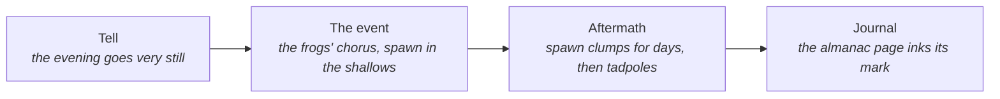
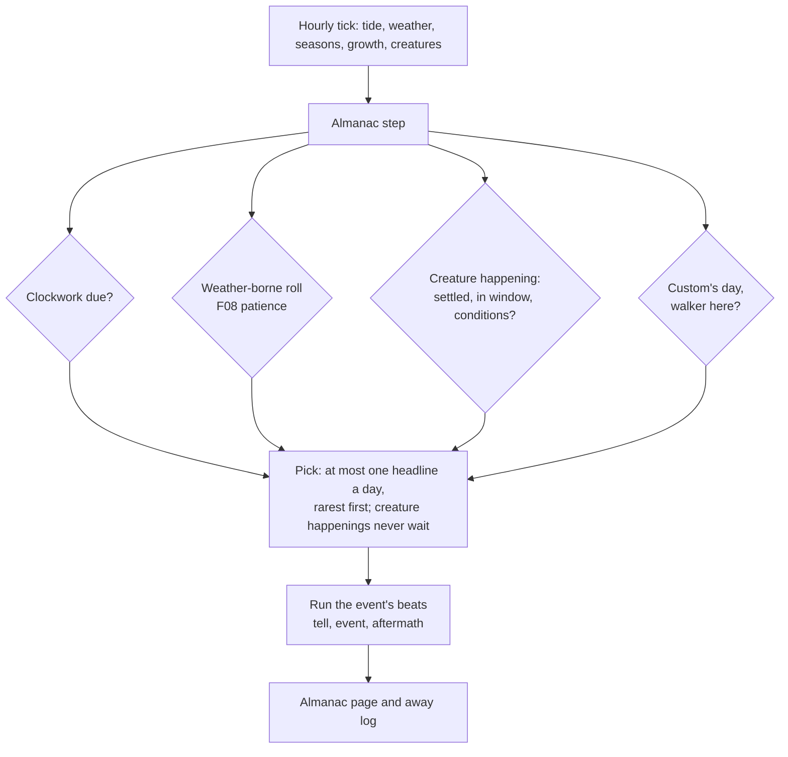

# F14 — The almanac: events that come round

> Real places keep a calendar of their own. There's the night the frogs spawn, the morning the dragonflies climb out of the pond, the lowest tide of spring that shows rocks no one has seen since last year, the shortest night you sit up through. ebb already has pieces of this scattered around: music's signature nights (doc 24), F08's rare phenomena, the season markers (storm shells, jellyfish, fungi and webs), bottles on the strandline, and the first evening's director. This doc gathers them into one calendar, the **almanac**, and adds three new kinds: creature happenings, keeper's customs and the lowest tides. Every event comes from the island's own clock and conditions, recurs, and can never be missed for good.

**Status:** Seed. Not scheduled. Drafted October 25, 2026, from Matt's ask to explore scripted and regularly occurring events.

## Decided so far

Nothing new. These rules carry over from the vision and F08:

- Events run on **game time**: the 56-day year, the moon, the tide and the weather record. They never use real time or the real calendar, so there are no real-world holidays and no "log in this weekend".
- No notifications, no countdowns, no fail states, no daily-login pressure (doc 01).
- Nothing is lost by being away. An event missed this year comes again next year.
- The outside world stays distant and unnamed (the bottle letters' rule).

## The idea

An event is a day the island remembers. Some can be predicted, like a tide table: the spring low tides, the turnings of the year. Some need the right weather on the right night, like the frogs' first warm, wet night of spring. Some belong to the creatures that live here, so they only begin once those creatures have settled. A few belong to the keeper: small customs the walker can choose to keep on certain days, like a fire on the shortest night.

What makes them "scripted" is that each has a short shape: a lead-in the world gives as a tell, the thing itself, and an aftermath you can still find later. What keeps them cozy is that none of them asks anything of the player.

## How it could work

### Five families

| Family | What drives it | Predictable? | Touches the ecology? | Examples |
|---|---|---|---|---|
| **Clockwork** | Calendar, moon, tide | Yes, listed ahead in the almanac | No | The four turnings of the year, the spring low tides, full-moon nights, king tides (F08), the meteor shower (F08) |
| **Weather-borne** | Season plus the weather record, then a seeded roll with patience (F08) | No | No | Fog bank, rainbow, glowing plankton, frost flowers, migration morning (all F08) |
| **Creature happenings** (new) | A settled population plus the season and weather it would really wait for | Roughly ("some warm night in early spring") | **Yes**: part of the sim, so it runs identically in catch-up | Frog spawning night, dragonfly emergence, turtle hatchlings, the eel run, bat swarming, the dawn chorus peak |
| **Keeper's customs** (new) | A calendar day plus the walker choosing to do something | Yes | No | The shortest-night fire, the longest-night lantern, first sowing day, the island's birthday (F04) |
| **The sea's deliveries** | Season, storms, rarity | No | No | Storm wrack and storm shells, jellyfish strandings, bottles with letters (F12) |

The first two families are F08's and stay as F08 designs them. The last family is mostly built. This doc adds the middle three and the one calendar they share.

### Creature happenings (new)

These are real events in the lives of the species ebb already has or plans (doc 12). Each one waits for the settled population and the conditions the animal really waits for.

| Happening | Species | When | What you see | Aftermath | Real basis |
|---|---|---|---|---|---|
| **Spawning night** | Frogs | The first mild, wet night after the frogs wake in early spring | The chorus starts at dusk and swells for an hour. Frogs gather in the shallowest warm water | Clumps of spawn in the shallows for 3 to 5 game days, then tadpoles (the life stages already exist) | Common frogs spawn en masse on the first mild wet nights, often all on one night |
| **Emergence morning** | Dragonflies | A warm, still morning in early summer | Nymphs climb reed stems at first light; adults split out and pump up their wings | Empty nymph skins (exuviae) left on the reeds for days: a find, and a sketchbook moment | Exuviae on emergent stems are how real surveys count dragonflies |
| **Hatchling run** | Turtles | Late summer, a warm afternoon | Tiny turtles leave the nest bank and make for the water | A small nest hollow in the bank; the hatchlings in the pond's shallows for the rest of the season | Hatchlings emerge together and head straight for water |
| **Eel run** | Silver eels | The darkest, wettest autumn nights, near the new moon | Eels slip down the outflow toward the sea | Nothing to find: they are gone, and the journal notes it | Silver eels migrate on dark, rainy autumn nights |
| **Swarming** | Bats | Late summer and early autumn nights | Bats chase and circle one place for hours | None; it marks the place they will winter | Autumn swarming at roost sites is real bat behavior |
| **Dawn chorus peak** | Songbirds | Late spring dawns | The fullest dawn of the year, every singer at once | None; the music may answer it (doc 24) | The chorus peaks in late spring |
| **Seal pupping** | Grey seals | Autumn, on a quiet sandbar | A white-coated pup on the bar; the mother in the shallows | The pup stays about three game weeks, then is gone | Grey seals pup in autumn on undisturbed shores |

Rules for this family:

- **Only for settled species.** A happening never brings a species. It is what a species does once it lives here.
- **Deterministic.** These change the ecology (spawn becomes tadpoles), so they run in the sim tick from the world seed, the same in catch-up as when watched. That is what the determinism check needs.
- **Once a year per population**, with a window of several days and a seeded night inside it. If the weather never suits that window, the last night of the window takes it, so the year always has one.
- **Never harm.** Spawn that dries out is not shown dying; it simply was not laid there. Hatchlings all make it. No predators.

### Keeper's customs (new)

These are small things the walker can do on a few days of the year. They are never asked for, and never rewarded beyond a journal line and a moment the sketchbook can draw. They give the year a rhythm the player owns.

| Custom | Day | What the walker does | What answers |
|---|---|---|---|
| **The shortest-night fire** | Midsummer (the first night of summer, a new moon) | Light the fire and sit up through the night, instead of resting | The sky never quite goes dark in the north. Moths at the fire, then the dawn chorus before the fire is out |
| **The longest-night lantern** | Midwinter (the first night of winter, also F08's meteor peak and winter's signature night in doc 24) | Set a small floating light on the pond: a rush float carrying the hand lantern's flame | The light drifts on the still water through the night; meteors overhead if the sky is clear |
| **First sowing** | The first warm day of spring | Sow anything from the tin | The journal's year starts here; the almanac page turns to a new year |
| **The island's birthday** | The day the island was made, each year (F04 already proposes anniversaries) | Nothing to do: visit and look | One keeper's page in the walker's hand, comparing then and now |
| **Harvest day** | The first frost of autumn | Gather from any herb, berry or seed plant | A line about the year's stores; the camp hamper looks full (P2j) |

- Each one is offered once by a soft line in the island-notes corner on its day (*"The shortest night. The fire would see the dawn."*), and only if the walker is on the island. A tap tucks the line away, as the first evening's do.
- Skipping a custom costs nothing. It comes next year.
- The first evening is itself the first custom. The director that runs it (src/world/intro) is the natural engine for these: a few beats, each with a tell, a check and a line.

### The lowest tides (new, clockwork)

Twice a year the spring tides nearest the equinoxes fall lowest of all. F08 has the high side of the same swing, king tides. On the low side, a band of shore below the usual low-water mark shows for a few hours.

- **What shows:** rock that is normally under water, with things that live only there: anemones, a starfish, a pool with a blenny in it. It is a new set of finds for the nets and the beachcomber's trail, and a place to walk that is not there the rest of the year.
- **Why it matters:** it is the most clockwork event of all. The almanac can list it ahead, a real tide table can predict it, and it rewards the player who reads the calendar.
- **Cost:** the tide model already has the swing (F08's slow yearly term); this uses its low peak too.

### The almanac page

A journal page draws the year as a wheel: 56 days around the rim, the four seasons as quarters, the moon's phases inside.

The forager's trail already gives a **forager's almanac** (in main since PR #120): a ring calendar in the herbarium of when each gathered part is ready. The events wheel should be the same wheel, not a second one. Either it gains an outer ring of events, or the two share one "Almanac" page with plants inside and events outside. One wheel, one name.

- **Clockwork events** are pencilled on the wheel ahead of time: the low tides, the turnings, the meteor peak. This is the tide table gift the trails already plan, grown into a year.
- **Other events** are pencilled only once seen, and inked each year they are seen again. A frame never lists what is missing (doc 13's rule).
- **Away**, an event writes one quiet note to the away log, ranked with the rest for the reveal ("The frogs spawned in the night of day 6"). Its aftermath is there to find.
- **Year over year**, the page keeps the last few years' marks faintly behind the current one, so a player can see the island's calendar settle (the frogs spawning a little earlier as the pond warms, say).

### One scheduler for everything

- **Data:** one recipe, `recipes/world/almanac.json`. Each event has an id, a family, a trigger (date window, moon phase, tide, weather flags, a settled species, a custom's check), its beats, and its words. A species' own happening could live in its species recipe instead and be gathered at boot.
- **At most one headline a day,** as F08 says. Creature happenings are the exception: they belong to the sim and are never held back. A cosmetic event that clashes waits for its next chance and keeps its patience.
- **Two kinds of determinism.** Creature happenings write to the ecology, so they are seeded and identical in catch-up. Everything else writes only to what the player sees, so it can lean toward times the player is present (F08's argument) without changing the island.
- **Events talk through the event bus** (`almanac:tell`, `almanac:start`, `almanac:end`, each with `{ id }`), and each system answers in its own module: the music for signature nights, the water for the low tide, the frogs for spawning. The almanac never reaches into another module.
- **Saves:** which events have been seen each year, patience counters, today's event. Well under 1 KB.

### What a year could look like

| Day | Season | What might happen |
|---|---|---|
| 0 | Spring begins | First sowing. A lowest tide near the equinox |
| about 3 to 8 | Early spring | Frogs' spawning night (once frogs wake). Migration morning (F08) |
| about 10 | Spring | Fog bank chance (F08) |
| 14 | Summer begins | The shortest-night fire. Dark sky at the new moon |
| about 16 to 20 | Early summer | Dragonflies' emergence morning |
| about 22 | Summer | Glowing plankton chance (F08). Dawn chorus already past its peak |
| about 25 | Late summer | Turtle hatchlings. Bats begin swarming |
| 28 | Autumn begins | A lowest tide near the equinox. King tide (F08) |
| about 30 to 34 | Autumn | Seal pup on the bar. Storm wrack days |
| about 36 | Autumn | Eel run on a dark wet night. Harvest day at the first frost |
| 42 | Winter begins | The longest-night lantern; the meteor peak (F08); winter's signature night (doc 24) |
| about 44 to 52 | Winter | Frost flowers (F08). Turnstones on the wrack |

## What it would change

- **02** core loop: an almanac step in the tick order after weather and seasons; new away-log note kinds.
- **07** water and tide: the low peak of F08's yearly tide swing; the low-water band as a walkable zone with its own finds.
- **11** creatures and ecology: a `happening` block per species (window, conditions, beats, aftermath); spawn clumps and exuviae as pieces.
- **12** creature roadmap: each species' happening listed with it.
- **13** progression and journal: the events ring on the forager's almanac wheel; the tide table gift feeds it.
- **F08** rare phenomena: its scheduler becomes the almanac's weather-borne family, unchanged in behavior.
- **F13** keeper's camp: the customs reuse the evening director; the floating lantern is a small make.
- **17, 24, 25** audio and music: the spawning chorus swell, the dawn chorus peak, the custom nights.
- **18** saves: the almanac's small record.

## Risks and guardrails

- **The event treadmill.** Live games turn calendars into chores. Here nothing is a quest, nothing gives a reward worth chasing, and nothing that is missed is gone. If an event ever starts to feel like an appointment, it is wrong.
- **Too much at once.** One headline a day, and most days have none. The calendar above has about 20 marks in 56 days.
- **Fear of missing out.** Clockwork events are shown ahead, everything recurs, and aftermaths last days.
- **Story creep.** Customs are things the walker does, not visitors who arrive. No people come to the island.
- **Determinism.** Only creature happenings touch the ecology, and they run in the sim. Everything else is drawn on top.

## Open questions

- Which events belong in a first set? A small start could be frogs' spawning night, the lowest tides and the shortest-night fire.
- Should customs be offered with a line on their day, or found only by players who read the almanac?
- Should events join the forager's almanac wheel as an outer ring, or should the tide table gift on the trails grow into its own events wheel?
- Is anything from outside the island ever welcome, such as a sail seen far out at dawn once a season, never landing? Or does the sea's bottles stay the only voice from outside?
- Should the floating lantern on the longest night be a make (a rush float) or something the walker simply does with the hand lantern?

## Depends on / feeds into

- Depends on: F01 (the 56-day year), F08 (the weather-borne scheduler and the tide swing), 06 (moon), 07 (tide), 10 (weather record), 11 and 12 (species), F13 (the director, the camp, makes), 24 (signature nights).
- Feeds into: F04 (anniversaries), F09 (wrack and trails as traces), F12 (low-tide finds), F15 (the hen's laying season), F16 (the cave's tides and its bats).
