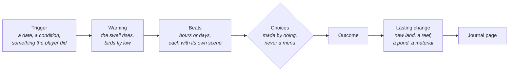

# F14 — Scripted events

> Most days on the island are quiet, and they should be. But now and then something happens that the island will remember. A boat comes ashore in a winter storm and breaks up over a week. A star falls into the meadow. Small stone cairns start appearing overnight, and no one is ever seen building them. These are written set pieces: each has a warning, beats that play out over hours or days, a choice or two the player makes by doing things, and a change that stays.

**Status:** Seed. Not scheduled. Drafted October 25, 2026, from Matt's ask for scripted and regularly occurring events, and redrafted the same day after his note that the first draft listed things the game already does. Matt called this set "a great start"; more can be added later. October 29, 2026: the shared runner and the first two set pieces, the cairn builder and the passing boat, built on `m2-set-pieces` (see "Built so far" at the end); a plan for all seven is the plan page scripted-events-plan.html.

## Decided so far

- **Scripted means written.** A set piece is an authored sequence with a beginning, middle and end, not a weather roll or a creature's yearly habit. Recurring phenomena stay in F08, and the season markers stay as they are.
- These rules carry over from doc 01 and shape everything below:
  - Nothing destroys the player's progress. A storm never undoes shaping or harms a creature.
  - No countdowns and no daily-login pressure. A set piece that needs the player waits for them.
  - The outside world stays distant: no people land on the island and no faces are shown. One possible exception, not decided (Matt, October 29, 2026): the old fisherman from the passing boat might one day come ashore as a companion to the walker (see "Future: the dock, the boat as a home").

## What a set piece is

- **Trigger.** A date window, an island condition (a camp exists, the pond is deep enough, a tall seaward cliff stands), a previous set piece, or something the player did.
- **Warning.** The island tells you first, in the world and in the walker's lines: the swell, the light, the birds.
- **Beats.** The set piece unfolds as a few scenes over hours or game days, so it is something you live through, not a cutscene.
- **Choices by doing.** The player chooses by acting in the world: carry the timbers to camp or leave them, add a stone to the cairn or not, leave a parcel on the shore or not. There are no dialogue menus.
- **Lasting change.** Every set piece leaves the island different: a material, a piece of land, a habitat, a keepsake, a new plant.
- **The journal** gets a page for each one, in the keeper's hand, with a sketch.

## The first set

| Set piece | How often | Trigger | What stays |
|---|---|---|---|
| **The wreck** | Once per island | The first winter storm after the camp is made | Ship's timber, a sea chest, a hull that becomes a reef |
| **The great storm** | About once a year | Autumn or winter, seeded | A reshaped strand, a fallen tree, a beach full of wreckage |
| **The falling star** | Once per island, maybe a second years later | A meteor-shower night (F08) in the second year | A crater pond, star-iron |
| **The cairn builder** | Once per island, over weeks | The cave mouth exists (F16), or the second spring | A trail of cairns, the old keeper's letter |
| **The hard freeze** | About one winter in three, seeded | Midwinter, a still, clear spell | Frost-split stones, ice plates on the shore |
| **The new bank** | Once per island | A great storm in a year with a sandbar | A sandbank offshore that grows into land |
| **The passing boat** | Up to once a season | The camp has stores | Letters, seeds, things from far away |

### The wreck

A small boat, its mooring broken somewhere far off, comes ashore in a winter storm. No one was aboard: the journal says so plainly on the first morning, because a cozy game cannot leave that question open.

- **Warning.** The evening before, the storm's warning (see the great storm) plus a light out at sea that comes and goes.
- **Beat 1, the night.** In the storm's worst hour, a dark shape on the bar and a sound of timber.
- **Beat 2, the first morning.** The boat lies on its side on the bar, mast down. At low tide the walker can reach it. In the cabin is a **sea chest**.
- **Beat 3, the breaking up.** Over about a game week the sea takes it apart. Each tide puts planks, a cask and rope on the strand. **Ship's timber** is a new material: seasoned oak, the best wood on the island, for makes that need long, straight pieces (a proper bench, a jetty, a boat later).
- **The choice.** Whatever timber the player carries to camp is theirs. Whatever is left becomes the hull's lasting shape on the bar. Over the next years it grows weed and barnacles, then fish and crabs live in it: a reef. Taking everything leaves no reef; taking nothing leaves the biggest one. Most players will land in between, and both halves are worth having.
- **The sea chest.** A compass (a keepsake), a ship's log with most pages washed blank, and a tin of seeds from far away. Sown, the seeds give **a plant that doesn't grow anywhere else on the island**.

### The great storm

Once a year, roughly, a real storm comes. F08 and the weather record already have bad days; this is the one the island talks about afterwards.

- **Warning, the day before.** A long swell with no wind, high thin cloud, gulls flying inland, the walker's line: *"Weather coming. A big one."* The sky goes copper at dusk.
- **The choice: getting ready.** The player can weigh down the tarp with stones, bring the hamper and pack under cover, haul the raft above the tide line and bank up the fire. Each one is a small action at camp.
- **Beat 1, the night.** Rain, wind in the trees, the sea loud. Being in the shelter by the fire is the coziest night of the year.
- **Beat 2, the morning.** Anything not made safe has blown around the island. Nothing is lost: it all lies somewhere to be found, which becomes a small morning's hunt. Things that were made safe are just where you left them, and the journal notes the keeper's good sense.
- **What stays:**
  - The strand is covered in wreckage: driftwood, storm shells, weed, a bottle or two (the season markers, all at once).
  - One wild tree is down. It becomes a fallen log, a home for creatures (F10).
  - The storm only adds. It may leave a new rock pool or a drift of sand on the strand, but it never touches the player's shaping.

### The falling star

- **Trigger.** A meteor-shower night (F08) in the island's second year or later, with a clear sky.
- **Beat 1.** Among the meteors, one far brighter streak, a low boom a few seconds later, and a glow somewhere on the island.
- **Beat 2, the hunt.** The glow fades by morning, but a thread of steam rises from where it fell. Finding it means walking there.
- **What stays:**
  - A small crater, a meter or two across. The next rain fills it, and it becomes a little pond with its own life.
  - **Star-iron**, a lump of meteoric iron. It is the only metal on the island. It can stay as a keepsake on the shelf, or become the blade of the best weapon in F16. That choice is the player's.

### The cairn builder

A mystery told across weeks.

- **Trigger.** The cave mouth exists (F16), or else the island's second spring.
- **Beats.** Every few game days a new cairn of stacked stones stands somewhere on the island at dawn. No one is ever seen building them, and they never appear while the walker watches. Each one leans toward the next, and together they form a trail across the island that ends at the cave's rubble passage (F16), or at the old keeper's cache (F13) if there is no cave yet.
- **The choice.** The walker can add a stone to any cairn. If they do, the next cairn answers with one stone more. If they knock one down, it stands again two mornings later, a little crooked.
- **What stays.** The cairns, which slowly gather moss. At the end, a letter in the old keeper's hand. Who builds them is never said; see the open questions.

### The hard freeze

- **Trigger.** Midwinter, about one winter in three, seeded. It needs a still, clear spell.
- **Warning.** Stars very sharp, smoke rising straight up, the walker's breath showing.
- **Beat 1.** Over two nights the pond freezes from the edges in. Bubbles are caught in the ice, and frogs can be seen sleeping below it.
- **Beat 2.** The ice holds. The walker can walk on it and slide a little. The camp needs its fire, and the reeds stand white with frost.
- **The choice.** The walker can break a hole in the ice by the deep end, as real pond keepers do, to let air in. The fish are fine either way, but the minnows gather under the hole, and that becomes a journal sketch.
- **Beat 3, the thaw.** The ice breaks into plates that pile on the shore, then melt.
- **What stays.** Frost splits a few rocks along the shore, which gives new flat stones and pebbles.

### The new bank

- **Trigger.** A great storm in a year when the island has a sandbar.
- **Beats.** At dawn after the storm there's a pale bank offshore that wasn't there before. Over the season it grows a little at each spring tide. Marram takes hold on its crest.
- **The choice.** The shaping tools can reach it, so the player can make it part of the island. Or they can leave it wild, and then seals haul out on it and terns nest on it in summer. These are creatures that need land no one walks on.
- **What stays.** New land.

### The passing boat

The one way the outside world reaches the island, and it never lands. It is an old fisherman's working boat (Matt's model), and the letters are his.

- **Trigger.** After the camp has stores, and then every few game days (4 to 7, seeded), so its eight letters take about one game year (Matt, October 29, 2026: once a season was too drawn out).
- **Beat 1, dusk.** A lantern on the water offshore and a bell, carried on the wind. The boat anchors for the night and never comes close.
- **The choice.** The walker can leave a parcel on the flat stone at the tide line, while the boat is there or any time between its visits, so a visit slept through loses nothing.
- **Beat 2, dawn.** The boat is gone. If a parcel was left, something is there in return: seeds, a tool part, cord, a letter.
- **Over the years.** The letters get warmer. Whoever is on the boat starts to know the island through what the keeper sends. The eighth letter asks the keeper to build a dock so the boat can come in (see below); after it, short quiet notes keep coming. This also gives the camp's goods somewhere to go, without a shop.

## Future: the dock, the boat as a home

Not built; an idea for later (Matt, October 29, 2026).

- **The dock.** The fisherman's last letter asks for a dock out past the mooring, so the boat can come in instead of lying off in the swell. Building it would be a camp build on foot: posts driven into the shallows, planks laid over them (ship's timber from the wreck would suit it).
- **The boat comes in.** Once the dock stands, the boat ties up at it for good. The fisherman leaves it to the keeper; a last letter says it is the keeper's now.
- **A home.** Over time the boat becomes where the walker lives: a cabin to rest in instead of the tent, shelves where keepsakes are placed in the world (not only in the journal), and things to decorate it with.
- **A companion, maybe.** One exception to "no people land" is open: the old fisherman might come ashore and stay, a companion to the walker. Not decided; it would need its own design (how he is shown, what he does, how he fits the cozy rules).

## More for later

The whale passing close on a calm evening. A total eclipse. A swarm of jellyfish lighting the bay. A lost kite tangled in the gorse. A heron that stays a whole winter with a hurt wing and leaves in spring.

## How it runs

- **Data, not code.** Each set piece is one recipe, `recipes/setpieces/<id>.json`, holding:
  - its trigger
  - its warning and beats, each with a duration, what it places or changes, and its words
  - its choices, each with the check that notices it
  - its outcome and its journal page
- **One director.** The first evening's director (`src/world/intro`) already runs beats from data with checks and lines. It grows into the set piece director. The first evening becomes the first set piece.
- **Bus events.** The director uses `setpiece:warn`, `setpiece:beat`, `setpiece:choice` and `setpiece:end`, each with `{ id }`. Each system answers in its own module: the water, the weather, the music, the journal. The name avoids clashing with the event bus itself.
- **Spacing.** One set piece at a time. Big ones (the wreck, the great storm, the falling star) are at least a game week apart. A first year has two or three at most.
- **Presence.** A set piece that needs the player waits for them. When its trigger comes true while the player is away, it arms and starts at the next fitting moment while they're on the island (the next stormy night, the next shower night). Nothing big happens behind their back.
- **Determinism.** The day a set piece starts and the choices made are saved, like edits. From then on, its lasting changes run in the sim from the seed: the reef grows, the bank builds, the crater pond fills. They come out the same in catch-up. The determinism check replays the saved start days along with the edits.
- **Saves.** Per set piece: armed, started on, current beat, choices, done. Well under 1 KB.

## What it would change

- **01** vision: one line, written set pieces, none that destroy progress.
- **02** core loop: the set piece director in the tick order; armed set pieces wait for presence.
- **07, 10** water and weather: the storm's swell and copper sky, the freeze, the bank's growth.
- **08** terrain: the crater, the new bank as land the tools reach, the storm's added rock pool.
- **11** ecology: the reef on the hull, the crater pond, seals and terns on the bank.
- **13** journal: a page per set piece.
- **F08** rare phenomena: the meteor shower now has a set piece riding on it.
- **F12** keepsakes: the compass, star-iron, the boat's gifts.
- **F13** camp: ship's timber as a material, the storm's getting ready, parcels from the stores; the director grows from the first evening's.
- **F16** the cave: star-iron for a weapon, the cairns leading to the rubble passage.
- **17, 24, 25** audio and music: the storm night, the bell, the freeze.
- **18** saves: the set pieces' small record; determinism replays their start days.

## Risks and guardrails

- **Drama against coziness.** A storm and a wreck can be frightening. The warmth is in the camp: the storm night is spent by the fire, and the wreck is empty and says so.
- **Too often.** Set pieces are rare on purpose. If one starts to feel routine, space them further.
- **Story creep.** No people come ashore. The boat's fisherman is only ever a lantern and handwriting, unless the possible exception above is chosen.
- **Scope.** Each set piece is real work: new pieces, sounds, words and a journal page. Build one at a time, starting with the one that reuses the most.

## Open questions

- Which comes first? The great storm reuses the most (weather, the strand, logs, the camp). The wreck is the most memorable.
- Who builds the cairns? Never answered, or answered at the very end (an otter that stacks stones, the bear, the old keeper)?
- Should the passing boat's letters ever become a story with an end, or keep coming forever?
- Should the falling star's star-iron be the only metal on the island, as here, which makes it precious?
- Is the new bank too big a change to the island's shape to happen on its own?

## Depends on / feeds into

- Depends on: the first evening's director (src/world/intro), F08 (meteor shower, the weather record), 07 and 10 (tide, weather), 08 (terrain), F10 (logs), F12 (keepsakes, bottles), F13 (camp, stores, makes).
- Feeds into: F04 (the reef and the bank growing over years), F15 (the hen's arrival), F16 (star-iron, ship's timber, the cairns' trail).

## Built so far

October 29, 2026, on `m2-set-pieces`. Where this differs from "How it runs" above, this is what the game does.

- **The runner** (`src/world/setpieces/runner.js`) is a step in the hourly tick, after the hen, rather than the first evening's director grown larger: the evening stays as it is, and merging them later is a tidy-up. Its state is in the world state (`world.setpieces`), so saving, catch-up and the determinism check carry it with no save section of its own. Older saves start with none.
- **Recipes:** `recipes/setpieces/<id>.json` (trigger, beats, words, the set piece's own numbers); `recipes/world/setpieces.json` holds the order they may arm in and the spacing (a rest of `gapDays` after each, big ones `bigGapDays` apart, at most `firstYearMax` big ones in the first year).
- **Beats** fall `afterDays` after the one before (a number or a seeded range), at dawn, dusk or any hour (dawn and dusk follow the season's day length), once their `waitFor` holds. A beat marked `presence` waits through hours away (catch-up sets `env.away`) for the next fitting hour you are on the island. At most one beat an hour.
- **Choices by doing** are card actions that record a small note in the world state; the next hour's tick applies it through the set piece's rules (`src/world/setpieces/hooks.js`). Conditions the tick cannot see (the camp has stores) come the same way.
- **Events:** `setpiece:arm`, `setpiece:warn`, `setpiece:beat` (with the beat's id and repeat), `setpiece:choice`, `setpiece:end`.
- **Journal:** each set piece's page is a keeper page (`recipes/world/keeper-pages.json`), had when it first ends; a page line can be `{ if, line }` or `{ not, line }` on a journal flag, so it follows what you did. Letters (the old keeper's, the boat's) are keeper pages too, and open as a centered card when found.
- **The cairn builder** (`cairns-live.js`, `cairn-rules.js`): arms in the second spring (or when F16 reports the cave mouth). The trail is planned once on the live island from the camp pad along the longest line of dry land (or toward the old keeper's cache, once the dig reports it). Seven cairns, a dawn every one to three days, drawn in code from stacked flat stones, mossier as the seasons pass; never appearing while you watch. Add a stone (a flat stone or pebble from the pack) and the next cairn has one more than that one holds. Knocking one down is left out for now.
- **The passing boat** (`boat-live.js`): Matt's fishing vessel (`assets/models/camp/fishing-boat.glb`, 11 m), once the camp has stores and then every 4 to 7 game days (seeded) after it last left; at dusk, when you are there, it lies at anchor about 70 m out with a lantern's light at the wheelhouse and a ship's bell made in code (`src/audio/bell.js`). The mooring stone stands by the stake from then on. A parcel (one handful of herbs, cord or something made at camp) can be left on it any time; at the boat's next dawn it is taken and the next return lies there (seeds or cord, never what was sent) with the next of the old fisherman's eight letters, warmer each time. The eighth asks for a dock (not built; see "Future: the dock, the boat as a home"); short quiet notes follow.
- **Test links** (unsaved): `?setpiece=<id>&beat=N` starts a set piece now at step N (a repeated beat counts each time). Tests: `tools/unit-tests-setpieces.js`; two seeded years on `tools/determinism.html`.
