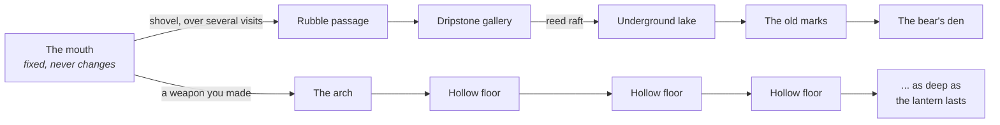
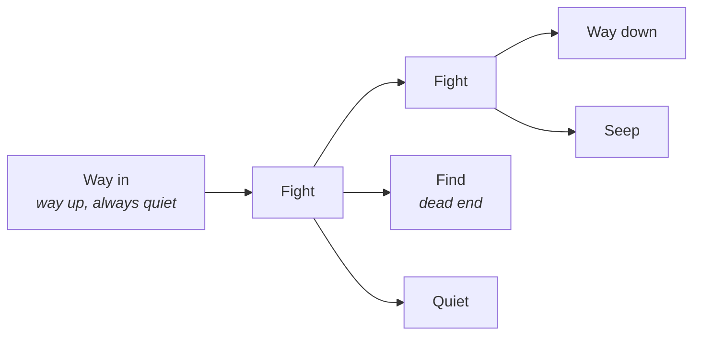
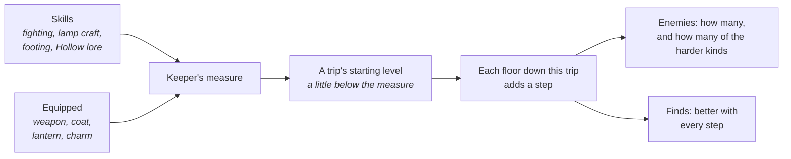
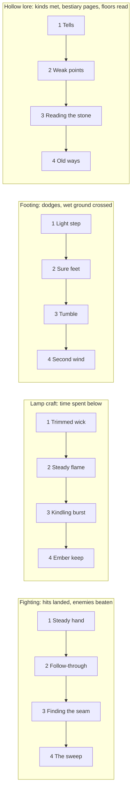

# F16 — The sea cave and the Hollow

> Where the sea has worked at a cliff long enough, it opens a mouth. Inside is a chamber that is always the same: tide pools, weed, the sound of the sea. Two ways lead on. One is choked with fallen rock, and digging through it, visit by visit, leads to quiet chambers and a sleeping bear. The other is an old arch with soot marks around it, and the walker won't go through it with empty hands. Beyond it is **the Hollow**: floors that are different every time you go down, things in the dark that don't belong to the island, and a lantern that decides how far you get before you have to turn back. Nothing makes a player go there. It's for the ones who want it, the way the mines are in Stardew Valley.

**Status:** Leaning. Not scheduled: work for a later date. Drafted October 25, 2026, from Matt's ask for a cave with a dungeon-crawling experience, then redrafted the same day to Matt's own design (below). It builds on Matt's pin of October 18, 2026 (caves for a landmark creature such as a bear) and doc 20's M7 line on placed rock pieces for sea caves.

## Decided so far (Matt, October 25, 2026)

- **Optional.** Nothing on the surface needs the cave. A player goes there only to do everything, as in Stardew Valley's mines. It has **its own trail**.
- **The mouth never changes.** It is one fixed, hand-made area.
- **To one side, a rubble passage**, blocked at first, that eventually leads to the bear.
- **Another entrance that needs a weapon.** The player can't go through until they've made one.
- **Beyond it, the Hollow:** floors that change procedurally and get tougher as the player progresses.
- **No numbered levels.** Progress is tracked by internal numbers for the player's skills and equipped items, and the Hollow sets its enemies' level from them.
- **Each skill is a track of four ranks**, each rank making the walker stronger.
- **Enemies never learn new behavior.** Harder levels bring more enemies, and more of the harder kinds.
- **Making is gated by progress**, and the first set of weapons, lanterns and coats in the tables is approved.
- **The lantern decides** how far the player can go before they have to call it quits.

## What this changes for ebb

This is the first place in ebb with enemies. Doc 01 lists "no combat" as a non-goal. The proposal is a single, bounded exception:

- **Combat happens only in the Hollow, and only when the player chooses to go in.** The island, the camp, the rubble passage and the bear's chambers never have enemies.
- **None of the Hollow's things ever come up.** Only materials, keepsakes, plans and the root halls' old seeds do. The surface stays exactly as cozy as it is now.
- **The island's real creatures are never fought.** The Hollow's things are not animals (see the bestiary).
- **No death.** When the light gives out, the walker finds their way out in the dark and wakes at the mouth (see when the lantern goes out).

## The layout

### The mouth

- One fixed space, hand-built, the same on every island: a wave-cut floor, weed, rock pools with prawns and a blenny, daylight from the entrance.
- At high tide the sea fills the entrance. The walker comes in at low tide. The rubble passage, the arch and everything beyond are above the highest tide, so no one is ever trapped: the walker waits on the ledge or rests until the water drops.
- A **lantern hook** by the arch. The walker hangs the lantern here and it lights the mouth while they look around. It's where every trip into the Hollow starts and ends.

### The rubble passage and the bear

The quiet half of the cave, with no enemies.

- **The rubble** is cleared with the shovel (P2c digging), a stretch per visit, so getting through takes several trips. Each stretch turns up something: old bones, a bead, a fossil.
- **Behind it** are hand-made chambers that never change: a dripstone gallery, an underground lake crossed on the reed raft, and a wall of old soot marks with the earlier keeper's letter (F13 section 10).
- **The bear's den** is the last chamber. A brown bear comes to the island late in the game, once the woodland can feed it, and winters here. Finding it asleep is the quiet climax: you lower the lantern and leave. Its trust grows by being left alone. It is never an enemy.
- The cairn builder (F14) can lead here.

### The arch

- An old arch to the other side of the mouth, ringed with soot and scratched signs. Something moves in the dark beyond it, just past the lantern's reach.
- **Without a weapon** the walker stops at the arch: *"Not with empty hands."*
- **With a weapon they made**, the walker steps through. The first time, the arch's journal page opens the Lamplighter's trail.

### The Hollow

A trip is a run down through floors, one after another, until the player decides to head back up or the lantern gives out.

- **Each floor** is a handful of chambers and passages with a way down, enemies, finds and sometimes a feature: an oil seep, a crystal pocket, a still pool for the net. Some floors are guardian floors. The depths, the floor plan, how enemies fill it and the guardians are below (agreed with Matt, October 27, 2026).
- **One camera for the whole game.** The island's walker camera follows the walker into the Hollow with the same controls, set a little higher and further back (see Fighting).
- **Every trip is new.** A floor's layout comes from the island seed, the trip number and the floor's place in the trip. The Hollow is seeded, so saves and replays are exact, but no two trips repeat.
- **The way up** is always marked. On any floor the walker can climb back out with everything they're carrying. Going up is a walk back to the arch with a fade, not a climb through every floor.
- **Not simulated while away.** Nothing grows or moves in the Hollow while the game is closed. It has no part in catch-up.

### The depths

Four depths in order, and two flavors that can come up instead. A floor's level (the trip's starting level plus one step per floor; never shown) picks its depth, with soft edges so that near a border either depth can come up. Each depth has its own rock, light, sound, chamber shapes and kinds, so going deeper reads at once. The first time the walker reaches a new depth they say one quiet line (*"The weed's gone. Only stone down here now."*), and the Lamplighter's trail marks it. That is the only sign of depth: no numbers.

| Depth | Looks | Chambers | Lives here | Finds |
|---|---|---|---|---|
| **1 The wet shelf** | Wave-worn shelves, weed, shallow rock pools, the sea faint above | Wide and low; puddles that slow you; weed heaps, some of them tanglers | Soot motes, silt crawlers, wrack tanglers, brine eels in the pools | Clay, soot, tangle fibre, the odd hagstone, sea-worn keepsakes |
| **2 The dripstone** | Columns and hanging stone, tall rooms, the drip echo; long column shadows | Pillared halls that break sight lines; narrow crawls between | Drip wisps on the ceiling, crawlers, the first hagstone watchers (one at a time) | Cave pearls, flint, ochre; oil seeps start here |
| **3 The silt deeps** | Black still water, mud flats, old tide lines high on the walls; quiet, sounds carry | Long rooms with a deep channel down the middle; causeways; silt that slows you | Barnacle backs on the flats, brine eels in the channels, the first lamp-eaters | Hollow oil, brine salt, barnacle shell, guardian make plans |
| **4 The glass halls** | Crystal in the walls throws the lantern back in colors; the darkest, bluest rooms | Pools of thrown light with dark between | Tide shades in the gaps, hagstone watchers in groups, lamp-eaters, a few of everything above | Crystal, the best keepsakes, the rarest charms |

**The two flavors**, from depth 2 on, take the place of a depth's usual rock. Each keeps its depth's level, budget and kinds, and uses the same camera and controls:

- **The sponge.** A gyroid lattice: the rock worn into a porous sponge, light leaking every way (the TPMS floor in How it is built). Its chambers open into each other through the lattice instead of passages. It has more finds than any other floor. About 1 floor in 12.
- **The root halls.** The island's own tree roots, grown down through the ceiling and walls: pale, knotted, alive and dripping, with glow-worm threads between them, the one place in the Hollow where something from above has reached down.
  - **How often** follows how many trees grow on the island: rare with a few young willows, common once the woodland is in. A keeper who plants trees finds more of them, and nothing above ever needs it.
  - **How it plays:** root curtains split chambers into lanes. Hollow things are uneasy near living roots and won't cross the thickest tangles, so the floor plays as lit lanes of root with open dark between. Its wrack tanglers are knots of root, not weed.
  - **Finds:** root-wood (a make ingredient), cave fungi, and now and then an **old seed**, a plant the island hasn't got yet, to plant on the surface (Matt, October 27, 2026). It is the Hollow's one gift to the garden, and never the only way that plant arrives. Taproot's burst is stronger here.

### A floor

A floor is a small map of chambers joined by short passages: a main path of 3 to 5 chambers and 1 to 3 side chambers, from about 4 chambers near the top to about 8 deep down. Chambers are real rooms with height (columns, hanging stone, ledges), about 12 to 20 m across, and passages bend so one chamber's things can't see into the next. Each depth brings its own chamber shapes (pillars, channels, crystal), each one a blend of blobs meshed with dual contouring.

| Chamber | What it is |
|---|---|
| **Way in** | Where the rope drop lands. Always quiet. The way up is marked here, so the walk back is never far |
| **Fight** | The main chambers, filled from the threat budget (below). The passage ahead stays dim until the chamber is quiet, but the walker can always run through |
| **Quiet** | No enemies: a still pool for the net, a crystal pocket, a ledge to look out from |
| **Find** | A dead end with a better find, sometimes guarded by one or two things |
| **Seep** | An oil seep that tops up the lantern a little. At most one a floor, and not every floor |
| **Way down** | A shaft, a slope or a rope drop. Going down is a choice: a card says what's left in the lantern, in words ("half a light") |

A floor takes about 2 to 4 minutes. A new keeper's hand lantern lasts about 5 floors, all on the wet shelf and into the dripstone; a seasoned keeper starts in the dripstone and pushes into the glass halls. A short trip is about 10 minutes, a long, careful one 30 to 40.

### Filling a floor

Each fight chamber gets a **threat budget** from the floor's level, about 4 at level 1 rising to about 17 at level 12, and spends it on kinds. Each kind has a cost and a first level, so a harder level brings more things and more of the harder kinds, never new behavior.

| Kind | Cost | From level | Prefers |
|---|---|---|---|
| Soot motes (a swarm of 5) | 2 | 1 | Anywhere |
| Silt crawler | 2 | 1 | Wet floor, shelf, silt |
| Wrack tangler | 2 | 2 | Weed heaps, beside pools |
| Brine eel | 3 | 2 | Only chambers with water |
| Hagstone watcher | 4 | 3 | High spots, chamber centers |
| Drip wisp | 2 | 3 | Only under a ceiling (dripstone) |
| Barnacle back | 5 | 5 | Long open chambers |
| Lamp-eater | 6 | 6 | Dark corners, far from seeps |
| Tide shade | 6 | 8 | Gaps between pools of light |

- **A cap per chamber:** at most 5 things at once, a mote swarm counting as one. With the camera behind the walker some will be off screen, so fewer is fairer. Past the cap, the budget buys tougher kinds rather than more of them.
- **Mix rules:** at most two of the large kinds a chamber, and a watcher never shares a chamber with another watcher until depth 4.
- **A spread on each floor:** one fight chamber is always light (half budget) and one is the floor's hardest.
- **The gentler Hollow** spends about two thirds of the budget and caps a chamber at 3.
- The costs, first levels and curve are recipe values in `recipes/world/hollow.json`, checked on the cave-lab page.

### Guardians

A guardian floor is one large chamber built for one strong thing. **A guardian is a great old one of a kind already known**: bigger and stronger, with slower, clearer tells and a small retinue. It keeps that kind's one set of behaviors, so it never breaks the rule that enemies don't learn. Each depth has one.

| Depth | Guardian | What it is |
|---|---|---|
| Wet shelf | **The old crawler** | A silt crawler the size of a boat, its front plated with shells. Lunges like any crawler, slower, and the floor shakes. Small crawlers hatch from the silt round it |
| Dripstone | **The great eye** | A hagstone watcher as big as a boulder, turning in the middle of a pillared hall. When it sees the walker it calls motes and wisps. It is won by moving from pillar to pillar |
| Silt deeps | **The old back** | A barnacle back as long as the chamber. It charges along the flats and hits the walls hard, and the stone it knocks down makes cover |
| Glass halls | **The lamp-mother** | A lamp-eater as big as a cottage that drinks the light in the whole chamber. The seeps round the edge are the only light, and small lamp-eaters come to feed |

- **How often:** at most once a trip, from the fourth floor on, with the chance rising each floor after (about 1 in 4 from the fifth).
- **The prize:** a make plan for gear and a better find. Beaten, the guardian breaks into sand and light like the others.
- **A guardian's page** in the bestiary sits beside its kind's page, and Unmake works on it once that kind's page is full.

## How hard it gets: the keeper's measure

There are no numbered levels. Instead the game keeps one internal number, the **keeper's measure**, made from the walker's skills and what they carry. The player never sees it as a number.

- **Skills** are the four tracks below. Each rank reached adds to the measure.
- **Equipped items** each carry a tier: the weapon, the coat, the lantern and a worn charm.
- **A trip starts a little below the measure**, so the first floor of any trip feels comfortable. **Each floor further down in the same trip adds a step**, and finds get better with each step. How deep a player goes in one trip is how hard it gets, so pushing on pays off.
- **The measure lags growth.** If the Hollow matched every gain, getting stronger would feel like nothing. That's the known trap of level scaling. So the Hollow counts only part of each gain (about 70% to start, a recipe value). A better weapon always feels better, and the Hollow catches up only slowly.
- **A slow average.** The measure uses a slowly moving average of the player's best kit, so swapping to a stick at the arch to make the Hollow easy doesn't work.

## The four skill tracks

Each skill is its own track with four ranks. A track fills by doing that thing in the Hollow, and each rank makes the walker stronger in a way the player can feel. The thresholds are recipe values. A new rank gets a line in the walker's hand on the Lamplighter's trail page (*"My feet have learned the wet rock"*), and the track shows as four marks, never as a number.

### Fighting

Fills from hits landed and enemies beaten.

| Rank | Name | What it does |
|---|---|---|
| 1 | **Steady hand** | Recovery after each swing is shorter, so swings come faster |
| 2 | **Follow-through** | Every third hit in a row staggers the enemy |
| 3 | **Finding the seam** | Hits on armored enemies (silt crawlers, barnacle backs) from the side or behind do full damage |
| 4 | **The sweep** | Hold the swing to charge it, then let go to hit everything around the walker |

### Lamp craft

Fills from time spent below, more on deeper floors.

| Rank | Name | What it does |
|---|---|---|
| 1 | **Trimmed wick** | Fuel lasts about 15% longer |
| 2 | **Steady flame** | Hits make the flame gutter less, so each one costs less fuel |
| 3 | **Kindling burst** | The rank unlocks the Kindling burst move (see Special moves): the lantern's stored light sent out in one straight beam |
| 4 | **Ember keep** | Once per trip, when the light would go out, it holds as an ember long enough to walk to the way up and keep everything |

### Footing

Fills from dodges that avoid a hit, and wet or broken ground crossed.

| Rank | Name | What it does |
|---|---|---|
| 1 | **Light step** | The dodge step recovers faster |
| 2 | **Sure feet** | No slowing on wet rock, weed or silt; rope drops are quicker |
| 3 | **Tumble** | The dodge becomes a roll that passes through enemies untouched |
| 4 | **Second wind** | After a dodge at the last moment, the next hit does double damage |

### Hollow lore

Fills from each new kind met, each bestiary page and each floor fully walked.

| Rank | Name | What it does |
|---|---|---|
| 1 | **Tells** | Enemies' wind-ups show sooner, as a glint in the lantern light |
| 2 | **Weak points** | Kinds with a full bestiary page take more damage |
| 3 | **Reading the stone** | On each floor, a draft of air shows toward the way down, and finds glint at the lantern's edge |
| 4 | **Old ways** | Once per trip, the walker spots a hidden side passage to a find room |

## Special moves: Q and E

Decided by Matt, October 26, 2026, and redrawn by him the same day (the second pass, below). Each rank of each track also unlocks one active move, so the four tracks give sixteen. The walker carries only two, one on **Q** and one on **E**. The pair, together with the weapon, lantern and coat, is the player's build, and choosing only two makes them refine it.

- **Every move draws a mark on the floor** (a ring, an arc, a line) before or as it lands, so it reads from the Hollow's raised camera.
- **Costs follow the lantern-as-health rule.** A *sip* is about one hit's worth of fuel. Moves that don't spend fuel use a short wait, once a floor, once a trip, or seeds and rushlights from the pack.
- **Raise the lantern is not a move.** Holding the right mouse button raises it for everyone, so it never takes a peg.
- **Some passives become moves.** The sweep and Kindling burst are moves, unlocked by their ranks. Ember keep and Second wind stay automatic: a safety net shouldn't cost a peg. Old ways stays a passive, so the hidden side passage exists without a peg. Space is everyone's dodge roll, so Tumble upgrades it to pass through enemies untouched, and nothing in Footing is a second dodge.
- **Unlocks are by rank alone.** Spring chorus and Moth lure don't wait for frogs or moths to live on the island; they're flavor, not gates.

What the set is for:

- **A spread of range.** Every track has at least one close move, and the set has five long-reach moves.
- **Magic and natural side by side.** Seven moves feel like casting. The rest are weapon, body and hand work.
- **The light and the island.** Lamp craft is the light. Hollow lore is the island's own magic: salt, seed and sea water carried down into a place that was never meant to hold them.
- **Each move stands alone.** No move needs another move to work. No "every third hit", no "pairs with". Every move works with every weapon. (Passives such as Follow-through, Tumble and Tells are not moves and stay as they are.)
- **Cheap to animate.** Every move uses one of five shared poses. The show is the mark on the floor and the light, not the walker's body.
- **No jumps, no climbing.**

### The five shared poses

| Pose | What the walker does | Already planned for |
|---|---|---|
| **Swing** | The weapon's own swing, sometimes held or cut short | Fighting |
| **Plant** | Drives the weapon or a palm down into the floor | Close to the planting kneel |
| **Throw** | An underarm toss | The sling throw |
| **Raise** | Lifts or covers the lantern | Raise the lantern (right mouse) |
| **Kneel** | Kneels and sets something on the floor | Planting (all planting is the walker's) |

A sixth, **Point**, is one arm held out, the smallest clip in the set. Back step is the dodge roll's clip played backward and cut short, so it adds no clip of its own.

**Hands.** The lantern hand is never free, so a move that needs a hand (Spring chorus's cupped hand, Snuff's hand over the glass) uses the weapon hand. With the lantern staff, the staff hand holds the light and the other hand does it.

### The sixteen moves

**Fighting: weapon and body.** Close and natural. Each weapon kind still flavors these: a spear's Groundline runs longer, a club's Anchor reels harder, a knife's Hook and turn is quicker.

| Rank | Move | What it does | Reach | Pose | Mark on the floor | Cost |
|---|---|---|---|---|---|---|
| 1 | **Anchor** | Plant the weapon and brace. A hit that lands during the brace costs no fuel, and the attacker reels back open for a moment | At the walker | Plant | A small ring at the feet that flashes when a hit is caught | 6 s wait |
| 2 | **Hook and turn** | A hooking sweep that spins one enemy to face away. Its back and sides are open, and a charge goes off the wrong way | Close | Swing | A curved arrow round the enemy | 8 s wait |
| 3 | **Groundline** | Drive the weapon down and send a crack along the floor. Everything standing on the line stumbles and loses its wind-up. Drip wisps on the ceiling and tide shades between pools are untouched | 6 m line | Plant | A crack that races out ahead | 10 s wait |
| 4 | **The sweep** | Hold to charge, let go to hit everything in the ring | Ring round the walker | Swing, held | A ring that grows while held | 12 s wait |

**Lamp craft: the light (the mage track).** The lantern is health, so every flame move spends something real.

| Rank | Move | What it does | Reach | Pose | Mark on the floor | Cost |
|---|---|---|---|---|---|---|
| 1 | **Cast the flame** | A ball of the lantern's fire thrown to a marked spot, bursting in a small ring (Matt: a mage-style fireball) | Long, to 10 m | Throw | The landing ring, then scorch | A sip, 6 s wait |
| 2 | **Wick snare** | Set a lit wick on the floor. The first Hollow thing to cross it is bound in threads of light for 3 s. Lasts the floor or until sprung | Placed at the feet | Kneel | A small glowing wick and a faint circle | 10 s wait, one on the floor at a time |
| 3 | **Kindling burst** | The lantern's stored light leaves in one straight beam. Light-shy things in it are thrown back to its end and stunned. Anything beside the beam is untouched | Long line, 10 m | Raise | A bright lane that fades | Once a floor, and a sip |
| 4 | **Rushlight ring** | Plant a burning rushlight. A 3 m circle stays safe from light-shy things for 30 s | Placed | Kneel | The ring of light itself | One rushlight from the pack, once a floor |

**Footing: where you stand and when.**

| Rank | Move | What it does | Reach | Pose | Mark on the floor | Cost |
|---|---|---|---|---|---|---|
| 1 | **Back step** | A 3 m hop backward that tears free of a tangler's grip | At the walker | The dodge, reversed | Two scuff marks | 5 s wait |
| 2 | **Feint** | A half swing, cut short. Every guarding thing in reach (crawlers, barnacle backs, eels) throws its attack at the spot and stays open while it recovers | Close | Swing, cut short | A faint arc where the swing would have landed | 8 s wait |
| 3 | **Snuff** | Cover the lantern and go still. Watchers and light-hunters lose the walker. The light shrinks to an ember and burns no fuel. Moving or being hit ends it | At the walker | Raise (a hand over the glass) | The light pulls in to a small ring | 12 s wait, up to 8 s |
| 4 | **Light on the rock** | For 5 s, dodges have no recovery and each last-moment dodge gives back a sip | — | — | Footprints glint | Once a floor |

**Hollow lore: the island's ways.** The Hollow's things are made of the dark and the old sea. The island's living things unsettle them. The keeper carries the island down.

| Rank | Move | What it does | Reach | Pose | Mark on the floor | Cost |
|---|---|---|---|---|---|---|
| 1 | **Taproot** | Throw a seed at one Hollow thing. It roots in the silt the thing is made of, green cracks spread over it, and 3 s later the root bursts. What the burst does depends on the thing's size (below). If the thing is beaten first, the seed falls and does nothing | Long, to 10 m | Throw | Green cracks across the target | One seed from the pack, 10 s wait |
| 2 | **Spring chorus** | Sing the frog's call, the first sound that kept the keeper on the island. Every Hollow thing within 5 m hears living water, and for 6 s its wind-ups and movement run at half speed | Ring round the walker, 5 m | Raise (a hand cupped to the mouth) | Soft ripples spreading across the floor | 12 s wait |
| 3 | **Moth lure** | Open a hand and island moths drift out to a marked spot, glowing. Things that go toward light (lamp-eaters, hagstone watchers) break off and follow them for 8 s | Long, to 10 m | Point | The drifting swarm itself, shader motion with no rig | 10 s wait |
| 4 | **Unmake** | Point at one kind with a full bestiary page. For 6 s it loses the one thing that makes it itself. No damage | Long, to 12 m | Point | A pale ring round the target | 10 s wait |

Unmake sits at rank 4 because it grows with the bestiary: the more pages filled, the more kinds it works on.

**Taproot is never a one-shot on anything big.** The root breaks small things, but larger things only crack. The shares are recipe values, starting at a quarter for large kinds. A thing can carry only one root at a time. **Seeds** become a Hollow supply in the pack, alongside rushlights.

| Size | Kinds | The burst… |
|---|---|---|
| **Small** | Soot motes, drip wisps, silt crawlers, brine eels, wrack tanglers | Breaks it apart |
| **Large** | Barnacle backs, lamp-eaters, hagstone watchers, tide shades | Takes about a quarter of its strength and staggers it. The cracks stay for 5 s, and hits land harder while they show |
| **Guardians** | The guardian floor's strong one | Takes about a tenth of its strength, with no stagger. The cracks stay for 5 s |

**What Unmake does to each kind**, since each keeps one defining trait:

| Kind | Unmade, it… |
|---|---|
| Soot motes | Can't scatter from the light |
| Silt crawlers | Loses its armored front |
| Drip wisps | Drops from the ceiling and can't climb back |
| Barnacle backs | Can't charge |
| Brine eels | Can't sink back into the water |
| Lamp-eaters | Can't drain fuel |
| Tide shades | Can't fade |
| Wrack tanglers | Can't grab |
| Hagstone watchers | Can't call |

### The set at a glance

| | Close | Mid or placed | Long |
|---|---|---|---|
| **Fighting** | Anchor, Hook and turn, The sweep | Groundline | |
| **Lamp craft** | | Wick snare, Rushlight ring | Cast the flame, Kindling burst |
| **Footing** | Back step, Feint, Snuff | | |
| **Hollow lore** | Spring chorus | | Taproot, Moth lure, Unmake |

- **Mage-style (seven):** Cast the flame, Kindling burst, Wick snare, Taproot, Spring chorus, Moth lure, Unmake.
- **The light (five):** Cast the flame, Wick snare, Kindling burst, Rushlight ring, Snuff.
- **The island (three):** Taproot (seeds), Spring chorus (the frogs), Moth lure (the moths). Each carries something living from the surface into the dark.
- **Holding ground** is left to Wick snare and Rushlight ring, so the island track has no zoning moves.

### Clever or instinctive: instinctive

Each kind keeps one fixed set of behaviors and never learns, and the set is built on that. No trick asks an enemy to think; each one presses on a plain instinct the bestiary page names (see the bestiary's instinct column):

| Instinct | Kinds | Moves that use it |
|---|---|---|
| Shies from light | Soot motes, tide shades, lamp-eaters | Kindling burst, Wick snare, Rushlight ring |
| Strikes at movement | Crawlers, barnacle backs, eels | Feint |
| Goes toward light | Hagstone watchers, lamp-eaters | Snuff, Moth lure |
| Unsettled by island life | Every kind | Taproot, Spring chorus |

### Choosing them

- **Only at camp or at the lantern hook in the mouth**, never inside the Hollow, so a choice holds for the whole trip. The hook's card has a page with two pegs, Q and E, and every unlocked move on a rail below, one per row, each a drawn icon with its name.
- A newly unlocked move goes onto an empty peg by itself, with a line on the Lamplighter's trail, so a new player never has a blank peg.
- The pegs are saved with the skills.
- The **gentler Hollow** setting halves every wait.

### On screen

- Two round tablets beside the lantern flame, each with the move's drawn icon and Q or E beneath. No numbers.
- A waiting move drains to a pale outline and refills with ink from the bottom; a glint runs round the rim when it is ready.
- Once-a-floor moves show a small wick, lit or spent. A move that spends fuel has a small flame mark on its rim.
- Out of seeds or rushlights, or already spent: the tablet greys and does nothing, with no buzzer.

### Example builds

| Build | Q | E | How it plays |
|---|---|---|---|
| **The lamplighter** | Cast the flame | Kindling burst | Burns from range. Spends fuel fast, so trips are bright and shorter. Easy for younger players |
| **The breakwater** | Anchor | Groundline | Stands in the middle, catches hits and knocks lines of enemies off their wind-ups |
| **The gardener** | Taproot | Moth lure | Leads the light-hungry away with moths, roots the big one and lets it crack |
| **The chorister** | Spring chorus | Anchor | Slows the whole crowd, then braces against whatever still gets through |
| **The quiet keeper** | Snuff | Wick snare | Lets watchers pass, leaves snares behind, saves fuel to go deep |
| **The reader** | Unmake | Hook and turn | Takes apart the hardest kind in a room, then turns it to open its side |

### What ships first, and the rig

- **First version: ranks 1 to 3** of each track (twelve moves). The rank 4 moves come after.
- **Clips:** the five shared poses (Swing, Plant, Throw, Raise, Kneel) plus Point, on the walker's rig. Swing, Throw, Raise and Kneel are already planned for fighting, the sling, the lantern and planting. Moth lure's moths are shader motion with no rig.
- **Feel, approved by Matt (October 26, 2026):**
  - **Aiming and firing** were redrawn on October 27, 2026, with the one camera: tap Q or E to fire at the locked target or the floor dot, with "Ready, then click" as a setting (see Fighting). This replaces the free cursor and "hold to aim, tap to fire".
  - **Plant and Throw come from Meshy's animation library**, picked by Matt and retargeted onto our rig like the walk clips. Point and the hand variants of Raise are made in code.
  - **The movement arena comes first.** `tools/move-arena.html` gains Q and E pegs, a pick list of the twelve moves, stand-in enemies (one that winds up and lunges, a watcher) and a slider for each timing. It also gets the Hollow camera, Tab lock-on, the floor dot and a switch between tap to fire and ready-then-click, so both are felt before one is fixed. It's the first piece of Phase 3, so the feel is settled before any cave is built. The timings start from the feel page (plan-pages folder `hollow-moves-feel-plan.html`).

## The lantern

The lantern is how far you can go.

- **Fuel is made at camp** (see Lanterns below for the fuels). Each trip starts with whatever fuel the walker brings.
- **It burns down** as you go, and a little faster on deeper floors.
- **Its light is a real light.** Better lanterns reach further or burn longer (see Lanterns below). Some enemies shy from the light, so a bigger light is a defense.
- **The lantern is also the walker's health** (Matt, October 27, 2026). A hit makes the flame gutter and costs fuel. One thing to watch, drawn as the flame itself, with no hearts or health bar. A long, clean trip goes deep; a scrappy one ends early.
- **When it runs low**, the light shrinks, enemies grow bolder, and the walker says it's time: *"The light won't last."* The player heads for the way up.

### When the lantern goes out

- The screen goes dark, and the walker finds their way out by touch. They wake at the mouth with the hook's lantern lit.
- Everything brought in is kept: the weapon, the coat, the lantern, anything from camp.
- About a third of what was found on this trip is dropped in the dark, a seeded share (Matt, October 27, 2026; a recipe value). This is Stardew's rule, and it's what makes turning back in time a real decision.

## Fighting

Simple and readable, with the same camera and controls as the island (the WASD walking plan, approved October 26, 2026: W A S D move, Shift runs, Space rolls the way you move, the mouse turns the camera). Matt, October 27, 2026: one camera for the whole game, not a fixed high camera in the Hollow. It keeps one set of controls, shows the cave's height, and lets things hang from the ceiling.

### The camera below

The walker camera, with only its recipe numbers changed in the Hollow, so the floor reads:

| | On the island | In the Hollow |
|---|---|---|
| Distance behind | 1.8 to 5.2 m (starts 3) | 4 to 7 m (starts 5.5) |
| Tilt down | -8° to 45° (starts 14°) | 20° to 55° (starts 32°) |
| Walls in the way | The camera pulls in | Walls between the camera and the walker fade to a soft outline, so the camera never lurches in a tight passage |

Things behind the walker give a sound and a glint at the edge of the light.

### Lock-on: Tab

- **Tab** locks onto the thing nearest the middle of the view. **Tab again** moves to the next one, sweeping left to right, and one more Tab after the last turns the lock off. Nothing is held (Matt: a held lock-on asks too much of the little finger).
- Only things the walker can see can be locked: in the lantern's light, or glinting at its edge.
- While locked, the camera keeps the walker and the target framed, and the mouse still nudges it. WASD circles the target and Space rolls round it.
- When the target breaks, the lock moves to the nearest thing still in view. If nothing is in view, it turns off. It also drops if the target is out of the light for 2 s, and on Esc when no panel is open.
- The lock is a drawn ring on the floor under the target, in the journal's ink, never an arrow or reticle.

### Aiming: the floor dot

- In the Hollow a small dot always sits on the floor in front of the walker, the way the camera faces.
- **Tilt sets the range.** No ray is cast from the screen: with a camera behind the walker, a raw ray skims the floor and the dot leaps about. Instead, how far down the camera looks sets how far out the dot is. Looking level puts it 10 m out, looking down brings it in to 2 m. It's smooth and predictable, like aiming a throw in Zelda.
- **It stays on reachable floor.** The dot walks out along the walk grid and stops before a wall or a drop, never on a ledge the walker can't reach, so a move never fires into rock.
- When locked, the dot sits under the target instead.

### Q and E: tap to fire

- **Tap Q or E** and the move goes off at once: at the locked target, or at the dot. Moves that work round the walker (Anchor, Snuff, Spring chorus) go off where the walker stands. Nothing is held, so the fingers on WASD never stretch (Matt, October 27, 2026).
- The move's mark is drawn the instant it fires, so it still reads.
- **"Ready, then click"**, a setting: tap Q to show the mark at the dot, steer with the mouse, left-click to fire, and tap Q again to put it away. It's for players who want to place Wick snare or Moth lure exactly.
- Mouse thumb buttons can take Q and E, and Tab can be moved, in Settings.

### What the keys do

- **Swing** the weapon with a left click. Each weapon has its own reach and rhythm.
- **Dodge roll** on Space, out of the way.
- **Raise the lantern** by holding the right mouse button. This pushes back light-shy enemies but burns fuel faster.
- **Q and E** are the two special moves the player chose (see Special moves).
- **Sling.** It throws pebbles, which the walker already gathers, so the pebble store becomes ammunition. A sling pebble makes a sound where it lands: things nearby go to look, and watchers turn to it. This does the old Toss a pebble move's job without a peg.
- A **"gentler Hollow"** setting for younger players (Matt's testers are 7 and 10): fewer things in each chamber (see Filling a floor) and half every move's wait.

## What the walker carries

Weapons, lanterns and coats are all made at camp with the making core (S1).

- **At most three ingredients** per item.
- **Better tiers use what the Hollow gives**, which is the loop: go down, bring back, make, go deeper.
- **An item can be an ingredient of its own upgrade**, so nothing made is wasted.
- **Tiers 1 to 4** feed the keeper's measure.

- **Making is gated by progress.** A recipe can only be made once its ingredients exist on the island, so a player can build up to a certain point and no further until the rest of the game catches up: a birch for birch tar, the wreck for ship's timber, the falling star for star-iron, deeper floors for crystal and pearls. That is intended.

These lists are a pool to pick from, not a build list. The first set is marked in each table (Matt approved it, October 25, 2026).

### Weapons

**One hand only** (Matt, October 26, 2026). The keeper always holds the lantern, so the lantern hand is never free and every weapon is one-handed. The lantern arm is its own animation layer, and each weapon needs only right-arm and body swings. Weight still exists, as a short dense head that is slow and staggers hard, never as a two-handed swing. The lantern staff is the one exception.

| Weapon | Kind | Made from | Tier | Good at | First set |
|---|---|---|---|---|---|
| **Driftwood staff** | Staff | Drift stick, rush cord | 1 | Balanced reach and speed. The first weapon; it opens the arch | Yes |
| **Hazel walking staff** | Staff | Hazel rod, rush cord | 2 | Faster swings than the drift staff | |
| **Barnacle staff** | Staff | Ship's timber, barnacle shell, birch tar | 3 | Rough ends that crack armor: good against crawlers and barnacle backs | |
| **Lantern staff** | Staff | Hazel rod, crystal, rush cord | 3 | The one exception to the lantern hand: the lantern hangs from the staff's head, so the light leads where you point, and raising the lantern lifts the staff. Weaker hits | |
| **Burl club** | Club | Drift root, rush cord | 1 | Slow, heavy, staggers | |
| **Stone mallet** | Club | Flat stone, ship's timber, rush cord | 2 | A flat stone lashed to a short haft. The biggest stagger, knocks enemies back. Very slow | Yes |
| **Pearl-studded club** | Club | Drift root, cave pearls, birch tar | 3 | Each hit throws a spark of light that sends light-shy enemies back | |
| **Shell knife** | Blade | Razor shell, rush cord | 1 | Quick and short. Cuts free of tanglers at once | Yes |
| **Flint knife** | Blade | Flint, hazel rod, birch tar | 2 | Quick and sure | |
| **Crystal blade** | Blade | Crystal, ship's timber, birch tar | 3 | Very sharp. The best against tide shades | |
| **Star-iron knife** | Blade | Star-iron, ship's timber, brine salt (to quench it) | 4 | The best blade | |
| **Fire-hardened spear** | Spear | Hazel rod, hardened at the hearth | 1 | Long reach, cheap | |
| **Flint spear** | Spear | Ship's timber, flint, rush cord | 2 | Long reach and a real point | Yes |
| **Bone harpoon** | Spear | Bone, hazel rod, nettle cord | 3 | Thrown on its line and pulled back. Drags brine eels out of the water and drip wisps off the ceiling | |
| **Star-iron spear** | Spear | Star-iron, ship's timber, birch tar | 4 | The best reach. The island's star-iron makes either this or the knife, never both | |
| **Sling** | Thrown | Rush cord, sailcloth | 1 | Pebbles as shot, from the pebble store | Yes |
| **Bolas** | Thrown | Nettle cord, pebbles | 2 | Tangles legs and wings: slows enemies, brings wisps down | Yes |
| **Wrack whip** | Odd | Tangle fibre, rush cord | 2 | A long lash that pulls small enemies in | |
| **Ember brand** | Odd | Hazel rod, rushes, oil | 2 | A burning club with its own light. Light-shy enemies won't close. Burns out after a floor | |
| **Hagstone flail** | Odd | Hagstone, hazel rod, nettle cord | 3 | A wide spinning arc. Looking through its stone shows tide shades, and it hits watchers hard | |

The hazel bow and its arrows are cut. Long reach stays with the sling, the bone harpoon and Cast the flame.

**Shot,** made by the handful:

| Ammunition | Made from | For | Does |
|---|---|---|---|
| **Pebbles** | Gathered as now | Sling | Plain shot |
| **Clay shot** | Clay, fired at the hearth | Sling | Heavier, staggers |
| **Flare shot** | Clay, oil, soot | Sling | Bursts into light where it lands, scattering light-shy enemies |
| **Pearl shot** | Cave pearls | Sling | The hardest hit |

### Lanterns

The lantern is the trip's limit and, as proposed, the walker's health, so lanterns matter as much as weapons. Reach is how far the light goes; burn is how long a fill of fuel lasts, against the hand lantern.

| Lantern | Made from | Reach | Burn | Good at | First set |
|---|---|---|---|---|---|
| **Hand lantern** | The walker already has it | 6 m | 1x | Where everyone starts | Yes |
| **Clay lamp** | Clay, rush pith | 4 m | 1.5x | Cheap and long-burning, but a small light | Yes |
| **Shell lantern** | Ship's timber, oyster shell scraped thin, rush cord | 6 m | 1.2x | A steadier flame: hits cost less fuel | |
| **Sea-glass lantern** | Sea glass, ship's timber, birch tar | 8 m | 1x | A wider light, tinted by the glass | Yes |
| **Bulls-eye lantern** | Crystal, ship's timber, birch tar | 12 m ahead, 3 m around | 1x | A beam. Light-shy enemies caught in it slow down | |
| **Pearl lantern** | Cave pearls, crystal, clay | 7 m | 1.2x | An even, soft glow. Tide shades can't fade inside it | |
| **Ship's lantern** | The wreck's lantern (F14), sea glass, rush cord | 8 m | 1.6x | Storm-built: the longest burn | |
| **Ember pot** | Clay, charcoal, rush cord | Belt light | — | Worn with any lantern. If the lantern goes out, the ember pot lights the way to the way up once. Works with Ember keep | |

**Fuel:**
- **Rushlights:** rush pith dipped in seed oil. The first fuel.
- **Seed oil:** pressed in the mortar. It burns longer.
- **Hollow oil:** from lamp-eaters and oil seeps. It burns longest.

### Coats

A coat's guard is how much of a hit it takes off, which means less fuel lost from the lantern. Heavier coats guard more but slow the dodge.

| Coat | Made from | Guard | Good at | Tier | First set |
|---|---|---|---|---|---|
| **Rush cape** | Rushes, rush cord | Light | Keeps the dodge quick | 1 | Yes |
| **Oilskin coat** | Sailcloth, seed oil | Medium | Sheds hits; the all-rounder | 2 | Yes |
| **Soot cloak** | Sailcloth, soot, seed oil | Light | Enemies notice the walker later; watchers take longer to see them | 2 | |
| **Wrack cloak** | Tangle fibre, rush cord | Light | Tanglers can't hold on | 2 | |
| **Feather cape** | Feathers, nettle cord, sailcloth | Light | The dodge goes further | 3 | |
| **Limpet scale coat** | Limpet shells, sailcloth, birch tar | Heavy | Strong guard; a slower dodge | 3 | |
| **Barnacle mail** | Barnacle shell, nettle cord, birch tar | Heaviest | Stops the most; the slowest dodge | 3 | |
| **Pearl-lined oilskin** | Oilskin coat, cave pearls, crystal | Medium | The lining glows faintly, a little light of its own | 4 | |

### Charms

Keepsakes worn on the belt, one at a time, each with one small effect. A hagstone lets the walker see tide shades a moment sooner. A piece of sea glass tints the light. A cave pearl steadies the flame. Charms come from finds, not from making.

### Where the ingredients come from

| Ingredient | From |
|---|---|
| Drift stick, drift root | The strand (F10 logs) |
| Rushes, rush cord, rush pith | Rushes, worked at camp (F13) |
| Reed | Reeds at the pond |
| Nettle cord | Nettles (already on the island), worked at camp |
| Hazel rod | A hazel, coppiced (F07). Hazel comes with the woodland tier (doc 12): a dependency |
| Birch tar | Birch bark cooked at the hearth: a camp make. Needs a birch, a dependency |
| Flat stone, pebbles, razor shell, limpet shells, oyster shell, sea glass | The strand |
| Hagstone | Rare on the strand; common from hagstone watchers |
| Feathers | The hen (F15), or gulls' feathers on the strand |
| Seed oil | Pressed in the mortar (F13) |
| Charcoal | The hearth |
| Clay | The Hollow (silt crawlers), or the silted crawl |
| Ship's timber, sailcloth, the ship's lantern | The wreck (F14) |
| Star-iron | The falling star (F14) |
| Bone | The rubble passage |
| Flint, barnacle shell, crystal, cave pearls, soot, oil, brine salt, tangle fibre | The Hollow, from enemies and finds |
| Root-wood, cave fungi | The root halls |

## The bestiary: things in the dark

They are not animals. They're made of the dark and the old sea, so the island's naturalist rules never apply to them. Beaten, they break into grey sand and motes of light, and drop what they were made around. No blood, no bodies. Each is rigged and animated (the creature rule). Swarms may use shader motion.

| Kind | What it does | Size | Instinct | Where | Drops |
|---|---|---|---|---|---|
| **Soot motes** | A swarm that drifts in and nips; scatters from the light | Small | Shies from light | Any floor | Soot, for ink and dye |
| **Silt crawlers** | Crab-shaped, made of packed silt; slow, armored front | Small | Strikes at movement | Wet floors | Clay, sand glass |
| **Drip wisps** | Hang from the ceiling and drop; quick | Small | | Dripstone floors | Cave pearls |
| **Barnacle backs** | Big, slow, charge in a straight line | Large | Strikes at movement | Deeper floors | Shell, flint |
| **Brine eels** | Lunge from the water's edge | Small | Strikes at movement | Pool floors | Brine salt |
| **Lamp-eaters** | Snuff the light: each touch drains fuel | Large | Shies from light, and goes toward it | Deeper floors | Oil |
| **Tide shades** | Fade between pools of light; only seen in the lantern's glow | Large | Shies from light | Deepest floors | Crystal |
| **Wrack tanglers** | Heaps of dark weed that lie still until the walker is close, then grab and hold. Struggle free, or cut free with a blade | Small | | Wet and pool floors | Tangle fibre |
| **Hagstone watchers** | Floating stones with a hole through them that turn toward light. When one sees the walker it calls everything nearby. Dim the lantern, or reach it first | Large | Goes toward light | Any floor; in groups deeper down | Hagstones |

Every kind is also **unsettled by island life**, which is what Taproot and Spring chorus press on. A guardian floor's strong one counts as a third size, **guardian**.

- **Each kind keeps one fixed set of behaviors.** Nothing learns or gains new moves as the level rises (Matt, October 25, 2026). A harder level means more enemies on a floor, and more of the harder kinds: soot motes and crawlers at the start, then barnacle backs, lamp-eaters, watchers and tide shades mixed in more and more. Health and damage can scale a little with the level too, as recipe values.
- **Each kind gets a bestiary page** in the journal the first time it's beaten: a sketch, its habits, its tells, its size, and one "It…" line naming its instinct, so the player learns which tricks work on what. Filling the bestiary is the Hollow lore skill.

**How each kind behaves.** Every kind runs the same steps (rest, notice, close in, wind-up, strike, recover). What differs is what makes it notice, what its tell looks like and the opening it leaves. Timings are starting recipe values.

| Kind | Notices | Tell, then strike | Opening after | Weak to |
|---|---|---|---|---|
| **Soot motes** | Anything at the light's edge | Bunch up tight, then a quick dart and nip | Scatter for a moment | Raising the lantern; any sweep |
| **Silt crawler** | Movement within 5 m | Claws rise for 0.6 s, then a short lunge | Stuck for 1 s; a soft back | Hits from behind; Feint |
| **Wrack tangler** | The walker within 1.5 m | A ripple in the weed, then a grab that holds | Lies flat once shaken off | Blades cut free; Back step |
| **Brine eel** | Movement at the water's edge | A bulge in the water, then a lunge out | Stranded on the edge for 1.5 s | Standing back; the harpoon |
| **Drip wisp** | The walker passing under it | A drop of light falls first, then the wisp | Dazed on the floor | Bolas; stepping aside |
| **Hagstone watcher** | The lantern in its sight | The hole glows brighter for 1.5 s, then a call | Turns slowly to look again | Snuff; reaching it first; moths |
| **Barnacle back** | Movement in a straight line | Paws the floor for 1 s, then charges straight | Hits the wall and is stuck 2 s | A dodge to the side; Hook and turn |
| **Lamp-eater** | The lantern anywhere in the chamber | Its mouth opens to the light, then a touch that drains | Drowsy after feeding | Raising the lantern drives it back; moths |
| **Tide shade** | Seen only in the lantern's glow | Fades out, reappears beside the walker, then strikes | Solid for 1 s after the strike | Crystal blade; the pearl lantern |

A hit always costs fuel (a sip, more from the large kinds), and the coat takes some of it off.

**Models.** Matt is trying text-to-3D for the first kinds (October 27, 2026). Each kind is still rigged and animated as its form allows; a session builds the rig in code, as for the walker.

## What comes back up

- **Materials** the surface can't give: flint, clay, ochre, soot, cave pearls, crystal, brine salt, oil. They feed the camp: clay for pots and bowls, ochre and soot for dyes, flint for tools, oil for the lantern.
- **Keepsakes** (F12) found only underground.
- **Make plans** for gear, found on guardian floors.

## The Lamplighter's trail

A fifth trail, alongside the naturalist's, the beachcomber's, the shaper's and the forager's.

- **Marks:**
  - first through the arch
  - the deepest a single trip has gone (a personal best in floors, not a level)
  - each bestiary page
  - each weapon made
  - each Hollow material found
  - through the rubble
  - the bear
- **Gifts along it:**
  - a better lantern
  - a rope back (once per trip, climb out from any floor and keep everything, even with the light going out)
  - make plans for gear

## How it is built

- **The fixed parts** (the mouth, the rubble passage and the bear's chambers) are implicit surfaces: chambers as smoothly blended blobs, passages as capsules, worn with noise, meshed once in a worker with dual contouring, and rebuilt from the seed.
- **Hollow floors** use the same mesher on a generated floor plan: a small graph of chambers and passages, made in a worker while the descent fades to black. Each floor is about 60k to 100k triangles, small enough to build in a moment.
- **TPMS for the strange floors.** A rare floor kind can be a gyroid sponge: rock eroded into a porous lattice, from a gyroid field clipped by the chamber shapes.
- **Walking** uses a walk grid from the mesh's upward-facing surfaces, and enemies path on the same grid.
- **Enemies** run simple state machines: idle, notice, approach, attack with a tell, recover. The tell is how a player learns them.
- **Light** is the lantern as a point light with soft shadows. The palette keeps the darks deep blue-green, never black (doc 05).
- **Recipes:** `recipes/world/cave.json` for the fixed parts and the lantern, and `recipes/world/hollow.json` for the depths and flavors, floor sizes, the threat budget and kind costs, guardians, the measure's weights, the lag, the drop share and the Hollow camera's numbers.
- **A tool page,** `tools/cave-lab.html`, shows:
  - floors made from seeds side by side
  - the walk grid
  - the measure against floor depth, as curves for different players
  - each chamber's threat budget and what it bought, for a new and a seasoned keeper
  - how long meshing takes

## What it would change

- **01** vision: the non-goal "no combat" gains its one exception, the Hollow, which is opt-in and never reaches the surface. **Matt's call.**
- **04** render pipeline: an interior scene with its own pass list.
- **05** look: the cave's darks in the palette.
- **08** terrain: the cave mouth as a placed rock piece.
- **11, 12** creatures: the bear as the landmark; the Hollow's kinds kept apart from the ecology.
- **13** progression and journal: the Lamplighter's trail, the bestiary pages.
- **15** input: swing (left click), dodge roll (Space), raise the lantern (right mouse held), the two special moves (Q and E, tap to fire), Tab to lock on and cycle, sling; the Hollow camera's numbers and wall fade.
- **23** walker: fighting animations (a one-handed swing per weapon, dodge, hit, lantern raise), the five shared move poses plus Point (see Special moves), and a climb.
- **F13** camp: weapons, lanterns, coats, fuel and ammunition as makes (at most three ingredients each); birch tar at the hearth; the Hollow's materials as inputs.
- **F10, 12** plants: hazel (woodland tier) and birch, which several makes need.
- **F14** scripted events: star-iron, ship's timber, the cairns.
- **17, 25** audio: cave reverb, enemy sounds, the lantern's flame.
- **18** saves: the measure, skills, trip count, rubble progress, the bestiary, the deepest trip.
- **19** performance: the interior budget.
- **20** roadmap: a late milestone, after the Headland (M7) at the earliest.

## Risks and guardrails

- **Tone.** Combat can sour a cozy game. Stardew shows it can live beside farming when it stays optional, bright and short. Keep the enemies strange rather than horrible, and keep the walker's lines calm.
- **Level scaling.** If the Hollow tracks the player too closely, progress feels pointless. The lag and the per-trip steps are there to prevent it. The cave-lab curves are where to check it.
- **Scope.** This is the biggest feature ebb would have: combat, enemy AI, a floor generator, nine rigged enemy kinds, many made items and fighting animations. The first version is built in pieces, each click-tested on its own:
  - **H0** the move arena (above)
  - **H1** the floor maker on the cave-lab page: floors from seeds side by side, as maps and in 3D, with meshing times
  - **H2** three kinds, rigged and animated and fought in the arena: soot motes, silt crawlers and hagstone watchers, one for each instinct (shies from light, strikes at movement, goes toward light)
  - **H3** two depths playable, the wet shelf and the dripstone: through the arch, down floors, the lantern burning, the way up
  - **H4** the threat budget, with the cave-lab curves
  - **H5** the old crawler, the first guardian floor

  The other six kinds, the silt deeps, the glass halls, the two flavors and the other guardians come after Matt has played this.
- **The surface must never need it.** Hollow materials make things better, but nothing on the island requires them.
- **Kid testers.** The gentler setting, and an end to a trip that never feels like punishment.

## Open questions

- Is the one exception to "no combat" right, kept to the Hollow?
- Does the sea open the cave in a tall cliff the player made (F16's first draft), or is it found in a cliff that's already there?
- What do the Hollow's things look like? Matt is trying text-to-3D for the first kinds; who makes the rest is Matt's call (CLAUDE.md).
- Should the player ever see anything of the measure, such as a hint like "the Hollow feels deeper today"?
- **A character and inventory page** (Matt, October 26, 2026: needed with this build-out). The Walker page (doc 23, the I key) now exists with the kit, the pouches and hidden Q and E pegs, which sit as round tablets in the portrait's top corners, Q left and E right (Matt, October 27, 2026). With this build-out it gains the weapon and charm, the Q and E moves and the four tracks' marks, still words and drawings, never numbers.

## Depends on / feeds into

- Depends on: the walker (doc 23) and its lantern, F13 (makes, the shovel and digging, the mortar), F14 (star-iron, ship's timber, sailcloth, the ship's lantern), doc 09 (the reed raft), 08 (placed rock pieces), M7 (the Headland), 04 to 06 (rendering and light), doc 12's woodland tier (hazel), a birch (birch tar), F07 (coppicing), F15 (feathers, or gulls' feathers on the strand).
- Feeds into: F12 (keepsakes), F13 (clay, ochre, soot, flint, oil), F04 (the bear's years), the sketchbook (P2i).
