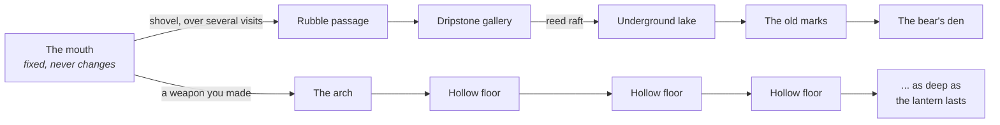
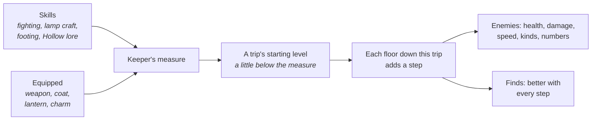

# F16 — The sea cave and the Hollow

> Where the sea has worked at a cliff long enough, it opens a mouth. Inside is a chamber that is always the same: tide pools, weed, the sound of the sea. Two ways lead on. One is choked with fallen rock, and digging through it, visit by visit, leads to quiet chambers and a sleeping bear. The other is an old arch with soot marks around it, and the walker won't go through it with empty hands. Beyond it is **the Hollow**: floors that are different every time you go down, things in the dark that don't belong to the island, and a lantern that decides how far you get before you have to turn back. Nothing makes a player go there. It's for the ones who want it, the way the mines are in Stardew Valley.

**Status:** Seed. Not scheduled. Drafted October 25, 2026, from Matt's ask for a cave with a dungeon-crawling experience, then redrafted the same day to Matt's own design (below). It builds on Matt's pin of October 18, 2026 (caves for a landmark creature such as a bear) and doc 20's M7 line on placed rock pieces for sea caves.

## Decided so far (Matt, October 25, 2026)

- **Optional.** Nothing on the surface needs the cave. A player goes there only to do everything, as in Stardew Valley's mines. It has **its own trail**.
- **The mouth never changes.** It is one fixed, hand-made area.
- **To one side, a rubble passage**, blocked at first, that eventually leads to the bear.
- **Another entrance that needs a weapon.** The player can't go through until they've made one.
- **Beyond it, the Hollow:** floors that change procedurally and get tougher as the player progresses.
- **No numbered levels.** Progress is tracked by internal numbers for the player's skills and equipped items, and the Hollow sets its enemies' level from them.
- **The lantern decides** how far the player can go before they have to call it quits.

## What this changes for ebb

This is the first place in ebb with enemies. Doc 01 lists "no combat" as a non-goal. The proposal is a single, bounded exception:

- **Combat happens only in the Hollow, and only when the player chooses to go in.** The island, the camp, the rubble passage and the bear's chambers never have enemies.
- **Nothing from the Hollow ever comes up.** The surface stays exactly as cozy as it is now.
- **The island's real creatures are never fought.** The Hollow's things are not animals (see the bestiary).
- **No death.** When the light gives out, the walker finds their way out in the dark and wakes at the mouth (see when the lantern goes out).

## The layout

### The mouth

- One fixed space, hand-built, the same on every island: a wave-cut floor, weed, rock pools with prawns and a blenny, daylight from the entrance.
- At high tide the sea fills the entrance. The walker comes in at low tide. The rubble passage, the arch and everything beyond are above the highest tide, so no one is ever trapped: the walker waits on the ledge or rests until the water drops.
- A **lantern hook** by the arch. The walker hangs the lantern here and it lights the mouth while they look around. It's where every trip into the Hollow starts and ends.

### The rubble passage and the bear

The quiet half of the cave, with no enemies.

- **The rubble** is cleared with the shovel (P2c digging), a stretch per visit, so getting through takes several trips. Each stretch turns up something: old bones, a bead, a fossil.
- **Behind it** are hand-made chambers that never change: a dripstone gallery, an underground lake crossed on the reed raft, and a wall of old soot marks with the earlier keeper's letter (F13 section 10).
- **The bear's den** is the last chamber. A brown bear comes to the island late in the game, once the woodland can feed it, and winters here. Finding it asleep is the quiet climax: you lower the lantern and leave. Its trust grows by being left alone. It is never an enemy.
- The cairn builder (F14) can lead here.

### The arch

- An old arch to the other side of the mouth, ringed with soot and scratched signs. Something moves in the dark beyond it, just past the lantern's reach.
- **Without a weapon** the walker stops at the arch: *"Not with empty hands."*
- **With a weapon they made**, the walker steps through. The first time, the arch's journal page opens the Lamplighter's trail.

### The Hollow

A trip is a run down through floors, one after another, until the player decides to head back up or the lantern gives out.

- **Each floor** is a handful of chambers and passages. It has a way down (a shaft, a slope or a rope drop), enemies, finds, and sometimes a feature:
  - an oil seep that tops up the lantern a little
  - a crystal pocket
  - a still pool with something in it for the net
  - a guardian floor: one strong enemy and a better find
- **Every trip is new.** A floor's layout comes from the island seed, the trip number and the floor's place in the trip. The Hollow is seeded, so saves and replays are exact, but no two trips repeat.
- **The way up** is always marked. On any floor the walker can climb back out with everything they're carrying. Going up is a walk back to the arch with a fade, not a climb through every floor.
- **Not simulated while away.** Nothing grows or moves in the Hollow while the game is closed. It has no part in catch-up.

## How hard it gets: the keeper's measure

There are no numbered levels. Instead the game keeps one internal number, the **keeper's measure**, made from the walker's skills and what they carry. The player never sees it as a number.

- **Skills** are internal numbers that grow with use:
  - **Fighting**, from hits landed and enemies beaten.
  - **Lamp craft**, from trips made. The lantern burns a little more slowly.
  - **Footing**, from dodges and climbs. The dodge step gets quicker.
  - **Hollow lore**, from bestiary pages filled. Enemies' tells read sooner.
- **Equipped items** each carry a tier: the weapon, the coat, the lantern and a worn charm.
- **A trip starts a little below the measure**, so the first floor of any trip feels comfortable. **Each floor further down in the same trip adds a step**, and finds get better with each step. How deep a player goes in one trip is how hard it gets, so pushing on pays off.
- **The measure lags growth.** If the Hollow matched every gain, getting stronger would feel like nothing. That's the known trap of level scaling. So the Hollow counts only part of each gain (about 70% to start, a recipe value). A better weapon always feels better, and the Hollow catches up only slowly.
- **A slow average.** The measure uses a slowly moving average of the player's best kit, so swapping to a stick at the arch to make the Hollow easy doesn't work.

## The lantern

The lantern is how far you can go.

- **Fuel is made at camp.** Rushlights come first: rush pith dipped in fat. Then pressed seed oil from the mortar. Each trip starts with whatever fuel the walker brings.
- **It burns down** as you go, and a little faster on deeper floors.
- **Its light is a real light.** Lantern tiers reach further: the hand lantern, a horn lantern, a bulls-eye lantern. Some enemies shy from the light, so a bigger light is a defense.
- **Recommended: the lantern is also the walker's health.** A hit makes the flame gutter and costs fuel. One thing to watch, drawn as the flame itself, with no hearts or health bar. A long, clean trip goes deep; a scrappy one ends early. The alternative is a separate steadiness meter.
- **When it runs low**, the light shrinks, enemies grow bolder, and the walker says it's time: *"The light won't last."* The player heads for the way up.

### When the lantern goes out

- The screen goes dark, and the walker finds their way out by touch. They wake at the mouth with the hook's lantern lit.
- Everything brought in is kept: the weapon, the coat, the lantern, anything from camp.
- Part of what was found on this trip is dropped in the dark, a seeded share of it. This is Stardew's rule, and it's what makes turning back in time a real decision.

## Fighting

Simple, readable, from the below-view camera.

- **Swing** the weapon. Each weapon has its own reach and rhythm.
- **Dodge step** out of the way.
- **Raise the lantern.** This pushes back light-shy enemies but burns fuel faster.
- **Sling.** It throws pebbles, which the walker already gathers, so the pebble store becomes ammunition.
- A gentle lock-on to the nearest enemy, and a **"gentler Hollow"** setting for younger players (Matt's testers are 7 and 10).

### Weapons and gear

All of them are made at camp with the making core (S1). Better tiers use what the Hollow gives, which is the loop.

| Item | Made from | Notes |
|---|---|---|
| **Driftwood staff** | A long drift stick, bound with rush cord | The first weapon; it opens the arch |
| **Sling** | Braided rush cord | Throws pebbles |
| **Flint spear** | Ship's timber shaft (F14), flint from the Hollow | Long reach |
| **Star-iron knife** | Star-iron from the falling star (F14) | The best blade; only one per island |
| **Oilskin coat** | Cloth, waxed, dyed | Takes the edge off hits (less fuel lost) |
| **Lanterns** | Hand, horn, bulls-eye | Reach and burn time |
| **Charms** | Keepsakes worn on the belt | Small effects, such as a steadier flame |

## The bestiary: things in the dark

They are not animals. They're made of the dark and the old sea, so the island's naturalist rules never apply to them. Beaten, they break into grey sand and motes of light, and drop what they were made around. No blood, no bodies. Each is rigged and animated (the creature rule). Swarms may use shader motion.

| Kind | What it does | Where | Drops |
|---|---|---|---|
| **Soot motes** | A swarm that drifts in and nips; scatters from the light | Any floor | Soot, for ink and dye |
| **Silt crawlers** | Crab-shaped, made of packed silt; slow, armored front | Wet floors | Clay, sand glass |
| **Drip wisps** | Hang from the ceiling and drop; quick | Dripstone floors | Cave pearls |
| **Barnacle backs** | Big, slow, charge in a straight line | Deeper floors | Shell, flint |
| **Brine eels** | Lunge from the water's edge | Pool floors | Brine salt |
| **Lamp-eaters** | Snuff the light: each touch drains fuel | Deeper floors | Oil |
| **Tide shades** | Fade between pools of light; only seen in the lantern's glow | Deepest floors | Crystal |

- **As the level rises**, kinds get tougher and gain behaviors: crawlers that burrow, wisps in pairs, shades that circle.
- **Each kind gets a bestiary page** in the journal the first time it's beaten: a sketch, its habits and its tells. Filling the bestiary is the Hollow lore skill.

## What comes back up

- **Materials** the surface can't give: flint, clay, ochre, soot, cave pearls, crystal, brine salt, oil. They feed the camp: clay for pots and bowls, ochre and soot for dyes, flint for tools, oil for the lantern.
- **Keepsakes** (F12) found only underground.
- **Make plans** for gear, found on guardian floors.

## The Lamplighter's trail

A fifth trail, alongside the naturalist's, the beachcomber's, the shaper's and the forager's.

- **Marks:**
  - first through the arch
  - the deepest a single trip has gone (a personal best in floors, not a level)
  - each bestiary page
  - each weapon made
  - each Hollow material found
  - through the rubble
  - the bear
- **Gifts along it:**
  - a better lantern
  - a rope back (once per trip, climb out from any floor and keep everything, even with the light going out)
  - make plans for gear

## How it is built

- **The fixed parts** (the mouth, the rubble passage and the bear's chambers) are implicit surfaces: chambers as smoothly blended blobs, passages as capsules, worn with noise, meshed once in a worker with dual contouring, and rebuilt from the seed.
- **Hollow floors** use the same mesher on a generated floor plan: a small graph of chambers and passages, made in a worker while the descent fades to black. Each floor is about 60k to 100k triangles, small enough to build in a moment.
- **TPMS for the strange floors.** A rare floor kind can be a gyroid sponge: rock eroded into a porous lattice, from a gyroid field clipped by the chamber shapes.
- **Walking** uses a walk grid from the mesh's upward-facing surfaces, and enemies path on the same grid.
- **Enemies** run simple state machines: idle, notice, approach, attack with a tell, recover. The tell is how a player learns them.
- **Light** is the lantern as a point light with soft shadows. The palette keeps the darks deep blue-green, never black (doc 05).
- **Recipes:** `recipes/world/cave.json` for the fixed parts and the lantern, and `recipes/world/hollow.json` for floor sizes, enemy tables, the measure's weights, the lag and the drop share.
- **A tool page,** `tools/cave-lab.html`, shows:
  - floors made from seeds side by side
  - the walk grid
  - the measure against floor depth, as curves for different players
  - how long meshing takes

## What it would change

- **01** vision: the non-goal "no combat" gains its one exception, the Hollow, which is opt-in and never reaches the surface. **Matt's call.**
- **04** render pipeline: an interior scene with its own pass list.
- **05** look: the cave's darks in the palette.
- **08** terrain: the cave mouth as a placed rock piece.
- **11, 12** creatures: the bear as the landmark; the Hollow's kinds kept apart from the ecology.
- **13** progression and journal: the Lamplighter's trail, the bestiary pages.
- **15** input: swing, dodge, raise the lantern, sling.
- **23** walker: fighting animations (swing per weapon, dodge, hit, lantern raise) and a climb.
- **F13** camp: weapons, gear, lantern fuel, and the Hollow's materials as inputs.
- **F14** scripted events: star-iron, ship's timber, the cairns.
- **17, 25** audio: cave reverb, enemy sounds, the lantern's flame.
- **18** saves: the measure, skills, trip count, rubble progress, the bestiary, the deepest trip.
- **19** performance: the interior budget.
- **20** roadmap: a late milestone, after the Headland (M7) at the earliest.

## Risks and guardrails

- **Tone.** Combat can sour a cozy game. Stardew shows it can live beside farming when it stays optional, bright and short. Keep the enemies strange rather than horrible, and keep the walker's lines calm.
- **Level scaling.** If the Hollow tracks the player too closely, progress feels pointless. The lag and the per-trip steps are there to prevent it. The cave-lab curves are where to check it.
- **Scope.** This is the biggest feature ebb would have: combat, enemy AI, a floor generator, seven rigged enemy kinds and fighting animations. A first version could be the mouth, the arch, three floor kinds and three enemies.
- **The surface must never need it.** Hollow materials make things better, but nothing on the island requires them.
- **Kid testers.** The gentler setting, and an end to a trip that never feels like punishment.

## Open questions

- Is the one exception to "no combat" right, kept to the Hollow?
- Does the sea open the cave in a tall cliff the player made (F16's first draft), or is it found in a cliff that's already there?
- Is the lantern also the walker's health, or is there a separate steadiness?
- When the light goes out, how much of the trip's finds is dropped: a share, everything found, or nothing?
- What do the Hollow's things look like? Matt to sketch a direction, or a session to propose some. Who makes their models is Matt's call (CLAUDE.md).
- Guardian floors: should there be bigger set-piece enemies, and how often?
- Should the player ever see anything of the measure, such as a hint like "the Hollow feels deeper today"?

## Depends on / feeds into

- Depends on: the walker (doc 23) and its lantern, F13 (makes, the shovel and digging, the mortar), F14 (star-iron, ship's timber), doc 09 (the reed raft), 08 (placed rock pieces), M7 (the Headland), 04 to 06 (rendering and light).
- Feeds into: F12 (keepsakes), F13 (clay, ochre, soot, flint, oil), F04 (the bear's years), the sketchbook (P2i).
