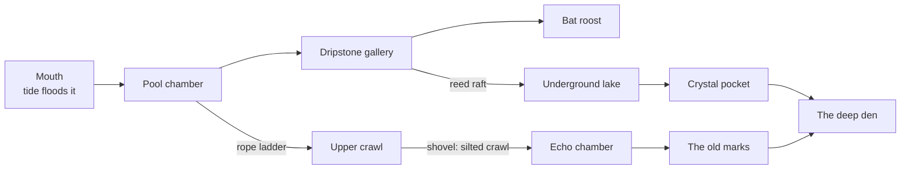

# F16 — The sea cave

> Where the sea has worked at a cliff for long enough, it opens a mouth. At low tide the walker can step in with the lantern. The cave goes back further than it should: a pool chamber, a gallery of dripstone, a roost of bats, a lake you'd need the raft to cross, and further in, places no one has lit for a long time. It is ebb's dungeon. You explore it chamber by chamber over many visits, opening the way deeper with things you've made, and you find what the dark has kept. Nothing in it can hurt you, and you can always walk out.

**Status:** Seed. Not scheduled. Drafted October 25, 2026, from Matt's ask for a cave that gives a dungeon-crawling experience. It builds on Matt's pin of October 18, 2026 (burrows and caves for a landmark creature such as a bear, doc 12) and doc 20's M7 line: "Placed rock pieces for arches and sea caves, which the heightfield cannot hold."

## Decided so far

Nothing. These rules carry over and shape everything below:

- **No combat, no harm, no fail states** (doc 01's non-goals). The dungeon is exploration, not danger.
- **No meters.** No oil that runs out, no stamina, no health. The lantern always burns.
- **The heightfield holds no caves** (doc 08). The cave is its own placed space, joined to the island at its mouth.
- **Deterministic and seeded.** The same island makes the same cave.
- **Physical light, painted last** (doc 05). A cave is mostly darkness, so it is the strongest test of that rule.

## The idea

A dungeon crawl is a place you go into, a little further each time, with a sense that it keeps going. Doors open with keys you earn. Every room holds something, and a map fills in behind you. ebb can keep all of that and drop the parts that don't belong:

| Dungeon crawl | In the sea cave |
|---|---|
| Monsters and traps | None. The dark, the tide and the way the cave is built are the obstacles |
| Keys and locked doors | Things the walker already makes or is given: the lantern, a rope ladder, the reed raft, the shovel, the net |
| Loot | Finds and keepsakes that exist only underground |
| Running out of torches | No. The lantern always burns; what it lights is how far you can see |
| Getting lost | The journal draws the map as you go, and "Back to the mouth" walks you out from anywhere |
| A boss at the bottom | A landmark creature in the deepest chamber, met quietly: Matt's bear |
| Procedural floors | One seeded cave per island, the same every visit, growing slowly over the years |

## How it could work

### How the cave opens: the sea makes it

**Shape the land and let the tide shape it back** (the keeper's page). The cave fits that line exactly.

- A cave can only open in a **seaward rock face** at least about 3 m tall whose foot sits in the tide band. The Cliff tool (Terrace and Cut, doc 08) can make one. The Headland (M7) has them already.
- Once such a face has stood for **a season**, the sea opens a mouth at its foot: first a notch, then a dark arch. The journal notes it ("The waves have found a weakness in the cliff below the point").
- If the face is reshaped away, the mouth closes and the cave waits, kept in the save, for the next face that qualifies. Nothing found inside is lost.
- **One cave per island.** Its inside is seeded from the island, so it doesn't depend on where the mouth opens.

Alternatively it could just be **found** (on the Headland, or on a new island's coast from the start). That's simpler, but it loses the link to shaping.

### The way in

- **At low tide** the mouth is dry. At high tide the sea fills its first chamber, as real sea caves do.
- **Inside, the walker can't be trapped.** The inner chambers sit above the highest tide. If the tide rises while the walker is deep inside, the first chamber floods behind them, and they wait on the dry ledge or press **Rest** to sleep until the water drops. It's a quiet hour, never a danger.
- **Going in** is a walk, as anywhere. The view switches to the cave scene at the mouth with a short fade to darkness. The island is not drawn while you are inside, so the cave has the whole frame budget.

### The chambers

The cave is a small graph of chambers and passages, 6 to 12 chambers in 3 depths, seeded per island. Each chamber is one of a set of kinds. Each kind is a real cave feature with something to find and sometimes something that opens the way on.

| Chamber | What it is | Life | Finds | Opens on with |
|---|---|---|---|---|
| **Mouth** | Wave-cut floor, weed, the sea's sound | Anemones, limpets on the walls | Wrack, sea-polished stones | — |
| **Pool chamber** | Rock pools left by the tide, light from the mouth | Prawns, a blenny, a starfish | Shells only found here | — |
| **Dripstone gallery** | Stalactites and flowstone | Cave spiders (*Meta menardi*, real and harmless) | Cave pearls (drip-rolled stones, real), flowstone chips | — |
| **Bat roost** | A high dome, quiet | Bats, which roost here in winter (doc 12's night tier) | None to take: the find is the roost itself, a journal moment | Pass quietly; lantern dimmed |
| **Underground lake** | Still, clear, very cold water | Blind shrimp, nothing else | A drowned old lantern; a lake-floor keepsake for the net | **The reed raft** (the turtles' gift) |
| **Upper crawl** | A high ledge to a low passage | — | Bones of long-gone animals; a fossil | **A rope ladder** (a make: rush cord and sticks) |
| **Silted crawl** | Sand washed in over centuries | — | Whatever digging finds here: old layers, a bead | **The shovel**, a few digs to clear it |
| **Echo chamber** | Round and hard-walled | — | Its sound: whistle and it answers | — |
| **Crystal pocket** | Calcite crystals catching the lantern | — | A crystal keepsake | — |
| **The old marks** | Soot and scratched signs on the wall | — | A keeper's letter, like the cache's (F13 section 10), from whoever was here before | — |
| **The deep den** | The furthest chamber, dry and quiet | The landmark creature, if it has come | — | — |

- **Keys come from the rest of the game.** Every way deeper uses something the player already gets from camp, gifts or trails. The cave rewards a keeper who has lived on the island a while, and it gives the late game somewhere new to go.
- **Rooms keep giving, slowly.** Pool life changes with the tides. Cave pearls form again over a season. The dripstone grows a little every game year, which is F04's deep clock underground.
- **Seasons reach in.** Bats roost in winter and are gone in summer. In spring, swallows nest in the mouth. On F08's glowing-plankton nights, the pool chamber's water lights blue.

### The map

- The journal gets a **cave page** that draws itself as you explore, in the same pencil as the sketchbook: chamber outlines, the passages between, small marks for what you found. Unexplored passages show as a line that trails off.
- The page is also the "you are here". **Back to the mouth** on it walks the walker out along the known way.
- Nothing on the map lists what is still to find.

### Light

The lantern is the only light most of the time, so the cave is where ebb's physical lighting shows best.

- **The lantern** is a point light with soft shadows. It reaches about 6 m, so a big chamber shows its far walls only as you cross it.
- **Daylight** comes in at the mouth and through any shaft to the surface, as a real light shaft with dust in it.
- **Wet rock** shines with the lantern's highlights; flowstone glows a little where light passes through its edges.
- **Glow** from life only, where it is real: plankton in the pool on its nights, and nothing invented.
- The palette lookup at tonemap (doc 05) keeps all of it soft. Darkness is a palette question, not a black screen: the darks should read as deep blue-green, never as nothing.

### The landmark creature

Matt's pin was a bear. A bear needs a landmark place, and the deep den is that place.

- **Recommended: a brown bear that winters in the den.** It comes to the island late in the game, once the woodland can feed it (berries, roots and the like, doc 12's woodland tier). It sleeps in the den through winter and ranges the woods in summer.
- **Meeting it is the cave's quiet climax.** In winter you find it asleep in the deepest chamber. The right thing to do is lower the lantern and leave, and that is all the "boss" there is. Its trust grows by being left alone, as the herons' does (F13 section 8.4).
- **Smaller alternative:** a badger sett in the silted crawl, or otters using the mouth. Both are real cave users and much cheaper to make.

### How it is built

This is the part that leans on Matt's own field.

- **The cave is an implicit surface.** Each chamber is a smooth blob (a few ellipsoids, smoothly unioned), each passage a capsule along a curve, all blended with a smooth minimum. Then domain noise wears it to rock. The SDF is evaluated once, in a worker, and meshed (dual contouring keeps the ledges and arches crisp) into a cave mesh stored by seed. Like the terrain, the mesh is never saved; it is rebuilt from the seed.
- **TPMS for the strange places.** One rare chamber kind could be a **gyroid sponge**: a gallery where the rock is eroded into a continuous porous lattice, as karst can be. A gyroid field clipped by the chamber's blob gives it for almost nothing.
- **Dripstone is grown.** Stalactites are tapered capsules placed where the SDF's ceiling faces down and is wet. Their length grows with the island's age. Flowstone is the same thing on walls.
- **Walking.** The walk grid comes from the mesh's upward-facing surfaces, sampled into cells as the island's walk grid is, with steps and ledges marked. The walker's motion code needs only one new thing, a climb for the rope ladder.
- **Camera.** Below-view only: the low follow camera, pulled in close in tight passages. There is no "above" in a cave. The map page stands in for it.
- **Budget.** One cave mesh of about 150k to 300k triangles at high, a single lantern shadow, light shafts, and pool water using the existing water shading. The island is not drawn while inside, so this fits inside the island's own budget.
- **Recipe.** `recipes/world/cave.json`: chamber kinds and counts, sizes, noise, dripstone rates, the lantern's reach, tide margins.
- **A tool page:** `tools/cave-lab.html` generates caves from seeds side by side, shows the chamber graph and the walk grid, and times the meshing.

## What it would change

- **01** vision: one line, the cave as the late game's exploration, with no danger.
- **04** render pipeline: an interior scene with its own pass list (no sky, no ocean, the lantern's shadow).
- **05** look: the cave's darks in the palette.
- **08** terrain and sculpt: the rule for a cave-forming rock face; the mouth as a placed rock piece in the heightfield (M7's plan).
- **11** creatures and ecology: a den field for the landmark creature; the cave's own small life.
- **12** creature roadmap: the bear (or badger) as the landmark; bats' winter roost.
- **13** progression: the cave page; cave finds on the trails.
- **F04** deep clock: dripstone growth by year.
- **F12** keepsakes: underground keepsakes.
- **F13** keeper's camp: the rope ladder make; the raft and shovel used underground.
- **17, 25** audio: cave reverb, drips, the sea's sound from the mouth, the echo chamber.
- **18** saves: the cave's seed, explored chambers, cleared crawls, finds taken. Well under 1 KB.
- **19** performance: the interior budget.
- **20** roadmap: the cave sits with M7 (the Headland) or later.

## Risks and guardrails

- **Scary is easy to make by accident.** Darkness, tight spaces and a bear can all frighten. Keep the light warm, keep the passages wide enough to see down, and let the soundscape stay calm. The bear sleeps.
- **Claustrophobia and controls.** A low camera in tight space fights the walls. The camera should pull close and rise rather than clip through, and passages should never be tighter than the walker plus a margin.
- **Scope.** A whole new scene, mesher, walk grid and camera mode is large. A first version could be three chambers with no generation: mouth, pool and dripstone, hand-placed.
- **The cave must not compete with the island.** It is a place to visit, not to live in. Nothing in it is needed for any creature on the surface.

## Open questions

- Does the sea open the cave in a cliff the player made, or is it found where it already is?
- Is the bear the landmark, or something smaller (badger, otter)?
- Should rooms ever regrow their finds, or is each find once per island?
- How deep should it go: one visit's worth of chambers, or many visits?
- Does a first, hand-made three-chamber version come before the generated one?

## Depends on / feeds into

- Depends on: 08 (rock faces, placed rock pieces), M7 (the Headland), the walker and its lantern, F13 (makes, the shovel, digging layers), doc 09 (the reed raft), 11 and 12 (bats, the landmark creature), 04 to 06 (rendering and light).
- Feeds into: F04 (dripstone), F12 (keepsakes), F14 (the bats' swarming and winter roost, plankton nights in the pool), the sketchbook (P2i).
