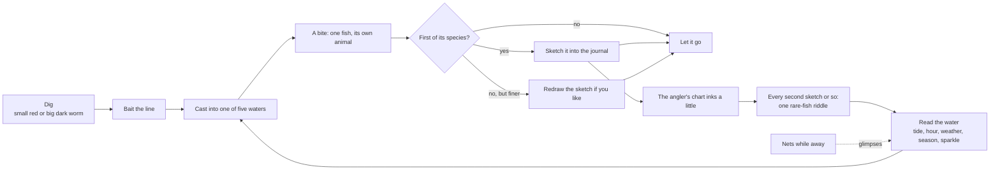

# F17 — Fishing, the fish and the angler's chart

> The keeper lives on an island in the sea, so some fishing belongs in ebb. This doc proposes it in the game's own terms: a **line the player makes**, **worms from the dig as bait**, and fish that are **never kept**. Each fish is let go, and the journal keeps one **sketch per species**. What bites depends on reading the water: which of five **waters** you cast into, the tide, the hour, the weather and the season, plus the same **sparkle** the nets watch for. Every fish is drawn by one procedural generator, so no two catches look alike. A fixed **roster** per island keeps the sketches finite. Sketching every ordinary species fills in **the angler's chart**, a hand-drawn sea chart in the journal that inks in as you go and hands out riddles for **twelve rare fish**. A prize fish in an **aquarium** waits for a future living space. It is grounded in a read of the code on October 31, 2026, and two click-through pages: `tools/fish-lab.html` and `tools/angler-chart.html`.

**Status:** Decided (direction, October 30 and 31, 2026). Nothing is built. The nets' living catches (F12, K6) are built and would change (see "The nets, reworked"). The sparkle waits for F12's signs in the water (K8). The aquarium is a roadmap item only.

## Decided so far

Matt, October 30, 2026:

- **The player fishes.** On an island in the sea, some semblance of fishing belongs in the game.
- **Fish are recorded, not kept.** A caught fish goes into the journal and back into the water. This may change how the net catches fish too.
- **Only in the sea.** No fish in the rain-fed ponds.
- **One journal sketch per species** is a good start.
- **The player crafts their own fishing line.**
- **Bait comes from the worms already in the game.** Digging turns them up often.
- **An aquarium is a future goal.** If the player later gets a living space, a prize fish kept in an aquarium is something to work toward.
- **The fish generator needs more variety.** The first lab pass ("all look similar in each grouping") led to color phases, more grown patterns and fish drawn to true scale against each other.
- **The aquarium fish is a special individual,** caught only once the game reaches that point.
- **Worm type matters.** The game has two: the small red worm (topsoil) and the big dark worm (subsoil).
- **Rare types:** ghost fish, lionfish, stonefish and anglerfish.

Matt, October 30, 2026 (later):

- **The rare types have different species.** Three of each, twelve in all.
- **Special conditions** make sense, such as rain.
- **The aquarium is a future plan,** not built now, only in the roadmap.
- **Conditions raise the odds,** never gate. A fish can still turn up out of its conditions, just rarely.
- **The sparkle is the same sign the nets use.**
- **A reward for discovering every ordinary fish** (all but the rare ones): an angler's chart that gives players clues on how to find the rare fish.

Matt, October 31, 2026 (after the chart mockup):

- **The condition icons beside each riddle are a fair nudge.**
- **The rare-fish clues ink in a little at a time** as the player catches more fish, not all at the end.
- **The chart's level of detail is right:** the fish themselves, the water marks, soundings, the compass and the title.

## The loop

The nets work while you are away and tell you who lives where. The line works while you are there and brings one fish up close. Both feed the same journal, and every living catch goes back to the sea.

## Line fishing

### The line

A made tool, in the language of F13's makes (real island things, a unique set of parts, made at the workbench):

| Part | From | Notes (proposal) |
|---|---|---|
| Rod | A withy (grey willow) | Willow is already a volunteer and a withy is already a part (the drying rack, the hamper lid) |
| Line | Rush cord | Already made from rushes |
| Hook | A gorse thorn | Gorse is a volunteer; a thorn hook is an old real practice |
| Float | Drift twigs or a small piece of driftwood | Drift twigs are on the strandline from the first evening |

- It hangs on the pack like the shovel and takes no pouch.
- Proposed tier: T3, after the shovel (T2), so worms are already coming up when the line arrives.
- A line never breaks or wears out. Wear belongs to the nets (F12, K7); one mending chore is enough.

### Bait: two worms

The dig already tells the two worms apart (`src/world/dig/finds.js`: topsoil gives `small`, subsoil `big`), but both go into one `worms` pouch. Bait needs the pouch split in two:

| Pack kind | From | Bait for | Other uses today |
|---|---|---|---|
| `worms` (the small red worm) | Topsoil | Shallow-water fish | Turtles, the hen, the robin, the lily leaf parcel |
| `bigworms` (the big dark worm) | Subsoil | Deeper and larger fish | Proposed: the turtles prefer it (see open questions) |

- Each species prefers the small red worm, the big dark worm, or either. The water sets the leaning: sand and kelp fish lean small red, open and deep water fish lean big dark (the lab's weights: sand 60/10/30, kelp 50/20/30, reef 35/35/30, open 15/50/35, deep 5/70/25, as small/big/either).
- The right worm doubles a species' odds; the wrong one doesn't stop a bite.
- **Winter has no worms** (F13: "No worms, no clay" in winter). Worms already keep in their pouch, so autumn digging carries into winter. See the open questions for a winter bait.
- Saves: the existing `worms` count becomes small red worms, so older saves read without change.

### Reading the water

**Five waters**, each classified from ground the player shaped (doc 13, "Shaped, not found"):

| Water | Where | Read from |
|---|---|---|
| Rocky reef | Off rock and cliff coast | The shore cell's ground beside the cast (rock, cliff) |
| Sand flats | Off sand, the bay, the tide flats | Sand ground and shallow slope |
| Kelp shallows | Where the kelp and wrack grow | The strandline's kelp band and wrack cells |
| Open water | Past the tide band, over a sand or gravel bottom | Depth beyond the tide band |
| Deep water | Past the drop-off | Depth past a threshold (the sinker net's water) |

Shaping the coast changes what you can catch. A cliff headland the player raised brings the reef; a sheltered sandy cove brings the flats.

**Conditions** (each species has none, one or two): night, dawn and dusk, calm sunny days, rain, fog, after a storm, low tide, high tide, a season, and near a sparkle.

**Odds, never gates** (proposal for the numbers):

- A species' weight in its water starts from its rarity: Common 60, Uncommon 28, Rare 10, Very rare 2.
- Each of its conditions that holds multiplies its weight by 4.
- The right worm multiplies it by 2.
- With none of its conditions met, a species keeps its base weight, so a night fish can still bite at noon, just rarely.
- Every number lives in `recipes/world/fishing.json`.

**The sparkle** is F12's sign in the water (K8), shared. Casting near one counts as the "near a sparkle" condition, and for every species it nudges the morphs up a little.

### The bite

No reflex minigame and no fail state. Cast, the float settles, and after a short, varied wait the float dips. Click to ease the line in; a missed dip just means waiting for the next one. The calm moment is the point, in the spirit of doc 01.

### Letting go and the sketch

- The fish shows for a moment in the tray language the nets already use (`src/ui/haul-tray.js`): name, length, rarity word, and a short line.
- **A first of its species is sketched into the journal.** The page uses the same traced-sketch path as the net catches (`src/ui/sketches/catch.js`), so the sketch is of that very fish.
- **One sketch per species.** When you catch a more remarkable one (a rare morph, a larger one), the tray offers to redraw the page. The page keeps one sketch, never a count.
- Every fish goes back. Releasing is what counts, as with the nets.
- Counters of kinds are allowed and totals never (F12, October 21): "14 kinds sketched" is a record; "catch 50 fish" is grinding.

## The fish

All fish come from one generator, worked out in `tools/fish-lab.html` (open it, pick a water, roll species and individuals, tap one for its traits and growth grid, switch to the journal sketch).

- **Body by a growth grid** (D'Arcy Thompson's transformed coordinates). A species is a set of grid-warp numbers: depth, head-to-tail profile, shear, back arch, head droop. Four body plans seed them: torpedo, deep-bodied, eel-like, round.
- **The water drives the look.** Reef fish are deep-bodied, bright and barred or eyespotted. Open-water fish are silver, countershaded and fork-tailed. Kelp fish are olive and mottled, sand fish pale and speckled, deep fish dark and large-eyed with light organs.
- **Grown patterns.** Five reaction-diffusion families (spots, maze, squiggles, lace, rings), grown on the fish's own body grid so marks crowd toward the head and tail. Each species has its own feature size and grain direction, so one family can grow as round spots, vertical bars or lengthwise lines. Each individual nudges the growth constants a little, so no two match. Plus drawn patterns: bars, stripes, mottle, speckle, an eyespot and light organs.
- **Color phases.** Each species has its typical look and one to three phases (dusky, pale, reversed, bold, faint, bright-finned, a hue shift); each individual falls in one.
- **Pattern placement.** Some species carry their pattern on the back only, or only toward the tail.
- **Morphs.** Leucistic, golden, melanistic and giant, rare and found anywhere. The lab boosts them to about 1 in 7 for testing; in the game they'd be far rarer.
- **True scale.** Size is its own seeded draw, so a set of fish can be shown against each other at true scale.
- **Seeded throughout** (`src/core/rng.js` in the game), so a species and an individual rebuild the same from their seeds and the journal can redraw them.

**From the lab to the game.** The lab draws in 2D; the game needs meshes. The growth grid maps onto the existing creature body bake (`src/world/nets/living/bodies.js`): u runs nose to tail, v round the girth. The same field then colors the mesh, and the journal traces its sketch from the mesh as the net catches do today. The grid's numbers extend the catch numbers already saved (`catchNumbers` in `src/world/nets/living/index.js`) as a `gen: 2`, so `gen: 1` catches still rebuild.

## The roster

The generator can make endless species, so "every fish" needs a fixed set. Each island seeds its own roster from the world seed:

| Water | Ordinary species (proposal) |
|---|---|
| Rocky reef | 5 |
| Sand flats | 5 |
| Kelp shallows | 4 |
| Open water | 4 |
| Deep water | 4 |
| **All** | **22**, plus the 12 rare species |

- About 4 in 10 ordinary species get one condition, so conditions read as part of the world rather than a rare-fish rule.
- A sister island (F02) rolls its own roster, so a new island means new fish.
- The rare species are the same twelve on every island; their looks still vary by individual.

## The rare types

Twelve species in four types. Each is labeled Very rare and has its own look and conditions; the generator draws each type's signature form (see the lab's Rare types row).

| Type | What makes it | Species | Water | Conditions |
|---|---|---|---|---|
| Ghost fish | See-through body showing spine, ribs, skull and gut | Glass sprat | Open water | Fog, dawn and dusk |
| | | Wraith catfish (eel-like) | Open water | Night, rain |
| | | Moon glassfish (deep-bodied, violet) | Open water | Night, near a sparkle |
| Lionfish | Bars onto the head, separate banded spines, fan fins | Firework lionfish | Rocky reef | Calm sunny days, summer |
| | | Ember dwarf lionfish (orange, short spines, 9 to 16 cm) | Rocky reef | Dawn and dusk, summer |
| | | Zebra lionfish (black and white) | Rocky reef | Night, high tide |
| Stonefish | Lumpy grown outline, warts, eyes high, upturned mouth | Reef stonefish | Rocky reef | Low tide |
| | | Mossy devilfish (green, flatter, lumpier) | Rocky reef | Rain, low tide |
| | | Rust stonefish (red) | Rocky reef | Autumn, low tide |
| Anglerfish | Toothed gape, lure stalk, glowing bulb | Lantern angler (gold lure) | Deep water | Night |
| | | Whipline angler (long blue lure) | Deep water | After a storm, night |
| | | Black devil (green lure, wider gape) | Deep water | Winter, after a storm |

"After a storm" waits for F08's storms; until then it can read as the day after heavy rain and wind.

## The angler's chart

A hand-drawn sea chart of your own island's waters, kept in the journal in the keeper's hand. Worked out in `tools/angler-chart.html` (sketch fish one at a time, play the whole fill, or tap fish in any order).

**It starts as a pencil draft:** the coastline, the five water names, depth lines, the water marks, the compass and the title, all faint pencil.

**Each sketch inks part of it:**

- **The fish itself** appears in its water, drawn from its journal sketch. Tapping it gives its name, bait and conditions.
- **Its water fills in.** The first fish there inks that stretch of coast; later ones ink the depth line, the soundings and the water's own marks (rocks on the reef, fronds in the kelp, stippling on the sand, waves offshore, steep contours past the drop-off). The sea tint deepens as the water fills.
- **A finished water** inks its name and a line in the legend saying what bites there ("Most here take the small red worm. More bite in rain.").
- **The compass** inks one quarter at a time.

**The rare-fish riddles ink in as you go.** About every second sketch inks one riddle, with its numbered mark at its place on your coast, easiest first: twelve riddles over the 22 sketches, the last with the final sketch. Each riddle is in the journal's riddle voice ("Something would sit so still it looks like the reef itself, where the rocks show at the lowest tides.") with drawn icons for its conditions beside it. A riddle never names the type outright.

| Order | Riddle for | After about this many sketches |
|---|---|---|
| 1 | Reef stonefish | 2 |
| 2 | Lantern angler | 4 |
| 3 | Glass sprat | 6 |
| 4 | Zebra lionfish | 8 |
| 5 | Ember dwarf lionfish | 10 |
| 6 | Firework lionfish | 11 |
| 7 | Mossy devilfish | 13 |
| 8 | Wraith catfish | 15 |
| 9 | Rust stonefish | 17 |
| 10 | Moon glassfish | 19 |
| 11 | Whipline angler | 21 |
| 12 | Black devil | 22 |

**When every ordinary fish is sketched,** the frame and the title ink. In the game there's no count on the chart; the chart itself shows how far along it is.

**Placing the marks.** Each riddle's mark sits in the right water on the player's own coast: the stonefish beside rock coast at the tide line, the lionfish further off the reef, the ghosts offshore, the anglers past the drop-off. Because the coast is shaped, the chart is drawn from the island's own shoreline when the journal opens, not from a fixed picture.

## Later: the aquarium (roadmap only)

- Waits for a player living space, which is not yet designed.
- **The prize fish is a special individual,** caught only once the living space exists: one fish the island offers, never a rare morph rolled at random.
- It is the one exception to letting go, earned rather than collected: one aquarium, one fish.
- Doc 20 gets a roadmap line for it; nothing here builds toward it yet beyond keeping fish seeded so one can be rebuilt anywhere.

## The nets, reworked

Today the general net brings up eight living kinds (sand eel, sand goby, pipefish, young plaice, ballan wrasse, brown shrimp, shore crab, moon jelly). Each first release inks a page and counts as a find on the naturalist's trail. With the line, the proposal is:

- **The nets keep the small lives:** shrimp, crabs and jellies keep their pages and their naturalist finds exactly as now.
- **Fish in a net become glimpses.** A roster fish in a haul shows on the tray for a moment and pencils its silhouette into the journal and onto the chart ("a silver shoal passed the east reef at dawn"). The sketch, and the chart's ink, come only from the line.
- **The five net fish join the roster** as fixed, named members of the shallow waters (sand eel and sand goby on the flats, pipefish and wrasse in the kelp or reef, plaice on the flats). They stay the common, familiar fish; the generator gives their individuals the new variety.
- **Saves:** a fish page already inked from a net release counts as sketched, so nobody loses a page.
- Nets keep scouting: a glimpse tells you a fish lives in that water, which is a reason to come back with the line.

## How it plugs into the code

- **`src/world/fishing/`** (new): the cast, the bite (pure: a function of the world seed, the water, the hour, the tide, the weather, the season, the bait and any sign nearby, like a haul), and the roster.
- **`recipes/world/fishing.json`** (new): the waters' classification, the odds and multipliers, the bite timing, the line's make, the twelve rare species and the riddles' words.
- **`src/world/nets/living/`**: the growth grid, phases and grown patterns as catch `gen: 2`; the rare types' signature forms. The 2D lab's pattern code ports to a worker (the reaction-diffusion step runs once per fish and is cached by seed).
- **`src/world/nets/haul.js`**: roster fish become glimpses; small lives unchanged.
- **`src/world/pack/`** and `recipes/world/pack.json`: the `bigworms` kind; `dig/index.js` routes the big dark worm to it.
- **`recipes/world/cook.json`**: the line's make.
- **`src/ui/haul-tray.js`**: reused for a caught fish, with the redraw choice.
- **`src/ui/journal-chart.js`** (new): the chart page, drawn from the island's coast. Its pencil-then-ink pieces follow the mockup's rules.
- **`recipes/world/journal.json`**: a Fish section with one page per roster species and the chart page.
- **Saves:** a fishing section (species sketched, each with the seed of the sketched individual; glimpses; clue progress), read without breaking by older saves.
- **Test links:** `?fishing`, `?fishing=chart:N` (the chart with N species sketched), `?fishing=rare` (every rare species catchable for review).

## What it would change

Each line is a change to a numbered doc, for Matt to apply when this is accepted:

- **Doc 01 (vision):** fishing joins the core hooks beside keepsakes; "living catches are always released" extends to fish caught on the line, with the aquarium as the one future exception.
- **Doc 07 (water and tide):** the five waters as a classification of the sea beside the coast; the bite reads tide, depth and the sparkle.
- **Doc 11 (creatures):** fish caught on the line are catches, not simulated creatures; they need no presence or trust.
- **Doc 13 (progression):** the angler's chart as a reward line (riddles as it fills, the title at the end); fish sketches count as kinds, never totals; the roster per island; how sister islands roll new rosters.
- **Doc 15 (camera, input and UI):** the cast and the bite; the journal's Fish section and the chart page.
- **Doc 17 (audio):** the cast, the float, the line easing in and the release, all quiet.
- **Doc 18 (saves):** the fishing section; the worm split; net fish pages counting as sketched.
- **Doc 20 (roadmap):** a fishing stage (proposed after the meadow islet, since the line needs willow and gorse); the aquarium as a later line with the living space.
- **F12 (keepsakes and nets):** net fish become glimpses; the five net fish join the roster; the sparkle is shared with the line.
- **F13 (keeper's camp):** the `bigworms` pack kind; the line as a T3 make; worms as bait in the uses tables.

## Risks and guardrails

- **Grinding.** The roster is finite, sketches are one per species, counters are kinds only, and conditions raise odds rather than gate, so there's no reason to fish one spot for hours.
- **Hurry.** No timers, no missed-bite penalty, no fish that spoils. A cast can wait.
- **Sameness.** Phases, grown patterns and morphs keep individuals distinct; the lab is the place to judge it.
- **Chart clutter.** Fish names and details show on tap only; marks sit in clear water; the chart is drawn from the coast, so its layout needs a fit pass on very irregular islands.
- **Performance.** Reaction diffusion runs once per fish in a worker and is cached by seed; a cast shows at most one fish.

## Open questions

- **Winter bait.** Winter has no worms. Should lugworms from the clam rake work as winter bait, should the pouch simply carry autumn's worms, or should winter fishing be slow by design?
- **Turtles and the big dark worm.** Should the turtles (or the robin) prefer one worm, or stay a fishing-only distinction?
- **The roster size.** Is 22 ordinary species right, or should it grow with new waters as the island expands (the tide flats, the outer skerry)?
- **Reaching deep water.** A long cast from a headland, the end of the stepping stones, or the boat later?
- **The redraw.** Does a redraw replace the sketch, or keep the first in pencil behind the new one?
- **The chart's reward beyond the riddles.** Is the inked title enough at the end, or should completing it open something (a second line, a new bait)?

## Depends on / feeds into

- **Depends on:** F12 (the nets, the tray, the sparkle in K8), F13 (the dig, the pack, makes at the workbench), F10 (shore types for the waters), F08 (storms for "after a storm").
- **Feeds into:** F02 (new rosters on sister islands), F04 (the chart as part of an island's long record), the future living space and its aquarium.
