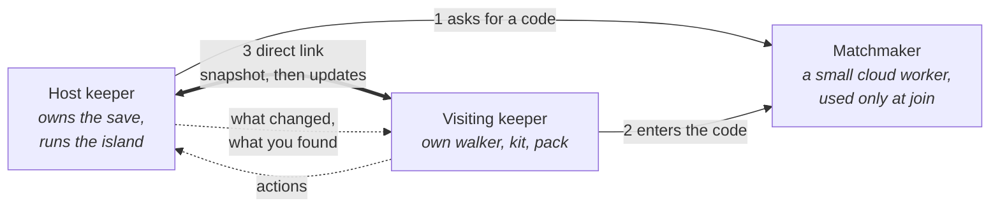

# F18 — Visiting keepers (multiplayer)

> A friend comes to tend your island with you. You host: the island is yours, it lives in your save, and your browser runs it. You send a short invite code; your friend arrives as their own walker, with their own hat, kit and pack, and from then on what they do changes your island as much as what you do. They can dig, sculpt, plant, feed, set nets and go down into the Hollow beside you. Creatures learn to trust the island's keepers together. What your friend finds, catches and wins in the Hollow goes home with them. You can end a visit at any time, and if a visit goes badly, you can put the island back as it was before they arrived. It is drafted from Matt's ideation session on November 1, 2026.

**Status:** Decided (direction, November 1, 2026). Nothing built. It changes doc 01's non-goal "No multiplayer in v1" (see "What it would change"); where it lands on the roadmap is Matt's call. The one piece worth doing early is the groundwork in "How it plugs into the code", step 1.

## Decided so far

Matt, November 1, 2026:

- **One person hosts.** The base island is the host's. The other player joins by invite code, on request.
- **The visitor changes the island.** Their actions affect the island's state, not only their own view of it.
- **The visitor can change bigger things,** terrain included. They are there by invite.
- **The host can disconnect any visitor at any time.**
- **The visitor keeps what they collect:** finds, catches and everything from the Hollow (artifacts, weapons, hats and the rest) go home with them.
- **The Hollow is part of it.** Both keepers can go down together.
- **Trust belongs to the island.** Both keepers progressing trust together raises that island's creatures' trust, whichever visitor shows up next time.
- **The visitor keeps their Hollow rank increase,** including any Q or E move it unlocks.
- **Both keepers opt into bed.** The host can force the night skip; when they do, both walkers stand outside their tent or on their bed roll.
- **A restore to before the visit** is a good option and not much code.
- **The visitor sleeps on a bed roll outside the camp,** using the bed roll already in the assets (`assets/models/camp/bedroll.glb`).
- **Cloud services are fine.** Matt already uses some for other projects.

## The shape of it

- **The host's browser is the island.** It runs the frame sim, the hourly tick, creatures, water and the Hollow's enemies, and only it writes the save. The doc 18 rule "one writer per island" holds unchanged.
- **The visitor's browser draws the island** from what the host sends, and sends back what the visitor does. It never runs its own copy of the simulation: two GPUs give slightly different answers, and two copies would drift apart.
- **The matchmaker** is one small cloud worker (Cloudflare Workers fits, alongside Matt's other cloud services). It holds an invite code for a few minutes and passes connection details between the two browsers once. After that the browsers talk directly, over a WebRTC data channel, and the matchmaker is out of the loop.
- **A relay** is needed only when a home or office network blocks a direct connection. A TURN service (Cloudflare offers one) carries those sessions. Most visits won't use it.
- **The game itself stays on GitHub Pages.** Nothing about the build or deploy changes, except one small worker deployed separately.

## A visit, start to end

1. **Invite.** The host opens the Keeper book (or the camp) and chooses Invite. A short code appears, good for about five minutes and one use. Codes are words, not symbols, so they can be read aloud ("heron-moss-tide").
2. **Request.** The visitor chooses Visit an island and enters the code. The host sees who is asking (the visitor's keeper name and hat) and accepts or declines.
3. **Arrival.** The host saves a **restore point** (below), then sends the island as an `.ebb` world file (doc 18): the same bytes as an export, so no new format is needed to describe an island. The visitor's walker steps off a boat at the landing, as on a sister island, and the visit begins.
4. **Tending together.** The host sends a steady stream of small updates. The visitor's actions go to the host, which applies them and sends the results back.
5. **Leaving.** Either keeper ends the visit, or the host disconnects the visitor. The visitor's walker walks back to the boat. Everything the visitor did is already in the host's save, and everything they earned is already in theirs.

If the link drops, the visitor sees a calm line ("The tide's come between you") and is offered to try again with the same code for a minute. Nothing is lost on either side.

## What travels between the two

| From | To | What | How often |
|---|---|---|---|
| Host | Visitor | The island as an `.ebb` file | Once, at arrival |
| Host | Visitor | The hourly tick's results: what grew, joined, arrived, left, changed in the ecology | Each game hour |
| Host | Visitor | What moves in the frame: creatures, the host's walker, the tide and weather, Hollow enemies | About 10 to 20 times a second, smoothed on the visitor's side |
| Host | Visitor | Terrain and water edits, placed and removed pieces | As they happen |
| Host | Visitor | Rewards: a find, a sketch, an item, a rank | As they happen |
| Visitor | Host | The visitor's actions (below) and their walker's position | As they happen |

- **The visitor's own walker moves at once** on their own screen; the host corrects it only if it walks somewhere it can't. So walking never feels delayed.
- **Edits arrive as the same plain data** the action layer already uses for its undo stack (`src/input/actions.js`: commands with a `kind`, applied by the system that owns them). A sculpt stroke is its brush, its path and its pressures, which is small, so the host replays it exactly as if it were its own.
- **Water and water surface, foam, particles, moss and plant meshes are never sent.** Each side rebuilds them from the shared state, the same way a loaded save does (doc 18, "Save what cannot be derived").

## What the visitor can do

Everything the host can do on the island, through the same paths:

- Walk, sit, kneel, look about.
- Sculpt, smooth and paint terrain, cut steps, place and lift stones and logs.
- Pour and drain water, add and remove springs.
- Plant, gather, dig, feed and give treats.
- Set, haul and mend nets; fish.
- Use the camp: the fire, the workbench, the cookpot, the piles. What the visitor sets down on a pile becomes the island's.
- Go down into the sea cave and the Hollow.

Two things stay the host's:

- **The farewell** (F02). Only the host can let the island ebb, and not while a visitor is there.
- **Settings and time flow.** The host's time speed, pause and keep-growing choice apply; the visitor's controls for them are greyed with one line saying it's the host's island.

**Undo** is per keeper: each keeper's undo reaches only their own edits from this visit. The restore point is the host's way back from anything bigger.

## What goes home with whom

| Stays with the island (host's save) | Goes home with the visitor (their save) |
|---|---|
| Terrain, water, plants, placed pieces | Finds they pick up and keepsakes they keep (onto their own 16-space shelf) |
| Creature trust, named creatures, happiness, gifts given | Fish they sketch, in their own journal and angler's chart |
| What they set down on the camp's piles | Hollow materials, artifacts, make plans, weapons, lanterns, coats, charms, hats |
| The island's journal pages and trails | Their Hollow skill ranks, and any Q or E move a rank unlocks |
| | What is in their pack when they leave |

- **The host's game decides what drops** and sends it to the visitor as a reward, and the visitor's game writes it to their own save at once. A reward never waits for the visit to end, so a dropped link loses nothing.
- **A keepsake or find is made once.** When the visitor picks one up, it leaves the island, as it would if the host had picked it up. Both keepers never get the same one.
- **Trails on the visitor's side:** the visitor's own trails count what goes home with them (finds, sketches, Hollow marks and ranks). Trails that count the island (the naturalist's species pages, the shaper's) stay the host's.

## Trust is the island's

Trust is already a per-creature number on the island (doc 11, the creatures section of the save). It stays that way. Whoever feeds, sits near or gives a treat, the island's creature trusts **the island's keepers** a little more. A heron that has come to trust the host's island greets any keeper who visits, the way a dog that knows a house is calm with its guests. No per-keeper trust is stored.

- **Rates don't double.** Two keepers feeding the same frog in the same hour give what one keeper would give, plus a small share for the second (a recipe value, about a third to start). Otherwise a visit would race a slow bond the game is built around.
- **Rest and away time stay the host's.** The visitor's own island has normal time away while they visit.

## Night and rest: both opt into bed

- **Either keeper can go to rest.** A keeper at their tent flap or bed roll who chooses Rest settles there and waits; a small line tells the other keeper ("Your friend has turned in").
- **When both are resting,** the night skips to just before sunrise, as it does now (F13, C-39). Both walkers wake where they lay.
- **The host can force it.** The host's Rest has a second choice, Sleep anyway, when the visitor is still up. Both walkers then stand at their tent or bed roll as the night skips, and the visitor sees the same short fade as the host.
- **The Hollow pauses rest.** Nobody can rest while either keeper is below; the line says so.

## The visitor's bed roll

- **Matt's bed roll model** is already in the assets (`assets/models/camp/bedroll.glb`, baked from `Ebb_Bedroll.glb` by `tools/assets/models.json`).
- **It sits outside the pad,** on a **guest spot** picked when a visitor first arrives: the nearest dry, level, walkable ground within about 6 m of the pad's edge, out of the pad's protection and off the lane to the boat. The visitor can move it (pick it up, set it down on any level spot nearby); it never goes inside the pad, so the camp's fixed slots stay as they are.
- **It leaves with the visitor** and isn't saved on the host's island. A ring of pressed grass stays where it lay for a game day or two, like boot prints.
- **The visitor's own bed roll:** the walker already carries one on the pack (doc 23, the figure), so arriving with it and rolling it out is natural.

## The Hollow together

- **The host's game runs the floor:** the floor plan, enemies, drops and the lantern's light on the rock. Floors are made from a seed in a worker (F16, H1), so the visitor's game builds the same floor's mesh from the same seed instead of receiving the mesh.
- **Each keeper has their own lantern.** Each lantern decides how far its own keeper can go, as it does now. When one keeper's light gives out, that keeper finds their way out in the dark and wakes at the mouth, as alone; the other carries on, or follows.
- **A trip's level** comes from the **higher** of the two keepers' measures, then follows the doc's rule of a little below the measure, with each floor down adding a step. A stronger visitor can't be made to fight too-easy floors, and a new keeper can tag along with an old one and be looked after.
- **More enemies for two keepers.** Each floor's threat budget grows by a share for the second keeper (a recipe value, about half to start), spent on more enemies, not stronger ones, keeping F16's rule that enemies never learn new behavior.
- **Taproot stays fair.** A thing can carry only one root at a time (F16), so two keepers can't stack it into a one-shot. The large-thing share stays at a quarter.
- **The visitor's attacks and Q and E moves** play out at once on their screen (the swing, the effect, the light), and the host decides what they hit. The short delay hides well in the game's unhurried combat.
- **Drops are split per keeper.** Each keeper's finds on a floor are rolled for them (from their own share of the budget), so nobody races the other to a glint.
- **Ranks are kept.** Skill progress the visitor earns below fills their own four tracks and goes home with them, Q and E unlocks included. The Lamplighter's trail marks it earns (bestiary pages, deepest floor, weapons made) are theirs too.
- **The bear and the rubble passage** stay the host's progress: the visitor can dig with the host, and it counts for the island.

## The restore point

- **When a visitor arrives,** the host's game saves a named restore point: a normal save generation (doc 18) marked `beforeVisit` with the visitor's name and the date, kept outside the usual three generations so routine saves never push it out.
- **After a visit,** the Saves menu shows "Before [name]'s visit, [date]". Restoring it works like opening an earlier save (doc 18, S7d): asked twice, copied in as the newest, and stamped with the time now so the time between earns no away time.
- **Only the last few visits** keep a restore point (a recipe value, three to start).
- **What a restore doesn't undo:** what the visitor took home stays theirs. A keepsake the visitor picked up comes back to the island only as the strandline would bring a new one, never as the same one.

## Ending a visit

- **The host can disconnect any visitor at any time:** from the keeper card for that visitor, or from the Invite panel's list. One click, no confirmation needed for a single visitor, because nothing is lost.
- **The visitor sees** a calm line ("The tide is turning; time to sail home") and walks to the boat, and their game returns to their own island.
- **Closing the tab** on either side ends the visit the same way.

## How it plugs into the code

The build order, each step a separate piece of work for Matt's approval:

1. **Every change goes through the action layer** (groundwork; worth doing early). `src/input/actions.js` already turns gestures into typed actions and keeps undo commands as plain data. Audit what doesn't go through it yet (the walker's gather, feed, dig and camp actions, nets, the Hollow's swings and moves) and route them through typed actions too. This has no visible change in single-player and makes step 3 mostly a matter of sending actions over a link.
2. **The matchmaker and the link.** A Cloudflare Worker (in its own folder, deployed separately from Pages) that holds invite codes and passes connection details, and `src/net/` in the game: `link.js` (the WebRTC data channel, with a relay fallback), `invite.js` (codes and the request), `host.js` and `guest.js` (the two roles).
3. **The visitor on the island.** Snapshot at arrival, hourly and frame updates, the visitor's actions applied by the host, a second walker figure drawn from the visitor's kit, the guest spot and bed roll, rest by both, ending and disconnect, the restore point. A test page, `tools/visit-lab.html`, runs host and guest in two panes side by side in one browser so it can be clicked through on Matt's machine.
4. **Rewards going home.** The reward messages and the visitor's save writing them.
5. **The Hollow together.** After the Hollow's first version is in.

## What it would change

- **Doc 01:** the non-goal "No multiplayer in v1. Sharing happens by exporting a world file or a photo." becomes "Visiting keepers (F18): a friend can come to tend your island by invite. No public servers, matchmaking with strangers or shared worlds."
- **Doc 03:** the module map gains `src/net/`; Deploy notes the matchmaker worker deployed separately; the event bus gains a `visit` domain (`visit:requested`, `visit:started`, `visit:ended`, `visit:dropped`); the system contract notes that systems apply actions only through the action layer.
- **Doc 11:** trust gains the second-keeper share; no per-keeper trust.
- **Doc 13:** which trails count for a visitor (theirs) and which stay the island's (above).
- **Doc 15:** the Invite panel, the visit request, the visitor's greyed time controls, Disconnect on the keeper card.
- **Doc 18:** the `beforeVisit` restore point and how many are kept; a visitor's island is never saved by the visitor's game; rewards from a visit are written to the visitor's own save as they come; the one-writer rule restated for visits.
- **Doc 19:** the link's budget (under about 20 KB/s during play) and the cost of drawing a second walker.
- **Doc 20:** where visiting keepers sit on the roadmap (Matt's call).
- **Doc 23:** a second walker on the island (the visitor's own kit and dyes, so the two read apart), and both walkers resting.
- **F02:** no farewell while a visitor is there.
- **F13:** the guest spot and the visitor's bed roll outside the pad; rest by both; Sleep anyway.
- **F16:** two keepers below: the higher measure, the second keeper's share of the threat budget, a lantern each, drops per keeper, ranks kept by the visitor.

## Risks and guardrails

- **Drift between the two sides.** Only the host runs the island; the visitor draws what it's told. A visitor that seems out of step can be sent a fresh snapshot.
- **A visitor's big changes.** The restore point and disconnect cover it. Undo is per keeper.
- **A modified visitor game.** Every reward is decided by the host's game, so a visitor can't make their own drops. Visits are by invite, between friends; there is no anti-cheat beyond that.
- **Older and newer builds.** Both games compare their build and save format at the request; if they differ, the visitor is told to reload for the newest version first.
- **Cost.** The matchmaker and relay fit free or low tiers at this scale.
- **Doc 01's spirit.** Visits are quiet and by invite, with nothing competitive, no public lobby, and nothing that hurries either keeper.

## Open questions

- Should more than one visitor be able to come at once, or only one for now?
- Does a visitor's walker need a different look to tell the two apart from above, or are their own hats and dyes enough?
- Can the visitor make things at the host's workbench with the host's piles, and does the made thing go home with them?
- Should the visitor's arrival use the boat at the landing, or simply appear at the guest spot?
- Do finds the visitor picks up count toward the host's island trails too, or only the visitor's?
- Can the host see from the island later that a visit happened (a line in the journal, the pressed grass), or only in the Saves menu?

## Depends on / feeds into

- **Depends on:** doc 03 (the action layer and event bus), doc 18 (the `.ebb` file and save generations), doc 23 (the walker), F13 (camp, rest, the pack), F16 (the Hollow).
- **Feeds into:** F02 (farewell), F04 (the deep clock: the yearly chronicle could note visits).
