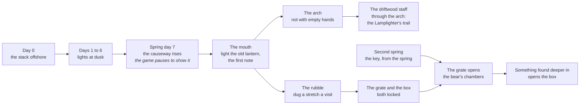

# F19 — The light on the stack

> Offshore, on its own side of the island, a tall rock stands alone in the sea: a stack, stepped in ledges like a stair, with a dark band of old soot near its top and an iron bracket rusting there. Someone kept a light on it once. For the first week, on clear evenings, a small light flickers at its foot and the moths go out to it, and nothing can reach it. Halfway through the first spring the sea draws back further than it ever has and leaves a road of stones to the stack, and the road stays. In the stack's foot is the sea cave: a cold lantern on the floor, a note in an old hand, an arch ringed with soot, and a passage choked with rubble. This doc is the story that opens the Hollow (F16) early, so players who want a fight find one in their first season. It was drafted from Matt's session on November 1, 2026.

**Status:** Decided (direction, November 1, 2026). Nothing built. It changes where F16's cave is (F16 is updated to match) and how a player first reaches it. The lamplighter's later story (who they were, the pages below, relighting the bracket) is Leaning: proposals to react to.

## Decided so far

Matt, November 1, 2026:

- **Like Stardew Valley, ebb offers something for different kinds of players.** Players who want combat should reach the Hollow early enough that it hooks them.
- **The old keeper's iron key** from the spring (the cairns, second year) is for the bear's part of the cave, not the Hollow.
- **The Hollow's entrance gets a story of its own.**
- **One cave, as F16 decided:** the mouth room, with the arch in it, and the bear's passage off to the side, not reachable at first. The bear's part is not a separate area.
- **A terraced cliff seeded from the start**, as a stack offshore on its own side of the main island, not on the islet, since the islet rises late for some players.
- **A rocky causeway to it opens halfway through the first season** (spring day 7) and can be crossed **at any tide**.
- **The game pauses and shows it** when the causeway rises, so the player sees it happen, and the story is in the threads.
- **The lamplighter's first note is in the mouth room.**
- **A lantern lies on the mouth's floor,** and the walker hangs that one on the hook. The walker has only one lantern of their own, and players would notice it going missing.
- **The rubble comes first, the grate last.** The rubble can be dug in the first year; at its end are the iron grate and the locked box. The key opens the grate.
- **F16's locked box is an extra** in the bear's part of the cave. Players who find it early keep it as a mystery. **It opens with something found deeper in**, not with the key.

## The story at a glance

| When | What | What the player does |
|---|---|---|
| Spring day 0 | The stack stands offshore in the first evening's view | Nothing; it's there to be wondered at |
| Spring days 1 to 6 | A light at the stack's foot on some clear evenings at low tide; moths cross the water to it | Nothing; it can't be reached |
| Spring day 7 | The causeway rises (the reveal) | Watch it; walk out whenever they like |
| Any time after | The mouth: the lantern, the note, the arch, the rubble | Light and hang the lantern; read the note; see the arch |
| A visit or two later | The driftwood staff made at the workbench | Through the arch: the Hollow |
| The first year, at the player's pace | The rubble dug through; the grate and the box found | Dig a stretch a visit |
| End of the second spring | The key from the spring (the cairns) | Open the grate |
| Later | Something in the bear's chambers opens the box | Explore |

A combat-minded player can be on the Hollow's first floor around spring day 8 to 10 of the first year: about their first or second evening of real play at doc 13's pace.

## The stack

- **A fixed piece of every island's land recipe,** placed on the side of the main island away from where the meadow islet will rise and away from the camp's view of the boat's mooring. It stands about 30 to 50 m offshore in water too deep to wade.
- **Its look:** a tall, terraced sea stack in the Cliff tool's language (level shelves, sheer rock faces, doc 08), about 12 to 16 m high, with three or four ledges stepping up one side. A band of old soot near the top; an iron bracket (a short arm and a ring) on the top ledge, rusted. Weed and barnacles to the high tide line; thrift and sea campion on the ledges.
- **It isn't sculpted by the player.** The stack, the causeway and the cave mouth are protected like the camp pad (doc 08): the shaping tools don't touch them, so the cave always opens where it should.
- **The walker's first look** at it from the shore gives one line: *"Someone kept a light out there once."*

## The lights at dusk (days 1 to 6)

- On two or three of the first six evenings (seeded), clear and near low tide, a small warm light shows at the stack's foot for a few minutes after sunset.
- Moths come out of the island's grass and stream across the water toward it, the same moths as F16's Moth lure.
- Like the cairns, it is never there when you go to look closer: walking to the shore nearest it, or zooming the camera in past a set distance, and it is gone.
- It is a light, not a person. Nothing lands, and no face is ever shown (F14's rule). What it was is left to the notes.

## The causeway rises (spring day 7)

**The beat.** At the first low tide of spring day 7, the sea draws back further than it ever has. A spine of weed-covered boulders surfaces between the island and the stack, a last wave breaks across it, and the water settles on either side. The causeway now stands above the highest tide for good.

**The reveal** (Matt: the game pauses so the player sees it):

- Time pauses and the camera glides out to frame the island's shore and the stack, as for a land rise (doc 02's reveal, doc 13's islet rise).
- About 10 to 15 seconds: the water pulls back, the boulders surface from the sea end to the stack, the wave, the settle. Its own sound: the long draw of the sea, stones knocking, the wave.
- One line in journal italic: *"The sea has left a road to the stack."*
- The camera returns to where the player was, and time runs again.
- **If the player is away on day 7,** the reveal plays when they next open the game, before the morning notes, and the causeway is already standing behind it.
- **If the player is busy** (in the middle of a sculpt stroke, at a station, in the journal), it waits until they're done.
- **An island already past spring day 7** when this is built gets the stack and plays the reveal on its next load.

**How it rises:** the same technique as the islet (doc 13, "The meadow islet in play"): the causeway's target heights blend up from a submerged copy over the reveal, with weed and wet rock first and drying rock above the tide line after. Its walk grid joins the island's once it's up. The causeway is about 2.5 to 3.5 m wide, a little uneven, with a few flat stones to step across at its narrow points.

## The mouth room

F16's mouth, unchanged except where noted (F16 is updated to match):

- **Above every tide.** The causeway and the mouth's floor are above the highest tide; the rock pools in the floor still fill and drain with it.
- **The old lantern.** It lies cold on its side on the floor, an older pattern than the walker's. Its card: *"An old lantern, cold. There's oil in it still."* **Light it** (the fire steel) and then **Hang it** on the hook by the arch. From then on it lights the mouth whenever the walker is in the cave, and it is the light the walker wakes to when their own lantern gives out below (F16, when the lantern goes out).
- **The lamplighter's first note** lies beside it: a keeper page, below.
- **The arch** on one side: soot and scratched signs, something moving just past the light. *"Not with empty hands."* Seeing it adds the **driftwood staff** (a drift stick and rush cord, F16's first weapon) to the workbench's makes, so a player who has the parts can make it the same day.
- **The rubble** on the other side: the passage to the bear, choked with fallen rock. Dug a stretch a visit with the shovel (F16).

## The lamplighter's notes

The lamplighter is someone older than the old keeper, who kept a light on the stack's top ledge. The notes are keeper pages (`recipes/world/keeper-pages.json`, form `Keeper page`, under 60 words each), written by Matt's story collaborator; the drafts here are for them to rework.

**The first note, in the mouth (draft):**

> Whoever finds the lamp: light it. Hang it by the arch. They don't like the light, and they don't come up past it. I kept the big lamp on the top of the rock for as long as I could carry the oil. If you go through, go with something in your hand, and come back before your light does.

**Later notes (Leaning, proposals):** one on each of the first guardian floors, telling in pieces who the lamplighter was, why the light was kept, and why it went out. The last says where the bracket's lamp went. They give the Lamplighter's trail (F16) its reason.

**The late payoff (Leaning, proposal):** a player who reaches the glass halls (F16's fourth depth) finds the bracket's lamp, or what's needed to make it. Carrying it up the stack's ledges and lighting it on the bracket lights the stack every night from then on: a beacon the passing boat's fisherman notices in his next letter (F14). It explains in the world why nothing from the Hollow ever comes up, which F16 already requires.

## The bear's passage

- **The rubble** can be dug from the first visit (F16).
- **At its end:** the old iron grate, padlocked, across the passage. Through the bars, the dark of the dripstone gallery. Beside it, wedged in a niche, **the locked box**. Both cards are a mystery until something opens them.
- **The key** from the spring's pool (the cairns, at the end of the second spring) opens the grate. The thread that ends at the key (*"It fits nothing on the island. Not yet."*) gets its answer here.
- **Beyond:** F16's dripstone gallery, the underground lake on the reed raft, the old marks and the den.
- **The box** opens with something found deeper in the chambers. What that is, and what the box holds, are not decided yet.

## The threads

Two threads in `recipes/world/threads.json`, in the keeper's voice (American spelling). Each line has a test in the morning hints' shape; new flags are `setpiece:stack:...`. Drafts:

**The light on the stack** (icon: a stack with a small flame on its top)

| Line | Test | Text |
|---|---|---|
| seen | `setpiece:stack:seen` | There's a rock offshore, stepped like a stair. A dark band near its top, and something iron. Someone kept a light out there once. |
| lights | `setpiece:stack:lights` | A light at the foot of the stack tonight, low on the water. The moths went out to it. When I looked again it was gone. |
| road | `setpiece:stack:road` | The sea drew back further than I've ever seen it and left a road of stones to the stack. It hasn't gone back under. |
| lamp | `setpiece:stack:lamp` | A cave in the stack's foot, and an old lantern on the floor. I lit it and hung it by the door. There was a note beside it. |
| arch | `setpiece:stack:arch` | An arch at the back of the cave, ringed with soot. Something moves past the light. Not with empty hands. |
| through | `setpiece:stack:through` | I made a staff from driftwood and cord, and I went through the arch. |

Pencil line: *"The road to the stack is dry at any tide."* End: `setpiece:stack:through`.

**The sleeper's passage** (icon: an iron grate)

| Line | Test | Text |
|---|---|---|
| rubble | `setpiece:stack:rubble` | A passage off the cave, choked with fallen rock. I dug some of it out today. |
| grate | `setpiece:stack:grate` | Through the rubble at last. An iron grate, locked, and a small box wedged in the rock beside it, locked too. |
| key | `setpiece:stack:key` | The little key from the spring fits the grate. The old keeper locked it. I think I know why now. |

Pencil line: *"Whatever is past the grate, the old keeper wanted it left in peace."* End: none yet; the bear and the box extend it later.

## How it plugs into the code

- **The set piece:** `recipes/setpieces/stack.json`, run by the set-piece runner like the cairns (`src/world/setpieces/runner.js`): the lights' beats (days 1 to 6, seeded evenings, dusk), the causeway's beat (spring day 7, first low tide, with the reveal) and the flags above.
- **The land:** the stack, the causeway's shape and the mouth's place in each land recipe (a `stack` block beside `camp`), protected from shaping like the camp pad (doc 08).
- **The reveal:** doc 02's reveal, as the islet uses it, with a camera path to the stack.
- **The cave:** a zone (`docs/26-zones.md`), as the underground spring is.
- **Saves:** the stack's flags live in the journal's flags; the causeway's risen state and the lantern hung are small records in a stack section or in the camp section, read as "not yet" by older saves. No change to the island's heights is saved for the causeway; it rises from the recipe, as the islet does.
- **Test links:** `?stack=lights` (an evening with the light), `?stack=road` (play the reveal now), `?stack=mouth` (the walker in the mouth, lantern cold), and the threads part-way on `?threads`.
- **A morning hint** the morning after the causeway rises, if the player hasn't crossed it: *"The road to the stack is still there."*
- **CLAUDE.md, "Adding a set piece or story arc":** the two threads, the keeper pages, the morning hint and the test links above are that list.

## What it would change

- **F16:** done in this branch: the cave in the stack, the causeway, the mouth above every tide, the old lantern on the floor, the first note, the driftwood staff added to the makes at the arch, the grate at the rubble's end, the box beside it opening with something found deeper in.
- **F14:** the cairns no longer have a second trigger in the cave mouth; their trail ends at the spring, and the key leads to the stack's grate. `recipes/setpieces/cairns.json` drops its `caveMouth` trigger.
- **Doc 08:** the stack and the causeway as protected, recipe-placed land.
- **Doc 13:** the year's early beats gain the stack's lights and the causeway on spring day 7; the Lamplighter's trail can start in the first spring.
- **Doc 20:** "The Hollow, first version" places the cave in the stack, not "a cliff the island already has or the player made with the Cliff tool," and adds the stack, the causeway's reveal and the mouth's lantern to H3.
- **Doc 23:** the walker's line on first seeing the stack; lighting and hanging the old lantern.

## Open questions

- Who was the lamplighter, and are they tied to the old keeper at all (an earlier keeper of the same island, someone they knew of, or nobody they knew)?
- What opens the locked box, and what is inside?
- Should the later notes and the relit beacon go ahead as proposed?
- Should the lights at dusk keep coming after the causeway rises, now and then, as a sign that something below is still awake?
- Where on the island does the stack stand for the starter island: which side, and how far out?

## Depends on / feeds into

- **Depends on:** F16 (the cave and the Hollow), F14 (the set-piece runner, the cairns, the passing boat), F13 (the fire steel, the workbench, drift sticks and rush cord, the shovel), doc 13 (the islet's rise technique and reveal), doc 26 (zones).
- **Feeds into:** F16's Lamplighter's trail, the bear (doc 12, the woodland tier), F14's passing boat (the beacon).
