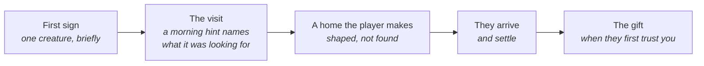

# F20 — Meadow stories: the skep, the first wing, the robin at the shovel

> The meadow islet's three creatures each arrive with a short story. Every story has the same shape: a **first sign**, a **visit**, a **home the player makes**, and **the gift**. The bees are honeybees that need a skep the player weaves and daubs with clay, and they give honey, which the walker brews with herbs into honeyed teas to carry into the Hollow. The butterflies come as eggs on the nettles and open their wings for the first time on the islet. The robin turns up beside the shovel, as robins do for anyone who digs, and stays once there's a hedge to nest in and a wall to sing from. Drafted from Matt's session on November 1, 2026.

**Status:** Decided (direction, November 1, 2026). Nothing built. The honeyed teas' effects are Leaning: proposals to react to. More meadow stories that aren't about creatures are still to come, in this doc or the next.

## Decided so far

Matt, November 1, 2026:

- **The stories are tied to the meadow's creatures** and kept simple. A first draft with a seed tin, bee boles and a beacon was too complicated.
- **Animals bring the tools,** as agreed early on (doc 13, the gift chain). The stories wrap that progress; they don't gate it.
- **The meadow tier is bees, butterflies and songbirds.** Songbirds come last, and need a stone wall to perch on.
- **Hedgehogs open the next tier** (the woodland, doc 12). The meadow leaves the player with everything they need for them: hedges and walls with leaf litter at their feet.
- **The bees are honeybees,** so the player can plausibly get honey, one of the main things Matt wants to refine for the islet.
- **Anything the player has to make is explained well** so they never get stuck: what to make, from what, where it goes, and when it will be used.
- **Dried grass is not a material in the game.** The skep is made from what is: rods, clay and rush cord.
- **Honey goes into a clay bowl.** The player can make many of them.
- **Honey combines with the herbs** into different boons for the walker to take into the Hollow.

## The shape every meadow story follows

This is the game's existing arrival flow (doc 13, "Shaped, not found": a newcomer visits first and leaves a hint note the next morning), with one written beat at each step. The gift arrives as the story's last beat, on the usual rule: when the first of a species is named, or a group first trusts the keeper to 0.5.

## The meadow's order

| Order | Species | Needs (doc 12, with this doc's changes) | Gift | Sets up |
|---|---|---|---|---|
| 1 | Bees (honeybees) | A nectar field in flower; **a skep** in a sunny, sheltered spot; water within 40 m | Hawthorn | Hedges for songbirds and hedgehogs |
| 2 | Butterflies | Nettles to lay on; damp ground to drink from; sun | Stone wall tool | Walls to bask and perch on |
| 3 | Songbirds | A hawthorn hedge to nest in; **a stone wall to perch and sing from**; a seed and insect field | Oak | Squirrels and owls later |
| Next tier, first | Hedgehogs | Leaf litter under a hedge or at a wall's foot | Bramble | (doc 12, Tier 3) |

## The bees: the skep

**The first sign.** On a warm morning, once the islet has clover or wildflowers in bloom, a single bee works the flowers and then flies off over the water. The walker's line: *"One bee, all the way out here. It went back over the sea."*

**The visit and the hint.** The next morning: *"A scout, I think. It was looking for somewhere dry and sheltered to live. A skep might do: rods woven into a basket and daubed with clay."* From that moment the **skep** shows in the workbench's makes.

**The skep.** A wicker skep: rods woven into a dome and daubed with clay against wind and rain. Before coiled straw, many skeps were made this way.

| Part | Where it comes from | When |
|---|---|---|
| Willow withies **or** sticks | Withies cut from willow; sticks from under gorse and willow | Withies in winter; sticks all year |
| Clay | The shovel, a spade down in damp ground | Any season |
| Rush cord | Twisted at the workbench from reed leaves, rushes or marram | Most of the year |

- Made at the workbench, with its three parts shown in pencil outline until they're in the pack, as every make shows what's missing. No other make uses this set of parts.
- Sticks serve for the rods, as they do for the drying rack, so the skep never waits on winter withies.
- It's carried like the nest box and set down on its own flat stone, so nothing else is needed to place it.

**Where it goes.** On the islet, in a spot that is sunny and out of the wind. While the walker carries it, the here-bar says whether the spot will work:
- *"Sunny and out of the wind. Bees would like it here."*
- *"Too open to the wind."*
- *"Too shaded."*
- *"Too far from flowers."* (no nectar field within reach)

A spot that won't work can still take the skep; the line just says why the bees won't come yet, and moving it is always allowed.

**The wait.** Honeybees swarm in late spring and early summer. A skep set out at another time waits, and the bee page says so in pencil: *"A skep is waiting. Swarms come when the meadow is in full flower."*

**The swarm.** In late spring or early summer, with the skep in place and the meadow in flower, a swarm arrives: a humming cloud over the islet, then a cluster hanging from a bush or a wall for a day, then a stream of bees into the skep. A real swarm is calm, so the walker can stand close and watch. (If the skep isn't set out by then, the cluster hangs a day and flies on; the next swarm comes the following late spring, or later the same summer.)

**The gift.** Hawthorn, when the bees first trust the keeper (a group's 0.5).

### Honey

- **When.** From late summer, the real harvest time. Bees need what they store to see them through winter, so only the **surplus** can be taken.
- **How it shows.** The skep's card draws how full it is, as the pack's pouches do: never a number. **Take honey** appears only when there's surplus.
- **Into a bowl.** Honey goes into a fired clay bowl from the pack. A bowl of honey is one pouch. A strong hive in a good summer gives a few bowls; a thin year gives one or none.
- **More bowls.** The workbench's bowl limit (three today, `cook.json`) is raised so a keeper can keep a few bowls for honey as well as for the hearth (a recipe value, eight to start).
- **Never for creatures.** F13's real-food rule stands: no honey or beeswax for any creature. Honey is the walker's.

### Honeyed teas for the Hollow (Leaning, proposals)

Honey brewed with one of the tea herbs at the tea pot makes a **honeyed tea**: one bowl of honey and one handful of the herb. Ordinary teas lift the walker on the island (P2e). A honeyed tea lifts the walker **below**, for one trip into the Hollow: it's drunk at camp or at the lantern hook in the mouth, and it lasts until the walker comes back up. One honeyed tea at a time, as with teas. Each pairs honey with an herb's real use, kept gentle:

| Honeyed tea | Herb's real use | Below, it gives (proposal) |
|---|---|---|
| Honey and willow bark | Willow bark eases pain | The first hit on each floor takes less from the lantern |
| Honey and nettle | Nettle tea as a tonic | A steadier footing: puddles and silt slow you less |
| Honey and chamomile | Chamomile calms | The lantern burns a little longer for the trip |
| Honey and water mint | Mint's cool, clear taste | Finds and the way down show from further off in the dark |
| Honey and meadowsweet | Meadowsweet, another pain-easer | The lantern recovers a little after each room is cleared |
| Honey and gorse | Gorse flowers' warm, coconut scent | Light-shy things hang back a moment longer from your light |

The numbers are recipe values for later. Each needs its own words and a drawn icon. Honeyed teas don't stack with ordinary teas below; on the island, an ordinary tea still works as it does now.

## The butterflies: the first wing

**The first sign.** On a warm, still day at low tide, a single butterfly crosses the sandbar and stops to drink from the damp sand. Butterflies really do this (puddling). The walker's line: *"A butterfly, drinking from the wet sand. It went on toward the nettles."*

**The visit and the hint.** The next morning: *"It was looking for nettles to lay on, I think, somewhere sunny."* Peacock and small tortoiseshell butterflies lay only on nettles, and nettles are already a tea herb in the game.

**The home.** A patch of nettles in a sunny spot on the islet, planted from saved seed or spreading on their own, near damp ground (a puddle, a spring-fed rill or the bar's wet sand). The player shapes and plants it; nothing is made.

**The first wing.** Once the patch is there in spring:
- The walker finds tiny green eggs under the nettle leaves, and the butterfly page opens in pencil.
- A few game days later, small black caterpillars feed in a cluster on the nettle tops.
- Then a chrysalis hangs under a dry stem or a stone's lip in the sun.
- One summer morning the first butterfly opens its wings there. Others follow over the next days, basking on warm stone.

Picking nettle tops for tea still works: the walker leaves the leaves with eggs or caterpillars (their card says so), so tea and butterflies don't compete.

**The gift.** The stone wall tool (doc 09), when the butterflies first trust the keeper. Its sunny face is where they bask from then on.

## The songbirds: the robin at the shovel

**The first sign.** Any time after the islet has risen, while the walker digs, a robin lands a few steps away and takes a worm the shovel turned up. Robins really do follow anyone who digs. The walker's line: *"A robin, right by the spade. It took a worm and went."* It comes back now and then when the walker digs, on either island.

**The visit and the hint.** The next morning: *"It wanted a hedge to nest in, and somewhere high to sing from."*

**The home.** A hawthorn hedge grown thick enough to nest in (the bees' gift), and a stone wall nearby to perch and sing from (the butterflies' gift), with seed and insect fields around them (doc 12). This is the step that makes songbirds the meadow's last species: they need both earlier gifts.

**They arrive.** In spring, a pair. They sing from the wall's top, carry moss and leaves into the hedge, and build a nest. The next morning the **dawn chorus** starts, and from then on it's part of every spring morning's sound (doc 25). Wrens and a jay join over the following seasons (doc 12).

**The gift.** Oak, when the first robin is named: an acorn the jay buries, which comes up as a seedling the next spring.

## About when

| Story beat | Earliest | Usually |
|---|---|---|
| The islet rises | End of the first summer (doc 13) | Autumn, year 1 |
| The scout bee | The islet's first flowers | Autumn year 1, or spring year 2 |
| The swarm | Late spring | Year 2 |
| The puddling butterfly | A warm day after the islet rises | Summer year 1 or spring year 2 |
| The first wing | Summer | Summer year 2 |
| The robin at the shovel | After the islet rises | Year 1 |
| The robins nest | Spring, once the hedge has grown | Spring year 3 |
| Honey | Late summer, with surplus | Late summer year 2 |

## The threads

One thread per species in `recipes/world/threads.json`, in the keeper's voice (American spelling), with the first sign, the hint, the home, the arrival and the gift as lines. Drafts:

**The bees** (icon: a skep)
- *One bee, all the way out on the islet. It went back over the sea.*
- *A scout, I think. It wants somewhere dry and sheltered. I'll weave a skep.*
- *The skep is out on the islet, in the sun and out of the wind. Now we wait.*
- *A swarm hung from the bush all day. By evening they were going into the skep.*
- *I took a bowl of honey, only what they could spare.*

**The butterflies** (icon: a butterfly on a nettle)
- *A butterfly drinking from the wet sand on the bar. It went on toward the nettles.*
- *Tiny green eggs under the nettle leaves.*
- *Black caterpillars on the nettle tops, all together.*
- *A butterfly opened its wings this morning, right where the chrysalis hung.*

**The robin** (icon: a robin)
- *A robin came right up to the spade and took a worm.*
- *It wants a hedge to nest in and somewhere high to sing from.*
- *A pair on the wall, singing. They're carrying moss into the hedge.*
- *The birds started singing before it was light this morning.*

Each line's test uses the flags the arrival flow and these beats set (`setpiece:meadow:...` where none fit).

## What it would change

- **Doc 12:** the bees are honeybees: Kind (a colony that swarms in late spring), Shelter (a skep the player makes, sunny and out of the wind, in place of "a sunny bare bank or stone wall"), Signature (a swarm cluster; bees at the skep's entrance). Songbirds' shelter needs both a hawthorn hedge and a stone wall within reach. Butterflies' food names nettles as the host plant.
- **Doc 13:** the gift chain is unchanged. The meadow's arrivals follow the shape above; the songbirds' needs make them the meadow's last.
- **F13:** the skep make (workbench); the bowl limit raised; honey as a pouch kind in a bowl; Take honey on the skep; honeyed teas at the tea pot as a Hollow boon, one at a time.
- **F16:** honeyed teas as a supply for a trip below, drunk at camp or at the lantern hook.
- **Doc 25:** the dawn chorus once robins nest; the swarm's hum.
- **CLAUDE.md's creature list** applies to each species as it's built: model and rig, species recipe, journal page, sketchbook, icon, Show me, sound, seasons, saves and test links.

## Open questions

- What does each honeyed tea do, and how strong is it? The table is a first proposal.
- Is beeswax worth having too, for example for better rushlights in the Hollow (F16)?
- Does a second swarm in a later spring leave the skep, and can the player catch it in a second skep?
- Should the robin also follow the walker digging on the main island before the islet rises, as an early sign?

## Depends on / feeds into

- **Depends on:** doc 12 (the meadow tier), doc 13 (the gift chain, "Shaped, not found", the islet's rise), F13 (makes, digging, clay bowls, teas), doc 09 (the stone wall tool).
- **Feeds into:** F16 (honeyed teas below), doc 12's woodland tier (hedgehogs first), doc 25 (sound).
