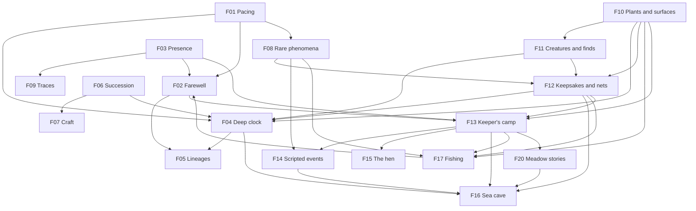

# Future ideas

> Design docs for things ebb might become after the vertical slice, drafted from Matt's theorycrafting sessions starting October 19, 2026. Some of it has since been built (see each doc's status). These docs propose; the numbered docs in `docs/` decide. Where an idea would change a numbered doc, it lists the change instead of making it, so Matt can apply it when the idea is accepted.

## Status words

- **Built:** in the game and merged to main.
- **Largely built:** the main pieces are in main; the doc lists what is still to come.
- **Decided:** Matt has chosen the direction; values may still be open.
- **Leaning:** a direction Matt finds promising, with proposals to react to.
- **Tentative:** worth keeping, to be approached carefully.
- **Seed:** a first sketch to think about.

## The docs

| Doc | Status | In one line |
|---|---|---|
| [F01 Pacing and seasons](01-pacing-and-seasons.md) | Built (F01a and F01b, merged in PR #41) | 14-day seasons, a 7-day catch-up cap and growth while away at a quarter of watched time; every doc it touches |
| [F02 Farewell and sister islands](02-farewell-and-sister-islands.md) | Leaning | Let an island ebb on a low tide of your choosing, sail to a sister island, and sail back any time |
| [F03 Presence, in depth](03-presence.md) | Leaning (the walker is built in M2, doc 23) | The seat (now the walker's Sit), the walker and the camp in detail: body language, routine, group familiarity, leanings on doc 23's open questions |
| [F04 The deep clock](04-deep-clock.md) | Leaning | Old growth, the yearly chronicle and anniversary notes: change that keeps coming over many years |
| [F05 Lineages](05-lineages.md) | Tentative | Small cosmetic heritable traits that let a population drift toward its island over generations |
| [F06 Succession](06-succession.md) | Seed | What the island grows into when left alone, and gentle ways to keep a meadow open |
| [F07 Growing as craft](07-growing-as-craft.md) | Seed | Pruning, coppicing, pleaching and training trees, and trees shaped by the wind |
| [F08 Rare phenomena](08-rare-phenomena.md) | Seed | King tides, fog banks, glowing shallows and migration mornings, all recurring |
| [F09 Traces](09-traces.md) | Seed | Desire lines worn by walking and creature runs, mossing over when unused |
| [F10 Plants, surfaces and placed pieces](10-plants-surfaces-and-placed-pieces.md) | Largely built | Shore zonation, the driftline, new plants once growth reads ground type, and stones and logs to live under |
| [F11 Creature roadmap and finds](11-creature-roadmap-and-finds.md) | Largely built | Creature weight classes, cheap finds shaped by the player, a naturalist's progression line, and what to generalize once |
| [F12 Keepsakes and nets](12-keepsakes-and-nets.md) | Largely built (net wear and signs in the water still to come) | One-of-a-kind seeded keepsakes on the strandline and in three nets, labeled rarity, a 16-space shelf, and signs in the water |
| [F13 The keeper's camp](13-keepers-camp.md) | Decided (Phase 1, the first evening, is the current target) | Why the keeper is here: the first evening, the camp, the pack and gathering, making, teas, treats, dyes and digging, in five phases |
| [F14 Scripted events](14-scripted-events.md) | Seed (Matt: "a great start") | Written set pieces with a warning, beats over days, choices made by doing and a lasting change: the wreck, the great storm, the falling star, the cairn builder, the hard freeze, the new bank, the passing boat |
| [F15 The hen](15-the-hen.md) | Seed | A feral hen who comes to trust the walker, roosts at camp, follows you, and lays eggs for the walker's first meal; chicks if Matt wants them |
| [F16 The sea cave and the Hollow](16-the-sea-cave.md) | Leaning (Matt's design; for a later date) | An optional cave: a fixed mouth, a rubble passage to the sleeping bear, and an arch that needs a made weapon, leading to the Hollow's changing floors. Enemies scale to four skill tracks and the gear you've made; the lantern is the limit. Pools of weapons, lanterns and coats; its own trail |
| [F17 Fishing and the angler's chart](17-fishing-and-the-anglers-chart.md) | Decided (direction; nothing built) | A made line, two worms as bait, fish sketched and let go, one generator for every fish, a fixed roster per island, twelve rare species, and a chart that inks in as you sketch and hands out riddles; the aquarium waits for a living space |
| [F20 Meadow stories](20-meadow-stories.md) | Decided (direction; honeyed teas Leaning) | The meadow's three arrivals as short stories with one shape (first sign, visit, a home you make, the gift): honeybees and a woven, clay-daubed skep, honey in clay bowls and honeyed teas for the Hollow; butterflies from eggs on the nettles; a robin at the shovel that nests once there's a hedge and a wall; and three without creatures: rye from a boat parcel, a midsummer marker stone and a kite |

## How they connect

## Working rule

When an idea here is accepted, its "What it would change" list becomes the work: update the numbered docs it names, get Matt's approval, then build. Move the doc's status to Decided, and keep the doc as the record of why.
